# Run profile — ht-0lo

```
Profile: ht-0lo · 1 invocation · 2026-10-11T19:29Z → 2026-10-12T16:23Z · wall 20h55m (task graph 20h48m, after the last landing 6m) · agents 421 (timed 421) · beads dispatched 5, landed 4, planned 24
Profile: shape — 24 beads · 31 edges · depth 5 · width 4.8 · beads per level 14/5/3/1/1 · widest fan-out ht-0lo.2.1 (3 direct, 5 transitive dependents)
Profile: bound — graph lower bound 31m (unlimited slots and merge lanes) · model of the run 31m (cap 4, one merge lane) vs actual 20h48m (2%) → bead-bound: ht-0lo.15 alone set the pace — split it or make it faster
Profile: critical path — 20h48m = implement 16m · review 2m · planning 6m · other 2m · startup 20s · wait 20h22m
Profile: critical chain — validation other 2m → plan planning 6m → ht-0lo.15 implement+review+merge 18m
Profile: bottleneck — ht-0lo.15 — 20h36m on the critical path (99%) · implement 16m · review 2m · wait 20h18m · implement on the path 16m: poll 1m · git 19s · read 2s · edit 14s · other 2s · model 14m (longest: "wait_agent" 1m, "git reset --soft 36c3988fe8fd0e46861170c182d1160afda00fc4" 6s) · dependents 0
Profile: waits — ready→start, summed per bead (beads wait at the same time, so not wall time): 81h35m over 4 of 4 landed beads — retry 41h00m (2) · unexplained 40h34m (2)
Profile: rework — 1h01m of dispatch time in attempts that did not land — ht-0lo.8.4 43m (?, ?, ?, ?; never landed) · ht-0lo.13 13m (?; landed later) · ht-0lo.14 5m (?; landed later)
Profile: tests — implementers and fixers, summed: 0s running tests and 7m polling background runs, 2% of their 6h18m · 0 Bash call(s) ran into the 10-minute tool limit
Profile: merge lane — busy 23m of 20h41m (2%) · seam reviews and fixes 23m (100% of busy) · 4 merge dispatches, first try not merged for 0 of 4 · queue wait 0s total, peak 0 waiting · stack-parent wait 0s
Profile: concurrency — 421 dispatches over 20h55m · a dispatch running 8h54m (43%) · dispatches at once: 0 for 57% · 1 for 11% · 2 for 12% · 3+ for 20% of the time · peak 10
Profile: dispatch time by kind, summed — impl 50m (9) · plan 29m (12) · fix 23m (5) · review 16m (8) · triage 2m (1) · final-review 2m (1) · not named for a bead: review 5h42m (119) · impl 5h05m (59) · triage 4h29m (60) · r1 2h25m (41) · prepare 1h17m (10) · resume 55m (14) · roast1 54m (19) · q3 40m (10) · 15 more 2h35m (53) · merges run by the coordinator 0s (4)
Profile: runtime — peak 10 agents at once · slot cap 4
Profile: what-if — faster ht-0lo.15 → 22m (−8m, 26%) — its implement time halved
Profile: unmeasured — 4 landed bead(s) with no merge in the coordinator's log: lane time 0; 385 dispatch(es) not named for a bead of ht-0lo, in the run-level lines only (coordinator-subagents.md names dispatches <kind>_<bead id> on Codex, <kind>:<bead id> on Claude Code); the schedule model is 2% of actual, so the what-ifs are rough; 1 dispatched bead(s) did not land (not in the model): ht-0lo.8.4
```

## Per bead

Offsets are from the run's first dispatch. `wait` is from the moment every blocker was usable (its implementation under early unblock, else its merge) to the implementer starting, with its cause; `stack` is a stacked task waiting for its parents to merge; `queue` is the wait for the single merge lane; `lane` is its lane turn (merge plus seam work).

| bead | deps | dependents | attempts | wait (cause) | implement | of it: tools | review | fix | stack | queue | lane (seam) | landed | critical |
|---|---|---|---|---|---|---|---|---|---|---|---|---|---|
| ht-0lo.8.4 | 1 | 1 | ?, ?, ?, ? | 18m (retry) | 2m | edit 2s · shell 3s | 2m | - | - | 4m | 7m (7m) | not landed |  |
| ht-0lo.12 | 0 | 0 | IMPLEMENTED | 20h17m (unexplained) | 5m | git 10s · read 1s · edit 2s | 2m | - | - | - | - | +20h37m |  |
| ht-0lo.15 | 0 | 0 | IMPLEMENTED | 20h17m (unexplained) | 16m | poll 1m · git 19s · read 2s · edit 14s · other 2s | 2m | - | - | - | - | +20h48m | 20h36m |
| ht-0lo.13 | 0 | 0 | ?, IMPLEMENTED | 20h30m (retry) | 1m | - | 2m | - | - | - | - | +20h46m |  |
| ht-0lo.14 | 0 | 0 | ?, IMPLEMENTED | 20h30m (retry) | 1m | - | 2m | - | - | - | - | +20h46m |  |

## Critical path, step by step

| at | step | kind | via | duration |
|---|---|---|---|---|
| +0s | run start | startup |  | 20s |
| +20s | validation_reassessment | other |  | 2m |
| +2m | previous → validation_reassessment | wait |  | 2m |
| +4m | validation_reassessment | other | previous | 16s |
| +4m | previous → plan:ht_0lo_8_4_activation | wait |  | 3m |
| +7m | plan:ht_0lo_8_4_activation | planning | previous | 6m |
| +13m | planned → impl:ht-0lo.15 | wait |  | 20h17m |
| +20h30m | impl:ht-0lo.15 | implement | planned | 16m |
| +20h46m | chain → review:ht-0lo.15 | wait |  | 38s |
| +20h47m | review:ht-0lo.15 | review | chain | 2m |
| +20h48m | merge:ht-0lo.15 | merge | chain | 0s |

## Longest tool calls in the bottleneck's implement (ht-0lo.15)

| tool | category | what | duration |
|---|---|---|---|
| wait_agent | poll | wait_agent | 1m |
| exec | edit | git reset --soft 36c3988fe8fd0e46861170c182d1160afda00fc4 | 6s |
| exec | git | git reset --soft aed4b720084511464ca7065b8ff1b8fca059d263 | 6s |
| wait_agent | poll | wait_agent | 5s |
| exec | edit | rustfmt --edition 2024 --config skip_children=true tests/se… | 3s |
| exec | edit | rustfmt --edition 2024 --config skip_children=true tests/se… | 3s |
| exec | git | git add src/service/delivery_presentation.rs | 3s |
| exec | git | git add src/service/delivery_presentation.rs | 3s |
| exec | git | git commit -m 'test: cover presentation owner budget conten… | 2s |
| exec | git | git add tests/service.rs tests/service/presentation_owner_b… | 2s |

## Schedule model

Landed beads replayed with their measured implement, review+fix and lane times; planner timing kept as it ran; dependents start at a blocker's implementation except over edges where this run's dependent waited for the merge. Model of the run: 31m against 20h48m measured. Estimates, not measurements.

| scenario | makespan | saving |
|---|---|---|
| as run (cap 4, one merge lane) | 31m | - |
| unlimited slots | 31m | 0s |
| unlimited merge lanes | 31m | 0s |
| graph lower bound (both) | 31m | 0s |
| faster ht-0lo.15 | 22m | 8m |

## Timeline

each bead's final attempt; critical-path steps are marked crit.

```mermaid
gantt
  dateFormat x
  axisFormat %H:%M
  section ht-0lo.8.4
  impl mod_prepare :1791748775878, 1791748902856
  fix watch :1791749136197, 1791749472658
  review watch_fix :1791749500210, 1791749643166
  fix watch :1791749549440, 1791749609278
  section ht-0lo.12
  impl :1791820718461, 1791821020408
  review :1791821033597, 1791821136072
  section ht-0lo.15
  impl :crit, 1791820745721, 1791821712504
  review :crit, 1791821750924, 1791821851587
  section ht-0lo.13
  impl :1791821516896, 1791821583116
  review :1791821594087, 1791821711919
  section ht-0lo.14
  impl :1791821524899, 1791821589846
  review :1791821600830, 1791821700797
```



## Unmeasured

- 4 landed bead(s) with no merge in the coordinator's log: lane time 0
- 385 dispatch(es) not named for a bead of ht-0lo, in the run-level lines only (coordinator-subagents.md names dispatches <kind>_<bead id> on Codex, <kind>:<bead id> on Claude Code)
- the schedule model is 2% of actual, so the what-ifs are rough
- 1 dispatched bead(s) did not land (not in the model): ht-0lo.8.4
