# Run profile — ht-yha

```
Profile: ht-yha · 2 invocations · 2026-10-13T18:59Z → 2026-10-14T07:47Z · wall 12h48m (task graph 12h32m, after the last landing 15m) · agents 265 (timed 265) · beads dispatched 19, landed 19, planned 19
Profile: shape — 19 beads · 72 edges · depth 7 · width 2.7 · beads per level 3/4/2/2/4/3/1 · widest fan-out ht-yha.1 (10 direct, 16 transitive dependents)
Profile: bound — graph lower bound 12h31m along ht-yha.3 → ht-yha.4 → ht-yha.5.2 → ht-yha.5.4 → ht-yha.15 → ht-yha.16 (unlimited slots and merge lanes) · model of the run 13h34m (cap 8, one merge lane) vs actual 12h32m (108%) → graph-bound: the 6-bead dependency chain set the pace — reshaping it is the lever
Profile: critical path — 12h32m = implement 5h40m · review 1m · fix 10m · merge 5m · seam 8m · planning 47m · ready 2h07m · startup 8s · dispatch 1m · wait 2h58m · relaunch 36m
Profile: critical chain — bd-ready ready 13s → plan planning 17m → plan-rest planning 28m → ht-yha.3 implement 2h25m → bd-ready ready 2h07m → plan planning 2m → ht-yha.3 implement 36m → ht-yha.4 implement 38m → ht-yha.5.2 implement 29m → ht-yha.5.4 implement+review+fix+merge+seam 1h27m → ht-yha.15 implement 15m → ht-yha.16 implement+review+merge 14m
Profile: bottleneck — ht-yha.3 — 5h58m on the critical path (48%) · implement 3h01m · dispatch 6s · wait 2h58m · implement on the path 3h01m: test 49m · poll 1h03m · build 7m · git 32s · bd 6s · read 57s · edit 4s · shell 49s · model 59m (longest: "cargo nextest run --locked --all-features --no-fail-fast -E…" 17m, "until grep -q "^done " /tmp/sp-3dc5f923/ht-yha.3/base-suite…" 10m) · 3 attempts (FAILED, FAILED, IMPLEMENTED) · dependents 7 direct, 11 transitive
Profile: waits — ready→start, summed per bead (beads wait at the same time, so not wall time): 1h41m over 7 of 19 landed beads — stack-conflict 1h26m (5) · cancelled 6m (1) · unexplained 9m (1)
Profile: early unblock — 16 landed beads had in-run blockers · stacked on an implementation 8 · bounced on a stack conflict then waited for the merge 5 (1h26m) · waited for a merge without one 0
Profile: rework — 3h57m of dispatch time in attempts that did not land — ht-yha.3 2h25m (FAILED, FAILED; landed later) · ht-yha.7 53m (FAILED, IMPLEMENTED; landed later) · ht-yha.5.3 35m (FAILED, IMPLEMENTED; landed later) · 8 more
Profile: tests — implementers and fixers, summed: 4h08m running tests and 2h50m polling background runs, 56% of their 12h33m · 5 Bash call(s) ran into the 10-minute tool limit
Profile: slow tests — cargo test --locked --all-features $f 22m (13 runs, longest 7m) · cargo nextest run --locked --all-features --no-fail-fast -E 'binary(combined) or binary(s… 17m (1 run, longest 17m) · cargo test --locked --all-features --no-run 12m (8 runs, longest 3m) · cargo test --locked --all-features --no-fail-fast --test combined --test hook_entrypoint … 9m (1 run, longest 9m) · cargo test --locked --all-features page_cursor 9m (1 run, longest 9m)
Profile: redo — on the critical path, up to stack-conflict re-cuts 23m (ht-yha.15) — from a bead's first attempt to its final one; the what-ifs model the real saving
Profile: merge lane — busy 56m of 11h59m (8%) · seam reviews and fixes 14m (25% of busy) · 26 merge dispatches, first try not merged for 4 of 19 · queue wait 33s total, peak 1 waiting · stack-parent wait 18h56m
Profile: conflicts — src/store/read_cursors.rs (stack conflicts 3, seam overlaps 1, declared by 3) · tests/service/delivery_pull.rs (stack conflicts 2, seam overlaps 2, declared by 2) · src/store/lazy_delivery/inbox.rs (stack conflicts 3, seam overlaps 0, declared by 4) · src/store/queries/inbox_v2/hydrate.rs (stack conflicts 2, seam overlaps 1, declared by 5)
Profile: runtime — peak 10 agents at once of 10 runtime slots · full 0% of the run · slot cap 8
Profile: what-if — unlimited merge lanes → 12h31m (−1h03m, 8%) — merges in parallel, each still after its stack parents
Profile: what-if — every early unblock taken → 13h09m (−24m, 3%) — no stack conflicts: dependents stack on implemented blockers instead of waiting for their merge
Profile: unmeasured — none
```

## Per bead

Offsets are from the run's first dispatch. `wait` is from the moment every blocker was usable (its implementation under early unblock, else its merge) to the implementer starting, with its cause; `stack` is a stacked task waiting for its parents to merge; `queue` is the wait for the single merge lane; `lane` is its lane turn (merge plus seam work).

| bead | deps | dependents | attempts | wait (cause) | implement | of it: tools | review | fix | stack | queue | lane (seam) | landed | critical |
|---|---|---|---|---|---|---|---|---|---|---|---|---|---|
| ht-yha.1 | 0 | 10 | IMPLEMENTED, ALREADY_MERGED | - | 18m | poll 5m · build 7m · git 2s · read 5s · shell 1m | 49s | - | 3h56m | - | 3h55m | +4h32m |  |
| ht-yha.13 | 0 | 5 | IMPLEMENTED | - | 15m | test 8m · poll 4m · read 2s · shell 2m | 58s | - | 3h58m | - | 4h00m | +4h33m |  |
| ht-yha.2 | 0 | 6 | IMPLEMENTED | - | 17m | test 2m · poll 11m · bd 3s · read 8s · shell 23s | 1m | - | 3h57m | - | 3h57m | +4h34m |  |
| ht-yha.14 | 1 | 5 | IMPLEMENTED, ALREADY_MERGED | 9m (unexplained) | 14m | test 7m · build 4m · git 1s · read 3s · shell 1m | 34s | - | 3h33m | - | 3m | +1h02m |  |
| ht-yha.5.1 | 1 | 4 | IMPLEMENTED, ALREADY_MERGED | - | 14m | test 11m · read 4s · shell 53s | 37s | - | 3h32m | - | 3m | +1h05m |  |
| ht-yha.3 | 3 | 7 | FAILED, FAILED, IMPLEMENTED | - | 36m | test 4m · poll 23m · build 1m · git 28s · bd 4s · read 26s · edit 1s · shell 27s | 1m | - | - | 2s | 2m | +9h32m | 5h58m |
| ht-yha.7 | 1 | 3 | FAILED, IMPLEMENTED, IMPLEMENTED | - | 1h20m | test 18m · poll 40m · build 8m · git 3s · bd 8s · read 32s · shell 1m | 1m | 5m | - | 2s | 3m (27s) | +10h23m |  |
| ht-yha.5.3 | 3 | 2 | FAILED, IMPLEMENTED, IMPLEMENTED | 6m (cancelled) | 14s | - | 32s | - | - | 2s | 2m | +9h03m |  |
| ht-yha.4 | 5 | 7 | IMPLEMENTED | - | 38m | test 22m · build 6m · read 20s · shell 44s | 1m | - | - | 2s | 1m | +10h09m | 38m |
| ht-yha.8 | 4 | 4 | IMPLEMENTED | - | 44m | test 32m · build 3m · git 7s · bd 3s · read 21s · shell 9s | 43s | - | - | 3s | 7m (5m) | +10h59m |  |
| ht-yha.5.2 | 5 | 3 | IMPLEMENTED | - | 29m | test 15m · poll 3m · build 2m · git 5s · bd 6s · read 16s · shell 1m | 36s | - | - | 2s | 2m | +10h38m | 29m |
| ht-yha.6 | 5 | 4 | IMPLEMENTED | - | 59m | test 18m · poll 14m · build 5m · git 4s · read 1m · shell 2m | 44s | - | - | 2s | 2m (36s) | +11h38m |  |
| ht-yha.5.4 | 5 | 4 | IMPLEMENTED | - | 1h05m | test 13m · poll 42s · build 3m · git 20s · bd 4s · read 1m · shell 11m | 36s | 10m | - | 2s | 12m (8m) | +12h03m | 1h27m |
| ht-yha.9 | 4 | 3 | STACK_CONFLICT, IMPLEMENTED | 8m (stack-conflict) | 16m | test 5m · poll 2m · build 5m · git 6s · bd 1s · read 5s · shell 20s | 41s | - | - | 2s | 1m | +11h17m |  |
| ht-yha.11 | 4 | 2 | STACK_CONFLICT, IMPLEMENTED | 8m (stack-conflict) | 9m | test 10s · read 6s · shell 4m | 1m | 4m | - | 2s | 43s | +11h14m |  |
| ht-yha.15 | 4 | 1 | STACK_CONFLICT, IMPLEMENTED | 23m (stack-conflict) | 15m | test 5m · poll 1m · build 2m · git 3s · bd 1s · read 20s · shell 13s | 28s | 6m | - | 3s | 1m | +12h26m | 15m |
| ht-yha.12 | 5 | 1 | STACK_CONFLICT, IMPLEMENTED | 23m (stack-conflict) | 8m | test 4m · poll 2m · git 3s · read 9s · shell 3s | 23s | - | - | 2s | 1m | +12h13m |  |
| ht-yha.10 | 4 | 1 | STACK_CONFLICT, IMPLEMENTED | 23m (stack-conflict) | 6m | test 9s · poll 3m · git 1s · read 7s · shell 11s | 36s | - | - | 3s | 53s | +12h10m |  |
| ht-yha.16 | 18 | 0 | IMPLEMENTED | - | 13m | test 3m · poll 2m · build 1m · git 4s · read 21s · edit 2s · shell 8s | 30s | - | - | 3s | 54s | +12h32m | 14m |

## Critical path, step by step

| at | step | kind | via | duration |
|---|---|---|---|---|
| +0s | run start | startup |  | 8s |
| +8s | bd-ready | ready |  | 13s |
| +21s | previous → plan | dispatch |  | 2s |
| +23s | plan | planning | previous | 17m |
| +18m | previous → plan-rest | dispatch |  | 2s |
| +18m | plan-rest | planning | previous | 28m |
| +45m | planned → impl:ht-yha.3 | dispatch |  | 3s |
| +45m | impl:ht-yha.3 | implement | planned | 48m |
| +1h34m | retry → impl:ht-yha.3 | wait |  | 2h58m |
| +4h32m | impl:ht-yha.3 | implement | retry | 1h36m |
| +6h08m | previous → bd-ready | dispatch |  | 0s |
| +6h08m | bd-ready | ready | previous | 37m |
| +6h45m | previous → bd-ready | dispatch |  | 0s |
| +6h45m | bd-ready | ready | previous | 37m |
| +7h22m | previous → bd-ready | dispatch |  | 0s |
| +7h22m | bd-ready | ready | previous | 53m |
| +8h15m | relaunch → bd-ready | relaunch |  | 36m |
| +8h51m | bd-ready | ready | relaunch | 13s |
| +8h51m | previous → plan | dispatch |  | 2s |
| +8h51m | plan | planning | previous | 2m |
| +8h52m | planned → impl:ht-yha.3 | dispatch |  | 3s |
| +8h52m | impl:ht-yha.3 | implement | planned | 36m |
| +9h28m | dep → impl:ht-yha.4 | dispatch |  | 4s |
| +9h28m | impl:ht-yha.4 | implement | dep | 38m |
| +10h07m | dep → impl:ht-yha.5.2 | dispatch |  | 7s |
| +10h07m | impl:ht-yha.5.2 | implement | dep | 29m |
| +10h35m | dep → impl:ht-yha.5.4 | dispatch |  | 6s |
| +10h35m | impl:ht-yha.5.4 | implement | dep | 1h05m |
| +11h40m | chain → review:ht-yha.5.4 | dispatch |  | 3s |
| +11h40m | review:ht-yha.5.4 | review | chain | 36s |
| +11h41m | chain → fix:ht-yha.5.4 | dispatch |  | 2s |
| +11h41m | fix:ht-yha.5.4 | fix | chain | 10m |
| +11h51m | chain → merge:ht-yha.5.4 | dispatch |  | 2s |
| +11h51m | merge:ht-yha.5.4 | merge | chain | 57s |
| +11h52m | chain → seam-review:ht-yha.5.4 | dispatch |  | 2s |
| +11h52m | seam-review:ht-yha.5.4 | seam | chain | 8m |
| +12h00m | chain → merge:ht-yha.5.4:seam-cleared | dispatch |  | 2s |
| +12h00m | merge:ht-yha.5.4:seam-cleared | merge | chain | 3m |
| +12h03m | stack-conflict → impl:ht-yha.15 | dispatch |  | 12s |
| +12h03m | impl:ht-yha.15 | implement | stack-conflict | 15m |
| +12h18m | dep → impl:ht-yha.16 | dispatch |  | 3s |
| +12h18m | impl:ht-yha.16 | implement | dep | 13m |
| +12h31m | chain → review:ht-yha.16 | dispatch |  | 3s |
| +12h31m | review:ht-yha.16 | review | chain | 30s |
| +12h31m | chain → merge:ht-yha.16 | dispatch |  | 3s |
| +12h31m | merge:ht-yha.16 | merge | chain | 54s |

## Longest tool calls in the bottleneck's implement (ht-yha.3)

| tool | category | what | duration |
|---|---|---|---|
| Bash | poll | for i in $(seq 1 58) | 10m |
| Bash | poll | for i in $(seq 1 55) | 8m |
| Bash | poll | for i in $(seq 1 58) | 3m |
| Bash | poll | for i in $(seq 1 58) | 2m |
| Bash | test | HT_LEAK_RUN_ID=$(uuidgen) | 1m |
| Bash | build | cargo fmt | 1m |
| Bash | test | python3 - <<'E' | 50s |
| Bash | test | cargo nextest run --locked --all-targets --all-features --n… | 35s |
| Bash | test | cargo nextest run --locked --all-features --no-fail-fast -E… | 21s |
| Bash | poll | for i in $(seq 1 55) | 20s |

## Conflict files

Files named in stack-conflict findings and in merges' seam overlaps, with how many planned beads declared them.

| file | stack conflicts | seam overlaps | declared by |
|---|---|---|---|
| src/store/read_cursors.rs | 3 | 1 | 3 |
| tests/service/delivery_pull.rs | 2 | 2 | 2 |
| src/store/lazy_delivery/inbox.rs | 3 | 0 | 4 |
| src/store/queries/inbox_v2/hydrate.rs | 2 | 1 | 5 |
| tests/hook_entrypoint.rs | 0 | 3 | 1 |
| tests/cli/cooperative.rs | 0 | 2 | 2 |
| tests/hook_entrypoint/agy.rs | 0 | 2 | 2 |
| tests/integration/lazy_attention.rs | 0 | 2 | 2 |
| tests/protocol/capabilities.rs | 0 | 2 | 4 |
| tests/store/query_work_q4.rs | 0 | 2 | 1 |
| TRUST-POLICY.md | 0 | 1 | 4 |
| src/cli/accept_delivery.rs | 0 | 1 | 1 |
| src/cli/hook_inbox.rs | 0 | 1 | 1 |
| src/protocol/capabilities.rs | 0 | 1 | 4 |
| src/protocol/commands.rs | 0 | 1 | 4 |

## Schedule model

Landed beads replayed with their measured implement, review+fix and lane times; planner timing kept as it ran; dependents start at a blocker's implementation except over edges where this run's dependent waited for the merge. Model of the run: 13h34m against 12h32m measured. Estimates, not measurements.

| scenario | makespan | saving |
|---|---|---|
| as run (cap 8, one merge lane) | 13h34m | - |
| unlimited slots | 13h34m | 0s |
| unlimited merge lanes | 12h31m | 1h03m |
| graph lower bound (both) | 12h31m | 1h03m |
| every early unblock taken | 13h09m | 24m |

## Timeline

each bead's final attempt; critical-path steps are marked crit.

```mermaid
gantt
  dateFormat x
  axisFormat %H:%M
  section ht-yha.1
  impl :1791919026842, 1791920090138
  review :1791920092363, 1791920122371
  merge :1791920230235, 1791920620611
  close-check :1791920622637, 1791920627815
  review :1791934241598, 1791934260826
  review-bead :1791934241599, 1791934252623
  merge :1791934267499, 1791934305126
  reopen :1791934307207, 1791934315431
  missing-blocker :1791934317424, 1791934328977
  triage :1791934331187, 1791934362441
  clarify :1791934364356, 1791934374166
  section ht-yha.13
  impl :1791919028748, 1791919938614
  review :1791919940783, 1791919971744
  merge :1791919974252, 1791920137084
  close-check :1791920139057, 1791920147853
  review :1791934243864, 1791934270935
  review-bead :1791934263538, 1791934271380
  merge :1791934307207, 1791934347351
  close-check :1791934349308, 1791934358057
  section ht-yha.2
  impl :1791919028748, 1791920045784
  review :1791920048000, 1791920073512
  merge :1791920149825, 1791920218299
  close-check :1791920220364, 1791920227899
  review :1791934243863, 1791934261425
  review-bead :1791934262757, 1791934275054
  review retry :1791934270371, 1791934291168
  merge :1791934360183, 1791934391980
  close-check :1791934393855, 1791934400625
  section ht-yha.14
  impl :1791920629934, 1791921462217
  review :1791921464301, 1791921498725
  review-bead :1791921464302, 1791921482664
  merge :1791921500814, 1791921668865
  close-check :1791921670890, 1791921676994
  section ht-yha.5.1
  impl :1791920691351, 1791921543020
  review :1791921545223, 1791921582701
  review-bead :1791921545224, 1791921559304
  merge :1791921679170, 1791921852393
  close-check :1791921856135, 1791921863490
  section ht-yha.3
  impl :crit, 1791949913933, 1791952066216
  review-bead :1791952068661, 1791952081926
  review :1791952068661, 1791952137808
  merge :1791952139955, 1791952288047
  close-check :1791952290322, 1791952296182
  section ht-yha.7
  impl :1791949916190, 1791954741410
  review :1791954745351, 1791954813291
  review-bead :1791954745355, 1791954757114
  fix :1791954817129, 1791955125762
  merge :1791955128086, 1791955139328
  seam-review :1791955142180, 1791955169432
  merge seam-cleared :1791955171773, 1791955319405
  close-check :1791955323414, 1791955330814
  section ht-yha.5.3
  impl :1791950361739, 1791950375714
  review-bead :1791950378061, 1791950384564
  review :1791950378061, 1791950409779
  merge :1791950411897, 1791950519063
  close-check :1791950521107, 1791950527751
  section ht-yha.4
  impl :crit, 1791952070590, 1791954360286
  review :1791954364699, 1791954431382
  review-bead :1791954364700, 1791954376992
  merge :1791954433599, 1791954499705
  close-check :1791954501902, 1791954509827
  section ht-yha.8
  impl :1791954366944, 1791957006393
  review :1791957008944, 1791957052377
  review-bead :1791957008945, 1791957018628
  merge :1791957055475, 1791957066765
  seam-review :1791957069646, 1791957355243
  merge seam-cleared :1791957357821, 1791957492060
  close-check :1791957495004, 1791957502052
  section ht-yha.5.2
  impl :crit, 1791954366945, 1791956083418
  review :1791956087822, 1791956123607
  review-bead :1791956087823, 1791956097561
  merge :1791956125872, 1791956260450
  close-check :1791956262613, 1791956270041
  section ht-yha.6
  impl :1791956089512, 1791959638846
  review-bead :1791959642296, 1791959661718
  review :1791959642296, 1791959686655
  merge :1791959688735, 1791959700226
  seam-review :1791959702608, 1791959738131
  merge seam-cleared :1791959740292, 1791959831807
  close-check :1791959834094, 1791959841091
  section ht-yha.5.4
  impl :crit, 1791956089513, 1791959964076
  review :crit, 1791959967402, 1791960003219
  review-bead :1791959967403, 1791959981344
  fix :crit, 1791960005660, 1791960605860
  merge :crit, 1791960608070, 1791960665272
  seam-review :crit, 1791960667334, 1791961157095
  merge seam-cleared :crit, 1791961159311, 1791961330654
  close-check :1791961332876, 1791961340230
  section ht-yha.9
  impl :1791957504256, 1791958449910
  review-bead :1791958453618, 1791958465949
  review :1791958453618, 1791958494328
  merge :1791958496742, 1791958576741
  close-check :1791958579112, 1791958585767
  section ht-yha.11
  impl :1791957504256, 1791958031987
  review-bead :1791958036736, 1791958049374
  review :1791958036736, 1791958113302
  fix :1791958115463, 1791958346480
  merge :1791958348743, 1791958391467
  close-check :1791958394149, 1791958401032
  section ht-yha.15
  impl :crit, 1791961342541, 1791962254796
  review :1791962257457, 1791962285792
  review-bead :1791962257459, 1791962268019
  fix :1791962288014, 1791962651221
  merge :1791962653832, 1791962719004
  close-check :1791962721576, 1791962728974
  section ht-yha.12
  impl :1791961342542, 1791961851047
  review-bead :1791961853506, 1791961862651
  review :1791961853506, 1791961876527
  merge :1791961878851, 1791961943255
  close-check :1791961945443, 1791961952853
  section ht-yha.10
  impl :1791961342542, 1791961683282
  review :1791961686688, 1791961723114
  review-bead :1791961686689, 1791961697582
  merge :1791961725754, 1791961778565
  close-check :1791961781319, 1791961787932
  section ht-yha.16
  impl :crit, 1791962257460, 1791963009130
  review :crit, 1791963011994, 1791963041792
  merge :crit, 1791963044461, 1791963098376
  close-check :1791963100807, 1791963106683
```


