# Run profile — ht-yha

```
Profile: ht-yha · 1 invocation · 2026-10-14T08:13Z → 2026-10-14T09:10Z · wall 57m (task graph 46m, after the last landing 10m) · agents 64 (timed 64) · beads dispatched 10, landed 6, planned 25
Profile: shape — 25 beads · 0 edges · depth 1 · width 25 · beads per level 25
Profile: bound — graph lower bound 44m (unlimited slots and merge lanes) · model of the run 46m (cap 8, one merge lane) vs actual 46m (98%) → bead-bound: ht-yha.34 alone set the pace — split it or make it faster
Profile: critical path — 46m = implement 21m · review 31s · merge 5m · seam 2m · planning 16m · ready 21s · startup 31s · dispatch 1m · of which other beads' merge-lane turns 5m
Profile: critical chain — bd-ready ready 21s → plan planning 16m → ht-yha.36 implement+review+merge 23m → merge lane ×2 5m (seam 2m)
Profile: bottleneck — ht-yha.36 — 23m on the critical path (50%) · implement 21m · review 31s · merge 1m · dispatch 15s · implement on the path 21m: test 18m · read 2s · shell 11s · model 3m (longest: "sed -i '' 's/if let Some(code) = self.probe_error {/if let …" 6m, "cargo clippy --locked --all-targets --all-features -- -D wa…" 5m) · dependents 0
Profile: waits — ready→start, summed per bead (beads wait at the same time, so not wall time): 0s over 0 of 6 landed beads
Profile: early unblock — 0 landed beads had in-run blockers · stacked on an implementation 0 · bounced on a stack conflict then waited for the merge 0 (0s) · waited for a merge without one 0
Profile: rework — 2m of dispatch time in attempts that did not land — ht-yha.33 1m (?; never landed) · ht-yha.14 29s (?; never landed) · ht-yha.5.1 15s (?; never landed) · 1 more
Profile: tests — implementers and fixers, summed: 1h11m running tests and 17m polling background runs, 80% of their 1h51m · 0 Bash call(s) ran into the 10-minute tool limit
Profile: slow tests — cargo test --locked --all-features --lib delivery:: 11m (5 runs, longest 3m) · cargo test --locked --all-features --lib send_priority 8m (3 runs, longest 6m) · cargo test --locked --all-features --lib priority_send_tests 8m (2 runs, longest 6m) · cargo test --locked --all-features --lib delivery::assemble::batch_order_tests 6m (1 run, longest 6m) · cargo test --locked --all-features --lib cli:: 6m (2 runs, longest 5m)
Profile: merge lane — busy 11m of 16m (71%) · seam reviews and fixes 2m (19% of busy) · 8 merge dispatches, first try not merged for 2 of 6 · queue wait 4m total, peak 1 waiting · stack-parent wait 0s
Profile: conflicts — src/delivery/assemble.rs (stack conflicts 0, seam overlaps 1, declared by 5) · tests/delivery/batch_order.rs (stack conflicts 0, seam overlaps 1, declared by 3) · tests/delivery/extraction.rs (stack conflicts 0, seam overlaps 1, declared by 1)
Profile: runtime — peak 10 agents at once of 10 runtime slots · full 0% of the run · slot cap 8
Profile: what-if — faster ht-yha.34 → 44m (−2m, 4%) — its implement time halved
Profile: what-if — unlimited merge lanes → 44m (−1m, 3%) — merges in parallel, each still after its stack parents
Profile: what-if — faster ht-yha.37 → 44m (−1m, 3%) — its implement time halved
Profile: what-if — seam work off the merge lane → 44m (−1m, 2%) — rebase and seam review/fix before queueing; the lane only merges (an engine change)
Profile: unmeasured — 4 dispatched bead(s) did not land (not in the model): ht-yha.33, ht-yha.14, ht-yha.5.1, ht-yha.1
```

## Per bead

Offsets are from the run's first dispatch. `wait` is from the moment every blocker was usable (its implementation under early unblock, else its merge) to the implementer starting, with its cause; `stack` is a stacked task waiting for its parents to merge; `queue` is the wait for the single merge lane; `lane` is its lane turn (merge plus seam work).

| bead | deps | dependents | attempts | wait (cause) | implement | of it: tools | review | fix | stack | queue | lane (seam) | landed | critical |
|---|---|---|---|---|---|---|---|---|---|---|---|---|---|
| ht-yha.33 | 0 | 0 | ? | 17m (planning) | 0s | - | 0s | - | - | - | - | not landed |  |
| ht-yha.31 | 0 | 0 | IMPLEMENTED | - | 17m | test 5m · poll 7m · build 3m · read 4s · shell 7s | 44s | - | - | 5s | 1m | +36m |  |
| ht-yha.32 | 0 | 0 | IMPLEMENTED | - | 14m | test 6m · poll 4m · build 2m · git 3s · read 6s · shell 15s | 50s | - | - | 26s | 2m | +34m |  |
| ht-yha.34 | 0 | 0 | IMPLEMENTED | - | 25m | test 14m · poll 6m · git 2s · read 11s · shell 7s | 41s | - | - | 2m | 2m (19s) | +46m | 2m |
| ht-yha.35 | 0 | 0 | IMPLEMENTED | - | 13m | test 11m · read 8s · shell 17s | 22s | - | - | 20s | 1m | +32m |  |
| ht-yha.36 | 0 | 0 | IMPLEMENTED | - | 21m | test 18m · read 2s · shell 11s | 31s | - | - | 3s | 1m | +40m | 23m |
| ht-yha.37 | 0 | 0 | IMPLEMENTED | - | 22m | test 18m · build 2m · read 5s · shell 9s | 48s | - | - | 1m | 4m (2m) | +44m | 4m |
| ht-yha.14 | 0 | 0 | ? | - | 0s | - | 0s | - | - | - | - | not landed |  |
| ht-yha.5.1 | 0 | 0 | ? | - | 0s | - | 0s | - | - | - | - | not landed |  |
| ht-yha.1 | 0 | 0 | ? | 34s (unexplained) | 0s | - | 0s | - | - | - | - | not landed |  |

## Critical path, step by step

| at | step | kind | via | duration |
|---|---|---|---|---|
| +0s | run start | startup |  | 31s |
| +31s | bd-ready | ready |  | 21s |
| +52s | previous → plan | dispatch |  | 3s |
| +55s | plan | planning | previous | 16m |
| +17m | planned → impl:ht-yha.36 | dispatch |  | 9s |
| +17m | impl:ht-yha.36 | implement | planned | 21m |
| +38m | chain → review:ht-yha.36 | dispatch |  | 3s |
| +38m | review:ht-yha.36 | review | chain | 31s |
| +39m | chain → merge:ht-yha.36 | dispatch |  | 3s |
| +39m | merge:ht-yha.36 | merge | chain | 1m |
| +40m | merge-lane → merge:ht-yha.37 | dispatch |  | 22s |
| +41m | merge:ht-yha.37 | merge | merge-lane | 12s |
| +41m | chain → seam-review:ht-yha.37 | dispatch |  | 2s |
| +41m | seam-review:ht-yha.37 | seam | chain | 2m |
| +43m | chain → merge:ht-yha.37:seam-cleared | dispatch |  | 3s |
| +43m | merge:ht-yha.37:seam-cleared | merge | chain | 2m |
| +44m | merge-lane → merge:ht-yha.34 | dispatch |  | 14s |
| +45m | merge:ht-yha.34 | merge | merge-lane | 14s |
| +45m | chain → seam-review:ht-yha.34 | dispatch |  | 4s |
| +45m | seam-review:ht-yha.34 | seam | chain | 19s |
| +45m | chain → merge:ht-yha.34:seam-cleared | dispatch |  | 2s |
| +45m | merge:ht-yha.34:seam-cleared | merge | chain | 1m |

## Longest tool calls in the bottleneck's implement (ht-yha.36)

| tool | category | what | duration |
|---|---|---|---|
| Bash | test | sed -i '' 's/if let Some(code) = self.probe_error {/if let … | 6m |
| Bash | test | cargo clippy --locked --all-targets --all-features -- -D wa… | 5m |
| Bash | test | cargo test --locked --all-features --test combined send 2> | 2m |
| Bash | test | sed -i '' 's/ErrorCode::Busy,/ErrorCode::ServiceBusy,/' tes… | 2m |
| Bash | test | python3 - <<'E' | 59s |
| Bash | test | sed -n 569,572p tests/cli/lazy_send.rs | 29s |
| Bash | test | cargo test --locked --all-features --lib cli:: 2> | 28s |
| Bash | test | sed -i '' '573s/vec!\[Command::Capabilities, Command::Capab… | 19s |
| Bash | test | sed -i '' 's/Command::Capabilities => match self.capability… | 14s |
| Bash | test | python3 - <<'E' | 11s |

## Conflict files

Files named in stack-conflict findings and in merges' seam overlaps, with how many planned beads declared them.

| file | stack conflicts | seam overlaps | declared by |
|---|---|---|---|
| src/delivery/assemble.rs | 0 | 1 | 5 |
| tests/delivery/batch_order.rs | 0 | 1 | 3 |
| tests/delivery/extraction.rs | 0 | 1 | 1 |

## Schedule model

Landed beads replayed with their measured implement, review+fix and lane times; planner timing kept as it ran; dependents start at a blocker's implementation except over edges where this run's dependent waited for the merge. Model of the run: 46m against 46m measured. Estimates, not measurements.

| scenario | makespan | saving |
|---|---|---|
| as run (cap 8, one merge lane) | 46m | - |
| unlimited slots | 46m | 0s |
| unlimited merge lanes | 44m | 1m |
| graph lower bound (both) | 44m | 1m |
| faster ht-yha.34 | 44m | 2m |
| faster ht-yha.37 | 44m | 1m |
| seam work off the merge lane | 44m | 1m |

## Timeline

each bead's final attempt; critical-path steps are marked crit.

```mermaid
gantt
  dateFormat x
  axisFormat %H:%M
  section ht-yha.33
  unplanned-blocker :1791966656354, 1791966672782
  triage :1791966676326, 1791966715839
  notify :1791966729453, 1791966741615
  section ht-yha.31
  impl :1791966656354, 1791967659750
  review :1791967664045, 1791967707806
  merge :1791967712588, 1791967802025
  close-check :1791967804431, 1791967814672
  section ht-yha.32
  impl :1791966658728, 1791967489526
  review :1791967502322, 1791967552448
  merge :1791967578842, 1791967677498
  close-check :1791967680578, 1791967690732
  section ht-yha.34
  impl :1791966658729, 1791968142206
  review :1791968146820, 1791968187613
  merge :crit, 1791968300143, 1791968313675
  seam-review :crit, 1791968317375, 1791968336557
  merge seam-cleared :crit, 1791968338757, 1791968411150
  close-check :1791968413697, 1791968424282
  section ht-yha.35
  impl :1791966658730, 1791967430465
  review :1791967435769, 1791967457897
  merge :1791967477939, 1791967555773
  close-check :1791967558836, 1791967575993
  section ht-yha.36
  impl :crit, 1791966658731, 1791967930707
  review :crit, 1791967933836, 1791967964560
  merge :crit, 1791967967256, 1791968046095
  close-check :1791968048752, 1791968065853
  section ht-yha.37
  impl :1791966658732, 1791967948237
  review :1791967951284, 1791967999674
  merge :crit, 1791968068571, 1791968080151
  seam-review :crit, 1791968082504, 1791968186684
  merge seam-cleared :crit, 1791968189286, 1791968286557
  close-check :1791968290362, 1791968297574
  section ht-yha.14
  close-only :1791966661354, 1791966670104
  close-only :1791968454279, 1791968474954
  section ht-yha.5.1
  close-only :1791966672382, 1791966680546
  close-only :1791968459281, 1791968466408
  section ht-yha.1
  close-only :1791966683571, 1791966690601
  close-only :1791968459309, 1791968466042
```



## Unmeasured

- 4 dispatched bead(s) did not land (not in the model): ht-yha.33, ht-yha.14, ht-yha.5.1, ht-yha.1
