# Run profile — ht-yha

```
Profile: ht-yha · 1 invocation · 2026-10-14T09:22Z → 2026-10-14T09:54Z · wall 32m (task graph 21m, after the last landing 11m) · agents 52 (timed 52) · beads dispatched 6, landed 3, planned 28
Profile: shape — 28 beads · 0 edges · depth 1 · width 28 · beads per level 28
Profile: bound — graph lower bound 20m (unlimited slots and merge lanes) · model of the run 20m (cap 8, one merge lane) vs actual 21m (99%) → bead-bound: ht-yha.38 alone set the pace — split it or make it faster
Profile: critical path — 21m = implement 10m · review 33s · merge 56s · planning 9m · ready 9s · startup 29s · dispatch 17s
Profile: critical chain — bd-ready ready 9s → plan planning 9m → ht-yha.38 implement+review+merge 11m
Profile: bottleneck — ht-yha.38 — 11m on the critical path (55%) · implement 10m · review 33s · merge 56s · dispatch 14s · implement on the path 10m: test 7m · build 51s · read 1s · shell 3s · model 1m (longest: "python3 - <<'EOF'" 3m, "for f in lazy_delivery wake attention delivery_row_seek nud…" 2m) · dependents 0
Profile: waits — ready→start, summed per bead (beads wait at the same time, so not wall time): 0s over 0 of 3 landed beads
Profile: early unblock — 0 landed beads had in-run blockers · stacked on an implementation 0 · bounced on a stack conflict then waited for the merge 0 (0s) · waited for a merge without one 0
Profile: rework — 51s of dispatch time in attempts that did not land — ht-yha.1 19s (?; never landed) · ht-yha.5.1 17s (?; never landed) · ht-yha.14 15s (?; never landed)
Profile: tests — implementers and fixers, summed: 17m running tests and 0s polling background runs, 81% of their 21m · 0 Bash call(s) ran into the 10-minute tool limit
Profile: slow tests — cargo test --locked --all-features --lib binding_lazy 5m (3 runs, longest 3m) · cargo test --locked --all-features skill 4m (1 run, longest 4m) · cargo test --locked --all-features --test combined golden_surfaces:: 3m (3 runs, longest 2m) · cargo test --locked --all-features --lib $f 3m (2 runs, longest 2m) · cargo test --locked --all-features --test combined lazy_inbox_v2 2m (1 run, longest 2m)
Profile: merge lane — busy 3m of 8m (36%) · seam reviews and fixes 0s (0% of busy) · 3 merge dispatches, first try not merged for 0 of 3 · queue wait 7s total, peak 1 waiting · stack-parent wait 0s
Profile: runtime — peak 7 agents at once of 10 runtime slots · full 0% of the run · slot cap 8
Profile: what-if — faster ht-yha.38 → 19m (−2m, 8%) — its implement time halved
Profile: unmeasured — 3 dispatched bead(s) did not land (not in the model): ht-yha.14, ht-yha.5.1, ht-yha.1
```

## Per bead

Offsets are from the run's first dispatch. `wait` is from the moment every blocker was usable (its implementation under early unblock, else its merge) to the implementer starting, with its cause; `stack` is a stacked task waiting for its parents to merge; `queue` is the wait for the single merge lane; `lane` is its lane turn (merge plus seam work).

| bead | deps | dependents | attempts | wait (cause) | implement | of it: tools | review | fix | stack | queue | lane (seam) | landed | critical |
|---|---|---|---|---|---|---|---|---|---|---|---|---|---|
| ht-yha.14 | 0 | 0 | ? | - | 0s | - | 0s | - | - | - | - | not landed |  |
| ht-yha.33 | 0 | 0 | IMPLEMENTED | - | 3m | test 2m · shell 21s | 25s | - | - | 3s | 51s | +14m |  |
| ht-yha.5.1 | 0 | 0 | ? | - | 0s | - | 0s | - | - | - | - | not landed |  |
| ht-yha.1 | 0 | 0 | ? | - | 0s | - | 0s | - | - | - | - | not landed |  |
| ht-yha.38 | 0 | 0 | IMPLEMENTED | - | 10m | test 7m · build 51s · read 1s · shell 3s | 33s | - | - | 2s | 56s | +21m | 11m |
| ht-yha.39 | 0 | 0 | IMPLEMENTED | - | 8m | test 7m · git 1s · shell 2s | 22s | - | - | 2s | 57s | +19m |  |

## Critical path, step by step

| at | step | kind | via | duration |
|---|---|---|---|---|
| +0s | run start | startup |  | 29s |
| +29s | bd-ready | ready |  | 9s |
| +38s | previous → plan | dispatch |  | 3s |
| +41s | plan | planning | previous | 9m |
| +9m | planned → impl:ht-yha.38 | dispatch |  | 9s |
| +9m | impl:ht-yha.38 | implement | planned | 10m |
| +19m | chain → review:ht-yha.38 | dispatch |  | 3s |
| +19m | review:ht-yha.38 | review | chain | 33s |
| +20m | chain → merge:ht-yha.38 | dispatch |  | 2s |
| +20m | merge:ht-yha.38 | merge | chain | 56s |

## Longest tool calls in the bottleneck's implement (ht-yha.38)

| tool | category | what | duration |
|---|---|---|---|
| Bash | test | python3 - <<'EOF' | 3m |
| Bash | test | for f in lazy_delivery wake attention delivery_row_seek nud… | 2m |
| Bash | test | python3 - <<'EOF' | 1m |
| Bash | build | cargo clippy --locked --all-targets --all-features -- -D wa… | 51s |
| Bash | test | for f in binding_lazy lazy_delivery wake delivery_row_seek | 43s |
| Bash | test | python3 - <<'EOF' | 31s |
| Bash | shell | git worktree add $W -b task-ht-yha.38 super-auto/message-pr… | 3s |
| Bash | git | git add -A | 1s |
| Bash | read | sed -n 95,135p src/store/lazy_delivery/mod.rs | 1s |
| Bash | read | sed -n 1,66p tests/store/binding_lazy.rs | 0s |

## Schedule model

Landed beads replayed with their measured implement, review+fix and lane times; planner timing kept as it ran; dependents start at a blocker's implementation except over edges where this run's dependent waited for the merge. Model of the run: 20m against 21m measured. Estimates, not measurements.

| scenario | makespan | saving |
|---|---|---|
| as run (cap 8, one merge lane) | 20m | - |
| unlimited slots | 20m | 0s |
| unlimited merge lanes | 20m | 0s |
| graph lower bound (both) | 20m | 0s |
| faster ht-yha.38 | 19m | 2m |

## Timeline

each bead's final attempt; critical-path steps are marked crit.

```mermaid
gantt
  dateFormat x
  axisFormat %H:%M
  section ht-yha.14
  close-only :1791970285960, 1791970290930
  close-only :1791970996768, 1791971001807
  close-only :1791971040529, 1791971045469
  section ht-yha.33
  impl :1791970285960, 1791970474484
  review :1791970477112, 1791970502399
  merge :1791970505050, 1791970555991
  close-check :1791970558529, 1791970564741
  section ht-yha.5.1
  close-only :1791970288025, 1791970293599
  close-only :1791970998330, 1791971003082
  close-only :1791971040529, 1791971047527
  section ht-yha.1
  close-only :1791970288026, 1791970294365
  close-only :1791970998332, 1791971003761
  close-only :1791971040530, 1791971047334
  section ht-yha.38
  impl :crit, 1791970288055, 1791970867350
  review :crit, 1791970870084, 1791970902788
  merge :crit, 1791970905262, 1791970961681
  close-check :1791970964676, 1791970971184
  section ht-yha.39
  impl :1791970288056, 1791970781963
  review :1791970785898, 1791970807573
  merge :1791970809855, 1791970866857
  close-check :1791970869645, 1791970878007
```



## Unmeasured

- 3 dispatched bead(s) did not land (not in the model): ht-yha.14, ht-yha.5.1, ht-yha.1
