# Run profile — ht-794l

```
Profile: ht-794l · 1 invocation · 2026-10-16T06:41Z → 2026-10-16T08:05Z · wall 1h25m (task graph 1h23m, after the last landing 2m) · agents 42 (timed 42) · beads dispatched 4, landed 4, planned 4
Profile: shape — 4 beads · 4 edges · depth 3 · width 1.3 · beads per level 2/1/1 · widest fan-out ht-794l.1 (2 direct, 2 transitive dependents)
Profile: bound — graph lower bound 1h58m along ht-794l.1 → ht-794l.2 → ht-794l.4 (unlimited slots and merge lanes) · model of the run 1h58m (cap 4, one merge lane) vs actual 1h23m (143%) → graph-bound: the 3-bead dependency chain set the pace — reshaping it is the lever
Profile: critical path — 1h23m = implement 42m · review 1m · fix 9m · merge 24m · seam 1m · planning 2m · dispatch 3m · of which other beads' merge-lane turns 7m
Profile: critical chain — plan planning 2m → ht-794l.3 implement+review+merge 51m → merge lane ×1 5m (seam 23s) → ht-794l.1 fix+merge 12m → merge lane ×2 9m (seam 56s)
Profile: bottleneck — ht-794l.3 — 51m on the critical path (62%) · implement 42m · review 1m · merge 7m · dispatch 23s · implement on the path 42m: test 16s · poll 17m · build 2s · git 21s · read 2s · edit 10s · shell 1m · other 5s · model 23m (longest: "sleep" 30s, "sleep" 30s) · dependents 1 direct, 1 transitive
Profile: waits — ready→start, summed per bead (beads wait at the same time, so not wall time): 59m over 4 of 4 landed beads — planning 2m (1) · retry 57m (3)
Profile: early unblock — 2 landed beads had in-run blockers · stacked on an implementation 2 · bounced on a stack conflict then waited for the merge 0 (0s) · waited for a merge without one 0
Profile: tests — implementers and fixers, summed: 1m running tests and 51m polling background runs, 32% of their 2h45m · 0 Bash call(s) ran into the 10-minute tool limit
Profile: merge lane — busy 25m of 37m (69%) · seam reviews and fixes 1m (5% of busy) · 16 merge dispatches, first try not merged for 4 of 4 · queue wait 7m total, peak 1 waiting · stack-parent wait 23m
Profile: concurrency — 42 dispatches over 1h25m · a dispatch running 1h22m (97%) · dispatches at once: 0 for 3% · 1 for 21% · 2 for 21% · 3+ for 55% of the time · peak 5
Profile: dispatch time by kind, summed — impl 2h36m (8) · merge 24m (16) · fix 9m (2) · review 6m (7) · plan 4m (3) · seam-review 1m (5) · final-review 1m (1)
Profile: runtime — peak 5 agents at once · slot cap 4
Profile: what-if — cut ht-794l.2 <- ht-794l.1 → 1h19m (−39m, 33%) — payoff if this edge were cut — whether it can be is a design call
Profile: what-if — split ht-794l.1 → 1h27m (−31m, 26%) — its 2 dependent(s) wait only for a contract slice ≈30% of its implement time
Profile: what-if — faster ht-794l.2 → 1h34m (−24m, 21%) — its implement time halved
Profile: what-if — faster ht-794l.1 → 1h36m (−22m, 19%) — its implement time halved
Profile: what-if — cut ht-794l.4 <- ht-794l.2 → 1h42m (−17m, 14%) — payoff if this edge were cut — whether it can be is a design call
Profile: what-if — split ht-794l.2 → 1h42m (−17m, 14%) — its 1 dependent(s) wait only for a contract slice ≈30% of its implement time
Profile: context — agents 19 (measured 19) · peak≥80% 0 · tasks>1 4 · compacted 0 agents, 0 compactions · coordinator 171K/475K (36%), 0 compactions · max code/impl_ht_794l_2 61%
Profile: context agent — code/impl_ht_794l_2 peak 288K/475K (61%) · first 33K · compactions 0
Profile: unmeasured — the schedule model is 143% of actual, so the what-ifs are rough
```

## Per bead

Offsets are from the run's first dispatch. `wait` is from the moment every blocker was usable (its implementation under early unblock, else its merge) to the implementer starting, with its cause; `stack` is a stacked task waiting for its parents to merge; `queue` is the wait for the single merge lane; `lane` is its lane turn (merge plus seam work).

| bead | deps | dependents | attempts | wait (cause) | implement | of it: tools | review | fix | stack | queue | lane (seam) | landed | critical |
|---|---|---|---|---|---|---|---|---|---|---|---|---|---|
| ht-794l.1 | 0 | 2 | ?, IMPLEMENTED | 2m (retry) | 44m | test 7s · poll 21m · build 3s · edit 9s · shell 24s · other 4s | 1m | 9m | - | 6m | 18m (23s) | +1h12m | 19m |
| ht-794l.3 | 0 | 1 | IMPLEMENTED | 2m (planning) | 42m | test 16s · poll 17m · build 2s · git 21s · read 2s · edit 10s · shell 1m · other 5s | 1m | - | - | 14s | 7m | +53m | 51m |
| ht-794l.2 | 1 | 1 | ?, IMPLEMENTED | 16m (retry) | 49m | test 37s · poll 7m · build 1s · git 3s · read 7s · shell 2m · other 4s | 2m | - | 6m | 24s | 6m (27s) | +1h19m | 7m |
| ht-794l.4 | 3 | 0 | ?, ?, IMPLEMENTED | 39m (retry) | 20m | test 16s · poll 3m · build 1s · git 20s · read 5s · edit 2s · shell 40s · other 3s | 1m | - | 18m | 15s | 4m (29s) | +1h23m | 4m |

## Critical path, step by step

| at | step | kind | via | duration |
|---|---|---|---|---|
| +0s | plan | planning |  | 0s |
| +0s | plan | planning | previous | 2m |
| +2m | planned → impl:ht-794l.3 | dispatch |  | 9s |
| +2m | impl:ht-794l.3 | implement | planned | 42m |
| +45m | review:ht-794l.3 | review | chain | 1m |
| +46m | chain → merge:ht-794l.3 | dispatch |  | 14s |
| +46m | merge:ht-794l.3 | merge | chain | 0s |
| +46m | merge:ht-794l.3 | merge | chain | 0s |
| +46m | merge:ht-794l.3 | merge | chain | 0s |
| +46m | chain → merge:ht-794l.3 | dispatch |  | 0s |
| +46m | merge:ht-794l.3 | merge | chain | 0s |
| +46m | merge:ht-794l.3 | merge | chain | 7m |
| +53m | merge-lane → merge:ht-794l.1 | dispatch |  | 27s |
| +54m | merge:ht-794l.1 | merge | merge-lane | 0s |
| +54m | merge:ht-794l.1 | merge | chain | 34s |
| +54m | chain → seam-review:ht-794l.1 | dispatch |  | 16s |
| +55m | seam-review:ht-794l.1 | seam | chain | 0s |
| +55m | seam-review:ht-794l.1 | seam | chain | 23s |
| +55m | chain → merge:ht-794l.1 | dispatch |  | 13s |
| +55m | merge:ht-794l.1 | merge | chain | 4m |
| +1h00m | chain → fix:ht-794l.1 | dispatch |  | 8s |
| +1h00m | fix:ht-794l.1 | fix | chain | 0s |
| +1h00m | fix:ht-794l.1 | fix | chain | 9m |
| +1h08m | chain → merge:ht-794l.1 | dispatch |  | 15s |
| +1h09m | merge:ht-794l.1 | merge | chain | 4m |
| +1h12m | stack-parent → merge:ht-794l.2 | dispatch |  | 24s |
| +1h13m | merge:ht-794l.2 | merge | stack-parent | 0s |
| +1h13m | merge:ht-794l.2 | merge | chain | 0s |
| +1h13m | merge:ht-794l.2 | merge | chain | 38s |
| +1h13m | chain → seam-review:ht-794l.2 | dispatch |  | 8s |
| +1h13m | seam-review:ht-794l.2 | seam | chain | 27s |
| +1h14m | chain → merge:ht-794l.2 | dispatch |  | 26s |
| +1h14m | merge:ht-794l.2 | merge | chain | 5m |
| +1h19m | stack-parent → merge:ht-794l.4 | dispatch |  | 15s |
| +1h19m | merge:ht-794l.4 | merge | stack-parent | 0s |
| +1h19m | merge:ht-794l.4 | merge | chain | 1m |
| +1h20m | chain → seam-review:ht-794l.4 | dispatch |  | 8s |
| +1h20m | seam-review:ht-794l.4 | seam | chain | 0s |
| +1h20m | seam-review:ht-794l.4 | seam | chain | 29s |
| +1h21m | chain → merge:ht-794l.4 | dispatch |  | 11s |
| +1h21m | merge:ht-794l.4 | merge | chain | 2m |

## Longest tool calls in the bottleneck's implement (ht-794l.3)

| tool | category | what | duration |
|---|---|---|---|
| sleep | poll | sleep | 30s |
| sleep | poll | sleep | 30s |
| sleep | poll | sleep | 30s |
| sleep | poll | sleep | 30s |
| sleep | poll | sleep | 30s |
| sleep | poll | sleep | 30s |
| sleep | poll | sleep | 30s |
| sleep | poll | sleep | 30s |
| sleep | poll | sleep | 30s |
| sleep | poll | sleep | 30s |

## Schedule model

Landed beads replayed with their measured implement, review+fix and lane times; planner timing kept as it ran; dependents start at a blocker's implementation except over edges where this run's dependent waited for the merge. Model of the run: 1h58m against 1h23m measured. Estimates, not measurements.

| scenario | makespan | saving |
|---|---|---|
| as run (cap 4, one merge lane) | 1h58m | - |
| unlimited slots | 1h58m | 0s |
| unlimited merge lanes | 1h58m | 0s |
| graph lower bound (both) | 1h58m | 0s |
| cut ht-794l.2 <- ht-794l.1 | 1h19m | 39m |
| split ht-794l.1 | 1h27m | 31m |
| faster ht-794l.2 | 1h34m | 24m |
| faster ht-794l.1 | 1h36m | 22m |
| cut ht-794l.4 <- ht-794l.2 | 1h42m | 17m |
| split ht-794l.2 | 1h42m | 17m |

## Timeline

each bead's final attempt; critical-path steps are marked crit.

```mermaid
gantt
  dateFormat x
  axisFormat %H:%M
  section ht-794l.1
  impl :1792133006362, 1792135667917
  review :1792135676612, 1792135754503
  merge :crit, 1792136109959, 1792136109960
  merge :crit, 1792136109960, 1792136143822
  seam-review :crit, 1792136159449, 1792136159450
  seam-review :crit, 1792136159450, 1792136182134
  merge :crit, 1792136194729, 1792136452419
  fix :crit, 1792136460433, 1792136460434
  fix :crit, 1792136460434, 1792136977586
  merge :crit, 1792136992742, 1792137205170
  section ht-794l.3
  impl :crit, 1792133013023, 1792135558551
  review :1792135554643, 1792135554644
  review :crit, 1792135554644, 1792135636123
  merge :crit, 1792135650084, 1792135650112
  merge :crit, 1792135650112, 1792135650118
  merge :crit, 1792135650118, 1792135650123
  merge :crit, 1792135650125, 1792135650126
  merge :crit, 1792135650126, 1792136082727
  section ht-794l.2
  impl :1792133809481, 1792136742884
  review :1792136734623, 1792136734624
  review :1792136734625, 1792136862458
  merge :crit, 1792137228891, 1792137228892
  merge :crit, 1792137228892, 1792137228893
  merge :crit, 1792137228893, 1792137266646
  seam-review :crit, 1792137274400, 1792137301041
  merge :crit, 1792137326668, 1792137610291
  section ht-794l.4
  impl :1792135240578, 1792136461496
  review :1792136487819, 1792136487820
  review :1792136487820, 1792136552015
  merge :crit, 1792137625398, 1792137625399
  merge :crit, 1792137625399, 1792137686963
  seam-review :crit, 1792137695108, 1792137695109
  seam-review :crit, 1792137695109, 1792137724020
  merge :crit, 1792137735509, 1792137850841
```



## Context

- Profile: context — agents 19 (measured 19) · peak≥80% 0 · tasks>1 4 · compacted 0 agents, 0 compactions · coordinator 171K/475K (36%), 0 compactions · max code/impl_ht_794l_2 61%
- Profile: context agent — code/impl_ht_794l_2 peak 288K/475K (61%) · first 33K · compactions 0

| agent | role | model | tasks | requests | first | peak | window | source | peak% | compactions |
| --- | --- | --- | --- | --- | --- | --- | --- | --- | --- | --- |
| coordinator | coordinator | gpt-6.1-sol | 1 | 352 | 34K | 171K | 475K | transcript | 36% | 0 |
| code/impl_ht_794l_2 | agent | gpt-6.1-sol | 1 | 189 | 33K | 288K | 475K | transcript | 61% | 0 |
| code/impl_ht_794l_3 | agent | gpt-6.1-sol | 1 | 170 | 33K | 189K | 475K | transcript | 40% | 0 |
| code/impl_ht_794l_1 | agent | gpt-6.1-sol | 1 | 160 | 33K | 181K | 475K | transcript | 38% | 0 |
| code/impl_ht_794l_4 | agent | gpt-6.1-sol | 1 | 106 | 34K | 161K | 475K | transcript | 34% | 0 |
| code/fix_ht_794l_1 | agent | gpt-6.1-sol | 1 | 42 | 34K | 95K | 475K | transcript | 20% | 0 |
| code/review_ht_794l_2 | agent | gpt-6.1-sol | 1 | 13 | 34K | 88K | 475K | transcript | 19% | 0 |
| code/final_review | agent | gpt-6.1-sol | 1 | 10 | 34K | 75K | 475K | transcript | 16% | 0 |
| code/plan | agent | gpt-6.1-sol | 2 | 21 | 33K | 76K | 475K | transcript | 16% | 0 |
| code/review_ht_794l_1 | agent | gpt-6.1-sol | 1 | 9 | 34K | 71K | 475K | transcript | 15% | 0 |
| code/review_ht_794l_3 | agent | gpt-6.1-sol | 1 | 9 | 34K | 64K | 475K | transcript | 14% | 0 |
| code/review_ht_794l_4 | agent | gpt-6.1-sol | 1 | 8 | 34K | 57K | 475K | transcript | 12% | 0 |
| code/merge_ht_794l_1 | agent | gpt-6.1-sol | 3 | 54 | 34K | 52K | 475K | transcript | 11% | 0 |
| code/merge_ht_794l_3 | agent | gpt-6.1-sol | 1 | 48 | 34K | 51K | 475K | transcript | 11% | 0 |
| code/seam_review_ht_794l_2 | agent | gpt-6.1-sol | 1 | 4 | 34K | 51K | 475K | transcript | 11% | 0 |
| code/seam_review_ht_794l_4 | agent | gpt-6.1-sol | 1 | 5 | 34K | 50K | 475K | transcript | 11% | 0 |
| code/merge_ht_794l_2 | agent | gpt-6.1-sol | 2 | 33 | 34K | 46K | 475K | transcript | 10% | 0 |
| code/merge_ht_794l_4 | agent | gpt-6.1-sol | 2 | 22 | 34K | 46K | 475K | transcript | 10% | 0 |
| code/seam_review_ht_794l_1 | agent | gpt-6.1-sol | 1 | 4 | 34K | 47K | 475K | transcript | 10% | 0 |

## Unmeasured

- the schedule model is 143% of actual, so the what-ifs are rough
