# Run profile — ht-794l

```
Profile: ht-794l · 1 invocation · 2026-10-16T06:41Z → 2026-10-16T09:05Z · wall 2h25m (task graph 2h23m, after the last landing 2m) · agents 84 (timed 84) · beads dispatched 7, landed 7, planned 7
Profile: shape — 7 beads · 4 edges · depth 3 · width 2.3 · beads per level 5/1/1 · widest fan-out ht-794l.1 (2 direct, 2 transitive dependents)
Profile: bound — graph lower bound 1h58m along ht-794l.1 → ht-794l.2 → ht-794l.4 (unlimited slots and merge lanes) · model of the run 2h08m (cap 2, one merge lane) vs actual 2h23m (90%) → graph-bound: the 3-bead dependency chain set the pace — reshaping it is the lever
Profile: critical path — 2h23m = implement 14m · review 49s · merge 2m · dispatch 31s · wait 2h05m
Profile: critical chain — plan planning 0s → ht-794l.10 implement+review+merge 17m
Profile: bottleneck — ht-794l.10 — 2h23m on the critical path (100%) · implement 14m · review 49s · merge 2m · dispatch 31s · wait 2h05m · implement on the path 14m: test 27s · poll 4m · build 5s · git 6s · shell 32s · other 1s · model 9m (longest: "cargo fmt --check" 25s, "git diff --check" 13s) · 4 attempts (?, ?, ?, IMPLEMENTED) · dependents 0
Profile: waits — ready→start, summed per bead (beads wait at the same time, so not wall time): 6h49m over 7 of 7 landed beads — planning 2m (1) · retry 6h46m (6)
Profile: early unblock — 2 landed beads had in-run blockers · stacked on an implementation 2 · bounced on a stack conflict then waited for the merge 0 (0s) · waited for a merge without one 0
Profile: tests — implementers and fixers, summed: 2m running tests and 59m polling background runs, 31% of their 3h19m · 0 Bash call(s) ran into the 10-minute tool limit
Profile: merge lane — busy 30m of 1h37m (31%) · seam reviews and fixes 1m (4% of busy) · 27 merge dispatches, first try not merged for 7 of 7 · queue wait 8m total, peak 1 waiting · stack-parent wait 23m
Profile: concurrency — 84 dispatches over 2h25m · a dispatch running 1h56m (80%) · dispatches at once: 0 for 20% · 1 for 25% · 2 for 23% · 3+ for 32% of the time · peak 5
Profile: dispatch time by kind, summed — impl 3h10m (19) · merge 29m (27) · review 9m (16) · fix 9m (2) · plan 8m (8) · final-review 3m (7) · seam-review 1m (5)
Profile: runtime — peak 5 agents at once · slot cap 2
Profile: what-if — faster ht-794l.2 → 1h46m (−22m, 17%) — its implement time halved
Profile: what-if — faster ht-794l.1 → 1h47m (−22m, 17%) — its implement time halved
Profile: what-if — cut ht-794l.4 <- ht-794l.2 → 1h52m (−17m, 13%) — payoff if this edge were cut — whether it can be is a design call
Profile: what-if — split ht-794l.2 → 1h53m (−15m, 12%) — its 1 dependent(s) wait only for a contract slice ≈30% of its implement time
Profile: what-if — unlimited slots → 1h58m (−10m, 8%) — no slot cap
Profile: what-if — cut ht-794l.2 <- ht-794l.1 → 2h02m (−6m, 5%) — payoff if this edge were cut — whether it can be is a design call
Profile: context — agents 32 (measured 32) · peak≥80% 0 · tasks>1 4 · compacted 0 agents, 0 compactions · coordinator 217K/475K (46%), 0 compactions · max code/impl_ht_794l_2 61%
Profile: context agent — code/impl_ht_794l_2 peak 288K/475K (61%) · first 33K · compactions 0
Profile: unmeasured — none
```

## Per bead

Offsets are from the run's first dispatch. `wait` is from the moment every blocker was usable (its implementation under early unblock, else its merge) to the implementer starting, with its cause; `stack` is a stacked task waiting for its parents to merge; `queue` is the wait for the single merge lane; `lane` is its lane turn (merge plus seam work).

| bead | deps | dependents | attempts | wait (cause) | implement | of it: tools | review | fix | stack | queue | lane (seam) | landed | critical |
|---|---|---|---|---|---|---|---|---|---|---|---|---|---|
| ht-794l.1 | 0 | 2 | ?, IMPLEMENTED | 2m (retry) | 44m | test 7s · poll 21m · build 3s · edit 9s · shell 24s · other 4s | 1m | 9m | - | 6m | 18m (23s) | +1h12m |  |
| ht-794l.3 | 0 | 1 | IMPLEMENTED | 2m (planning) | 42m | test 16s · poll 17m · build 2s · git 21s · read 2s · edit 10s · shell 1m · other 5s | 1m | - | - | 14s | 7m | +53m |  |
| ht-794l.2 | 1 | 1 | ?, IMPLEMENTED | 16m (retry) | 49m | test 37s · poll 7m · build 1s · git 3s · read 7s · shell 2m · other 4s | 2m | - | 6m | 24s | 6m (27s) | +1h19m |  |
| ht-794l.4 | 3 | 0 | ?, ?, IMPLEMENTED | 39m (retry) | 20m | test 16s · poll 3m · build 1s · git 20s · read 5s · edit 2s · shell 40s · other 3s | 1m | - | 18m | 15s | 4m (29s) | +1h23m |  |
| ht-794l.8 | 0 | 0 | ?, ?, ?, IMPLEMENTED | 1h39m (retry) | 8m | test 15s · poll 1m · git 6s · edit 5s · shell 19s | 1m | - | - | 17s | 1m | +1h50m |  |
| ht-794l.9 | 0 | 0 | ?, ?, IMPLEMENTED | 2h05m (retry) | 12m | test 21s · poll 3m · build 11s · git 12s · shell 23s | 1m | - | - | 15s | 2m | +2h21m |  |
| ht-794l.10 | 0 | 0 | ?, ?, ?, IMPLEMENTED | 2h05m (retry) | 14m | test 27s · poll 4m · build 5s · git 6s · shell 32s · other 1s | 49s | - | - | 17s | 2m | +2h23m | 2h23m |

## Critical path, step by step

| at | step | kind | via | duration |
|---|---|---|---|---|
| +0s | plan | planning |  | 0s |
| +0s | planned → impl:ht-794l.10 | wait |  | 2h05m |
| +2h05m | impl:ht-794l.10 | implement | planned | 0s |
| +2h05m | impl:ht-794l.10 | implement | retry | 0s |
| +2h05m | impl:ht-794l.10 | implement | retry | 0s |
| +2h05m | impl:ht-794l.10 | implement | retry | 14m |
| +2h20m | chain → review:ht-794l.10 | dispatch |  | 15s |
| +2h20m | review:ht-794l.10 | review | chain | 0s |
| +2h20m | review:ht-794l.10 | review | chain | 0s |
| +2h20m | review:ht-794l.10 | review | chain | 49s |
| +2h21m | chain → merge:ht-794l.10 | dispatch |  | 17s |
| +2h21m | merge:ht-794l.10 | merge | chain | 0s |
| +2h21m | merge:ht-794l.10 | merge | chain | 0s |
| +2h21m | merge:ht-794l.10 | merge | chain | 2m |

## Longest tool calls in the bottleneck's implement (ht-794l.10)

| tool | category | what | duration |
|---|---|---|---|
| exec | poll | cargo fmt --check | 25s |
| exec | poll | git diff --check | 13s |
| exec | shell | bash /Users/alepar/.codex/plugins/cache/superpowers-alepar/… | 12s |
| exec | poll | cargo test --locked --all-features --test combined hook_rec… | 11s |
| exec | poll | write_stdin | 10s |
| exec | poll | write_stdin | 10s |
| exec | test | cargo test --locked --all-features --lib protocol::capabili… | 9s |
| exec | shell | git rebase super-auto/inbox-injection-auto-ack | 9s |
| exec | poll | write_stdin | 8s |
| exec | poll | bash /Users/alepar/.codex/plugins/cache/superpowers-alepar/… | 8s |

## Schedule model

Landed beads replayed with their measured implement, review+fix and lane times; planner timing kept as it ran; dependents start at a blocker's implementation except over edges where this run's dependent waited for the merge. Model of the run: 2h08m against 2h23m measured. Estimates, not measurements.

| scenario | makespan | saving |
|---|---|---|
| as run (cap 2, one merge lane) | 2h08m | - |
| unlimited slots | 1h58m | 10m |
| unlimited merge lanes | 2h08m | 0s |
| graph lower bound (both) | 1h58m | 10m |
| faster ht-794l.2 | 1h46m | 22m |
| faster ht-794l.1 | 1h47m | 22m |
| cut ht-794l.4 <- ht-794l.2 | 1h52m | 17m |
| split ht-794l.2 | 1h53m | 15m |
| cut ht-794l.2 <- ht-794l.1 | 2h02m | 6m |
| split ht-794l.1 | 2h04m | 5m |

## Timeline

each bead's final attempt; critical-path steps are marked crit.

```mermaid
gantt
  dateFormat x
  axisFormat %H:%M
  section ht-794l.1
  impl :1792133006362, 1792135667917
  review :1792135676612, 1792135754503
  merge :1792136109959, 1792136109960
  merge :1792136109960, 1792136143822
  seam-review :1792136159449, 1792136159450
  seam-review :1792136159450, 1792136182134
  merge :1792136194729, 1792136452419
  fix :1792136460433, 1792136460434
  fix :1792136460434, 1792136977586
  merge :1792136992742, 1792137205170
  section ht-794l.3
  impl :1792133013023, 1792135558551
  review :1792135554643, 1792135554644
  review :1792135554644, 1792135636123
  merge :1792135650084, 1792135650112
  merge :1792135650112, 1792135650118
  merge :1792135650118, 1792135650123
  merge :1792135650125, 1792135650126
  merge :1792135650126, 1792136082727
  section ht-794l.2
  impl :1792133809481, 1792136742884
  review :1792136734623, 1792136734624
  review :1792136734625, 1792136862458
  merge :1792137228891, 1792137228892
  merge :1792137228892, 1792137228893
  merge :1792137228893, 1792137266646
  seam-review :1792137274400, 1792137301041
  merge :1792137326668, 1792137610291
  section ht-794l.4
  impl :1792135240578, 1792136461496
  review :1792136487819, 1792136487820
  review :1792136487820, 1792136552015
  merge :1792137625398, 1792137625399
  merge :1792137625399, 1792137686963
  seam-review :1792137695108, 1792137695109
  seam-review :1792137695109, 1792137724020
  merge :1792137735509, 1792137850841
  section ht-794l.8
  impl :1792138796303, 1792139286996
  review :1792139294062, 1792139294063
  review :1792139294063, 1792139294064
  review :1792139294064, 1792139367169
  merge :1792139384345, 1792139384349
  merge :1792139384349, 1792139384350
  merge :1792139384350, 1792139384352
  merge :1792139384352, 1792139384353
  merge :1792139384353, 1792139384367
  merge :1792139384368, 1792139466165
  section ht-794l.9
  impl :1792140394985, 1792141101113
  review :1792141114503, 1792141114504
  review :1792141114504, 1792141114505
  review :1792141114506, 1792141197815
  merge :1792141213001, 1792141213002
  merge :1792141213002, 1792141327166
  section ht-794l.10
  impl :crit, 1792140404520, 1792141269719
  review :crit, 1792141284276, 1792141284277
  review :crit, 1792141284277, 1792141284278
  review :crit, 1792141284278, 1792141333741
  merge :crit, 1792141350578, 1792141350579
  merge :crit, 1792141350579, 1792141350580
  merge :crit, 1792141350580, 1792141467415
```



## Context

- Profile: context — agents 32 (measured 32) · peak≥80% 0 · tasks>1 4 · compacted 0 agents, 0 compactions · coordinator 217K/475K (46%), 0 compactions · max code/impl_ht_794l_2 61%
- Profile: context agent — code/impl_ht_794l_2 peak 288K/475K (61%) · first 33K · compactions 0

| agent | role | model | tasks | requests | first | peak | window | source | peak% | compactions |
| --- | --- | --- | --- | --- | --- | --- | --- | --- | --- | --- |
| coordinator | coordinator | gpt-6.1-sol | 3 | 466 | 34K | 217K | 475K | transcript | 46% | 0 |
| code/impl_ht_794l_2 | agent | gpt-6.1-sol | 1 | 189 | 33K | 288K | 475K | transcript | 61% | 0 |
| code/impl_ht_794l_3 | agent | gpt-6.1-sol | 1 | 170 | 33K | 189K | 475K | transcript | 40% | 0 |
| code/impl_ht_794l_1 | agent | gpt-6.1-sol | 1 | 160 | 33K | 181K | 475K | transcript | 38% | 0 |
| code/impl_ht_794l_4 | agent | gpt-6.1-sol | 1 | 106 | 34K | 161K | 475K | transcript | 34% | 0 |
| code/impl_ht_794l_9 | agent | gpt-6.1-sol | 1 | 53 | 35K | 135K | 475K | transcript | 28% | 0 |
| code/impl_ht_794l_10 | agent | gpt-6.1-sol | 1 | 63 | 35K | 117K | 475K | transcript | 25% | 0 |
| code/impl_ht_794l_8 | agent | gpt-6.1-sol | 1 | 43 | 35K | 116K | 475K | transcript | 24% | 0 |
| code/fix_ht_794l_1 | agent | gpt-6.1-sol | 1 | 42 | 34K | 95K | 475K | transcript | 20% | 0 |
| code/final_review_sweep_fix | agent | gpt-6.1-sol | 1 | 10 | 35K | 92K | 475K | transcript | 19% | 0 |
| code/review_ht_794l_2 | agent | gpt-6.1-sol | 1 | 13 | 34K | 88K | 475K | transcript | 19% | 0 |
| code/final_review | agent | gpt-6.1-sol | 1 | 10 | 34K | 75K | 475K | transcript | 16% | 0 |
| code/final_review_fix_round1 | agent | gpt-6.1-sol | 1 | 7 | 35K | 74K | 475K | transcript | 16% | 0 |
| code/plan | agent | gpt-6.1-sol | 2 | 21 | 33K | 76K | 475K | transcript | 16% | 0 |
| code/review_ht_794l_1 | agent | gpt-6.1-sol | 1 | 9 | 34K | 71K | 475K | transcript | 15% | 0 |
| code/plan_sweep_fix | agent | gpt-6.1-sol | 1 | 9 | 35K | 65K | 475K | transcript | 14% | 0 |
| code/review_ht_794l_3 | agent | gpt-6.1-sol | 1 | 9 | 34K | 64K | 475K | transcript | 14% | 0 |
| code/review_ht_794l_9 | agent | gpt-6.1-sol | 1 | 9 | 35K | 68K | 475K | transcript | 14% | 0 |
| code/plan_fix_round1 | agent | gpt-6.1-sol | 1 | 10 | 34K | 58K | 475K | transcript | 12% | 0 |
| code/review_ht_794l_4 | agent | gpt-6.1-sol | 1 | 8 | 34K | 57K | 475K | transcript | 12% | 0 |
| code/merge_ht_794l_1 | agent | gpt-6.1-sol | 3 | 54 | 34K | 52K | 475K | transcript | 11% | 0 |
| code/merge_ht_794l_3 | agent | gpt-6.1-sol | 1 | 48 | 34K | 51K | 475K | transcript | 11% | 0 |
| code/review_ht_794l_10 | agent | gpt-6.1-sol | 1 | 7 | 35K | 51K | 475K | transcript | 11% | 0 |
| code/review_ht_794l_8 | agent | gpt-6.1-sol | 1 | 10 | 35K | 53K | 475K | transcript | 11% | 0 |
| code/seam_review_ht_794l_2 | agent | gpt-6.1-sol | 1 | 4 | 34K | 51K | 475K | transcript | 11% | 0 |
| code/seam_review_ht_794l_4 | agent | gpt-6.1-sol | 1 | 5 | 34K | 50K | 475K | transcript | 11% | 0 |
| code/merge_ht_794l_2 | agent | gpt-6.1-sol | 2 | 33 | 34K | 46K | 475K | transcript | 10% | 0 |
| code/merge_ht_794l_4 | agent | gpt-6.1-sol | 2 | 22 | 34K | 46K | 475K | transcript | 10% | 0 |
| code/merge_ht_794l_9 | agent | gpt-6.1-sol | 1 | 22 | 35K | 46K | 475K | transcript | 10% | 0 |
| code/seam_review_ht_794l_1 | agent | gpt-6.1-sol | 1 | 4 | 34K | 47K | 475K | transcript | 10% | 0 |
| code/merge_ht_794l_10 | agent | gpt-6.1-sol | 1 | 16 | 35K | 41K | 475K | transcript | 9% | 0 |
| code/merge_ht_794l_8 | agent | gpt-6.1-sol | 1 | 8 | 35K | 40K | 475K | transcript | 8% | 0 |
