# Run profile — ht-u3ym

```
Profile: ht-u3ym · 1 invocation · 2026-10-16T09:07Z → 2026-10-16T09:37Z · wall 30m (task graph 22m, after the last landing 7m) · agents 18 (timed 18) · beads dispatched 1, landed 1, planned 9
Profile: shape — 9 beads · 0 edges · depth 1 · width 9 · beads per level 9
Profile: bound — graph lower bound 22m (unlimited slots and merge lanes) · model of the run 22m (cap 8, one merge lane) vs actual 22m (100%) → bead-bound: ht-u3ym.11 alone set the pace — split it or make it faster
Profile: critical path — 22m = implement 12m · review 49s · merge 39s · planning 5m · ready 11s · startup 3m · dispatch 8s
Profile: critical chain — close-epics ready 11s → plan planning 5m → ht-u3ym.11 implement+review+merge 14m
Profile: bottleneck — ht-u3ym.11 — 14m on the critical path (61%) · implement 12m · review 49s · merge 39s · dispatch 6s · implement on the path 12m: test 5m · build 3m · read 6s · shell 10s · model 4m (longest: "cargo test --locked --all-features --lib cli::cooperative_t…" 2m, "for f in "--lib cli::cooperative_tests" "--lib cli::command…" 1m) · dependents 0
Profile: waits — ready→start, summed per bead (beads wait at the same time, so not wall time): 0s over 0 of 1 landed beads
Profile: early unblock — 0 landed beads had in-run blockers · stacked on an implementation 0 · bounced on a stack conflict then waited for the merge 0 (0s) · waited for a merge without one 0
Profile: tests — implementers and fixers, summed: 5m running tests and 0s polling background runs, 42% of their 12m · 0 Bash call(s) ran into the 10-minute tool limit
Profile: slow tests — cargo test --locked --all-features --lib cli::cooperative_tests 3m (2 runs, longest 2m) · cargo test --locked --all-features ${=f} 1m (1 run, longest 1m)
Profile: merge lane — busy 39s of 39s (100%) · seam reviews and fixes 0s (0% of busy) · 1 merge dispatches, first try not merged for 0 of 1 · queue wait 2s total, peak 1 waiting · stack-parent wait 0s
Profile: runtime — peak 3 agents at once of 10 runtime slots · full 0% of the run · slot cap 8
Profile: what-if — faster ht-u3ym.11 → 16m (−6m, 27%) — its implement time halved
Profile: unmeasured — none
```

## Per bead

Offsets are from the run's first dispatch. `wait` is from the moment every blocker was usable (its implementation under early unblock, else its merge) to the implementer starting, with its cause; `stack` is a stacked task waiting for its parents to merge; `queue` is the wait for the single merge lane; `lane` is its lane turn (merge plus seam work).

| bead | deps | dependents | attempts | wait (cause) | implement | of it: tools | review | fix | stack | queue | lane (seam) | landed | critical |
|---|---|---|---|---|---|---|---|---|---|---|---|---|---|
| ht-u3ym.11 | 0 | 0 | IMPLEMENTED | - | 12m | test 5m · build 3m · read 6s · shell 10s | 49s | - | - | 2s | 39s | +22m | 14m |

## Critical path, step by step

| at | step | kind | via | duration |
|---|---|---|---|---|
| +0s | run start | startup |  | 3m |
| +3m | close-epics | ready |  | 11s |
| +3m | previous → plan | dispatch |  | 2s |
| +3m | plan | planning | previous | 5m |
| +9m | planned → impl:ht-u3ym.11 | dispatch |  | 2s |
| +9m | impl:ht-u3ym.11 | implement | planned | 12m |
| +21m | chain → review:ht-u3ym.11 | dispatch |  | 2s |
| +21m | review:ht-u3ym.11 | review | chain | 49s |
| +22m | chain → merge:ht-u3ym.11 | dispatch |  | 2s |
| +22m | merge:ht-u3ym.11 | merge | chain | 39s |

## Longest tool calls in the bottleneck's implement (ht-u3ym.11)

| tool | category | what | duration |
|---|---|---|---|
| Bash | test | cargo test --locked --all-features --lib cli::cooperative_t… | 2m |
| Bash | test | for f in "--lib cli::cooperative_tests" "--lib cli::command… | 1m |
| Bash | build | grep -rn "resolve_cli_seats(" src tests | 52s |
| Bash | build | python3 - <<'EOF' | 52s |
| Bash | test | python3 - <<'EOF' | 44s |
| Bash | build | python3 - <<'EOF' | 43s |
| Bash | build | cargo clippy --locked --all-targets --all-features -- -D wa… | 41s |
| Bash | test | cargo fmt --check | 32s |
| Bash | shell | git worktree add $W -b task-ht-u3ym.11 super-auto/unified-s… | 4s |
| Bash | shell | bash /Users/alepar/.claude/plugins/cache/superpowers-alepar… | 3s |

## Schedule model

Landed beads replayed with their measured implement, review+fix and lane times; planner timing kept as it ran; dependents start at a blocker's implementation except over edges where this run's dependent waited for the merge. Model of the run: 22m against 22m measured. Estimates, not measurements.

| scenario | makespan | saving |
|---|---|---|
| as run (cap 8, one merge lane) | 22m | - |
| unlimited slots | 22m | 0s |
| unlimited merge lanes | 22m | 0s |
| graph lower bound (both) | 22m | 0s |
| faster ht-u3ym.11 | 16m | 6m |

## Timeline

each bead's final attempt; critical-path steps are marked crit.

```mermaid
gantt
  dateFormat x
  axisFormat %H:%M
  section ht-u3ym.11
  impl :crit, 1792142186847, 1792142910651
  review :crit, 1792142912892, 1792142962314
  merge :crit, 1792142964298, 1792143002984
  close-check :1792143004828, 1792143017588
```


