# Run profile — ht-u3ym

```
Profile: ht-u3ym · 1 invocation · 2026-10-16T05:25Z → 2026-10-16T08:53Z · wall 3h28m (task graph 3h20m, after the last landing 8m) · agents 67 (timed 67) · beads dispatched 8, landed 8, planned 8
Profile: shape — 8 beads · 13 edges · depth 5 · width 1.6 · beads per level 3/1/1/2/1 · widest fan-out ht-u3ym.1 (2 direct, 5 transitive dependents)
Profile: bound — graph lower bound 3h20m along ht-u3ym.1 → ht-u3ym.3.2 → ht-u3ym.3.3 → ht-u3ym.4 → ht-u3ym.6 (unlimited slots and merge lanes) · model of the run 3h20m (cap 8, one merge lane) vs actual 3h20m (100%) → graph-bound: the 5-bead dependency chain set the pace — reshaping it is the lever
Profile: critical path — 3h20m = implement 3h05m · review 2m · merge 3m · planning 7m · ready 8s · startup 3m · dispatch 30s
Profile: critical chain — bd-ready ready 8s → plan planning 7m → ht-u3ym.1 implement 38m → ht-u3ym.3.2 implement+review+merge 1h51m → ht-u3ym.3.3 implement 10m → ht-u3ym.4 implement 16m → ht-u3ym.6 implement+review+merge 15m
Profile: bottleneck — ht-u3ym.3.2 — 1h51m on the critical path (55%) · implement 1h47m · review 1m · merge 2m · dispatch 7s · implement on the path 1h47m: test 10m · poll 1h11m · build 9m · git 5s · read 46s · shell 2m · model 14m (longest: "python3 - <<'EOF'" 2m, "cargo fmt" 2m) · dependents 2 direct, 4 transitive
Profile: waits — ready→start, summed per bead (beads wait at the same time, so not wall time): 3m over 1 of 8 landed beads — stack-conflict 3m (1)
Profile: early unblock — 5 landed beads had in-run blockers · stacked on an implementation 4 · bounced on a stack conflict then waited for the merge 1 (3m) · waited for a merge without one 0
Profile: rework — 21s of dispatch time in attempts that did not land — ht-u3ym.3.3 21s (STACK_CONFLICT; landed later)
Profile: tests — implementers and fixers, summed: 1h09m running tests and 1h52m polling background runs, 76% of their 3h59m · 1 Bash call(s) ran into the 10-minute tool limit
Profile: slow tests — cargo test --locked --all-features --lib cli::seat_selector 19m (4 runs, longest 10m) · cargo test --locked --all-features --test combined lazy_send 10m (1 run, longest 10m) · cargo test --locked --all-features --lib cli::commands 8m (4 runs, longest 5m) · cargo test --locked --all-features --lib cli::panes 6m (1 run, longest 6m) · cargo test --locked --all-features --lib scoped_runtime 4m (5 runs, longest 2m)
Profile: redo — on the critical path, up to stack-conflict re-cuts 3m (ht-u3ym.3.3) — from a bead's first attempt to its final one; the what-ifs model the real saving
Profile: merge lane — busy 33m of 2h51m (19%) · seam reviews and fixes 6m (18% of busy) · 10 merge dispatches, first try not merged for 2 of 8 · queue wait 5m total, peak 1 waiting · stack-parent wait 1s
Profile: conflicts — src/cli/mod.rs (stack conflicts 1, seam overlaps 2, declared by 4)
Profile: runtime — peak 4 agents at once of 10 runtime slots · full 0% of the run · slot cap 8
Profile: what-if — faster ht-u3ym.3.2 → 2h26m (−54m, 27%) — its implement time halved
Profile: what-if — split ht-u3ym.3.2 → 2h39m (−41m, 21%) — its 2 dependent(s) wait only for a contract slice ≈30% of its implement time
Profile: what-if — cut ht-u3ym.3.3 <- ht-u3ym.3.2 → 2h51m (−29m, 14%) — payoff if this edge were cut — whether it can be is a design call
Profile: what-if — cut ht-u3ym.3.2 <- ht-u3ym.1 → 3h07m (−13m, 7%) — payoff if this edge were cut — whether it can be is a design call
Profile: what-if — split ht-u3ym.1 → 3h07m (−13m, 7%) — its 2 dependent(s) wait only for a contract slice ≈30% of its implement time
Profile: what-if — faster ht-u3ym.1 → 3h07m (−13m, 7%) — its implement time halved
Profile: unmeasured — none
```

## Per bead

Offsets are from the run's first dispatch. `wait` is from the moment every blocker was usable (its implementation under early unblock, else its merge) to the implementer starting, with its cause; `stack` is a stacked task waiting for its parents to merge; `queue` is the wait for the single merge lane; `lane` is its lane turn (merge plus seam work).

| bead | deps | dependents | attempts | wait (cause) | implement | of it: tools | review | fix | stack | queue | lane (seam) | landed | critical |
|---|---|---|---|---|---|---|---|---|---|---|---|---|---|
| ht-u3ym.1 | 0 | 2 | IMPLEMENTED | - | 38m | test 19m · poll 8m · build 5m · read 6s · edit 8s · shell 11s | 52s | - | - | 2s | 8m (3m) | +57m | 38m |
| ht-u3ym.2 | 0 | 2 | IMPLEMENTED | - | 25m | test 2m · poll 20m · bd 5s · read 6s · shell 26s | 27s | - | - | 5m | 8m (3m) | +48m |  |
| ht-u3ym.3.1 | 0 | 2 | IMPLEMENTED | - | 19m | test 16m · build 1m · git 1s · read 2s · shell 23s | 28s | - | 1s | 2s | 11m | +40m |  |
| ht-u3ym.3.2 | 3 | 2 | IMPLEMENTED | - | 1h47m | test 10m · poll 1h11m · build 9m · git 5s · read 46s · shell 2m | 1m | - | - | 2s | 2m | +2h39m | 1h51m |
| ht-u3ym.3.3 | 1 | 3 | STACK_CONFLICT, IMPLEMENTED | 3m (stack-conflict) | 10m | test 6m · build 1m · git 10s · read 6s · shell 12s | 35s | - | - | 2s | 1m | +2h51m | 10m |
| ht-u3ym.4 | 1 | 1 | IMPLEMENTED | - | 16m | test 8m · poll 3m · git 1s · bd 2s · read 9s · shell 7s | 38s | - | - | 2s | 1m | +3h07m | 16m |
| ht-u3ym.5 | 1 | 1 | IMPLEMENTED | - | 10m | poll 9m · git 1s · bd 4s · read 3s · shell 7s | 23s | - | - | 2s | 37s | +3h00m |  |
| ht-u3ym.6 | 7 | 0 | IMPLEMENTED | - | 14m | test 8m · build 3m · git 14s · bd 4s · read 7s · edit 4s · shell 10s | 26s | - | - | 2s | 1m | +3h20m | 16m |

## Critical path, step by step

| at | step | kind | via | duration |
|---|---|---|---|---|
| +0s | run start | startup |  | 3m |
| +3m | bd-ready | ready |  | 8s |
| +3m | previous → plan | dispatch |  | 2s |
| +3m | plan | planning | previous | 7m |
| +10m | planned → impl:ht-u3ym.1 | dispatch |  | 2s |
| +10m | impl:ht-u3ym.1 | implement | planned | 38m |
| +48m | dep → impl:ht-u3ym.3.2 | dispatch |  | 2s |
| +48m | impl:ht-u3ym.3.2 | implement | dep | 1h47m |
| +2h36m | chain → review:ht-u3ym.3.2 | dispatch |  | 3s |
| +2h36m | review:ht-u3ym.3.2 | review | chain | 1m |
| +2h37m | chain → merge:ht-u3ym.3.2 | dispatch |  | 2s |
| +2h37m | merge:ht-u3ym.3.2 | merge | chain | 2m |
| +2h39m | stack-conflict → impl:ht-u3ym.3.3 | dispatch |  | 10s |
| +2h39m | impl:ht-u3ym.3.3 | implement | stack-conflict | 10m |
| +2h49m | dep → impl:ht-u3ym.4 | dispatch |  | 2s |
| +2h49m | impl:ht-u3ym.4 | implement | dep | 16m |
| +3h05m | dep → impl:ht-u3ym.6 | dispatch |  | 3s |
| +3h05m | impl:ht-u3ym.6 | implement | dep | 14m |
| +3h19m | chain → review:ht-u3ym.6 | dispatch |  | 2s |
| +3h19m | review:ht-u3ym.6 | review | chain | 26s |
| +3h19m | chain → merge:ht-u3ym.6 | dispatch |  | 2s |
| +3h19m | merge:ht-u3ym.6 | merge | chain | 1m |

## Longest tool calls in the bottleneck's implement (ht-u3ym.3.2)

| tool | category | what | duration |
|---|---|---|---|
| Bash | build | python3 - <<'EOF' | 2m |
| Bash | test | cargo fmt | 2m |
| Bash | build | python3 - <<'EOF' | 2m |
| Bash | test | cargo nextest run --locked --all-features --lib --no-fail-f… | 2m |
| Bash | build | cargo clippy --locked --all-targets --all-features -- -D wa… | 2m |
| Bash | poll | for k in $(seq 19) | 2m |
| Bash | poll | python3 - <<'EOF' | 2m |
| Bash | poll | for k in $(seq 19) | 2m |
| Bash | poll | for i in $(seq 19) | 2m |
| Bash | poll | for i in $(seq 19) | 2m |

## Conflict files

Files named in stack-conflict findings and in merges' seam overlaps, with how many planned beads declared them.

| file | stack conflicts | seam overlaps | declared by |
|---|---|---|---|
| src/cli/mod.rs | 1 | 2 | 4 |

## Schedule model

Landed beads replayed with their measured implement, review+fix and lane times; planner timing kept as it ran; dependents start at a blocker's implementation except over edges where this run's dependent waited for the merge. Model of the run: 3h20m against 3h20m measured. Estimates, not measurements.

| scenario | makespan | saving |
|---|---|---|
| as run (cap 8, one merge lane) | 3h20m | - |
| unlimited slots | 3h20m | 0s |
| unlimited merge lanes | 3h20m | 0s |
| graph lower bound (both) | 3h20m | 0s |
| faster ht-u3ym.3.2 | 2h26m | 54m |
| split ht-u3ym.3.2 | 2h39m | 41m |
| cut ht-u3ym.3.3 <- ht-u3ym.3.2 | 2h51m | 29m |
| cut ht-u3ym.3.2 <- ht-u3ym.1 | 3h07m | 13m |
| split ht-u3ym.1 | 3h07m | 13m |
| faster ht-u3ym.1 | 3h07m | 13m |
| cut ht-u3ym.4 <- ht-u3ym.3.3 | 3h14m | 5m |
| every early unblock taken | 3h17m | 3m |

## Timeline

each bead's final attempt; critical-path steps are marked crit.

```mermaid
gantt
  dateFormat x
  axisFormat %H:%M
  section ht-u3ym.1
  impl :crit, 1792128922988, 1792131208087
  review-bead :1792131210180, 1792131234478
  review :1792131210180, 1792131261983
  merge :1792131263816, 1792131280690
  seam-review :1792131282602, 1792131462332
  merge seam-cleared :1792131464440, 1792131745630
  close-check :1792131747474, 1792131761866
  section ht-u3ym.2
  impl :1792128924758, 1792130418406
  review :1792130420486, 1792130447643
  review-bead :1792130420490, 1792130440344
  merge :1792130741712, 1792130756119
  seam-review :1792130758298, 1792130928020
  merge seam-cleared :1792130929947, 1792131202419
  close-check :1792131204265, 1792131218871
  section ht-u3ym.3.1
  impl :1792128924760, 1792130038237
  review :1792130040216, 1792130068404
  review-bead :1792130040217, 1792130069882
  merge :1792130071834, 1792130729104
  close-check :1792130731009, 1792130739974
  section ht-u3ym.3.2
  impl :crit, 1792131210181, 1792137657623
  review :crit, 1792137660705, 1792137732061
  review-bead :1792137660706, 1792137672755
  merge :crit, 1792137734080, 1792137846387
  close-check :1792137848252, 1792137854491
  section ht-u3ym.3.3
  impl :crit, 1792137856472, 1792138465805
  review :1792138467760, 1792138503207
  review-bead :1792138467761, 1792138478337
  merge :1792138505130, 1792138572914
  close-check :1792138574768, 1792138582206
  section ht-u3ym.4
  impl :crit, 1792138467761, 1792139410410
  review :1792139413446, 1792139451254
  review-bead :1792139413447, 1792139425770
  merge :1792139453181, 1792139522273
  close-check :1792139524010, 1792139530680
  section ht-u3ym.5
  impl :1792138467762, 1792139087766
  review :1792139089724, 1792139112602
  review-bead :1792139089725, 1792139106850
  merge :1792139114393, 1792139151440
  close-check :1792139153311, 1792139160554
  section ht-u3ym.6
  impl :crit, 1792139413447, 1792140235905
  review :crit, 1792140237911, 1792140263635
  merge :crit, 1792140265403, 1792140341640
  close-check :1792140343707, 1792140350428
```


