# Run profile — ht-1urq

```
Profile: ht-1urq · 1 invocation · 2026-10-18T02:41Z → 2026-10-18T04:41Z · wall 2h00m (task graph 1h58m, after the last landing 2m) · agents 64 (timed 64) · beads dispatched 11, landed 11, planned 11
Profile: graph scope — observed invocation/residual graph; historical topology is unknown
Profile: shape — 11 beads · 24 edges · depth 7 · width 1.6 · beads per level 2/3/2/1/1/1/1 · widest fan-out ht-1urq.1 (5 direct, 9 transitive dependents)
Profile: bound — graph lower bound 2h42m along ht-1urq.1 → ht-1urq.3 → ht-1urq.4 → ht-1urq.6 → ht-1urq.19 → ht-1urq.9 → ht-1urq.10 (unlimited slots and merge lanes) · model of the run 3h31m (cap 1, one merge lane) vs actual 1h58m (179%) → slot-bound: 47m of the 49m above the graph's bound is the slot cap
Profile: critical path — 1h58m = implement 53m · review 7m · merge 11m · planning 4m · other 13m · dispatch 3m · wait 24m · unmeasured-gap 3m · of which other beads' merge-lane turns 5m
Profile: diagnosis — planning 4m (3% of first dispatch to last landing)
Profile: critical chain — design other 13m → plan planning 2m → ht-1urq.3 implement 0s → ht-1urq.5 implement+review+merge 18m → merge lane ×2 5m → ht-1urq.6 implement+review+fix 19m → plan planning 2m → ht-1urq.19 implement+review+merge 18m → ht-1urq.10 implement+review+merge 12m
Profile: bottleneck — ht-1urq.6 — 19m on the critical path (16%) · implement 17m · review 2m · dispatch 44s · implement on the path 17m: test 14s · poll 2m · build 1s · git 14s · read 4s · edit 19s · shell 27s · other 1s · model 14m (longest: "scripts/check-harness-neutral" 9s, "tail -8 target/task-evidence/topology-handoff.log" 8s) · dependents 3
Profile: waits — ready→start, summed per bead (beads wait at the same time, so not wall time): 0s over 0 of 11 landed beads
Profile: rework — 1m of dispatch time in attempts that did not land — ht-1urq.8 1m (?; landed later)
Profile: tests — implementers and fixers, summed: 5m running tests and 29m polling background runs, 20% of their 2h48m · 0 Bash call(s) ran into the 10-minute tool limit
Profile: merge lane — busy 27m of 1h31m (30%) · seam reviews and fixes 0s (0% of busy) · 15 merge dispatches, first try not merged for 4 of 11 · queue wait 6m total, peak 2 waiting · stack-parent wait 0s
Profile: concurrency — 64 dispatches over 2h00m · a dispatch running 1h56m (97%) · dispatches at once: 0 for 3% · 1 for 25% · 2 for 36% · 3+ for 36% of the time · peak 5
Profile: dispatch time by kind, summed — impl 2h43m (16) · merge 27m (15) · review 17m (14) · plan 7m (4) · fix 5m (2) · not named for a bead: design 13m (2) · investigate 9m (1) · recover 7m (1) · collect 5m (3) · repair 2m (4) · finish 1m (1) · assemble 28s (1)
Profile: runtime — peak 5 agents at once · slot cap 1
Profile: concurrency scope — all-agent concurrency peak 5 · task-slot concurrency peak 5, cap 1 (ordinary chains retain a slot through merge)
Profile: what-if estimate — unlimited slots → 2h44m (−47m, 22%) — no slot cap; first dispatch to last landing, planning retained
Profile: what-if estimate — faster ht-1urq.9 → 3h14m (−17m, 8%) — its implement time halved; first dispatch to last landing, planning retained
Profile: what-if estimate — faster ht-1urq.6 → 3h23m (−8m, 4%) — its implement time halved; first dispatch to last landing, planning retained
Profile: what-if estimate — cut ht-1urq.9 <- ht-1urq.19 → 3h28m (−3m, 1%) — payoff if this edge were cut — whether it can be is a design call; first dispatch to last landing, planning retained
Profile: what-if estimate — cut ht-1urq.10 <- ht-1urq.9 → 3h28m (−3m, 1%) — payoff if this edge were cut — whether it can be is a design call; first dispatch to last landing, planning retained
Profile: what-if estimate — cut ht-1urq.19 <- ht-1urq.6 → 3h29m (−2m, 1%) — payoff if this edge were cut — whether it can be is a design call; first dispatch to last landing, planning retained
Profile: context — agents 56 (measured 56) · peak≥80% 0 · compacted 0 agents, 0 compactions · coordinator 258K/475K (54%), 0 compactions · max coordinator 54%
Profile: context agent — coordinator peak 258K/475K (54%) · first 24K · compactions 0
Profile: unmeasured — availability/readiness timing unknown for 8 bead(s): waits unmeasured; schedule estimates retain dispatch as the release boundary; 13 dispatch(es) not named for a bead of ht-1urq, in the run-level lines only (coordinator-subagents.md names dispatches <kind>_<bead id> on Codex, <kind>:<bead id> on Claude Code); the schedule model is 179% of actual, so the what-ifs are rough; coordinator rows counted from the session start (no invocation found)
```

## Per bead

Offsets are from the run's first dispatch. `wait` starts at evidenced creation/mapping/dependency availability, bounded by invocation start; unknown readiness means unknown wait. Creation, mapping and dependency timestamps stay distinct in JSON. `stack` waits for parents to merge; `queue` waits for the single merge lane; `lane` is its lane turn (merge plus seam work).

| bead | deps | dependents | attempts | wait (cause) | implement | of it: tools | review | fix | stack | queue | lane (seam) | landed | critical |
|---|---|---|---|---|---|---|---|---|---|---|---|---|---|
| ht-1urq.1 | 0 | 5 | IMPLEMENTED | - | 11m | test 8s · poll 1m · git 11s · read 1s · edit 8s · shell 46s | 1m | - | - | 9s | 3m | +33m |  |
| ht-1urq.7 | 0 | 2 | ?, IMPLEMENTED | - | 7m | test 7s · poll 2m · build 1s · git 11s · shell 38s | 1m | - | - | 12s | 3m | +31m |  |
| ht-1urq.3 | 1 | 3 | ?, IMPLEMENTED | unknown | 16m | test 40s · poll 2m · build 10s · git 8s · read 2s · edit 3s · shell 38s | 2m | - | - | 1m | 2m | +51m | 14m |
| ht-1urq.5 | 1 | 2 | IMPLEMENTED | unknown | 13m | test 32s · poll 3m · build 11s · git 10s · read 1s · edit 11s · shell 18s · other 2s | 2m | - | - | 23s | 2m | +48m | 19m |
| ht-1urq.2 | 1 | 3 | IMPLEMENTED | unknown | 16m | test 46s · poll 4m · build 12s · git 10s · read 2s · edit 6s · shell 31s | 1m | - | - | 3m | 2m | +53m | 3m |
| ht-1urq.4 | 2 | 2 | IMPLEMENTED | unknown | 10m | test 16s · poll 1m · build 6s · git 11s · read 1s · shell 30s | 1m | - | - | 14s | 3m | +1h00m |  |
| ht-1urq.8 | 2 | 1 | ?, IMPLEMENTED | - | 14m | test 18s · poll 5m · build 12s · git 19s · read 1s · shell 56s · other 1s | 57s | - | - | 8s | 2m | +1h11m |  |
| ht-1urq.6 | 4 | 3 | IMPLEMENTED | unknown | 17m | test 14s · poll 2m · build 1s · git 14s · read 4s · edit 19s · shell 27s · other 1s | 2m | 5m | - | 5s | 2m | +1h22m | 19m |
| ht-1urq.9 | 2 | 1 | ?, IMPLEMENTED | unknown | 34m | test 57s · poll 4m · build 3s · git 15s · read 10s · edit 29s · shell 1m · other 2s | 2m | - | - | 13s | 3m | +1h50m |  |
| ht-1urq.19 | 1 | 2 | IMPLEMENTED | unknown | 15m | test 55s · poll 2m · build 36s · git 15s · read 2s · edit 13s · shell 32s | 1m | - | - | 9s | 2m | +1h40m | 19m |
| ht-1urq.10 | 10 | 0 | ?, IMPLEMENTED | unknown | 9m | test 21s · poll 2m · build 1s · git 10s · shell 13s | 2m | - | - | 9s | 2m | +1h58m | 18m |

## Critical path, step by step

| at | step | kind | via | duration |
|---|---|---|---|---|
| +0s | design | other |  | 10m |
| +10m | previous → design_resume | wait |  | 3m |
| +12m | design_resume | other | previous | 3m |
| +15m | previous → plan | dispatch |  | 30s |
| +16m | plan | planning | previous | 2m |
| +18m | planned → impl:ht-1urq.3 | wait |  | 12m |
| +29m | impl:ht-1urq.3 | implement | planned | 0s |
| +29m | readiness unknown → impl:ht-1urq.5 | unmeasured-gap |  | 14s |
| +30m | impl:ht-1urq.5 | implement | slot | 13m |
| +43m | chain → review:ht-1urq.5 | dispatch |  | 11s |
| +43m | review:ht-1urq.5 | review | chain | 2m |
| +45m | chain → merge:ht-1urq.5 | dispatch |  | 23s |
| +46m | merge:ht-1urq.5 | merge | chain | 2m |
| +48m | merge-lane → merge:ht-1urq.3 | dispatch |  | 11s |
| +48m | merge:ht-1urq.3 | merge | merge-lane | 2m |
| +51m | merge-lane → merge:ht-1urq.2 | dispatch |  | 13s |
| +51m | merge:ht-1urq.2 | merge | merge-lane | 0s |
| +51m | merge:ht-1urq.2 | merge | chain | 2m |
| +53m | readiness unknown → impl:ht-1urq.6 | unmeasured-gap |  | 2m |
| +56m | impl:ht-1urq.6 | implement | dep | 17m |
| +1h12m | chain → review:ht-1urq.6 | dispatch |  | 18s |
| +1h13m | review:ht-1urq.6 | review | chain | 2m |
| +1h15m | chain → fix:ht-1urq.6 | dispatch |  | 26s |
| +1h15m | fix:ht-1urq.6 | fix | chain | 0s |
| +1h15m | previous → plan:native_fix | wait |  | 5m |
| +1h20m | plan:native_fix | planning | previous | 0s |
| +1h20m | plan:native_fix | planning | previous | 2m |
| +1h21m | readiness unknown → impl:ht-1urq.19 | unmeasured-gap |  | 25s |
| +1h22m | impl:ht-1urq.19 | implement | planned | 15m |
| +1h36m | chain → review:ht-1urq.19 | dispatch |  | 21s |
| +1h36m | review:ht-1urq.19 | review | chain | 1m |
| +1h38m | chain → merge:ht-1urq.19 | dispatch |  | 9s |
| +1h38m | merge:ht-1urq.19 | merge | chain | 2m |
| +1h40m | dep → impl:ht-1urq.10 | wait |  | 5m |
| +1h46m | impl:ht-1urq.10 | implement | dep | 0s |
| +1h46m | impl:ht-1urq.10 | implement | retry | 9m |
| +1h54m | chain → review:ht-1urq.10 | dispatch |  | 21s |
| +1h55m | review:ht-1urq.10 | review | chain | 0s |
| +1h55m | review:ht-1urq.10 | review | chain | 2m |
| +1h56m | chain → merge:ht-1urq.10 | dispatch |  | 9s |
| +1h56m | merge:ht-1urq.10 | merge | chain | 0s |
| +1h56m | merge:ht-1urq.10 | merge | chain | 2m |

## Longest tool calls in the bottleneck's implement (ht-1urq.6)

| tool | category | what | duration |
|---|---|---|---|
| exec | shell | scripts/check-harness-neutral | 9s |
| exec | edit | tail -8 target/task-evidence/topology-handoff.log | 8s |
| exec | poll | bash /Users/alepar/.codex/plugins/cache/superpowers-alepar/… | 7s |
| exec | edit | cargo fmt | 6s |
| exec | shell | cat /Users/alepar/AleCode/herdr-threads/.worktrees/handoff-… | 6s |
| exec | poll | ls -lt target/debug/deps/herdr_threads* | 5s |
| exec | poll | tail -28 evidence-profile.log | 5s |
| exec | poll | tail -22 evidence-red.log | 5s |
| exec | poll | tail -25 evidence-red.log | 5s |
| exec | poll | wc -l TRUST-POLICY.md | 5s |

## Schedule model

Landed beads replayed with their measured implement, review+fix and lane times; creation, mapping and invocation bounds retained, with dispatch as the conservative release when readiness is unknown. In-model dependencies release at their modeled implementation/merge times; known releases outside the model stay fixed. Window: first dispatch to last landing; planning retained. Model of the run: 3h31m against 1h58m measured. Estimates, not measurements.

| scenario | makespan | saving |
|---|---|---|
| as run (cap 1, one merge lane) | 3h31m | - |
| unlimited slots | 2h44m | 47m |
| unlimited merge lanes | 3h31m | 0s |
| graph lower bound (both) | 2h42m | 49m |
| faster ht-1urq.9 | 3h14m | 17m |
| faster ht-1urq.6 | 3h23m | 8m |
| cut ht-1urq.9 <- ht-1urq.19 | 3h28m | 3m |
| cut ht-1urq.10 <- ht-1urq.9 | 3h28m | 3m |
| cut ht-1urq.19 <- ht-1urq.6 | 3h29m | 2m |

## Timeline

each bead's final attempt; critical-path steps are marked crit.

```mermaid
gantt
  dateFormat x
  axisFormat %H:%M
  section ht-1urq.1
  impl :1792292376875, 1792293022954
  review :1792293040762, 1792293125178
  merge :1792293134066, 1792293303494
  section ht-1urq.7
  impl :1792292381757, 1792292826519
  review :1792292834132, 1792292834133
  review :1792292834133, 1792292916499
  merge :1792292928179, 1792292928180
  merge :1792292928180, 1792293129065
  section ht-1urq.3
  impl :1792293056246, 1792294025918
  review :1792294006226, 1792294006227
  review :1792294006227, 1792294120158
  merge :crit, 1792294199512, 1792294337664
  section ht-1urq.5
  impl :crit, 1792293069881, 1792293863729
  review :crit, 1792293874688, 1792294022032
  merge :crit, 1792294045080, 1792294188837
  section ht-1urq.2
  impl :1792293110013, 1792294096101
  review :1792294114892, 1792294180302
  merge :crit, 1792294350270, 1792294350271
  merge :crit, 1792294350271, 1792294489709
  section ht-1urq.4
  impl :1792294015909, 1792294596652
  review :1792294621325, 1792294687423
  merge :1792294701265, 1792294701266
  merge :1792294701266, 1792294881926
  section ht-1urq.8
  impl :1792294503742, 1792295372168
  review :1792295387141, 1792295444006
  merge :1792295452479, 1792295571673
  section ht-1urq.6
  impl :crit, 1792294631143, 1792295635566
  review :crit, 1792295653440, 1792295771089
  fix :crit, 1792295797059, 1792295797068
  fix :1792295797068, 1792296087254
  merge :1792296092290, 1792296225985
  section ht-1urq.9
  impl :1792295658408, 1792297709093
  review :1792297628155, 1792297735766
  merge :1792297748522, 1792297922387
  section ht-1urq.19
  impl :crit, 1792296192005, 1792297063008
  review :crit, 1792297084048, 1792297158822
  merge :crit, 1792297167763, 1792297306586
  section ht-1urq.10
  impl :crit, 1792297635467, 1792298156905
  review :crit, 1792298177542, 1792298177543
  review :crit, 1792298177543, 1792298270259
  merge :crit, 1792298279527, 1792298279528
  merge :crit, 1792298279528, 1792298384830
```



## Context

- Profile: context — agents 56 (measured 56) · peak≥80% 0 · compacted 0 agents, 0 compactions · coordinator 258K/475K (54%), 0 compactions · max coordinator 54%
- Profile: context agent — coordinator peak 258K/475K (54%) · first 24K · compactions 0

| agent | role | model | tasks | requests | first | peak | window | source | peak% | compactions |
| --- | --- | --- | --- | --- | --- | --- | --- | --- | --- | --- |
| coordinator | coordinator | gpt-6.1-sol | 2 | 361 | 24K | 258K | 475K | transcript | 54% | 0 |
| impl_ht_1urq_9 | agent | gpt-6.1-sol | 1 | 140 | 26K | 223K | 475K | transcript | 47% | 0 |
| design | agent | gpt-6.1-sol | 1 | 63 | 26K | 176K | 475K | transcript | 37% | 0 |
| impl_ht_1urq_6 | agent | gpt-6.1-sol | 1 | 115 | 26K | 173K | 475K | transcript | 36% | 0 |
| impl_ht_1urq_3 | agent | gpt-6.1-sol | 1 | 94 | 26K | 146K | 475K | transcript | 31% | 0 |
| impl_ht_1urq_5 | agent | gpt-6.1-sol | 1 | 71 | 26K | 128K | 475K | transcript | 27% | 0 |
| impl_ht_1urq_2 | agent | gpt-6.1-sol | 1 | 82 | 26K | 123K | 475K | transcript | 26% | 0 |
| impl_ht_1urq_1 | agent | gpt-6.1-sol | 1 | 71 | 26K | 115K | 475K | transcript | 24% | 0 |
| impl_ht_1urq_10 | agent | gpt-6.1-sol | 1 | 54 | 29K | 114K | 475K | transcript | 24% | 0 |
| impl_ht_1urq_19 | agent | gpt-6.1-sol | 1 | 90 | 26K | 116K | 475K | transcript | 24% | 0 |
| investigate_topology_failure | agent | gpt-6.1-sol | 1 | 61 | 26K | 115K | 475K | transcript | 24% | 0 |
| impl_ht_1urq_4 | agent | gpt-6.1-sol | 1 | 64 | 26K | 105K | 475K | transcript | 22% | 0 |
| impl_ht_1urq_8__2 | agent | gpt-6.1-sol | 1 | 76 | 26K | 106K | 475K | transcript | 22% | 0 |
| collect_final_checks | agent | gpt-6.1-sol | 1 | 24 | 29K | 101K | 475K | transcript | 21% | 0 |
| review_ht_1urq_6 | agent | gpt-6.1-sol | 1 | 12 | 26K | 94K | 475K | transcript | 20% | 0 |
| review_ht_1urq_9 | agent | gpt-6.1-sol | 1 | 17 | 28K | 88K | 475K | transcript | 18% | 0 |
| design_resume | agent | gpt-6.1-sol | 1 | 23 | 26K | 81K | 475K | transcript | 17% | 0 |
| fix_ht_1urq_6 | agent | gpt-6.1-sol | 1 | 32 | 26K | 80K | 475K | transcript | 17% | 0 |
| impl_ht_1urq_7 | agent | gpt-6.1-sol | 1 | 54 | 26K | 83K | 475K | transcript | 17% | 0 |
| review_ht_1urq_10 | agent | gpt-6.1-sol | 1 | 14 | 28K | 75K | 475K | transcript | 16% | 0 |
| review_ht_1urq_19 | agent | gpt-6.1-sol | 1 | 10 | 28K | 74K | 475K | transcript | 16% | 0 |
| review_ht_1urq_5 | agent | gpt-6.1-sol | 1 | 14 | 26K | 76K | 475K | transcript | 16% | 0 |
| finish_metrics | agent | gpt-6.1-sol | 1 | 9 | 29K | 70K | 475K | transcript | 15% | 0 |
| plan | agent | gpt-6.1-sol | 1 | 13 | 26K | 71K | 475K | transcript | 15% | 0 |
| plan_rest | agent | gpt-6.1-sol | 1 | 21 | 26K | 66K | 475K | transcript | 14% | 0 |
| review_ht_1urq_1 | agent | gpt-6.1-sol | 1 | 9 | 26K | 66K | 475K | transcript | 14% | 0 |
| review_ht_1urq_3 | agent | gpt-6.1-sol | 1 | 12 | 26K | 68K | 475K | transcript | 14% | 0 |
| collect_checks | agent | gpt-6.1-sol | 1 | 17 | 26K | 64K | 475K | transcript | 13% | 0 |
| recover_task2_evidence | agent | gpt-6.1-sol | 1 | 34 | 26K | 60K | 475K | transcript | 13% | 0 |
| repair_check_pointers | agent | gpt-6.1-sol | 1 | 11 | 26K | 60K | 475K | transcript | 13% | 0 |
| merge_ht_1urq_19 | agent | gpt-6.1-sol | 1 | 25 | 28K | 56K | 475K | transcript | 12% | 0 |
| merge_ht_1urq_9 | agent | gpt-6.1-sol | 1 | 25 | 28K | 55K | 475K | transcript | 12% | 0 |
| review_ht_1urq_7 | agent | gpt-6.1-sol | 1 | 8 | 26K | 57K | 475K | transcript | 12% | 0 |
| review_ht_1urq_8 | agent | gpt-6.1-sol | 1 | 8 | 26K | 55K | 475K | transcript | 12% | 0 |
| merge_ht_1urq_4 | agent | gpt-6.1-sol | 1 | 28 | 26K | 50K | 475K | transcript | 11% | 0 |
| merge_ht_1urq_6 | agent | gpt-6.1-sol | 1 | 20 | 26K | 50K | 475K | transcript | 11% | 0 |
| plan_native_fix | agent | gpt-6.1-sol | 1 | 12 | 26K | 51K | 475K | transcript | 11% | 0 |
| review_ht_1urq_2 | agent | gpt-6.1-sol | 1 | 8 | 26K | 53K | 475K | transcript | 11% | 0 |
| review_ht_1urq_4 | agent | gpt-6.1-sol | 1 | 9 | 26K | 54K | 475K | transcript | 11% | 0 |
| merge_ht_1urq_10 | agent | gpt-6.1-sol | 1 | 17 | 28K | 49K | 475K | transcript | 10% | 0 |
| merge_ht_1urq_3 | agent | gpt-6.1-sol | 1 | 23 | 26K | 49K | 475K | transcript | 10% | 0 |
| merge_ht_1urq_5 | agent | gpt-6.1-sol | 1 | 18 | 26K | 48K | 475K | transcript | 10% | 0 |
| repair_review_intent | agent | gpt-6.1-sol | 1 | 4 | 29K | 46K | 475K | transcript | 10% | 0 |
| merge_ht_1urq_1 | agent | gpt-6.1-sol | 1 | 29 | 26K | 44K | 475K | transcript | 9% | 0 |
| merge_ht_1urq_2 | agent | gpt-6.1-sol | 1 | 23 | 26K | 42K | 475K | transcript | 9% | 0 |
| merge_ht_1urq_7 | agent | gpt-6.1-sol | 1 | 32 | 26K | 42K | 475K | transcript | 9% | 0 |
| merge_ht_1urq_8 | agent | gpt-6.1-sol | 1 | 16 | 26K | 45K | 475K | transcript | 9% | 0 |
| design/abstractions | agent | gpt-6.1-sol | 1 | 7 | 22K | 38K | 475K | transcript | 8% | 0 |
| impl_ht_1urq_8 | agent | gpt-6.1-sol | 1 | 11 | 26K | 40K | 475K | transcript | 8% | 0 |
| assemble_final | agent | gpt-6.1-sol | 1 | 5 | 28K | 33K | 475K | transcript | 7% | 0 |
| design_resume/graph_review | agent | gpt-6.1-sol | 1 | 3 | 22K | 34K | 475K | transcript | 7% | 0 |
| design/promotion | agent | gpt-6.1-sol | 1 | 4 | 22K | 33K | 475K | transcript | 7% | 0 |
| design_resume/coverage2_a | agent | gpt-6.1-sol | 1 | 2 | 22K | 25K | 475K | transcript | 5% | 0 |
| design_resume/coverage2_b | agent | gpt-6.1-sol | 1 | 2 | 22K | 25K | 475K | transcript | 5% | 0 |
| design/coverage_one | agent | gpt-6.1-sol | 1 | 1 | 24K | 24K | 475K | transcript | 5% | 0 |
| design/coverage_two | agent | gpt-6.1-sol | 1 | 1 | 24K | 24K | 475K | transcript | 5% | 0 |

## Unmeasured

- availability/readiness timing unknown for 8 bead(s): waits unmeasured; schedule estimates retain dispatch as the release boundary
- 13 dispatch(es) not named for a bead of ht-1urq, in the run-level lines only (coordinator-subagents.md names dispatches <kind>_<bead id> on Codex, <kind>:<bead id> on Claude Code)
- the schedule model is 179% of actual, so the what-ifs are rough
- coordinator rows counted from the session start (no invocation found)
