# Run profile — ht-76u6

```
Profile: ht-76u6 · 1 invocation · 2026-10-19T01:56Z → 2026-10-19T04:18Z · wall 2h22m (task graph 2h08m, after the last landing 14m) · agents 122 (timed 122) · beads dispatched 9, landed 9, planned 10
Profile: graph scope — observed invocation/residual graph; historical topology is unknown
Profile: shape — 10 beads · 19 edges · depth 5 · width 2 · beads per level 3/2/2/2/1 · widest fan-out ht-76u6.9 (4 direct, 6 transitive dependents)
Profile: bound — graph lower bound 2h08m (unlimited slots and merge lanes) · model of the run 2h08m (cap 8, one merge lane) vs actual 2h08m (100%) → bead-bound: ht-76u6.8 alone set the pace — split it or make it faster
Profile: critical path — 2h08m = implement 1h29m · review 1m · merge 4m · close 6s · planning 28m · ready 43s · startup 3m · dispatch 37s · unmeasured-gap 4s
Profile: diagnosis — planning 28m (22% of first dispatch to last landing)
Profile: critical chain — bd-ready ready 10s → plan planning 3m → plan-rest planning 19m → split planning 33s → bd-ready ready 8s → ht-76u6.2 implement+review+merge+close 26m → bd-ready-topup ready 13s → close-epics ready 11s → plan planning 5m → ht-76u6.9 implement 15m → ht-76u6.10 implement 18m → ht-76u6.5 implement 14m → ht-76u6.6 implement 8m → ht-76u6.8 implement+review+merge 14m
Profile: bottleneck — ht-76u6.2 — 26m on the critical path (21%) · implement 22m · review 1m · merge 3m · close 6s · dispatch 8s · implement on the path 22m: test 8m · poll 2m · build 3m · git 33s · read 25s · shell 31s · model 7m (longest: "cargo test --locked --all-features --lib --no-run 2>" 2m, "cargo test --locked --all-features --test combined -- journ…" 2m) · dependents 2 direct, 6 transitive
Profile: waits — ready→start, summed per bead (beads wait at the same time, so not wall time): 4m over 2 of 9 landed beads — stack-conflict 3m (1) · ready-query 53s (1)
Profile: early unblock — 6 landed beads had in-run blockers · stacked on an implementation 5 · bounced on a stack conflict then waited for the merge 1 (3m) · waited for a merge without one 0
Profile: rework — 27s of dispatch time in attempts that did not land — ht-76u6.7 27s (STACK_CONFLICT; landed later)
Profile: tests — implementers and fixers, summed: 38m running tests and 20m polling background runs, 53% of their 1h49m · 0 Bash call(s) ran into the 10-minute tool limit
Profile: slow tests — cargo test --locked --all-features --test combined -- journal_port_contract opaque_relay … 6m (3 runs, longest 2m) · cargo test --locked --all-features --lib -- resync 4m (5 runs, longest 2m) · cargo test --locked --all-features --lib --no-run 4m (3 runs, longest 2m) · cargo test --locked --all-features --test sync_resync 3m (2 runs, longest 3m) · cargo test --locked --all-features --lib -- journal apply incarnations sync_status resync) 3m (2 runs, longest 3m)
Profile: merge lane — busy 13m of 1h54m (11%) · seam reviews and fixes 0s (0% of busy) · 9 merge dispatches, first try not merged for 0 of 9 · queue wait 1m total, peak 1 waiting · stack-parent wait 0s
Profile: conflicts — .../super-auto-bytes-first-journal--task-ht-76u6.7 (stack conflicts 1, seam overlaps 0, declared by 0) · src/protocol/output_compact.rs (stack conflicts 1, seam overlaps 0, declared by 3) · src/protocol/sync_admin.rs (stack conflicts 1, seam overlaps 0, declared by 3) · src/store/sync_status.rs (stack conflicts 1, seam overlaps 0, declared by 3)
Profile: runtime — peak 4 agents at once of 10 runtime slots · full 0% of the run · slot cap 8
Profile: concurrency scope — all-agent concurrency peak 4 · task-slot concurrency peak 3, cap 8 (ordinary chains retain a slot through merge)
Profile: what-if estimate — faster ht-76u6.8 → 2h01m (−6m, 5%) — its implement time halved; first dispatch to last landing, planning retained
Profile: context — agents 123 (measured 123) · peak≥80% 0 · compacted 0 agents, 0 compactions · coordinator 639K/1000K (64%), 0 compactions · max coordinator 64%
Profile: context agent — coordinator peak 639K/1000K (64%) · first 526K · compactions 0
Profile: unmeasured — availability/readiness timing unknown for 3 bead(s): waits unmeasured; schedule estimates retain dispatch as the release boundary; Claude context windows from the model table: claude-opus-5-5 1000K, claude-sonnet-5-5 1000K
```

## Per bead

Offsets are from the run's first dispatch. `wait` starts at evidenced creation/mapping/dependency availability, bounded by invocation start; unknown readiness means unknown wait. Creation, mapping and dependency timestamps stay distinct in JSON. `stack` waits for parents to merge; `queue` waits for the single merge lane; `lane` is its lane turn (merge plus seam work).

| bead | deps | dependents | attempts | wait (cause) | implement | of it: tools | review | fix | stack | queue | lane (seam) | landed | critical |
|---|---|---|---|---|---|---|---|---|---|---|---|---|---|
| ht-76u6.1 | 0 | 0 | IMPLEMENTED | - | 7m | test 3m · poll 2m · bd 4s · read 10s · shell 14s | 28s | - | - | 2s | 2m | +16m |  |
| ht-76u6.2 | 0 | 2 | IMPLEMENTED | 53s (ready-query) | 22m | test 8m · poll 2m · build 3m · git 33s · read 25s · shell 31s | 1m | - | - | 2s | 3m | +53m | 26m |
| ht-76u6.9 | 0 | 4 | IMPLEMENTED | - | 15m | test 6m · build 6m · read 14s · edit 8s · shell 24s | 42s | - | - | 2s | 1m | +1h16m | 15m |
| ht-76u6.10 | 1 | 3 | IMPLEMENTED | - | 18m | test 5m · poll 1m · build 3m · git 5s · read 26s · shell 3m | 38s | - | - | 2s | 39s | +1h33m | 18m |
| ht-76u6.4 | 3 | 3 | IMPLEMENTED | unknown | 12m | test 5m · poll 2m · build 2m · read 8s · shell 19s | 45s | - | - | 2s | 2m | +1h46m |  |
| ht-76u6.5 | 3 | 2 | IMPLEMENTED | unknown | 14m | test 9m · poll 3m · git 1s · bd 6s · read 9s · edit 4s · shell 17s | 2m | - | - | 6s | 1m | +1h49m | 14m |
| ht-76u6.6 | 2 | 1 | IMPLEMENTED | - | 8m | test 3m · build 2m · git 5s · read 10s · edit 1s · shell 12s | 35s | - | - | 2s | 41s | +1h55m | 8m |
| ht-76u6.7 | 1 | 1 | STACK_CONFLICT, IMPLEMENTED | 3m (stack-conflict) | 1m | git 4s · read 5s · shell 8s | 29s | - | - | 55s | 39s | +1h50m |  |
| ht-76u6.8 | 8 | 0 | IMPLEMENTED | unknown | 13m | poll 11m · git 3s · read 5s · shell 23s | 29s | - | - | 2s | 51s | +2h08m | 14m |

## Critical path, step by step

| at | step | kind | via | duration |
|---|---|---|---|---|
| +0s | run start | startup |  | 3m |
| +3m | bd-ready | ready |  | 10s |
| +3m | previous → plan | dispatch |  | 2s |
| +3m | plan | planning | previous | 3m |
| +6m | previous → plan-rest | dispatch |  | 2s |
| +6m | plan-rest | planning | previous | 19m |
| +26m | previous → split:ht-76u6.3 | dispatch |  | 2s |
| +26m | split:ht-76u6.3 | planning | previous | 33s |
| +26m | previous → bd-ready | dispatch |  | 8s |
| +26m | bd-ready | ready | previous | 8s |
| +27m | ready-query → impl:ht-76u6.2 | dispatch |  | 2s |
| +27m | impl:ht-76u6.2 | implement | ready-query | 22m |
| +48m | chain → review:ht-76u6.2 | dispatch |  | 2s |
| +48m | review:ht-76u6.2 | review | chain | 1m |
| +49m | chain → merge:ht-76u6.2 | dispatch |  | 2s |
| +50m | merge:ht-76u6.2 | merge | chain | 3m |
| +53m | chain → close-check:ht-76u6.2 | dispatch |  | 2s |
| +53m | close-check:ht-76u6.2 | close | chain | 6s |
| +53m | previous → bd-ready-topup | dispatch |  | 2s |
| +53m | bd-ready-topup | ready | previous | 13s |
| +53m | previous → close-epics | dispatch |  | 2s |
| +53m | close-epics | ready | previous | 11s |
| +53m | previous → plan | dispatch |  | 2s |
| +53m | plan | planning | previous | 5m |
| +59m | planned → impl:ht-76u6.9 | dispatch |  | 2s |
| +59m | impl:ht-76u6.9 | implement | planned | 15m |
| +1h14m | dep → impl:ht-76u6.10 | dispatch |  | 2s |
| +1h14m | impl:ht-76u6.10 | implement | dep | 18m |
| +1h31m | readiness unknown → impl:ht-76u6.5 | unmeasured-gap |  | 2s |
| +1h31m | impl:ht-76u6.5 | implement | dep | 14m |
| +1h45m | dep → impl:ht-76u6.6 | dispatch |  | 2s |
| +1h46m | impl:ht-76u6.6 | implement | dep | 8m |
| +1h53m | readiness unknown → impl:ht-76u6.8 | unmeasured-gap |  | 2s |
| +1h53m | impl:ht-76u6.8 | implement | dep | 13m |
| +2h06m | chain → review:ht-76u6.8 | dispatch |  | 2s |
| +2h06m | review:ht-76u6.8 | review | chain | 29s |
| +2h07m | chain → merge:ht-76u6.8 | dispatch |  | 2s |
| +2h07m | merge:ht-76u6.8 | merge | chain | 51s |

## Longest tool calls in the bottleneck's implement (ht-76u6.2)

| tool | category | what | duration |
|---|---|---|---|
| Bash | test | cargo test --locked --all-features --lib --no-run 2> | 2m |
| Bash | test | cargo test --locked --all-features --test combined -- journ… | 2m |
| Bash | poll | for i in $(seq 18) | 2m |
| Bash | build | cargo fmt | 1m |
| Bash | build | python3 - <<'EOF' | 1m |
| Bash | test | cat >> tests/store/schema.rs <<'EOF' | 50s |
| Bash | test | sed -i 's\|journal::insert_opaque(&tx, log_ix, tail_row.as_o… | 48s |
| Bash | test | cargo test --locked --all-features --test sync_resync 2> | 46s |
| Bash | build | python3 - <<'EOF' | 44s |
| Bash | test | git grep -n "journal_opaque" -- src tests migrations scripts | 35s |

## Conflict files

Files named in stack-conflict findings and in merges' seam overlaps, with how many planned beads declared them.

| file | stack conflicts | seam overlaps | declared by |
|---|---|---|---|
| .../super-auto-bytes-first-journal--task-ht-76u6.7 | 1 | 0 | 0 |
| src/protocol/output_compact.rs | 1 | 0 | 3 |
| src/protocol/sync_admin.rs | 1 | 0 | 3 |
| src/store/sync_status.rs | 1 | 0 | 3 |
| tmp/sp-ba742846/ht-76u6.7 | 1 | 0 | 0 |

## Schedule model

Landed beads replayed with their measured implement, review+fix and lane times; creation, mapping and invocation bounds retained, with dispatch as the conservative release when readiness is unknown. In-model dependencies release at their modeled implementation/merge times; known releases outside the model stay fixed. Window: first dispatch to last landing; planning retained. Model of the run: 2h08m against 2h08m measured. Estimates, not measurements.

| scenario | makespan | saving |
|---|---|---|
| as run (cap 8, one merge lane) | 2h08m | - |
| unlimited slots | 2h08m | 0s |
| unlimited merge lanes | 2h08m | 0s |
| graph lower bound (both) | 2h08m | 0s |
| faster ht-76u6.8 | 2h01m | 6m |

## Timeline

each bead's final attempt; critical-path steps are marked crit.

```mermaid
gantt
  dateFormat x
  axisFormat %H:%M
  section ht-76u6.1
  impl :1792375401814, 1792375812914
  review :1792375814887, 1792375842838
  merge :1792375844577, 1792375980024
  close-check :1792375982084, 1792375987925
  section ht-76u6.2
  impl :crit, 1792376618201, 1792377925497
  review-bead :1792377927765, 1792377939110
  review :crit, 1792377927765, 1792377987615
  merge :crit, 1792377989732, 1792378178142
  close-check :crit, 1792378180194, 1792378186550
  section ht-76u6.9
  impl :crit, 1792378541254, 1792379443618
  review-bead :1792379445636, 1792379459070
  review :1792379445636, 1792379487329
  merge :1792379489147, 1792379553472
  close-check :1792379555356, 1792379564363
  section ht-76u6.10
  impl :crit, 1792379445637, 1792380501147
  review :1792380503239, 1792380541462
  review-bead :1792380503240, 1792380513788
  merge :1792380543207, 1792380582551
  close-check :1792380584414, 1792380590978
  section ht-76u6.4
  impl :1792380503241, 1792381217579
  review :1792381219763, 1792381265055
  review-bead :1792381219765, 1792381237045
  merge :1792381266796, 1792381402601
  close-check :1792381405216, 1792381412409
  section ht-76u6.5
  impl :crit, 1792380503241, 1792381348088
  review-bead :1792381350061, 1792381360670
  review :1792381350061, 1792381477813
  merge :1792381484216, 1792381556276
  close-check :1792381558546, 1792381565846
  section ht-76u6.6
  impl :crit, 1792381350062, 1792381825020
  review :1792381827102, 1792381861861
  review-bead :1792381827103, 1792381837789
  merge :1792381863520, 1792381904415
  close-check :1792381906134, 1792381912507
  section ht-76u6.7
  impl :1792381414305, 1792381478471
  review-bead :1792381484503, 1792381494947
  review :1792381484503, 1792381513156
  merge :1792381567692, 1792381606972
  close-check :1792381608718, 1792381615376
  section ht-76u6.8
  impl :crit, 1792381827104, 1792382591925
  review :crit, 1792382593767, 1792382623248
  merge :crit, 1792382625046, 1792382676027
  close-check :1792382677816, 1792382683783
```



## Context

- Profile: context — agents 123 (measured 123) · peak≥80% 0 · compacted 0 agents, 0 compactions · coordinator 639K/1000K (64%), 0 compactions · max coordinator 64%
- Profile: context agent — coordinator peak 639K/1000K (64%) · first 526K · compactions 0

| agent | role | model | tasks | requests | first | peak | window | source | peak% | compactions |
| --- | --- | --- | --- | --- | --- | --- | --- | --- | --- | --- |
| coordinator | coordinator | claude-opus-5-5 | 7 | 36 | 526K | 639K | 1000K | table | 64% | 0 |
| plan-rest | agent | claude-opus-5-5 | 1 | 56 | 44K | 314K | 1000K | table | 31% | 0 |
| impl:ht-76u6.2 | agent | claude-sonnet-5-5 | 1 | 67 | 48K | 278K | 1000K | table | 28% | 0 |
| final-review | agent | claude-opus-5-5 | 1 | 41 | 48K | 218K | 1000K | table | 22% | 0 |
| impl:ht-76u6.10 | agent | claude-sonnet-5-5 | 1 | 67 | 48K | 212K | 1000K | table | 21% | 0 |
| impl:ht-76u6.4 | agent | claude-sonnet-5-5 | 1 | 28 | 48K | 176K | 1000K | table | 18% | 0 |
| impl:ht-76u6.9 | agent | claude-sonnet-5-5 | 1 | 32 | 48K | 173K | 1000K | table | 17% | 0 |
| plan | agent | claude-opus-5-5 | 1 | 20 | 44K | 155K | 1000K | table | 16% | 0 |
| impl:ht-76u6.5 | agent | claude-sonnet-5-5 | 1 | 36 | 48K | 152K | 1000K | table | 15% | 0 |
| impl:ht-76u6.6 | agent | claude-sonnet-5-5 | 1 | 29 | 48K | 150K | 1000K | table | 15% | 0 |
| review:ht-76u6.2 | agent | claude-sonnet-5-5 | 1 | 10 | 45K | 118K | 1000K | table | 12% | 0 |
| impl:ht-76u6.1 | agent | claude-sonnet-5-5 | 1 | 17 | 48K | 106K | 1000K | table | 11% | 0 |
| plan | agent | claude-opus-5-5 | 1 | 18 | 44K | 111K | 1000K | table | 11% | 0 |
| impl:ht-76u6.8 | agent | claude-sonnet-5-5 | 1 | 22 | 48K | 102K | 1000K | table | 10% | 0 |
| review:ht-76u6.10 | agent | claude-sonnet-5-5 | 1 | 5 | 45K | 94K | 1000K | table | 9% | 0 |
| review:ht-76u6.4 | agent | claude-sonnet-5-5 | 1 | 5 | 45K | 93K | 1000K | table | 9% | 0 |
| review:ht-76u6.9 | agent | claude-sonnet-5-5 | 1 | 6 | 45K | 88K | 1000K | table | 9% | 0 |
| impl:ht-76u6.7 | agent | claude-sonnet-5-5 | 1 | 15 | 48K | 79K | 1000K | table | 8% | 0 |
| review:ht-76u6.1 | agent | claude-sonnet-5-5 | 1 | 5 | 45K | 76K | 1000K | table | 8% | 0 |
| review:ht-76u6.5 | agent | claude-sonnet-5-5 | 1 | 6 | 45K | 83K | 1000K | table | 8% | 0 |
| review:ht-76u6.6 | agent | claude-sonnet-5-5 | 1 | 5 | 45K | 84K | 1000K | table | 8% | 0 |
| review:ht-76u6.7 | agent | claude-sonnet-5-5 | 1 | 5 | 45K | 74K | 1000K | table | 7% | 0 |
| review:ht-76u6.8 | agent | claude-sonnet-5-5 | 1 | 6 | 45K | 70K | 1000K | table | 7% | 0 |
| edge-audit:1 | agent | claude-opus-5-5 | 1 | 5 | 43K | 61K | 1000K | table | 6% | 0 |
| edge-audit:2 | agent | claude-opus-5-5 | 1 | 5 | 44K | 60K | 1000K | table | 6% | 0 |
| impl:ht-76u6.7 | agent | claude-sonnet-5-5 | 1 | 5 | 48K | 62K | 1000K | table | 6% | 0 |
| merge:ht-76u6.1 | agent | claude-sonnet-5-5 | 1 | 10 | 47K | 57K | 1000K | table | 6% | 0 |
| merge:ht-76u6.10 | agent | claude-sonnet-5-5 | 1 | 9 | 47K | 56K | 1000K | table | 6% | 0 |
| merge:ht-76u6.2 | agent | claude-sonnet-5-5 | 1 | 9 | 47K | 57K | 1000K | table | 6% | 0 |
| merge:ht-76u6.4 | agent | claude-sonnet-5-5 | 1 | 10 | 47K | 58K | 1000K | table | 6% | 0 |
| merge:ht-76u6.5 | agent | claude-sonnet-5-5 | 1 | 10 | 47K | 57K | 1000K | table | 6% | 0 |
| merge:ht-76u6.6 | agent | claude-sonnet-5-5 | 1 | 10 | 47K | 57K | 1000K | table | 6% | 0 |
| merge:ht-76u6.7 | agent | claude-sonnet-5-5 | 1 | 10 | 47K | 57K | 1000K | table | 6% | 0 |
| merge:ht-76u6.8 | agent | claude-sonnet-5-5 | 1 | 10 | 47K | 57K | 1000K | table | 6% | 0 |
| merge:ht-76u6.9 | agent | claude-sonnet-5-5 | 1 | 8 | 47K | 55K | 1000K | table | 6% | 0 |
| read-ledger | agent | claude-sonnet-5-5 | 1 | 2 | 43K | 57K | 1000K | table | 6% | 0 |
| read-ledger:finish | agent | claude-sonnet-5-5 | 1 | 2 | 43K | 61K | 1000K | table | 6% | 0 |
| assemble:final | agent | claude-sonnet-5-5 | 1 | 7 | 45K | 55K | 1000K | table | 5% | 0 |
| bd-ready-topup | agent | claude-sonnet-5-5 | 1 | 3 | 43K | 46K | 1000K | table | 5% | 0 |
| bd-ready-topup | agent | claude-sonnet-5-5 | 1 | 3 | 43K | 50K | 1000K | table | 5% | 0 |
| bd-ready-topup | agent | claude-sonnet-5-5 | 1 | 3 | 43K | 46K | 1000K | table | 5% | 0 |
| bd-ready-topup | agent | claude-sonnet-5-5 | 1 | 3 | 43K | 46K | 1000K | table | 5% | 0 |
| bd-ready-topup | agent | claude-sonnet-5-5 | 1 | 3 | 43K | 50K | 1000K | table | 5% | 0 |
| bd-ready-topup | agent | claude-sonnet-5-5 | 1 | 3 | 43K | 46K | 1000K | table | 5% | 0 |
| bd-ready-topup | agent | claude-sonnet-5-5 | 1 | 3 | 43K | 46K | 1000K | table | 5% | 0 |
| bd-ready-topup | agent | claude-sonnet-5-5 | 1 | 3 | 43K | 50K | 1000K | table | 5% | 0 |
| bd-ready-topup | agent | claude-sonnet-5-5 | 1 | 3 | 43K | 46K | 1000K | table | 5% | 0 |
| bd-ready-topup | agent | claude-sonnet-5-5 | 1 | 3 | 43K | 50K | 1000K | table | 5% | 0 |
| bd-ready-topup | agent | claude-sonnet-5-5 | 1 | 3 | 43K | 46K | 1000K | table | 5% | 0 |
| bd-ready-topup | agent | claude-sonnet-5-5 | 1 | 3 | 43K | 46K | 1000K | table | 5% | 0 |
| bd-ready-topup | agent | claude-sonnet-5-5 | 1 | 3 | 43K | 50K | 1000K | table | 5% | 0 |
| bd-ready-topup | agent | claude-sonnet-5-5 | 1 | 3 | 43K | 46K | 1000K | table | 5% | 0 |
| bd-ready-topup | agent | claude-sonnet-5-5 | 1 | 3 | 43K | 46K | 1000K | table | 5% | 0 |
| bd-ready-topup | agent | claude-sonnet-5-5 | 1 | 3 | 43K | 46K | 1000K | table | 5% | 0 |
| bd-ready-topup | agent | claude-sonnet-5-5 | 1 | 3 | 43K | 46K | 1000K | table | 5% | 0 |
| bd-ready-topup | agent | claude-sonnet-5-5 | 1 | 3 | 43K | 46K | 1000K | table | 5% | 0 |
| bd-ready-topup | agent | claude-sonnet-5-5 | 1 | 3 | 43K | 46K | 1000K | table | 5% | 0 |
| bd-ready-topup | agent | claude-sonnet-5-5 | 1 | 3 | 43K | 46K | 1000K | table | 5% | 0 |
| bd-ready-topup | agent | claude-sonnet-5-5 | 1 | 3 | 43K | 46K | 1000K | table | 5% | 0 |
| bd-ready-topup | agent | claude-sonnet-5-5 | 1 | 3 | 43K | 46K | 1000K | table | 5% | 0 |
| bd-ready-topup | agent | claude-sonnet-5-5 | 1 | 3 | 43K | 50K | 1000K | table | 5% | 0 |
| bd-ready-topup | agent | claude-sonnet-5-5 | 1 | 3 | 43K | 46K | 1000K | table | 5% | 0 |
| bd-ready-topup | agent | claude-sonnet-5-5 | 1 | 3 | 43K | 46K | 1000K | table | 5% | 0 |
| bd-ready-topup | agent | claude-sonnet-5-5 | 1 | 3 | 43K | 50K | 1000K | table | 5% | 0 |
| bd-ready-topup | agent | claude-sonnet-5-5 | 1 | 3 | 43K | 46K | 1000K | table | 5% | 0 |
| bd-ready-topup | agent | claude-sonnet-5-5 | 1 | 3 | 43K | 50K | 1000K | table | 5% | 0 |
| bd-ready-topup | agent | claude-sonnet-5-5 | 1 | 3 | 43K | 46K | 1000K | table | 5% | 0 |
| bd-ready-topup | agent | claude-sonnet-5-5 | 1 | 3 | 43K | 50K | 1000K | table | 5% | 0 |
| bd-ready-topup | agent | claude-sonnet-5-5 | 1 | 3 | 43K | 46K | 1000K | table | 5% | 0 |
| bd-ready-topup | agent | claude-sonnet-5-5 | 1 | 3 | 43K | 46K | 1000K | table | 5% | 0 |
| bd-ready-topup | agent | claude-sonnet-5-5 | 1 | 3 | 43K | 50K | 1000K | table | 5% | 0 |
| bd-ready-topup | agent | claude-sonnet-5-5 | 1 | 3 | 43K | 50K | 1000K | table | 5% | 0 |
| bd-ready-topup | agent | claude-sonnet-5-5 | 1 | 3 | 43K | 50K | 1000K | table | 5% | 0 |
| bd-ready-topup | agent | claude-sonnet-5-5 | 1 | 3 | 43K | 50K | 1000K | table | 5% | 0 |
| edge-add:1 | agent | claude-sonnet-5-5 | 1 | 3 | 43K | 49K | 1000K | table | 5% | 0 |
| ledger-append:launch | agent | claude-sonnet-5-5 | 1 | 2 | 43K | 45K | 1000K | table | 5% | 0 |
| ledger-append:metrics | agent | claude-sonnet-5-5 | 1 | 2 | 44K | 48K | 1000K | table | 5% | 0 |
| ledger-append:split:ht-76u6.3 | agent | claude-sonnet-5-5 | 1 | 2 | 42K | 46K | 1000K | table | 5% | 0 |
| ledger:ht-76u6.1 | agent | claude-sonnet-5-5 | 1 | 2 | 42K | 46K | 1000K | table | 5% | 0 |
| ledger:ht-76u6.10 | agent | claude-sonnet-5-5 | 1 | 2 | 43K | 45K | 1000K | table | 5% | 0 |
| ledger:ht-76u6.2 | agent | claude-sonnet-5-5 | 1 | 2 | 43K | 45K | 1000K | table | 5% | 0 |
| ledger:ht-76u6.4 | agent | claude-sonnet-5-5 | 1 | 2 | 43K | 46K | 1000K | table | 5% | 0 |
| ledger:ht-76u6.5 | agent | claude-sonnet-5-5 | 1 | 2 | 43K | 45K | 1000K | table | 5% | 0 |
| ledger:ht-76u6.6 | agent | claude-sonnet-5-5 | 1 | 2 | 43K | 46K | 1000K | table | 5% | 0 |
| ledger:ht-76u6.8 | agent | claude-sonnet-5-5 | 1 | 2 | 42K | 45K | 1000K | table | 5% | 0 |
| split:ht-76u6.3 | agent | claude-sonnet-5-5 | 1 | 2 | 44K | 47K | 1000K | table | 5% | 0 |
| worktree-sweep | agent | claude-sonnet-5-5 | 1 | 2 | 44K | 47K | 1000K | table | 5% | 0 |
| bd-ready | agent | claude-sonnet-5-5 | 1 | 2 | 43K | 45K | 1000K | table | 4% | 0 |
| bd-ready | agent | claude-sonnet-5-5 | 1 | 2 | 43K | 45K | 1000K | table | 4% | 0 |
| bd-ready | agent | claude-sonnet-5-5 | 1 | 2 | 43K | 45K | 1000K | table | 4% | 0 |
| bd-ready | agent | claude-sonnet-5-5 | 1 | 2 | 43K | 45K | 1000K | table | 4% | 0 |
| close-check:ht-76u6.1 | agent | claude-sonnet-5-5 | 1 | 2 | 42K | 44K | 1000K | table | 4% | 0 |
| close-check:ht-76u6.10 | agent | claude-sonnet-5-5 | 1 | 2 | 42K | 44K | 1000K | table | 4% | 0 |
| close-check:ht-76u6.2 | agent | claude-sonnet-5-5 | 1 | 2 | 42K | 44K | 1000K | table | 4% | 0 |
| close-check:ht-76u6.4 | agent | claude-sonnet-5-5 | 1 | 2 | 42K | 44K | 1000K | table | 4% | 0 |
| close-check:ht-76u6.5 | agent | claude-sonnet-5-5 | 1 | 2 | 42K | 44K | 1000K | table | 4% | 0 |
| close-check:ht-76u6.6 | agent | claude-sonnet-5-5 | 1 | 2 | 42K | 44K | 1000K | table | 4% | 0 |
| close-check:ht-76u6.7 | agent | claude-sonnet-5-5 | 1 | 2 | 42K | 44K | 1000K | table | 4% | 0 |
| close-check:ht-76u6.8 | agent | claude-sonnet-5-5 | 1 | 2 | 42K | 44K | 1000K | table | 4% | 0 |
| close-check:ht-76u6.9 | agent | claude-sonnet-5-5 | 1 | 2 | 42K | 44K | 1000K | table | 4% | 0 |
| close-epics | agent | claude-sonnet-5-5 | 1 | 2 | 42K | 44K | 1000K | table | 4% | 0 |
| close-epics | agent | claude-sonnet-5-5 | 1 | 2 | 42K | 45K | 1000K | table | 4% | 0 |
| close-epics | agent | claude-sonnet-5-5 | 1 | 2 | 42K | 45K | 1000K | table | 4% | 0 |
| close-epics | agent | claude-sonnet-5-5 | 1 | 2 | 42K | 45K | 1000K | table | 4% | 0 |
| ledger-append:detector | agent | claude-sonnet-5-5 | 1 | 2 | 42K | 45K | 1000K | table | 4% | 0 |
| ledger-append:detector | agent | claude-sonnet-5-5 | 1 | 2 | 42K | 45K | 1000K | table | 4% | 0 |
| ledger-append:detector | agent | claude-sonnet-5-5 | 1 | 2 | 42K | 45K | 1000K | table | 4% | 0 |
| ledger-append:edge-add:1 | agent | claude-sonnet-5-5 | 1 | 2 | 42K | 45K | 1000K | table | 4% | 0 |
| ledger-append:edge-audit:1 | agent | claude-sonnet-5-5 | 1 | 2 | 42K | 45K | 1000K | table | 4% | 0 |
| ledger-append:edge-audit:2 | agent | claude-sonnet-5-5 | 1 | 2 | 42K | 45K | 1000K | table | 4% | 0 |
| ledger-append:recovery:deferred:ht-76u6:sweep:bytes-first-journal-20261019T012327 | agent | claude-sonnet-5-5 | 1 | 2 | 42K | 45K | 1000K | table | 4% | 0 |
| ledger-append:surface:1 | agent | claude-sonnet-5-5 | 1 | 2 | 42K | 45K | 1000K | table | 4% | 0 |
| ledger-append:surface:2 | agent | claude-sonnet-5-5 | 1 | 2 | 42K | 45K | 1000K | table | 4% | 0 |
| ledger-append:surface:3 | agent | claude-sonnet-5-5 | 1 | 2 | 42K | 45K | 1000K | table | 4% | 0 |
| ledger-recurring:1 | agent | claude-sonnet-5-5 | 1 | 2 | 42K | 45K | 1000K | table | 4% | 0 |
| ledger:ht-76u6.9 | agent | claude-sonnet-5-5 | 1 | 2 | 42K | 45K | 1000K | table | 4% | 0 |
| review-bead:ht-76u6.10 | agent | claude-sonnet-5-5 | 1 | 2 | 42K | 45K | 1000K | table | 4% | 0 |
| review-bead:ht-76u6.2 | agent | claude-sonnet-5-5 | 1 | 2 | 42K | 45K | 1000K | table | 4% | 0 |
| review-bead:ht-76u6.4 | agent | claude-sonnet-5-5 | 1 | 2 | 42K | 45K | 1000K | table | 4% | 0 |
| review-bead:ht-76u6.5 | agent | claude-sonnet-5-5 | 1 | 2 | 43K | 45K | 1000K | table | 4% | 0 |
| review-bead:ht-76u6.6 | agent | claude-sonnet-5-5 | 1 | 2 | 42K | 45K | 1000K | table | 4% | 0 |
| review-bead:ht-76u6.7 | agent | claude-sonnet-5-5 | 1 | 2 | 43K | 45K | 1000K | table | 4% | 0 |
| review-bead:ht-76u6.9 | agent | claude-sonnet-5-5 | 1 | 2 | 42K | 45K | 1000K | table | 4% | 0 |

## Unmeasured

- availability/readiness timing unknown for 3 bead(s): waits unmeasured; schedule estimates retain dispatch as the release boundary
- Claude context windows from the model table: claude-opus-5-5 1000K, claude-sonnet-5-5 1000K
