# Run profile — ht-76u6

```
Profile: ht-76u6 · 1 invocation · 2026-10-19T04:42Z → 2026-10-19T05:35Z · wall 53m (task graph 41m, after the last landing 12m) · agents 45 (timed 45) · beads dispatched 5, landed 5, planned 15
Profile: graph scope — observed invocation/residual graph; historical topology is unknown
Profile: shape — 15 beads · 0 edges · depth 1 · width 15 · beads per level 15
Profile: bound — graph lower bound 41m (unlimited slots and merge lanes) · model of the run 41m (cap 8, one merge lane) vs actual 41m (100%) → bead-bound: ht-76u6.21 alone set the pace — split it or make it faster
Profile: critical path — 41m = implement 15m · review 1m · fix 8m · merge 2m · seam 3m · planning 9m · ready 10s · startup 4m · dispatch 18s
Profile: diagnosis — planning 9m (21% of first dispatch to last landing)
Profile: critical chain — close-epics ready 10s → plan planning 9m → ht-76u6.21 implement+review+fix+merge+seam 29m
Profile: bottleneck — ht-76u6.21 — 29m on the critical path (70%) · implement 15m · review 1m · fix 8m · merge 2m · seam 3m · dispatch 16s · implement on the path 15m: test 9m · build 3m · git 1s · read 13s · shell 14s · model 2m (longest: "for i in 1 2 3 4 5" 8m, "mkdir -p /tmp/sp-ba742846/ht-76u6.21" 2m) · dependents 0
Profile: waits — ready→start, summed per bead (beads wait at the same time, so not wall time): 0s over 0 of 5 landed beads
Profile: early unblock — 0 landed beads had in-run blockers · stacked on an implementation 0 · bounced on a stack conflict then waited for the merge 0 (0s) · waited for a merge without one 0
Profile: tests — implementers and fixers, summed: 37m running tests and 12m polling background runs, 72% of their 1h09m · 0 Bash call(s) ran into the 10-minute tool limit
Profile: slow tests — cargo test --locked --all-features --lib -- store::apply:: understood_layout_hook sync::e… 9m (2 runs, longest 8m) · cargo test --locked --all-features --lib -- second_connection_skips_delta 6m (1 run, longest 6m) · cargo test --locked --all-features --test combined -- incarnations 5m (1 run, longest 5m) · cargo test --locked --all-features --lib -- opaque_forked_predecessor 5m (1 run, longest 5m) · cargo test --locked --all-features --lib -- store:: sync:: test_support:: 3m (1 run, longest 3m)
Profile: merge lane — busy 10m of 27m (36%) · seam reviews and fixes 3m (28% of busy) · 6 merge dispatches, first try not merged for 1 of 5 · queue wait 3m total, peak 1 waiting · stack-parent wait 0s
Profile: conflicts — src/sync/envelope.rs (stack conflicts 0, seam overlaps 1, declared by 4) · tests/store/incarnations.rs (stack conflicts 0, seam overlaps 1, declared by 6) · tests/store/journal.rs (stack conflicts 0, seam overlaps 1, declared by 5)
Profile: runtime — peak 7 agents at once of 10 runtime slots · full 0% of the run · slot cap 8
Profile: concurrency scope — all-agent concurrency peak 7 · task-slot concurrency peak 5, cap 8 (ordinary chains retain a slot through merge)
Profile: what-if estimate — faster ht-76u6.21 → 35m (−6m, 15%) — its implement time halved; first dispatch to last landing, planning retained
Profile: context — agents 46 (measured 46) · peak≥80% 0 · compacted 0 agents, 0 compactions · coordinator 660K/1000K (66%), 0 compactions · max coordinator 66%
Profile: context agent — coordinator peak 660K/1000K (66%) · first 526K · compactions 0
Profile: unmeasured — Claude context windows from the model table: claude-opus-5-5 1000K, claude-sonnet-5-5 1000K
```

## Per bead

Offsets are from the run's first dispatch. `wait` starts at evidenced creation/mapping/dependency availability, bounded by invocation start; unknown readiness means unknown wait. Creation, mapping and dependency timestamps stay distinct in JSON. `stack` waits for parents to merge; `queue` waits for the single merge lane; `lane` is its lane turn (merge plus seam work).

| bead | deps | dependents | attempts | wait (cause) | implement | of it: tools | review | fix | stack | queue | lane (seam) | landed | critical |
|---|---|---|---|---|---|---|---|---|---|---|---|---|---|
| ht-76u6.18 | 0 | 0 | IMPLEMENTED | - | 1m | git 10s · read 2s · edit 7s · shell 19s | 29s | - | - | 2s | 37s | +15m |  |
| ht-76u6.19 | 0 | 0 | IMPLEMENTED | - | 16m | test 3m · poll 11m · git 1s · read 8s · edit 3s · shell 14s | 35s | - | - | 33s | 1m | +31m |  |
| ht-76u6.22 | 0 | 0 | IMPLEMENTED | - | 13m | test 8m · build 3m · read 5s · shell 27s | 29s | - | - | 2s | 3m | +29m |  |
| ht-76u6.20 | 0 | 0 | IMPLEMENTED | - | 14m | test 12m · git 1s · read 4s · edit 3s · shell 21s | 27s | - | - | 2m | 43s | +29m |  |
| ht-76u6.21 | 0 | 0 | IMPLEMENTED | - | 15m | test 9m · build 3m · git 1s · read 13s · shell 14s | 1m | 8m | - | 2s | 5m (3m) | +41m | 29m |

## Critical path, step by step

| at | step | kind | via | duration |
|---|---|---|---|---|
| +0s | run start | startup |  | 4m |
| +4m | close-epics | ready |  | 10s |
| +4m | previous → plan | dispatch |  | 2s |
| +4m | plan | planning | previous | 9m |
| +12m | planned → impl:ht-76u6.21 | dispatch |  | 5s |
| +13m | impl:ht-76u6.21 | implement | planned | 15m |
| +27m | chain → review:ht-76u6.21 | dispatch |  | 2s |
| +27m | review:ht-76u6.21 | review | chain | 1m |
| +28m | chain → fix:ht-76u6.21 | dispatch |  | 2s |
| +28m | fix:ht-76u6.21 | fix | chain | 8m |
| +36m | chain → merge:ht-76u6.21 | dispatch |  | 2s |
| +36m | merge:ht-76u6.21 | merge | chain | 15s |
| +37m | chain → seam-review:ht-76u6.21 | dispatch |  | 2s |
| +37m | seam-review:ht-76u6.21 | seam | chain | 32s |
| +37m | chain → fix:ht-76u6.21:seam | dispatch |  | 2s |
| +37m | fix:ht-76u6.21:seam | seam | chain | 2m |
| +39m | chain → merge:ht-76u6.21:seam-cleared | dispatch |  | 2s |
| +39m | merge:ht-76u6.21:seam-cleared | merge | chain | 2m |

## Longest tool calls in the bottleneck's implement (ht-76u6.21)

| tool | category | what | duration |
|---|---|---|---|
| Bash | test | for i in 1 2 3 4 5 | 8m |
| Bash | build | mkdir -p /tmp/sp-ba742846/ht-76u6.21 | 2m |
| Bash | test | python3 - <<'EOF' | 1m |
| Bash | build | cargo clippy --locked --all-targets --all-features -- -D wa… | 33s |
| Bash | shell | git worktree add $W -b task-ht-76u6.21 super-auto/bytes-fir… | 5s |
| Bash | shell | W=/Users/alepar/AleCode/herdr-threads/.worktrees/super-auto… | 4s |
| Bash | shell | python3 - <<'EOF' | 3s |
| Bash | read | grep -rlE "synthetic_(entry\|unsigned\|parts\|malformed)\|SYNTH… | 1s |
| Bash | read | grep -rln "synthetic_\\|SYNTHETIC\\|HTJRNL99\\|opaque_entry" t… | 1s |
| Bash | shell | grep -n -B2 -A8 "envelope.rs:888\\|apply.rs:2282" docs/super… | 1s |

## Conflict files

Files named in stack-conflict findings and in merges' seam overlaps, with how many planned beads declared them.

| file | stack conflicts | seam overlaps | declared by |
|---|---|---|---|
| src/sync/envelope.rs | 0 | 1 | 4 |
| tests/store/incarnations.rs | 0 | 1 | 6 |
| tests/store/journal.rs | 0 | 1 | 5 |

## Schedule model

Landed beads replayed with their measured implement, review+fix and lane times; creation, mapping and invocation bounds retained, with dispatch as the conservative release when readiness is unknown. In-model dependencies release at their modeled implementation/merge times; known releases outside the model stay fixed. Window: first dispatch to last landing; planning retained. Model of the run: 41m against 41m measured. Estimates, not measurements.

| scenario | makespan | saving |
|---|---|---|
| as run (cap 8, one merge lane) | 41m | - |
| unlimited slots | 41m | 0s |
| unlimited merge lanes | 41m | 0s |
| graph lower bound (both) | 41m | 0s |
| faster ht-76u6.21 | 35m | 6m |

## Timeline

each bead's final attempt; critical-path steps are marked crit.

```mermaid
gantt
  dateFormat x
  axisFormat %H:%M
  section ht-76u6.18
  impl :1792385669780, 1792385740912
  review :1792385742907, 1792385771561
  merge :1792385773438, 1792385810280
  close-check :1792385812436, 1792385818670
  section ht-76u6.19
  impl :1792385672626, 1792386625803
  review :1792386631716, 1792386666524
  merge :1792386699221, 1792386762572
  close-check :1792386764327, 1792386770343
  section ht-76u6.22
  impl :1792385672627, 1792386446050
  review :1792386447962, 1792386476601
  merge :1792386478306, 1792386631041
  close-check :1792386632967, 1792386639350
  section ht-76u6.20
  impl :1792385672627, 1792386498192
  review :1792386500477, 1792386527714
  merge :1792386643942, 1792386686662
  close-check :1792386688654, 1792386697486
  section ht-76u6.21
  impl :crit, 1792385672627, 1792386548604
  review :crit, 1792386550551, 1792386619796
  fix :crit, 1792386621514, 1792387104024
  merge :crit, 1792387105944, 1792387120595
  seam-review :crit, 1792387122490, 1792387154667
  fix seam :crit, 1792387156516, 1792387287959
  merge seam-cleared :crit, 1792387289983, 1792387410321
  close-check :1792387412088, 1792387419529
```



## Context

- Profile: context — agents 46 (measured 46) · peak≥80% 0 · compacted 0 agents, 0 compactions · coordinator 660K/1000K (66%), 0 compactions · max coordinator 66%
- Profile: context agent — coordinator peak 660K/1000K (66%) · first 526K · compactions 0

| agent | role | model | tasks | requests | first | peak | window | source | peak% | compactions |
| --- | --- | --- | --- | --- | --- | --- | --- | --- | --- | --- |
| coordinator | coordinator | claude-opus-5-5 | 11 | 46 | 526K | 660K | 1000K | table | 66% | 0 |
| final-review | agent | claude-opus-5-5 | 1 | 40 | 48K | 247K | 1000K | table | 25% | 0 |
| plan | agent | claude-opus-5-5 | 1 | 35 | 44K | 187K | 1000K | table | 19% | 0 |
| fix:ht-76u6.21 | agent | claude-sonnet-5-5 | 1 | 33 | 47K | 116K | 1000K | table | 12% | 0 |
| impl:ht-76u6.21 | agent | claude-sonnet-5-5 | 1 | 21 | 48K | 115K | 1000K | table | 12% | 0 |
| impl:ht-76u6.19 | agent | claude-sonnet-5-5 | 1 | 26 | 48K | 95K | 1000K | table | 10% | 0 |
| impl:ht-76u6.18 | agent | claude-sonnet-5-5 | 1 | 11 | 48K | 89K | 1000K | table | 9% | 0 |
| impl:ht-76u6.20 | agent | claude-sonnet-5-5 | 1 | 14 | 48K | 86K | 1000K | table | 9% | 0 |
| review:ht-76u6.21 | agent | claude-sonnet-5-5 | 1 | 13 | 45K | 86K | 1000K | table | 9% | 0 |
| impl:ht-76u6.22 | agent | claude-sonnet-5-5 | 1 | 14 | 48K | 79K | 1000K | table | 8% | 0 |
| fix:ht-76u6.21:seam | agent | claude-sonnet-5-5 | 1 | 7 | 48K | 73K | 1000K | table | 7% | 0 |
| plan-rest | agent | claude-opus-5-5 | 1 | 8 | 44K | 66K | 1000K | table | 7% | 0 |
| review:ht-76u6.18 | agent | claude-sonnet-5-5 | 1 | 5 | 45K | 70K | 1000K | table | 7% | 0 |
| review:ht-76u6.19 | agent | claude-sonnet-5-5 | 1 | 5 | 45K | 70K | 1000K | table | 7% | 0 |
| review:ht-76u6.20 | agent | claude-sonnet-5-5 | 1 | 5 | 45K | 73K | 1000K | table | 7% | 0 |
| merge:ht-76u6.18 | agent | claude-sonnet-5-5 | 1 | 8 | 47K | 56K | 1000K | table | 6% | 0 |
| merge:ht-76u6.19 | agent | claude-sonnet-5-5 | 1 | 9 | 47K | 56K | 1000K | table | 6% | 0 |
| merge:ht-76u6.20 | agent | claude-sonnet-5-5 | 1 | 9 | 47K | 56K | 1000K | table | 6% | 0 |
| merge:ht-76u6.21:seam-cleared | agent | claude-sonnet-5-5 | 1 | 9 | 47K | 56K | 1000K | table | 6% | 0 |
| merge:ht-76u6.22 | agent | claude-sonnet-5-5 | 1 | 11 | 47K | 58K | 1000K | table | 6% | 0 |
| read-ledger | agent | claude-sonnet-5-5 | 1 | 2 | 43K | 60K | 1000K | table | 6% | 0 |
| read-ledger:finish | agent | claude-sonnet-5-5 | 1 | 3 | 43K | 64K | 1000K | table | 6% | 0 |
| review:ht-76u6.22 | agent | claude-sonnet-5-5 | 1 | 4 | 45K | 61K | 1000K | table | 6% | 0 |
| seam-review:ht-76u6.21 | agent | claude-sonnet-5-5 | 1 | 4 | 45K | 56K | 1000K | table | 6% | 0 |
| assemble:final | agent | claude-sonnet-5-5 | 1 | 5 | 45K | 53K | 1000K | table | 5% | 0 |
| ledger-append:launch | agent | claude-sonnet-5-5 | 1 | 2 | 43K | 45K | 1000K | table | 5% | 0 |
| ledger-append:metrics | agent | claude-sonnet-5-5 | 1 | 2 | 44K | 48K | 1000K | table | 5% | 0 |
| ledger-append:surface:1 | agent | claude-sonnet-5-5 | 1 | 7 | 43K | 50K | 1000K | table | 5% | 0 |
| ledger:ht-76u6.19 | agent | claude-sonnet-5-5 | 1 | 2 | 43K | 45K | 1000K | table | 5% | 0 |
| ledger:ht-76u6.21 | agent | claude-sonnet-5-5 | 1 | 2 | 44K | 47K | 1000K | table | 5% | 0 |
| merge:ht-76u6.21 | agent | claude-sonnet-5-5 | 1 | 4 | 47K | 51K | 1000K | table | 5% | 0 |
| worktree-sweep | agent | claude-sonnet-5-5 | 1 | 3 | 43K | 47K | 1000K | table | 5% | 0 |
| bd-ready | agent | claude-sonnet-5-5 | 1 | 2 | 43K | 45K | 1000K | table | 4% | 0 |
| bd-ready | agent | claude-sonnet-5-5 | 1 | 2 | 43K | 45K | 1000K | table | 4% | 0 |
| close-check:ht-76u6.18 | agent | claude-sonnet-5-5 | 1 | 2 | 42K | 44K | 1000K | table | 4% | 0 |
| close-check:ht-76u6.19 | agent | claude-sonnet-5-5 | 1 | 2 | 42K | 44K | 1000K | table | 4% | 0 |
| close-check:ht-76u6.20 | agent | claude-sonnet-5-5 | 1 | 2 | 42K | 44K | 1000K | table | 4% | 0 |
| close-check:ht-76u6.21 | agent | claude-sonnet-5-5 | 1 | 2 | 42K | 44K | 1000K | table | 4% | 0 |
| close-check:ht-76u6.22 | agent | claude-sonnet-5-5 | 1 | 2 | 42K | 44K | 1000K | table | 4% | 0 |
| close-epics | agent | claude-sonnet-5-5 | 1 | 2 | 42K | 45K | 1000K | table | 4% | 0 |
| close-epics | agent | claude-sonnet-5-5 | 1 | 2 | 42K | 44K | 1000K | table | 4% | 0 |
| ledger-append:detector | agent | claude-sonnet-5-5 | 1 | 2 | 42K | 45K | 1000K | table | 4% | 0 |
| ledger-append:recovery:deferred:ht-76u6:sweep:bytes-first-journal-20261019T012327 | agent | claude-sonnet-5-5 | 1 | 2 | 42K | 45K | 1000K | table | 4% | 0 |
| ledger-recurring:1 | agent | claude-sonnet-5-5 | 1 | 2 | 42K | 45K | 1000K | table | 4% | 0 |
| ledger:ht-76u6.20 | agent | claude-sonnet-5-5 | 1 | 2 | 42K | 45K | 1000K | table | 4% | 0 |
| ledger:ht-76u6.22 | agent | claude-sonnet-5-5 | 1 | 2 | 42K | 45K | 1000K | table | 4% | 0 |

## Unmeasured

- Claude context windows from the model table: claude-opus-5-5 1000K, claude-sonnet-5-5 1000K
