# Run profile — ht-j87z

```
Profile: ht-j87z · 1 invocation · 2026-10-18T17:52Z → 2026-10-18T21:40Z · wall 3h48m (task graph 3h36m, after the last landing 12m) · agents 188 (timed 188) · beads dispatched 12, landed 11, planned 15
Profile: graph scope — observed invocation/residual graph; historical topology is unknown
Profile: shape — 15 beads · 28 edges · depth 7 · width 2.1 · beads per level 7/2/1/1/2/1/1 · widest fan-out ht-j87z.14 (4 direct, 7 transitive dependents)
Profile: bound — graph lower bound 3h36m (unlimited slots and merge lanes) · model of the run 3h36m (cap 8, one merge lane) vs actual 3h36m (100%) → bead-bound: ht-j87z.22 alone set the pace — split it or make it faster
Profile: critical path — 3h36m = implement 2h39m · review 3m · merge 3m · close 6s · planning 44m · ready 2m · startup 3m · dispatch 53s · wait 1m · unmeasured-gap 14s
Profile: diagnosis — planning 44m (20% of first dispatch to last landing)
Profile: critical chain — bd-ready ready 10s → plan planning 11m → plan-rest planning 17m → bd-ready-topup ready 26s → ht-j87z.11 implement+review 18m → bd-ready-topup ready 39s → … 4 more … → ht-j87z.10 implement+review+merge 44m → ht-j87z.4 implement 35m → ht-j87z.7 implement+review+merge+close 9m → bd-ready ready 10s → plan planning 8m → ht-j87z.22 implement+review+merge 13m
Profile: bottleneck — ht-j87z.10 — 44m on the critical path (21%) · implement 42m · review 1m · merge 1m · dispatch 4s · implement on the path 42m: test 23m · build 8m · git 3s · read 36s · shell 24s · model 10m (longest: "W=/Users/alepar/AleCode/herdr-threads/.worktrees/super-auto…" 3m, "W=/Users/alepar/AleCode/herdr-threads/.worktrees/super-auto…" 3m) · dependents 4 direct, 5 transitive
Profile: waits — ready→start, summed per bead (beads wait at the same time, so not wall time): 1m over 1 of 11 landed beads — ready-query 1m (1)
Profile: early unblock — 4 landed beads had in-run blockers · stacked on an implementation 3 · bounced on a stack conflict then waited for the merge 0 (0s) · waited for a merge without one 0
Profile: rework — 2m of dispatch time in attempts that did not land — ht-j87z.13 1m (?; never landed) · ht-j87z.4 35s (STACK_CONFLICT; landed later)
Profile: tests — implementers and fixers, summed: 1h20m running tests and 16m polling background runs, 46% of their 3h26m · 0 Bash call(s) ran into the 10-minute tool limit
Profile: slow tests — cargo test --locked --all-features --lib $f 8m (7 runs, longest 3m) · cargo test --locked --all-features --no-run --message-format short 7m (5 runs, longest 2m) · cargo test --locked --all-features --test combined peer_wire 7m (3 runs, longest 5m) · cargo test --locked --all-features --lib store::connection::tests::journal_opaque 5m (3 runs, longest 3m) · cargo test --locked --all-features --lib sync::coordinator 4m (8 runs, longest 1m)
Profile: redo — on the critical path, up to stack-conflict re-cuts 3m (ht-j87z.4) — from a bead's first attempt to its final one; the what-ifs model the real saving
Profile: merge lane — busy 15m of 3h15m (8%) · seam reviews and fixes 0s (0% of busy) · 11 merge dispatches, first try not merged for 0 of 11 · queue wait 4m total, peak 1 waiting · stack-parent wait 0s
Profile: conflicts — .../super-auto-peer-wire-compat-hardening--task-ht-j87z.4 (stack conflicts 1, seam overlaps 0, declared by 0) · src/store/incarnations.rs (stack conflicts 1, seam overlaps 0, declared by 4) · src/sync/coordinator.rs (stack conflicts 1, seam overlaps 0, declared by 6) · src/sync/coordinator/serve.rs (stack conflicts 1, seam overlaps 0, declared by 4)
Profile: runtime — peak 6 agents at once of 10 runtime slots · full 0% of the run · slot cap 8
Profile: concurrency scope — all-agent concurrency peak 6 · task-slot concurrency peak 4, cap 8 (ordinary chains retain a slot through merge)
Profile: what-if estimate — faster ht-j87z.22 → 3h30m (−5m, 3%) — its implement time halved; first dispatch to last landing, planning retained
Profile: context — agents 189 (measured 189) · peak≥80% 0 · compacted 0 agents, 0 compactions · coordinator 422K/1000K (42%), 0 compactions · max coordinator 42%
Profile: unmeasured — availability/readiness timing unknown for 3 bead(s): waits unmeasured; schedule estimates retain dispatch as the release boundary; 1 dispatched bead(s) did not land (not in the model): ht-j87z.13; Claude context windows from the model table: claude-opus-5-5 1000K, claude-sonnet-5-5 1000K
```

## Per bead

Offsets are from the run's first dispatch. `wait` starts at evidenced creation/mapping/dependency availability, bounded by invocation start; unknown readiness means unknown wait. Creation, mapping and dependency timestamps stay distinct in JSON. `stack` waits for parents to merge; `queue` waits for the single merge lane; `lane` is its lane turn (merge plus seam work).

| bead | deps | dependents | attempts | wait (cause) | implement | of it: tools | review | fix | stack | queue | lane (seam) | landed | critical |
|---|---|---|---|---|---|---|---|---|---|---|---|---|---|
| ht-j87z.1 | 0 | 0 | IMPLEMENTED | - | 7m | git 4s · read 31s · shell 20s | 29s | - | - | 2s | 45s | +22m |  |
| ht-j87z.2 | 0 | 0 | IMPLEMENTED | - | 7m | test 5m · git 2s · read 3s · shell 18s | 34s | - | - | 2s | 4m | +26m |  |
| ht-j87z.8 | 0 | 0 | IMPLEMENTED | - | 8m | test 15s · build 2m · git 1s · read 5s · shell 10s | 31s | - | - | 4m | 50s | +27m |  |
| ht-j87z.6 | 0 | 3 | IMPLEMENTED | - | 25m | test 7m · poll 2m · build 1m · git 2s · read 16s · edit 2s · shell 9m | 31s | - | - | 2s | 46s | +40m |  |
| ht-j87z.11 | 0 | 2 | IMPLEMENTED | 1m (ready-query) | 17m | test 7m · poll 3m · build 2m · git 1s · read 15s · shell 22s | 42s | - | - | 2s | 59s | +51m | 18m |
| ht-j87z.14 | 0 | 4 | IMPLEMENTED | - | 17m | test 8m · build 2m · git 5s · read 17s · shell 14s | 51s | - | - | 2s | 2m | +1h19m | 17m |
| ht-j87z.15 | 1 | 3 | IMPLEMENTED | - | 29m | test 12m · poll 53s · build 7m · git 1s · bd 6s · read 25s · shell 1m | 44s | - | - | 2s | 49s | +1h47m | 29m |
| ht-j87z.10 | 3 | 4 | IMPLEMENTED | unknown | 42m | test 23m · build 8m · git 3s · read 36s · shell 24s | 1m | - | - | 2s | 1m | +2h29m | 44m |
| ht-j87z.4 | 4 | 4 | STACK_CONFLICT, IMPLEMENTED | unknown | 35m | test 11m · poll 6m · build 5m · git 7s · read 34s · shell 47s | 1m | - | - | 2s | 2m | +3h08m | 35m |
| ht-j87z.7 | 2 | 2 | IMPLEMENTED | - | 8m | test 2m · build 1m · git 11s · bd 2s · read 11s · shell 24s | 29s | - | - | 2s | 42s | +3h14m | 9m |
| ht-j87z.13 | 0 | 3 | ? | unknown | 0s | - | 0s | - | - | - | - | not landed |  |
| ht-j87z.22 | 0 | 1 | IMPLEMENTED | - | 11m | test 4m · poll 4m · git 5s · read 12s · shell 14s | 41s | - | - | 2s | 1m | +3h36m | 13m |

## Critical path, step by step

| at | step | kind | via | duration |
|---|---|---|---|---|
| +0s | run start | startup |  | 3m |
| +3m | bd-ready | ready |  | 10s |
| +3m | previous → plan | dispatch |  | 2s |
| +3m | plan | planning | previous | 11m |
| +14m | previous → plan-rest | dispatch |  | 2s |
| +14m | plan-rest | planning | previous | 17m |
| +31m | previous → bd-ready-topup | wait |  | 32s |
| +32m | bd-ready-topup | ready | previous | 26s |
| +32m | ready-query → impl:ht-j87z.11 | dispatch |  | 2s |
| +32m | impl:ht-j87z.11 | implement | ready-query | 17m |
| +49m | chain → review:ht-j87z.11 | dispatch |  | 2s |
| +49m | review:ht-j87z.11 | review | chain | 42s |
| +50m | previous → bd-ready-topup | dispatch |  | 5s |
| +50m | bd-ready-topup | ready | previous | 17s |
| +50m | previous → bd-ready-topup | wait |  | 32s |
| +51m | bd-ready-topup | ready | previous | 22s |
| +51m | previous → close-epics | dispatch |  | 4s |
| +51m | close-epics | ready | previous | 9s |
| +52m | previous → plan | dispatch |  | 2s |
| +52m | plan | planning | previous | 7m |
| +59m | planned → impl:ht-j87z.14 | dispatch |  | 2s |
| +59m | impl:ht-j87z.14 | implement | planned | 17m |
| +1h16m | dep → impl:ht-j87z.15 | dispatch |  | 2s |
| +1h16m | impl:ht-j87z.15 | implement | dep | 29m |
| +1h45m | readiness unknown → impl:ht-j87z.10 | unmeasured-gap |  | 2s |
| +1h45m | impl:ht-j87z.10 | implement | dep | 42m |
| +2h27m | chain → review:ht-j87z.10 | dispatch |  | 2s |
| +2h27m | review:ht-j87z.10 | review | chain | 1m |
| +2h28m | chain → merge:ht-j87z.10 | dispatch |  | 2s |
| +2h28m | merge:ht-j87z.10 | merge | chain | 1m |
| +2h29m | readiness unknown → impl:ht-j87z.4 | unmeasured-gap |  | 12s |
| +2h30m | impl:ht-j87z.4 | implement | stack-conflict | 35m |
| +3h05m | dep → impl:ht-j87z.7 | dispatch |  | 3s |
| +3h05m | impl:ht-j87z.7 | implement | dep | 8m |
| +3h13m | chain → review:ht-j87z.7 | dispatch |  | 2s |
| +3h13m | review:ht-j87z.7 | review | chain | 29s |
| +3h13m | chain → merge:ht-j87z.7 | dispatch |  | 2s |
| +3h13m | merge:ht-j87z.7 | merge | chain | 42s |
| +3h14m | chain → close-check:ht-j87z.7 | dispatch |  | 2s |
| +3h14m | close-check:ht-j87z.7 | close | chain | 6s |
| +3h14m | previous → bd-ready | dispatch |  | 9s |
| +3h14m | bd-ready | ready | previous | 10s |
| +3h14m | previous → plan | dispatch |  | 3s |
| +3h14m | plan | planning | previous | 8m |
| +3h23m | planned → impl:ht-j87z.22 | dispatch |  | 2s |
| +3h23m | impl:ht-j87z.22 | implement | planned | 11m |
| +3h34m | chain → review:ht-j87z.22 | dispatch |  | 2s |
| +3h34m | review:ht-j87z.22 | review | chain | 41s |
| +3h34m | chain → merge:ht-j87z.22 | dispatch |  | 2s |
| +3h34m | merge:ht-j87z.22 | merge | chain | 1m |

## Longest tool calls in the bottleneck's implement (ht-j87z.10)

| tool | category | what | duration |
|---|---|---|---|
| Bash | test | W=/Users/alepar/AleCode/herdr-threads/.worktrees/super-auto… | 3m |
| Bash | test | W=/Users/alepar/AleCode/herdr-threads/.worktrees/super-auto… | 3m |
| Bash | test | W=/Users/alepar/AleCode/herdr-threads/.worktrees/super-auto… | 3m |
| Bash | test | W=/Users/alepar/AleCode/herdr-threads/.worktrees/super-auto… | 3m |
| Bash | test | W=/Users/alepar/AleCode/herdr-threads/.worktrees/super-auto… | 2m |
| Bash | test | W=/Users/alepar/AleCode/herdr-threads/.worktrees/super-auto… | 2m |
| Bash | build | W=/Users/alepar/AleCode/herdr-threads/.worktrees/super-auto… | 2m |
| Bash | test | W=/Users/alepar/AleCode/herdr-threads/.worktrees/super-auto… | 2m |
| Bash | test | W=/Users/alepar/AleCode/herdr-threads/.worktrees/super-auto… | 2m |
| Bash | build | W=/Users/alepar/AleCode/herdr-threads/.worktrees/super-auto… | 1m |

## Conflict files

Files named in stack-conflict findings and in merges' seam overlaps, with how many planned beads declared them.

| file | stack conflicts | seam overlaps | declared by |
|---|---|---|---|
| .../super-auto-peer-wire-compat-hardening--task-ht-j87z.4 | 1 | 0 | 0 |
| src/store/incarnations.rs | 1 | 0 | 4 |
| src/sync/coordinator.rs | 1 | 0 | 6 |
| src/sync/coordinator/serve.rs | 1 | 0 | 4 |
| src/sync/incarnations/sink.rs | 1 | 0 | 3 |
| src/sync/incarnations/worker.rs | 1 | 0 | 4 |
| tests/sync/journal_port_contract.rs | 1 | 0 | 3 |
| tmp/sp-af85f0d2/ht-j87z.4 | 1 | 0 | 0 |

## Schedule model

Landed beads replayed with their measured implement, review+fix and lane times; creation, mapping and invocation bounds retained, with dispatch as the conservative release when readiness is unknown. In-model dependencies release at their modeled implementation/merge times; known releases outside the model stay fixed. Window: first dispatch to last landing; planning retained. Model of the run: 3h36m against 3h36m measured. Estimates, not measurements.

| scenario | makespan | saving |
|---|---|---|
| as run (cap 8, one merge lane) | 3h36m | - |
| unlimited slots | 3h36m | 0s |
| unlimited merge lanes | 3h36m | 0s |
| graph lower bound (both) | 3h36m | 0s |
| faster ht-j87z.22 | 3h30m | 5m |

## Timeline

each bead's final attempt; critical-path steps are marked crit.

```mermaid
gantt
  dateFormat x
  axisFormat %H:%M
  section ht-j87z.1
  impl :1792346767623, 1792347164735
  review :1792347167012, 1792347195717
  merge :1792347197433, 1792347242565
  close-check :1792347244399, 1792347252479
  section ht-j87z.2
  impl :1792346769542, 1792347218095
  review :1792347220049, 1792347253910
  merge :1792347255949, 1792347467413
  close-check :1792347469329, 1792347479234
  section ht-j87z.8
  impl :1792346769542, 1792347229415
  review :1792347231407, 1792347262528
  merge :1792347481052, 1792347530758
  close-check :1792347532660, 1792347537922
  section ht-j87z.6
  impl :1792346769542, 1792348267620
  review-bead :1792348269680, 1792348281344
  review :1792348269680, 1792348300813
  merge :1792348302509, 1792348348343
  close-check :1792348350149, 1792348370701
  section ht-j87z.11
  impl :crit, 1792347874981, 1792348894124
  review-bead :1792348896190, 1792348906520
  review :crit, 1792348896190, 1792348938205
  merge :1792348940054, 1792348998904
  close-check :1792349001005, 1792349007406
  section ht-j87z.14
  impl :crit, 1792349475086, 1792350466511
  review :1792350468762, 1792350519323
  review-bead :1792350468763, 1792350491150
  merge :1792350521119, 1792350648156
  close-check :1792350649904, 1792350660666
  section ht-j87z.15
  impl :crit, 1792350468764, 1792352233470
  review :1792352235661, 1792352279619
  review-bead :1792352235662, 1792352246886
  merge :1792352281310, 1792352330747
  close-check :1792352332406, 1792352339423
  section ht-j87z.10
  impl :crit, 1792352235662, 1792354752346
  review :crit, 1792354754712, 1792354819931
  review-bead :1792354754713, 1792354772156
  merge :crit, 1792354821614, 1792354903358
  close-check :1792354905077, 1792354913394
  section ht-j87z.4
  impl :crit, 1792354915218, 1792357026451
  review :1792357029027, 1792357104606
  review-bead :1792357029028, 1792357040777
  merge :1792357106293, 1792357217710
  close-check :1792357219518, 1792357226902
  section ht-j87z.7
  impl :crit, 1792357029029, 1792357486035
  review :crit, 1792357488027, 1792357516815
  review-bead :1792357488028, 1792357500009
  merge :crit, 1792357518626, 1792357560687
  close-check :crit, 1792357562336, 1792357568619
  section ht-j87z.13
  unplanned-blocker :1792358094724, 1792358108140
  triage :1792358110313, 1792358173160
  notify :1792358174937, 1792358181126
  section ht-j87z.22
  impl :crit, 1792358094725, 1792358748217
  review-bead :1792358750658, 1792358764565
  review :crit, 1792358750658, 1792358791465
  merge :crit, 1792358793127, 1792358876178
  close-check :1792358877874, 1792358884699
```



## Context

- Profile: context — agents 189 (measured 189) · peak≥80% 0 · compacted 0 agents, 0 compactions · coordinator 422K/1000K (42%), 0 compactions · max coordinator 42%

| agent | role | model | tasks | requests | first | peak | window | source | peak% | compactions |
| --- | --- | --- | --- | --- | --- | --- | --- | --- | --- | --- |
| coordinator | coordinator | claude-opus-5-5 | 13 | 106 | 101K | 422K | 1000K | table | 42% | 0 |
| impl:ht-j87z.4 | agent | claude-sonnet-5-5 | 1 | 110 | 48K | 364K | 1000K | table | 36% | 0 |
| impl:ht-j87z.10 | agent | claude-sonnet-5-5 | 1 | 92 | 49K | 317K | 1000K | table | 32% | 0 |
| plan-rest | agent | claude-opus-5-5 | 1 | 58 | 44K | 318K | 1000K | table | 32% | 0 |
| impl:ht-j87z.15 | agent | claude-sonnet-5-5 | 1 | 88 | 49K | 276K | 1000K | table | 28% | 0 |
| impl:ht-j87z.1 | agent | claude-sonnet-5-5 | 1 | 39 | 48K | 246K | 1000K | table | 25% | 0 |
| plan | agent | claude-opus-5-5 | 1 | 28 | 44K | 215K | 1000K | table | 22% | 0 |
| impl:ht-j87z.14 | agent | claude-sonnet-5-5 | 1 | 45 | 48K | 207K | 1000K | table | 21% | 0 |
| final-review | agent | claude-opus-5-5 | 1 | 44 | 48K | 203K | 1000K | table | 20% | 0 |
| impl:ht-j87z.6 | agent | claude-sonnet-5-5 | 1 | 44 | 48K | 193K | 1000K | table | 19% | 0 |
| plan | agent | claude-opus-5-5 | 1 | 28 | 44K | 185K | 1000K | table | 19% | 0 |
| plan | agent | claude-opus-5-5 | 1 | 38 | 44K | 184K | 1000K | table | 18% | 0 |
| impl:ht-j87z.11 | agent | claude-sonnet-5-5 | 1 | 44 | 48K | 166K | 1000K | table | 17% | 0 |
| impl:ht-j87z.7 | agent | claude-sonnet-5-5 | 1 | 34 | 48K | 154K | 1000K | table | 15% | 0 |
| impl:ht-j87z.8 | agent | claude-sonnet-5-5 | 1 | 18 | 48K | 150K | 1000K | table | 15% | 0 |
| impl:ht-j87z.2 | agent | claude-sonnet-5-5 | 1 | 12 | 48K | 129K | 1000K | table | 13% | 0 |
| review:ht-j87z.4 | agent | claude-sonnet-5-5 | 1 | 12 | 45K | 130K | 1000K | table | 13% | 0 |
| impl:ht-j87z.22 | agent | claude-sonnet-5-5 | 1 | 29 | 48K | 125K | 1000K | table | 12% | 0 |
| review:ht-j87z.10 | agent | claude-sonnet-5-5 | 1 | 6 | 45K | 88K | 1000K | table | 9% | 0 |
| review:ht-j87z.11 | agent | claude-sonnet-5-5 | 1 | 6 | 45K | 92K | 1000K | table | 9% | 0 |
| review:ht-j87z.14 | agent | claude-sonnet-5-5 | 1 | 10 | 45K | 91K | 1000K | table | 9% | 0 |
| review:ht-j87z.15 | agent | claude-sonnet-5-5 | 1 | 9 | 45K | 92K | 1000K | table | 9% | 0 |
| review:ht-j87z.7 | agent | claude-sonnet-5-5 | 1 | 5 | 45K | 86K | 1000K | table | 9% | 0 |
| review:ht-j87z.2 | agent | claude-sonnet-5-5 | 1 | 6 | 45K | 79K | 1000K | table | 8% | 0 |
| review:ht-j87z.8 | agent | claude-sonnet-5-5 | 1 | 5 | 45K | 76K | 1000K | table | 8% | 0 |
| triage:ht-j87z.13 | agent | claude-opus-5-5 | 1 | 6 | 43K | 78K | 1000K | table | 8% | 0 |
| edge-audit:1 | agent | claude-opus-5-5 | 1 | 5 | 44K | 75K | 1000K | table | 7% | 0 |
| impl:ht-j87z.4 | agent | claude-sonnet-5-5 | 1 | 5 | 48K | 68K | 1000K | table | 7% | 0 |
| review:ht-j87z.6 | agent | claude-sonnet-5-5 | 1 | 5 | 45K | 67K | 1000K | table | 7% | 0 |
| edge-audit:2 | agent | claude-opus-5-5 | 1 | 3 | 44K | 56K | 1000K | table | 6% | 0 |
| read-ledger:finish | agent | claude-sonnet-5-5 | 1 | 2 | 43K | 59K | 1000K | table | 6% | 0 |
| review:ht-j87z.1 | agent | claude-sonnet-5-5 | 1 | 6 | 45K | 61K | 1000K | table | 6% | 0 |
| review:ht-j87z.22 | agent | claude-sonnet-5-5 | 1 | 6 | 45K | 65K | 1000K | table | 6% | 0 |
| assemble:final | agent | claude-sonnet-5-5 | 1 | 5 | 45K | 52K | 1000K | table | 5% | 0 |
| bd-ready-topup | agent | claude-sonnet-5-5 | 1 | 3 | 43K | 51K | 1000K | table | 5% | 0 |
| bd-ready-topup | agent | claude-sonnet-5-5 | 1 | 3 | 43K | 45K | 1000K | table | 5% | 0 |
| bd-ready-topup | agent | claude-sonnet-5-5 | 1 | 3 | 43K | 47K | 1000K | table | 5% | 0 |
| bd-ready-topup | agent | claude-sonnet-5-5 | 1 | 3 | 43K | 45K | 1000K | table | 5% | 0 |
| bd-ready-topup | agent | claude-sonnet-5-5 | 1 | 3 | 43K | 45K | 1000K | table | 5% | 0 |
| bd-ready-topup | agent | claude-sonnet-5-5 | 1 | 3 | 43K | 45K | 1000K | table | 5% | 0 |
| bd-ready-topup | agent | claude-sonnet-5-5 | 1 | 3 | 43K | 47K | 1000K | table | 5% | 0 |
| bd-ready-topup | agent | claude-sonnet-5-5 | 1 | 4 | 43K | 46K | 1000K | table | 5% | 0 |
| bd-ready-topup | agent | claude-sonnet-5-5 | 1 | 3 | 43K | 45K | 1000K | table | 5% | 0 |
| bd-ready-topup | agent | claude-sonnet-5-5 | 1 | 3 | 43K | 45K | 1000K | table | 5% | 0 |
| bd-ready-topup | agent | claude-sonnet-5-5 | 1 | 3 | 43K | 45K | 1000K | table | 5% | 0 |
| bd-ready-topup | agent | claude-sonnet-5-5 | 1 | 3 | 43K | 45K | 1000K | table | 5% | 0 |
| bd-ready-topup | agent | claude-sonnet-5-5 | 1 | 3 | 43K | 47K | 1000K | table | 5% | 0 |
| bd-ready-topup | agent | claude-sonnet-5-5 | 1 | 3 | 43K | 47K | 1000K | table | 5% | 0 |
| bd-ready-topup | agent | claude-sonnet-5-5 | 1 | 3 | 43K | 47K | 1000K | table | 5% | 0 |
| bd-ready-topup | agent | claude-sonnet-5-5 | 1 | 3 | 43K | 47K | 1000K | table | 5% | 0 |
| bd-ready-topup | agent | claude-sonnet-5-5 | 1 | 3 | 43K | 45K | 1000K | table | 5% | 0 |
| bd-ready-topup | agent | claude-sonnet-5-5 | 1 | 3 | 43K | 45K | 1000K | table | 5% | 0 |
| bd-ready-topup | agent | claude-sonnet-5-5 | 1 | 3 | 43K | 45K | 1000K | table | 5% | 0 |
| bd-ready-topup | agent | claude-sonnet-5-5 | 1 | 3 | 43K | 45K | 1000K | table | 5% | 0 |
| bd-ready-topup | agent | claude-sonnet-5-5 | 1 | 3 | 43K | 45K | 1000K | table | 5% | 0 |
| bd-ready-topup | agent | claude-sonnet-5-5 | 1 | 3 | 43K | 51K | 1000K | table | 5% | 0 |
| bd-ready-topup | agent | claude-sonnet-5-5 | 1 | 3 | 43K | 51K | 1000K | table | 5% | 0 |
| bd-ready-topup | agent | claude-sonnet-5-5 | 1 | 3 | 43K | 51K | 1000K | table | 5% | 0 |
| bd-ready-topup | agent | claude-sonnet-5-5 | 1 | 3 | 43K | 51K | 1000K | table | 5% | 0 |
| bd-ready-topup | agent | claude-sonnet-5-5 | 1 | 3 | 43K | 51K | 1000K | table | 5% | 0 |
| bd-ready-topup | agent | claude-sonnet-5-5 | 1 | 3 | 43K | 51K | 1000K | table | 5% | 0 |
| bd-ready-topup | agent | claude-sonnet-5-5 | 1 | 3 | 43K | 51K | 1000K | table | 5% | 0 |
| bd-ready-topup | agent | claude-sonnet-5-5 | 1 | 3 | 43K | 51K | 1000K | table | 5% | 0 |
| bd-ready-topup | agent | claude-sonnet-5-5 | 1 | 3 | 43K | 51K | 1000K | table | 5% | 0 |
| bd-ready-topup | agent | claude-sonnet-5-5 | 1 | 3 | 43K | 51K | 1000K | table | 5% | 0 |
| bd-ready-topup | agent | claude-sonnet-5-5 | 1 | 3 | 43K | 51K | 1000K | table | 5% | 0 |
| bd-ready-topup | agent | claude-sonnet-5-5 | 1 | 3 | 43K | 51K | 1000K | table | 5% | 0 |
| bd-ready-topup | agent | claude-sonnet-5-5 | 1 | 3 | 43K | 51K | 1000K | table | 5% | 0 |
| bd-ready-topup | agent | claude-sonnet-5-5 | 1 | 3 | 43K | 51K | 1000K | table | 5% | 0 |
| bd-ready-topup | agent | claude-sonnet-5-5 | 1 | 3 | 43K | 51K | 1000K | table | 5% | 0 |
| bd-ready-topup | agent | claude-sonnet-5-5 | 1 | 3 | 43K | 51K | 1000K | table | 5% | 0 |
| bd-ready-topup | agent | claude-sonnet-5-5 | 1 | 3 | 43K | 51K | 1000K | table | 5% | 0 |
| bd-ready-topup | agent | claude-sonnet-5-5 | 1 | 3 | 43K | 45K | 1000K | table | 5% | 0 |
| bd-ready-topup | agent | claude-sonnet-5-5 | 1 | 3 | 43K | 51K | 1000K | table | 5% | 0 |
| bd-ready-topup | agent | claude-sonnet-5-5 | 1 | 3 | 43K | 51K | 1000K | table | 5% | 0 |
| bd-ready-topup | agent | claude-sonnet-5-5 | 1 | 3 | 43K | 51K | 1000K | table | 5% | 0 |
| bd-ready-topup | agent | claude-sonnet-5-5 | 1 | 3 | 43K | 51K | 1000K | table | 5% | 0 |
| bd-ready-topup | agent | claude-sonnet-5-5 | 1 | 3 | 43K | 51K | 1000K | table | 5% | 0 |
| bd-ready-topup | agent | claude-sonnet-5-5 | 1 | 3 | 43K | 51K | 1000K | table | 5% | 0 |
| bd-ready-topup | agent | claude-sonnet-5-5 | 1 | 3 | 43K | 51K | 1000K | table | 5% | 0 |
| bd-ready-topup | agent | claude-sonnet-5-5 | 1 | 3 | 43K | 45K | 1000K | table | 5% | 0 |
| bd-ready-topup | agent | claude-sonnet-5-5 | 1 | 3 | 43K | 51K | 1000K | table | 5% | 0 |
| bd-ready-topup | agent | claude-sonnet-5-5 | 1 | 3 | 43K | 51K | 1000K | table | 5% | 0 |
| bd-ready-topup | agent | claude-sonnet-5-5 | 1 | 3 | 43K | 46K | 1000K | table | 5% | 0 |
| bd-ready-topup | agent | claude-sonnet-5-5 | 1 | 3 | 43K | 51K | 1000K | table | 5% | 0 |
| bd-ready-topup | agent | claude-sonnet-5-5 | 1 | 3 | 43K | 51K | 1000K | table | 5% | 0 |
| bd-ready-topup | agent | claude-sonnet-5-5 | 1 | 3 | 43K | 51K | 1000K | table | 5% | 0 |
| bd-ready-topup | agent | claude-sonnet-5-5 | 1 | 3 | 43K | 51K | 1000K | table | 5% | 0 |
| bd-ready-topup | agent | claude-sonnet-5-5 | 1 | 3 | 43K | 51K | 1000K | table | 5% | 0 |
| bd-ready-topup | agent | claude-sonnet-5-5 | 1 | 2 | 43K | 46K | 1000K | table | 5% | 0 |
| edge-add:1 | agent | claude-sonnet-5-5 | 1 | 4 | 43K | 50K | 1000K | table | 5% | 0 |
| ledger-append:edge-audit:1 | agent | claude-sonnet-5-5 | 1 | 2 | 43K | 46K | 1000K | table | 5% | 0 |
| ledger-append:launch | agent | claude-sonnet-5-5 | 1 | 2 | 43K | 45K | 1000K | table | 5% | 0 |
| ledger-append:metrics | agent | claude-sonnet-5-5 | 1 | 2 | 44K | 47K | 1000K | table | 5% | 0 |
| ledger-append:surface:2 | agent | claude-sonnet-5-5 | 1 | 5 | 43K | 47K | 1000K | table | 5% | 0 |
| ledger-append:surface:3 | agent | claude-sonnet-5-5 | 1 | 2 | 42K | 48K | 1000K | table | 5% | 0 |
| ledger:ht-j87z.10 | agent | claude-sonnet-5-5 | 1 | 2 | 43K | 45K | 1000K | table | 5% | 0 |
| ledger:ht-j87z.13 | agent | claude-sonnet-5-5 | 1 | 2 | 44K | 47K | 1000K | table | 5% | 0 |
| ledger:ht-j87z.14 | agent | claude-sonnet-5-5 | 1 | 2 | 43K | 45K | 1000K | table | 5% | 0 |
| merge:ht-j87z.1 | agent | claude-sonnet-5-5 | 1 | 9 | 47K | 52K | 1000K | table | 5% | 0 |
| merge:ht-j87z.10 | agent | claude-sonnet-5-5 | 1 | 8 | 47K | 52K | 1000K | table | 5% | 0 |
| merge:ht-j87z.11 | agent | claude-sonnet-5-5 | 1 | 7 | 47K | 51K | 1000K | table | 5% | 0 |
| merge:ht-j87z.14 | agent | claude-sonnet-5-5 | 1 | 8 | 47K | 52K | 1000K | table | 5% | 0 |
| merge:ht-j87z.15 | agent | claude-sonnet-5-5 | 1 | 9 | 47K | 52K | 1000K | table | 5% | 0 |
| merge:ht-j87z.2 | agent | claude-sonnet-5-5 | 1 | 9 | 47K | 53K | 1000K | table | 5% | 0 |
| merge:ht-j87z.22 | agent | claude-sonnet-5-5 | 1 | 10 | 47K | 53K | 1000K | table | 5% | 0 |
| merge:ht-j87z.4 | agent | claude-sonnet-5-5 | 1 | 9 | 47K | 53K | 1000K | table | 5% | 0 |
| merge:ht-j87z.6 | agent | claude-sonnet-5-5 | 1 | 8 | 47K | 53K | 1000K | table | 5% | 0 |
| merge:ht-j87z.7 | agent | claude-sonnet-5-5 | 1 | 9 | 47K | 52K | 1000K | table | 5% | 0 |
| merge:ht-j87z.8 | agent | claude-sonnet-5-5 | 1 | 9 | 47K | 53K | 1000K | table | 5% | 0 |
| notify:ht-j87z.13 | agent | claude-sonnet-5-5 | 1 | 3 | 43K | 46K | 1000K | table | 5% | 0 |
| read-ledger | agent | claude-sonnet-5-5 | 1 | 2 | 43K | 55K | 1000K | table | 5% | 0 |
| split:ht-j87z.3 | agent | claude-sonnet-5-5 | 1 | 2 | 45K | 48K | 1000K | table | 5% | 0 |
| unplanned-blocker:ht-j87z.13 | agent | claude-sonnet-5-5 | 1 | 3 | 44K | 48K | 1000K | table | 5% | 0 |
| worktree-sweep | agent | claude-sonnet-5-5 | 1 | 3 | 44K | 46K | 1000K | table | 5% | 0 |
| bd-ready | agent | claude-sonnet-5-5 | 1 | 2 | 42K | 44K | 1000K | table | 4% | 0 |
| bd-ready | agent | claude-sonnet-5-5 | 1 | 2 | 43K | 44K | 1000K | table | 4% | 0 |
| bd-ready | agent | claude-sonnet-5-5 | 1 | 2 | 43K | 44K | 1000K | table | 4% | 0 |
| bd-ready | agent | claude-sonnet-5-5 | 1 | 2 | 43K | 44K | 1000K | table | 4% | 0 |
| bd-ready-topup | agent | claude-sonnet-5-5 | 1 | 2 | 43K | 45K | 1000K | table | 4% | 0 |
| bd-ready-topup | agent | claude-sonnet-5-5 | 1 | 2 | 43K | 45K | 1000K | table | 4% | 0 |
| bd-ready-topup | agent | claude-sonnet-5-5 | 1 | 3 | 43K | 45K | 1000K | table | 4% | 0 |
| bd-ready-topup | agent | claude-sonnet-5-5 | 1 | 2 | 43K | 45K | 1000K | table | 4% | 0 |
| bd-ready-topup | agent | claude-sonnet-5-5 | 1 | 3 | 43K | 45K | 1000K | table | 4% | 0 |
| bd-ready-topup | agent | claude-sonnet-5-5 | 1 | 3 | 43K | 45K | 1000K | table | 4% | 0 |
| bd-ready-topup | agent | claude-sonnet-5-5 | 1 | 3 | 43K | 45K | 1000K | table | 4% | 0 |
| bd-ready-topup | agent | claude-sonnet-5-5 | 1 | 3 | 43K | 45K | 1000K | table | 4% | 0 |
| bd-ready-topup | agent | claude-sonnet-5-5 | 1 | 3 | 43K | 45K | 1000K | table | 4% | 0 |
| bd-ready-topup | agent | claude-sonnet-5-5 | 1 | 3 | 43K | 45K | 1000K | table | 4% | 0 |
| bd-ready-topup | agent | claude-sonnet-5-5 | 1 | 3 | 43K | 45K | 1000K | table | 4% | 0 |
| bd-ready-topup | agent | claude-sonnet-5-5 | 1 | 3 | 43K | 45K | 1000K | table | 4% | 0 |
| bd-ready-topup | agent | claude-sonnet-5-5 | 1 | 3 | 43K | 45K | 1000K | table | 4% | 0 |
| bd-ready-topup | agent | claude-sonnet-5-5 | 1 | 3 | 43K | 45K | 1000K | table | 4% | 0 |
| bd-ready-topup | agent | claude-sonnet-5-5 | 1 | 3 | 43K | 45K | 1000K | table | 4% | 0 |
| bd-ready-topup | agent | claude-sonnet-5-5 | 1 | 3 | 43K | 45K | 1000K | table | 4% | 0 |
| bd-ready-topup | agent | claude-sonnet-5-5 | 1 | 3 | 43K | 45K | 1000K | table | 4% | 0 |
| bd-ready-topup | agent | claude-sonnet-5-5 | 1 | 3 | 43K | 45K | 1000K | table | 4% | 0 |
| bd-ready-topup | agent | claude-sonnet-5-5 | 1 | 3 | 43K | 45K | 1000K | table | 4% | 0 |
| bd-ready-topup | agent | claude-sonnet-5-5 | 1 | 3 | 43K | 45K | 1000K | table | 4% | 0 |
| bd-ready-topup | agent | claude-sonnet-5-5 | 1 | 3 | 43K | 45K | 1000K | table | 4% | 0 |
| bd-ready-topup | agent | claude-sonnet-5-5 | 1 | 3 | 43K | 45K | 1000K | table | 4% | 0 |
| bd-ready-topup | agent | claude-sonnet-5-5 | 1 | 3 | 43K | 45K | 1000K | table | 4% | 0 |
| bd-ready-topup | agent | claude-sonnet-5-5 | 1 | 3 | 43K | 45K | 1000K | table | 4% | 0 |
| bd-ready-topup | agent | claude-sonnet-5-5 | 1 | 3 | 43K | 45K | 1000K | table | 4% | 0 |
| bd-ready-topup | agent | claude-sonnet-5-5 | 1 | 3 | 43K | 45K | 1000K | table | 4% | 0 |
| bd-ready-topup | agent | claude-sonnet-5-5 | 1 | 3 | 43K | 45K | 1000K | table | 4% | 0 |
| bd-ready-topup | agent | claude-sonnet-5-5 | 1 | 3 | 43K | 45K | 1000K | table | 4% | 0 |
| blocker-check | agent | claude-sonnet-5-5 | 1 | 3 | 42K | 44K | 1000K | table | 4% | 0 |
| close-check:ht-j87z.1 | agent | claude-sonnet-5-5 | 1 | 2 | 42K | 44K | 1000K | table | 4% | 0 |
| close-check:ht-j87z.10 | agent | claude-sonnet-5-5 | 1 | 2 | 42K | 44K | 1000K | table | 4% | 0 |
| close-check:ht-j87z.11 | agent | claude-sonnet-5-5 | 1 | 2 | 42K | 44K | 1000K | table | 4% | 0 |
| close-check:ht-j87z.14 | agent | claude-sonnet-5-5 | 1 | 2 | 42K | 44K | 1000K | table | 4% | 0 |
| close-check:ht-j87z.15 | agent | claude-sonnet-5-5 | 1 | 2 | 42K | 44K | 1000K | table | 4% | 0 |
| close-check:ht-j87z.2 | agent | claude-sonnet-5-5 | 1 | 2 | 42K | 44K | 1000K | table | 4% | 0 |
| close-check:ht-j87z.22 | agent | claude-sonnet-5-5 | 1 | 2 | 42K | 44K | 1000K | table | 4% | 0 |
| close-check:ht-j87z.4 | agent | claude-sonnet-5-5 | 1 | 2 | 42K | 44K | 1000K | table | 4% | 0 |
| close-check:ht-j87z.6 | agent | claude-sonnet-5-5 | 1 | 2 | 42K | 44K | 1000K | table | 4% | 0 |
| close-check:ht-j87z.7 | agent | claude-sonnet-5-5 | 1 | 2 | 42K | 44K | 1000K | table | 4% | 0 |
| close-check:ht-j87z.8 | agent | claude-sonnet-5-5 | 1 | 2 | 42K | 44K | 1000K | table | 4% | 0 |
| close-epics | agent | claude-sonnet-5-5 | 1 | 2 | 42K | 44K | 1000K | table | 4% | 0 |
| close-epics | agent | claude-sonnet-5-5 | 1 | 2 | 42K | 44K | 1000K | table | 4% | 0 |
| close-epics | agent | claude-sonnet-5-5 | 1 | 2 | 42K | 44K | 1000K | table | 4% | 0 |
| close-epics | agent | claude-sonnet-5-5 | 1 | 2 | 42K | 44K | 1000K | table | 4% | 0 |
| ledger-append:detector | agent | claude-sonnet-5-5 | 1 | 2 | 42K | 44K | 1000K | table | 4% | 0 |
| ledger-append:detector | agent | claude-sonnet-5-5 | 1 | 2 | 42K | 44K | 1000K | table | 4% | 0 |
| ledger-append:detector | agent | claude-sonnet-5-5 | 1 | 2 | 42K | 44K | 1000K | table | 4% | 0 |
| ledger-append:edge-add:1 | agent | claude-sonnet-5-5 | 1 | 2 | 43K | 45K | 1000K | table | 4% | 0 |
| ledger-append:edge-audit:2 | agent | claude-sonnet-5-5 | 1 | 2 | 42K | 44K | 1000K | table | 4% | 0 |
| ledger-append:recovery:deferred:ht-j87z:sweep:peer-wire-compat-hardening-20261018T171300 | agent | claude-sonnet-5-5 | 1 | 2 | 42K | 44K | 1000K | table | 4% | 0 |
| ledger-append:split:ht-j87z.3 | agent | claude-sonnet-5-5 | 1 | 2 | 42K | 44K | 1000K | table | 4% | 0 |
| ledger-append:surface:1 | agent | claude-sonnet-5-5 | 1 | 2 | 42K | 45K | 1000K | table | 4% | 0 |
| ledger-append:surface:4 | agent | claude-sonnet-5-5 | 1 | 2 | 42K | 44K | 1000K | table | 4% | 0 |
| ledger:ht-j87z.11 | agent | claude-sonnet-5-5 | 1 | 2 | 43K | 45K | 1000K | table | 4% | 0 |
| ledger:ht-j87z.15 | agent | claude-sonnet-5-5 | 1 | 2 | 42K | 44K | 1000K | table | 4% | 0 |
| ledger:ht-j87z.2 | agent | claude-sonnet-5-5 | 1 | 2 | 42K | 44K | 1000K | table | 4% | 0 |
| ledger:ht-j87z.22 | agent | claude-sonnet-5-5 | 1 | 2 | 42K | 44K | 1000K | table | 4% | 0 |
| ledger:ht-j87z.4 | agent | claude-sonnet-5-5 | 1 | 2 | 42K | 45K | 1000K | table | 4% | 0 |
| ledger:ht-j87z.6 | agent | claude-sonnet-5-5 | 1 | 2 | 42K | 44K | 1000K | table | 4% | 0 |
| ledger:ht-j87z.7 | agent | claude-sonnet-5-5 | 1 | 2 | 43K | 45K | 1000K | table | 4% | 0 |
| ledger:ht-j87z.8 | agent | claude-sonnet-5-5 | 1 | 2 | 42K | 45K | 1000K | table | 4% | 0 |
| reconcile-buckets | agent | claude-sonnet-5-5 | 1 | 2 | 42K | 44K | 1000K | table | 4% | 0 |
| review-bead:ht-j87z.10 | agent | claude-sonnet-5-5 | 1 | 2 | 43K | 44K | 1000K | table | 4% | 0 |
| review-bead:ht-j87z.11 | agent | claude-sonnet-5-5 | 1 | 2 | 43K | 44K | 1000K | table | 4% | 0 |
| review-bead:ht-j87z.14 | agent | claude-sonnet-5-5 | 1 | 2 | 43K | 44K | 1000K | table | 4% | 0 |
| review-bead:ht-j87z.15 | agent | claude-sonnet-5-5 | 1 | 2 | 43K | 44K | 1000K | table | 4% | 0 |
| review-bead:ht-j87z.22 | agent | claude-sonnet-5-5 | 1 | 2 | 43K | 44K | 1000K | table | 4% | 0 |
| review-bead:ht-j87z.4 | agent | claude-sonnet-5-5 | 1 | 2 | 43K | 44K | 1000K | table | 4% | 0 |
| review-bead:ht-j87z.6 | agent | claude-sonnet-5-5 | 1 | 2 | 43K | 44K | 1000K | table | 4% | 0 |
| review-bead:ht-j87z.7 | agent | claude-sonnet-5-5 | 1 | 2 | 43K | 44K | 1000K | table | 4% | 0 |

## Unmeasured

- availability/readiness timing unknown for 3 bead(s): waits unmeasured; schedule estimates retain dispatch as the release boundary
- 1 dispatched bead(s) did not land (not in the model): ht-j87z.13
- Claude context windows from the model table: claude-opus-5-5 1000K, claude-sonnet-5-5 1000K
