# Run profile — ht-j87z

```
Profile: ht-j87z · 1 invocation · 2026-10-18T21:41Z → 2026-10-18T22:10Z · wall 28m (task graph 14m, after the last landing 14m) · agents 35 (timed 35) · beads dispatched 2, landed 1, planned 16
Profile: graph scope — observed invocation/residual graph; historical topology is unknown
Profile: shape — 16 beads · 3 edges · depth 2 · width 8 · beads per level 15/1 · widest fan-out ht-j87z.25 (1 direct, 1 transitive dependents)
Profile: bound — graph lower bound 14m (unlimited slots and merge lanes) · model of the run 14m (cap 8, one merge lane) vs actual 14m (99%) → bead-bound: ht-j87z.25 alone set the pace — split it or make it faster
Profile: critical path — 14m = implement 4m · review 32s · merge 34s · planning 6m · ready 9s · startup 3m · dispatch 7s
Profile: diagnosis — planning 6m (41% of first dispatch to last landing)
Profile: critical chain — close-epics ready 9s → plan planning 6m → ht-j87z.25 implement+review+merge 5m
Profile: bottleneck — ht-j87z.25 — 5m on the critical path (36%) · implement 4m · review 32s · merge 34s · dispatch 5s · implement on the path 4m: test 3m · git 3s · read 2s · edit 9s · shell 4s · model 40s (longest: "mkdir -p /tmp/sp-af85f0d2/ht-j87z.25" 2m, "cargo fmt" 1m) · dependents 1 direct, 1 transitive
Profile: waits — ready→start, summed per bead (beads wait at the same time, so not wall time): 0s over 0 of 1 landed beads
Profile: early unblock — 0 landed beads had in-run blockers · stacked on an implementation 0 · bounced on a stack conflict then waited for the merge 0 (0s) · waited for a merge without one 0
Profile: rework — 1m of dispatch time in attempts that did not land — ht-j87z.13 1m (?; never landed)
Profile: tests — implementers and fixers, summed: 3m running tests and 0s polling background runs, 76% of their 4m · 0 Bash call(s) ran into the 10-minute tool limit
Profile: slow tests — cargo test --locked --all-features --test combined legacy_wire_v211 3m (2 runs, longest 2m)
Profile: merge lane — busy 34s of 34s (100%) · seam reviews and fixes 0s (0% of busy) · 1 merge dispatches, first try not merged for 0 of 1 · queue wait 2s total, peak 1 waiting · stack-parent wait 0s
Profile: runtime — peak 4 agents at once of 10 runtime slots · full 0% of the run · slot cap 8
Profile: concurrency scope — all-agent concurrency peak 4 · task-slot concurrency peak 2, cap 8 (ordinary chains retain a slot through merge)
Profile: what-if estimate — faster ht-j87z.25 → 12m (−2m, 14%) — its implement time halved; first dispatch to last landing, planning retained
Profile: context — agents 36 (measured 36) · peak≥80% 0 · compacted 0 agents, 0 compactions · coordinator 438K/1000K (44%), 0 compactions · max coordinator 44%
Profile: unmeasured — availability/readiness timing unknown for 1 bead(s): waits unmeasured; schedule estimates retain dispatch as the release boundary; 1 dispatched bead(s) did not land (not in the model): ht-j87z.13; Claude context windows from the model table: claude-opus-5-5 1000K, claude-sonnet-5-5 1000K
```

## Per bead

Offsets are from the run's first dispatch. `wait` starts at evidenced creation/mapping/dependency availability, bounded by invocation start; unknown readiness means unknown wait. Creation, mapping and dependency timestamps stay distinct in JSON. `stack` waits for parents to merge; `queue` waits for the single merge lane; `lane` is its lane turn (merge plus seam work).

| bead | deps | dependents | attempts | wait (cause) | implement | of it: tools | review | fix | stack | queue | lane (seam) | landed | critical |
|---|---|---|---|---|---|---|---|---|---|---|---|---|---|
| ht-j87z.13 | 0 | 3 | ? | unknown | 0s | - | 0s | - | - | - | - | not landed |  |
| ht-j87z.25 | 0 | 1 | IMPLEMENTED | - | 4m | test 3m · git 3s · read 2s · edit 9s · shell 4s | 32s | - | - | 2s | 34s | +14m | 5m |

## Critical path, step by step

| at | step | kind | via | duration |
|---|---|---|---|---|
| +0s | run start | startup |  | 3m |
| +3m | close-epics | ready |  | 9s |
| +3m | previous → plan | dispatch |  | 2s |
| +3m | plan | planning | previous | 6m |
| +9m | planned → impl:ht-j87z.25 | dispatch |  | 2s |
| +9m | impl:ht-j87z.25 | implement | planned | 4m |
| +13m | chain → review:ht-j87z.25 | dispatch |  | 2s |
| +13m | review:ht-j87z.25 | review | chain | 32s |
| +14m | chain → merge:ht-j87z.25 | dispatch |  | 2s |
| +14m | merge:ht-j87z.25 | merge | chain | 34s |

## Longest tool calls in the bottleneck's implement (ht-j87z.25)

| tool | category | what | duration |
|---|---|---|---|
| Bash | test | mkdir -p /tmp/sp-af85f0d2/ht-j87z.25 | 2m |
| Bash | test | cargo fmt | 1m |
| Bash | test | git init -q --bare $TMPDIR/empty.git | 9s |
| Edit | edit |  | 8s |
| Edit | edit |  | 6s |
| Bash | shell | bash /Users/alepar/.aisw/profiles/claude/claude-1/plugins/c… | 4s |
| Edit | edit |  | 3s |
| Bash | git | git add -A | 1s |
| Bash | read | grep -rn "legacy_wire_v211" tests Cargo.toml | 1s |
| Bash | git | sed -n 28,62p .github/workflows/ci.yml | 1s |

## Schedule model

Landed beads replayed with their measured implement, review+fix and lane times; creation, mapping and invocation bounds retained, with dispatch as the conservative release when readiness is unknown. In-model dependencies release at their modeled implementation/merge times; known releases outside the model stay fixed. Window: first dispatch to last landing; planning retained. Model of the run: 14m against 14m measured. Estimates, not measurements.

| scenario | makespan | saving |
|---|---|---|
| as run (cap 8, one merge lane) | 14m | - |
| unlimited slots | 14m | 0s |
| unlimited merge lanes | 14m | 0s |
| graph lower bound (both) | 14m | 0s |
| faster ht-j87z.25 | 12m | 2m |

## Timeline

each bead's final attempt; critical-path steps are marked crit.

```mermaid
gantt
  dateFormat x
  axisFormat %H:%M
  section ht-j87z.13
  unplanned-blocker :1792360279960, 1792360294715
  triage :1792360296374, 1792360357254
  notify :1792360358977, 1792360366003
  section ht-j87z.25
  impl :crit, 1792360279960, 1792360517535
  review-bead :1792360519288, 1792360529483
  review :crit, 1792360519288, 1792360551550
  merge :crit, 1792360553234, 1792360587071
  close-check :1792360588874, 1792360595731
```



## Context

- Profile: context — agents 36 (measured 36) · peak≥80% 0 · compacted 0 agents, 0 compactions · coordinator 438K/1000K (44%), 0 compactions · max coordinator 44%

| agent | role | model | tasks | requests | first | peak | window | source | peak% | compactions |
| --- | --- | --- | --- | --- | --- | --- | --- | --- | --- | --- |
| coordinator | coordinator | claude-opus-5-5 | 14 | 113 | 101K | 438K | 1000K | table | 44% | 0 |
| final-review | agent | claude-opus-5-5 | 1 | 44 | 48K | 208K | 1000K | table | 21% | 0 |
| plan | agent | claude-opus-5-5 | 1 | 35 | 44K | 163K | 1000K | table | 16% | 0 |
| plan-rest | agent | claude-opus-5-5 | 1 | 12 | 44K | 104K | 1000K | table | 10% | 0 |
| impl:ht-j87z.25 | agent | claude-sonnet-5-5 | 1 | 12 | 48K | 90K | 1000K | table | 9% | 0 |
| review:ht-j87z.25 | agent | claude-sonnet-5-5 | 1 | 6 | 45K | 69K | 1000K | table | 7% | 0 |
| triage:ht-j87z.13 | agent | claude-opus-5-5 | 1 | 6 | 43K | 72K | 1000K | table | 7% | 0 |
| read-ledger | agent | claude-sonnet-5-5 | 1 | 2 | 43K | 58K | 1000K | table | 6% | 0 |
| read-ledger:finish | agent | claude-sonnet-5-5 | 1 | 2 | 43K | 59K | 1000K | table | 6% | 0 |
| assemble:final | agent | claude-sonnet-5-5 | 1 | 6 | 45K | 52K | 1000K | table | 5% | 0 |
| ledger-append:launch | agent | claude-sonnet-5-5 | 1 | 2 | 43K | 45K | 1000K | table | 5% | 0 |
| ledger-append:metrics | agent | claude-sonnet-5-5 | 1 | 2 | 44K | 47K | 1000K | table | 5% | 0 |
| ledger:ht-j87z.13 | agent | claude-sonnet-5-5 | 1 | 2 | 43K | 51K | 1000K | table | 5% | 0 |
| merge:ht-j87z.25 | agent | claude-sonnet-5-5 | 1 | 9 | 47K | 52K | 1000K | table | 5% | 0 |
| notify:ht-j87z.13 | agent | claude-sonnet-5-5 | 1 | 3 | 43K | 45K | 1000K | table | 5% | 0 |
| unplanned-blocker:ht-j87z.13 | agent | claude-sonnet-5-5 | 1 | 3 | 45K | 49K | 1000K | table | 5% | 0 |
| worktree-sweep | agent | claude-sonnet-5-5 | 1 | 3 | 44K | 46K | 1000K | table | 5% | 0 |
| bd-ready | agent | claude-sonnet-5-5 | 1 | 2 | 43K | 44K | 1000K | table | 4% | 0 |
| bd-ready | agent | claude-sonnet-5-5 | 1 | 2 | 43K | 44K | 1000K | table | 4% | 0 |
| bd-ready-topup | agent | claude-sonnet-5-5 | 1 | 3 | 43K | 45K | 1000K | table | 4% | 0 |
| bd-ready-topup | agent | claude-sonnet-5-5 | 1 | 3 | 43K | 45K | 1000K | table | 4% | 0 |
| bd-ready-topup | agent | claude-sonnet-5-5 | 1 | 3 | 43K | 45K | 1000K | table | 4% | 0 |
| bd-ready-topup | agent | claude-sonnet-5-5 | 1 | 3 | 43K | 45K | 1000K | table | 4% | 0 |
| bd-ready-topup | agent | claude-sonnet-5-5 | 1 | 3 | 43K | 45K | 1000K | table | 4% | 0 |
| bd-ready-topup | agent | claude-sonnet-5-5 | 1 | 3 | 43K | 45K | 1000K | table | 4% | 0 |
| bd-ready-topup | agent | claude-sonnet-5-5 | 1 | 3 | 43K | 45K | 1000K | table | 4% | 0 |
| bd-ready-topup | agent | claude-sonnet-5-5 | 1 | 3 | 43K | 45K | 1000K | table | 4% | 0 |
| blocker-check | agent | claude-sonnet-5-5 | 1 | 2 | 42K | 44K | 1000K | table | 4% | 0 |
| close-check:ht-j87z.25 | agent | claude-sonnet-5-5 | 1 | 2 | 42K | 44K | 1000K | table | 4% | 0 |
| close-epics | agent | claude-sonnet-5-5 | 1 | 2 | 42K | 44K | 1000K | table | 4% | 0 |
| close-epics | agent | claude-sonnet-5-5 | 1 | 2 | 42K | 44K | 1000K | table | 4% | 0 |
| ledger-append:detector | agent | claude-sonnet-5-5 | 1 | 2 | 42K | 44K | 1000K | table | 4% | 0 |
| ledger-append:recovery:deferred:ht-j87z:sweep:peer-wire-compat-hardening-20261018T171300 | agent | claude-sonnet-5-5 | 1 | 2 | 42K | 44K | 1000K | table | 4% | 0 |
| ledger-append:surface:1 | agent | claude-sonnet-5-5 | 1 | 2 | 43K | 45K | 1000K | table | 4% | 0 |
| reconcile-buckets | agent | claude-sonnet-5-5 | 1 | 2 | 42K | 44K | 1000K | table | 4% | 0 |
| review-bead:ht-j87z.25 | agent | claude-sonnet-5-5 | 1 | 2 | 43K | 44K | 1000K | table | 4% | 0 |

## Unmeasured

- availability/readiness timing unknown for 1 bead(s): waits unmeasured; schedule estimates retain dispatch as the release boundary
- 1 dispatched bead(s) did not land (not in the model): ht-j87z.13
- Claude context windows from the model table: claude-opus-5-5 1000K, claude-sonnet-5-5 1000K
