# Run profile — ht-j87z

```
Profile: ht-j87z · 1 invocation · 2026-10-18T22:11Z → 2026-10-18T23:00Z · wall 49m (task graph 36m, after the last landing 13m) · agents 32 (timed 32) · beads dispatched 3, landed 3, planned 16
Profile: graph scope — observed invocation/residual graph; historical topology is unknown
Profile: shape — 16 beads · 2 edges · depth 2 · width 8 · beads per level 15/1 · widest fan-out ht-j87z.5 (1 direct, 1 transitive dependents)
Profile: bound — graph lower bound 36m along ht-j87z.5 → ht-j87z.12 (unlimited slots and merge lanes) · model of the run 36m (cap 8, one merge lane) vs actual 36m (100%) → graph-bound: the 2-bead dependency chain set the pace — reshaping it is the lever
Profile: critical path — 36m = implement 27m · review 36s · merge 37s · planning 4m · ready 9s · startup 3m · dispatch 10s
Profile: diagnosis — planning 4m (12% of first dispatch to last landing)
Profile: critical chain — bd-ready ready 9s → plan planning 4m → ht-j87z.5 implement 6m → ht-j87z.12 implement+review+merge 22m
Profile: bottleneck — ht-j87z.12 — 22m on the critical path (61%) · implement 20m · review 36s · merge 37s · dispatch 6s · implement on the path 20m: test 2m · poll 14m · git 4s · read 10s · shell 2m · model 2m (longest: "D=evidence/ht-j87z.12" 2m, "D=evidence/ht-j87z.12" 2m) · dependents 0
Profile: waits — ready→start, summed per bead (beads wait at the same time, so not wall time): 0s over 0 of 3 landed beads
Profile: early unblock — 1 landed beads had in-run blockers · stacked on an implementation 1 · bounced on a stack conflict then waited for the merge 0 (0s) · waited for a merge without one 0
Profile: tests — implementers and fixers, summed: 4m running tests and 16m polling background runs, 73% of their 28m · 0 Bash call(s) ran into the 10-minute tool limit
Profile: slow tests — python3 -m unittest discover -s scripts/tests -p 'test_check_wire_compat.py' 2m (1 run, longest 2m) · cargo test --locked --all-features --test combined opaque_relay 2m (2 runs, longest 2m)
Profile: merge lane — busy 2m of 26m (7%) · seam reviews and fixes 0s (0% of busy) · 3 merge dispatches, first try not merged for 0 of 3 · queue wait 5s total, peak 1 waiting · stack-parent wait 0s
Profile: runtime — peak 4 agents at once of 10 runtime slots · full 0% of the run · slot cap 8
Profile: concurrency scope — all-agent concurrency peak 4 · task-slot concurrency peak 2, cap 8 (ordinary chains retain a slot through merge)
Profile: what-if estimate — faster ht-j87z.12 → 26m (−10m, 29%) — its implement time halved; first dispatch to last landing, planning retained
Profile: what-if estimate — cut ht-j87z.12 <- ht-j87z.5 → 31m (−5m, 14%) — payoff if this edge were cut — whether it can be is a design call; first dispatch to last landing, planning retained
Profile: what-if estimate — split ht-j87z.5 → 31m (−5m, 13%) — its 1 dependent(s) wait only for a contract slice ≈30% of its implement time; first dispatch to last landing, planning retained
Profile: what-if estimate — faster ht-j87z.5 → 33m (−3m, 9%) — its implement time halved; first dispatch to last landing, planning retained
Profile: context — agents 33 (measured 33) · peak≥80% 0 · compacted 0 agents, 0 compactions · coordinator 448K/1000K (45%), 0 compactions · max coordinator 45%
Profile: unmeasured — Claude context windows from the model table: claude-opus-5-5 1000K, claude-sonnet-5-5 1000K
```

## Per bead

Offsets are from the run's first dispatch. `wait` starts at evidenced creation/mapping/dependency availability, bounded by invocation start; unknown readiness means unknown wait. Creation, mapping and dependency timestamps stay distinct in JSON. `stack` waits for parents to merge; `queue` waits for the single merge lane; `lane` is its lane turn (merge plus seam work).

| bead | deps | dependents | attempts | wait (cause) | implement | of it: tools | review | fix | stack | queue | lane (seam) | landed | critical |
|---|---|---|---|---|---|---|---|---|---|---|---|---|---|
| ht-j87z.5 | 0 | 1 | IMPLEMENTED | - | 6m | test 2m · poll 3m · git 2s · read 3s · shell 8s | 22s | - | - | 2s | 34s | +15m | 7m |
| ht-j87z.9 | 0 | 1 | IMPLEMENTED | - | 2m | git 3s · bd 2s · read 7s · edit 8s · shell 13s | 36s | - | - | 2s | 44s | +11m |  |
| ht-j87z.12 | 2 | 0 | IMPLEMENTED | - | 20m | test 2m · poll 14m · git 4s · read 10s · shell 2m | 36s | - | - | 2s | 37s | +36m | 22m |

## Critical path, step by step

| at | step | kind | via | duration |
|---|---|---|---|---|
| +0s | run start | startup |  | 3m |
| +3m | bd-ready | ready |  | 9s |
| +3m | previous → plan | dispatch |  | 2s |
| +4m | plan | planning | previous | 4m |
| +8m | planned → impl:ht-j87z.5 | dispatch |  | 2s |
| +8m | impl:ht-j87z.5 | implement | planned | 6m |
| +14m | dep → impl:ht-j87z.12 | dispatch |  | 2s |
| +14m | impl:ht-j87z.12 | implement | dep | 20m |
| +35m | chain → review:ht-j87z.12 | dispatch |  | 2s |
| +35m | review:ht-j87z.12 | review | chain | 36s |
| +35m | chain → merge:ht-j87z.12 | dispatch |  | 2s |
| +35m | merge:ht-j87z.12 | merge | chain | 37s |

## Longest tool calls in the bottleneck's implement (ht-j87z.12)

| tool | category | what | duration |
|---|---|---|---|
| Bash | test | D=evidence/ht-j87z.12 | 2m |
| Bash | shell | D=evidence/ht-j87z.12 | 2m |
| Bash | poll | for i in $(seq 19) | 2m |
| Bash | poll | for i in $(seq 19) | 2m |
| Bash | poll | for i in $(seq 19) | 2m |
| Bash | poll | for i in $(seq 19) | 2m |
| Bash | poll | for i in $(seq 19) | 2m |
| Bash | poll | for i in $(seq 19) | 2m |
| Bash | poll | for i in $(seq 18) | 2m |
| Bash | poll | for i in $(seq 18) | 31s |

## Schedule model

Landed beads replayed with their measured implement, review+fix and lane times; creation, mapping and invocation bounds retained, with dispatch as the conservative release when readiness is unknown. In-model dependencies release at their modeled implementation/merge times; known releases outside the model stay fixed. Window: first dispatch to last landing; planning retained. Model of the run: 36m against 36m measured. Estimates, not measurements.

| scenario | makespan | saving |
|---|---|---|
| as run (cap 8, one merge lane) | 36m | - |
| unlimited slots | 36m | 0s |
| unlimited merge lanes | 36m | 0s |
| graph lower bound (both) | 36m | 0s |
| faster ht-j87z.12 | 26m | 10m |
| cut ht-j87z.12 <- ht-j87z.5 | 31m | 5m |
| split ht-j87z.5 | 31m | 5m |
| faster ht-j87z.5 | 33m | 3m |

## Timeline

each bead's final attempt; critical-path steps are marked crit.

```mermaid
gantt
  dateFormat x
  axisFormat %H:%M
  section ht-j87z.5
  impl :crit, 1792361945897, 1792362334410
  review :1792362336304, 1792362358665
  review-bead :1792362336306, 1792362349179
  merge :1792362360401, 1792362394796
  close-check :1792362396501, 1792362402735
  section ht-j87z.9
  impl :1792361947620, 1792362037214
  review-bead :1792362039189, 1792362049532
  review :1792362039189, 1792362075310
  merge :1792362077061, 1792362120918
  close-check :1792362122643, 1792362129399
  section ht-j87z.12
  impl :crit, 1792362336308, 1792363563421
  review :crit, 1792363565580, 1792363601511
  merge :crit, 1792363603278, 1792363640472
  close-check :1792363642273, 1792363647581
```



## Context

- Profile: context — agents 33 (measured 33) · peak≥80% 0 · compacted 0 agents, 0 compactions · coordinator 448K/1000K (45%), 0 compactions · max coordinator 45%

| agent | role | model | tasks | requests | first | peak | window | source | peak% | compactions |
| --- | --- | --- | --- | --- | --- | --- | --- | --- | --- | --- |
| coordinator | coordinator | claude-opus-5-5 | 17 | 120 | 101K | 448K | 1000K | table | 45% | 0 |
| final-review | agent | claude-opus-5-5 | 1 | 44 | 48K | 214K | 1000K | table | 21% | 0 |
| plan | agent | claude-opus-5-5 | 1 | 21 | 44K | 126K | 1000K | table | 13% | 0 |
| impl:ht-j87z.12 | agent | claude-sonnet-5-5 | 1 | 39 | 48K | 120K | 1000K | table | 12% | 0 |
| impl:ht-j87z.9 | agent | claude-sonnet-5-5 | 1 | 17 | 48K | 107K | 1000K | table | 11% | 0 |
| impl:ht-j87z.5 | agent | claude-sonnet-5-5 | 1 | 16 | 48K | 94K | 1000K | table | 9% | 0 |
| plan-rest | agent | claude-opus-5-5 | 1 | 6 | 44K | 79K | 1000K | table | 8% | 0 |
| review:ht-j87z.5 | agent | claude-sonnet-5-5 | 1 | 4 | 45K | 68K | 1000K | table | 7% | 0 |
| review:ht-j87z.9 | agent | claude-sonnet-5-5 | 1 | 6 | 45K | 70K | 1000K | table | 7% | 0 |
| read-ledger | agent | claude-sonnet-5-5 | 1 | 2 | 43K | 59K | 1000K | table | 6% | 0 |
| read-ledger:finish | agent | claude-sonnet-5-5 | 1 | 3 | 43K | 61K | 1000K | table | 6% | 0 |
| review:ht-j87z.12 | agent | claude-sonnet-5-5 | 1 | 6 | 45K | 63K | 1000K | table | 6% | 0 |
| assemble:final | agent | claude-sonnet-5-5 | 1 | 4 | 45K | 52K | 1000K | table | 5% | 0 |
| ledger-append:launch | agent | claude-sonnet-5-5 | 1 | 2 | 43K | 45K | 1000K | table | 5% | 0 |
| ledger-append:metrics | agent | claude-sonnet-5-5 | 1 | 2 | 44K | 47K | 1000K | table | 5% | 0 |
| ledger-append:surface:1 | agent | claude-sonnet-5-5 | 1 | 4 | 43K | 47K | 1000K | table | 5% | 0 |
| merge:ht-j87z.12 | agent | claude-sonnet-5-5 | 1 | 9 | 47K | 52K | 1000K | table | 5% | 0 |
| merge:ht-j87z.5 | agent | claude-sonnet-5-5 | 1 | 8 | 47K | 52K | 1000K | table | 5% | 0 |
| merge:ht-j87z.9 | agent | claude-sonnet-5-5 | 1 | 8 | 47K | 53K | 1000K | table | 5% | 0 |
| worktree-sweep | agent | claude-sonnet-5-5 | 1 | 3 | 44K | 46K | 1000K | table | 5% | 0 |
| bd-ready | agent | claude-sonnet-5-5 | 1 | 2 | 43K | 44K | 1000K | table | 4% | 0 |
| bd-ready | agent | claude-sonnet-5-5 | 1 | 2 | 43K | 44K | 1000K | table | 4% | 0 |
| close-check:ht-j87z.12 | agent | claude-sonnet-5-5 | 1 | 2 | 42K | 44K | 1000K | table | 4% | 0 |
| close-check:ht-j87z.5 | agent | claude-sonnet-5-5 | 1 | 2 | 42K | 44K | 1000K | table | 4% | 0 |
| close-check:ht-j87z.9 | agent | claude-sonnet-5-5 | 1 | 2 | 42K | 44K | 1000K | table | 4% | 0 |
| close-epics | agent | claude-sonnet-5-5 | 1 | 2 | 42K | 44K | 1000K | table | 4% | 0 |
| close-epics | agent | claude-sonnet-5-5 | 1 | 2 | 42K | 44K | 1000K | table | 4% | 0 |
| ledger-append:detector | agent | claude-sonnet-5-5 | 1 | 2 | 42K | 44K | 1000K | table | 4% | 0 |
| ledger-append:recovery:deferred:ht-j87z:sweep:peer-wire-compat-hardening-20261018T171300 | agent | claude-sonnet-5-5 | 1 | 2 | 42K | 44K | 1000K | table | 4% | 0 |
| ledger:ht-j87z.12 | agent | claude-sonnet-5-5 | 1 | 2 | 43K | 45K | 1000K | table | 4% | 0 |
| ledger:ht-j87z.9 | agent | claude-sonnet-5-5 | 1 | 2 | 42K | 44K | 1000K | table | 4% | 0 |
| review-bead:ht-j87z.5 | agent | claude-sonnet-5-5 | 1 | 2 | 43K | 44K | 1000K | table | 4% | 0 |
| review-bead:ht-j87z.9 | agent | claude-sonnet-5-5 | 1 | 2 | 43K | 44K | 1000K | table | 4% | 0 |

## Unmeasured

- Claude context windows from the model table: claude-opus-5-5 1000K, claude-sonnet-5-5 1000K
