# Run profile — ht-j87z

```
Profile: ht-j87z · 1 invocation · 2026-10-18T23:23Z → 2026-10-19T00:15Z · wall 52m (task graph 40m, after the last landing 13m) · agents 49 (timed 49) · beads dispatched 5, landed 5, planned 21
Profile: graph scope — observed invocation/residual graph; historical topology is unknown
Profile: shape — 21 beads · 2 edges · depth 2 · width 10.5 · beads per level 19/2 · widest fan-out ht-j87z.30 (1 direct, 1 transitive dependents)
Profile: bound — graph lower bound 39m along ht-j87z.31 → ht-j87z.32 (unlimited slots and merge lanes) · model of the run 39m (cap 8, one merge lane) vs actual 40m (100%) → graph-bound: the 2-bead dependency chain set the pace — reshaping it is the lever
Profile: critical path — 40m = implement 24m · review 22s · merge 58s · planning 10m · ready 9s · startup 3m · dispatch 11s
Profile: diagnosis — planning 10m (26% of first dispatch to last landing)
Profile: critical chain — bd-ready ready 9s → plan planning 10m → ht-j87z.31 implement 16m → ht-j87z.32 implement+review+merge 10m
Profile: bottleneck — ht-j87z.31 — 16m on the critical path (40%) · implement 16m · dispatch 4s · implement on the path 16m: test 6m · poll 5m · build 3m · git 6s · read 2s · shell 20s · model 1m (longest: "cargo fmt" 2m, "python3 - <<'E'" 2m) · dependents 1 direct, 1 transitive
Profile: waits — ready→start, summed per bead (beads wait at the same time, so not wall time): 0s over 0 of 5 landed beads
Profile: early unblock — 2 landed beads had in-run blockers · stacked on an implementation 2 · bounced on a stack conflict then waited for the merge 0 (0s) · waited for a merge without one 0
Profile: tests — implementers and fixers, summed: 24m running tests and 12m polling background runs, 75% of their 49m · 0 Bash call(s) ran into the 10-minute tool limit
Profile: slow tests — cargo test --locked --all-features --test combined -- status_reports_link_withheld_logs o… 6m (1 run, longest 6m) · cargo test --locked --all-features --lib sync::coordinator::tests:: 5m (3 runs, longest 4m) · cargo test --locked --all-features --lib resync::tests::salvage_reads_a_pre_0004_backup 3m (1 run, longest 3m) · cargo test --locked --all-features --lib sync::coordinator::tests::park_pushes 3m (1 run, longest 3m) · cargo test --locked --all-features --lib -- store::schema::tests::journal_opaque store::j… 2m (1 run, longest 2m)
Profile: merge lane — busy 7m of 19m (37%) · seam reviews and fixes 21s (5% of busy) · 6 merge dispatches, first try not merged for 1 of 5 · queue wait 1m total, peak 1 waiting · stack-parent wait 0s
Profile: conflicts — docs/superpowers/runs/2026-10-18-peer-wire-compat-hardening/2026-10-18-peer-wire-compat-hardening-design.md (stack conflicts 0, seam overlaps 1, declared by 2)
Profile: runtime — peak 7 agents at once of 10 runtime slots · full 0% of the run · slot cap 8
Profile: concurrency scope — all-agent concurrency peak 7 · task-slot concurrency peak 4, cap 8 (ordinary chains retain a slot through merge)
Profile: what-if estimate — cut ht-j87z.32 <- ht-j87z.31 → 35m (−4m, 11%) — payoff if this edge were cut — whether it can be is a design call; first dispatch to last landing, planning retained
Profile: what-if estimate — split ht-j87z.31 → 35m (−4m, 11%) — its 1 dependent(s) wait only for a contract slice ≈30% of its implement time; first dispatch to last landing, planning retained
Profile: what-if estimate — faster ht-j87z.31 → 35m (−4m, 11%) — its implement time halved; first dispatch to last landing, planning retained
Profile: what-if estimate — faster ht-j87z.32 → 36m (−3m, 8%) — its implement time halved; first dispatch to last landing, planning retained
Profile: context — agents 50 (measured 50) · peak≥80% 0 · compacted 0 agents, 0 compactions · coordinator 481K/1000K (48%), 0 compactions · max coordinator 48%
Profile: unmeasured — Claude context windows from the model table: claude-opus-5-5 1000K, claude-sonnet-5-5 1000K
```

## Per bead

Offsets are from the run's first dispatch. `wait` starts at evidenced creation/mapping/dependency availability, bounded by invocation start; unknown readiness means unknown wait. Creation, mapping and dependency timestamps stay distinct in JSON. `stack` waits for parents to merge; `queue` waits for the single merge lane; `lane` is its lane turn (merge plus seam work).

| bead | deps | dependents | attempts | wait (cause) | implement | of it: tools | review | fix | stack | queue | lane (seam) | landed | critical |
|---|---|---|---|---|---|---|---|---|---|---|---|---|---|
| ht-j87z.29 | 0 | 0 | IMPLEMENTED | - | 7m | test 4m · build 1m · read 2s · edit 10s · shell 14s | 28s | - | - | 1m | 44s | +23m |  |
| ht-j87z.30 | 0 | 1 | IMPLEMENTED | - | 6m | test 4m · build 1m · git 5s · read 6s · shell 10s | 34s | - | - | 2s | 1m | +22m |  |
| ht-j87z.31 | 0 | 1 | IMPLEMENTED | - | 16m | test 6m · poll 5m · build 3m · git 6s · read 2s · shell 20s | 31s | - | - | 2s | 2m | +32m | 16m |
| ht-j87z.33 | 1 | 0 | IMPLEMENTED | - | 12m | test 10m · git 3s · read 8s · shell 20s | 36s | - | - | 2s | 3m (21s) | +35m |  |
| ht-j87z.32 | 1 | 0 | IMPLEMENTED | - | 8m | test 4s · poll 7m · git 2s · read 3s · shell 24s | 22s | - | - | 2s | 58s | +40m | 10m |

## Critical path, step by step

| at | step | kind | via | duration |
|---|---|---|---|---|
| +0s | run start | startup |  | 3m |
| +3m | bd-ready | ready |  | 9s |
| +4m | previous → plan | dispatch |  | 2s |
| +4m | plan | planning | previous | 10m |
| +14m | planned → impl:ht-j87z.31 | dispatch |  | 4s |
| +14m | impl:ht-j87z.31 | implement | planned | 16m |
| +30m | dep → impl:ht-j87z.32 | dispatch |  | 2s |
| +30m | impl:ht-j87z.32 | implement | dep | 8m |
| +38m | chain → review:ht-j87z.32 | dispatch |  | 2s |
| +38m | review:ht-j87z.32 | review | chain | 22s |
| +39m | chain → merge:ht-j87z.32 | dispatch |  | 2s |
| +39m | merge:ht-j87z.32 | merge | chain | 58s |

## Longest tool calls in the bottleneck's implement (ht-j87z.31)

| tool | category | what | duration |
|---|---|---|---|
| Bash | test | cargo fmt | 2m |
| Bash | build | python3 - <<'E' | 2m |
| Bash | poll | for i in $(seq 19) | 2m |
| Bash | test | rg -n 'journal_opaque_promoting\|promote_opaque\|unpark' src … | 2m |
| Bash | test | grep -E 'journal_opaque_(rejects\|delta)' $TMPDIR/t1.log | 2m |
| Bash | poll | for i in $(seq 19) | 1m |
| Bash | build | python3 - <<'E' | 1m |
| Bash | poll | for i in $(seq 19) | 1m |
| Bash | poll | for i in $(seq 18) | 55s |
| Bash | poll | for i in $(seq 18) | 25s |

## Conflict files

Files named in stack-conflict findings and in merges' seam overlaps, with how many planned beads declared them.

| file | stack conflicts | seam overlaps | declared by |
|---|---|---|---|
| docs/superpowers/runs/2026-10-18-peer-wire-compat-hardening/2026-10-18-peer-wire-compat-hardening-design.md | 0 | 1 | 2 |

## Schedule model

Landed beads replayed with their measured implement, review+fix and lane times; creation, mapping and invocation bounds retained, with dispatch as the conservative release when readiness is unknown. In-model dependencies release at their modeled implementation/merge times; known releases outside the model stay fixed. Window: first dispatch to last landing; planning retained. Model of the run: 39m against 40m measured. Estimates, not measurements.

| scenario | makespan | saving |
|---|---|---|
| as run (cap 8, one merge lane) | 39m | - |
| unlimited slots | 39m | 0s |
| unlimited merge lanes | 39m | 0s |
| graph lower bound (both) | 39m | 0s |
| cut ht-j87z.32 <- ht-j87z.31 | 35m | 4m |
| split ht-j87z.31 | 35m | 4m |
| faster ht-j87z.31 | 35m | 4m |
| faster ht-j87z.32 | 36m | 3m |

## Timeline

each bead's final attempt; critical-path steps are marked crit.

```mermaid
gantt
  dateFormat x
  axisFormat %H:%M
  section ht-j87z.29
  impl :1792366622986, 1792367020386
  review :1792367022056, 1792367050077
  merge :1792367115619, 1792367159907
  close-check :1792367161682, 1792367167900
  section ht-j87z.30
  impl :1792366625059, 1792366999551
  review-bead :1792367001256, 1792367014744
  review :1792367001256, 1792367034791
  merge :1792367036489, 1792367105431
  close-check :1792367107181, 1792367114009
  section ht-j87z.31
  impl :crit, 1792366625059, 1792367568646
  review :1792367570602, 1792367601560
  review-bead :1792367570603, 1792367586053
  merge :1792367603165, 1792367700876
  close-check :1792367702683, 1792367713261
  section ht-j87z.33
  impl :1792367001257, 1792367720116
  review :1792367722034, 1792367758005
  merge :1792367759751, 1792367805843
  seam-review :1792367807543, 1792367828143
  merge seam-cleared :1792367829963, 1792367914167
  close-check :1792367915846, 1792367922840
  section ht-j87z.32
  impl :crit, 1792367570604, 1792368079543
  review :crit, 1792368081310, 1792368103067
  merge :crit, 1792368104721, 1792368163092
  close-check :1792368164860, 1792368170342
```



## Context

- Profile: context — agents 50 (measured 50) · peak≥80% 0 · compacted 0 agents, 0 compactions · coordinator 481K/1000K (48%), 0 compactions · max coordinator 48%

| agent | role | model | tasks | requests | first | peak | window | source | peak% | compactions |
| --- | --- | --- | --- | --- | --- | --- | --- | --- | --- | --- |
| coordinator | coordinator | claude-opus-5-5 | 21 | 141 | 101K | 481K | 1000K | table | 48% | 0 |
| final-review | agent | claude-opus-5-5 | 1 | 41 | 48K | 237K | 1000K | table | 24% | 0 |
| plan | agent | claude-opus-5-5 | 1 | 47 | 44K | 217K | 1000K | table | 22% | 0 |
| impl:ht-j87z.29 | agent | claude-sonnet-5-5 | 1 | 13 | 48K | 97K | 1000K | table | 10% | 0 |
| impl:ht-j87z.30 | agent | claude-sonnet-5-5 | 1 | 11 | 48K | 87K | 1000K | table | 9% | 0 |
| impl:ht-j87z.31 | agent | claude-sonnet-5-5 | 1 | 23 | 48K | 86K | 1000K | table | 9% | 0 |
| impl:ht-j87z.33 | agent | claude-sonnet-5-5 | 1 | 17 | 48K | 86K | 1000K | table | 9% | 0 |
| impl:ht-j87z.32 | agent | claude-sonnet-5-5 | 1 | 18 | 48K | 75K | 1000K | table | 8% | 0 |
| plan-rest | agent | claude-opus-5-5 | 1 | 8 | 44K | 67K | 1000K | table | 7% | 0 |
| review:ht-j87z.31 | agent | claude-sonnet-5-5 | 1 | 4 | 45K | 73K | 1000K | table | 7% | 0 |
| review:ht-j87z.33 | agent | claude-sonnet-5-5 | 1 | 6 | 45K | 74K | 1000K | table | 7% | 0 |
| read-ledger | agent | claude-sonnet-5-5 | 1 | 3 | 43K | 60K | 1000K | table | 6% | 0 |
| read-ledger:finish | agent | claude-sonnet-5-5 | 1 | 3 | 43K | 62K | 1000K | table | 6% | 0 |
| review:ht-j87z.29 | agent | claude-sonnet-5-5 | 1 | 5 | 45K | 60K | 1000K | table | 6% | 0 |
| review:ht-j87z.30 | agent | claude-sonnet-5-5 | 1 | 4 | 45K | 58K | 1000K | table | 6% | 0 |
| review:ht-j87z.32 | agent | claude-sonnet-5-5 | 1 | 4 | 45K | 57K | 1000K | table | 6% | 0 |
| seam-review:ht-j87z.33 | agent | claude-sonnet-5-5 | 1 | 4 | 45K | 55K | 1000K | table | 6% | 0 |
| assemble:final | agent | claude-sonnet-5-5 | 1 | 5 | 45K | 52K | 1000K | table | 5% | 0 |
| edge-add:1 | agent | claude-sonnet-5-5 | 1 | 4 | 42K | 47K | 1000K | table | 5% | 0 |
| edge-add:2 | agent | claude-sonnet-5-5 | 1 | 3 | 42K | 48K | 1000K | table | 5% | 0 |
| ledger-append:launch | agent | claude-sonnet-5-5 | 1 | 2 | 43K | 45K | 1000K | table | 5% | 0 |
| ledger-append:metrics | agent | claude-sonnet-5-5 | 1 | 2 | 44K | 47K | 1000K | table | 5% | 0 |
| ledger-append:surface:1 | agent | claude-sonnet-5-5 | 1 | 5 | 43K | 46K | 1000K | table | 5% | 0 |
| merge:ht-j87z.29 | agent | claude-sonnet-5-5 | 1 | 9 | 47K | 52K | 1000K | table | 5% | 0 |
| merge:ht-j87z.30 | agent | claude-sonnet-5-5 | 1 | 9 | 47K | 53K | 1000K | table | 5% | 0 |
| merge:ht-j87z.31 | agent | claude-sonnet-5-5 | 1 | 9 | 47K | 53K | 1000K | table | 5% | 0 |
| merge:ht-j87z.32 | agent | claude-sonnet-5-5 | 1 | 9 | 47K | 53K | 1000K | table | 5% | 0 |
| merge:ht-j87z.33 | agent | claude-sonnet-5-5 | 1 | 6 | 47K | 52K | 1000K | table | 5% | 0 |
| merge:ht-j87z.33:seam-cleared | agent | claude-sonnet-5-5 | 1 | 9 | 47K | 53K | 1000K | table | 5% | 0 |
| worktree-sweep | agent | claude-sonnet-5-5 | 1 | 3 | 44K | 46K | 1000K | table | 5% | 0 |
| bd-ready | agent | claude-sonnet-5-5 | 1 | 2 | 43K | 44K | 1000K | table | 4% | 0 |
| bd-ready | agent | claude-sonnet-5-5 | 1 | 2 | 43K | 44K | 1000K | table | 4% | 0 |
| close-check:ht-j87z.29 | agent | claude-sonnet-5-5 | 1 | 2 | 42K | 44K | 1000K | table | 4% | 0 |
| close-check:ht-j87z.30 | agent | claude-sonnet-5-5 | 1 | 2 | 42K | 44K | 1000K | table | 4% | 0 |
| close-check:ht-j87z.31 | agent | claude-sonnet-5-5 | 1 | 2 | 42K | 44K | 1000K | table | 4% | 0 |
| close-check:ht-j87z.32 | agent | claude-sonnet-5-5 | 1 | 2 | 42K | 44K | 1000K | table | 4% | 0 |
| close-check:ht-j87z.33 | agent | claude-sonnet-5-5 | 1 | 2 | 42K | 44K | 1000K | table | 4% | 0 |
| close-epics | agent | claude-sonnet-5-5 | 1 | 2 | 42K | 44K | 1000K | table | 4% | 0 |
| close-epics | agent | claude-sonnet-5-5 | 1 | 2 | 42K | 44K | 1000K | table | 4% | 0 |
| ledger-append:detector | agent | claude-sonnet-5-5 | 1 | 2 | 42K | 44K | 1000K | table | 4% | 0 |
| ledger-append:edge-add:1 | agent | claude-sonnet-5-5 | 1 | 2 | 42K | 44K | 1000K | table | 4% | 0 |
| ledger-append:edge-add:2 | agent | claude-sonnet-5-5 | 1 | 2 | 42K | 44K | 1000K | table | 4% | 0 |
| ledger-append:recovery:deferred:ht-j87z:sweep:peer-wire-compat-hardening-20261018T171300 | agent | claude-sonnet-5-5 | 1 | 2 | 42K | 44K | 1000K | table | 4% | 0 |
| ledger:ht-j87z.29 | agent | claude-sonnet-5-5 | 1 | 2 | 42K | 44K | 1000K | table | 4% | 0 |
| ledger:ht-j87z.30 | agent | claude-sonnet-5-5 | 1 | 2 | 42K | 44K | 1000K | table | 4% | 0 |
| ledger:ht-j87z.31 | agent | claude-sonnet-5-5 | 1 | 2 | 42K | 44K | 1000K | table | 4% | 0 |
| ledger:ht-j87z.32 | agent | claude-sonnet-5-5 | 1 | 2 | 42K | 44K | 1000K | table | 4% | 0 |
| ledger:ht-j87z.33 | agent | claude-sonnet-5-5 | 1 | 2 | 42K | 44K | 1000K | table | 4% | 0 |
| review-bead:ht-j87z.30 | agent | claude-sonnet-5-5 | 1 | 2 | 42K | 44K | 1000K | table | 4% | 0 |
| review-bead:ht-j87z.31 | agent | claude-sonnet-5-5 | 1 | 2 | 43K | 44K | 1000K | table | 4% | 0 |

## Unmeasured

- Claude context windows from the model table: claude-opus-5-5 1000K, claude-sonnet-5-5 1000K
