# Run profile — ht-kqrt

```
Profile: ht-kqrt · 1 invocation · 2026-10-31T23:14Z → 2026-11-01T02:40Z · wall 3h26m (task graph 2h27m, after the last landing 59m) · agents 200 (timed 200) · beads dispatched 19, landed 13, planned 71
Profile: graph scope — observed invocation/residual graph; historical topology is unknown
Profile: shape — 71 beads · 306 edges · depth 15 · width 4.7 · beads per level 3/7/8/10/4/6/10/7/5/3/1/3/2/1/1 · widest fan-out ht-kqrt.1 (10 direct, 68 transitive dependents)
Profile: bound — graph lower bound 2h04m along ht-kqrt.5 → ht-kqrt.8 (unlimited slots and merge lanes) · model of the run 2h05m (cap 6, one merge lane) vs actual 2h27m (85%) → graph-bound: the 2-bead dependency chain set the pace — reshaping it is the lever
Profile: critical path — 2h27m = implement 1h19m · review 2m · merge 5m · planning 33m · ready 1m · startup 4m · dispatch 28s · wait 22m
Profile: diagnosis — planning 33m (23% of first dispatch to last landing)
Profile: critical chain — close-epics ready 13s → plan planning 2m → plan-rest planning 21m → split planning 4m → ht-kqrt.37 implement+review 30m → bd-ready-topup ready 22s → ht-kqrt.5 implement 17m → close-epics ready 39s → plan planning 6m → ht-kqrt.5 implement+review+merge 26m → ht-kqrt.8 implement+review+merge 15m
Profile: bottleneck — ht-kqrt.5 — 42m on the critical path (29%) · implement 38m · review 41s · merge 3m · dispatch 9s · implement on the path 38m: poll 9m · git 4s · read 5s · shell 27m · model 3m (longest: "python3 - <<'EOF'" 10m, "W=/var/home/alepar/AleCode/herdr-threads/.worktrees/externa…" 10m) · 2 attempts (?, IMPLEMENTED) · dependents 7 direct, 47 transitive
Profile: waits — ready→start, summed per bead (beads wait at the same time, so not wall time): 2h05m over 9 of 13 landed beads — planning 17m (4) · retry 21m (2) · unexplained 1h27m (3)
Profile: early unblock — 10 landed beads had in-run blockers · stacked on an implementation 0 · bounced on a stack conflict then waited for the merge 0 (0s) · waited for a merge without one 0
Profile: rework — 5h47m of dispatch time in attempts that did not land — ht-kqrt.14 1h03m (?, IMPLEMENTED, IMPLEMENTED; never landed) · ht-kqrt.53 47m (?; landed later) · ht-kqrt.11 44m (IMPLEMENTED; never landed) · 8 more
Profile: tests — implementers and fixers, summed: 3m running tests and 2h57m polling background runs, 34% of their 8h57m · 7 Bash call(s) ran into the 10-minute tool limit
Profile: slow tests — cargo test --locked --all-features --test combined -- golden_surfaces::doctor_reports 2m (1 run, longest 2m)
Profile: redo — on the critical path, up to retries 25m (ht-kqrt.5) — from a bead's first attempt to its final one; the what-ifs model the real saving
Profile: merge lane — busy 49m of 2h15m (36%) · seam reviews and fixes 1m (2% of busy) · 17 merge dispatches, first try not merged for 2 of 13 · queue wait 3m total, peak 1 waiting · stack-parent wait 0s
Profile: conflicts — src/cli/mod.rs (stack conflicts 0, seam overlaps 2, declared by 10) · src/cli/topology_handoff.rs (stack conflicts 0, seam overlaps 2, declared by 1) · src/host/native.rs (stack conflicts 0, seam overlaps 2, declared by 4) · src/cli/handoff_delivery.rs (stack conflicts 0, seam overlaps 1, declared by 1)
Profile: runtime — peak 9 agents at once of 16 runtime slots · full 0% of the run · slot cap 6
Profile: concurrency scope — all-agent concurrency peak 9 · task-slot concurrency peak 7, cap 6 (ordinary chains retain a slot through merge)
Profile: what-if estimate — faster ht-kqrt.5 → 2h03m (−1m, 1%) — its implement time halved; first dispatch to last landing, planning retained
Profile: context — agents 201 (measured 201) · peak≥80% 0 · tasks>1 7 · compacted 0 agents, 0 compactions · coordinator 680K/1000K (68%), 0 compactions · max coordinator 68%
Profile: context agent — coordinator peak 680K/1000K (68%) · first 261K · compactions 0
Profile: unmeasured — 6 dispatched bead(s) did not land (not in the model): ht-kqrt.14, ht-kqrt.73, ht-kqrt.6, ht-kqrt.9, ht-kqrt.15, …; Claude context windows from the model table: claude-opus-5-5 1000K, claude-sonnet-5-5 1000K
```

## Per bead

Offsets are from the run's first dispatch. `wait` starts at evidenced creation/mapping/dependency availability, bounded by invocation start; unknown readiness means unknown wait. Creation, mapping and dependency timestamps stay distinct in JSON. `stack` waits for parents to merge; `queue` waits for the single merge lane; `lane` is its lane turn (merge plus seam work).

| bead | deps | dependents | attempts | wait (cause) | implement | of it: tools | review | fix | stack | queue | lane (seam) | landed | critical |
|---|---|---|---|---|---|---|---|---|---|---|---|---|---|
| ht-kqrt.1 | 0 | 10 | IMPLEMENTED | - | 6m | poll 5m · git 3s · shell 17s | 30s | - | - | 2s | 38s | +13m |  |
| ht-kqrt.2 | 1 | 8 | IMPLEMENTED | 4m (planning) | 10m | poll 8m · read 11s · shell 29s | 1m | - | - | 2s | 4m | +47m |  |
| ht-kqrt.3 | 1 | 9 | IMPLEMENTED | 4m (planning) | 28m | poll 9m · read 6s · shell 17m | 39s | - | - | 2s | 3m | +1h03m |  |
| ht-kqrt.12 | 1 | 4 | IMPLEMENTED | 4m (planning) | 25m | poll 14m · git 2s · read 14s · shell 7m | 27s | - | - | 2s | 2m | +59m |  |
| ht-kqrt.37 | 1 | 2 | IMPLEMENTED | 4m (planning) | 29m | poll 7s · git 3s · read 8s · shell 27m | 2m | - | - | 50s | 7m | +1h10m | 30m |
| ht-kqrt.4 | 1 | 6 | IMPLEMENTED, IMPLEMENTED | - | 15s | git 3s | 52s | - | - | 2s | 3m | +1h32m |  |
| ht-kqrt.5 | 1 | 7 | ?, IMPLEMENTED | - | 22m | poll 4m · git 3s · read 2s · shell 16m | 41s | - | - | 2s | 3m | +1h53m | 42m |
| ht-kqrt.7 | 1 | 2 | ?, IMPLEMENTED | - | 12m | read 2s · shell 12m | 37s | - | - | 2s | 8m | +1h48m |  |
| ht-kqrt.10 | 1 | 7 | ?, IMPLEMENTED | 1m (retry) | 28m | poll 3m · git 6s · read 3s · shell 23m | 50s | - | - | 2s | 4m (38s) | +2h02m |  |
| ht-kqrt.53 | 1 | 5 | ?, IMPLEMENTED | 19m (retry) | 16m | poll 4m · git 22s · read 3s · shell 10m | 36s | - | - | 2s | 3m (35s) | +2h10m |  |
| ht-kqrt.73 | 1 | 2 | ?, IMPLEMENTED | 24m (retry) | 14m | git 6s · read 8s · edit 2s · shell 12m | 1m | - | - | - | - | not landed |  |
| ht-kqrt.75 | 0 | 9 | IMPLEMENTED | 27m (unexplained) | 14m | poll 6m · git 6s · read 6s · shell 4m | 49s | - | - | 2m | 4m | +2h18m |  |
| ht-kqrt.76 | 0 | 9 | IMPLEMENTED | 36m (unexplained) | 5m | test 40s · git 3s · read 2s · shell 3m | 29s | - | - | 2s | 2m | +2h14m |  |
| ht-kqrt.6 | 1 | 5 | IMPLEMENTED | 22m (unexplained) | 31m | poll 2m · git 3s · read 11s · shell 25m | 40s | - | - | - | - | not landed |  |
| ht-kqrt.8 | 2 | 3 | IMPLEMENTED | 23m (unexplained) | 12m | poll 9m · git 6s · read 5s · shell 42s | 46s | - | - | 2s | 2m | +2h27m | 34m |
| ht-kqrt.9 | 1 | 4 | IMPLEMENTED | 23m (unexplained) | 42m | poll 17m · git 1s · read 45s · shell 15m | 1m | - | - | - | - | not landed |  |
| ht-kqrt.15 | 3 | 6 | BLOCKED | 36m (unexplained) | 1m | read 7s · shell 11s | 0s | - | - | - | - | not landed |  |
| ht-kqrt.14 | 1 | 12 | ?, IMPLEMENTED, IMPLEMENTED | 56m (cancelled) | 29s | git 3s · shell 7s | 35s | - | - | 2s | 18s | not landed |  |
| ht-kqrt.11 | 3 | 7 | IMPLEMENTED | 32m (unexplained) | 33m | poll 19m · git 6s · read 41s · shell 3m | 2m | 9m | - | - | - | not landed |  |

## Critical path, step by step

| at | step | kind | via | duration |
|---|---|---|---|---|
| +0s | run start | startup |  | 4m |
| +4m | close-epics | ready |  | 13s |
| +4m | previous → plan | dispatch |  | 2s |
| +4m | plan | planning | previous | 2m |
| +6m | previous → plan-rest | dispatch |  | 2s |
| +6m | plan-rest | planning | previous | 21m |
| +27m | previous → split:ht-kqrt.40 | dispatch |  | 3s |
| +27m | split:ht-kqrt.40 | planning | previous | 4m |
| +32m | planned → impl:ht-kqrt.37 | dispatch |  | 4s |
| +32m | impl:ht-kqrt.37 | implement | planned | 29m |
| +1h01m | chain → review:ht-kqrt.37 | dispatch |  | 3s |
| +1h01m | review:ht-kqrt.37 | review | chain | 47s |
| +1h02m | previous → bd-ready-topup | wait |  | 31s |
| +1h02m | bd-ready-topup | ready | previous | 22s |
| +1h02m | impl:ht-kqrt.5 | implement | ready-query | 17m |
| +1h19m | previous → close-epics | wait |  | 2m |
| +1h21m | close-epics | ready | previous | 39s |
| +1h22m | previous → plan | dispatch |  | 2s |
| +1h22m | plan | planning | previous | 6m |
| +1h27m | planned → impl:ht-kqrt.5 | dispatch |  | 5s |
| +1h27m | impl:ht-kqrt.5 | implement | planned | 22m |
| +1h49m | chain → review:ht-kqrt.5 | dispatch |  | 2s |
| +1h49m | review:ht-kqrt.5 | review | chain | 41s |
| +1h50m | chain → merge:ht-kqrt.5 | dispatch |  | 2s |
| +1h50m | merge:ht-kqrt.5 | merge | chain | 3m |
| +1h53m | dep → impl:ht-kqrt.8 | wait |  | 19m |
| +2h12m | impl:ht-kqrt.8 | implement | dep | 12m |
| +2h24m | chain → review:ht-kqrt.8 | dispatch |  | 2s |
| +2h24m | review:ht-kqrt.8 | review | chain | 46s |
| +2h25m | chain → merge:ht-kqrt.8 | dispatch |  | 2s |
| +2h25m | merge:ht-kqrt.8 | merge | chain | 2m |

## Longest tool calls in the bottleneck's implement (ht-kqrt.5)

| tool | category | what | duration |
|---|---|---|---|
| Bash | shell | W=/var/home/alepar/AleCode/herdr-threads/.worktrees/externa… | 10m |
| Bash | shell | W=/var/home/alepar/AleCode/herdr-threads/.worktrees/externa… | 5m |
| Bash | poll | T=/tmp/sp-503081fe/ht-kqrt.5 | 3m |
| Bash | poll | T=/tmp/sp-503081fe/ht-kqrt.5 | 1m |
| Bash | shell | W=/var/home/alepar/AleCode/herdr-threads/.worktrees/externa… | 55s |
| Bash | shell | W=/var/home/alepar/AleCode/herdr-threads/.worktrees/externa… | 9s |
| Bash | poll | T=/tmp/sp-503081fe/ht-kqrt.5 | 6s |
| Bash | shell | W=/var/home/alepar/AleCode/herdr-threads/.worktrees/externa… | 6s |
| Bash | shell | W=/var/home/alepar/AleCode/herdr-threads/.worktrees/externa… | 3s |
| Bash | git | W=/var/home/alepar/AleCode/herdr-threads/.worktrees/externa… | 1s |

## Conflict files

Files named in stack-conflict findings and in merges' seam overlaps, with how many planned beads declared them.

| file | stack conflicts | seam overlaps | declared by |
|---|---|---|---|
| src/cli/mod.rs | 0 | 2 | 10 |
| src/cli/topology_handoff.rs | 0 | 2 | 1 |
| src/host/native.rs | 0 | 2 | 4 |
| src/cli/handoff_delivery.rs | 0 | 1 | 1 |
| tests/combined.rs | 0 | 1 | 10 |

## Schedule model

Landed beads replayed with their measured implement, review+fix and lane times; creation, mapping and invocation bounds retained, with dispatch as the conservative release when readiness is unknown. In-model dependencies release at their modeled implementation/merge times; known releases outside the model stay fixed. Window: first dispatch to last landing; planning retained. Model of the run: 2h05m against 2h27m measured. Estimates, not measurements.

| scenario | makespan | saving |
|---|---|---|
| as run (cap 6, one merge lane) | 2h05m | - |
| unlimited slots | 2h05m | 0s |
| unlimited merge lanes | 2h04m | 54s |
| graph lower bound (both) | 2h04m | 54s |
| faster ht-kqrt.5 | 2h03m | 1m |

## Timeline

each bead's final attempt; critical-path steps are marked crit.

```mermaid
gantt
  dateFormat x
  axisFormat %H:%M
  section ht-kqrt.1
  impl :1793488822918, 1793489187586
  review :1793489189148, 1793489219592
  merge :1793489221103, 1793489258899
  close-check :1793489260424, 1793489266365
  section ht-kqrt.2
  impl :1793490356910, 1793490937004
  review :1793490940353, 1793491002932
  review-bead :1793490940359, 1793490974660
  merge :1793491004714, 1793491249362
  close-check :1793491251169, 1793491261088
  section ht-kqrt.3
  impl :1793490359299, 1793492013534
  review :1793492015536, 1793492054551
  review-bead :1793492015537, 1793492039561
  merge :1793492056456, 1793492235162
  close-check :1793492236907, 1793492247136
  section ht-kqrt.12
  impl :1793490359300, 1793491844585
  review :1793491846501, 1793491873647
  review-bead :1793491846502, 1793491863627
  merge :1793491875474, 1793491993559
  close-check :1793491995475, 1793492004503
  section ht-kqrt.37
  impl :crit, 1793490359300, 1793492101689
  review :crit, 1793492104522, 1793492152000
  review-bead :1793492104524, 1793492129727
  review retry :1793492154562, 1793492199205
  merge :1793492249160, 1793492667141
  close-check :1793492669319, 1793492677480
  section ht-kqrt.4
  impl :1793493696068, 1793493711028
  review :1793493712794, 1793493764689
  merge :1793493766464, 1793493972146
  close-check :1793493973858, 1793493983296
  section ht-kqrt.5
  impl :crit, 1793493699656, 1793494995358
  review :crit, 1793494997204, 1793495038137
  review-bead :1793494997206, 1793495019051
  merge :crit, 1793495039918, 1793495232975
  close-check :1793495234698, 1793495244934
  section ht-kqrt.7
  impl :1793493699656, 1793494436545
  review :1793494438532, 1793494475892
  review-bead :1793494438537, 1793494466119
  merge :1793494477740, 1793494940640
  close-check :1793494942658, 1793494952418
  section ht-kqrt.10
  impl :1793493766462, 1793495436549
  review :1793495438901, 1793495488420
  review-bead :1793495438903, 1793495454998
  merge :1793495490248, 1793495505735
  seam-review :1793495507539, 1793495545568
  merge seam-cleared :1793495547404, 1793495747661
  close-check :1793495749378, 1793495758227
  section ht-kqrt.53
  impl :1793495039915, 1793496020378
  review :1793496022329, 1793496058339
  review-bead :1793496022330, 1793496039436
  merge :1793496060061, 1793496074310
  seam-review :1793496076091, 1793496111114
  merge seam-cleared :1793496112886, 1793496267984
  close-check :1793496269715, 1793496277819
  section ht-kqrt.73
  impl :1793495312223, 1793496142259
  review :1793496144087, 1793496174605
  review-bead :1793496144088, 1793496162995
  review retry :1793496176298, 1793496211063
  reopen :1793496212908, 1793496221993
  missing-blocker :1793496223743, 1793496241837
  triage :1793496243682, 1793496283688
  clarify :1793496285414, 1793496296372
  section ht-kqrt.75
  impl :1793495490245, 1793496347897
  review :1793496349936, 1793496399141
  review-bead :1793496349937, 1793496364207
  merge :1793496521663, 1793496745623
  close-check :1793496747360, 1793496758413
  section ht-kqrt.76
  impl :1793496060060, 1793496365033
  review :1793496366830, 1793496395492
  review-bead :1793496366831, 1793496384287
  merge :1793496397136, 1793496499240
  close-check :1793496500906, 1793496519908
  section ht-kqrt.6
  impl :1793496298071, 1793498145399
  review :1793498147175, 1793498187381
  review-bead :1793498147176, 1793498168139
  section ht-kqrt.8
  impl :crit, 1793496397135, 1793497120774
  review :crit, 1793497122635, 1793497168526
  review-bead :1793497122636, 1793497146842
  merge :crit, 1793497170388, 1793497287484
  close-check :1793497289197, 1793497297440
  section ht-kqrt.9
  impl :1793496400856, 1793498947559
  review :1793498949711, 1793499012777
  review-bead :1793498949712, 1793498976229
  section ht-kqrt.15
  impl :1793497170386, 1793497244721
  missing-blocker :1793497246465, 1793497257741
  section ht-kqrt.14
  impl :1793497259505, 1793497288619
  review :1793497290386, 1793497325124
  review-bead :1793497290387, 1793497308361
  merge :1793497326812, 1793497344671
  section ht-kqrt.11
  impl :1793497326811, 1793499298506
  review :1793499300587, 1793499430421
  review-bead :1793499300589, 1793499323364
  fix :1793499432237, 1793499970982
```



## Context

- Profile: context — agents 201 (measured 201) · peak≥80% 0 · tasks>1 7 · compacted 0 agents, 0 compactions · coordinator 680K/1000K (68%), 0 compactions · max coordinator 68%
- Profile: context agent — coordinator peak 680K/1000K (68%) · first 261K · compactions 0

| agent | role | model | tasks | requests | first | peak | window | source | peak% | compactions |
| --- | --- | --- | --- | --- | --- | --- | --- | --- | --- | --- |
| coordinator | coordinator | claude-opus-5-5 | 29 | 195 | 261K | 680K | 1000K | table | 68% | 0 |
| plan-rest | agent | claude-opus-5-5 | 1 | 68 | 40K | 367K | 1000K | table | 37% | 0 |
| impl:ht-kqrt.11 | agent | claude-sonnet-5-5 | 1 | 101 | 44K | 338K | 1000K | table | 34% | 0 |
| impl:ht-kqrt.9 | agent | claude-sonnet-5-5 | 1 | 117 | 44K | 297K | 1000K | table | 30% | 0 |
| final-review | agent | claude-opus-5-5 | 1 | 40 | 44K | 206K | 1000K | table | 21% | 0 |
| impl:ht-kqrt.73 | agent | claude-sonnet-5-5 | 2 | 28 | 44K | 181K | 1000K | table | 18% | 0 |
| impl:ht-kqrt.53 | agent | claude-sonnet-5-5 | 2 | 79 | 44K | 168K | 1000K | table | 17% | 0 |
| impl:ht-kqrt.6 | agent | claude-sonnet-5-5 | 1 | 42 | 44K | 167K | 1000K | table | 17% | 0 |
| fix:ht-kqrt.11 | agent | claude-sonnet-5-5 | 1 | 36 | 43K | 165K | 1000K | table | 16% | 0 |
| impl:ht-kqrt.10 | agent | claude-sonnet-5-5 | 2 | 39 | 44K | 162K | 1000K | table | 16% | 0 |
| impl:ht-kqrt.12 | agent | claude-sonnet-5-5 | 1 | 49 | 44K | 151K | 1000K | table | 15% | 0 |
| impl:ht-kqrt.4 | agent | claude-sonnet-5-5 | 1 | 50 | 44K | 154K | 1000K | table | 15% | 0 |
| impl:ht-kqrt.75 | agent | claude-sonnet-5-5 | 1 | 30 | 44K | 150K | 1000K | table | 15% | 0 |
| plan | agent | claude-opus-5-5 | 1 | 25 | 40K | 145K | 1000K | table | 15% | 0 |
| review:ht-kqrt.11 | agent | claude-sonnet-5-5 | 1 | 16 | 42K | 126K | 1000K | table | 13% | 0 |
| impl:ht-kqrt.14 | agent | claude-sonnet-5-5 | 2 | 29 | 44K | 122K | 1000K | table | 12% | 0 |
| impl:ht-kqrt.15 | agent | claude-sonnet-5-5 | 1 | 16 | 44K | 122K | 1000K | table | 12% | 0 |
| impl:ht-kqrt.73 | agent | claude-sonnet-5-5 | 1 | 22 | 44K | 118K | 1000K | table | 12% | 0 |
| impl:ht-kqrt.8 | agent | claude-sonnet-5-5 | 1 | 27 | 44K | 124K | 1000K | table | 12% | 0 |
| impl:ht-kqrt.10 | agent | claude-sonnet-5-5 | 1 | 22 | 44K | 109K | 1000K | table | 11% | 0 |
| impl:ht-kqrt.3 | agent | claude-sonnet-5-5 | 1 | 30 | 44K | 109K | 1000K | table | 11% | 0 |
| impl:ht-kqrt.5 | agent | claude-sonnet-5-5 | 2 | 18 | 44K | 113K | 1000K | table | 11% | 0 |
| plan | agent | claude-opus-5-5 | 1 | 19 | 40K | 107K | 1000K | table | 11% | 0 |
| impl:ht-kqrt.37 | agent | claude-sonnet-5-5 | 1 | 29 | 44K | 104K | 1000K | table | 10% | 0 |
| impl:ht-kqrt.5 | agent | claude-sonnet-5-5 | 1 | 26 | 44K | 95K | 1000K | table | 10% | 0 |
| impl:ht-kqrt.76 | agent | claude-sonnet-5-5 | 1 | 18 | 44K | 101K | 1000K | table | 10% | 0 |
| plan-rest | agent | claude-opus-5-5 | 1 | 12 | 40K | 98K | 1000K | table | 10% | 0 |
| review:ht-kqrt.53 | agent | claude-sonnet-5-5 | 1 | 7 | 41K | 97K | 1000K | table | 10% | 0 |
| review:ht-kqrt.9 | agent | claude-sonnet-5-5 | 1 | 10 | 41K | 99K | 1000K | table | 10% | 0 |
| impl:ht-kqrt.2 | agent | claude-sonnet-5-5 | 1 | 15 | 44K | 87K | 1000K | table | 9% | 0 |
| impl:ht-kqrt.53 | agent | claude-sonnet-5-5 | 1 | 28 | 44K | 92K | 1000K | table | 9% | 0 |
| review:ht-kqrt.10 | agent | claude-sonnet-5-5 | 1 | 8 | 41K | 92K | 1000K | table | 9% | 0 |
| review:ht-kqrt.4 | agent | claude-sonnet-5-5 | 1 | 7 | 41K | 90K | 1000K | table | 9% | 0 |
| impl:ht-kqrt.14 | agent | claude-sonnet-5-5 | 1 | 12 | 44K | 76K | 1000K | table | 8% | 0 |
| impl:ht-kqrt.7 | agent | claude-sonnet-5-5 | 2 | 10 | 44K | 76K | 1000K | table | 8% | 0 |
| impl:ht-kqrt.7 | agent | claude-sonnet-5-5 | 1 | 13 | 44K | 78K | 1000K | table | 8% | 0 |
| review:ht-kqrt.14 | agent | claude-sonnet-5-5 | 1 | 6 | 41K | 76K | 1000K | table | 8% | 0 |
| review:ht-kqrt.4 | agent | claude-sonnet-5-5 | 1 | 12 | 41K | 84K | 1000K | table | 8% | 0 |
| review:ht-kqrt.5 | agent | claude-sonnet-5-5 | 1 | 6 | 41K | 85K | 1000K | table | 8% | 0 |
| review:ht-kqrt.75 | agent | claude-sonnet-5-5 | 1 | 7 | 41K | 79K | 1000K | table | 8% | 0 |
| impl:ht-kqrt.1 | agent | claude-sonnet-5-5 | 1 | 13 | 44K | 69K | 1000K | table | 7% | 0 |
| ledger-append:human-action:1 | agent | claude-sonnet-5-5 | 1 | 4 | 38K | 68K | 1000K | table | 7% | 0 |
| read-ledger:finish | agent | claude-sonnet-5-5 | 1 | 2 | 39K | 65K | 1000K | table | 7% | 0 |
| review:ht-kqrt.12 | agent | claude-sonnet-5-5 | 1 | 5 | 41K | 67K | 1000K | table | 7% | 0 |
| review:ht-kqrt.2 | agent | claude-sonnet-5-5 | 1 | 5 | 41K | 71K | 1000K | table | 7% | 0 |
| review:ht-kqrt.3 | agent | claude-sonnet-5-5 | 1 | 8 | 41K | 65K | 1000K | table | 7% | 0 |
| review:ht-kqrt.37:retry | agent | claude-sonnet-5-5 | 1 | 7 | 41K | 67K | 1000K | table | 7% | 0 |
| review:ht-kqrt.6 | agent | claude-sonnet-5-5 | 1 | 8 | 41K | 73K | 1000K | table | 7% | 0 |
| review:ht-kqrt.73:retry | agent | claude-sonnet-5-5 | 1 | 6 | 42K | 66K | 1000K | table | 7% | 0 |
| review:ht-kqrt.76 | agent | claude-sonnet-5-5 | 1 | 4 | 41K | 74K | 1000K | table | 7% | 0 |
| review:ht-kqrt.8 | agent | claude-sonnet-5-5 | 1 | 4 | 41K | 73K | 1000K | table | 7% | 0 |
| edge-add:3 | agent | claude-sonnet-5-5 | 1 | 7 | 38K | 61K | 1000K | table | 6% | 0 |
| impl:ht-kqrt.14 | agent | claude-sonnet-5-5 | 1 | 4 | 44K | 61K | 1000K | table | 6% | 0 |
| merge:ht-kqrt.10:seam-cleared | agent | claude-sonnet-5-5 | 1 | 12 | 43K | 58K | 1000K | table | 6% | 0 |
| merge:ht-kqrt.12 | agent | claude-sonnet-5-5 | 1 | 8 | 43K | 57K | 1000K | table | 6% | 0 |
| merge:ht-kqrt.3 | agent | claude-sonnet-5-5 | 1 | 12 | 43K | 59K | 1000K | table | 6% | 0 |
| merge:ht-kqrt.4 | agent | claude-sonnet-5-5 | 1 | 9 | 43K | 56K | 1000K | table | 6% | 0 |
| merge:ht-kqrt.5 | agent | claude-sonnet-5-5 | 1 | 13 | 43K | 61K | 1000K | table | 6% | 0 |
| merge:ht-kqrt.53:seam-cleared | agent | claude-sonnet-5-5 | 1 | 10 | 43K | 57K | 1000K | table | 6% | 0 |
| merge:ht-kqrt.75 | agent | claude-sonnet-5-5 | 1 | 15 | 43K | 55K | 1000K | table | 6% | 0 |
| merge:ht-kqrt.76 | agent | claude-sonnet-5-5 | 1 | 9 | 43K | 56K | 1000K | table | 6% | 0 |
| review:ht-kqrt.1 | agent | claude-sonnet-5-5 | 1 | 5 | 41K | 57K | 1000K | table | 6% | 0 |
| review:ht-kqrt.14:retry | agent | claude-sonnet-5-5 | 1 | 4 | 41K | 55K | 1000K | table | 6% | 0 |
| review:ht-kqrt.7 | agent | claude-sonnet-5-5 | 1 | 6 | 41K | 61K | 1000K | table | 6% | 0 |
| review:ht-kqrt.73 | agent | claude-sonnet-5-5 | 1 | 5 | 42K | 62K | 1000K | table | 6% | 0 |
| seam-review:ht-kqrt.10 | agent | claude-sonnet-5-5 | 1 | 6 | 41K | 57K | 1000K | table | 6% | 0 |
| triage:ht-kqrt.14 | agent | claude-opus-5-5 | 1 | 5 | 39K | 56K | 1000K | table | 6% | 0 |
| assemble:final | agent | claude-sonnet-5-5 | 1 | 5 | 40K | 49K | 1000K | table | 5% | 0 |
| bd-ready-topup | agent | claude-sonnet-5-5 | 1 | 2 | 39K | 47K | 1000K | table | 5% | 0 |
| bd-ready-topup | agent | claude-sonnet-5-5 | 1 | 2 | 39K | 47K | 1000K | table | 5% | 0 |
| bd-ready-topup | agent | claude-sonnet-5-5 | 1 | 2 | 39K | 47K | 1000K | table | 5% | 0 |
| bd-ready-topup | agent | claude-sonnet-5-5 | 1 | 2 | 39K | 46K | 1000K | table | 5% | 0 |
| bd-ready-topup | agent | claude-sonnet-5-5 | 1 | 2 | 39K | 47K | 1000K | table | 5% | 0 |
| bd-ready-topup | agent | claude-sonnet-5-5 | 1 | 2 | 39K | 47K | 1000K | table | 5% | 0 |
| bd-ready-topup | agent | claude-sonnet-5-5 | 1 | 3 | 39K | 48K | 1000K | table | 5% | 0 |
| bd-ready-topup | agent | claude-sonnet-5-5 | 1 | 2 | 39K | 47K | 1000K | table | 5% | 0 |
| bd-ready-topup | agent | claude-sonnet-5-5 | 1 | 3 | 39K | 47K | 1000K | table | 5% | 0 |
| bd-ready-topup | agent | claude-sonnet-5-5 | 1 | 2 | 39K | 47K | 1000K | table | 5% | 0 |
| bd-ready-topup | agent | claude-sonnet-5-5 | 1 | 3 | 39K | 49K | 1000K | table | 5% | 0 |
| bd-ready-topup | agent | claude-sonnet-5-5 | 1 | 3 | 39K | 48K | 1000K | table | 5% | 0 |
| bd-ready-topup | agent | claude-sonnet-5-5 | 1 | 3 | 39K | 47K | 1000K | table | 5% | 0 |
| bd-ready-topup | agent | claude-sonnet-5-5 | 1 | 2 | 39K | 47K | 1000K | table | 5% | 0 |
| bd-ready-topup | agent | claude-sonnet-5-5 | 1 | 3 | 39K | 47K | 1000K | table | 5% | 0 |
| bd-ready-topup | agent | claude-sonnet-5-5 | 1 | 3 | 39K | 48K | 1000K | table | 5% | 0 |
| bd-ready-topup | agent | claude-sonnet-5-5 | 1 | 3 | 39K | 47K | 1000K | table | 5% | 0 |
| bd-ready-topup | agent | claude-sonnet-5-5 | 1 | 3 | 39K | 48K | 1000K | table | 5% | 0 |
| bd-ready-topup | agent | claude-sonnet-5-5 | 1 | 3 | 39K | 48K | 1000K | table | 5% | 0 |
| bd-ready-topup | agent | claude-sonnet-5-5 | 1 | 2 | 39K | 47K | 1000K | table | 5% | 0 |
| bd-ready-topup | agent | claude-sonnet-5-5 | 1 | 2 | 39K | 47K | 1000K | table | 5% | 0 |
| bd-ready-topup | agent | claude-sonnet-5-5 | 1 | 2 | 39K | 47K | 1000K | table | 5% | 0 |
| edge-add:1 | agent | claude-sonnet-5-5 | 1 | 3 | 38K | 50K | 1000K | table | 5% | 0 |
| edge-add:2 | agent | claude-sonnet-5-5 | 1 | 3 | 38K | 52K | 1000K | table | 5% | 0 |
| impl:ht-kqrt.4 | agent | claude-sonnet-5-5 | 1 | 3 | 44K | 47K | 1000K | table | 5% | 0 |
| ledger:ht-kqrt.11 | agent | claude-sonnet-5-5 | 1 | 3 | 41K | 48K | 1000K | table | 5% | 0 |
| ledger:ht-kqrt.73 | agent | claude-sonnet-5-5 | 1 | 2 | 39K | 48K | 1000K | table | 5% | 0 |
| merge:ht-kqrt.1 | agent | claude-sonnet-5-5 | 1 | 7 | 43K | 53K | 1000K | table | 5% | 0 |
| merge:ht-kqrt.10 | agent | claude-sonnet-5-5 | 1 | 4 | 43K | 47K | 1000K | table | 5% | 0 |
| merge:ht-kqrt.14 | agent | claude-sonnet-5-5 | 1 | 5 | 43K | 48K | 1000K | table | 5% | 0 |
| merge:ht-kqrt.2 | agent | claude-sonnet-5-5 | 1 | 8 | 43K | 51K | 1000K | table | 5% | 0 |
| merge:ht-kqrt.37 | agent | claude-sonnet-5-5 | 1 | 11 | 43K | 54K | 1000K | table | 5% | 0 |
| merge:ht-kqrt.4 | agent | claude-sonnet-5-5 | 2 | 6 | 43K | 49K | 1000K | table | 5% | 0 |
| merge:ht-kqrt.53 | agent | claude-sonnet-5-5 | 1 | 4 | 43K | 47K | 1000K | table | 5% | 0 |
| merge:ht-kqrt.7 | agent | claude-sonnet-5-5 | 1 | 11 | 43K | 52K | 1000K | table | 5% | 0 |
| merge:ht-kqrt.8 | agent | claude-sonnet-5-5 | 1 | 9 | 43K | 54K | 1000K | table | 5% | 0 |
| missing-blocker:ht-kqrt.73 | agent | claude-sonnet-5-5 | 1 | 4 | 40K | 46K | 1000K | table | 5% | 0 |
| read-ledger | agent | claude-sonnet-5-5 | 1 | 2 | 39K | 54K | 1000K | table | 5% | 0 |
| review:ht-kqrt.14 | agent | claude-sonnet-5-5 | 1 | 5 | 41K | 54K | 1000K | table | 5% | 0 |
| review:ht-kqrt.37 | agent | claude-sonnet-5-5 | 1 | 3 | 41K | 54K | 1000K | table | 5% | 0 |
| seam-review:ht-kqrt.53 | agent | claude-sonnet-5-5 | 1 | 7 | 41K | 54K | 1000K | table | 5% | 0 |
| split:ht-kqrt.40 | agent | claude-sonnet-5-5 | 1 | 10 | 40K | 55K | 1000K | table | 5% | 0 |
| triage:ht-kqrt.73 | agent | claude-opus-5-5 | 1 | 4 | 39K | 50K | 1000K | table | 5% | 0 |
| worktree-sweep | agent | claude-sonnet-5-5 | 1 | 3 | 40K | 50K | 1000K | table | 5% | 0 |
| bd-ready | agent | claude-sonnet-5-5 | 1 | 2 | 38K | 41K | 1000K | table | 4% | 0 |
| bd-ready | agent | claude-sonnet-5-5 | 1 | 2 | 39K | 41K | 1000K | table | 4% | 0 |
| bd-ready-topup | agent | claude-sonnet-5-5 | 1 | 2 | 39K | 41K | 1000K | table | 4% | 0 |
| bd-ready-topup | agent | claude-sonnet-5-5 | 1 | 2 | 39K | 41K | 1000K | table | 4% | 0 |
| bd-ready-topup | agent | claude-sonnet-5-5 | 1 | 2 | 39K | 41K | 1000K | table | 4% | 0 |
| bd-ready-topup | agent | claude-sonnet-5-5 | 1 | 2 | 39K | 41K | 1000K | table | 4% | 0 |
| bd-ready-topup | agent | claude-sonnet-5-5 | 1 | 3 | 39K | 43K | 1000K | table | 4% | 0 |
| bd-ready-topup | agent | claude-sonnet-5-5 | 1 | 2 | 39K | 41K | 1000K | table | 4% | 0 |
| bd-ready-topup | agent | claude-sonnet-5-5 | 1 | 2 | 39K | 41K | 1000K | table | 4% | 0 |
| bd-ready-topup | agent | claude-sonnet-5-5 | 1 | 2 | 39K | 41K | 1000K | table | 4% | 0 |
| bd-ready-topup | agent | claude-sonnet-5-5 | 1 | 2 | 39K | 41K | 1000K | table | 4% | 0 |
| bd-ready-topup | agent | claude-sonnet-5-5 | 1 | 3 | 39K | 42K | 1000K | table | 4% | 0 |
| bd-ready-topup | agent | claude-sonnet-5-5 | 1 | 3 | 39K | 42K | 1000K | table | 4% | 0 |
| bd-ready-topup | agent | claude-sonnet-5-5 | 1 | 3 | 39K | 42K | 1000K | table | 4% | 0 |
| bd-ready-topup | agent | claude-sonnet-5-5 | 1 | 2 | 39K | 41K | 1000K | table | 4% | 0 |
| bd-ready-topup | agent | claude-sonnet-5-5 | 1 | 3 | 39K | 42K | 1000K | table | 4% | 0 |
| bd-ready-topup | agent | claude-sonnet-5-5 | 1 | 2 | 39K | 43K | 1000K | table | 4% | 0 |
| bd-ready-topup | agent | claude-sonnet-5-5 | 1 | 3 | 39K | 43K | 1000K | table | 4% | 0 |
| bd-ready-topup | agent | claude-sonnet-5-5 | 1 | 3 | 39K | 42K | 1000K | table | 4% | 0 |
| bd-ready-topup | agent | claude-sonnet-5-5 | 1 | 2 | 39K | 43K | 1000K | table | 4% | 0 |
| clarify:ht-kqrt.14 | agent | claude-sonnet-5-5 | 1 | 2 | 39K | 43K | 1000K | table | 4% | 0 |
| clarify:ht-kqrt.73 | agent | claude-sonnet-5-5 | 1 | 2 | 39K | 42K | 1000K | table | 4% | 0 |
| close-check:ht-kqrt.1 | agent | claude-sonnet-5-5 | 1 | 2 | 38K | 40K | 1000K | table | 4% | 0 |
| close-check:ht-kqrt.10 | agent | claude-sonnet-5-5 | 1 | 2 | 38K | 40K | 1000K | table | 4% | 0 |
| close-check:ht-kqrt.12 | agent | claude-sonnet-5-5 | 1 | 2 | 38K | 40K | 1000K | table | 4% | 0 |
| close-check:ht-kqrt.2 | agent | claude-sonnet-5-5 | 1 | 2 | 38K | 40K | 1000K | table | 4% | 0 |
| close-check:ht-kqrt.3 | agent | claude-sonnet-5-5 | 1 | 2 | 38K | 40K | 1000K | table | 4% | 0 |
| close-check:ht-kqrt.37 | agent | claude-sonnet-5-5 | 1 | 2 | 38K | 40K | 1000K | table | 4% | 0 |
| close-check:ht-kqrt.4 | agent | claude-sonnet-5-5 | 1 | 2 | 38K | 40K | 1000K | table | 4% | 0 |
| close-check:ht-kqrt.5 | agent | claude-sonnet-5-5 | 1 | 2 | 38K | 40K | 1000K | table | 4% | 0 |
| close-check:ht-kqrt.53 | agent | claude-sonnet-5-5 | 1 | 2 | 38K | 40K | 1000K | table | 4% | 0 |
| close-check:ht-kqrt.7 | agent | claude-sonnet-5-5 | 1 | 2 | 38K | 40K | 1000K | table | 4% | 0 |
| close-check:ht-kqrt.75 | agent | claude-sonnet-5-5 | 1 | 2 | 38K | 40K | 1000K | table | 4% | 0 |
| close-check:ht-kqrt.76 | agent | claude-sonnet-5-5 | 1 | 2 | 38K | 40K | 1000K | table | 4% | 0 |
| close-check:ht-kqrt.8 | agent | claude-sonnet-5-5 | 1 | 2 | 38K | 40K | 1000K | table | 4% | 0 |
| close-epics | agent | claude-sonnet-5-5 | 1 | 2 | 38K | 41K | 1000K | table | 4% | 0 |
| close-epics | agent | claude-sonnet-5-5 | 1 | 2 | 38K | 41K | 1000K | table | 4% | 0 |
| ledger-append:detector | agent | claude-sonnet-5-5 | 1 | 2 | 38K | 41K | 1000K | table | 4% | 0 |
| ledger-append:edge-add:1 | agent | claude-sonnet-5-5 | 1 | 2 | 38K | 41K | 1000K | table | 4% | 0 |
| ledger-append:edge-add:2 | agent | claude-sonnet-5-5 | 1 | 2 | 38K | 41K | 1000K | table | 4% | 0 |
| ledger-append:edge-add:3 | agent | claude-sonnet-5-5 | 1 | 2 | 38K | 41K | 1000K | table | 4% | 0 |
| ledger-append:launch | agent | claude-sonnet-5-5 | 1 | 1 | 39K | 39K | 1000K | table | 4% | 0 |
| ledger-append:launch | agent | claude-sonnet-5-5 | 1 | 2 | 39K | 42K | 1000K | table | 4% | 0 |
| ledger-append:metrics | agent | claude-sonnet-5-5 | 1 | 2 | 40K | 45K | 1000K | table | 4% | 0 |
| ledger-append:recovery:deferred:ht-kqrt:sweep:environments-named-seats-herdr-app-20261031T201115 | agent | claude-sonnet-5-5 | 1 | 2 | 38K | 41K | 1000K | table | 4% | 0 |
| ledger-append:split:ht-kqrt.40 | agent | claude-sonnet-5-5 | 1 | 2 | 38K | 40K | 1000K | table | 4% | 0 |
| ledger-append:surface:1 | agent | claude-sonnet-5-5 | 1 | 2 | 38K | 41K | 1000K | table | 4% | 0 |
| ledger-append:surface:1 | agent | claude-sonnet-5-5 | 1 | 2 | 41K | 43K | 1000K | table | 4% | 0 |
| ledger-append:surface:2 | agent | claude-sonnet-5-5 | 1 | 2 | 41K | 43K | 1000K | table | 4% | 0 |
| ledger-recurring:1 | agent | claude-sonnet-5-5 | 1 | 2 | 38K | 41K | 1000K | table | 4% | 0 |
| ledger-recurring:1 | agent | claude-sonnet-5-5 | 1 | 2 | 38K | 41K | 1000K | table | 4% | 0 |
| ledger:ht-kqrt.1 | agent | claude-sonnet-5-5 | 1 | 2 | 38K | 43K | 1000K | table | 4% | 0 |
| ledger:ht-kqrt.10 | agent | claude-sonnet-5-5 | 1 | 2 | 38K | 41K | 1000K | table | 4% | 0 |
| ledger:ht-kqrt.12 | agent | claude-sonnet-5-5 | 1 | 2 | 38K | 41K | 1000K | table | 4% | 0 |
| ledger:ht-kqrt.14 | agent | claude-sonnet-5-5 | 1 | 2 | 39K | 43K | 1000K | table | 4% | 0 |
| ledger:ht-kqrt.14 | agent | claude-sonnet-5-5 | 1 | 2 | 39K | 42K | 1000K | table | 4% | 0 |
| ledger:ht-kqrt.2 | agent | claude-sonnet-5-5 | 1 | 2 | 38K | 41K | 1000K | table | 4% | 0 |
| ledger:ht-kqrt.3 | agent | claude-sonnet-5-5 | 1 | 2 | 38K | 41K | 1000K | table | 4% | 0 |
| ledger:ht-kqrt.37 | agent | claude-sonnet-5-5 | 1 | 2 | 39K | 41K | 1000K | table | 4% | 0 |
| ledger:ht-kqrt.4 | agent | claude-sonnet-5-5 | 1 | 2 | 38K | 41K | 1000K | table | 4% | 0 |
| ledger:ht-kqrt.5 | agent | claude-sonnet-5-5 | 1 | 2 | 38K | 41K | 1000K | table | 4% | 0 |
| ledger:ht-kqrt.53 | agent | claude-sonnet-5-5 | 1 | 2 | 39K | 42K | 1000K | table | 4% | 0 |
| ledger:ht-kqrt.6 | agent | claude-sonnet-5-5 | 1 | 2 | 41K | 44K | 1000K | table | 4% | 0 |
| ledger:ht-kqrt.7 | agent | claude-sonnet-5-5 | 1 | 2 | 38K | 41K | 1000K | table | 4% | 0 |
| ledger:ht-kqrt.75 | agent | claude-sonnet-5-5 | 1 | 2 | 38K | 41K | 1000K | table | 4% | 0 |
| ledger:ht-kqrt.76 | agent | claude-sonnet-5-5 | 1 | 2 | 38K | 41K | 1000K | table | 4% | 0 |
| ledger:ht-kqrt.8 | agent | claude-sonnet-5-5 | 1 | 2 | 38K | 41K | 1000K | table | 4% | 0 |
| missing-blocker:ht-kqrt.14 | agent | claude-sonnet-5-5 | 1 | 4 | 40K | 45K | 1000K | table | 4% | 0 |
| missing-blocker:ht-kqrt.15 | agent | claude-sonnet-5-5 | 1 | 3 | 40K | 43K | 1000K | table | 4% | 0 |
| reopen:ht-kqrt.14 | agent | claude-sonnet-5-5 | 1 | 2 | 38K | 41K | 1000K | table | 4% | 0 |
| reopen:ht-kqrt.73 | agent | claude-sonnet-5-5 | 1 | 2 | 39K | 41K | 1000K | table | 4% | 0 |
| review-bead:ht-kqrt.10 | agent | claude-sonnet-5-5 | 1 | 2 | 38K | 41K | 1000K | table | 4% | 0 |
| review-bead:ht-kqrt.11 | agent | claude-sonnet-5-5 | 1 | 2 | 38K | 41K | 1000K | table | 4% | 0 |
| review-bead:ht-kqrt.12 | agent | claude-sonnet-5-5 | 1 | 2 | 38K | 41K | 1000K | table | 4% | 0 |
| review-bead:ht-kqrt.14 | agent | claude-sonnet-5-5 | 1 | 2 | 39K | 41K | 1000K | table | 4% | 0 |
| review-bead:ht-kqrt.14 | agent | claude-sonnet-5-5 | 1 | 2 | 38K | 41K | 1000K | table | 4% | 0 |
| review-bead:ht-kqrt.2 | agent | claude-sonnet-5-5 | 1 | 2 | 38K | 41K | 1000K | table | 4% | 0 |
| review-bead:ht-kqrt.3 | agent | claude-sonnet-5-5 | 1 | 2 | 38K | 41K | 1000K | table | 4% | 0 |
| review-bead:ht-kqrt.37 | agent | claude-sonnet-5-5 | 1 | 2 | 39K | 40K | 1000K | table | 4% | 0 |
| review-bead:ht-kqrt.4 | agent | claude-sonnet-5-5 | 1 | 2 | 38K | 40K | 1000K | table | 4% | 0 |
| review-bead:ht-kqrt.5 | agent | claude-sonnet-5-5 | 1 | 2 | 38K | 40K | 1000K | table | 4% | 0 |
| review-bead:ht-kqrt.53 | agent | claude-sonnet-5-5 | 1 | 2 | 38K | 41K | 1000K | table | 4% | 0 |
| review-bead:ht-kqrt.6 | agent | claude-sonnet-5-5 | 1 | 2 | 38K | 41K | 1000K | table | 4% | 0 |
| review-bead:ht-kqrt.7 | agent | claude-sonnet-5-5 | 1 | 2 | 38K | 40K | 1000K | table | 4% | 0 |
| review-bead:ht-kqrt.73 | agent | claude-sonnet-5-5 | 1 | 2 | 39K | 41K | 1000K | table | 4% | 0 |
| review-bead:ht-kqrt.75 | agent | claude-sonnet-5-5 | 1 | 2 | 38K | 41K | 1000K | table | 4% | 0 |
| review-bead:ht-kqrt.76 | agent | claude-sonnet-5-5 | 1 | 2 | 38K | 41K | 1000K | table | 4% | 0 |
| review-bead:ht-kqrt.8 | agent | claude-sonnet-5-5 | 1 | 2 | 38K | 41K | 1000K | table | 4% | 0 |
| review-bead:ht-kqrt.9 | agent | claude-sonnet-5-5 | 1 | 2 | 38K | 41K | 1000K | table | 4% | 0 |

## Unmeasured

- 6 dispatched bead(s) did not land (not in the model): ht-kqrt.14, ht-kqrt.73, ht-kqrt.6, ht-kqrt.9, ht-kqrt.15, …
- Claude context windows from the model table: claude-opus-5-5 1000K, claude-sonnet-5-5 1000K
