# Run profile — ht-kqrt

```
Profile: ht-kqrt · 1 invocation · 2026-11-01T03:06Z → 2026-11-01T08:11Z · wall 5h05m (task graph 5h00m, after the last landing 5m) · agents 231 (timed 231) · beads dispatched 28, landed 24, planned 72
Profile: graph scope — observed invocation/residual graph; historical topology is unknown
Profile: shape — 72 beads · 188 edges · depth 12 · width 6 · beads per level 26/7/6/10/7/5/3/1/3/2/1/1 · widest fan-out ht-kqrt.15 (6 direct, 38 transitive dependents)
Profile: bound — graph lower bound 4h59m (unlimited slots and merge lanes) · model of the run 4h59m (cap 4, one merge lane) vs actual 5h00m (100%) → bead-bound: ht-kqrt.17 alone set the pace — split it or make it faster
Profile: critical path — 5h00m = implement 4h32m · review 1m · merge 6m · blocker 2m · close 10s · planning 10m · ready 47s · startup 6m · dispatch 45s · wait 2m
Profile: diagnosis — planning 10m (3% of first dispatch to last landing)
Profile: critical chain — bd-ready ready 17s → plan planning 3m → ht-kqrt.15 implement 2h11m → ht-kqrt.16 implement 24m → ht-kqrt.18 implement+blocker 14m → ht-kqrt.19 implement+review+merge+close 29m → close-epics ready 12s → plan planning 7m → bd-ready-topup ready 18s → ht-kqrt.17 implement+review+merge 1h23m
Profile: bottleneck — ht-kqrt.15 — 2h12m on the critical path (44%) · implement 2h11m · wait 59s · implement on the path 2h11m: poll 1h55m · git 12s · read 32s · shell 4m · model 11m (longest: "sed -n 225,243p tests/identity/reconcile.rs" 2m, "for i in $(seq 19)" 2m) · dependents 6 direct, 38 transitive
Profile: waits — ready→start, summed per bead (beads wait at the same time, so not wall time): 1h45m over 14 of 24 landed beads — slot 1h38m (8) · retry 4m (3) · unexplained 3m (3)
Profile: early unblock — 13 landed beads had in-run blockers · stacked on an implementation 8 · bounced on a stack conflict then waited for the merge 0 (0s) · waited for a merge without one 0
Profile: rework — 3h56m of dispatch time in attempts that did not land — ht-kqrt.46 1h31m (SETUP_FAILED, ?; never landed) · ht-kqrt.70 1h09m (SETUP_FAILED, ?; never landed) · ht-kqrt.56 1h00m (BLOCKED, ?; never landed) · 4 more
Profile: tests — implementers and fixers, summed: 25m running tests and 5h42m polling background runs, 43% of their 14h21m · 6 Bash call(s) ran into the 10-minute tool limit
Profile: slow tests — cargo test --locked --all-features --lib site_capability 8m (1 run, longest 8m) · python3 -m unittest discover -s integrations/hermes -p 'test_bridge.py' 5m (2 runs, longest 5m) · cargo test --locked --all-features hc_ 3m (1 run, longest 3m) · cargo test --locked --all-features peer_launcher 3m (1 run, longest 3m) · cargo test --locked --all-features --test combined host_neutral 2m (1 run, longest 2m)
Profile: redo — on the critical path, up to retries 53m (ht-kqrt.17, ht-kqrt.18) — from a bead's first attempt to its final one; the what-ifs model the real saving
Profile: merge lane — busy 1h39m of 4h50m (34%) · seam reviews and fixes 15m (15% of busy) · 37 merge dispatches, first try not merged for 13 of 24 · queue wait 2h22m total, peak 4 waiting · stack-parent wait 1m
Profile: conflicts — TRUST-POLICY.md (stack conflicts 0, seam overlaps 4, declared by 24) · src/host/hc/mod.rs (stack conflicts 0, seam overlaps 4, declared by 12) · src/cli/mod.rs (stack conflicts 0, seam overlaps 3, declared by 10) · src/host/mod.rs (stack conflicts 0, seam overlaps 3, declared by 9)
Profile: runtime — peak 7 agents at once of 16 runtime slots · full 0% of the run · slot cap 4
Profile: concurrency scope — all-agent concurrency peak 7 · task-slot concurrency peak 5, cap 4 (ordinary chains retain a slot through merge)
Profile: what-if estimate — faster ht-kqrt.17 → 4h20m (−39m, 13%) — its implement time halved; first dispatch to last landing, planning retained
Profile: context — agents 232 (measured 232) · peak≥80% 0 · tasks>1 4 · compacted 0 agents, 0 compactions · coordinator 735K/1000K (74%), 0 compactions · max coordinator 74%
Profile: context agent — coordinator peak 735K/1000K (74%) · first 261K · compactions 0
Profile: unmeasured — availability/readiness timing unknown for 4 bead(s): waits unmeasured; schedule estimates retain dispatch as the release boundary; 4 dispatched bead(s) did not land (not in the model): ht-kqrt.56, ht-kqrt.70, ht-kqrt.46, ht-kqrt.21; Claude context windows from the model table: claude-opus-5-5 1000K, claude-sonnet-5-5 1000K
```

## Per bead

Offsets are from the run's first dispatch. `wait` starts at evidenced creation/mapping/dependency availability, bounded by invocation start; unknown readiness means unknown wait. Creation, mapping and dependency timestamps stay distinct in JSON. `stack` waits for parents to merge; `queue` waits for the single merge lane; `lane` is its lane turn (merge plus seam work).

| bead | deps | dependents | attempts | wait (cause) | implement | of it: tools | review | fix | stack | queue | lane (seam) | landed | critical |
|---|---|---|---|---|---|---|---|---|---|---|---|---|---|
| ht-kqrt.14 | 0 | 0 | IMPLEMENTED | unknown | 12s | - | 45s | - | - | 12m | 7m (23s) | +29m |  |
| ht-kqrt.6 | 0 | 0 | IMPLEMENTED | unknown | 10s | - | 43s | - | - | 3m | 9m (24s) | +22m |  |
| ht-kqrt.11 | 0 | 0 | IMPLEMENTED | unknown | 12s | - | 35s | - | - | 2s | 3m | +13m |  |
| ht-kqrt.9 | 0 | 0 | IMPLEMENTED | unknown | 13s | - | 48s | 54s | - | 18m | 5m (26s) | +35m |  |
| ht-kqrt.15 | 0 | 6 | IMPLEMENTED | 59s (unexplained) | 2h11m | poll 1h55m · git 12s · read 32s · shell 4m | 59s | - | - | 30s | 4m (1m) | +2h27m | 2h12m |
| ht-kqrt.41 | 0 | 10 | IMPLEMENTED | 1m (unexplained) | 28m | git 5s · read 9s · shell 25m | 55s | - | - | 6m | 2m | +47m |  |
| ht-kqrt.51 | 0 | 2 | IMPLEMENTED | 1m (unexplained) | 17m | read 6s · shell 15m | 41s | - | - | 26m | 2m (23s) | +56m |  |
| ht-kqrt.65 | 0 | 5 | IMPLEMENTED | 1m (slot) | 8m | git 3s · shell 6m | 38s | - | - | 13m | 10m (3m) | +45m |  |
| ht-kqrt.73 | 0 | 2 | IMPLEMENTED | 10m (slot) | 20s | git 1s · shell 4s | 1m | - | - | 24m | 7m (28s) | +54m |  |
| ht-kqrt.74 | 0 | 3 | IMPLEMENTED | 11m (slot) | 20m | poll 19s · git 3s · read 7s · shell 19m | 30s | - | - | 12m | 2m (46s) | +58m |  |
| ht-kqrt.43 | 1 | 4 | IMPLEMENTED | - | 19m | poll 7m · git 1s · bd 9s · read 9s · shell 8m | 1m | 1m | - | 2s | 6m (1m) | +1h05m |  |
| ht-kqrt.44 | 1 | 5 | IMPLEMENTED | 59s (slot) | 26m | poll 14m · git 4s · bd 4s · read 12s · shell 6m | 38s | - | - | 13m | 7m (3m) | +1h25m |  |
| ht-kqrt.45 | 1 | 4 | IMPLEMENTED | 7m (slot) | 19m | read 6s · shell 17m | 32s | - | - | 1m | 12m (2m) | +1h17m |  |
| ht-kqrt.67 | 1 | 4 | IMPLEMENTED | 21m (slot) | 1h03m | poll 46m · git 16s · read 35s · shell 5m | 53s | - | - | 2s | 5m | +2h08m |  |
| ht-kqrt.55 | 1 | 4 | IMPLEMENTED | 26m (slot) | 37m | poll 21m · git 2s · read 10s · shell 11m | 1m | 6m | - | 2s | 3m | +1h51m |  |
| ht-kqrt.13 | 2 | 3 | IMPLEMENTED | 21m (slot) | 6m | poll 4m · git 15s · read 5s · shell 2m | 41s | - | - | 14m | 52s | +1h26m |  |
| ht-kqrt.58 | 1 | 2 | IMPLEMENTED | - | 32m | git 7s · bd 4s · read 26s · shell 24m | 1m | 5m | - | 2s | 4m (31s) | +2h23m |  |
| ht-kqrt.52 | 3 | 2 | IMPLEMENTED | - | 11m | test 15s · read 21s · shell 5m | 40s | - | - | 2s | 47s | +2h15m |  |
| ht-kqrt.16 | 1 | 14 | IMPLEMENTED | - | 24m | git 2s · bd 6s · read 18s · shell 18m | 45s | 12m | - | 3s | 3m (1m) | +3h02m | 24m |
| ht-kqrt.18 | 1 | 6 | SETUP_FAILED, IMPLEMENTED | 2m (retry) | 12m | poll 2m · git 3s · read 10s · shell 7m | 1m | - | 1m | 13s | 47s | +3h03m | 14m |
| ht-kqrt.19 | 1 | 3 | IMPLEMENTED | - | 26m | test 4s · read 18s · shell 21m | 34s | - | - | 3s | 2m | +3h28m | 29m |
| ht-kqrt.46 | 5 | 5 | SETUP_FAILED, ? | - | 1h29m | test 2s · poll 25m · git 4s · read 43s · shell 53m | 0s | - | - | - | - | not landed |  |
| ht-kqrt.99 | 0 | 0 | IMPLEMENTED | - | 22m | git 3s · read 13s · shell 19m | 34s | - | - | 2s | 2m | +4h01m |  |
| ht-kqrt.17 | 1 | 4 | SETUP_FAILED, IMPLEMENTED | 52s (retry) | 1h19m | test 5m · poll 29m · git 4s · read 15s · shell 38m | 54s | - | - | 3s | 4m | +5h00m | 1h23m |
| ht-kqrt.20 | 2 | 15 | SETUP_FAILED, IMPLEMENTED | 52s (retry) | 29m | poll 23m · git 2s · read 23s · shell 29s | 59s | - | - | 2s | 49s | +4h08m |  |
| ht-kqrt.70 | 1 | 3 | SETUP_FAILED, ? | 23m (retry) | 1h06m | poll 45m · git 4s · read 45s · shell 9m | 0s | - | - | - | - | not landed |  |
| ht-kqrt.56 | 0 | 2 | BLOCKED, ? | 32m (retry) | 58m | poll 6m · git 2s · read 7s · shell 48m | 0s | - | - | - | - | not landed |  |
| ht-kqrt.21 | 1 | 2 | ? | 50m (slot) | 9m | poll 3m · git 4s · read 16s · shell 13s | 0s | - | - | - | - | not landed |  |

## Critical path, step by step

| at | step | kind | via | duration |
|---|---|---|---|---|
| +0s | run start | startup |  | 6m |
| +6m | bd-ready | ready |  | 17s |
| +6m | previous → plan | dispatch |  | 2s |
| +6m | plan | planning | previous | 3m |
| +9m | planned → impl:ht-kqrt.15 | wait |  | 59s |
| +10m | impl:ht-kqrt.15 | implement | planned | 2h11m |
| +2h21m | dep → impl:ht-kqrt.16 | dispatch |  | 2s |
| +2h21m | impl:ht-kqrt.16 | implement | dep | 24m |
| +2h46m | dep → impl:ht-kqrt.18 | dispatch |  | 2s |
| +2h46m | impl:ht-kqrt.18 | implement | dep | 22s |
| +2h46m | chain → missing-blocker:ht-kqrt.18 | dispatch |  | 2s |
| +2h46m | missing-blocker:ht-kqrt.18 | blocker | chain | 14s |
| +2h46m | chain → triage:ht-kqrt.18 | dispatch |  | 2s |
| +2h46m | triage:ht-kqrt.18 | blocker | chain | 1m |
| +2h47m | chain → clarify:ht-kqrt.18 | dispatch |  | 4s |
| +2h47m | clarify:ht-kqrt.18 | blocker | chain | 16s |
| +2h48m | retry → impl:ht-kqrt.18 | dispatch |  | 2s |
| +2h48m | impl:ht-kqrt.18 | implement | retry | 12m |
| +2h59m | dep → impl:ht-kqrt.19 | dispatch |  | 2s |
| +2h59m | impl:ht-kqrt.19 | implement | dep | 26m |
| +3h26m | chain → review:ht-kqrt.19 | dispatch |  | 2s |
| +3h26m | review:ht-kqrt.19 | review | chain | 34s |
| +3h26m | chain → merge:ht-kqrt.19 | dispatch |  | 3s |
| +3h26m | merge:ht-kqrt.19 | merge | chain | 2m |
| +3h28m | chain → close-check:ht-kqrt.19 | dispatch |  | 2s |
| +3h28m | close-check:ht-kqrt.19 | close | chain | 10s |
| +3h29m | previous → close-epics | dispatch |  | 11s |
| +3h29m | close-epics | ready | previous | 12s |
| +3h29m | previous → plan | dispatch |  | 2s |
| +3h29m | plan | planning | previous | 7m |
| +3h36m | previous → bd-ready-topup | wait |  | 32s |
| +3h37m | bd-ready-topup | ready | previous | 18s |
| +3h37m | ready-query → impl:ht-kqrt.17 | dispatch |  | 2s |
| +3h37m | impl:ht-kqrt.17 | implement | ready-query | 1h19m |
| +4h56m | chain → review:ht-kqrt.17 | dispatch |  | 2s |
| +4h56m | review:ht-kqrt.17 | review | chain | 54s |
| +4h56m | chain → merge:ht-kqrt.17 | dispatch |  | 3s |
| +4h57m | merge:ht-kqrt.17 | merge | chain | 4m |

## Longest tool calls in the bottleneck's implement (ht-kqrt.15)

| tool | category | what | duration |
|---|---|---|---|
| Bash | shell | sed -n 225,243p tests/identity/reconcile.rs | 2m |
| Bash | poll | for i in $(seq 19) | 2m |
| Bash | poll | for i in $(seq 19) | 2m |
| Bash | poll | for i in $(seq 19) | 2m |
| Bash | poll | for i in $(seq 19) | 2m |
| Bash | poll | for i in $(seq 19) | 2m |
| Bash | poll | for i in $(seq 19) | 2m |
| Bash | poll | for i in $(seq 19) | 2m |
| Bash | poll | for i in $(seq 19) | 2m |
| Bash | poll | for i in $(seq 19) | 2m |

## Conflict files

Files named in stack-conflict findings and in merges' seam overlaps, with how many planned beads declared them.

| file | stack conflicts | seam overlaps | declared by |
|---|---|---|---|
| TRUST-POLICY.md | 0 | 4 | 24 |
| src/host/hc/mod.rs | 0 | 4 | 12 |
| src/cli/mod.rs | 0 | 3 | 10 |
| src/host/mod.rs | 0 | 3 | 9 |
| src/ports.rs | 0 | 2 | 6 |
| src/service/dispatch.rs | 0 | 2 | 13 |
| tests/combined.rs | 0 | 2 | 10 |
| AGENTS.md | 0 | 1 | 8 |
| src/host/hc/labels.rs | 0 | 1 | 3 |
| src/protocol/capabilities.rs | 0 | 1 | 6 |
| src/protocol/commands.rs | 0 | 1 | 8 |
| src/protocol/results.rs | 0 | 1 | 11 |
| src/service/seat_publisher.rs | 0 | 1 | 4 |
| tests/daemon/lifecycle.rs | 0 | 1 | 2 |
| tests/protocol/capabilities.rs | 0 | 1 | 0 |

## Schedule model

Landed beads replayed with their measured implement, review+fix and lane times; creation, mapping and invocation bounds retained, with dispatch as the conservative release when readiness is unknown. In-model dependencies release at their modeled implementation/merge times; known releases outside the model stay fixed. Window: first dispatch to last landing; planning retained. Model of the run: 4h59m against 5h00m measured. Estimates, not measurements.

| scenario | makespan | saving |
|---|---|---|
| as run (cap 4, one merge lane) | 4h59m | - |
| unlimited slots | 4h59m | 0s |
| unlimited merge lanes | 4h59m | 0s |
| graph lower bound (both) | 4h59m | 0s |
| faster ht-kqrt.17 | 4h20m | 39m |

## Timeline

each bead's final attempt; critical-path steps are marked crit.

```mermaid
gantt
  dateFormat x
  axisFormat %H:%M
  section ht-kqrt.14
  impl :1793502949990, 1793502961976
  review :1793502963735, 1793503009026
  merge :1793503719998, 1793503733622
  seam-review :1793503735303, 1793503758100
  merge seam-cleared :1793503759820, 1793504134215
  close-check :1793504135861, 1793504151976
  section ht-kqrt.6
  impl :1793502953676, 1793502963235
  review :1793502965050, 1793503008025
  merge :1793503181164, 1793503194660
  seam-review :1793503196370, 1793503220320
  merge seam-cleared :1793503222889, 1793503706114
  close-check :1793503707851, 1793503718263
  section ht-kqrt.11
  impl :1793502953677, 1793502966047
  review :1793502969561, 1793503004407
  merge :1793503006178, 1793503157266
  close-check :1793503159226, 1793503179397
  section ht-kqrt.9
  impl :1793502953677, 1793502966487
  review :1793502969552, 1793503018018
  fix :1793503019770, 1793503073695
  merge :1793504153758, 1793504185935
  seam-review :1793504187663, 1793504213623
  merge seam-cleared :1793504215443, 1793504468797
  close-check :1793504470494, 1793504481139
  section ht-kqrt.15
  impl :crit, 1793503006177, 1793510877054
  review :1793510879251, 1793510938213
  review-bead :1793510879252, 1793510894186
  merge :1793510968494, 1793510983552
  seam-review :1793510985274, 1793511069862
  merge seam-cleared :1793511071710, 1793511209248
  close-check :1793511211154, 1793511221722
  section ht-kqrt.41
  impl :1793503009736, 1793504662110
  review :1793504664080, 1793504719304
  review-bead :1793504664082, 1793504680508
  merge :1793505081137, 1793505207716
  close-check :1793505211496, 1793505223670
  section ht-kqrt.51
  impl :1793503010694, 1793504033176
  review :1793504034974, 1793504075623
  review-bead :1793504034975, 1793504056229
  merge :1793505656579, 1793505670410
  seam-review :1793505672051, 1793505694669
  merge seam-cleared :1793505696759, 1793505757627
  close-check :1793505759513, 1793505768100
  section ht-kqrt.65
  impl :1793503218352, 1793503679040
  review :1793503681316, 1793503719100
  review-bead :1793503681317, 1793503701444
  merge :1793504482786, 1793504497209
  seam-review :1793504499006, 1793504542177
  fix seam :1793504543918, 1793504681770
  merge seam-cleared :1793504683564, 1793505066112
  close-check :1793505067985, 1793505077992
  section ht-kqrt.73
  impl :1793503720838, 1793503741109
  review :1793503742865, 1793503806365
  review-bead :1793503742866, 1793503758266
  merge :1793505225477, 1793505240726
  seam-review :1793505242395, 1793505270420
  merge seam-cleared :1793505272079, 1793505644556
  close-check :1793505646566, 1793505654798
  section ht-kqrt.74
  impl :1793503808950, 1793505029647
  review :1793505031525, 1793505061115
  review-bead :1793505031526, 1793505054321
  merge :1793505769787, 1793505785376
  seam-review :1793505786965, 1793505832919
  merge seam-cleared :1793505834579, 1793505900192
  close-check :1793505901922, 1793505910520
  section ht-kqrt.43
  impl :1793504664085, 1793505786710
  review-bead :1793505788681, 1793505819390
  review :1793505788681, 1793505853207
  fix :1793505854856, 1793505914508
  merge :1793505916277, 1793505944300
  seam-review :1793505946065, 1793506028896
  merge seam-cleared :1793506030538, 1793506292619
  close-check :1793506294398, 1793506307680
  section ht-kqrt.44
  impl :1793504720921, 1793506253230
  review-bead :1793506255140, 1793506272754
  review :1793506255140, 1793506293151
  merge :1793507044856, 1793507059748
  seam-review :1793507061457, 1793507233457
  merge seam-cleared :1793507235197, 1793507463331
  close-check :1793507466357, 1793507484251
  section ht-kqrt.45
  impl :1793505062884, 1793506193409
  review :1793506195336, 1793506226888
  review-bead :1793506195338, 1793506218736
  merge :1793506309867, 1793506323611
  seam-review :1793506325571, 1793506443073
  merge seam-cleared :1793506444830, 1793507029781
  close-check :1793507031648, 1793507043108
  section ht-kqrt.67
  impl :1793505916275, 1793509709988
  review :1793509712241, 1793509764890
  review-bead :1793509712243, 1793509736934
  merge :1793509766637, 1793510056902
  close-check :1793510058638, 1793510068173
  section ht-kqrt.55
  impl :1793506228642, 1793508449880
  review :1793508452615, 1793508513562
  review-bead :1793508452616, 1793508470633
  fix :1793508515555, 1793508867109
  merge :1793508868952, 1793509032473
  close-check :1793509034326, 1793509044250
  section ht-kqrt.13
  impl :1793506294870, 1793506627513
  review :1793506629261, 1793506670561
  review-bead :1793506629263, 1793506649077
  merge :1793507485989, 1793507538016
  close-check :1793507539748, 1793507551205
  section ht-kqrt.58
  impl :1793508452619, 1793510366874
  review :1793510369580, 1793510436638
  review-bead :1793510369581, 1793510383624
  fix :1793510438471, 1793510739870
  merge :1793510741693, 1793510754800
  seam-review :1793510756534, 1793510787140
  merge seam-cleared :1793510788840, 1793510956859
  close-check :1793510958696, 1793510966721
  section ht-kqrt.52
  impl :1793509712247, 1793510395806
  review-bead :1793510397857, 1793510412820
  review :1793510397857, 1793510437784
  merge :1793510439546, 1793510486707
  close-check :1793510488581, 1793510506722
  section ht-kqrt.16
  impl :crit, 1793510879253, 1793512325821
  review :1793512327929, 1793512372556
  review-bead :1793512327932, 1793512351296
  fix :1793512376507, 1793513091720
  merge :1793513094582, 1793513110915
  seam-review :1793513112710, 1793513182847
  merge seam-cleared :1793513184443, 1793513281359
  close-check :1793513283047, 1793513292379
  section ht-kqrt.18
  impl :crit, 1793512455365, 1793513147895
  review-bead :1793513150364, 1793513167044
  review :1793513150364, 1793513216319
  merge :1793513294308, 1793513341380
  close-check :1793513343234, 1793513354946
  section ht-kqrt.19
  impl :crit, 1793513150366, 1793514733831
  review :crit, 1793514735978, 1793514769743
  review-bead :1793514735979, 1793514752423
  merge :crit, 1793514772698, 1793514891271
  close-check :crit, 1793514893100, 1793514902747
  section ht-kqrt.46
  impl :1793515353525, 1793520706087
  section ht-kqrt.99
  impl :1793515357146, 1793516681528
  review :1793516683640, 1793516717517
  merge :1793516719713, 1793516829725
  close-check :1793516831600, 1793516839740
  section ht-kqrt.17
  impl :crit, 1793515403656, 1793520123829
  review :crit, 1793520126059, 1793520180081
  review-bead :1793520126060, 1793520143990
  merge :crit, 1793520182866, 1793520394011
  close-check :1793520395808, 1793520408608
  section ht-kqrt.20
  impl :1793515403656, 1793517166561
  review :1793517168617, 1793517227960
  review-bead :1793517168618, 1793517187811
  merge :1793517229852, 1793517278494
  close-check :1793517280406, 1793517290002
  section ht-kqrt.70
  impl :1793516744426, 1793520706075
  section ht-kqrt.56
  impl :1793517252328, 1793520706081
  section ht-kqrt.21
  impl :1793520182865, 1793520706090
```



## Context

- Profile: context — agents 232 (measured 232) · peak≥80% 0 · tasks>1 4 · compacted 0 agents, 0 compactions · coordinator 735K/1000K (74%), 0 compactions · max coordinator 74%
- Profile: context agent — coordinator peak 735K/1000K (74%) · first 261K · compactions 0

| agent | role | model | tasks | requests | first | peak | window | source | peak% | compactions |
| --- | --- | --- | --- | --- | --- | --- | --- | --- | --- | --- |
| coordinator | coordinator | claude-opus-5-5 | 51 | 265 | 261K | 735K | 1000K | table | 74% | 0 |
| impl:ht-kqrt.15 | agent | claude-sonnet-5-5 | 1 | 176 | 44K | 412K | 1000K | table | 41% | 0 |
| impl:ht-kqrt.70 | agent | claude-sonnet-5-5 | 2 | 144 | 44K | 404K | 1000K | table | 40% | 0 |
| impl:ht-kqrt.67 | agent | claude-sonnet-5-5 | 1 | 121 | 44K | 341K | 1000K | table | 34% | 0 |
| impl:ht-kqrt.46 | agent | claude-sonnet-5-5 | 2 | 110 | 44K | 332K | 1000K | table | 33% | 0 |
| impl:ht-kqrt.58 | agent | claude-sonnet-5-5 | 1 | 70 | 44K | 266K | 1000K | table | 27% | 0 |
| impl:ht-kqrt.20 | agent | claude-sonnet-5-5 | 1 | 81 | 44K | 240K | 1000K | table | 24% | 0 |
| impl:ht-kqrt.16 | agent | claude-sonnet-5-5 | 1 | 69 | 45K | 231K | 1000K | table | 23% | 0 |
| impl:ht-kqrt.17 | agent | claude-sonnet-5-5 | 1 | 70 | 44K | 217K | 1000K | table | 22% | 0 |
| impl:ht-kqrt.21 | agent | claude-sonnet-5-5 | 2 | 51 | 44K | 209K | 1000K | table | 21% | 0 |
| impl:ht-kqrt.55 | agent | claude-sonnet-5-5 | 1 | 42 | 44K | 199K | 1000K | table | 20% | 0 |
| impl:ht-kqrt.19 | agent | claude-sonnet-5-5 | 1 | 57 | 44K | 183K | 1000K | table | 18% | 0 |
| impl:ht-kqrt.44 | agent | claude-sonnet-5-5 | 1 | 46 | 44K | 184K | 1000K | table | 18% | 0 |
| plan | agent | claude-opus-5-5 | 1 | 47 | 40K | 183K | 1000K | table | 18% | 0 |
| impl:ht-kqrt.52 | agent | claude-sonnet-5-5 | 1 | 54 | 44K | 171K | 1000K | table | 17% | 0 |
| impl:ht-kqrt.99 | agent | claude-sonnet-5-5 | 1 | 39 | 44K | 168K | 1000K | table | 17% | 0 |
| impl:ht-kqrt.56 | agent | claude-sonnet-5-5 | 2 | 37 | 44K | 149K | 1000K | table | 15% | 0 |
| impl:ht-kqrt.41 | agent | claude-sonnet-5-5 | 1 | 25 | 44K | 135K | 1000K | table | 14% | 0 |
| impl:ht-kqrt.43 | agent | claude-sonnet-5-5 | 1 | 40 | 44K | 139K | 1000K | table | 14% | 0 |
| impl:ht-kqrt.18 | agent | claude-sonnet-5-5 | 1 | 26 | 44K | 135K | 1000K | table | 13% | 0 |
| impl:ht-kqrt.45 | agent | claude-sonnet-5-5 | 1 | 21 | 44K | 114K | 1000K | table | 11% | 0 |
| impl:ht-kqrt.51 | agent | claude-sonnet-5-5 | 1 | 16 | 44K | 112K | 1000K | table | 11% | 0 |
| review:ht-kqrt.58 | agent | claude-sonnet-5-5 | 1 | 12 | 41K | 106K | 1000K | table | 11% | 0 |
| impl:ht-kqrt.74 | agent | claude-sonnet-5-5 | 1 | 16 | 44K | 98K | 1000K | table | 10% | 0 |
| plan-rest | agent | claude-opus-5-5 | 1 | 12 | 40K | 99K | 1000K | table | 10% | 0 |
| review:ht-kqrt.16 | agent | claude-sonnet-5-5 | 1 | 7 | 42K | 95K | 1000K | table | 10% | 0 |
| review:ht-kqrt.19 | agent | claude-sonnet-5-5 | 1 | 6 | 42K | 97K | 1000K | table | 10% | 0 |
| review:ht-kqrt.20 | agent | claude-sonnet-5-5 | 1 | 8 | 42K | 97K | 1000K | table | 10% | 0 |
| review:ht-kqrt.44 | agent | claude-sonnet-5-5 | 1 | 6 | 41K | 100K | 1000K | table | 10% | 0 |
| review:ht-kqrt.67 | agent | claude-sonnet-5-5 | 1 | 8 | 42K | 97K | 1000K | table | 10% | 0 |
| fix:ht-kqrt.16 | agent | claude-sonnet-5-5 | 1 | 18 | 43K | 88K | 1000K | table | 9% | 0 |
| impl:ht-kqrt.56 | agent | claude-sonnet-5-5 | 1 | 15 | 44K | 91K | 1000K | table | 9% | 0 |
| impl:ht-kqrt.65 | agent | claude-sonnet-5-5 | 1 | 11 | 44K | 88K | 1000K | table | 9% | 0 |
| plan | agent | claude-opus-5-5 | 1 | 11 | 40K | 91K | 1000K | table | 9% | 0 |
| review:ht-kqrt.15 | agent | claude-sonnet-5-5 | 1 | 11 | 42K | 91K | 1000K | table | 9% | 0 |
| review:ht-kqrt.17 | agent | claude-sonnet-5-5 | 1 | 9 | 42K | 90K | 1000K | table | 9% | 0 |
| review:ht-kqrt.99 | agent | claude-sonnet-5-5 | 1 | 5 | 42K | 94K | 1000K | table | 9% | 0 |
| impl:ht-kqrt.13 | agent | claude-sonnet-5-5 | 1 | 12 | 44K | 75K | 1000K | table | 8% | 0 |
| merge:ht-kqrt.45:seam-cleared | agent | claude-sonnet-5-5 | 1 | 12 | 43K | 83K | 1000K | table | 8% | 0 |
| review:ht-kqrt.18 | agent | claude-sonnet-5-5 | 1 | 6 | 42K | 84K | 1000K | table | 8% | 0 |
| review:ht-kqrt.43 | agent | claude-sonnet-5-5 | 1 | 7 | 41K | 79K | 1000K | table | 8% | 0 |
| review:ht-kqrt.55 | agent | claude-sonnet-5-5 | 1 | 6 | 41K | 79K | 1000K | table | 8% | 0 |
| review:ht-kqrt.6 | agent | claude-sonnet-5-5 | 1 | 8 | 41K | 76K | 1000K | table | 8% | 0 |
| review:ht-kqrt.65 | agent | claude-sonnet-5-5 | 1 | 4 | 41K | 80K | 1000K | table | 8% | 0 |
| review:ht-kqrt.73 | agent | claude-sonnet-5-5 | 1 | 9 | 41K | 77K | 1000K | table | 8% | 0 |
| review:ht-kqrt.9 | agent | claude-sonnet-5-5 | 1 | 9 | 41K | 84K | 1000K | table | 8% | 0 |
| fix:ht-kqrt.43 | agent | claude-sonnet-5-5 | 1 | 8 | 43K | 71K | 1000K | table | 7% | 0 |
| fix:ht-kqrt.55 | agent | claude-sonnet-5-5 | 1 | 12 | 43K | 72K | 1000K | table | 7% | 0 |
| fix:ht-kqrt.9 | agent | claude-sonnet-5-5 | 1 | 7 | 43K | 65K | 1000K | table | 7% | 0 |
| impl:ht-kqrt.70 | agent | claude-sonnet-5-5 | 1 | 5 | 45K | 68K | 1000K | table | 7% | 0 |
| merge:ht-kqrt.14:seam-cleared | agent | claude-sonnet-5-5 | 1 | 14 | 43K | 65K | 1000K | table | 7% | 0 |
| merge:ht-kqrt.43 | agent | claude-sonnet-5-5 | 1 | 9 | 43K | 74K | 1000K | table | 7% | 0 |
| read-ledger | agent | claude-sonnet-5-5 | 1 | 3 | 39K | 67K | 1000K | table | 7% | 0 |
| read-ledger:retry | agent | claude-sonnet-5-5 | 1 | 3 | 39K | 67K | 1000K | table | 7% | 0 |
| review:ht-kqrt.11 | agent | claude-sonnet-5-5 | 1 | 6 | 41K | 66K | 1000K | table | 7% | 0 |
| review:ht-kqrt.14 | agent | claude-sonnet-5-5 | 1 | 7 | 41K | 67K | 1000K | table | 7% | 0 |
| review:ht-kqrt.41 | agent | claude-sonnet-5-5 | 1 | 9 | 41K | 74K | 1000K | table | 7% | 0 |
| review:ht-kqrt.45 | agent | claude-sonnet-5-5 | 1 | 6 | 41K | 68K | 1000K | table | 7% | 0 |
| review:ht-kqrt.51 | agent | claude-sonnet-5-5 | 1 | 4 | 41K | 71K | 1000K | table | 7% | 0 |
| review:ht-kqrt.52 | agent | claude-sonnet-5-5 | 1 | 6 | 42K | 68K | 1000K | table | 7% | 0 |
| review:ht-kqrt.74 | agent | claude-sonnet-5-5 | 1 | 5 | 41K | 68K | 1000K | table | 7% | 0 |
| fix:ht-kqrt.58 | agent | claude-sonnet-5-5 | 1 | 8 | 43K | 58K | 1000K | table | 6% | 0 |
| impl:ht-kqrt.17 | agent | claude-sonnet-5-5 | 1 | 5 | 44K | 60K | 1000K | table | 6% | 0 |
| impl:ht-kqrt.18 | agent | claude-sonnet-5-5 | 1 | 4 | 44K | 56K | 1000K | table | 6% | 0 |
| impl:ht-kqrt.20 | agent | claude-sonnet-5-5 | 1 | 4 | 45K | 58K | 1000K | table | 6% | 0 |
| impl:ht-kqrt.46 | agent | claude-sonnet-5-5 | 1 | 5 | 45K | 60K | 1000K | table | 6% | 0 |
| impl:ht-kqrt.73 | agent | claude-sonnet-5-5 | 1 | 4 | 44K | 62K | 1000K | table | 6% | 0 |
| merge:ht-kqrt.11 | agent | claude-sonnet-5-5 | 1 | 12 | 43K | 61K | 1000K | table | 6% | 0 |
| merge:ht-kqrt.13 | agent | claude-sonnet-5-5 | 1 | 9 | 43K | 57K | 1000K | table | 6% | 0 |
| merge:ht-kqrt.15:seam-cleared | agent | claude-sonnet-5-5 | 1 | 11 | 43K | 58K | 1000K | table | 6% | 0 |
| merge:ht-kqrt.16:seam-cleared | agent | claude-sonnet-5-5 | 1 | 12 | 43K | 62K | 1000K | table | 6% | 0 |
| merge:ht-kqrt.17 | agent | claude-sonnet-5-5 | 1 | 8 | 43K | 58K | 1000K | table | 6% | 0 |
| merge:ht-kqrt.18 | agent | claude-sonnet-5-5 | 1 | 9 | 43K | 58K | 1000K | table | 6% | 0 |
| merge:ht-kqrt.19 | agent | claude-sonnet-5-5 | 1 | 11 | 43K | 58K | 1000K | table | 6% | 0 |
| merge:ht-kqrt.20 | agent | claude-sonnet-5-5 | 1 | 9 | 43K | 58K | 1000K | table | 6% | 0 |
| merge:ht-kqrt.41 | agent | claude-sonnet-5-5 | 1 | 9 | 43K | 58K | 1000K | table | 6% | 0 |
| merge:ht-kqrt.43:seam-cleared | agent | claude-sonnet-5-5 | 1 | 15 | 43K | 64K | 1000K | table | 6% | 0 |
| merge:ht-kqrt.44:seam-cleared | agent | claude-sonnet-5-5 | 1 | 14 | 43K | 65K | 1000K | table | 6% | 0 |
| merge:ht-kqrt.51:seam-cleared | agent | claude-sonnet-5-5 | 1 | 10 | 43K | 58K | 1000K | table | 6% | 0 |
| merge:ht-kqrt.52 | agent | claude-sonnet-5-5 | 1 | 9 | 43K | 59K | 1000K | table | 6% | 0 |
| merge:ht-kqrt.55 | agent | claude-sonnet-5-5 | 1 | 9 | 43K | 56K | 1000K | table | 6% | 0 |
| merge:ht-kqrt.58:seam-cleared | agent | claude-sonnet-5-5 | 1 | 11 | 43K | 59K | 1000K | table | 6% | 0 |
| merge:ht-kqrt.6:seam-cleared | agent | claude-sonnet-5-5 | 1 | 10 | 43K | 59K | 1000K | table | 6% | 0 |
| merge:ht-kqrt.65:seam-cleared | agent | claude-sonnet-5-5 | 1 | 10 | 43K | 58K | 1000K | table | 6% | 0 |
| merge:ht-kqrt.67 | agent | claude-sonnet-5-5 | 1 | 8 | 43K | 57K | 1000K | table | 6% | 0 |
| merge:ht-kqrt.73:seam-cleared | agent | claude-sonnet-5-5 | 1 | 11 | 43K | 58K | 1000K | table | 6% | 0 |
| merge:ht-kqrt.74:seam-cleared | agent | claude-sonnet-5-5 | 1 | 10 | 43K | 57K | 1000K | table | 6% | 0 |
| merge:ht-kqrt.9:seam-cleared | agent | claude-sonnet-5-5 | 1 | 10 | 43K | 58K | 1000K | table | 6% | 0 |
| review:ht-kqrt.13 | agent | claude-sonnet-5-5 | 1 | 5 | 41K | 62K | 1000K | table | 6% | 0 |
| seam-review:ht-kqrt.15 | agent | claude-sonnet-5-5 | 1 | 6 | 41K | 57K | 1000K | table | 6% | 0 |
| seam-review:ht-kqrt.16 | agent | claude-sonnet-5-5 | 1 | 6 | 41K | 56K | 1000K | table | 6% | 0 |
| seam-review:ht-kqrt.58 | agent | claude-sonnet-5-5 | 1 | 6 | 41K | 59K | 1000K | table | 6% | 0 |
| seam-review:ht-kqrt.65 | agent | claude-sonnet-5-5 | 1 | 8 | 41K | 56K | 1000K | table | 6% | 0 |
| seam-review:ht-kqrt.73 | agent | claude-sonnet-5-5 | 1 | 5 | 41K | 63K | 1000K | table | 6% | 0 |
| seam-review:ht-kqrt.9 | agent | claude-sonnet-5-5 | 1 | 5 | 41K | 60K | 1000K | table | 6% | 0 |
| triage:ht-kqrt.17 | agent | claude-opus-5-5 | 1 | 4 | 39K | 55K | 1000K | table | 6% | 0 |
| triage:ht-kqrt.18 | agent | claude-opus-5-5 | 1 | 7 | 39K | 63K | 1000K | table | 6% | 0 |
| triage:ht-kqrt.20 | agent | claude-opus-5-5 | 1 | 6 | 39K | 60K | 1000K | table | 6% | 0 |
| triage:ht-kqrt.56 | agent | claude-opus-5-5 | 1 | 6 | 39K | 64K | 1000K | table | 6% | 0 |
| triage:ht-kqrt.70 | agent | claude-opus-5-5 | 1 | 9 | 39K | 60K | 1000K | table | 6% | 0 |
| edge-add:1 | agent | claude-sonnet-5-5 | 1 | 3 | 40K | 49K | 1000K | table | 5% | 0 |
| edge-add:2 | agent | claude-sonnet-5-5 | 1 | 3 | 39K | 51K | 1000K | table | 5% | 0 |
| edge-add:4 | agent | claude-sonnet-5-5 | 1 | 3 | 40K | 50K | 1000K | table | 5% | 0 |
| fix:ht-kqrt.65:seam | agent | claude-sonnet-5-5 | 1 | 5 | 44K | 53K | 1000K | table | 5% | 0 |
| impl:ht-kqrt.11 | agent | claude-sonnet-5-5 | 1 | 3 | 44K | 51K | 1000K | table | 5% | 0 |
| impl:ht-kqrt.14 | agent | claude-sonnet-5-5 | 1 | 3 | 44K | 50K | 1000K | table | 5% | 0 |
| impl:ht-kqrt.6 | agent | claude-sonnet-5-5 | 1 | 2 | 44K | 46K | 1000K | table | 5% | 0 |
| impl:ht-kqrt.9 | agent | claude-sonnet-5-5 | 1 | 3 | 44K | 47K | 1000K | table | 5% | 0 |
| ledger:ht-kqrt.15 | agent | claude-sonnet-5-5 | 1 | 2 | 40K | 45K | 1000K | table | 5% | 0 |
| merge:ht-kqrt.14 | agent | claude-sonnet-5-5 | 1 | 4 | 43K | 46K | 1000K | table | 5% | 0 |
| merge:ht-kqrt.15 | agent | claude-sonnet-5-5 | 1 | 4 | 43K | 48K | 1000K | table | 5% | 0 |
| merge:ht-kqrt.16 | agent | claude-sonnet-5-5 | 1 | 4 | 43K | 47K | 1000K | table | 5% | 0 |
| merge:ht-kqrt.44 | agent | claude-sonnet-5-5 | 1 | 4 | 43K | 46K | 1000K | table | 5% | 0 |
| merge:ht-kqrt.45 | agent | claude-sonnet-5-5 | 1 | 4 | 43K | 46K | 1000K | table | 5% | 0 |
| merge:ht-kqrt.51 | agent | claude-sonnet-5-5 | 1 | 4 | 43K | 47K | 1000K | table | 5% | 0 |
| merge:ht-kqrt.58 | agent | claude-sonnet-5-5 | 1 | 4 | 43K | 47K | 1000K | table | 5% | 0 |
| merge:ht-kqrt.6 | agent | claude-sonnet-5-5 | 1 | 4 | 43K | 47K | 1000K | table | 5% | 0 |
| merge:ht-kqrt.65 | agent | claude-sonnet-5-5 | 1 | 4 | 43K | 47K | 1000K | table | 5% | 0 |
| merge:ht-kqrt.73 | agent | claude-sonnet-5-5 | 1 | 4 | 43K | 47K | 1000K | table | 5% | 0 |
| merge:ht-kqrt.74 | agent | claude-sonnet-5-5 | 1 | 4 | 43K | 47K | 1000K | table | 5% | 0 |
| merge:ht-kqrt.9 | agent | claude-sonnet-5-5 | 1 | 8 | 43K | 50K | 1000K | table | 5% | 0 |
| merge:ht-kqrt.99 | agent | claude-sonnet-5-5 | 1 | 8 | 43K | 53K | 1000K | table | 5% | 0 |
| seam-review:ht-kqrt.14 | agent | claude-sonnet-5-5 | 1 | 4 | 41K | 48K | 1000K | table | 5% | 0 |
| seam-review:ht-kqrt.43 | agent | claude-sonnet-5-5 | 1 | 4 | 41K | 54K | 1000K | table | 5% | 0 |
| seam-review:ht-kqrt.44 | agent | claude-sonnet-5-5 | 1 | 4 | 41K | 50K | 1000K | table | 5% | 0 |
| seam-review:ht-kqrt.45 | agent | claude-sonnet-5-5 | 1 | 3 | 41K | 48K | 1000K | table | 5% | 0 |
| seam-review:ht-kqrt.51 | agent | claude-sonnet-5-5 | 1 | 4 | 41K | 47K | 1000K | table | 5% | 0 |
| seam-review:ht-kqrt.6 | agent | claude-sonnet-5-5 | 1 | 4 | 41K | 50K | 1000K | table | 5% | 0 |
| seam-review:ht-kqrt.74 | agent | claude-sonnet-5-5 | 1 | 3 | 41K | 52K | 1000K | table | 5% | 0 |
| triage:ht-kqrt.46 | agent | claude-opus-5-5 | 1 | 8 | 39K | 55K | 1000K | table | 5% | 0 |
| bd-ready | agent | claude-sonnet-5-5 | 1 | 2 | 39K | 40K | 1000K | table | 4% | 0 |
| bd-ready | agent | claude-sonnet-5-5 | 1 | 2 | 39K | 41K | 1000K | table | 4% | 0 |
| bd-ready-topup | agent | claude-sonnet-5-5 | 1 | 3 | 39K | 43K | 1000K | table | 4% | 0 |
| bd-ready-topup | agent | claude-sonnet-5-5 | 1 | 3 | 39K | 42K | 1000K | table | 4% | 0 |
| bd-ready-topup | agent | claude-sonnet-5-5 | 1 | 2 | 39K | 42K | 1000K | table | 4% | 0 |
| clarify:ht-kqrt.17 | agent | claude-sonnet-5-5 | 1 | 2 | 39K | 42K | 1000K | table | 4% | 0 |
| clarify:ht-kqrt.18 | agent | claude-sonnet-5-5 | 1 | 2 | 39K | 42K | 1000K | table | 4% | 0 |
| clarify:ht-kqrt.20 | agent | claude-sonnet-5-5 | 1 | 2 | 39K | 42K | 1000K | table | 4% | 0 |
| clarify:ht-kqrt.46 | agent | claude-sonnet-5-5 | 1 | 2 | 39K | 42K | 1000K | table | 4% | 0 |
| clarify:ht-kqrt.56 | agent | claude-sonnet-5-5 | 1 | 2 | 39K | 42K | 1000K | table | 4% | 0 |
| clarify:ht-kqrt.70 | agent | claude-sonnet-5-5 | 1 | 2 | 39K | 42K | 1000K | table | 4% | 0 |
| close-check:ht-kqrt.11 | agent | claude-sonnet-5-5 | 1 | 2 | 38K | 40K | 1000K | table | 4% | 0 |
| close-check:ht-kqrt.13 | agent | claude-sonnet-5-5 | 1 | 2 | 38K | 40K | 1000K | table | 4% | 0 |
| close-check:ht-kqrt.14 | agent | claude-sonnet-5-5 | 1 | 2 | 38K | 40K | 1000K | table | 4% | 0 |
| close-check:ht-kqrt.15 | agent | claude-sonnet-5-5 | 1 | 2 | 38K | 40K | 1000K | table | 4% | 0 |
| close-check:ht-kqrt.16 | agent | claude-sonnet-5-5 | 1 | 2 | 38K | 40K | 1000K | table | 4% | 0 |
| close-check:ht-kqrt.17 | agent | claude-sonnet-5-5 | 1 | 2 | 38K | 40K | 1000K | table | 4% | 0 |
| close-check:ht-kqrt.18 | agent | claude-sonnet-5-5 | 1 | 2 | 38K | 40K | 1000K | table | 4% | 0 |
| close-check:ht-kqrt.19 | agent | claude-sonnet-5-5 | 1 | 2 | 38K | 40K | 1000K | table | 4% | 0 |
| close-check:ht-kqrt.20 | agent | claude-sonnet-5-5 | 1 | 2 | 38K | 40K | 1000K | table | 4% | 0 |
| close-check:ht-kqrt.41 | agent | claude-sonnet-5-5 | 1 | 2 | 38K | 40K | 1000K | table | 4% | 0 |
| close-check:ht-kqrt.43 | agent | claude-sonnet-5-5 | 1 | 2 | 38K | 40K | 1000K | table | 4% | 0 |
| close-check:ht-kqrt.44 | agent | claude-sonnet-5-5 | 1 | 3 | 38K | 41K | 1000K | table | 4% | 0 |
| close-check:ht-kqrt.45 | agent | claude-sonnet-5-5 | 1 | 2 | 38K | 40K | 1000K | table | 4% | 0 |
| close-check:ht-kqrt.51 | agent | claude-sonnet-5-5 | 1 | 2 | 38K | 40K | 1000K | table | 4% | 0 |
| close-check:ht-kqrt.52 | agent | claude-sonnet-5-5 | 1 | 3 | 38K | 41K | 1000K | table | 4% | 0 |
| close-check:ht-kqrt.55 | agent | claude-sonnet-5-5 | 1 | 2 | 38K | 40K | 1000K | table | 4% | 0 |
| close-check:ht-kqrt.58 | agent | claude-sonnet-5-5 | 1 | 2 | 38K | 40K | 1000K | table | 4% | 0 |
| close-check:ht-kqrt.6 | agent | claude-sonnet-5-5 | 1 | 2 | 38K | 40K | 1000K | table | 4% | 0 |
| close-check:ht-kqrt.65 | agent | claude-sonnet-5-5 | 1 | 2 | 38K | 40K | 1000K | table | 4% | 0 |
| close-check:ht-kqrt.67 | agent | claude-sonnet-5-5 | 1 | 2 | 38K | 40K | 1000K | table | 4% | 0 |
| close-check:ht-kqrt.73 | agent | claude-sonnet-5-5 | 1 | 2 | 38K | 40K | 1000K | table | 4% | 0 |
| close-check:ht-kqrt.74 | agent | claude-sonnet-5-5 | 1 | 2 | 38K | 40K | 1000K | table | 4% | 0 |
| close-check:ht-kqrt.9 | agent | claude-sonnet-5-5 | 1 | 2 | 38K | 40K | 1000K | table | 4% | 0 |
| close-check:ht-kqrt.99 | agent | claude-sonnet-5-5 | 1 | 2 | 38K | 40K | 1000K | table | 4% | 0 |
| close-epics | agent | claude-sonnet-5-5 | 1 | 2 | 38K | 41K | 1000K | table | 4% | 0 |
| close-epics | agent | claude-sonnet-5-5 | 1 | 2 | 38K | 40K | 1000K | table | 4% | 0 |
| edge-add:3 | agent | claude-sonnet-5-5 | 1 | 4 | 39K | 44K | 1000K | table | 4% | 0 |
| edge-add:5 | agent | claude-sonnet-5-5 | 1 | 3 | 39K | 43K | 1000K | table | 4% | 0 |
| ledger-append:detector | agent | claude-sonnet-5-5 | 1 | 2 | 38K | 41K | 1000K | table | 4% | 0 |
| ledger-append:edge-add:1 | agent | claude-sonnet-5-5 | 1 | 2 | 39K | 42K | 1000K | table | 4% | 0 |
| ledger-append:edge-add:2 | agent | claude-sonnet-5-5 | 1 | 2 | 39K | 42K | 1000K | table | 4% | 0 |
| ledger-append:edge-add:3 | agent | claude-sonnet-5-5 | 1 | 2 | 39K | 42K | 1000K | table | 4% | 0 |
| ledger-append:edge-add:4 | agent | claude-sonnet-5-5 | 1 | 2 | 39K | 42K | 1000K | table | 4% | 0 |
| ledger-append:edge-add:5 | agent | claude-sonnet-5-5 | 1 | 2 | 39K | 42K | 1000K | table | 4% | 0 |
| ledger-append:launch | agent | claude-sonnet-5-5 | 1 | 1 | 39K | 39K | 1000K | table | 4% | 0 |
| ledger-append:surface:1 | agent | claude-sonnet-5-5 | 1 | 2 | 41K | 44K | 1000K | table | 4% | 0 |
| ledger-append:surface:2 | agent | claude-sonnet-5-5 | 1 | 2 | 38K | 41K | 1000K | table | 4% | 0 |
| ledger-recurring:1 | agent | claude-sonnet-5-5 | 1 | 2 | 38K | 41K | 1000K | table | 4% | 0 |
| ledger:ht-kqrt.11 | agent | claude-sonnet-5-5 | 1 | 2 | 39K | 42K | 1000K | table | 4% | 0 |
| ledger:ht-kqrt.13 | agent | claude-sonnet-5-5 | 1 | 2 | 38K | 41K | 1000K | table | 4% | 0 |
| ledger:ht-kqrt.14 | agent | claude-sonnet-5-5 | 1 | 2 | 38K | 41K | 1000K | table | 4% | 0 |
| ledger:ht-kqrt.16 | agent | claude-sonnet-5-5 | 1 | 2 | 39K | 43K | 1000K | table | 4% | 0 |
| ledger:ht-kqrt.17 | agent | claude-sonnet-5-5 | 1 | 2 | 39K | 43K | 1000K | table | 4% | 0 |
| ledger:ht-kqrt.17 | agent | claude-sonnet-5-5 | 1 | 2 | 39K | 42K | 1000K | table | 4% | 0 |
| ledger:ht-kqrt.18 | agent | claude-sonnet-5-5 | 1 | 2 | 40K | 43K | 1000K | table | 4% | 0 |
| ledger:ht-kqrt.18 | agent | claude-sonnet-5-5 | 1 | 2 | 39K | 42K | 1000K | table | 4% | 0 |
| ledger:ht-kqrt.19 | agent | claude-sonnet-5-5 | 1 | 2 | 39K | 41K | 1000K | table | 4% | 0 |
| ledger:ht-kqrt.20 | agent | claude-sonnet-5-5 | 1 | 2 | 39K | 42K | 1000K | table | 4% | 0 |
| ledger:ht-kqrt.20 | agent | claude-sonnet-5-5 | 1 | 2 | 39K | 42K | 1000K | table | 4% | 0 |
| ledger:ht-kqrt.41 | agent | claude-sonnet-5-5 | 1 | 2 | 38K | 41K | 1000K | table | 4% | 0 |
| ledger:ht-kqrt.43 | agent | claude-sonnet-5-5 | 1 | 2 | 40K | 43K | 1000K | table | 4% | 0 |
| ledger:ht-kqrt.44 | agent | claude-sonnet-5-5 | 1 | 2 | 38K | 41K | 1000K | table | 4% | 0 |
| ledger:ht-kqrt.45 | agent | claude-sonnet-5-5 | 1 | 2 | 39K | 41K | 1000K | table | 4% | 0 |
| ledger:ht-kqrt.46 | agent | claude-sonnet-5-5 | 1 | 2 | 39K | 43K | 1000K | table | 4% | 0 |
| ledger:ht-kqrt.51 | agent | claude-sonnet-5-5 | 1 | 2 | 38K | 41K | 1000K | table | 4% | 0 |
| ledger:ht-kqrt.52 | agent | claude-sonnet-5-5 | 1 | 2 | 39K | 41K | 1000K | table | 4% | 0 |
| ledger:ht-kqrt.55 | agent | claude-sonnet-5-5 | 1 | 2 | 39K | 43K | 1000K | table | 4% | 0 |
| ledger:ht-kqrt.56 | agent | claude-sonnet-5-5 | 1 | 2 | 39K | 43K | 1000K | table | 4% | 0 |
| ledger:ht-kqrt.58 | agent | claude-sonnet-5-5 | 1 | 2 | 39K | 43K | 1000K | table | 4% | 0 |
| ledger:ht-kqrt.6 | agent | claude-sonnet-5-5 | 1 | 2 | 39K | 41K | 1000K | table | 4% | 0 |
| ledger:ht-kqrt.65 | agent | claude-sonnet-5-5 | 1 | 2 | 39K | 42K | 1000K | table | 4% | 0 |
| ledger:ht-kqrt.67 | agent | claude-sonnet-5-5 | 1 | 2 | 40K | 44K | 1000K | table | 4% | 0 |
| ledger:ht-kqrt.70 | agent | claude-sonnet-5-5 | 1 | 2 | 39K | 43K | 1000K | table | 4% | 0 |
| ledger:ht-kqrt.73 | agent | claude-sonnet-5-5 | 1 | 2 | 39K | 42K | 1000K | table | 4% | 0 |
| ledger:ht-kqrt.74 | agent | claude-sonnet-5-5 | 1 | 2 | 38K | 41K | 1000K | table | 4% | 0 |
| ledger:ht-kqrt.9 | agent | claude-sonnet-5-5 | 1 | 2 | 39K | 43K | 1000K | table | 4% | 0 |
| ledger:ht-kqrt.99 | agent | claude-sonnet-5-5 | 1 | 2 | 38K | 41K | 1000K | table | 4% | 0 |
| missing-blocker:ht-kqrt.17 | agent | claude-sonnet-5-5 | 1 | 3 | 40K | 44K | 1000K | table | 4% | 0 |
| missing-blocker:ht-kqrt.18 | agent | claude-sonnet-5-5 | 1 | 3 | 40K | 44K | 1000K | table | 4% | 0 |
| missing-blocker:ht-kqrt.20 | agent | claude-sonnet-5-5 | 1 | 3 | 40K | 44K | 1000K | table | 4% | 0 |
| missing-blocker:ht-kqrt.46 | agent | claude-sonnet-5-5 | 1 | 3 | 40K | 44K | 1000K | table | 4% | 0 |
| missing-blocker:ht-kqrt.70 | agent | claude-sonnet-5-5 | 1 | 3 | 40K | 44K | 1000K | table | 4% | 0 |
| review-bead:ht-kqrt.13 | agent | claude-sonnet-5-5 | 1 | 2 | 39K | 41K | 1000K | table | 4% | 0 |
| review-bead:ht-kqrt.15 | agent | claude-sonnet-5-5 | 1 | 2 | 39K | 41K | 1000K | table | 4% | 0 |
| review-bead:ht-kqrt.16 | agent | claude-sonnet-5-5 | 1 | 2 | 38K | 40K | 1000K | table | 4% | 0 |
| review-bead:ht-kqrt.17 | agent | claude-sonnet-5-5 | 1 | 2 | 38K | 41K | 1000K | table | 4% | 0 |
| review-bead:ht-kqrt.18 | agent | claude-sonnet-5-5 | 1 | 2 | 38K | 40K | 1000K | table | 4% | 0 |
| review-bead:ht-kqrt.19 | agent | claude-sonnet-5-5 | 1 | 2 | 38K | 41K | 1000K | table | 4% | 0 |
| review-bead:ht-kqrt.20 | agent | claude-sonnet-5-5 | 1 | 2 | 38K | 40K | 1000K | table | 4% | 0 |
| review-bead:ht-kqrt.41 | agent | claude-sonnet-5-5 | 1 | 2 | 38K | 41K | 1000K | table | 4% | 0 |
| review-bead:ht-kqrt.43 | agent | claude-sonnet-5-5 | 1 | 2 | 38K | 41K | 1000K | table | 4% | 0 |
| review-bead:ht-kqrt.44 | agent | claude-sonnet-5-5 | 1 | 2 | 39K | 40K | 1000K | table | 4% | 0 |
| review-bead:ht-kqrt.45 | agent | claude-sonnet-5-5 | 1 | 2 | 39K | 41K | 1000K | table | 4% | 0 |
| review-bead:ht-kqrt.51 | agent | claude-sonnet-5-5 | 1 | 2 | 39K | 40K | 1000K | table | 4% | 0 |
| review-bead:ht-kqrt.52 | agent | claude-sonnet-5-5 | 1 | 2 | 38K | 41K | 1000K | table | 4% | 0 |
| review-bead:ht-kqrt.55 | agent | claude-sonnet-5-5 | 1 | 2 | 38K | 40K | 1000K | table | 4% | 0 |
| review-bead:ht-kqrt.58 | agent | claude-sonnet-5-5 | 1 | 2 | 38K | 41K | 1000K | table | 4% | 0 |
| review-bead:ht-kqrt.65 | agent | claude-sonnet-5-5 | 1 | 2 | 39K | 41K | 1000K | table | 4% | 0 |
| review-bead:ht-kqrt.67 | agent | claude-sonnet-5-5 | 1 | 2 | 38K | 41K | 1000K | table | 4% | 0 |
| review-bead:ht-kqrt.73 | agent | claude-sonnet-5-5 | 1 | 2 | 38K | 40K | 1000K | table | 4% | 0 |
| review-bead:ht-kqrt.74 | agent | claude-sonnet-5-5 | 1 | 2 | 39K | 41K | 1000K | table | 4% | 0 |

## Unmeasured

- availability/readiness timing unknown for 4 bead(s): waits unmeasured; schedule estimates retain dispatch as the release boundary
- 4 dispatched bead(s) did not land (not in the model): ht-kqrt.56, ht-kqrt.70, ht-kqrt.46, ht-kqrt.21
- Claude context windows from the model table: claude-opus-5-5 1000K, claude-sonnet-5-5 1000K
