# Run profile — ht-kqrt

```
Profile: ht-kqrt · 1 invocation · 2026-11-01T03:06Z → 2026-11-01T11:27Z · wall 8h21m (task graph 8h02m, after the last landing 20m) · agents 425 (timed 425) · beads dispatched 46, landed 43, planned 72
Profile: graph scope — observed invocation/residual graph; historical topology is unknown
Profile: shape — 72 beads · 188 edges · depth 12 · width 6 · beads per level 26/7/6/10/7/5/3/1/3/2/1/1 · widest fan-out ht-kqrt.15 (6 direct, 38 transitive dependents)
Profile: bound — graph lower bound 7h00m along ht-kqrt.26 → ht-kqrt.48 (unlimited slots and merge lanes) · model of the run 7h59m (cap 4, one merge lane) vs actual 8h02m (99%) → slot-bound: 54m of the 59m above the graph's bound is the slot cap
Profile: critical path — 8h02m = implement 6h57m · review 5m · fix 16m · merge 4m · seam 3m · blocker 5m · cancel 9s · close 10s · planning 14m · ready 1m · startup 6m · dispatch 1m · slot 9s · wait 10m
Profile: diagnosis — planning 14m (3% of first dispatch to last landing)
Profile: critical chain — bd-ready ready 17s → plan planning 3m → ht-kqrt.15 implement 2h11m → ht-kqrt.16 implement 24m → ht-kqrt.18 implement+blocker 14m → ht-kqrt.19 implement+review+merge+close 29m → … 7 more … → ht-kqrt.21 implement+review 11m → ht-kqrt.30 implement+review+fix+cancel+blocker 1h01m → ht-kqrt.72 implement+review 28m → ht-kqrt.28 implement+review+fix 22m → ht-kqrt.35 implement 12m → ht-kqrt.38 implement+review+merge+seam 31m
Profile: bottleneck — ht-kqrt.15 — 2h12m on the critical path (27%) · implement 2h11m · wait 59s · implement on the path 2h11m: poll 1h55m · git 12s · read 32s · shell 4m · model 11m (longest: "sed -n 225,243p tests/identity/reconcile.rs" 2m, "for i in $(seq 19)" 2m) · dependents 6 direct, 38 transitive
Profile: waits — ready→start, summed per bead (beads wait at the same time, so not wall time): 9h10m over 28 of 43 landed beads — slot 6h00m (19) · retry 3h08m (6) · unexplained 3m (3)
Profile: early unblock — 31 landed beads had in-run blockers · stacked on an implementation 13 · bounced on a stack conflict then waited for the merge 0 (0s) · waited for a merge without one 0
Profile: rework — 5h07m of dispatch time in attempts that did not land — ht-kqrt.46 1h31m (SETUP_FAILED, ?; landed later) · ht-kqrt.70 1h09m (SETUP_FAILED, ?; landed later) · ht-kqrt.30 1h01m (IMPLEMENTED; never landed) · 7 more
Profile: tests — implementers and fixers, summed: 47m running tests and 7h52m polling background runs, 37% of their 23h24m · 6 Bash call(s) ran into the 10-minute tool limit
Profile: slow tests — python3 -m unittest discover -s integrations/hermes -p 'test_bridge.py' 9m (4 runs, longest 5m) · cargo test --locked --all-features --lib site_capability 8m (1 run, longest 8m) · cargo test --locked --all-features locator_hint 4m (2 runs, longest 3m) · cargo test --locked --all-features hc_ 3m (1 run, longest 3m) · cargo test --locked --all-features peer_launcher 3m (1 run, longest 3m)
Profile: redo — on the critical path, up to retries 1h14m (ht-kqrt.17, ht-kqrt.18, ht-kqrt.21) — from a bead's first attempt to its final one; the what-ifs model the real saving
Profile: merge lane — busy 3h13m of 7h51m (41%) · seam reviews and fixes 48m (25% of busy) · 72 merge dispatches, first try not merged for 29 of 43 · queue wait 3h26m total, peak 4 waiting · stack-parent wait 1m
Profile: conflicts — TRUST-POLICY.md (stack conflicts 0, seam overlaps 16, declared by 24) · src/service/dispatch.rs (stack conflicts 0, seam overlaps 10, declared by 13) · src/ports.rs (stack conflicts 0, seam overlaps 8, declared by 6) · src/cli/mod.rs (stack conflicts 0, seam overlaps 6, declared by 10)
Profile: runtime — peak 7 agents at once of 16 runtime slots · full 0% of the run · slot cap 4
Profile: concurrency scope — all-agent concurrency peak 7 · task-slot concurrency peak 5, cap 4 (ordinary chains retain a slot through merge)
Profile: what-if estimate — unlimited slots → 7h05m (−54m, 11%) — no slot cap; first dispatch to last landing, planning retained
Profile: what-if estimate — split ht-kqrt.72 → 7h42m (−18m, 4%) — its 2 dependent(s) wait only for a contract slice ≈30% of its implement time; first dispatch to last landing, planning retained
Profile: what-if estimate — cut ht-kqrt.28 <- ht-kqrt.72 → 7h45m (−15m, 3%) — payoff if this edge were cut — whether it can be is a design call; first dispatch to last landing, planning retained
Profile: what-if estimate — faster ht-kqrt.72 → 7h46m (−14m, 3%) — its implement time halved; first dispatch to last landing, planning retained
Profile: what-if estimate — faster ht-kqrt.38 → 7h47m (−12m, 3%) — its implement time halved; first dispatch to last landing, planning retained
Profile: what-if estimate — cut ht-kqrt.38 <- ht-kqrt.28 → 7h48m (−11m, 2%) — payoff if this edge were cut — whether it can be is a design call; first dispatch to last landing, planning retained
Profile: context — agents 426 (measured 426) · peak≥80% 1 · tasks>1 4 · compacted 0 agents, 0 compactions · coordinator 797K/1000K (80%), 0 compactions · max coordinator 80%
Profile: context agent — coordinator peak 797K/1000K (80%) · first 261K · compactions 0
Profile: unmeasured — availability/readiness timing unknown for 4 bead(s): waits unmeasured; schedule estimates retain dispatch as the release boundary; 3 dispatched bead(s) did not land (not in the model): ht-kqrt.30, ht-kqrt.57, ht-kqrt.69; Claude context windows from the model table: claude-opus-5-5 1000K, claude-sonnet-5-5 1000K
```

## Per bead

Offsets are from the run's first dispatch. `wait` starts at evidenced creation/mapping/dependency availability, bounded by invocation start; unknown readiness means unknown wait. Creation, mapping and dependency timestamps stay distinct in JSON. `stack` waits for parents to merge; `queue` waits for the single merge lane; `lane` is its lane turn (merge plus seam work).

| bead | deps | dependents | attempts | wait (cause) | implement | of it: tools | review | fix | stack | queue | lane (seam) | landed | critical |
|---|---|---|---|---|---|---|---|---|---|---|---|---|---|
| ht-kqrt.14 | 0 | 0 | IMPLEMENTED | unknown | 12s | - | 45s | - | - | 12m | 7m (23s) | +29m |  |
| ht-kqrt.6 | 0 | 0 | IMPLEMENTED | unknown | 10s | - | 43s | - | - | 3m | 9m (24s) | +22m |  |
| ht-kqrt.11 | 0 | 0 | IMPLEMENTED | unknown | 12s | - | 35s | - | - | 2s | 3m | +13m |  |
| ht-kqrt.9 | 0 | 0 | IMPLEMENTED | unknown | 13s | - | 48s | 54s | - | 18m | 5m (26s) | +35m |  |
| ht-kqrt.15 | 0 | 6 | IMPLEMENTED | 59s (unexplained) | 2h11m | poll 1h55m · git 12s · read 32s · shell 4m | 59s | - | - | 30s | 4m (1m) | +2h27m | 2h12m |
| ht-kqrt.41 | 0 | 10 | IMPLEMENTED | 1m (unexplained) | 28m | git 5s · read 9s · shell 25m | 55s | - | - | 6m | 2m | +47m |  |
| ht-kqrt.51 | 0 | 2 | IMPLEMENTED | 1m (unexplained) | 17m | read 6s · shell 15m | 41s | - | - | 26m | 2m (23s) | +56m |  |
| ht-kqrt.65 | 0 | 5 | IMPLEMENTED | 1m (slot) | 8m | git 3s · shell 6m | 38s | - | - | 13m | 10m (3m) | +45m |  |
| ht-kqrt.73 | 0 | 2 | IMPLEMENTED | 10m (slot) | 20s | git 1s · shell 4s | 1m | - | - | 24m | 7m (28s) | +54m |  |
| ht-kqrt.74 | 0 | 3 | IMPLEMENTED | 11m (slot) | 20m | poll 19s · git 3s · read 7s · shell 19m | 30s | - | - | 12m | 2m (46s) | +58m |  |
| ht-kqrt.43 | 1 | 4 | IMPLEMENTED | - | 19m | poll 7m · git 1s · bd 9s · read 9s · shell 8m | 1m | 1m | - | 2s | 6m (1m) | +1h05m |  |
| ht-kqrt.44 | 1 | 5 | IMPLEMENTED | 59s (slot) | 26m | poll 14m · git 4s · bd 4s · read 12s · shell 6m | 38s | - | - | 13m | 7m (3m) | +1h25m |  |
| ht-kqrt.45 | 1 | 4 | IMPLEMENTED | 7m (slot) | 19m | read 6s · shell 17m | 32s | - | - | 1m | 12m (2m) | +1h17m |  |
| ht-kqrt.67 | 1 | 4 | IMPLEMENTED | 21m (slot) | 1h03m | poll 46m · git 16s · read 35s · shell 5m | 53s | - | - | 2s | 5m | +2h08m |  |
| ht-kqrt.55 | 1 | 4 | IMPLEMENTED | 26m (slot) | 37m | poll 21m · git 2s · read 10s · shell 11m | 1m | 6m | - | 2s | 3m | +1h51m |  |
| ht-kqrt.13 | 2 | 3 | IMPLEMENTED | 21m (slot) | 6m | poll 4m · git 15s · read 5s · shell 2m | 41s | - | - | 14m | 52s | +1h26m |  |
| ht-kqrt.58 | 1 | 2 | IMPLEMENTED | - | 32m | git 7s · bd 4s · read 26s · shell 24m | 1m | 5m | - | 2s | 4m (31s) | +2h23m |  |
| ht-kqrt.52 | 3 | 2 | IMPLEMENTED | - | 11m | test 15s · read 21s · shell 5m | 40s | - | - | 2s | 47s | +2h15m |  |
| ht-kqrt.16 | 1 | 14 | IMPLEMENTED | - | 24m | git 2s · bd 6s · read 18s · shell 18m | 45s | 12m | - | 3s | 3m (1m) | +3h02m | 24m |
| ht-kqrt.18 | 1 | 6 | SETUP_FAILED, IMPLEMENTED | 2m (retry) | 12m | poll 2m · git 3s · read 10s · shell 7m | 1m | - | 1m | 13s | 47s | +3h03m | 14m |
| ht-kqrt.19 | 1 | 3 | IMPLEMENTED | - | 26m | test 4s · read 18s · shell 21m | 34s | - | - | 3s | 2m | +3h28m | 29m |
| ht-kqrt.99 | 0 | 0 | IMPLEMENTED | - | 22m | git 3s · read 13s · shell 19m | 34s | - | - | 2s | 2m | +4h01m |  |
| ht-kqrt.17 | 1 | 4 | SETUP_FAILED, IMPLEMENTED | 52s (retry) | 1h19m | test 5m · poll 29m · git 4s · read 15s · shell 38m | 54s | - | - | 3s | 4m | +5h00m | 1h20m |
| ht-kqrt.20 | 2 | 15 | SETUP_FAILED, IMPLEMENTED | 52s (retry) | 29m | poll 23m · git 2s · read 23s · shell 29s | 59s | - | - | 2s | 49s | +4h08m |  |
| ht-kqrt.21 | 1 | 2 | ?, IMPLEMENTED | - | 10m | poll 6s · git 6s · read 2s · shell 9m | 51s | - | - | 2m | 4m (20s) | +5h34m | 20m |
| ht-kqrt.23 | 1 | 2 | IMPLEMENTED | - | 10m | git 4s · bd 2s · read 16s · shell 6m | 44s | - | - | 2s | 2m | +5h30m |  |
| ht-kqrt.24 | 2 | 2 | IMPLEMENTED | - | 46m | poll 21m · git 2s · read 3m · shell 17m | 48s | 18m | - | 2m | 9m (5m) | +6h32m |  |
| ht-kqrt.26 | 2 | 4 | IMPLEMENTED | - | 55m | poll 5m · git 4s · read 30s · shell 41m | 43s | - | - | 3m | 7m (2m) | +6h24m |  |
| ht-kqrt.25 | 1 | 2 | IMPLEMENTED | 8m (slot) | 23m | poll 55s · git 1s · bd 4s · read 16s · edit 3s · shell 15m | 43s | - | - | 2s | 4m (32s) | +5h56m |  |
| ht-kqrt.30 | 3 | 3 | IMPLEMENTED | 8m (slot) | 45m | poll 30m · git 3s · read 33s · shell 6m | 34s | 12m | - | - | - | not landed | 1h01m |
| ht-kqrt.31 | 2 | 5 | IMPLEMENTED | 32m (slot) | 20m | test 1m · git 1s · read 15s · edit 6s · shell 15m | 30s | - | - | 2s | 3m | +6h16m |  |
| ht-kqrt.46 | 5 | 5 | SETUP_FAILED, ?, IMPLEMENTED | 53m (retry) | 15m | test 5m · poll 6m · build 2m · git 5s · read 4s · shell 1m | 1m | - | - | 3m | 6m (1m) | +6h38m |  |
| ht-kqrt.49 | 4 | 2 | IMPLEMENTED | 53m (slot) | 24m | test 3m · git 2s · read 10s · shell 19m | 26s | - | - | 34s | 8m (5m) | +6h47m |  |
| ht-kqrt.56 | 0 | 2 | BLOCKED, ?, IMPLEMENTED | 1h02m (retry) | 18m | poll 16m · git 5s · read 5s · shell 15s | 1m | 41s | - | 6m | 6m (3m) | +6h53m |  |
| ht-kqrt.70 | 1 | 3 | SETUP_FAILED, ?, IMPLEMENTED | 1h09m (retry) | 27m | poll 7m · git 3s · read 2s · edit 8s · shell 18m | 1m | - | - | 2s | 8m (4m) | +7h05m |  |
| ht-kqrt.72 | 2 | 4 | IMPLEMENTED | 1h09m (slot) | 27m | poll 10m · git 3s · read 18s · shell 9m | 39s | - | - | 8m | 8m (2m) | +7h13m | 28m |
| ht-kqrt.32 | 3 | 3 | IMPLEMENTED | 26m (slot) | 23m | poll 11m · git 2s · read 18s · shell 6m | 54s | - | - | 11m | 6m (3m) | +7h19m |  |
| ht-kqrt.48 | 6 | 3 | IMPLEMENTED | 13m (slot) | 43m | git 9s · read 37s · edit 3s · shell 30m | 56s | - | - | 9m | 4m (2m) | +7h38m |  |
| ht-kqrt.54 | 2 | 3 | IMPLEMENTED | 29m (slot) | 25m | test 43s · git 1s · read 18s · edit 4s · shell 19m | 49s | - | - | 3m | 3m (21s) | +7h28m |  |
| ht-kqrt.28 | 2 | 4 | IMPLEMENTED | 43s (slot) | 16m | git 2s · read 13s · shell 12m | 1m | 4m | - | 52s | 5m (27s) | +7h25m | 22m |
| ht-kqrt.47 | 3 | 2 | IMPLEMENTED | 6m (slot) | 17m | poll 2m · git 2s · bd 3s · read 8s · shell 11m | 37s | - | - | 9m | 3m (21s) | +7h31m |  |
| ht-kqrt.35 | 2 | 3 | IMPLEMENTED | 18m (slot) | 12m | git 11s · read 11s · shell 10m | 27s | - | - | 36s | 2m (24s) | +7h34m | 12m |
| ht-kqrt.29 | 2 | 2 | IMPLEMENTED | 6m (slot) | 12m | git 3s · read 6s · shell 10m | 26s | - | - | 6m | 1m | +7h39m |  |
| ht-kqrt.57 | 5 | 3 | BLOCKED | 54s (slot) | 3m | git 5s · bd 10s · read 10s · shell 23s | 0s | - | - | - | - | not landed |  |
| ht-kqrt.38 | 4 | 2 | IMPLEMENTED | - | 25m | test 2s · poll 7m · git 1s · bd 13s · read 25s · shell 9m | 48s | - | - | 2s | 5m (3m) | +8h02m | 31m |
| ht-kqrt.69 | 3 | 5 | SETUP_FAILED | - | 41s | shell 22s | 0s | - | - | - | - | not landed |  |

## Critical path, step by step

| at | step | kind | via | duration |
|---|---|---|---|---|
| +0s | run start | startup |  | 6m |
| +6m | bd-ready | ready |  | 17s |
| +6m | previous → plan | dispatch |  | 2s |
| +6m | plan | planning | previous | 3m |
| +9m | planned → impl:ht-kqrt.15 | wait |  | 59s |
| +10m | impl:ht-kqrt.15 | implement | planned | 2h11m |
| +2h21m | dep → impl:ht-kqrt.16 | dispatch |  | 2s |
| +2h21m | impl:ht-kqrt.16 | implement | dep | 24m |
| +2h46m | dep → impl:ht-kqrt.18 | dispatch |  | 2s |
| +2h46m | impl:ht-kqrt.18 | implement | dep | 22s |
| +2h46m | chain → missing-blocker:ht-kqrt.18 | dispatch |  | 2s |
| +2h46m | missing-blocker:ht-kqrt.18 | blocker | chain | 14s |
| +2h46m | chain → triage:ht-kqrt.18 | dispatch |  | 2s |
| +2h46m | triage:ht-kqrt.18 | blocker | chain | 1m |
| +2h47m | chain → clarify:ht-kqrt.18 | dispatch |  | 4s |
| +2h47m | clarify:ht-kqrt.18 | blocker | chain | 16s |
| +2h48m | retry → impl:ht-kqrt.18 | dispatch |  | 2s |
| +2h48m | impl:ht-kqrt.18 | implement | retry | 12m |
| +2h59m | dep → impl:ht-kqrt.19 | dispatch |  | 2s |
| +2h59m | impl:ht-kqrt.19 | implement | dep | 26m |
| +3h26m | chain → review:ht-kqrt.19 | dispatch |  | 2s |
| +3h26m | review:ht-kqrt.19 | review | chain | 34s |
| +3h26m | chain → merge:ht-kqrt.19 | dispatch |  | 3s |
| +3h26m | merge:ht-kqrt.19 | merge | chain | 2m |
| +3h28m | chain → close-check:ht-kqrt.19 | dispatch |  | 2s |
| +3h28m | close-check:ht-kqrt.19 | close | chain | 10s |
| +3h29m | previous → close-epics | dispatch |  | 11s |
| +3h29m | close-epics | ready | previous | 12s |
| +3h29m | previous → plan | dispatch |  | 2s |
| +3h29m | plan | planning | previous | 7m |
| +3h36m | previous → bd-ready-topup | wait |  | 32s |
| +3h37m | bd-ready-topup | ready | previous | 18s |
| +3h37m | ready-query → impl:ht-kqrt.17 | dispatch |  | 2s |
| +3h37m | impl:ht-kqrt.17 | implement | ready-query | 1h19m |
| +4h56m | chain → review:ht-kqrt.17 | dispatch |  | 2s |
| +4h56m | review:ht-kqrt.17 | review | chain | 54s |
| +4h56m | slot → impl:ht-kqrt.21 | slot |  | 3s |
| +4h57m | impl:ht-kqrt.21 | implement | slot | 9m |
| +5h05m | previous → bd-ready | wait |  | 8m |
| +5h13m | bd-ready | ready | previous | 14s |
| +5h14m | previous → plan | dispatch |  | 2s |
| +5h14m | plan | planning | previous | 3m |
| +5h17m | planned → impl:ht-kqrt.21 | dispatch |  | 2s |
| +5h17m | impl:ht-kqrt.21 | implement | planned | 10m |
| +5h27m | chain → review:ht-kqrt.21 | dispatch |  | 2s |
| +5h27m | review:ht-kqrt.21 | review | chain | 51s |
| +5h28m | slot → impl:ht-kqrt.30 | slot |  | 2s |
| +5h28m | impl:ht-kqrt.30 | implement | slot | 45m |
| +6h13m | chain → review:ht-kqrt.30 | dispatch |  | 2s |
| +6h13m | review:ht-kqrt.30 | review | chain | 34s |
| +6h14m | chain → fix:ht-kqrt.30 | dispatch |  | 2s |
| +6h14m | fix:ht-kqrt.30 | fix | chain | 12m |
| +6h26m | chain → reopen:ht-kqrt.30 | dispatch |  | 3s |
| +6h26m | reopen:ht-kqrt.30 | cancel | chain | 9s |
| +6h26m | chain → triage:ht-kqrt.30 | dispatch |  | 2s |
| +6h26m | triage:ht-kqrt.30 | blocker | chain | 3m |
| +6h29m | chain → notify:ht-kqrt.30 | dispatch |  | 2s |
| +6h29m | notify:ht-kqrt.30 | blocker | chain | 8s |
| +6h29m | slot → impl:ht-kqrt.72 | slot |  | 2s |
| +6h29m | impl:ht-kqrt.72 | implement | slot | 27m |
| +6h56m | chain → review:ht-kqrt.72 | dispatch |  | 2s |
| +6h56m | review:ht-kqrt.72 | review | chain | 39s |
| +6h57m | slot → impl:ht-kqrt.28 | slot |  | 2s |
| +6h57m | impl:ht-kqrt.28 | implement | slot | 16m |
| +7h13m | chain → review:ht-kqrt.28 | dispatch |  | 2s |
| +7h13m | review:ht-kqrt.28 | review | chain | 1m |
| +7h14m | chain → fix:ht-kqrt.28 | dispatch |  | 2s |
| +7h14m | fix:ht-kqrt.28 | fix | chain | 4m |
| +7h19m | slot → impl:ht-kqrt.35 | slot |  | 2s |
| +7h19m | impl:ht-kqrt.35 | implement | slot | 12m |
| +7h31m | dep → impl:ht-kqrt.38 | dispatch |  | 2s |
| +7h31m | impl:ht-kqrt.38 | implement | dep | 25m |
| +7h56m | chain → review:ht-kqrt.38 | dispatch |  | 2s |
| +7h56m | review:ht-kqrt.38 | review | chain | 48s |
| +7h56m | chain → merge:ht-kqrt.38 | dispatch |  | 2s |
| +7h57m | merge:ht-kqrt.38 | merge | chain | 27s |
| +7h57m | chain → seam-review:ht-kqrt.38 | dispatch |  | 2s |
| +7h57m | seam-review:ht-kqrt.38 | seam | chain | 33s |
| +7h58m | chain → fix:ht-kqrt.38:seam | dispatch |  | 2s |
| +7h58m | fix:ht-kqrt.38:seam | seam | chain | 2m |
| +8h00m | chain → merge:ht-kqrt.38:seam-cleared | dispatch |  | 2s |
| +8h00m | merge:ht-kqrt.38:seam-cleared | merge | chain | 2m |

## Longest tool calls in the bottleneck's implement (ht-kqrt.15)

| tool | category | what | duration |
|---|---|---|---|
| Bash | shell | sed -n 225,243p tests/identity/reconcile.rs | 2m |
| Bash | poll | for i in $(seq 19) | 2m |
| Bash | poll | for i in $(seq 19) | 2m |
| Bash | poll | for i in $(seq 19) | 2m |
| Bash | poll | for i in $(seq 19) | 2m |
| Bash | poll | for i in $(seq 19) | 2m |
| Bash | poll | for i in $(seq 19) | 2m |
| Bash | poll | for i in $(seq 19) | 2m |
| Bash | poll | for i in $(seq 19) | 2m |
| Bash | poll | for i in $(seq 19) | 2m |

## Conflict files

Files named in stack-conflict findings and in merges' seam overlaps, with how many planned beads declared them.

| file | stack conflicts | seam overlaps | declared by |
|---|---|---|---|
| TRUST-POLICY.md | 0 | 16 | 24 |
| src/service/dispatch.rs | 0 | 10 | 13 |
| src/ports.rs | 0 | 8 | 6 |
| src/cli/mod.rs | 0 | 6 | 10 |
| src/host/hc/mod.rs | 0 | 5 | 12 |
| src/protocol/results.rs | 0 | 5 | 11 |
| src/cli/caller_location.rs | 0 | 4 | 12 |
| src/protocol/commands.rs | 0 | 4 | 8 |
| AGENTS.md | 0 | 3 | 8 |
| src/host/mod.rs | 0 | 3 | 9 |
| tests/protocol/capabilities.rs | 0 | 3 | 0 |
| src/store/queries.rs | 0 | 2 | 2 |
| tests/cli/caller_location.rs | 0 | 2 | 4 |
| tests/cli/topology_handoff.rs | 0 | 2 | 0 |
| tests/combined.rs | 0 | 2 | 10 |

## Schedule model

Landed beads replayed with their measured implement, review+fix and lane times; creation, mapping and invocation bounds retained, with dispatch as the conservative release when readiness is unknown. In-model dependencies release at their modeled implementation/merge times; known releases outside the model stay fixed. Window: first dispatch to last landing; planning retained. Model of the run: 7h59m against 8h02m measured. Estimates, not measurements.

| scenario | makespan | saving |
|---|---|---|
| as run (cap 4, one merge lane) | 7h59m | - |
| unlimited slots | 7h05m | 54m |
| unlimited merge lanes | 7h59m | 0s |
| graph lower bound (both) | 7h00m | 59m |
| split ht-kqrt.72 | 7h42m | 18m |
| cut ht-kqrt.28 <- ht-kqrt.72 | 7h45m | 15m |
| faster ht-kqrt.72 | 7h46m | 14m |
| faster ht-kqrt.38 | 7h47m | 12m |
| cut ht-kqrt.38 <- ht-kqrt.28 | 7h48m | 11m |
| split ht-kqrt.28 | 7h51m | 9m |
| cut ht-kqrt.35 <- ht-kqrt.32 | 7h52m | 7m |

## Timeline

each bead's final attempt; critical-path steps are marked crit.

```mermaid
gantt
  dateFormat x
  axisFormat %H:%M
  section ht-kqrt.14
  impl :1793502949990, 1793502961976
  review :1793502963735, 1793503009026
  merge :1793503719998, 1793503733622
  seam-review :1793503735303, 1793503758100
  merge seam-cleared :1793503759820, 1793504134215
  close-check :1793504135861, 1793504151976
  section ht-kqrt.6
  impl :1793502953676, 1793502963235
  review :1793502965050, 1793503008025
  merge :1793503181164, 1793503194660
  seam-review :1793503196370, 1793503220320
  merge seam-cleared :1793503222889, 1793503706114
  close-check :1793503707851, 1793503718263
  section ht-kqrt.11
  impl :1793502953677, 1793502966047
  review :1793502969561, 1793503004407
  merge :1793503006178, 1793503157266
  close-check :1793503159226, 1793503179397
  section ht-kqrt.9
  impl :1793502953677, 1793502966487
  review :1793502969552, 1793503018018
  fix :1793503019770, 1793503073695
  merge :1793504153758, 1793504185935
  seam-review :1793504187663, 1793504213623
  merge seam-cleared :1793504215443, 1793504468797
  close-check :1793504470494, 1793504481139
  section ht-kqrt.15
  impl :crit, 1793503006177, 1793510877054
  review :1793510879251, 1793510938213
  review-bead :1793510879252, 1793510894186
  merge :1793510968494, 1793510983552
  seam-review :1793510985274, 1793511069862
  merge seam-cleared :1793511071710, 1793511209248
  close-check :1793511211154, 1793511221722
  section ht-kqrt.41
  impl :1793503009736, 1793504662110
  review :1793504664080, 1793504719304
  review-bead :1793504664082, 1793504680508
  merge :1793505081137, 1793505207716
  close-check :1793505211496, 1793505223670
  section ht-kqrt.51
  impl :1793503010694, 1793504033176
  review :1793504034974, 1793504075623
  review-bead :1793504034975, 1793504056229
  merge :1793505656579, 1793505670410
  seam-review :1793505672051, 1793505694669
  merge seam-cleared :1793505696759, 1793505757627
  close-check :1793505759513, 1793505768100
  section ht-kqrt.65
  impl :1793503218352, 1793503679040
  review :1793503681316, 1793503719100
  review-bead :1793503681317, 1793503701444
  merge :1793504482786, 1793504497209
  seam-review :1793504499006, 1793504542177
  fix seam :1793504543918, 1793504681770
  merge seam-cleared :1793504683564, 1793505066112
  close-check :1793505067985, 1793505077992
  section ht-kqrt.73
  impl :1793503720838, 1793503741109
  review :1793503742865, 1793503806365
  review-bead :1793503742866, 1793503758266
  merge :1793505225477, 1793505240726
  seam-review :1793505242395, 1793505270420
  merge seam-cleared :1793505272079, 1793505644556
  close-check :1793505646566, 1793505654798
  section ht-kqrt.74
  impl :1793503808950, 1793505029647
  review :1793505031525, 1793505061115
  review-bead :1793505031526, 1793505054321
  merge :1793505769787, 1793505785376
  seam-review :1793505786965, 1793505832919
  merge seam-cleared :1793505834579, 1793505900192
  close-check :1793505901922, 1793505910520
  section ht-kqrt.43
  impl :1793504664085, 1793505786710
  review-bead :1793505788681, 1793505819390
  review :1793505788681, 1793505853207
  fix :1793505854856, 1793505914508
  merge :1793505916277, 1793505944300
  seam-review :1793505946065, 1793506028896
  merge seam-cleared :1793506030538, 1793506292619
  close-check :1793506294398, 1793506307680
  section ht-kqrt.44
  impl :1793504720921, 1793506253230
  review-bead :1793506255140, 1793506272754
  review :1793506255140, 1793506293151
  merge :1793507044856, 1793507059748
  seam-review :1793507061457, 1793507233457
  merge seam-cleared :1793507235197, 1793507463331
  close-check :1793507466357, 1793507484251
  section ht-kqrt.45
  impl :1793505062884, 1793506193409
  review :1793506195336, 1793506226888
  review-bead :1793506195338, 1793506218736
  merge :1793506309867, 1793506323611
  seam-review :1793506325571, 1793506443073
  merge seam-cleared :1793506444830, 1793507029781
  close-check :1793507031648, 1793507043108
  section ht-kqrt.67
  impl :1793505916275, 1793509709988
  review :1793509712241, 1793509764890
  review-bead :1793509712243, 1793509736934
  merge :1793509766637, 1793510056902
  close-check :1793510058638, 1793510068173
  section ht-kqrt.55
  impl :1793506228642, 1793508449880
  review :1793508452615, 1793508513562
  review-bead :1793508452616, 1793508470633
  fix :1793508515555, 1793508867109
  merge :1793508868952, 1793509032473
  close-check :1793509034326, 1793509044250
  section ht-kqrt.13
  impl :1793506294870, 1793506627513
  review :1793506629261, 1793506670561
  review-bead :1793506629263, 1793506649077
  merge :1793507485989, 1793507538016
  close-check :1793507539748, 1793507551205
  section ht-kqrt.58
  impl :1793508452619, 1793510366874
  review :1793510369580, 1793510436638
  review-bead :1793510369581, 1793510383624
  fix :1793510438471, 1793510739870
  merge :1793510741693, 1793510754800
  seam-review :1793510756534, 1793510787140
  merge seam-cleared :1793510788840, 1793510956859
  close-check :1793510958696, 1793510966721
  section ht-kqrt.52
  impl :1793509712247, 1793510395806
  review-bead :1793510397857, 1793510412820
  review :1793510397857, 1793510437784
  merge :1793510439546, 1793510486707
  close-check :1793510488581, 1793510506722
  section ht-kqrt.16
  impl :crit, 1793510879253, 1793512325821
  review :1793512327929, 1793512372556
  review-bead :1793512327932, 1793512351296
  fix :1793512376507, 1793513091720
  merge :1793513094582, 1793513110915
  seam-review :1793513112710, 1793513182847
  merge seam-cleared :1793513184443, 1793513281359
  close-check :1793513283047, 1793513292379
  section ht-kqrt.18
  impl :crit, 1793512455365, 1793513147895
  review-bead :1793513150364, 1793513167044
  review :1793513150364, 1793513216319
  merge :1793513294308, 1793513341380
  close-check :1793513343234, 1793513354946
  section ht-kqrt.19
  impl :crit, 1793513150366, 1793514733831
  review :crit, 1793514735978, 1793514769743
  review-bead :1793514735979, 1793514752423
  merge :crit, 1793514772698, 1793514891271
  close-check :crit, 1793514893100, 1793514902747
  section ht-kqrt.99
  impl :1793515357146, 1793516681528
  review :1793516683640, 1793516717517
  merge :1793516719713, 1793516829725
  close-check :1793516831600, 1793516839740
  section ht-kqrt.17
  impl :crit, 1793515403656, 1793520123829
  review :crit, 1793520126059, 1793520180081
  review-bead :1793520126060, 1793520143990
  merge :1793520182866, 1793520394011
  close-check :1793520395808, 1793520408608
  section ht-kqrt.20
  impl :1793515403656, 1793517166561
  review :1793517168617, 1793517227960
  review-bead :1793517168618, 1793517187811
  merge :1793517229852, 1793517278494
  close-check :1793517280406, 1793517290002
  section ht-kqrt.21
  impl :crit, 1793521407743, 1793522027734
  review :crit, 1793522029379, 1793522080788
  review-bead :1793522029380, 1793522042735
  merge :1793522206730, 1793522221533
  seam-review :1793522223155, 1793522243112
  merge seam-cleared :1793522244772, 1793522449011
  close-check :1793522450592, 1793522460198
  section ht-kqrt.23
  impl :1793521411394, 1793522022377
  review-bead :1793522024729, 1793522053297
  review :1793522024729, 1793522068457
  merge :1793522070502, 1793522194697
  close-check :1793522196537, 1793522205090
  section ht-kqrt.24
  impl :1793521411396, 1793524156943
  review :1793524158962, 1793524206690
  review-bead :1793524158963, 1793524175942
  fix :1793524208408, 1793525283642
  merge :1793525415937, 1793525444115
  seam-review :1793525445878, 1793525528199
  fix seam :1793525530024, 1793525754811
  merge seam-cleared :1793525756475, 1793525933523
  close-check :1793525935249, 1793525945653
  section ht-kqrt.26
  impl :1793521411397, 1793524740092
  review-bead :1793524742103, 1793524757674
  review :1793524742103, 1793524785330
  merge :1793524962225, 1793524976169
  seam-review :1793524977801, 1793525115882
  merge seam-cleared :1793525117738, 1793525401017
  close-check :1793525402658, 1793525414189
  section ht-kqrt.25
  impl :1793522070501, 1793523449413
  review :1793523451460, 1793523494166
  review-bead :1793523451461, 1793523470085
  merge :1793523496055, 1793523538355
  seam-review :1793523540221, 1793523572359
  merge seam-cleared :1793523574500, 1793523728862
  close-check :1793523731273, 1793523740450
  section ht-kqrt.30
  impl :crit, 1793522082591, 1793524794449
  review :crit, 1793524796677, 1793524831152
  review-bead :1793524796678, 1793524816541
  fix :crit, 1793524832973, 1793525532051
  reopen :crit, 1793525534854, 1793525544039
  triage :crit, 1793525545811, 1793525735144
  notify :crit, 1793525736845, 1793525745187
  section ht-kqrt.31
  impl :1793523496053, 1793524722629
  review-bead :1793524724465, 1793524743701
  review :1793524724465, 1793524754159
  merge :1793524755829, 1793524949128
  close-check :1793524950798, 1793524960545
  section ht-kqrt.46
  impl :1793524755829, 1793525675308
  review :1793525677134, 1793525739875
  review-bead :1793525677136, 1793525695031
  merge :1793525947344, 1793525976404
  seam-review :1793525978142, 1793526057242
  merge seam-cleared :1793526058941, 1793526287462
  close-check :1793526289150, 1793526299930
  section ht-kqrt.49
  impl :1793524787069, 1793526239688
  review :1793526241455, 1793526267889
  review-bead :1793526241456, 1793526259087
  merge :1793526301884, 1793526333118
  seam-review :1793526335172, 1793526359965
  fix seam :1793526361612, 1793526647037
  merge seam-cleared :1793526648758, 1793526787575
  close-check :1793526789203, 1793526798154
  section ht-kqrt.56
  impl :1793525285320, 1793526360947
  review :1793526362686, 1793526425776
  review-bead :1793526362687, 1793526377855
  fix :1793526427497, 1793526468796
  merge :1793526799936, 1793526813602
  seam-review :1793526815248, 1793527020170
  merge seam-cleared :1793527021880, 1793527152007
  close-check :1793527153765, 1793527166998
  section ht-kqrt.70
  impl :1793525741605, 1793527335031
  review-bead :1793527336630, 1793527355399
  review :1793527336630, 1793527400061
  merge :1793527401756, 1793527416817
  seam-review :1793527419544, 1793527654962
  merge seam-cleared :1793527656558, 1793527887705
  close-check :1793527889310, 1793527898991
  section ht-kqrt.72
  impl :crit, 1793525747026, 1793527373629
  review-bead :1793527375551, 1793527391135
  review :crit, 1793527375551, 1793527414900
  merge :1793527900537, 1793527923533
  seam-review :1793527925128, 1793528032052
  merge seam-cleared :1793528041123, 1793528374765
  close-check :1793528376385, 1793528384991
  section ht-kqrt.32
  impl :1793526270229, 1793527673257
  review :1793527675295, 1793527728932
  review-bead :1793527675296, 1793527691829
  merge :1793528386573, 1793528402043
  seam-review :1793528403687, 1793528579192
  merge seam-cleared :1793528580825, 1793528754223
  close-check :1793528763339, 1793528771814
  section ht-kqrt.48
  impl :1793526470560, 1793529026992
  review :1793529029641, 1793529085975
  review-bead :1793529029643, 1793529048128
  merge :1793529643114, 1793529678255
  seam-review :1793529680325, 1793529806415
  merge seam-cleared :1793529808076, 1793529874778
  close-check :1793529876618, 1793529884855
  section ht-kqrt.54
  impl :1793527401754, 1793528896920
  review :1793528900002, 1793528949190
  review-bead :1793528900003, 1793528921411
  merge :1793529102523, 1793529119133
  seam-review :1793529121201, 1793529141809
  merge seam-cleared :1793529143599, 1793529296059
  close-check :1793529298036, 1793529306585
  section ht-kqrt.28
  impl :crit, 1793527416447, 1793528385597
  review :crit, 1793528387329, 1793528454923
  review-bead :1793528387330, 1793528402569
  fix :crit, 1793528456573, 1793528722044
  merge :1793528774180, 1793528787813
  seam-review :1793528789582, 1793528816568
  merge seam-cleared :1793528818133, 1793529089508
  close-check :1793529091159, 1793529100767
  section ht-kqrt.47
  impl :1793527730435, 1793528729273
  review :1793528732614, 1793528769280
  review-bead :1793528732615, 1793528751650
  merge :1793529308297, 1793529342026
  seam-review :1793529343912, 1793529364676
  merge seam-cleared :1793529366464, 1793529474102
  close-check :1793529475923, 1793529484304
  section ht-kqrt.35
  impl :crit, 1793528723563, 1793529421604
  review :1793529423435, 1793529450172
  review-bead :1793529423436, 1793529441400
  merge :1793529486032, 1793529500748
  seam-review :1793529502409, 1793529526032
  merge seam-cleared :1793529527780, 1793529630741
  close-check :1793529632568, 1793529641513
  section ht-kqrt.29
  impl :1793528770937, 1793529483214
  review :1793529485113, 1793529511002
  review-bead :1793529485114, 1793529501445
  merge :1793529886547, 1793529958716
  close-check :1793529960483, 1793529979135
  section ht-kqrt.57
  impl :1793528950879, 1793529114366
  triage :1793529116229, 1793529279348
  notify :1793529281088, 1793529289338
  section ht-kqrt.38
  impl :crit, 1793529423438, 1793530929155
  review :crit, 1793530931293, 1793530979144
  review-bead :1793530931295, 1793530950058
  merge :crit, 1793530980941, 1793531007965
  seam-review :crit, 1793531009622, 1793531043082
  fix seam :crit, 1793531044894, 1793531165990
  merge seam-cleared :crit, 1793531168328, 1793531286030
  close-check :1793531288050, 1793531296291
  section ht-kqrt.69
  impl :1793530931296, 1793530972106
  missing-blocker :1793530973959, 1793530987761
  triage :1793530989567, 1793531192364
  clarify :1793531197510, 1793531209610
```



## Context

- Profile: context — agents 426 (measured 426) · peak≥80% 1 · tasks>1 4 · compacted 0 agents, 0 compactions · coordinator 797K/1000K (80%), 0 compactions · max coordinator 80%
- Profile: context agent — coordinator peak 797K/1000K (80%) · first 261K · compactions 0

| agent | role | model | tasks | requests | first | peak | window | source | peak% | compactions |
| --- | --- | --- | --- | --- | --- | --- | --- | --- | --- | --- |
| coordinator | coordinator | claude-opus-5-5 | 62 | 296 | 261K | 797K | 1000K | table | 80% | 0 |
| final-review | agent | claude-opus-5-5 | 1 | 55 | 44K | 454K | 1000K | table | 45% | 0 |
| impl:ht-kqrt.48 | agent | claude-sonnet-5-5 | 1 | 124 | 45K | 441K | 1000K | table | 44% | 0 |
| impl:ht-kqrt.15 | agent | claude-sonnet-5-5 | 1 | 176 | 44K | 412K | 1000K | table | 41% | 0 |
| impl:ht-kqrt.70 | agent | claude-sonnet-5-5 | 2 | 144 | 44K | 404K | 1000K | table | 40% | 0 |
| impl:ht-kqrt.67 | agent | claude-sonnet-5-5 | 1 | 121 | 44K | 341K | 1000K | table | 34% | 0 |
| impl:ht-kqrt.46 | agent | claude-sonnet-5-5 | 2 | 110 | 44K | 332K | 1000K | table | 33% | 0 |
| impl:ht-kqrt.26 | agent | claude-sonnet-5-5 | 1 | 93 | 45K | 312K | 1000K | table | 31% | 0 |
| impl:ht-kqrt.30 | agent | claude-sonnet-5-5 | 1 | 118 | 45K | 314K | 1000K | table | 31% | 0 |
| impl:ht-kqrt.72 | agent | claude-sonnet-5-5 | 1 | 80 | 45K | 281K | 1000K | table | 28% | 0 |
| impl:ht-kqrt.25 | agent | claude-sonnet-5-5 | 1 | 54 | 45K | 272K | 1000K | table | 27% | 0 |
| impl:ht-kqrt.58 | agent | claude-sonnet-5-5 | 1 | 70 | 44K | 266K | 1000K | table | 27% | 0 |
| impl:ht-kqrt.20 | agent | claude-sonnet-5-5 | 1 | 81 | 44K | 240K | 1000K | table | 24% | 0 |
| impl:ht-kqrt.24 | agent | claude-sonnet-5-5 | 1 | 78 | 45K | 240K | 1000K | table | 24% | 0 |
| impl:ht-kqrt.54 | agent | claude-sonnet-5-5 | 1 | 49 | 45K | 238K | 1000K | table | 24% | 0 |
| impl:ht-kqrt.16 | agent | claude-sonnet-5-5 | 1 | 69 | 45K | 231K | 1000K | table | 23% | 0 |
| impl:ht-kqrt.32 | agent | claude-sonnet-5-5 | 1 | 68 | 45K | 228K | 1000K | table | 23% | 0 |
| impl:ht-kqrt.17 | agent | claude-sonnet-5-5 | 1 | 70 | 44K | 217K | 1000K | table | 22% | 0 |
| impl:ht-kqrt.21 | agent | claude-sonnet-5-5 | 2 | 51 | 44K | 209K | 1000K | table | 21% | 0 |
| impl:ht-kqrt.38 | agent | claude-sonnet-5-5 | 1 | 81 | 46K | 213K | 1000K | table | 21% | 0 |
| impl:ht-kqrt.31 | agent | claude-sonnet-5-5 | 1 | 37 | 45K | 198K | 1000K | table | 20% | 0 |
| impl:ht-kqrt.55 | agent | claude-sonnet-5-5 | 1 | 42 | 44K | 199K | 1000K | table | 20% | 0 |
| impl:ht-kqrt.28 | agent | claude-sonnet-5-5 | 1 | 47 | 46K | 187K | 1000K | table | 19% | 0 |
| impl:ht-kqrt.19 | agent | claude-sonnet-5-5 | 1 | 57 | 44K | 183K | 1000K | table | 18% | 0 |
| impl:ht-kqrt.44 | agent | claude-sonnet-5-5 | 1 | 46 | 44K | 184K | 1000K | table | 18% | 0 |
| plan | agent | claude-opus-5-5 | 1 | 47 | 40K | 183K | 1000K | table | 18% | 0 |
| impl:ht-kqrt.52 | agent | claude-sonnet-5-5 | 1 | 54 | 44K | 171K | 1000K | table | 17% | 0 |
| impl:ht-kqrt.99 | agent | claude-sonnet-5-5 | 1 | 39 | 44K | 168K | 1000K | table | 17% | 0 |
| triage:ht-kqrt.30 | agent | claude-opus-5-5 | 1 | 12 | 40K | 167K | 1000K | table | 17% | 0 |
| impl:ht-kqrt.23 | agent | claude-sonnet-5-5 | 1 | 50 | 45K | 163K | 1000K | table | 16% | 0 |
| impl:ht-kqrt.47 | agent | claude-sonnet-5-5 | 1 | 40 | 46K | 149K | 1000K | table | 15% | 0 |
| impl:ht-kqrt.56 | agent | claude-sonnet-5-5 | 2 | 37 | 44K | 149K | 1000K | table | 15% | 0 |
| triage:ht-kqrt.57 | agent | claude-opus-5-5 | 1 | 11 | 40K | 149K | 1000K | table | 15% | 0 |
| triage:ht-kqrt.69 | agent | claude-opus-5-5 | 1 | 13 | 40K | 148K | 1000K | table | 15% | 0 |
| impl:ht-kqrt.41 | agent | claude-sonnet-5-5 | 1 | 25 | 44K | 135K | 1000K | table | 14% | 0 |
| impl:ht-kqrt.43 | agent | claude-sonnet-5-5 | 1 | 40 | 44K | 139K | 1000K | table | 14% | 0 |
| impl:ht-kqrt.57 | agent | claude-sonnet-5-5 | 1 | 24 | 46K | 137K | 1000K | table | 14% | 0 |
| impl:ht-kqrt.18 | agent | claude-sonnet-5-5 | 1 | 26 | 44K | 135K | 1000K | table | 13% | 0 |
| plan-rest | agent | claude-opus-5-5 | 1 | 9 | 41K | 128K | 1000K | table | 13% | 0 |
| fix:ht-kqrt.24 | agent | claude-sonnet-5-5 | 1 | 30 | 44K | 115K | 1000K | table | 12% | 0 |
| fix:ht-kqrt.30 | agent | claude-sonnet-5-5 | 1 | 25 | 44K | 123K | 1000K | table | 12% | 0 |
| impl:ht-kqrt.29 | agent | claude-sonnet-5-5 | 1 | 27 | 46K | 118K | 1000K | table | 12% | 0 |
| impl:ht-kqrt.49 | agent | claude-sonnet-5-5 | 1 | 27 | 45K | 117K | 1000K | table | 12% | 0 |
| plan | agent | claude-opus-5-5 | 1 | 11 | 41K | 117K | 1000K | table | 12% | 0 |
| impl:ht-kqrt.45 | agent | claude-sonnet-5-5 | 1 | 21 | 44K | 114K | 1000K | table | 11% | 0 |
| impl:ht-kqrt.51 | agent | claude-sonnet-5-5 | 1 | 16 | 44K | 112K | 1000K | table | 11% | 0 |
| impl:ht-kqrt.56 | agent | claude-sonnet-5-5 | 1 | 26 | 45K | 107K | 1000K | table | 11% | 0 |
| review:ht-kqrt.32 | agent | claude-sonnet-5-5 | 1 | 7 | 44K | 112K | 1000K | table | 11% | 0 |
| review:ht-kqrt.48 | agent | claude-sonnet-5-5 | 1 | 9 | 43K | 107K | 1000K | table | 11% | 0 |
| review:ht-kqrt.58 | agent | claude-sonnet-5-5 | 1 | 12 | 41K | 106K | 1000K | table | 11% | 0 |
| impl:ht-kqrt.35 | agent | claude-sonnet-5-5 | 1 | 21 | 46K | 96K | 1000K | table | 10% | 0 |
| impl:ht-kqrt.46 | agent | claude-sonnet-5-5 | 1 | 28 | 45K | 96K | 1000K | table | 10% | 0 |
| impl:ht-kqrt.74 | agent | claude-sonnet-5-5 | 1 | 16 | 44K | 98K | 1000K | table | 10% | 0 |
| plan-rest | agent | claude-opus-5-5 | 1 | 12 | 40K | 99K | 1000K | table | 10% | 0 |
| read-ledger:finish | agent | claude-sonnet-5-5 | 1 | 5 | 41K | 103K | 1000K | table | 10% | 0 |
| read-ledger:finish:retry | agent | claude-sonnet-5-5 | 1 | 5 | 41K | 101K | 1000K | table | 10% | 0 |
| review:ht-kqrt.16 | agent | claude-sonnet-5-5 | 1 | 7 | 42K | 95K | 1000K | table | 10% | 0 |
| review:ht-kqrt.19 | agent | claude-sonnet-5-5 | 1 | 6 | 42K | 97K | 1000K | table | 10% | 0 |
| review:ht-kqrt.20 | agent | claude-sonnet-5-5 | 1 | 8 | 42K | 97K | 1000K | table | 10% | 0 |
| review:ht-kqrt.21 | agent | claude-sonnet-5-5 | 1 | 5 | 42K | 98K | 1000K | table | 10% | 0 |
| review:ht-kqrt.26 | agent | claude-sonnet-5-5 | 1 | 8 | 43K | 103K | 1000K | table | 10% | 0 |
| review:ht-kqrt.44 | agent | claude-sonnet-5-5 | 1 | 6 | 41K | 100K | 1000K | table | 10% | 0 |
| review:ht-kqrt.46 | agent | claude-sonnet-5-5 | 1 | 8 | 43K | 105K | 1000K | table | 10% | 0 |
| review:ht-kqrt.67 | agent | claude-sonnet-5-5 | 1 | 8 | 42K | 97K | 1000K | table | 10% | 0 |
| fix:ht-kqrt.16 | agent | claude-sonnet-5-5 | 1 | 18 | 43K | 88K | 1000K | table | 9% | 0 |
| impl:ht-kqrt.21 | agent | claude-sonnet-5-5 | 1 | 24 | 45K | 95K | 1000K | table | 9% | 0 |
| impl:ht-kqrt.56 | agent | claude-sonnet-5-5 | 1 | 15 | 44K | 91K | 1000K | table | 9% | 0 |
| impl:ht-kqrt.65 | agent | claude-sonnet-5-5 | 1 | 11 | 44K | 88K | 1000K | table | 9% | 0 |
| impl:ht-kqrt.70 | agent | claude-sonnet-5-5 | 1 | 20 | 45K | 94K | 1000K | table | 9% | 0 |
| merge:ht-kqrt.47:seam-cleared | agent | claude-sonnet-5-5 | 1 | 14 | 44K | 91K | 1000K | table | 9% | 0 |
| plan | agent | claude-opus-5-5 | 1 | 11 | 40K | 91K | 1000K | table | 9% | 0 |
| read-ledger | agent | claude-sonnet-5-5 | 1 | 5 | 40K | 92K | 1000K | table | 9% | 0 |
| read-ledger:retry | agent | claude-sonnet-5-5 | 1 | 6 | 40K | 93K | 1000K | table | 9% | 0 |
| review:ht-kqrt.15 | agent | claude-sonnet-5-5 | 1 | 11 | 42K | 91K | 1000K | table | 9% | 0 |
| review:ht-kqrt.17 | agent | claude-sonnet-5-5 | 1 | 9 | 42K | 90K | 1000K | table | 9% | 0 |
| review:ht-kqrt.23 | agent | claude-sonnet-5-5 | 1 | 5 | 42K | 94K | 1000K | table | 9% | 0 |
| review:ht-kqrt.38 | agent | claude-sonnet-5-5 | 1 | 6 | 43K | 94K | 1000K | table | 9% | 0 |
| review:ht-kqrt.47 | agent | claude-sonnet-5-5 | 1 | 5 | 43K | 85K | 1000K | table | 9% | 0 |
| review:ht-kqrt.56 | agent | claude-sonnet-5-5 | 1 | 8 | 42K | 89K | 1000K | table | 9% | 0 |
| review:ht-kqrt.70 | agent | claude-sonnet-5-5 | 1 | 7 | 43K | 90K | 1000K | table | 9% | 0 |
| review:ht-kqrt.72 | agent | claude-sonnet-5-5 | 1 | 6 | 43K | 91K | 1000K | table | 9% | 0 |
| review:ht-kqrt.99 | agent | claude-sonnet-5-5 | 1 | 5 | 42K | 94K | 1000K | table | 9% | 0 |
| fix:ht-kqrt.24:seam | agent | claude-sonnet-5-5 | 1 | 6 | 45K | 76K | 1000K | table | 8% | 0 |
| impl:ht-kqrt.13 | agent | claude-sonnet-5-5 | 1 | 12 | 44K | 75K | 1000K | table | 8% | 0 |
| merge:ht-kqrt.25 | agent | claude-sonnet-5-5 | 1 | 10 | 44K | 79K | 1000K | table | 8% | 0 |
| merge:ht-kqrt.38 | agent | claude-sonnet-5-5 | 1 | 8 | 44K | 78K | 1000K | table | 8% | 0 |
| merge:ht-kqrt.45:seam-cleared | agent | claude-sonnet-5-5 | 1 | 12 | 43K | 83K | 1000K | table | 8% | 0 |
| merge:ht-kqrt.46 | agent | claude-sonnet-5-5 | 1 | 8 | 44K | 77K | 1000K | table | 8% | 0 |
| merge:ht-kqrt.47 | agent | claude-sonnet-5-5 | 1 | 9 | 44K | 77K | 1000K | table | 8% | 0 |
| merge:ht-kqrt.48 | agent | claude-sonnet-5-5 | 1 | 9 | 44K | 82K | 1000K | table | 8% | 0 |
| merge:ht-kqrt.49 | agent | claude-sonnet-5-5 | 1 | 9 | 44K | 78K | 1000K | table | 8% | 0 |
| review:ht-kqrt.18 | agent | claude-sonnet-5-5 | 1 | 6 | 42K | 84K | 1000K | table | 8% | 0 |
| review:ht-kqrt.25 | agent | claude-sonnet-5-5 | 1 | 7 | 42K | 77K | 1000K | table | 8% | 0 |
| review:ht-kqrt.28 | agent | claude-sonnet-5-5 | 1 | 8 | 43K | 80K | 1000K | table | 8% | 0 |
| review:ht-kqrt.31 | agent | claude-sonnet-5-5 | 1 | 4 | 43K | 83K | 1000K | table | 8% | 0 |
| review:ht-kqrt.35 | agent | claude-sonnet-5-5 | 1 | 4 | 43K | 77K | 1000K | table | 8% | 0 |
| review:ht-kqrt.43 | agent | claude-sonnet-5-5 | 1 | 7 | 41K | 79K | 1000K | table | 8% | 0 |
| review:ht-kqrt.55 | agent | claude-sonnet-5-5 | 1 | 6 | 41K | 79K | 1000K | table | 8% | 0 |
| review:ht-kqrt.6 | agent | claude-sonnet-5-5 | 1 | 8 | 41K | 76K | 1000K | table | 8% | 0 |
| review:ht-kqrt.65 | agent | claude-sonnet-5-5 | 1 | 4 | 41K | 80K | 1000K | table | 8% | 0 |
| review:ht-kqrt.73 | agent | claude-sonnet-5-5 | 1 | 9 | 41K | 77K | 1000K | table | 8% | 0 |
| review:ht-kqrt.9 | agent | claude-sonnet-5-5 | 1 | 9 | 41K | 84K | 1000K | table | 8% | 0 |
| fix:ht-kqrt.43 | agent | claude-sonnet-5-5 | 1 | 8 | 43K | 71K | 1000K | table | 7% | 0 |
| fix:ht-kqrt.55 | agent | claude-sonnet-5-5 | 1 | 12 | 43K | 72K | 1000K | table | 7% | 0 |
| fix:ht-kqrt.56 | agent | claude-sonnet-5-5 | 1 | 8 | 44K | 70K | 1000K | table | 7% | 0 |
| fix:ht-kqrt.9 | agent | claude-sonnet-5-5 | 1 | 7 | 43K | 65K | 1000K | table | 7% | 0 |
| impl:ht-kqrt.70 | agent | claude-sonnet-5-5 | 1 | 5 | 45K | 68K | 1000K | table | 7% | 0 |
| merge:ht-kqrt.14:seam-cleared | agent | claude-sonnet-5-5 | 1 | 14 | 43K | 65K | 1000K | table | 7% | 0 |
| merge:ht-kqrt.43 | agent | claude-sonnet-5-5 | 1 | 9 | 43K | 74K | 1000K | table | 7% | 0 |
| read-ledger | agent | claude-sonnet-5-5 | 1 | 3 | 39K | 67K | 1000K | table | 7% | 0 |
| read-ledger:retry | agent | claude-sonnet-5-5 | 1 | 3 | 39K | 67K | 1000K | table | 7% | 0 |
| review:ht-kqrt.11 | agent | claude-sonnet-5-5 | 1 | 6 | 41K | 66K | 1000K | table | 7% | 0 |
| review:ht-kqrt.14 | agent | claude-sonnet-5-5 | 1 | 7 | 41K | 67K | 1000K | table | 7% | 0 |
| review:ht-kqrt.24 | agent | claude-sonnet-5-5 | 1 | 6 | 42K | 71K | 1000K | table | 7% | 0 |
| review:ht-kqrt.30 | agent | claude-sonnet-5-5 | 1 | 5 | 43K | 67K | 1000K | table | 7% | 0 |
| review:ht-kqrt.41 | agent | claude-sonnet-5-5 | 1 | 9 | 41K | 74K | 1000K | table | 7% | 0 |
| review:ht-kqrt.45 | agent | claude-sonnet-5-5 | 1 | 6 | 41K | 68K | 1000K | table | 7% | 0 |
| review:ht-kqrt.49 | agent | claude-sonnet-5-5 | 1 | 5 | 43K | 65K | 1000K | table | 7% | 0 |
| review:ht-kqrt.51 | agent | claude-sonnet-5-5 | 1 | 4 | 41K | 71K | 1000K | table | 7% | 0 |
| review:ht-kqrt.52 | agent | claude-sonnet-5-5 | 1 | 6 | 42K | 68K | 1000K | table | 7% | 0 |
| review:ht-kqrt.54 | agent | claude-sonnet-5-5 | 1 | 7 | 43K | 73K | 1000K | table | 7% | 0 |
| review:ht-kqrt.74 | agent | claude-sonnet-5-5 | 1 | 5 | 41K | 68K | 1000K | table | 7% | 0 |
| seam-review:ht-kqrt.48 | agent | claude-sonnet-5-5 | 1 | 7 | 42K | 67K | 1000K | table | 7% | 0 |
| fix:ht-kqrt.28 | agent | claude-sonnet-5-5 | 1 | 8 | 44K | 59K | 1000K | table | 6% | 0 |
| fix:ht-kqrt.38:seam | agent | claude-sonnet-5-5 | 1 | 6 | 45K | 56K | 1000K | table | 6% | 0 |
| fix:ht-kqrt.49:seam | agent | claude-sonnet-5-5 | 1 | 7 | 45K | 56K | 1000K | table | 6% | 0 |
| fix:ht-kqrt.58 | agent | claude-sonnet-5-5 | 1 | 8 | 43K | 58K | 1000K | table | 6% | 0 |
| impl:ht-kqrt.17 | agent | claude-sonnet-5-5 | 1 | 5 | 44K | 60K | 1000K | table | 6% | 0 |
| impl:ht-kqrt.18 | agent | claude-sonnet-5-5 | 1 | 4 | 44K | 56K | 1000K | table | 6% | 0 |
| impl:ht-kqrt.20 | agent | claude-sonnet-5-5 | 1 | 4 | 45K | 58K | 1000K | table | 6% | 0 |
| impl:ht-kqrt.46 | agent | claude-sonnet-5-5 | 1 | 5 | 45K | 60K | 1000K | table | 6% | 0 |
| impl:ht-kqrt.69 | agent | claude-sonnet-5-5 | 1 | 4 | 46K | 60K | 1000K | table | 6% | 0 |
| impl:ht-kqrt.73 | agent | claude-sonnet-5-5 | 1 | 4 | 44K | 62K | 1000K | table | 6% | 0 |
| merge:ht-kqrt.11 | agent | claude-sonnet-5-5 | 1 | 12 | 43K | 61K | 1000K | table | 6% | 0 |
| merge:ht-kqrt.13 | agent | claude-sonnet-5-5 | 1 | 9 | 43K | 57K | 1000K | table | 6% | 0 |
| merge:ht-kqrt.15:seam-cleared | agent | claude-sonnet-5-5 | 1 | 11 | 43K | 58K | 1000K | table | 6% | 0 |
| merge:ht-kqrt.16:seam-cleared | agent | claude-sonnet-5-5 | 1 | 12 | 43K | 62K | 1000K | table | 6% | 0 |
| merge:ht-kqrt.17 | agent | claude-sonnet-5-5 | 1 | 8 | 43K | 58K | 1000K | table | 6% | 0 |
| merge:ht-kqrt.18 | agent | claude-sonnet-5-5 | 1 | 9 | 43K | 58K | 1000K | table | 6% | 0 |
| merge:ht-kqrt.19 | agent | claude-sonnet-5-5 | 1 | 11 | 43K | 58K | 1000K | table | 6% | 0 |
| merge:ht-kqrt.20 | agent | claude-sonnet-5-5 | 1 | 9 | 43K | 58K | 1000K | table | 6% | 0 |
| merge:ht-kqrt.21:seam-cleared | agent | claude-sonnet-5-5 | 1 | 11 | 44K | 59K | 1000K | table | 6% | 0 |
| merge:ht-kqrt.24:seam-cleared | agent | claude-sonnet-5-5 | 1 | 10 | 44K | 58K | 1000K | table | 6% | 0 |
| merge:ht-kqrt.25:seam-cleared | agent | claude-sonnet-5-5 | 1 | 11 | 44K | 59K | 1000K | table | 6% | 0 |
| merge:ht-kqrt.26:seam-cleared | agent | claude-sonnet-5-5 | 1 | 12 | 44K | 60K | 1000K | table | 6% | 0 |
| merge:ht-kqrt.28:seam-cleared | agent | claude-sonnet-5-5 | 1 | 11 | 44K | 60K | 1000K | table | 6% | 0 |
| merge:ht-kqrt.29 | agent | claude-sonnet-5-5 | 1 | 11 | 44K | 60K | 1000K | table | 6% | 0 |
| merge:ht-kqrt.31 | agent | claude-sonnet-5-5 | 1 | 8 | 44K | 58K | 1000K | table | 6% | 0 |
| merge:ht-kqrt.32:seam-cleared | agent | claude-sonnet-5-5 | 1 | 11 | 44K | 59K | 1000K | table | 6% | 0 |
| merge:ht-kqrt.35:seam-cleared | agent | claude-sonnet-5-5 | 1 | 12 | 44K | 65K | 1000K | table | 6% | 0 |
| merge:ht-kqrt.38:seam-cleared | agent | claude-sonnet-5-5 | 1 | 10 | 44K | 59K | 1000K | table | 6% | 0 |
| merge:ht-kqrt.41 | agent | claude-sonnet-5-5 | 1 | 9 | 43K | 58K | 1000K | table | 6% | 0 |
| merge:ht-kqrt.43:seam-cleared | agent | claude-sonnet-5-5 | 1 | 15 | 43K | 64K | 1000K | table | 6% | 0 |
| merge:ht-kqrt.44:seam-cleared | agent | claude-sonnet-5-5 | 1 | 14 | 43K | 65K | 1000K | table | 6% | 0 |
| merge:ht-kqrt.46:seam-cleared | agent | claude-sonnet-5-5 | 1 | 9 | 44K | 58K | 1000K | table | 6% | 0 |
| merge:ht-kqrt.48:seam-cleared | agent | claude-sonnet-5-5 | 1 | 9 | 44K | 58K | 1000K | table | 6% | 0 |
| merge:ht-kqrt.49:seam-cleared | agent | claude-sonnet-5-5 | 1 | 8 | 44K | 58K | 1000K | table | 6% | 0 |
| merge:ht-kqrt.51:seam-cleared | agent | claude-sonnet-5-5 | 1 | 10 | 43K | 58K | 1000K | table | 6% | 0 |
| merge:ht-kqrt.52 | agent | claude-sonnet-5-5 | 1 | 9 | 43K | 59K | 1000K | table | 6% | 0 |
| merge:ht-kqrt.54:seam-cleared | agent | claude-sonnet-5-5 | 1 | 10 | 44K | 58K | 1000K | table | 6% | 0 |
| merge:ht-kqrt.55 | agent | claude-sonnet-5-5 | 1 | 9 | 43K | 56K | 1000K | table | 6% | 0 |
| merge:ht-kqrt.56:seam-cleared | agent | claude-sonnet-5-5 | 1 | 9 | 44K | 58K | 1000K | table | 6% | 0 |
| merge:ht-kqrt.58:seam-cleared | agent | claude-sonnet-5-5 | 1 | 11 | 43K | 59K | 1000K | table | 6% | 0 |
| merge:ht-kqrt.6:seam-cleared | agent | claude-sonnet-5-5 | 1 | 10 | 43K | 59K | 1000K | table | 6% | 0 |
| merge:ht-kqrt.65:seam-cleared | agent | claude-sonnet-5-5 | 1 | 10 | 43K | 58K | 1000K | table | 6% | 0 |
| merge:ht-kqrt.67 | agent | claude-sonnet-5-5 | 1 | 8 | 43K | 57K | 1000K | table | 6% | 0 |
| merge:ht-kqrt.70:seam-cleared | agent | claude-sonnet-5-5 | 1 | 10 | 44K | 58K | 1000K | table | 6% | 0 |
| merge:ht-kqrt.72:seam-cleared | agent | claude-sonnet-5-5 | 1 | 12 | 44K | 59K | 1000K | table | 6% | 0 |
| merge:ht-kqrt.73:seam-cleared | agent | claude-sonnet-5-5 | 1 | 11 | 43K | 58K | 1000K | table | 6% | 0 |
| merge:ht-kqrt.74:seam-cleared | agent | claude-sonnet-5-5 | 1 | 10 | 43K | 57K | 1000K | table | 6% | 0 |
| merge:ht-kqrt.9:seam-cleared | agent | claude-sonnet-5-5 | 1 | 10 | 43K | 58K | 1000K | table | 6% | 0 |
| review:ht-kqrt.13 | agent | claude-sonnet-5-5 | 1 | 5 | 41K | 62K | 1000K | table | 6% | 0 |
| review:ht-kqrt.29 | agent | claude-sonnet-5-5 | 1 | 5 | 43K | 64K | 1000K | table | 6% | 0 |
| seam-review:ht-kqrt.15 | agent | claude-sonnet-5-5 | 1 | 6 | 41K | 57K | 1000K | table | 6% | 0 |
| seam-review:ht-kqrt.16 | agent | claude-sonnet-5-5 | 1 | 6 | 41K | 56K | 1000K | table | 6% | 0 |
| seam-review:ht-kqrt.25 | agent | claude-sonnet-5-5 | 1 | 4 | 42K | 58K | 1000K | table | 6% | 0 |
| seam-review:ht-kqrt.32 | agent | claude-sonnet-5-5 | 1 | 4 | 42K | 59K | 1000K | table | 6% | 0 |
| seam-review:ht-kqrt.38 | agent | claude-sonnet-5-5 | 1 | 7 | 42K | 62K | 1000K | table | 6% | 0 |
| seam-review:ht-kqrt.46 | agent | claude-sonnet-5-5 | 1 | 5 | 42K | 60K | 1000K | table | 6% | 0 |
| seam-review:ht-kqrt.56 | agent | claude-sonnet-5-5 | 1 | 8 | 42K | 60K | 1000K | table | 6% | 0 |
| seam-review:ht-kqrt.58 | agent | claude-sonnet-5-5 | 1 | 6 | 41K | 59K | 1000K | table | 6% | 0 |
| seam-review:ht-kqrt.65 | agent | claude-sonnet-5-5 | 1 | 8 | 41K | 56K | 1000K | table | 6% | 0 |
| seam-review:ht-kqrt.70 | agent | claude-sonnet-5-5 | 1 | 7 | 42K | 62K | 1000K | table | 6% | 0 |
| seam-review:ht-kqrt.72 | agent | claude-sonnet-5-5 | 1 | 7 | 42K | 60K | 1000K | table | 6% | 0 |
| seam-review:ht-kqrt.73 | agent | claude-sonnet-5-5 | 1 | 5 | 41K | 63K | 1000K | table | 6% | 0 |
| seam-review:ht-kqrt.9 | agent | claude-sonnet-5-5 | 1 | 5 | 41K | 60K | 1000K | table | 6% | 0 |
| triage:ht-kqrt.17 | agent | claude-opus-5-5 | 1 | 4 | 39K | 55K | 1000K | table | 6% | 0 |
| triage:ht-kqrt.18 | agent | claude-opus-5-5 | 1 | 7 | 39K | 63K | 1000K | table | 6% | 0 |
| triage:ht-kqrt.20 | agent | claude-opus-5-5 | 1 | 6 | 39K | 60K | 1000K | table | 6% | 0 |
| triage:ht-kqrt.56 | agent | claude-opus-5-5 | 1 | 6 | 39K | 64K | 1000K | table | 6% | 0 |
| triage:ht-kqrt.70 | agent | claude-opus-5-5 | 1 | 9 | 39K | 60K | 1000K | table | 6% | 0 |
| assemble:final | agent | claude-sonnet-5-5 | 1 | 5 | 42K | 51K | 1000K | table | 5% | 0 |
| edge-add:1 | agent | claude-sonnet-5-5 | 1 | 3 | 40K | 49K | 1000K | table | 5% | 0 |
| edge-add:1 | agent | claude-sonnet-5-5 | 1 | 4 | 41K | 47K | 1000K | table | 5% | 0 |
| edge-add:2 | agent | claude-sonnet-5-5 | 1 | 3 | 39K | 51K | 1000K | table | 5% | 0 |
| edge-add:4 | agent | claude-sonnet-5-5 | 1 | 3 | 40K | 50K | 1000K | table | 5% | 0 |
| fix:ht-kqrt.65:seam | agent | claude-sonnet-5-5 | 1 | 5 | 44K | 53K | 1000K | table | 5% | 0 |
| impl:ht-kqrt.11 | agent | claude-sonnet-5-5 | 1 | 3 | 44K | 51K | 1000K | table | 5% | 0 |
| impl:ht-kqrt.14 | agent | claude-sonnet-5-5 | 1 | 3 | 44K | 50K | 1000K | table | 5% | 0 |
| impl:ht-kqrt.6 | agent | claude-sonnet-5-5 | 1 | 2 | 44K | 46K | 1000K | table | 5% | 0 |
| impl:ht-kqrt.9 | agent | claude-sonnet-5-5 | 1 | 3 | 44K | 47K | 1000K | table | 5% | 0 |
| ledger-append:edge-add:1 | agent | claude-sonnet-5-5 | 1 | 3 | 41K | 46K | 1000K | table | 5% | 0 |
| ledger:ht-kqrt.15 | agent | claude-sonnet-5-5 | 1 | 2 | 40K | 45K | 1000K | table | 5% | 0 |
| ledger:ht-kqrt.24 | agent | claude-sonnet-5-5 | 1 | 3 | 43K | 49K | 1000K | table | 5% | 0 |
| ledger:ht-kqrt.30 | agent | claude-sonnet-5-5 | 1 | 2 | 41K | 45K | 1000K | table | 5% | 0 |
| ledger:ht-kqrt.38 | agent | claude-sonnet-5-5 | 1 | 3 | 43K | 47K | 1000K | table | 5% | 0 |
| ledger:ht-kqrt.56 | agent | claude-sonnet-5-5 | 1 | 2 | 41K | 45K | 1000K | table | 5% | 0 |
| ledger:ht-kqrt.69 | agent | claude-sonnet-5-5 | 1 | 2 | 41K | 45K | 1000K | table | 5% | 0 |
| merge:ht-kqrt.14 | agent | claude-sonnet-5-5 | 1 | 4 | 43K | 46K | 1000K | table | 5% | 0 |
| merge:ht-kqrt.15 | agent | claude-sonnet-5-5 | 1 | 4 | 43K | 48K | 1000K | table | 5% | 0 |
| merge:ht-kqrt.16 | agent | claude-sonnet-5-5 | 1 | 4 | 43K | 47K | 1000K | table | 5% | 0 |
| merge:ht-kqrt.21 | agent | claude-sonnet-5-5 | 1 | 4 | 44K | 48K | 1000K | table | 5% | 0 |
| merge:ht-kqrt.23 | agent | claude-sonnet-5-5 | 1 | 10 | 44K | 55K | 1000K | table | 5% | 0 |
| merge:ht-kqrt.24 | agent | claude-sonnet-5-5 | 1 | 8 | 44K | 50K | 1000K | table | 5% | 0 |
| merge:ht-kqrt.26 | agent | claude-sonnet-5-5 | 1 | 4 | 44K | 48K | 1000K | table | 5% | 0 |
| merge:ht-kqrt.28 | agent | claude-sonnet-5-5 | 1 | 4 | 44K | 48K | 1000K | table | 5% | 0 |
| merge:ht-kqrt.32 | agent | claude-sonnet-5-5 | 1 | 4 | 44K | 48K | 1000K | table | 5% | 0 |
| merge:ht-kqrt.35 | agent | claude-sonnet-5-5 | 1 | 4 | 44K | 47K | 1000K | table | 5% | 0 |
| merge:ht-kqrt.44 | agent | claude-sonnet-5-5 | 1 | 4 | 43K | 46K | 1000K | table | 5% | 0 |
| merge:ht-kqrt.45 | agent | claude-sonnet-5-5 | 1 | 4 | 43K | 46K | 1000K | table | 5% | 0 |
| merge:ht-kqrt.51 | agent | claude-sonnet-5-5 | 1 | 4 | 43K | 47K | 1000K | table | 5% | 0 |
| merge:ht-kqrt.54 | agent | claude-sonnet-5-5 | 1 | 4 | 44K | 48K | 1000K | table | 5% | 0 |
| merge:ht-kqrt.56 | agent | claude-sonnet-5-5 | 1 | 4 | 44K | 48K | 1000K | table | 5% | 0 |
| merge:ht-kqrt.58 | agent | claude-sonnet-5-5 | 1 | 4 | 43K | 47K | 1000K | table | 5% | 0 |
| merge:ht-kqrt.6 | agent | claude-sonnet-5-5 | 1 | 4 | 43K | 47K | 1000K | table | 5% | 0 |
| merge:ht-kqrt.65 | agent | claude-sonnet-5-5 | 1 | 4 | 43K | 47K | 1000K | table | 5% | 0 |
| merge:ht-kqrt.70 | agent | claude-sonnet-5-5 | 1 | 4 | 44K | 47K | 1000K | table | 5% | 0 |
| merge:ht-kqrt.72 | agent | claude-sonnet-5-5 | 1 | 5 | 44K | 50K | 1000K | table | 5% | 0 |
| merge:ht-kqrt.73 | agent | claude-sonnet-5-5 | 1 | 4 | 43K | 47K | 1000K | table | 5% | 0 |
| merge:ht-kqrt.74 | agent | claude-sonnet-5-5 | 1 | 4 | 43K | 47K | 1000K | table | 5% | 0 |
| merge:ht-kqrt.9 | agent | claude-sonnet-5-5 | 1 | 8 | 43K | 50K | 1000K | table | 5% | 0 |
| merge:ht-kqrt.99 | agent | claude-sonnet-5-5 | 1 | 8 | 43K | 53K | 1000K | table | 5% | 0 |
| seam-review:ht-kqrt.14 | agent | claude-sonnet-5-5 | 1 | 4 | 41K | 48K | 1000K | table | 5% | 0 |
| seam-review:ht-kqrt.21 | agent | claude-sonnet-5-5 | 1 | 3 | 42K | 50K | 1000K | table | 5% | 0 |
| seam-review:ht-kqrt.24 | agent | claude-sonnet-5-5 | 1 | 5 | 42K | 54K | 1000K | table | 5% | 0 |
| seam-review:ht-kqrt.26 | agent | claude-sonnet-5-5 | 1 | 4 | 42K | 51K | 1000K | table | 5% | 0 |
| seam-review:ht-kqrt.28 | agent | claude-sonnet-5-5 | 1 | 5 | 42K | 54K | 1000K | table | 5% | 0 |
| seam-review:ht-kqrt.35 | agent | claude-sonnet-5-5 | 1 | 4 | 42K | 52K | 1000K | table | 5% | 0 |
| seam-review:ht-kqrt.43 | agent | claude-sonnet-5-5 | 1 | 4 | 41K | 54K | 1000K | table | 5% | 0 |
| seam-review:ht-kqrt.44 | agent | claude-sonnet-5-5 | 1 | 4 | 41K | 50K | 1000K | table | 5% | 0 |
| seam-review:ht-kqrt.45 | agent | claude-sonnet-5-5 | 1 | 3 | 41K | 48K | 1000K | table | 5% | 0 |
| seam-review:ht-kqrt.47 | agent | claude-sonnet-5-5 | 1 | 3 | 42K | 54K | 1000K | table | 5% | 0 |
| seam-review:ht-kqrt.49 | agent | claude-sonnet-5-5 | 1 | 4 | 42K | 54K | 1000K | table | 5% | 0 |
| seam-review:ht-kqrt.51 | agent | claude-sonnet-5-5 | 1 | 4 | 41K | 47K | 1000K | table | 5% | 0 |
| seam-review:ht-kqrt.54 | agent | claude-sonnet-5-5 | 1 | 3 | 42K | 49K | 1000K | table | 5% | 0 |
| seam-review:ht-kqrt.6 | agent | claude-sonnet-5-5 | 1 | 4 | 41K | 50K | 1000K | table | 5% | 0 |
| seam-review:ht-kqrt.74 | agent | claude-sonnet-5-5 | 1 | 3 | 41K | 52K | 1000K | table | 5% | 0 |
| triage:ht-kqrt.46 | agent | claude-opus-5-5 | 1 | 8 | 39K | 55K | 1000K | table | 5% | 0 |
| worktree-sweep | agent | claude-sonnet-5-5 | 1 | 4 | 41K | 52K | 1000K | table | 5% | 0 |
| bd-ready | agent | claude-sonnet-5-5 | 1 | 2 | 39K | 40K | 1000K | table | 4% | 0 |
| bd-ready | agent | claude-sonnet-5-5 | 1 | 2 | 39K | 41K | 1000K | table | 4% | 0 |
| bd-ready | agent | claude-sonnet-5-5 | 1 | 2 | 40K | 42K | 1000K | table | 4% | 0 |
| bd-ready | agent | claude-sonnet-5-5 | 1 | 2 | 40K | 42K | 1000K | table | 4% | 0 |
| bd-ready-topup | agent | claude-sonnet-5-5 | 1 | 3 | 39K | 43K | 1000K | table | 4% | 0 |
| bd-ready-topup | agent | claude-sonnet-5-5 | 1 | 3 | 39K | 42K | 1000K | table | 4% | 0 |
| bd-ready-topup | agent | claude-sonnet-5-5 | 1 | 2 | 39K | 42K | 1000K | table | 4% | 0 |
| blocker-check | agent | claude-sonnet-5-5 | 1 | 2 | 39K | 41K | 1000K | table | 4% | 0 |
| clarify:ht-kqrt.17 | agent | claude-sonnet-5-5 | 1 | 2 | 39K | 42K | 1000K | table | 4% | 0 |
| clarify:ht-kqrt.18 | agent | claude-sonnet-5-5 | 1 | 2 | 39K | 42K | 1000K | table | 4% | 0 |
| clarify:ht-kqrt.20 | agent | claude-sonnet-5-5 | 1 | 2 | 39K | 42K | 1000K | table | 4% | 0 |
| clarify:ht-kqrt.46 | agent | claude-sonnet-5-5 | 1 | 2 | 39K | 42K | 1000K | table | 4% | 0 |
| clarify:ht-kqrt.56 | agent | claude-sonnet-5-5 | 1 | 2 | 39K | 42K | 1000K | table | 4% | 0 |
| clarify:ht-kqrt.69 | agent | claude-sonnet-5-5 | 1 | 2 | 41K | 45K | 1000K | table | 4% | 0 |
| clarify:ht-kqrt.70 | agent | claude-sonnet-5-5 | 1 | 2 | 39K | 42K | 1000K | table | 4% | 0 |
| close-check:ht-kqrt.11 | agent | claude-sonnet-5-5 | 1 | 2 | 38K | 40K | 1000K | table | 4% | 0 |
| close-check:ht-kqrt.13 | agent | claude-sonnet-5-5 | 1 | 2 | 38K | 40K | 1000K | table | 4% | 0 |
| close-check:ht-kqrt.14 | agent | claude-sonnet-5-5 | 1 | 2 | 38K | 40K | 1000K | table | 4% | 0 |
| close-check:ht-kqrt.15 | agent | claude-sonnet-5-5 | 1 | 2 | 38K | 40K | 1000K | table | 4% | 0 |
| close-check:ht-kqrt.16 | agent | claude-sonnet-5-5 | 1 | 2 | 38K | 40K | 1000K | table | 4% | 0 |
| close-check:ht-kqrt.17 | agent | claude-sonnet-5-5 | 1 | 2 | 38K | 40K | 1000K | table | 4% | 0 |
| close-check:ht-kqrt.18 | agent | claude-sonnet-5-5 | 1 | 2 | 38K | 40K | 1000K | table | 4% | 0 |
| close-check:ht-kqrt.19 | agent | claude-sonnet-5-5 | 1 | 2 | 38K | 40K | 1000K | table | 4% | 0 |
| close-check:ht-kqrt.20 | agent | claude-sonnet-5-5 | 1 | 2 | 38K | 40K | 1000K | table | 4% | 0 |
| close-check:ht-kqrt.21 | agent | claude-sonnet-5-5 | 1 | 2 | 39K | 41K | 1000K | table | 4% | 0 |
| close-check:ht-kqrt.23 | agent | claude-sonnet-5-5 | 1 | 2 | 39K | 41K | 1000K | table | 4% | 0 |
| close-check:ht-kqrt.24 | agent | claude-sonnet-5-5 | 1 | 2 | 39K | 41K | 1000K | table | 4% | 0 |
| close-check:ht-kqrt.25 | agent | claude-sonnet-5-5 | 1 | 2 | 39K | 41K | 1000K | table | 4% | 0 |
| close-check:ht-kqrt.26 | agent | claude-sonnet-5-5 | 1 | 2 | 39K | 41K | 1000K | table | 4% | 0 |
| close-check:ht-kqrt.28 | agent | claude-sonnet-5-5 | 1 | 2 | 39K | 41K | 1000K | table | 4% | 0 |
| close-check:ht-kqrt.29 | agent | claude-sonnet-5-5 | 1 | 2 | 39K | 41K | 1000K | table | 4% | 0 |
| close-check:ht-kqrt.31 | agent | claude-sonnet-5-5 | 1 | 2 | 39K | 41K | 1000K | table | 4% | 0 |
| close-check:ht-kqrt.32 | agent | claude-sonnet-5-5 | 1 | 2 | 39K | 41K | 1000K | table | 4% | 0 |
| close-check:ht-kqrt.35 | agent | claude-sonnet-5-5 | 1 | 2 | 39K | 41K | 1000K | table | 4% | 0 |
| close-check:ht-kqrt.38 | agent | claude-sonnet-5-5 | 1 | 2 | 39K | 41K | 1000K | table | 4% | 0 |
| close-check:ht-kqrt.41 | agent | claude-sonnet-5-5 | 1 | 2 | 38K | 40K | 1000K | table | 4% | 0 |
| close-check:ht-kqrt.43 | agent | claude-sonnet-5-5 | 1 | 2 | 38K | 40K | 1000K | table | 4% | 0 |
| close-check:ht-kqrt.44 | agent | claude-sonnet-5-5 | 1 | 3 | 38K | 41K | 1000K | table | 4% | 0 |
| close-check:ht-kqrt.45 | agent | claude-sonnet-5-5 | 1 | 2 | 38K | 40K | 1000K | table | 4% | 0 |
| close-check:ht-kqrt.46 | agent | claude-sonnet-5-5 | 1 | 2 | 39K | 41K | 1000K | table | 4% | 0 |
| close-check:ht-kqrt.47 | agent | claude-sonnet-5-5 | 1 | 2 | 39K | 41K | 1000K | table | 4% | 0 |
| close-check:ht-kqrt.48 | agent | claude-sonnet-5-5 | 1 | 2 | 39K | 41K | 1000K | table | 4% | 0 |
| close-check:ht-kqrt.49 | agent | claude-sonnet-5-5 | 1 | 2 | 39K | 41K | 1000K | table | 4% | 0 |
| close-check:ht-kqrt.51 | agent | claude-sonnet-5-5 | 1 | 2 | 38K | 40K | 1000K | table | 4% | 0 |
| close-check:ht-kqrt.52 | agent | claude-sonnet-5-5 | 1 | 3 | 38K | 41K | 1000K | table | 4% | 0 |
| close-check:ht-kqrt.54 | agent | claude-sonnet-5-5 | 1 | 2 | 39K | 41K | 1000K | table | 4% | 0 |
| close-check:ht-kqrt.55 | agent | claude-sonnet-5-5 | 1 | 2 | 38K | 40K | 1000K | table | 4% | 0 |
| close-check:ht-kqrt.56 | agent | claude-sonnet-5-5 | 1 | 2 | 39K | 41K | 1000K | table | 4% | 0 |
| close-check:ht-kqrt.58 | agent | claude-sonnet-5-5 | 1 | 2 | 38K | 40K | 1000K | table | 4% | 0 |
| close-check:ht-kqrt.6 | agent | claude-sonnet-5-5 | 1 | 2 | 38K | 40K | 1000K | table | 4% | 0 |
| close-check:ht-kqrt.65 | agent | claude-sonnet-5-5 | 1 | 2 | 38K | 40K | 1000K | table | 4% | 0 |
| close-check:ht-kqrt.67 | agent | claude-sonnet-5-5 | 1 | 2 | 38K | 40K | 1000K | table | 4% | 0 |
| close-check:ht-kqrt.70 | agent | claude-sonnet-5-5 | 1 | 2 | 39K | 41K | 1000K | table | 4% | 0 |
| close-check:ht-kqrt.72 | agent | claude-sonnet-5-5 | 1 | 2 | 39K | 41K | 1000K | table | 4% | 0 |
| close-check:ht-kqrt.73 | agent | claude-sonnet-5-5 | 1 | 2 | 38K | 40K | 1000K | table | 4% | 0 |
| close-check:ht-kqrt.74 | agent | claude-sonnet-5-5 | 1 | 2 | 38K | 40K | 1000K | table | 4% | 0 |
| close-check:ht-kqrt.9 | agent | claude-sonnet-5-5 | 1 | 2 | 38K | 40K | 1000K | table | 4% | 0 |
| close-check:ht-kqrt.99 | agent | claude-sonnet-5-5 | 1 | 2 | 38K | 40K | 1000K | table | 4% | 0 |
| close-epics | agent | claude-sonnet-5-5 | 1 | 2 | 38K | 41K | 1000K | table | 4% | 0 |
| close-epics | agent | claude-sonnet-5-5 | 1 | 2 | 38K | 40K | 1000K | table | 4% | 0 |
| close-epics | agent | claude-sonnet-5-5 | 1 | 2 | 40K | 41K | 1000K | table | 4% | 0 |
| close-epics | agent | claude-sonnet-5-5 | 1 | 2 | 40K | 42K | 1000K | table | 4% | 0 |
| edge-add:3 | agent | claude-sonnet-5-5 | 1 | 4 | 39K | 44K | 1000K | table | 4% | 0 |
| edge-add:5 | agent | claude-sonnet-5-5 | 1 | 3 | 39K | 43K | 1000K | table | 4% | 0 |
| ledger-append:detector | agent | claude-sonnet-5-5 | 1 | 2 | 38K | 41K | 1000K | table | 4% | 0 |
| ledger-append:detector | agent | claude-sonnet-5-5 | 1 | 2 | 39K | 41K | 1000K | table | 4% | 0 |
| ledger-append:detector | agent | claude-sonnet-5-5 | 1 | 2 | 39K | 42K | 1000K | table | 4% | 0 |
| ledger-append:edge-add:1 | agent | claude-sonnet-5-5 | 1 | 2 | 39K | 42K | 1000K | table | 4% | 0 |
| ledger-append:edge-add:2 | agent | claude-sonnet-5-5 | 1 | 2 | 39K | 42K | 1000K | table | 4% | 0 |
| ledger-append:edge-add:3 | agent | claude-sonnet-5-5 | 1 | 2 | 39K | 42K | 1000K | table | 4% | 0 |
| ledger-append:edge-add:4 | agent | claude-sonnet-5-5 | 1 | 2 | 39K | 42K | 1000K | table | 4% | 0 |
| ledger-append:edge-add:5 | agent | claude-sonnet-5-5 | 1 | 2 | 39K | 42K | 1000K | table | 4% | 0 |
| ledger-append:human-action:1 | agent | claude-sonnet-5-5 | 1 | 2 | 40K | 42K | 1000K | table | 4% | 0 |
| ledger-append:launch | agent | claude-sonnet-5-5 | 1 | 1 | 39K | 39K | 1000K | table | 4% | 0 |
| ledger-append:launch | agent | claude-sonnet-5-5 | 1 | 2 | 40K | 43K | 1000K | table | 4% | 0 |
| ledger-append:metrics | agent | claude-sonnet-5-5 | 1 | 2 | 40K | 43K | 1000K | table | 4% | 0 |
| ledger-append:recovery:deferred:ht-kqrt:sweep:environments-named-seats-herdr-app-20261031T201115 | agent | claude-sonnet-5-5 | 1 | 2 | 40K | 42K | 1000K | table | 4% | 0 |
| ledger-append:surface:1 | agent | claude-sonnet-5-5 | 1 | 2 | 41K | 44K | 1000K | table | 4% | 0 |
| ledger-append:surface:1 | agent | claude-sonnet-5-5 | 1 | 2 | 42K | 45K | 1000K | table | 4% | 0 |
| ledger-append:surface:2 | agent | claude-sonnet-5-5 | 1 | 2 | 38K | 41K | 1000K | table | 4% | 0 |
| ledger-recurring:1 | agent | claude-sonnet-5-5 | 1 | 2 | 38K | 41K | 1000K | table | 4% | 0 |
| ledger-recurring:1 | agent | claude-sonnet-5-5 | 1 | 2 | 39K | 42K | 1000K | table | 4% | 0 |
| ledger:ht-kqrt.11 | agent | claude-sonnet-5-5 | 1 | 2 | 39K | 42K | 1000K | table | 4% | 0 |
| ledger:ht-kqrt.13 | agent | claude-sonnet-5-5 | 1 | 2 | 38K | 41K | 1000K | table | 4% | 0 |
| ledger:ht-kqrt.14 | agent | claude-sonnet-5-5 | 1 | 2 | 38K | 41K | 1000K | table | 4% | 0 |
| ledger:ht-kqrt.16 | agent | claude-sonnet-5-5 | 1 | 2 | 39K | 43K | 1000K | table | 4% | 0 |
| ledger:ht-kqrt.17 | agent | claude-sonnet-5-5 | 1 | 2 | 39K | 43K | 1000K | table | 4% | 0 |
| ledger:ht-kqrt.17 | agent | claude-sonnet-5-5 | 1 | 2 | 39K | 42K | 1000K | table | 4% | 0 |
| ledger:ht-kqrt.18 | agent | claude-sonnet-5-5 | 1 | 2 | 40K | 43K | 1000K | table | 4% | 0 |
| ledger:ht-kqrt.18 | agent | claude-sonnet-5-5 | 1 | 2 | 39K | 42K | 1000K | table | 4% | 0 |
| ledger:ht-kqrt.19 | agent | claude-sonnet-5-5 | 1 | 2 | 39K | 41K | 1000K | table | 4% | 0 |
| ledger:ht-kqrt.20 | agent | claude-sonnet-5-5 | 1 | 2 | 39K | 42K | 1000K | table | 4% | 0 |
| ledger:ht-kqrt.20 | agent | claude-sonnet-5-5 | 1 | 2 | 39K | 42K | 1000K | table | 4% | 0 |
| ledger:ht-kqrt.21 | agent | claude-sonnet-5-5 | 1 | 2 | 40K | 42K | 1000K | table | 4% | 0 |
| ledger:ht-kqrt.23 | agent | claude-sonnet-5-5 | 1 | 2 | 40K | 43K | 1000K | table | 4% | 0 |
| ledger:ht-kqrt.25 | agent | claude-sonnet-5-5 | 1 | 2 | 40K | 42K | 1000K | table | 4% | 0 |
| ledger:ht-kqrt.26 | agent | claude-sonnet-5-5 | 1 | 2 | 40K | 43K | 1000K | table | 4% | 0 |
| ledger:ht-kqrt.28 | agent | claude-sonnet-5-5 | 1 | 2 | 41K | 44K | 1000K | table | 4% | 0 |
| ledger:ht-kqrt.29 | agent | claude-sonnet-5-5 | 1 | 2 | 40K | 42K | 1000K | table | 4% | 0 |
| ledger:ht-kqrt.31 | agent | claude-sonnet-5-5 | 1 | 2 | 40K | 42K | 1000K | table | 4% | 0 |
| ledger:ht-kqrt.32 | agent | claude-sonnet-5-5 | 1 | 2 | 40K | 42K | 1000K | table | 4% | 0 |
| ledger:ht-kqrt.35 | agent | claude-sonnet-5-5 | 1 | 2 | 40K | 42K | 1000K | table | 4% | 0 |
| ledger:ht-kqrt.41 | agent | claude-sonnet-5-5 | 1 | 2 | 38K | 41K | 1000K | table | 4% | 0 |
| ledger:ht-kqrt.43 | agent | claude-sonnet-5-5 | 1 | 2 | 40K | 43K | 1000K | table | 4% | 0 |
| ledger:ht-kqrt.44 | agent | claude-sonnet-5-5 | 1 | 2 | 38K | 41K | 1000K | table | 4% | 0 |
| ledger:ht-kqrt.45 | agent | claude-sonnet-5-5 | 1 | 2 | 39K | 41K | 1000K | table | 4% | 0 |
| ledger:ht-kqrt.46 | agent | claude-sonnet-5-5 | 1 | 2 | 39K | 43K | 1000K | table | 4% | 0 |
| ledger:ht-kqrt.46 | agent | claude-sonnet-5-5 | 1 | 2 | 40K | 43K | 1000K | table | 4% | 0 |
| ledger:ht-kqrt.47 | agent | claude-sonnet-5-5 | 1 | 2 | 40K | 42K | 1000K | table | 4% | 0 |
| ledger:ht-kqrt.48 | agent | claude-sonnet-5-5 | 1 | 2 | 40K | 43K | 1000K | table | 4% | 0 |
| ledger:ht-kqrt.49 | agent | claude-sonnet-5-5 | 1 | 2 | 40K | 43K | 1000K | table | 4% | 0 |
| ledger:ht-kqrt.51 | agent | claude-sonnet-5-5 | 1 | 2 | 38K | 41K | 1000K | table | 4% | 0 |
| ledger:ht-kqrt.52 | agent | claude-sonnet-5-5 | 1 | 2 | 39K | 41K | 1000K | table | 4% | 0 |
| ledger:ht-kqrt.54 | agent | claude-sonnet-5-5 | 1 | 2 | 40K | 44K | 1000K | table | 4% | 0 |
| ledger:ht-kqrt.55 | agent | claude-sonnet-5-5 | 1 | 2 | 39K | 43K | 1000K | table | 4% | 0 |
| ledger:ht-kqrt.56 | agent | claude-sonnet-5-5 | 1 | 2 | 39K | 43K | 1000K | table | 4% | 0 |
| ledger:ht-kqrt.57 | agent | claude-sonnet-5-5 | 1 | 2 | 41K | 45K | 1000K | table | 4% | 0 |
| ledger:ht-kqrt.58 | agent | claude-sonnet-5-5 | 1 | 2 | 39K | 43K | 1000K | table | 4% | 0 |
| ledger:ht-kqrt.6 | agent | claude-sonnet-5-5 | 1 | 2 | 39K | 41K | 1000K | table | 4% | 0 |
| ledger:ht-kqrt.65 | agent | claude-sonnet-5-5 | 1 | 2 | 39K | 42K | 1000K | table | 4% | 0 |
| ledger:ht-kqrt.67 | agent | claude-sonnet-5-5 | 1 | 2 | 40K | 44K | 1000K | table | 4% | 0 |
| ledger:ht-kqrt.70 | agent | claude-sonnet-5-5 | 1 | 2 | 39K | 43K | 1000K | table | 4% | 0 |
| ledger:ht-kqrt.70 | agent | claude-sonnet-5-5 | 1 | 2 | 41K | 44K | 1000K | table | 4% | 0 |
| ledger:ht-kqrt.72 | agent | claude-sonnet-5-5 | 1 | 2 | 40K | 43K | 1000K | table | 4% | 0 |
| ledger:ht-kqrt.73 | agent | claude-sonnet-5-5 | 1 | 2 | 39K | 42K | 1000K | table | 4% | 0 |
| ledger:ht-kqrt.74 | agent | claude-sonnet-5-5 | 1 | 2 | 38K | 41K | 1000K | table | 4% | 0 |
| ledger:ht-kqrt.9 | agent | claude-sonnet-5-5 | 1 | 2 | 39K | 43K | 1000K | table | 4% | 0 |
| ledger:ht-kqrt.99 | agent | claude-sonnet-5-5 | 1 | 2 | 38K | 41K | 1000K | table | 4% | 0 |
| missing-blocker:ht-kqrt.17 | agent | claude-sonnet-5-5 | 1 | 3 | 40K | 44K | 1000K | table | 4% | 0 |
| missing-blocker:ht-kqrt.18 | agent | claude-sonnet-5-5 | 1 | 3 | 40K | 44K | 1000K | table | 4% | 0 |
| missing-blocker:ht-kqrt.20 | agent | claude-sonnet-5-5 | 1 | 3 | 40K | 44K | 1000K | table | 4% | 0 |
| missing-blocker:ht-kqrt.46 | agent | claude-sonnet-5-5 | 1 | 3 | 40K | 44K | 1000K | table | 4% | 0 |
| missing-blocker:ht-kqrt.69 | agent | claude-sonnet-5-5 | 1 | 3 | 41K | 45K | 1000K | table | 4% | 0 |
| missing-blocker:ht-kqrt.70 | agent | claude-sonnet-5-5 | 1 | 3 | 40K | 44K | 1000K | table | 4% | 0 |
| notify:ht-kqrt.30 | agent | claude-sonnet-5-5 | 1 | 3 | 40K | 44K | 1000K | table | 4% | 0 |
| notify:ht-kqrt.57 | agent | claude-sonnet-5-5 | 1 | 3 | 41K | 44K | 1000K | table | 4% | 0 |
| reconcile-buckets | agent | claude-sonnet-5-5 | 1 | 2 | 39K | 41K | 1000K | table | 4% | 0 |
| reopen:ht-kqrt.30 | agent | claude-sonnet-5-5 | 1 | 2 | 40K | 42K | 1000K | table | 4% | 0 |
| review-bead:ht-kqrt.13 | agent | claude-sonnet-5-5 | 1 | 2 | 39K | 41K | 1000K | table | 4% | 0 |
| review-bead:ht-kqrt.15 | agent | claude-sonnet-5-5 | 1 | 2 | 39K | 41K | 1000K | table | 4% | 0 |
| review-bead:ht-kqrt.16 | agent | claude-sonnet-5-5 | 1 | 2 | 38K | 40K | 1000K | table | 4% | 0 |
| review-bead:ht-kqrt.17 | agent | claude-sonnet-5-5 | 1 | 2 | 38K | 41K | 1000K | table | 4% | 0 |
| review-bead:ht-kqrt.18 | agent | claude-sonnet-5-5 | 1 | 2 | 38K | 40K | 1000K | table | 4% | 0 |
| review-bead:ht-kqrt.19 | agent | claude-sonnet-5-5 | 1 | 2 | 38K | 41K | 1000K | table | 4% | 0 |
| review-bead:ht-kqrt.20 | agent | claude-sonnet-5-5 | 1 | 2 | 38K | 40K | 1000K | table | 4% | 0 |
| review-bead:ht-kqrt.21 | agent | claude-sonnet-5-5 | 1 | 2 | 40K | 42K | 1000K | table | 4% | 0 |
| review-bead:ht-kqrt.23 | agent | claude-sonnet-5-5 | 1 | 2 | 40K | 42K | 1000K | table | 4% | 0 |
| review-bead:ht-kqrt.24 | agent | claude-sonnet-5-5 | 1 | 2 | 40K | 42K | 1000K | table | 4% | 0 |
| review-bead:ht-kqrt.25 | agent | claude-sonnet-5-5 | 1 | 2 | 40K | 42K | 1000K | table | 4% | 0 |
| review-bead:ht-kqrt.26 | agent | claude-sonnet-5-5 | 1 | 2 | 40K | 42K | 1000K | table | 4% | 0 |
| review-bead:ht-kqrt.28 | agent | claude-sonnet-5-5 | 1 | 2 | 40K | 41K | 1000K | table | 4% | 0 |
| review-bead:ht-kqrt.29 | agent | claude-sonnet-5-5 | 1 | 2 | 40K | 42K | 1000K | table | 4% | 0 |
| review-bead:ht-kqrt.30 | agent | claude-sonnet-5-5 | 1 | 2 | 40K | 42K | 1000K | table | 4% | 0 |
| review-bead:ht-kqrt.31 | agent | claude-sonnet-5-5 | 1 | 2 | 40K | 42K | 1000K | table | 4% | 0 |
| review-bead:ht-kqrt.32 | agent | claude-sonnet-5-5 | 1 | 2 | 40K | 43K | 1000K | table | 4% | 0 |
| review-bead:ht-kqrt.35 | agent | claude-sonnet-5-5 | 1 | 2 | 40K | 42K | 1000K | table | 4% | 0 |
| review-bead:ht-kqrt.38 | agent | claude-sonnet-5-5 | 1 | 2 | 40K | 41K | 1000K | table | 4% | 0 |
| review-bead:ht-kqrt.41 | agent | claude-sonnet-5-5 | 1 | 2 | 38K | 41K | 1000K | table | 4% | 0 |
| review-bead:ht-kqrt.43 | agent | claude-sonnet-5-5 | 1 | 2 | 38K | 41K | 1000K | table | 4% | 0 |
| review-bead:ht-kqrt.44 | agent | claude-sonnet-5-5 | 1 | 2 | 39K | 40K | 1000K | table | 4% | 0 |
| review-bead:ht-kqrt.45 | agent | claude-sonnet-5-5 | 1 | 2 | 39K | 41K | 1000K | table | 4% | 0 |
| review-bead:ht-kqrt.46 | agent | claude-sonnet-5-5 | 1 | 2 | 40K | 41K | 1000K | table | 4% | 0 |
| review-bead:ht-kqrt.47 | agent | claude-sonnet-5-5 | 1 | 2 | 40K | 42K | 1000K | table | 4% | 0 |
| review-bead:ht-kqrt.48 | agent | claude-sonnet-5-5 | 1 | 2 | 40K | 41K | 1000K | table | 4% | 0 |
| review-bead:ht-kqrt.49 | agent | claude-sonnet-5-5 | 1 | 2 | 40K | 42K | 1000K | table | 4% | 0 |
| review-bead:ht-kqrt.51 | agent | claude-sonnet-5-5 | 1 | 2 | 39K | 40K | 1000K | table | 4% | 0 |
| review-bead:ht-kqrt.52 | agent | claude-sonnet-5-5 | 1 | 2 | 38K | 41K | 1000K | table | 4% | 0 |
| review-bead:ht-kqrt.54 | agent | claude-sonnet-5-5 | 1 | 2 | 40K | 41K | 1000K | table | 4% | 0 |
| review-bead:ht-kqrt.55 | agent | claude-sonnet-5-5 | 1 | 2 | 38K | 40K | 1000K | table | 4% | 0 |
| review-bead:ht-kqrt.56 | agent | claude-sonnet-5-5 | 1 | 2 | 40K | 41K | 1000K | table | 4% | 0 |
| review-bead:ht-kqrt.58 | agent | claude-sonnet-5-5 | 1 | 2 | 38K | 41K | 1000K | table | 4% | 0 |
| review-bead:ht-kqrt.65 | agent | claude-sonnet-5-5 | 1 | 2 | 39K | 41K | 1000K | table | 4% | 0 |
| review-bead:ht-kqrt.67 | agent | claude-sonnet-5-5 | 1 | 2 | 38K | 41K | 1000K | table | 4% | 0 |
| review-bead:ht-kqrt.70 | agent | claude-sonnet-5-5 | 1 | 2 | 40K | 42K | 1000K | table | 4% | 0 |
| review-bead:ht-kqrt.72 | agent | claude-sonnet-5-5 | 1 | 2 | 40K | 42K | 1000K | table | 4% | 0 |
| review-bead:ht-kqrt.73 | agent | claude-sonnet-5-5 | 1 | 2 | 38K | 40K | 1000K | table | 4% | 0 |
| review-bead:ht-kqrt.74 | agent | claude-sonnet-5-5 | 1 | 2 | 39K | 41K | 1000K | table | 4% | 0 |

## Unmeasured

- availability/readiness timing unknown for 4 bead(s): waits unmeasured; schedule estimates retain dispatch as the release boundary
- 3 dispatched bead(s) did not land (not in the model): ht-kqrt.30, ht-kqrt.57, ht-kqrt.69
- Claude context windows from the model table: claude-opus-5-5 1000K, claude-sonnet-5-5 1000K
