# Run profile — ht-kqrt

```
Profile: ht-kqrt · 1 invocation · 2026-11-01T11:52Z → 2026-11-01T18:18Z · wall 6h26m (task graph 6h12m, after the last landing 14m) · agents 326 (timed 326) · beads dispatched 27, landed 27, planned 84
Profile: graph scope — observed invocation/residual graph; historical topology is unknown
Profile: shape — 84 beads · 63 edges · depth 7 · width 12 · beads per level 70/3/4/3/2/1/1 · widest fan-out ht-kqrt.30 (3 direct, 9 transitive dependents)
Profile: bound — graph lower bound 6h12m along ht-kqrt.164 → ht-kqrt.64 → ht-kqrt.66 (unlimited slots and merge lanes) · model of the run 6h12m (cap 4, one merge lane) vs actual 6h12m (100%) → graph-bound: the 3-bead dependency chain set the pace — reshaping it is the lever
Profile: critical path — 6h12m = implement 4h55m · review 8m · fix 3m · merge 4m · seam 56s · split 29s · blocker 9m · close 16s · planning 43m · ready 3m · startup 2m · dispatch 2m · slot 12s · wait 32s
Profile: diagnosis — planning 43m (11% of first dispatch to last landing)
Profile: critical chain — close-epics ready 12s → plan planning 21m → ht-kqrt.30 implement+review 13m → ht-kqrt.137 implement+review 8m → ht-kqrt.138 implement+review 5m → ht-kqrt.140 implement+review 7m → … 12 more … → bd-ready ready 18s → blocker-check ready 8s → plan planning 15m → ht-kqrt.164 implement 31m → ht-kqrt.64 implement 15m → ht-kqrt.66 implement+review+merge+seam 23m
Profile: bottleneck — ht-kqrt.62 — 1h37m on the critical path (26%) · implement 1h23m · review 1m · merge 3m · seam 33s · blocker 9m · close 16s · dispatch 15s · slot 2s · implement on the path 1h23m: test 21m · poll 37m · build 2m · git 41s · bd 5s · read 54s · edit 2s · shell 3m · model 19m (longest: "for i in $(seq 58)" 10m, "for i in $(seq 55)" 7m) · 2 attempts (BLOCKED, IMPLEMENTED) · dependents 2
Profile: waits — ready→start, summed per bead (beads wait at the same time, so not wall time): 3h05m over 14 of 27 landed beads — slot 2h29m (10) · retry 36m (4)
Profile: early unblock — 14 landed beads had in-run blockers · stacked on an implementation 8 · bounced on a stack conflict then waited for the merge 0 (0s) · waited for a merge without one 0
Profile: rework — 1h10m of dispatch time in attempts that did not land — ht-kqrt.60 30m (IMPLEMENTED; landed later) · ht-kqrt.62 25m (BLOCKED; landed later) · ht-kqrt.57 5m (SETUP_FAILED; landed later) · 3 more
Profile: tests — implementers and fixers, summed: 23m running tests and 3h42m polling background runs, 32% of their 12h46m · 0 Bash call(s) ran into the 10-minute tool limit
Profile: slow tests — cargo nextest run --locked --all-features --no-fail-fast -E 'test(/host_neutral_scan/) | … 3m (1 run, longest 3m) · cargo nextest run --locked --all-features -E 'test(/mod_delivery::no_mod_or_env_off/) | t… 2m (1 run, longest 2m) · cargo nextest run --locked --all-features -E 'test(installed_argv_and_hook_parser) | test… 2m (1 run, longest 2m) · cargo nextest run --locked --all-features --no-capture -E 'test(/store_only_daemon_serves… 2m (2 runs, longest 2m) · cargo nextest run --locked --all-features --no-capture -E 'test(/capable_peer_new_termina… 2m (1 run, longest 2m)
Profile: redo — on the critical path, up to retries 1h37m (ht-kqrt.62, ht-kqrt.59) — from a bead's first attempt to its final one; the what-ifs model the real saving
Profile: merge lane — busy 1h01m of 5h36m (18%) · seam reviews and fixes 5m (7% of busy) · 35 merge dispatches, first try not merged for 8 of 27 · queue wait 1m total, peak 1 waiting · stack-parent wait 28s
Profile: conflicts — docs/superpowers/runs/2026-10-31-environments-named-seats-herdr-app/run.md (stack conflicts 0, seam overlaps 3, declared by 12) · TRUST-POLICY.md (stack conflicts 0, seam overlaps 2, declared by 27) · Cargo.toml (stack conflicts 0, seam overlaps 1, declared by 8) · src/cli/handoff.rs (stack conflicts 0, seam overlaps 1, declared by 6)
Profile: runtime — peak 8 agents at once of 16 runtime slots · full 0% of the run · slot cap 4
Profile: concurrency scope — all-agent concurrency peak 8 · task-slot concurrency peak 6, cap 4 (ordinary chains retain a slot through merge)
Profile: what-if estimate — cut ht-kqrt.66 <- ht-kqrt.64 → 5h58m (−14m, 4%) — payoff if this edge were cut — whether it can be is a design call; first dispatch to last landing, planning retained
Profile: what-if estimate — split ht-kqrt.64 → 6h01m (−10m, 3%) — its 1 dependent(s) wait only for a contract slice ≈30% of its implement time; first dispatch to last landing, planning retained
Profile: what-if estimate — faster ht-kqrt.66 → 6h02m (−10m, 3%) — its implement time halved; first dispatch to last landing, planning retained
Profile: what-if estimate — faster ht-kqrt.64 → 6h04m (−7m, 2%) — its implement time halved; first dispatch to last landing, planning retained
Profile: context — agents 327 (measured 327) · peak≥80% 1 · compacted 0 agents, 0 compactions · coordinator 868K/1000K (87%), 0 compactions · max coordinator 87%
Profile: context agent — coordinator peak 868K/1000K (87%) · first 261K · compactions 0
Profile: context agent — plan-rest peak 505K/1000K (51%) · first 41K · compactions 0
Profile: unmeasured — Claude context windows from the model table: claude-opus-5-5 1000K, claude-sonnet-5-5 1000K
```

## Per bead

Offsets are from the run's first dispatch. `wait` starts at evidenced creation/mapping/dependency availability, bounded by invocation start; unknown readiness means unknown wait. Creation, mapping and dependency timestamps stay distinct in JSON. `stack` waits for parents to merge; `queue` waits for the single merge lane; `lane` is its lane turn (merge plus seam work).

| bead | deps | dependents | attempts | wait (cause) | implement | of it: tools | review | fix | stack | queue | lane (seam) | landed | critical |
|---|---|---|---|---|---|---|---|---|---|---|---|---|---|
| ht-kqrt.30 | 0 | 3 | IMPLEMENTED | - | 12m | git 5s · read 4s · shell 11m | 43s | - | - | 1s | 43s | +37m | 13m |
| ht-kqrt.69 | 0 | 5 | IMPLEMENTED | - | 44m | poll 14m · git 6s · read 26s · shell 19m | 1m | - | - | 2s | 4m | +1h12m |  |
| ht-kqrt.133 | 0 | 4 | IMPLEMENTED | - | 1h09m | poll 12m · git 6s · read 56s · shell 39m | 1m | 4m | - | 2s | 4m (30s) | +1h41m |  |
| ht-kqrt.136 | 0 | 2 | IMPLEMENTED | - | 39m | poll 28m · git 11s · read 3s · edit 4s · shell 8m | 38s | - | - | 1s | 58s | +1h04m |  |
| ht-kqrt.137 | 0 | 2 | IMPLEMENTED | 13m (slot) | 7m | poll 2m · bd 1s · read 2s · shell 4m | 26s | - | 28s | - | 1m | +45m | 8m |
| ht-kqrt.138 | 0 | 2 | IMPLEMENTED | 21m (slot) | 4m | shell 3m | 25s | - | - | 1s | 2m | +51m | 5m |
| ht-kqrt.140 | 0 | 2 | IMPLEMENTED | 4m (slot) | 7m | git 4s · read 4s · shell 6m | 32s | - | - | 1s | 4m | +1h00m | 7m |
| ht-kqrt.141 | 0 | 2 | IMPLEMENTED | 12m (slot) | 9m | poll 5m · git 3s · read 1s · shell 4m | 24s | - | - | 1s | 2m | +1h08m | 10m |
| ht-kqrt.139 | 0 | 2 | IMPLEMENTED | 18m (slot) | 21m | git 4s · read 5s · shell 19m | 36s | - | - | 1s | 1m | +1h26m |  |
| ht-kqrt.142 | 0 | 2 | IMPLEMENTED | 21m (slot) | 7m | read 6s · edit 2s · shell 6m | 1m | 3m | - | 2s | 1m | +1h19m | 12m |
| ht-kqrt.33 | 1 | 4 | IMPLEMENTED | 24m (slot) | 32m | poll 19m · git 1s · read 23s · shell 6m | 45s | - | - | 32s | 3m (31s) | +1h45m |  |
| ht-kqrt.135 | 0 | 3 | IMPLEMENTED | 33m (slot) | 1h08m | git 10s · read 53s · shell 50m | 1m | - | - | 2s | 3m (1m) | +2h29m | 1h09m |
| ht-kqrt.134 | 1 | 3 | IMPLEMENTED | - | 50m | poll 12m · git 8s · read 35s · edit 3s · shell 23m | 58s | - | - | 2s | 2m | +2h25m |  |
| ht-kqrt.71 | 1 | 3 | IMPLEMENTED | - | 14m | poll 3m · git 7s · read 22s · shell 5m | 51s | - | - | 2s | 3m (23s) | +1h58m |  |
| ht-kqrt.50 | 2 | 2 | IMPLEMENTED | 54s (slot) | 30m | poll 13m · git 1s · bd 6s · read 34s · shell 7m | 1m | 7m | - | 2s | 2m | +2h35m |  |
| ht-kqrt.34 | 5 | 2 | IMPLEMENTED | - | 45m | poll 11m · git 3s · bd 5s · read 49s · shell 18m | 57s | - | - | 2s | 4m (24s) | +3h15m |  |
| ht-kqrt.61 | 2 | 2 | IMPLEMENTED | 1m (slot) | 9m | git 3s · read 11s · shell 4m | 1m | - | - | 2s | 6m | +2h43m | 10m |
| ht-kqrt.57 | 2 | 3 | SETUP_FAILED, IMPLEMENTED | 5m (retry) | 33m | poll 12m · git 5s · read 48s · edit 6s · shell 7m | 55s | - | - | 2s | 1m | +3h03m |  |
| ht-kqrt.68 | 1 | 2 | IMPLEMENTED | - | 7m | git 2s · bd 6s · read 14s · shell 4m | 34s | - | - | 2s | 52s | +3h08m |  |
| ht-kqrt.62 | 4 | 2 | BLOCKED, IMPLEMENTED | 27m (retry) | 1h07m | test 21m · poll 26m · build 2m · git 35s · bd 2s · read 51s · edit 2s · shell 1m | 1m | - | - | 3s | 3m (33s) | +4h13m | 1h37m |
| ht-kqrt.59 | 2 | 2 | SETUP_FAILED, IMPLEMENTED | 59s (retry) | 22m | test 2m · poll 6m · git 4s · read 31s · shell 4m | 1m | - | - | 2s | 52s | +4h47m | 23m |
| ht-kqrt.60 | 1 | 2 | IMPLEMENTED, IMPLEMENTED | - | 28s | git 1s · bd 6s · read 2s | 33s | - | - | 2s | 1m | +5h05m |  |
| ht-kqrt.143 | 0 | 2 | ?, IMPLEMENTED | - | 29m | git 4s · read 34s · shell 21m | 53s | - | - | 2s | 2m | +5h34m | 26s |
| ht-kqrt.164 | 0 | 2 | IMPLEMENTED | - | 31m | poll 16m · git 6s · read 17s · shell 8m | 1m | - | - | 2s | 3m (29s) | +5h38m | 32m |
| ht-kqrt.63 | 6 | 2 | SETUP_FAILED, IMPLEMENTED | 4m (retry) | 12m | poll 9m · git 6s · read 17s · shell 1m | 59s | - | - | 2s | 1m | +5h21m |  |
| ht-kqrt.64 | 9 | 1 | IMPLEMENTED | - | 15m | poll 7m · git 6s · bd 6s · read 17s · shell 5m | 53s | 5m | - | 2s | 1m | +5h57m | 15m |
| ht-kqrt.66 | 26 | 0 | IMPLEMENTED | - | 20m | poll 5m · git 11s · bd 4s · read 18s · shell 10m | 38s | - | - | 2s | 2m (23s) | +6h12m | 23m |

## Critical path, step by step

| at | step | kind | via | duration |
|---|---|---|---|---|
| +0s | run start | startup |  | 2m |
| +2m | close-epics | ready |  | 12s |
| +2m | previous → plan | dispatch |  | 2s |
| +2m | plan | planning | previous | 21m |
| +23m | planned → impl:ht-kqrt.30 | dispatch |  | 3s |
| +23m | impl:ht-kqrt.30 | implement | planned | 12m |
| +36m | chain → review:ht-kqrt.30 | dispatch |  | 2s |
| +36m | review:ht-kqrt.30 | review | chain | 43s |
| +36m | slot → impl:ht-kqrt.137 | slot |  | 1s |
| +36m | impl:ht-kqrt.137 | implement | slot | 7m |
| +44m | chain → review:ht-kqrt.137 | dispatch |  | 1s |
| +44m | review:ht-kqrt.137 | review | chain | 26s |
| +44m | slot → impl:ht-kqrt.138 | slot |  | 2s |
| +44m | impl:ht-kqrt.138 | implement | slot | 4m |
| +48m | chain → review:ht-kqrt.138 | dispatch |  | 1s |
| +48m | review:ht-kqrt.138 | review | chain | 25s |
| +49m | slot → impl:ht-kqrt.140 | slot |  | 1s |
| +49m | impl:ht-kqrt.140 | implement | slot | 7m |
| +55m | chain → review:ht-kqrt.140 | dispatch |  | 1s |
| +55m | review:ht-kqrt.140 | review | chain | 32s |
| +56m | slot → impl:ht-kqrt.141 | slot |  | 1s |
| +56m | impl:ht-kqrt.141 | implement | slot | 9m |
| +1h05m | chain → review:ht-kqrt.141 | dispatch |  | 2s |
| +1h05m | review:ht-kqrt.141 | review | chain | 24s |
| +1h06m | slot → impl:ht-kqrt.142 | slot |  | 1s |
| +1h06m | impl:ht-kqrt.142 | implement | slot | 7m |
| +1h13m | chain → review:ht-kqrt.142 | dispatch |  | 1s |
| +1h13m | review:ht-kqrt.142 | review | chain | 1m |
| +1h14m | chain → fix:ht-kqrt.142 | dispatch |  | 2s |
| +1h14m | fix:ht-kqrt.142 | fix | chain | 3m |
| +1h17m | slot → impl:ht-kqrt.135 | slot |  | 2s |
| +1h17m | impl:ht-kqrt.135 | implement | slot | 1h08m |
| +2h25m | chain → review:ht-kqrt.135 | dispatch |  | 2s |
| +2h25m | review:ht-kqrt.135 | review | chain | 1m |
| +2h26m | slot → impl:ht-kqrt.61 | slot |  | 2s |
| +2h26m | impl:ht-kqrt.61 | implement | slot | 9m |
| +2h35m | chain → review:ht-kqrt.61 | dispatch |  | 2s |
| +2h35m | review:ht-kqrt.61 | review | chain | 1m |
| +2h36m | slot → impl:ht-kqrt.62 | slot |  | 2s |
| +2h36m | impl:ht-kqrt.62 | implement | slot | 16m |
| +2h53m | chain → triage:ht-kqrt.62 | dispatch |  | 2s |
| +2h53m | triage:ht-kqrt.62 | blocker | chain | 9m |
| +3h01m | chain → clarify:ht-kqrt.62 | dispatch |  | 2s |
| +3h02m | clarify:ht-kqrt.62 | blocker | chain | 20s |
| +3h02m | retry → impl:ht-kqrt.62 | dispatch |  | 2s |
| +3h02m | impl:ht-kqrt.62 | implement | retry | 1h07m |
| +4h08m | chain → review:ht-kqrt.62 | dispatch |  | 2s |
| +4h08m | review:ht-kqrt.62 | review | chain | 1m |
| +4h10m | chain → merge:ht-kqrt.62 | dispatch |  | 3s |
| +4h10m | merge:ht-kqrt.62 | merge | chain | 1m |
| +4h11m | chain → seam-review:ht-kqrt.62 | dispatch |  | 2s |
| +4h11m | seam-review:ht-kqrt.62 | seam | chain | 33s |
| +4h12m | chain → merge:ht-kqrt.62:seam-cleared | dispatch |  | 2s |
| +4h12m | merge:ht-kqrt.62:seam-cleared | merge | chain | 1m |
| +4h13m | chain → close-check:ht-kqrt.62 | dispatch |  | 2s |
| +4h13m | close-check:ht-kqrt.62 | close | chain | 16s |
| +4h13m | previous → close-epics | dispatch |  | 17s |
| +4h14m | close-epics | ready | previous | 18s |
| +4h14m | previous → blocker-check | dispatch |  | 2s |
| +4h14m | blocker-check | ready | previous | 11s |
| +4h14m | previous → plan | dispatch |  | 2s |
| +4h14m | plan | planning | previous | 7m |
| +4h21m | planned → unplanned-blocker:ht-kqrt.143 | dispatch |  | 2s |
| +4h21m | unplanned-blocker:ht-kqrt.143 | blocker | planned | 24s |
| +4h22m | previous → bd-ready-topup | dispatch |  | 6s |
| +4h22m | bd-ready-topup | ready | previous | 25s |
| +4h22m | ready-query → impl:ht-kqrt.59 | dispatch |  | 2s |
| +4h22m | impl:ht-kqrt.59 | implement | ready-query | 22m |
| +4h45m | chain → review-bead:ht-kqrt.59 | dispatch |  | 2s |
| +4h45m | review-bead:ht-kqrt.59 | split | chain | 29s |
| +4h45m | previous → bd-ready-topup | dispatch |  | 24s |
| +4h45m | bd-ready-topup | ready | previous | 23s |
| +4h46m | previous → bd-ready-topup | wait |  | 32s |
| +4h46m | bd-ready-topup | ready | previous | 23s |
| +4h47m | previous → bd-ready-topup | dispatch |  | 2s |
| +4h47m | bd-ready-topup | ready | previous | 24s |
| +4h47m | previous → bd-ready | dispatch |  | 3s |
| +4h47m | bd-ready | ready | previous | 18s |
| +4h48m | previous → blocker-check | dispatch |  | 2s |
| +4h48m | blocker-check | ready | previous | 8s |
| +4h48m | previous → plan | dispatch |  | 2s |
| +4h48m | plan | planning | previous | 15m |
| +5h03m | planned → impl:ht-kqrt.164 | dispatch |  | 6s |
| +5h03m | impl:ht-kqrt.164 | implement | planned | 31m |
| +5h34m | dep → impl:ht-kqrt.64 | dispatch |  | 2s |
| +5h34m | impl:ht-kqrt.64 | implement | dep | 15m |
| +5h49m | dep → impl:ht-kqrt.66 | dispatch |  | 2s |
| +5h49m | impl:ht-kqrt.66 | implement | dep | 20m |
| +6h09m | chain → review:ht-kqrt.66 | dispatch |  | 2s |
| +6h09m | review:ht-kqrt.66 | review | chain | 38s |
| +6h10m | chain → merge:ht-kqrt.66 | dispatch |  | 2s |
| +6h10m | merge:ht-kqrt.66 | merge | chain | 30s |
| +6h10m | chain → seam-review:ht-kqrt.66 | dispatch |  | 2s |
| +6h10m | seam-review:ht-kqrt.66 | seam | chain | 23s |
| +6h11m | chain → merge:ht-kqrt.66:seam-cleared | dispatch |  | 2s |
| +6h11m | merge:ht-kqrt.66:seam-cleared | merge | chain | 1m |

## Longest tool calls in the bottleneck's implement (ht-kqrt.62)

| tool | category | what | duration |
|---|---|---|---|
| Bash | poll | for i in $(seq 58) | 10m |
| Bash | poll | rm -f evidence/ht-kqrt.62/suite-first-run.clean.log | 6m |
| Bash | poll | for i in $(seq 55) | 5m |
| Bash | poll | for i in $(seq 55) | 4m |
| Bash | test | python3 - <<'E' | 3m |
| Bash | test | python3 - <<'E' | 2m |
| Bash | test | sed -n 26,34p Cargo.toml | 2m |
| Bash | test | cargo nextest run --locked --all-features --no-capture -E '… | 2m |
| Bash | test | CARGO_INCREMENTAL=0 | 2m |
| Bash | test | sed -i 's/crate::client::local::Capabilities/crate::protoco… | 2m |

## Conflict files

Files named in stack-conflict findings and in merges' seam overlaps, with how many planned beads declared them.

| file | stack conflicts | seam overlaps | declared by |
|---|---|---|---|
| docs/superpowers/runs/2026-10-31-environments-named-seats-herdr-app/run.md | 0 | 3 | 12 |
| TRUST-POLICY.md | 0 | 2 | 27 |
| Cargo.toml | 0 | 1 | 8 |
| src/cli/handoff.rs | 0 | 1 | 6 |
| src/cli/mod.rs | 0 | 1 | 12 |
| src/cli/topology_runtime.rs | 0 | 1 | 4 |
| src/ports.rs | 0 | 1 | 11 |
| src/protocol/handoff/automatic_bootstrap.rs | 0 | 1 | 1 |
| src/service/host_sessions.rs | 0 | 1 | 10 |

## Schedule model

Landed beads replayed with their measured implement, review+fix and lane times; creation, mapping and invocation bounds retained, with dispatch as the conservative release when readiness is unknown. In-model dependencies release at their modeled implementation/merge times; known releases outside the model stay fixed. Window: first dispatch to last landing; planning retained. Model of the run: 6h12m against 6h12m measured. Estimates, not measurements.

| scenario | makespan | saving |
|---|---|---|
| as run (cap 4, one merge lane) | 6h12m | - |
| unlimited slots | 6h12m | 0s |
| unlimited merge lanes | 6h12m | 0s |
| graph lower bound (both) | 6h12m | 0s |
| cut ht-kqrt.66 <- ht-kqrt.64 | 5h58m | 14m |
| split ht-kqrt.64 | 6h01m | 10m |
| faster ht-kqrt.66 | 6h02m | 10m |
| faster ht-kqrt.64 | 6h04m | 7m |

## Timeline

each bead's final attempt; critical-path steps are marked crit.

```mermaid
gantt
  dateFormat x
  axisFormat %H:%M
  section ht-kqrt.30
  impl :crit, 1793535352473, 1793536089545
  review :crit, 1793536091104, 1793536134059
  merge :1793536135480, 1793536178149
  close-check :1793536179708, 1793536187291
  close-only landed :1793549631369, 1793549676510
  close-check :1793549678284, 1793549687068
  section ht-kqrt.69
  impl :1793535356566, 1793537968377
  review :1793537970257, 1793538037079
  review-bead :1793537970258, 1793537988195
  merge :1793538038670, 1793538266887
  close-check :1793538268339, 1793538279017
  section ht-kqrt.133
  impl :1793535356568, 1793539486698
  review-bead :1793539490297, 1793539511717
  review :1793539490297, 1793539556676
  fix :1793539558180, 1793539801056
  merge :1793539802706, 1793539827242
  seam-review :1793539828907, 1793539858758
  merge seam-cleared :1793539860494, 1793540041993
  close-check :1793540043721, 1793540053755
  section ht-kqrt.136
  impl :1793535356569, 1793537668959
  review :1793537670548, 1793537708619
  review-bead :1793537670549, 1793537685956
  merge :1793537710116, 1793537767941
  close-check :1793537769362, 1793537779322
  section ht-kqrt.137
  impl :crit, 1793536135479, 1793536581902
  review :crit, 1793536583398, 1793536609463
  merge :1793536611017, 1793536671240
  review-bead :1793536620844, 1793536637660
  close-check :1793536672663, 1793536681049
  close-only landed :1793536682384, 1793536720776
  close-check :1793536722220, 1793536730398
  section ht-kqrt.138
  impl :crit, 1793536611016, 1793536856791
  review :crit, 1793536858208, 1793536883549
  review-bead :1793536858209, 1793536875505
  merge :1793536884992, 1793537021582
  close-check :1793537023139, 1793537033215
  section ht-kqrt.140
  impl :crit, 1793536884990, 1793537278530
  review :crit, 1793537280013, 1793537311798
  review-bead :1793537280014, 1793537295492
  merge :1793537313232, 1793537561562
  close-check :1793537562985, 1793537574200
  section ht-kqrt.141
  impl :crit, 1793537313231, 1793537870820
  review-bead :1793537872393, 1793537888936
  review :crit, 1793537872393, 1793537896674
  merge :1793537898059, 1793538021427
  close-check :1793538022925, 1793538033360
  section ht-kqrt.139
  impl :1793537710114, 1793538994523
  review :1793538996139, 1793539032598
  review-bead :1793538996140, 1793539011060
  merge :1793539034078, 1793539118003
  close-check :1793539119644, 1793539133570
  section ht-kqrt.142
  impl :crit, 1793537898058, 1793538332766
  review :crit, 1793538334244, 1793538399044
  review-bead :1793538334245, 1793538354151
  fix :crit, 1793538400651, 1793538593232
  merge :1793538594738, 1793538677014
  close-check :1793538678508, 1793538694580
  section ht-kqrt.33
  impl :1793538038669, 1793539976146
  review :1793539977910, 1793540023188
  review-bead :1793539977911, 1793540007802
  merge :1793540055204, 1793540072240
  seam-review :1793540073774, 1793540104710
  merge seam-cleared :1793540106351, 1793540236673
  close-check :1793540238258, 1793540253815
  section ht-kqrt.135
  impl :crit, 1793538594737, 1793542649785
  review :crit, 1793542652244, 1793542718497
  review-bead :1793542652245, 1793542672027
  merge :1793542720155, 1793542739683
  seam-review :1793542741230, 1793542821537
  merge seam-cleared :1793542823232, 1793542915165
  close-check :1793542916728, 1793542925668
  section ht-kqrt.134
  impl :1793539490298, 1793542463220
  review :1793542465483, 1793542523880
  review-bead :1793542465484, 1793542484320
  merge :1793542525545, 1793542664221
  close-check :1793542665775, 1793542676964
  section ht-kqrt.71
  impl :1793539977913, 1793540803281
  review :1793540805036, 1793540855970
  review-bead :1793540805037, 1793540821105
  merge :1793540857572, 1793540875787
  seam-review :1793540877455, 1793540900705
  merge seam-cleared :1793540902274, 1793541040441
  close-check :1793541042439, 1793541055358
  section ht-kqrt.50
  impl :1793540857569, 1793542680792
  review :1793542683217, 1793542747811
  review-bead :1793542683218, 1793542700584
  fix :1793542749338, 1793543146660
  merge :1793543148354, 1793543240537
  close-check :1793543242101, 1793543260700
  section ht-kqrt.34
  impl :1793542652246, 1793545357845
  review :1793545360206, 1793545417492
  review-bead :1793545360207, 1793545378265
  merge :1793545419500, 1793545488652
  seam-review :1793545490375, 1793545514190
  merge seam-cleared :1793545515881, 1793545647183
  close-check :1793545648856, 1793545668329
  section ht-kqrt.61
  impl :crit, 1793542720153, 1793543266240
  review-bead :1793543268246, 1793543294757
  review :crit, 1793543268246, 1793543338992
  merge :1793543340577, 1793543720083
  close-check :1793543721827, 1793543735357
  section ht-kqrt.57
  impl :1793542760526, 1793544768847
  review :1793544771094, 1793544826456
  review-bead :1793544771096, 1793544795187
  merge :1793544828021, 1793544915022
  close-check :1793544916778, 1793544926692
  section ht-kqrt.68
  impl :1793544771100, 1793545168316
  review :1793545174148, 1793545208316
  review-bead :1793545174149, 1793545188973
  merge :1793545210019, 1793545262072
  close-check :1793545264288, 1793545282457
  section ht-kqrt.62
  impl :crit, 1793544866793, 1793548863391
  review :crit, 1793548865412, 1793548942249
  review-bead :1793548865413, 1793548887344
  merge :crit, 1793548945029, 1793549027794
  seam-review :crit, 1793549029478, 1793549062452
  merge seam-cleared :crit, 1793549064160, 1793549146253
  close-check :crit, 1793549147852, 1793549163524
  section ht-kqrt.59
  impl :crit, 1793549683395, 1793551029906
  review :1793551031872, 1793551092835
  review-bead :crit, 1793551031873, 1793551061139
  merge :1793551094341, 1793551146377
  close-check :1793551148195, 1793551158947
  section ht-kqrt.60
  impl :1793552125704, 1793552153720
  review :1793552155257, 1793552187917
  review-bead :1793552155258, 1793552167612
  merge :1793552189443, 1793552262894
  close-check :1793552264587, 1793552274206
  section ht-kqrt.143
  impl :1793552129251, 1793553842451
  review :1793553844383, 1793553897330
  review-bead :1793553844388, 1793553870810
  merge :1793553898874, 1793553989297
  close-check :1793553991161, 1793553999667
  section ht-kqrt.164
  impl :crit, 1793552129251, 1793554016825
  review :1793554018857, 1793554080244
  review-bead :1793554018858, 1793554036722
  merge :1793554081901, 1793554102654
  seam-review :1793554104299, 1793554133230
  merge seam-cleared :1793554134878, 1793554251759
  close-check :1793554253427, 1793554263840
  section ht-kqrt.63
  impl :1793552385682, 1793553107855
  review :1793553109929, 1793553169382
  review-bead :1793553109930, 1793553129542
  merge :1793553171120, 1793553242419
  close-check :1793553244099, 1793553257781
  section ht-kqrt.64
  impl :crit, 1793554018858, 1793554910213
  review :1793554911968, 1793554965021
  review-bead :1793554911970, 1793554931383
  fix :1793554966953, 1793555281367
  merge :1793555282914, 1793555359657
  close-check :1793555361310, 1793555370620
  section ht-kqrt.66
  impl :crit, 1793554911971, 1793556102951
  review :crit, 1793556104837, 1793556143225
  merge :crit, 1793556144808, 1793556174875
  seam-review :crit, 1793556176960, 1793556199908
  merge seam-cleared :crit, 1793556201567, 1793556270100
  close-check :1793556271683, 1793556278524
```



## Context

- Profile: context — agents 327 (measured 327) · peak≥80% 1 · compacted 0 agents, 0 compactions · coordinator 868K/1000K (87%), 0 compactions · max coordinator 87%
- Profile: context agent — coordinator peak 868K/1000K (87%) · first 261K · compactions 0
- Profile: context agent — plan-rest peak 505K/1000K (51%) · first 41K · compactions 0

| agent | role | model | tasks | requests | first | peak | window | source | peak% | compactions |
| --- | --- | --- | --- | --- | --- | --- | --- | --- | --- | --- |
| coordinator | coordinator | claude-opus-5-5 | 83 | 351 | 261K | 868K | 1000K | table | 87% | 0 |
| plan-rest | agent | claude-opus-5-5 | 1 | 45 | 41K | 505K | 1000K | table | 51% | 0 |
| plan | agent | claude-opus-5-5 | 1 | 32 | 41K | 472K | 1000K | table | 47% | 0 |
| impl:ht-kqrt.133 | agent | claude-sonnet-5-5 | 1 | 159 | 45K | 446K | 1000K | table | 45% | 0 |
| impl:ht-kqrt.135 | agent | claude-sonnet-5-5 | 1 | 140 | 45K | 447K | 1000K | table | 45% | 0 |
| impl:ht-kqrt.134 | agent | claude-sonnet-5-5 | 1 | 113 | 46K | 404K | 1000K | table | 40% | 0 |
| impl:ht-kqrt.57 | agent | claude-sonnet-5-5 | 1 | 117 | 45K | 385K | 1000K | table | 39% | 0 |
| final-review | agent | claude-opus-5-5 | 1 | 42 | 44K | 379K | 1000K | table | 38% | 0 |
| plan | agent | claude-opus-5-5 | 1 | 30 | 41K | 382K | 1000K | table | 38% | 0 |
| impl:ht-kqrt.34 | agent | claude-sonnet-5-5 | 1 | 130 | 45K | 325K | 1000K | table | 33% | 0 |
| impl:ht-kqrt.69 | agent | claude-sonnet-5-5 | 1 | 87 | 45K | 334K | 1000K | table | 33% | 0 |
| impl:ht-kqrt.62 | agent | claude-sonnet-5-5 | 1 | 177 | 45K | 313K | 1000K | table | 31% | 0 |
| impl:ht-kqrt.143 | agent | claude-sonnet-5-5 | 1 | 68 | 45K | 298K | 1000K | table | 30% | 0 |
| impl:ht-kqrt.59 | agent | claude-sonnet-5-5 | 1 | 76 | 45K | 302K | 1000K | table | 30% | 0 |
| impl:ht-kqrt.50 | agent | claude-sonnet-5-5 | 1 | 100 | 45K | 291K | 1000K | table | 29% | 0 |
| impl:ht-kqrt.33 | agent | claude-sonnet-5-5 | 1 | 73 | 45K | 264K | 1000K | table | 26% | 0 |
| plan | agent | claude-opus-5-5 | 1 | 18 | 41K | 223K | 1000K | table | 22% | 0 |
| triage:ht-kqrt.62 | agent | claude-opus-5-5 | 1 | 31 | 40K | 223K | 1000K | table | 22% | 0 |
| impl:ht-kqrt.164 | agent | claude-sonnet-5-5 | 1 | 69 | 45K | 213K | 1000K | table | 21% | 0 |
| impl:ht-kqrt.71 | agent | claude-sonnet-5-5 | 1 | 54 | 46K | 202K | 1000K | table | 20% | 0 |
| impl:ht-kqrt.60 | agent | claude-sonnet-5-5 | 1 | 35 | 45K | 185K | 1000K | table | 18% | 0 |
| impl:ht-kqrt.61 | agent | claude-sonnet-5-5 | 1 | 34 | 45K | 182K | 1000K | table | 18% | 0 |
| impl:ht-kqrt.66 | agent | claude-sonnet-5-5 | 1 | 58 | 45K | 184K | 1000K | table | 18% | 0 |
| triage:ht-kqrt.57 | agent | claude-opus-5-5 | 1 | 12 | 40K | 152K | 1000K | table | 15% | 0 |
| impl:ht-kqrt.136 | agent | claude-sonnet-5-5 | 1 | 32 | 45K | 138K | 1000K | table | 14% | 0 |
| impl:ht-kqrt.62 | agent | claude-sonnet-5-5 | 1 | 30 | 45K | 137K | 1000K | table | 14% | 0 |
| impl:ht-kqrt.139 | agent | claude-sonnet-5-5 | 1 | 28 | 45K | 126K | 1000K | table | 13% | 0 |
| impl:ht-kqrt.68 | agent | claude-sonnet-5-5 | 1 | 23 | 46K | 130K | 1000K | table | 13% | 0 |
| triage:ht-kqrt.60 | agent | claude-opus-5-5 | 1 | 16 | 40K | 125K | 1000K | table | 13% | 0 |
| read-ledger:finish | agent | claude-sonnet-5-5 | 1 | 7 | 41K | 121K | 1000K | table | 12% | 0 |
| read-ledger:finish:retry | agent | claude-sonnet-5-5 | 1 | 6 | 41K | 121K | 1000K | table | 12% | 0 |
| review:ht-kqrt.50 | agent | claude-sonnet-5-5 | 1 | 9 | 42K | 116K | 1000K | table | 12% | 0 |
| triage:ht-kqrt.143 | agent | claude-opus-5-5 | 1 | 7 | 40K | 123K | 1000K | table | 12% | 0 |
| triage:ht-kqrt.63 | agent | claude-opus-5-5 | 1 | 9 | 40K | 124K | 1000K | table | 12% | 0 |
| impl:ht-kqrt.142 | agent | claude-sonnet-5-5 | 1 | 13 | 45K | 107K | 1000K | table | 11% | 0 |
| impl:ht-kqrt.63 | agent | claude-sonnet-5-5 | 1 | 26 | 45K | 115K | 1000K | table | 11% | 0 |
| read-ledger | agent | claude-sonnet-5-5 | 1 | 5 | 40K | 106K | 1000K | table | 11% | 0 |
| review:ht-kqrt.143 | agent | claude-sonnet-5-5 | 1 | 8 | 43K | 114K | 1000K | table | 11% | 0 |
| review:ht-kqrt.57 | agent | claude-sonnet-5-5 | 1 | 8 | 43K | 107K | 1000K | table | 11% | 0 |
| triage:ht-kqrt.59 | agent | claude-opus-5-5 | 1 | 9 | 40K | 114K | 1000K | table | 11% | 0 |
| fix:ht-kqrt.50 | agent | claude-sonnet-5-5 | 1 | 28 | 44K | 97K | 1000K | table | 10% | 0 |
| impl:ht-kqrt.30 | agent | claude-sonnet-5-5 | 1 | 20 | 45K | 96K | 1000K | table | 10% | 0 |
| impl:ht-kqrt.64 | agent | claude-sonnet-5-5 | 1 | 33 | 45K | 104K | 1000K | table | 10% | 0 |
| merge:ht-kqrt.34:seam-cleared | agent | claude-sonnet-5-5 | 1 | 18 | 44K | 97K | 1000K | table | 10% | 0 |
| merge:ht-kqrt.62 | agent | claude-sonnet-5-5 | 1 | 18 | 44K | 98K | 1000K | table | 10% | 0 |
| read-ledger:retry | agent | claude-sonnet-5-5 | 1 | 6 | 40K | 102K | 1000K | table | 10% | 0 |
| review:ht-kqrt.134 | agent | claude-sonnet-5-5 | 1 | 10 | 42K | 101K | 1000K | table | 10% | 0 |
| review:ht-kqrt.71 | agent | claude-sonnet-5-5 | 1 | 7 | 42K | 98K | 1000K | table | 10% | 0 |
| impl:ht-kqrt.137 | agent | claude-sonnet-5-5 | 1 | 23 | 45K | 90K | 1000K | table | 9% | 0 |
| merge:ht-kqrt.34 | agent | claude-sonnet-5-5 | 1 | 14 | 44K | 86K | 1000K | table | 9% | 0 |
| review:ht-kqrt.135 | agent | claude-sonnet-5-5 | 1 | 8 | 42K | 94K | 1000K | table | 9% | 0 |
| review:ht-kqrt.30 | agent | claude-sonnet-5-5 | 1 | 7 | 42K | 91K | 1000K | table | 9% | 0 |
| review:ht-kqrt.33 | agent | claude-sonnet-5-5 | 1 | 8 | 43K | 94K | 1000K | table | 9% | 0 |
| review:ht-kqrt.61 | agent | claude-sonnet-5-5 | 1 | 9 | 42K | 87K | 1000K | table | 9% | 0 |
| review:ht-kqrt.62 | agent | claude-sonnet-5-5 | 1 | 8 | 43K | 86K | 1000K | table | 9% | 0 |
| review:ht-kqrt.69 | agent | claude-sonnet-5-5 | 1 | 9 | 42K | 93K | 1000K | table | 9% | 0 |
| impl:ht-kqrt.141 | agent | claude-sonnet-5-5 | 1 | 16 | 45K | 81K | 1000K | table | 8% | 0 |
| merge:ht-kqrt.66 | agent | claude-sonnet-5-5 | 1 | 8 | 44K | 81K | 1000K | table | 8% | 0 |
| review:ht-kqrt.136 | agent | claude-sonnet-5-5 | 1 | 5 | 42K | 81K | 1000K | table | 8% | 0 |
| review:ht-kqrt.139 | agent | claude-sonnet-5-5 | 1 | 5 | 42K | 77K | 1000K | table | 8% | 0 |
| review:ht-kqrt.164 | agent | claude-sonnet-5-5 | 1 | 9 | 43K | 75K | 1000K | table | 8% | 0 |
| review:ht-kqrt.34 | agent | claude-sonnet-5-5 | 1 | 7 | 43K | 80K | 1000K | table | 8% | 0 |
| review:ht-kqrt.59 | agent | claude-sonnet-5-5 | 1 | 8 | 43K | 78K | 1000K | table | 8% | 0 |
| review:ht-kqrt.60 | agent | claude-sonnet-5-5 | 1 | 4 | 43K | 79K | 1000K | table | 8% | 0 |
| review:ht-kqrt.63 | agent | claude-sonnet-5-5 | 1 | 5 | 43K | 85K | 1000K | table | 8% | 0 |
| review:ht-kqrt.64 | agent | claude-sonnet-5-5 | 1 | 6 | 43K | 76K | 1000K | table | 8% | 0 |
| review:ht-kqrt.68 | agent | claude-sonnet-5-5 | 1 | 4 | 42K | 83K | 1000K | table | 8% | 0 |
| fix:ht-kqrt.142 | agent | claude-sonnet-5-5 | 1 | 9 | 44K | 67K | 1000K | table | 7% | 0 |
| fix:ht-kqrt.64 | agent | claude-sonnet-5-5 | 1 | 13 | 44K | 67K | 1000K | table | 7% | 0 |
| impl:ht-kqrt.138 | agent | claude-sonnet-5-5 | 1 | 9 | 45K | 68K | 1000K | table | 7% | 0 |
| impl:ht-kqrt.140 | agent | claude-sonnet-5-5 | 1 | 11 | 45K | 70K | 1000K | table | 7% | 0 |
| impl:ht-kqrt.60 | agent | claude-sonnet-5-5 | 1 | 5 | 45K | 66K | 1000K | table | 7% | 0 |
| review:ht-kqrt.133 | agent | claude-sonnet-5-5 | 1 | 8 | 42K | 69K | 1000K | table | 7% | 0 |
| review:ht-kqrt.137 | agent | claude-sonnet-5-5 | 1 | 5 | 42K | 71K | 1000K | table | 7% | 0 |
| review:ht-kqrt.138 | agent | claude-sonnet-5-5 | 1 | 5 | 42K | 69K | 1000K | table | 7% | 0 |
| review:ht-kqrt.140 | agent | claude-sonnet-5-5 | 1 | 5 | 42K | 69K | 1000K | table | 7% | 0 |
| review:ht-kqrt.66 | agent | claude-sonnet-5-5 | 1 | 5 | 43K | 68K | 1000K | table | 7% | 0 |
| fix:ht-kqrt.133 | agent | claude-sonnet-5-5 | 1 | 8 | 44K | 60K | 1000K | table | 6% | 0 |
| fix:ht-kqrt.60 | agent | claude-sonnet-5-5 | 1 | 7 | 44K | 59K | 1000K | table | 6% | 0 |
| impl:ht-kqrt.57 | agent | claude-sonnet-5-5 | 1 | 5 | 46K | 58K | 1000K | table | 6% | 0 |
| impl:ht-kqrt.59 | agent | claude-sonnet-5-5 | 1 | 4 | 45K | 57K | 1000K | table | 6% | 0 |
| impl:ht-kqrt.63 | agent | claude-sonnet-5-5 | 1 | 5 | 45K | 58K | 1000K | table | 6% | 0 |
| merge:ht-kqrt.133:seam-cleared | agent | claude-sonnet-5-5 | 1 | 10 | 44K | 57K | 1000K | table | 6% | 0 |
| merge:ht-kqrt.134 | agent | claude-sonnet-5-5 | 1 | 9 | 44K | 60K | 1000K | table | 6% | 0 |
| merge:ht-kqrt.135:seam-cleared | agent | claude-sonnet-5-5 | 1 | 11 | 44K | 59K | 1000K | table | 6% | 0 |
| merge:ht-kqrt.136 | agent | claude-sonnet-5-5 | 1 | 11 | 44K | 61K | 1000K | table | 6% | 0 |
| merge:ht-kqrt.137 | agent | claude-sonnet-5-5 | 1 | 9 | 44K | 56K | 1000K | table | 6% | 0 |
| merge:ht-kqrt.139 | agent | claude-sonnet-5-5 | 1 | 10 | 44K | 59K | 1000K | table | 6% | 0 |
| merge:ht-kqrt.140 | agent | claude-sonnet-5-5 | 1 | 9 | 44K | 58K | 1000K | table | 6% | 0 |
| merge:ht-kqrt.143 | agent | claude-sonnet-5-5 | 1 | 8 | 44K | 58K | 1000K | table | 6% | 0 |
| merge:ht-kqrt.164:seam-cleared | agent | claude-sonnet-5-5 | 1 | 9 | 44K | 58K | 1000K | table | 6% | 0 |
| merge:ht-kqrt.30 | agent | claude-sonnet-5-5 | 1 | 10 | 44K | 58K | 1000K | table | 6% | 0 |
| merge:ht-kqrt.33:seam-cleared | agent | claude-sonnet-5-5 | 1 | 11 | 44K | 59K | 1000K | table | 6% | 0 |
| merge:ht-kqrt.50 | agent | claude-sonnet-5-5 | 1 | 10 | 44K | 60K | 1000K | table | 6% | 0 |
| merge:ht-kqrt.57 | agent | claude-sonnet-5-5 | 1 | 9 | 44K | 59K | 1000K | table | 6% | 0 |
| merge:ht-kqrt.59 | agent | claude-sonnet-5-5 | 1 | 9 | 44K | 58K | 1000K | table | 6% | 0 |
| merge:ht-kqrt.60 | agent | claude-sonnet-5-5 | 1 | 10 | 44K | 59K | 1000K | table | 6% | 0 |
| merge:ht-kqrt.61 | agent | claude-sonnet-5-5 | 1 | 12 | 44K | 64K | 1000K | table | 6% | 0 |
| merge:ht-kqrt.62:seam-cleared | agent | claude-sonnet-5-5 | 1 | 9 | 44K | 59K | 1000K | table | 6% | 0 |
| merge:ht-kqrt.63 | agent | claude-sonnet-5-5 | 1 | 9 | 44K | 58K | 1000K | table | 6% | 0 |
| merge:ht-kqrt.64 | agent | claude-sonnet-5-5 | 1 | 10 | 44K | 59K | 1000K | table | 6% | 0 |
| merge:ht-kqrt.66:seam-cleared | agent | claude-sonnet-5-5 | 1 | 10 | 44K | 57K | 1000K | table | 6% | 0 |
| merge:ht-kqrt.68 | agent | claude-sonnet-5-5 | 1 | 9 | 44K | 58K | 1000K | table | 6% | 0 |
| merge:ht-kqrt.69 | agent | claude-sonnet-5-5 | 1 | 10 | 44K | 56K | 1000K | table | 6% | 0 |
| merge:ht-kqrt.71:seam-cleared | agent | claude-sonnet-5-5 | 1 | 11 | 44K | 60K | 1000K | table | 6% | 0 |
| review:ht-kqrt.141 | agent | claude-sonnet-5-5 | 1 | 5 | 42K | 62K | 1000K | table | 6% | 0 |
| review:ht-kqrt.142 | agent | claude-sonnet-5-5 | 1 | 10 | 42K | 61K | 1000K | table | 6% | 0 |
| review:ht-kqrt.60 | agent | claude-sonnet-5-5 | 1 | 6 | 43K | 61K | 1000K | table | 6% | 0 |
| seam-review:ht-kqrt.133 | agent | claude-sonnet-5-5 | 1 | 4 | 42K | 60K | 1000K | table | 6% | 0 |
| seam-review:ht-kqrt.135 | agent | claude-sonnet-5-5 | 1 | 5 | 42K | 59K | 1000K | table | 6% | 0 |
| assemble:final | agent | claude-sonnet-5-5 | 1 | 5 | 42K | 51K | 1000K | table | 5% | 0 |
| bd-ready-topup | agent | claude-sonnet-5-5 | 1 | 3 | 40K | 51K | 1000K | table | 5% | 0 |
| bd-ready-topup | agent | claude-sonnet-5-5 | 1 | 3 | 40K | 52K | 1000K | table | 5% | 0 |
| bd-ready-topup | agent | claude-sonnet-5-5 | 1 | 2 | 40K | 51K | 1000K | table | 5% | 0 |
| bd-ready-topup | agent | claude-sonnet-5-5 | 1 | 3 | 40K | 53K | 1000K | table | 5% | 0 |
| bd-ready-topup | agent | claude-sonnet-5-5 | 1 | 2 | 40K | 51K | 1000K | table | 5% | 0 |
| bd-ready-topup | agent | claude-sonnet-5-5 | 1 | 2 | 40K | 51K | 1000K | table | 5% | 0 |
| bd-ready-topup | agent | claude-sonnet-5-5 | 1 | 2 | 40K | 51K | 1000K | table | 5% | 0 |
| bd-ready-topup | agent | claude-sonnet-5-5 | 1 | 3 | 40K | 52K | 1000K | table | 5% | 0 |
| bd-ready-topup | agent | claude-sonnet-5-5 | 1 | 2 | 40K | 51K | 1000K | table | 5% | 0 |
| bd-ready-topup | agent | claude-sonnet-5-5 | 1 | 2 | 40K | 52K | 1000K | table | 5% | 0 |
| clarify:ht-kqrt.62 | agent | claude-sonnet-5-5 | 1 | 2 | 42K | 47K | 1000K | table | 5% | 0 |
| clarify:ht-kqrt.63 | agent | claude-sonnet-5-5 | 1 | 2 | 41K | 45K | 1000K | table | 5% | 0 |
| close-only:ht-kqrt.137:landed | agent | claude-sonnet-5-5 | 1 | 5 | 42K | 52K | 1000K | table | 5% | 0 |
| close-only:ht-kqrt.30:landed | agent | claude-sonnet-5-5 | 1 | 5 | 42K | 52K | 1000K | table | 5% | 0 |
| edge-add:1 | agent | claude-sonnet-5-5 | 1 | 5 | 41K | 47K | 1000K | table | 5% | 0 |
| ledger-append:edge-add:1 | agent | claude-sonnet-5-5 | 1 | 3 | 41K | 45K | 1000K | table | 5% | 0 |
| ledger-append:surface:1 | agent | claude-sonnet-5-5 | 1 | 2 | 42K | 45K | 1000K | table | 5% | 0 |
| ledger-recurring:2 | agent | claude-sonnet-5-5 | 1 | 2 | 39K | 47K | 1000K | table | 5% | 0 |
| ledger:ht-kqrt.133 | agent | claude-sonnet-5-5 | 1 | 2 | 42K | 46K | 1000K | table | 5% | 0 |
| ledger:ht-kqrt.134 | agent | claude-sonnet-5-5 | 1 | 2 | 41K | 45K | 1000K | table | 5% | 0 |
| ledger:ht-kqrt.143 | agent | claude-sonnet-5-5 | 1 | 3 | 41K | 46K | 1000K | table | 5% | 0 |
| ledger:ht-kqrt.34 | agent | claude-sonnet-5-5 | 1 | 2 | 41K | 45K | 1000K | table | 5% | 0 |
| ledger:ht-kqrt.57 | agent | claude-sonnet-5-5 | 1 | 3 | 41K | 46K | 1000K | table | 5% | 0 |
| ledger:ht-kqrt.59 | agent | claude-sonnet-5-5 | 1 | 2 | 41K | 45K | 1000K | table | 5% | 0 |
| ledger:ht-kqrt.62 | agent | claude-sonnet-5-5 | 1 | 2 | 42K | 47K | 1000K | table | 5% | 0 |
| ledger:ht-kqrt.63 | agent | claude-sonnet-5-5 | 1 | 2 | 41K | 46K | 1000K | table | 5% | 0 |
| ledger:ht-kqrt.64 | agent | claude-sonnet-5-5 | 1 | 4 | 43K | 50K | 1000K | table | 5% | 0 |
| merge:ht-kqrt.133 | agent | claude-sonnet-5-5 | 1 | 4 | 44K | 49K | 1000K | table | 5% | 0 |
| merge:ht-kqrt.135 | agent | claude-sonnet-5-5 | 1 | 4 | 44K | 48K | 1000K | table | 5% | 0 |
| merge:ht-kqrt.138 | agent | claude-sonnet-5-5 | 1 | 9 | 44K | 53K | 1000K | table | 5% | 0 |
| merge:ht-kqrt.141 | agent | claude-sonnet-5-5 | 1 | 8 | 44K | 53K | 1000K | table | 5% | 0 |
| merge:ht-kqrt.142 | agent | claude-sonnet-5-5 | 1 | 10 | 44K | 54K | 1000K | table | 5% | 0 |
| merge:ht-kqrt.164 | agent | claude-sonnet-5-5 | 1 | 4 | 44K | 49K | 1000K | table | 5% | 0 |
| merge:ht-kqrt.33 | agent | claude-sonnet-5-5 | 1 | 4 | 44K | 48K | 1000K | table | 5% | 0 |
| merge:ht-kqrt.71 | agent | claude-sonnet-5-5 | 1 | 4 | 44K | 47K | 1000K | table | 5% | 0 |
| missing-blocker:ht-kqrt.57 | agent | claude-sonnet-5-5 | 1 | 4 | 41K | 46K | 1000K | table | 5% | 0 |
| missing-blocker:ht-kqrt.60 | agent | claude-sonnet-5-5 | 1 | 4 | 41K | 46K | 1000K | table | 5% | 0 |
| missing-blocker:ht-kqrt.63 | agent | claude-sonnet-5-5 | 1 | 3 | 41K | 45K | 1000K | table | 5% | 0 |
| seam-review:ht-kqrt.164 | agent | claude-sonnet-5-5 | 1 | 5 | 42K | 48K | 1000K | table | 5% | 0 |
| seam-review:ht-kqrt.33 | agent | claude-sonnet-5-5 | 1 | 4 | 42K | 49K | 1000K | table | 5% | 0 |
| seam-review:ht-kqrt.34 | agent | claude-sonnet-5-5 | 1 | 3 | 42K | 54K | 1000K | table | 5% | 0 |
| seam-review:ht-kqrt.62 | agent | claude-sonnet-5-5 | 1 | 4 | 42K | 55K | 1000K | table | 5% | 0 |
| seam-review:ht-kqrt.66 | agent | claude-sonnet-5-5 | 1 | 3 | 42K | 50K | 1000K | table | 5% | 0 |
| seam-review:ht-kqrt.71 | agent | claude-sonnet-5-5 | 1 | 3 | 42K | 48K | 1000K | table | 5% | 0 |
| unplanned-blocker:ht-kqrt.143 | agent | claude-sonnet-5-5 | 1 | 3 | 42K | 46K | 1000K | table | 5% | 0 |
| worktree-sweep | agent | claude-sonnet-5-5 | 1 | 3 | 41K | 51K | 1000K | table | 5% | 0 |
| bd-ready | agent | claude-sonnet-5-5 | 1 | 2 | 40K | 42K | 1000K | table | 4% | 0 |
| bd-ready | agent | claude-sonnet-5-5 | 1 | 2 | 40K | 42K | 1000K | table | 4% | 0 |
| bd-ready | agent | claude-sonnet-5-5 | 1 | 2 | 40K | 42K | 1000K | table | 4% | 0 |
| bd-ready | agent | claude-sonnet-5-5 | 1 | 2 | 40K | 42K | 1000K | table | 4% | 0 |
| bd-ready-topup | agent | claude-sonnet-5-5 | 1 | 3 | 40K | 44K | 1000K | table | 4% | 0 |
| bd-ready-topup | agent | claude-sonnet-5-5 | 1 | 3 | 40K | 44K | 1000K | table | 4% | 0 |
| bd-ready-topup | agent | claude-sonnet-5-5 | 1 | 3 | 40K | 44K | 1000K | table | 4% | 0 |
| bd-ready-topup | agent | claude-sonnet-5-5 | 1 | 3 | 40K | 44K | 1000K | table | 4% | 0 |
| bd-ready-topup | agent | claude-sonnet-5-5 | 1 | 3 | 40K | 44K | 1000K | table | 4% | 0 |
| bd-ready-topup | agent | claude-sonnet-5-5 | 1 | 3 | 40K | 44K | 1000K | table | 4% | 0 |
| bd-ready-topup | agent | claude-sonnet-5-5 | 1 | 3 | 40K | 44K | 1000K | table | 4% | 0 |
| bd-ready-topup | agent | claude-sonnet-5-5 | 1 | 3 | 40K | 44K | 1000K | table | 4% | 0 |
| bd-ready-topup | agent | claude-sonnet-5-5 | 1 | 3 | 40K | 44K | 1000K | table | 4% | 0 |
| bd-ready-topup | agent | claude-sonnet-5-5 | 1 | 3 | 40K | 43K | 1000K | table | 4% | 0 |
| bd-ready-topup | agent | claude-sonnet-5-5 | 1 | 3 | 40K | 43K | 1000K | table | 4% | 0 |
| bd-ready-topup | agent | claude-sonnet-5-5 | 1 | 2 | 40K | 43K | 1000K | table | 4% | 0 |
| bd-ready-topup | agent | claude-sonnet-5-5 | 1 | 3 | 40K | 44K | 1000K | table | 4% | 0 |
| bd-ready-topup | agent | claude-sonnet-5-5 | 1 | 3 | 40K | 43K | 1000K | table | 4% | 0 |
| bd-ready-topup | agent | claude-sonnet-5-5 | 1 | 3 | 40K | 42K | 1000K | table | 4% | 0 |
| bd-ready-topup | agent | claude-sonnet-5-5 | 1 | 2 | 40K | 43K | 1000K | table | 4% | 0 |
| bd-ready-topup | agent | claude-sonnet-5-5 | 1 | 3 | 40K | 44K | 1000K | table | 4% | 0 |
| bd-ready-topup | agent | claude-sonnet-5-5 | 1 | 2 | 40K | 42K | 1000K | table | 4% | 0 |
| bd-ready-topup | agent | claude-sonnet-5-5 | 1 | 3 | 40K | 43K | 1000K | table | 4% | 0 |
| bd-ready-topup | agent | claude-sonnet-5-5 | 1 | 2 | 40K | 43K | 1000K | table | 4% | 0 |
| bd-ready-topup | agent | claude-sonnet-5-5 | 1 | 2 | 40K | 43K | 1000K | table | 4% | 0 |
| bd-ready-topup | agent | claude-sonnet-5-5 | 1 | 2 | 40K | 43K | 1000K | table | 4% | 0 |
| bd-ready-topup | agent | claude-sonnet-5-5 | 1 | 2 | 40K | 43K | 1000K | table | 4% | 0 |
| bd-ready-topup | agent | claude-sonnet-5-5 | 1 | 3 | 40K | 43K | 1000K | table | 4% | 0 |
| bd-ready-topup | agent | claude-sonnet-5-5 | 1 | 3 | 40K | 44K | 1000K | table | 4% | 0 |
| bd-ready-topup | agent | claude-sonnet-5-5 | 1 | 3 | 40K | 43K | 1000K | table | 4% | 0 |
| bd-ready-topup | agent | claude-sonnet-5-5 | 1 | 3 | 40K | 43K | 1000K | table | 4% | 0 |
| bd-ready-topup | agent | claude-sonnet-5-5 | 1 | 3 | 40K | 43K | 1000K | table | 4% | 0 |
| bd-ready-topup | agent | claude-sonnet-5-5 | 1 | 3 | 40K | 43K | 1000K | table | 4% | 0 |
| bd-ready-topup | agent | claude-sonnet-5-5 | 1 | 3 | 40K | 43K | 1000K | table | 4% | 0 |
| bd-ready-topup | agent | claude-sonnet-5-5 | 1 | 3 | 40K | 43K | 1000K | table | 4% | 0 |
| bd-ready-topup | agent | claude-sonnet-5-5 | 1 | 3 | 40K | 43K | 1000K | table | 4% | 0 |
| bd-ready-topup | agent | claude-sonnet-5-5 | 1 | 3 | 40K | 44K | 1000K | table | 4% | 0 |
| bd-ready-topup | agent | claude-sonnet-5-5 | 1 | 3 | 40K | 43K | 1000K | table | 4% | 0 |
| bd-ready-topup | agent | claude-sonnet-5-5 | 1 | 3 | 40K | 43K | 1000K | table | 4% | 0 |
| bd-ready-topup | agent | claude-sonnet-5-5 | 1 | 3 | 40K | 43K | 1000K | table | 4% | 0 |
| bd-ready-topup | agent | claude-sonnet-5-5 | 1 | 2 | 40K | 42K | 1000K | table | 4% | 0 |
| bd-ready-topup | agent | claude-sonnet-5-5 | 1 | 3 | 40K | 43K | 1000K | table | 4% | 0 |
| bd-ready-topup | agent | claude-sonnet-5-5 | 1 | 3 | 40K | 44K | 1000K | table | 4% | 0 |
| bd-ready-topup | agent | claude-sonnet-5-5 | 1 | 2 | 40K | 43K | 1000K | table | 4% | 0 |
| bd-ready-topup | agent | claude-sonnet-5-5 | 1 | 3 | 40K | 44K | 1000K | table | 4% | 0 |
| bd-ready-topup | agent | claude-sonnet-5-5 | 1 | 3 | 40K | 43K | 1000K | table | 4% | 0 |
| bd-ready-topup | agent | claude-sonnet-5-5 | 1 | 3 | 40K | 43K | 1000K | table | 4% | 0 |
| bd-ready-topup | agent | claude-sonnet-5-5 | 1 | 3 | 40K | 43K | 1000K | table | 4% | 0 |
| bd-ready-topup | agent | claude-sonnet-5-5 | 1 | 3 | 40K | 44K | 1000K | table | 4% | 0 |
| bd-ready-topup | agent | claude-sonnet-5-5 | 1 | 3 | 40K | 44K | 1000K | table | 4% | 0 |
| bd-ready-topup | agent | claude-sonnet-5-5 | 1 | 2 | 40K | 42K | 1000K | table | 4% | 0 |
| bd-ready-topup | agent | claude-sonnet-5-5 | 1 | 2 | 40K | 42K | 1000K | table | 4% | 0 |
| bd-ready-topup | agent | claude-sonnet-5-5 | 1 | 3 | 40K | 43K | 1000K | table | 4% | 0 |
| bd-ready-topup | agent | claude-sonnet-5-5 | 1 | 3 | 40K | 43K | 1000K | table | 4% | 0 |
| bd-ready-topup | agent | claude-sonnet-5-5 | 1 | 3 | 40K | 43K | 1000K | table | 4% | 0 |
| bd-ready-topup | agent | claude-sonnet-5-5 | 1 | 2 | 40K | 42K | 1000K | table | 4% | 0 |
| bd-ready-topup | agent | claude-sonnet-5-5 | 1 | 3 | 40K | 43K | 1000K | table | 4% | 0 |
| bd-ready-topup | agent | claude-sonnet-5-5 | 1 | 3 | 40K | 44K | 1000K | table | 4% | 0 |
| bd-ready-topup | agent | claude-sonnet-5-5 | 1 | 3 | 40K | 43K | 1000K | table | 4% | 0 |
| bd-ready-topup | agent | claude-sonnet-5-5 | 1 | 2 | 40K | 43K | 1000K | table | 4% | 0 |
| bd-ready-topup | agent | claude-sonnet-5-5 | 1 | 3 | 40K | 43K | 1000K | table | 4% | 0 |
| bd-ready-topup | agent | claude-sonnet-5-5 | 1 | 3 | 40K | 44K | 1000K | table | 4% | 0 |
| bd-ready-topup | agent | claude-sonnet-5-5 | 1 | 2 | 40K | 43K | 1000K | table | 4% | 0 |
| bd-ready-topup | agent | claude-sonnet-5-5 | 1 | 2 | 40K | 42K | 1000K | table | 4% | 0 |
| bd-ready-topup | agent | claude-sonnet-5-5 | 1 | 3 | 40K | 43K | 1000K | table | 4% | 0 |
| blocker-check | agent | claude-sonnet-5-5 | 1 | 2 | 39K | 41K | 1000K | table | 4% | 0 |
| blocker-check | agent | claude-sonnet-5-5 | 1 | 2 | 39K | 41K | 1000K | table | 4% | 0 |
| clarify:ht-kqrt.57 | agent | claude-sonnet-5-5 | 1 | 2 | 41K | 44K | 1000K | table | 4% | 0 |
| clarify:ht-kqrt.59 | agent | claude-sonnet-5-5 | 1 | 2 | 41K | 44K | 1000K | table | 4% | 0 |
| close-check:ht-kqrt.133 | agent | claude-sonnet-5-5 | 1 | 2 | 39K | 41K | 1000K | table | 4% | 0 |
| close-check:ht-kqrt.134 | agent | claude-sonnet-5-5 | 1 | 2 | 39K | 41K | 1000K | table | 4% | 0 |
| close-check:ht-kqrt.135 | agent | claude-sonnet-5-5 | 1 | 2 | 39K | 41K | 1000K | table | 4% | 0 |
| close-check:ht-kqrt.136 | agent | claude-sonnet-5-5 | 1 | 2 | 39K | 41K | 1000K | table | 4% | 0 |
| close-check:ht-kqrt.137 | agent | claude-sonnet-5-5 | 1 | 2 | 39K | 41K | 1000K | table | 4% | 0 |
| close-check:ht-kqrt.137 | agent | claude-sonnet-5-5 | 1 | 2 | 39K | 41K | 1000K | table | 4% | 0 |
| close-check:ht-kqrt.138 | agent | claude-sonnet-5-5 | 1 | 2 | 39K | 41K | 1000K | table | 4% | 0 |
| close-check:ht-kqrt.139 | agent | claude-sonnet-5-5 | 1 | 2 | 39K | 41K | 1000K | table | 4% | 0 |
| close-check:ht-kqrt.140 | agent | claude-sonnet-5-5 | 1 | 2 | 39K | 41K | 1000K | table | 4% | 0 |
| close-check:ht-kqrt.141 | agent | claude-sonnet-5-5 | 1 | 2 | 39K | 41K | 1000K | table | 4% | 0 |
| close-check:ht-kqrt.142 | agent | claude-sonnet-5-5 | 1 | 2 | 39K | 41K | 1000K | table | 4% | 0 |
| close-check:ht-kqrt.143 | agent | claude-sonnet-5-5 | 1 | 2 | 39K | 41K | 1000K | table | 4% | 0 |
| close-check:ht-kqrt.164 | agent | claude-sonnet-5-5 | 1 | 2 | 39K | 41K | 1000K | table | 4% | 0 |
| close-check:ht-kqrt.30 | agent | claude-sonnet-5-5 | 1 | 2 | 39K | 41K | 1000K | table | 4% | 0 |
| close-check:ht-kqrt.30 | agent | claude-sonnet-5-5 | 1 | 2 | 39K | 41K | 1000K | table | 4% | 0 |
| close-check:ht-kqrt.33 | agent | claude-sonnet-5-5 | 1 | 2 | 39K | 41K | 1000K | table | 4% | 0 |
| close-check:ht-kqrt.34 | agent | claude-sonnet-5-5 | 1 | 2 | 39K | 41K | 1000K | table | 4% | 0 |
| close-check:ht-kqrt.50 | agent | claude-sonnet-5-5 | 1 | 2 | 39K | 41K | 1000K | table | 4% | 0 |
| close-check:ht-kqrt.57 | agent | claude-sonnet-5-5 | 1 | 2 | 39K | 41K | 1000K | table | 4% | 0 |
| close-check:ht-kqrt.59 | agent | claude-sonnet-5-5 | 1 | 2 | 39K | 41K | 1000K | table | 4% | 0 |
| close-check:ht-kqrt.60 | agent | claude-sonnet-5-5 | 1 | 2 | 39K | 41K | 1000K | table | 4% | 0 |
| close-check:ht-kqrt.61 | agent | claude-sonnet-5-5 | 1 | 2 | 39K | 41K | 1000K | table | 4% | 0 |
| close-check:ht-kqrt.62 | agent | claude-sonnet-5-5 | 1 | 2 | 39K | 41K | 1000K | table | 4% | 0 |
| close-check:ht-kqrt.63 | agent | claude-sonnet-5-5 | 1 | 2 | 39K | 41K | 1000K | table | 4% | 0 |
| close-check:ht-kqrt.64 | agent | claude-sonnet-5-5 | 1 | 2 | 39K | 41K | 1000K | table | 4% | 0 |
| close-check:ht-kqrt.66 | agent | claude-sonnet-5-5 | 1 | 2 | 39K | 41K | 1000K | table | 4% | 0 |
| close-check:ht-kqrt.68 | agent | claude-sonnet-5-5 | 1 | 2 | 39K | 41K | 1000K | table | 4% | 0 |
| close-check:ht-kqrt.69 | agent | claude-sonnet-5-5 | 1 | 2 | 39K | 41K | 1000K | table | 4% | 0 |
| close-check:ht-kqrt.71 | agent | claude-sonnet-5-5 | 1 | 2 | 39K | 41K | 1000K | table | 4% | 0 |
| close-epics | agent | claude-sonnet-5-5 | 1 | 2 | 40K | 42K | 1000K | table | 4% | 0 |
| close-epics | agent | claude-sonnet-5-5 | 1 | 2 | 40K | 42K | 1000K | table | 4% | 0 |
| close-epics | agent | claude-sonnet-5-5 | 1 | 2 | 40K | 42K | 1000K | table | 4% | 0 |
| close-epics | agent | claude-sonnet-5-5 | 1 | 2 | 40K | 42K | 1000K | table | 4% | 0 |
| ledger-append:detector | agent | claude-sonnet-5-5 | 1 | 2 | 39K | 41K | 1000K | table | 4% | 0 |
| ledger-append:detector | agent | claude-sonnet-5-5 | 1 | 2 | 39K | 41K | 1000K | table | 4% | 0 |
| ledger-append:detector | agent | claude-sonnet-5-5 | 1 | 2 | 39K | 41K | 1000K | table | 4% | 0 |
| ledger-append:human-action:1 | agent | claude-sonnet-5-5 | 1 | 2 | 39K | 42K | 1000K | table | 4% | 0 |
| ledger-append:human-action:2 | agent | claude-sonnet-5-5 | 1 | 2 | 40K | 41K | 1000K | table | 4% | 0 |
| ledger-append:launch | agent | claude-sonnet-5-5 | 1 | 2 | 40K | 43K | 1000K | table | 4% | 0 |
| ledger-append:metrics | agent | claude-sonnet-5-5 | 1 | 2 | 40K | 43K | 1000K | table | 4% | 0 |
| ledger-append:recovery:deferred:ht-kqrt:sweep:environments-named-seats-herdr-app-20261031T201115 | agent | claude-sonnet-5-5 | 1 | 2 | 40K | 42K | 1000K | table | 4% | 0 |
| ledger-append:release:ht-kqrt.143 | agent | claude-sonnet-5-5 | 1 | 2 | 39K | 42K | 1000K | table | 4% | 0 |
| ledger-append:release:ht-kqrt.60 | agent | claude-sonnet-5-5 | 1 | 2 | 39K | 42K | 1000K | table | 4% | 0 |
| ledger-append:surface:2 | agent | claude-sonnet-5-5 | 1 | 3 | 39K | 42K | 1000K | table | 4% | 0 |
| ledger-append:surface:3 | agent | claude-sonnet-5-5 | 1 | 2 | 39K | 42K | 1000K | table | 4% | 0 |
| ledger-recurring:1 | agent | claude-sonnet-5-5 | 1 | 2 | 39K | 42K | 1000K | table | 4% | 0 |
| ledger:ht-kqrt.135 | agent | claude-sonnet-5-5 | 1 | 2 | 40K | 43K | 1000K | table | 4% | 0 |
| ledger:ht-kqrt.136 | agent | claude-sonnet-5-5 | 1 | 2 | 40K | 43K | 1000K | table | 4% | 0 |
| ledger:ht-kqrt.137 | agent | claude-sonnet-5-5 | 1 | 2 | 39K | 42K | 1000K | table | 4% | 0 |
| ledger:ht-kqrt.138 | agent | claude-sonnet-5-5 | 1 | 2 | 39K | 42K | 1000K | table | 4% | 0 |
| ledger:ht-kqrt.139 | agent | claude-sonnet-5-5 | 1 | 2 | 39K | 42K | 1000K | table | 4% | 0 |
| ledger:ht-kqrt.140 | agent | claude-sonnet-5-5 | 1 | 2 | 39K | 42K | 1000K | table | 4% | 0 |
| ledger:ht-kqrt.141 | agent | claude-sonnet-5-5 | 1 | 2 | 39K | 42K | 1000K | table | 4% | 0 |
| ledger:ht-kqrt.142 | agent | claude-sonnet-5-5 | 1 | 2 | 40K | 43K | 1000K | table | 4% | 0 |
| ledger:ht-kqrt.143 | agent | claude-sonnet-5-5 | 1 | 2 | 40K | 45K | 1000K | table | 4% | 0 |
| ledger:ht-kqrt.164 | agent | claude-sonnet-5-5 | 1 | 2 | 39K | 42K | 1000K | table | 4% | 0 |
| ledger:ht-kqrt.30 | agent | claude-sonnet-5-5 | 1 | 2 | 40K | 42K | 1000K | table | 4% | 0 |
| ledger:ht-kqrt.30 | agent | claude-sonnet-5-5 | 1 | 2 | 39K | 42K | 1000K | table | 4% | 0 |
| ledger:ht-kqrt.33 | agent | claude-sonnet-5-5 | 1 | 2 | 40K | 42K | 1000K | table | 4% | 0 |
| ledger:ht-kqrt.50 | agent | claude-sonnet-5-5 | 1 | 2 | 41K | 44K | 1000K | table | 4% | 0 |
| ledger:ht-kqrt.57 | agent | claude-sonnet-5-5 | 1 | 2 | 40K | 42K | 1000K | table | 4% | 0 |
| ledger:ht-kqrt.59 | agent | claude-sonnet-5-5 | 1 | 2 | 40K | 43K | 1000K | table | 4% | 0 |
| ledger:ht-kqrt.60 | agent | claude-sonnet-5-5 | 1 | 2 | 41K | 45K | 1000K | table | 4% | 0 |
| ledger:ht-kqrt.60 | agent | claude-sonnet-5-5 | 1 | 2 | 39K | 42K | 1000K | table | 4% | 0 |
| ledger:ht-kqrt.61 | agent | claude-sonnet-5-5 | 1 | 2 | 40K | 42K | 1000K | table | 4% | 0 |
| ledger:ht-kqrt.62 | agent | claude-sonnet-5-5 | 1 | 2 | 40K | 42K | 1000K | table | 4% | 0 |
| ledger:ht-kqrt.63 | agent | claude-sonnet-5-5 | 1 | 2 | 40K | 42K | 1000K | table | 4% | 0 |
| ledger:ht-kqrt.66 | agent | claude-sonnet-5-5 | 1 | 2 | 41K | 44K | 1000K | table | 4% | 0 |
| ledger:ht-kqrt.68 | agent | claude-sonnet-5-5 | 1 | 2 | 40K | 42K | 1000K | table | 4% | 0 |
| ledger:ht-kqrt.69 | agent | claude-sonnet-5-5 | 1 | 2 | 40K | 42K | 1000K | table | 4% | 0 |
| ledger:ht-kqrt.71 | agent | claude-sonnet-5-5 | 1 | 2 | 40K | 42K | 1000K | table | 4% | 0 |
| missing-blocker:ht-kqrt.59 | agent | claude-sonnet-5-5 | 1 | 3 | 41K | 45K | 1000K | table | 4% | 0 |
| notify:ht-kqrt.143 | agent | claude-sonnet-5-5 | 1 | 3 | 41K | 45K | 1000K | table | 4% | 0 |
| notify:ht-kqrt.60 | agent | claude-sonnet-5-5 | 1 | 3 | 40K | 43K | 1000K | table | 4% | 0 |
| reopen:ht-kqrt.60 | agent | claude-sonnet-5-5 | 1 | 2 | 40K | 42K | 1000K | table | 4% | 0 |
| review-bead:ht-kqrt.133 | agent | claude-sonnet-5-5 | 1 | 2 | 40K | 41K | 1000K | table | 4% | 0 |
| review-bead:ht-kqrt.134 | agent | claude-sonnet-5-5 | 1 | 2 | 40K | 42K | 1000K | table | 4% | 0 |
| review-bead:ht-kqrt.135 | agent | claude-sonnet-5-5 | 1 | 2 | 40K | 42K | 1000K | table | 4% | 0 |
| review-bead:ht-kqrt.136 | agent | claude-sonnet-5-5 | 1 | 2 | 40K | 42K | 1000K | table | 4% | 0 |
| review-bead:ht-kqrt.137 | agent | claude-sonnet-5-5 | 1 | 2 | 40K | 42K | 1000K | table | 4% | 0 |
| review-bead:ht-kqrt.138 | agent | claude-sonnet-5-5 | 1 | 2 | 40K | 42K | 1000K | table | 4% | 0 |
| review-bead:ht-kqrt.139 | agent | claude-sonnet-5-5 | 1 | 2 | 40K | 42K | 1000K | table | 4% | 0 |
| review-bead:ht-kqrt.140 | agent | claude-sonnet-5-5 | 1 | 2 | 40K | 42K | 1000K | table | 4% | 0 |
| review-bead:ht-kqrt.141 | agent | claude-sonnet-5-5 | 1 | 2 | 40K | 42K | 1000K | table | 4% | 0 |
| review-bead:ht-kqrt.142 | agent | claude-sonnet-5-5 | 1 | 2 | 40K | 42K | 1000K | table | 4% | 0 |
| review-bead:ht-kqrt.143 | agent | claude-sonnet-5-5 | 1 | 2 | 40K | 42K | 1000K | table | 4% | 0 |
| review-bead:ht-kqrt.164 | agent | claude-sonnet-5-5 | 1 | 2 | 40K | 42K | 1000K | table | 4% | 0 |
| review-bead:ht-kqrt.33 | agent | claude-sonnet-5-5 | 1 | 2 | 40K | 42K | 1000K | table | 4% | 0 |
| review-bead:ht-kqrt.34 | agent | claude-sonnet-5-5 | 1 | 2 | 40K | 42K | 1000K | table | 4% | 0 |
| review-bead:ht-kqrt.50 | agent | claude-sonnet-5-5 | 1 | 2 | 40K | 42K | 1000K | table | 4% | 0 |
| review-bead:ht-kqrt.57 | agent | claude-sonnet-5-5 | 1 | 2 | 40K | 41K | 1000K | table | 4% | 0 |
| review-bead:ht-kqrt.59 | agent | claude-sonnet-5-5 | 1 | 2 | 40K | 42K | 1000K | table | 4% | 0 |
| review-bead:ht-kqrt.60 | agent | claude-sonnet-5-5 | 1 | 2 | 40K | 42K | 1000K | table | 4% | 0 |
| review-bead:ht-kqrt.60 | agent | claude-sonnet-5-5 | 1 | 2 | 40K | 42K | 1000K | table | 4% | 0 |
| review-bead:ht-kqrt.61 | agent | claude-sonnet-5-5 | 1 | 2 | 40K | 41K | 1000K | table | 4% | 0 |
| review-bead:ht-kqrt.62 | agent | claude-sonnet-5-5 | 1 | 2 | 40K | 42K | 1000K | table | 4% | 0 |
| review-bead:ht-kqrt.63 | agent | claude-sonnet-5-5 | 1 | 2 | 40K | 42K | 1000K | table | 4% | 0 |
| review-bead:ht-kqrt.64 | agent | claude-sonnet-5-5 | 1 | 2 | 40K | 41K | 1000K | table | 4% | 0 |
| review-bead:ht-kqrt.68 | agent | claude-sonnet-5-5 | 1 | 2 | 40K | 42K | 1000K | table | 4% | 0 |
| review-bead:ht-kqrt.69 | agent | claude-sonnet-5-5 | 1 | 2 | 40K | 42K | 1000K | table | 4% | 0 |
| review-bead:ht-kqrt.71 | agent | claude-sonnet-5-5 | 1 | 2 | 40K | 42K | 1000K | table | 4% | 0 |

## Unmeasured

- Claude context windows from the model table: claude-opus-5-5 1000K, claude-sonnet-5-5 1000K
