# Run profile — ht-kqrt

```
Profile: ht-kqrt · 1 invocation · 2026-11-01T19:26Z → 2026-11-01T23:35Z · wall 4h09m (task graph 3h53m, after the last landing 16m) · agents 181 (timed 181) · beads dispatched 25, landed 25, planned 110
Profile: graph scope — observed invocation/residual graph; historical topology is unknown
Profile: shape — 110 beads · 4 edges · depth 2 · width 55 · beads per level 106/4 · widest fan-out ht-kqrt.181 (2 direct, 2 transitive dependents)
Profile: bound — graph lower bound 3h53m along ht-kqrt.193 → ht-kqrt.194 (unlimited slots and merge lanes) · model of the run 3h53m (cap 4, one merge lane) vs actual 3h53m (100%) → graph-bound: the 2-bead dependency chain set the pace — reshaping it is the lever
Profile: critical path — 3h53m = implement 2h56m · review 4m · fix 6m · merge 3m · seam 32s · close 12s · planning 40m · ready 33s · startup 1m · dispatch 1m · slot 8s
Profile: diagnosis — planning 40m (17% of first dispatch to last landing)
Profile: critical chain — close-epics ready 13s → plan planning 24m → split planning 31s → ht-kqrt.174 implement+review 13m → ht-kqrt.177 implement+review+fix 32m → ht-kqrt.182 implement+review 19m → ht-kqrt.183 implement+review 47m → ht-kqrt.189 implement+review 9m → ht-kqrt.192 implement+review+merge+close 20m → bd-ready ready 12s → blocker-check ready 7s → plan planning 16m → ht-kqrt.193 implement 16m → ht-kqrt.194 implement+review+merge+seam 35m
Profile: bottleneck — ht-kqrt.183 — 47m on the critical path (20%) · implement 47m · review 31s · dispatch 2s · slot 2s · implement on the path 47m: git 3s · read 12s · shell 44m · model 2m (longest: "python3 - <<'EOF'" 8m, "python3 - <<'EOF'" 4m) · dependents 0
Profile: waits — ready→start, summed per bead (beads wait at the same time, so not wall time): 14h33m over 21 of 25 landed beads — slot 13h32m (17) · planning 2m (3) · retry 1h00m (1)
Profile: early unblock — 4 landed beads had in-run blockers · stacked on an implementation 1 · bounced on a stack conflict then waited for the merge 0 (0s) · waited for a merge without one 0
Profile: rework — 14m of dispatch time in attempts that did not land — ht-kqrt.191 12m (IMPLEMENTED; landed later) · ht-kqrt.186 2m (?; landed later)
Profile: tests — implementers and fixers, summed: 9m running tests and 2h49m polling background runs, 29% of their 10h06m · 0 Bash call(s) ran into the 10-minute tool limit
Profile: slow tests — cargo test --locked --all-features --lib creation_core 6m (2 runs, longest 4m) · python3 -m unittest discover -s scripts/tests -p 'test_ci_changed_paths.py' 2m (1 run, longest 2m) · target/debug/deps/herdr_threads-* --exact harness::bridge_tests::readonly_check_in_needs_… 2m (1 run, longest 2m)
Profile: merge lane — busy 1h14m of 3h15m (38%) · seam reviews and fixes 4m (6% of busy) · 28 merge dispatches, first try not merged for 3 of 25 · queue wait 18m total, peak 2 waiting · stack-parent wait 0s
Profile: conflicts — .github/workflows/ci.yml (stack conflicts 0, seam overlaps 1, declared by 4) · TRUST-POLICY.md (stack conflicts 0, seam overlaps 1, declared by 33) · src/cli/hook.rs (stack conflicts 0, seam overlaps 1, declared by 10) · src/cli/mod.rs (stack conflicts 0, seam overlaps 1, declared by 16)
Profile: runtime — peak 8 agents at once of 16 runtime slots · full 0% of the run · slot cap 4
Profile: concurrency scope — all-agent concurrency peak 8 · task-slot concurrency peak 5, cap 4 (ordinary chains retain a slot through merge)
Profile: what-if estimate — cut ht-kqrt.194 <- ht-kqrt.193 → 3h39m (−14m, 6%) — payoff if this edge were cut — whether it can be is a design call; first dispatch to last landing, planning retained
Profile: what-if estimate — faster ht-kqrt.194 → 3h39m (−14m, 6%) — its implement time halved; first dispatch to last landing, planning retained
Profile: what-if estimate — split ht-kqrt.193 → 3h42m (−11m, 5%) — its 1 dependent(s) wait only for a contract slice ≈30% of its implement time; first dispatch to last landing, planning retained
Profile: what-if estimate — faster ht-kqrt.193 → 3h45m (−8m, 3%) — its implement time halved; first dispatch to last landing, planning retained
Profile: context — agents 182 (measured 182) · peak≥80% 1 · compacted 0 agents, 0 compactions · coordinator 958K/1000K (96%), 0 compactions · max coordinator 96%
Profile: context agent — coordinator peak 958K/1000K (96%) · first 261K · compactions 0
Profile: context agent — final-review peak 521K/1000K (52%) · first 44K · compactions 0
Profile: context agent — plan peak 525K/1000K (52%) · first 41K · compactions 0
Profile: unmeasured — Claude context windows from the model table: claude-opus-5-5 1000K, claude-sonnet-5-5 1000K
```

## Per bead

Offsets are from the run's first dispatch. `wait` starts at evidenced creation/mapping/dependency availability, bounded by invocation start; unknown readiness means unknown wait. Creation, mapping and dependency timestamps stay distinct in JSON. `stack` waits for parents to merge; `queue` waits for the single merge lane; `lane` is its lane turn (merge plus seam work).

| bead | deps | dependents | attempts | wait (cause) | implement | of it: tools | review | fix | stack | queue | lane (seam) | landed | critical |
|---|---|---|---|---|---|---|---|---|---|---|---|---|---|
| ht-kqrt.171 | 0 | 0 | IMPLEMENTED | 35s (planning) | 34m | poll 4m · git 2s · read 8s · shell 27m | 32s | - | - | 1m | 4m | +1h05m |  |
| ht-kqrt.172 | 0 | 1 | IMPLEMENTED | 40s (planning) | 10m | git 3s · read 5s · shell 9m | 37s | 5m | - | 2s | 8m (3m) | +50m |  |
| ht-kqrt.174 | 0 | 0 | IMPLEMENTED | 40s (planning) | 13m | git 3s · read 9s · shell 10m | 33s | - | - | 2s | 2m | +41m | 13m |
| ht-kqrt.175 | 0 | 0 | IMPLEMENTED | 3m (slot) | 9m | poll 7m · git 1s · bd 3s · read 5s · shell 19s | 33s | - | - | 2s | 1m | +39m |  |
| ht-kqrt.176 | 0 | 0 | IMPLEMENTED | 12m (slot) | 13m | git 3s · read 7s · shell 11m | 26s | - | - | 2s | 2m | +53m |  |
| ht-kqrt.177 | 0 | 0 | IMPLEMENTED | 14m (slot) | 25m | poll 18m · git 3s · read 7s · shell 4m | 39s | 6m | - | 2s | 4m | +1h15m | 32m |
| ht-kqrt.178 | 0 | 0 | IMPLEMENTED | 1m (slot) | 16m | git 4s · edit 3s · shell 15m | 30s | - | - | 2s | 2m | +1h01m |  |
| ht-kqrt.179 | 0 | 0 | IMPLEMENTED | 10m (slot) | 1h34m | poll 56m · git 7s · read 15s · edit 2s · shell 30m | 31s | - | - | 4m | 3m | +2h32m |  |
| ht-kqrt.180 | 0 | 0 | IMPLEMENTED | 18m (slot) | 50m | git 5s · read 14s · shell 46m | 25s | - | - | 2s | 2m | +1h51m |  |
| ht-kqrt.181 | 0 | 2 | IMPLEMENTED | 19m (slot) | 37m | poll 21m · git 2s · read 29s · shell 10m | 37s | 22m | - | 2s | 7m | +2h07m |  |
| ht-kqrt.182 | 0 | 0 | IMPLEMENTED | 30m (slot) | 19m | poll 3m · git 3s · read 8s · shell 15m | 25s | - | - | 2s | 6m | +1h37m | 19m |
| ht-kqrt.183 | 0 | 0 | IMPLEMENTED | 50m (slot) | 47m | git 3s · read 12s · shell 44m | 31s | - | - | 2s | 3m | +2h21m | 47m |
| ht-kqrt.184 | 0 | 0 | IMPLEMENTED | 1h09m (slot) | 2m | git 6s · read 2s · shell 2m | 1m | - | - | 2s | 2m | +1h55m |  |
| ht-kqrt.185 | 0 | 0 | IMPLEMENTED | 1h12m (slot) | 15m | git 3s · shell 15m | 27s | - | - | 2s | 5m | +2h14m |  |
| ht-kqrt.187 | 0 | 0 | IMPLEMENTED | 1h20m (slot) | 40m | poll 34m · git 5s · read 14s · shell 2m | 33s | - | - | 12s | 1m | +2h42m |  |
| ht-kqrt.188 | 0 | 0 | IMPLEMENTED | 1h28m (slot) | 9m | read 3s · shell 8m | 28s | - | - | 2m | 3m | +2h24m |  |
| ht-kqrt.189 | 0 | 0 | IMPLEMENTED | 1h37m (slot) | 8m | test 2m · git 3s · read 4s · shell 5m | 30s | - | - | 6m | 3m (22s) | +2h35m | 9m |
| ht-kqrt.190 | 0 | 0 | IMPLEMENTED | 1h38m (slot) | 1m | test 3s · git 1s · read 4s · shell 12s | 32s | - | - | 3m | 4m | +2h28m |  |
| ht-kqrt.173 | 1 | 0 | IMPLEMENTED | 1h40m (slot) | 20m | git 3s · read 8s · shell 17m | 39s | - | - | 1m | 2m | +2h44m |  |
| ht-kqrt.192 | 1 | 0 | IMPLEMENTED | 49m (slot) | 18m | test 2m · git 3s · read 7s · shell 14m | 42s | - | - | 2s | 42s | +2h46m | 20m |
| ht-kqrt.191 | 1 | 0 | IMPLEMENTED, IMPLEMENTED | 1h00m (retry) | 20s | git 1s · shell 4s | 29s | - | - | 2s | 3m | +2h41m |  |
| ht-kqrt.186 | 0 | 0 | ?, IMPLEMENTED | - | 34m | poll 4m · git 2s · bd 5s · read 46s · shell 20m | 38s | - | - | 1s | 2m | +3h39m |  |
| ht-kqrt.195 | 0 | 0 | IMPLEMENTED | - | 3m | poll 1m · git 3s · read 2s · shell 1m | 28s | - | - | 1s | 1m | +3h07m |  |
| ht-kqrt.193 | 0 | 1 | IMPLEMENTED | - | 16m | poll 2m · git 4s · read 21s · shell 9m | 41s | - | - | 2s | 1m | +3h20m | 16m |
| ht-kqrt.194 | 1 | 0 | IMPLEMENTED | - | 31m | git 4s · read 34s · shell 24m | 39s | - | - | 2s | 3m (32s) | +3h53m | 35m |

## Critical path, step by step

| at | step | kind | via | duration |
|---|---|---|---|---|
| +0s | run start | startup |  | 1m |
| +1m | close-epics | ready |  | 13s |
| +2m | previous → plan | dispatch |  | 2s |
| +2m | plan | planning | previous | 24m |
| +25m | previous → split:ht-kqrt.170 | dispatch |  | 2s |
| +25m | split:ht-kqrt.170 | planning | previous | 31s |
| +26m | planned → impl:ht-kqrt.174 | dispatch |  | 7s |
| +26m | impl:ht-kqrt.174 | implement | planned | 13m |
| +39m | chain → review:ht-kqrt.174 | dispatch |  | 2s |
| +39m | review:ht-kqrt.174 | review | chain | 33s |
| +39m | slot → impl:ht-kqrt.177 | slot |  | 2s |
| +39m | impl:ht-kqrt.177 | implement | slot | 25m |
| +1h04m | chain → review:ht-kqrt.177 | dispatch |  | 2s |
| +1h04m | review:ht-kqrt.177 | review | chain | 39s |
| +1h05m | chain → fix:ht-kqrt.177 | dispatch |  | 2s |
| +1h05m | fix:ht-kqrt.177 | fix | chain | 6m |
| +1h11m | slot → impl:ht-kqrt.182 | slot |  | 2s |
| +1h11m | impl:ht-kqrt.182 | implement | slot | 19m |
| +1h30m | chain → review:ht-kqrt.182 | dispatch |  | 2s |
| +1h30m | review:ht-kqrt.182 | review | chain | 25s |
| +1h30m | slot → impl:ht-kqrt.183 | slot |  | 2s |
| +1h30m | impl:ht-kqrt.183 | implement | slot | 47m |
| +2h17m | chain → review:ht-kqrt.183 | dispatch |  | 2s |
| +2h17m | review:ht-kqrt.183 | review | chain | 31s |
| +2h18m | slot → impl:ht-kqrt.189 | slot |  | 2s |
| +2h18m | impl:ht-kqrt.189 | implement | slot | 8m |
| +2h26m | chain → review:ht-kqrt.189 | dispatch |  | 2s |
| +2h26m | review:ht-kqrt.189 | review | chain | 30s |
| +2h26m | slot → impl:ht-kqrt.192 | slot |  | 1s |
| +2h26m | impl:ht-kqrt.192 | implement | slot | 18m |
| +2h44m | chain → review:ht-kqrt.192 | dispatch |  | 2s |
| +2h45m | review:ht-kqrt.192 | review | chain | 42s |
| +2h45m | chain → merge:ht-kqrt.192 | dispatch |  | 2s |
| +2h45m | merge:ht-kqrt.192 | merge | chain | 42s |
| +2h46m | chain → close-check:ht-kqrt.192 | dispatch |  | 2s |
| +2h46m | close-check:ht-kqrt.192 | close | chain | 12s |
| +2h46m | previous → bd-ready | dispatch |  | 12s |
| +2h46m | bd-ready | ready | previous | 12s |
| +2h47m | previous → blocker-check | dispatch |  | 3s |
| +2h47m | blocker-check | ready | previous | 7s |
| +2h47m | previous → plan | dispatch |  | 2s |
| +2h47m | plan | planning | previous | 16m |
| +3h02m | planned → impl:ht-kqrt.193 | dispatch |  | 6s |
| +3h02m | impl:ht-kqrt.193 | implement | planned | 16m |
| +3h18m | dep → impl:ht-kqrt.194 | dispatch |  | 2s |
| +3h18m | impl:ht-kqrt.194 | implement | dep | 31m |
| +3h49m | chain → review:ht-kqrt.194 | dispatch |  | 2s |
| +3h49m | review:ht-kqrt.194 | review | chain | 39s |
| +3h50m | chain → merge:ht-kqrt.194 | dispatch |  | 2s |
| +3h50m | merge:ht-kqrt.194 | merge | chain | 17s |
| +3h50m | chain → seam-review:ht-kqrt.194 | dispatch |  | 2s |
| +3h50m | seam-review:ht-kqrt.194 | seam | chain | 32s |
| +3h51m | chain → merge:ht-kqrt.194:seam-cleared | dispatch |  | 2s |
| +3h51m | merge:ht-kqrt.194:seam-cleared | merge | chain | 2m |

## Longest tool calls in the bottleneck's implement (ht-kqrt.183)

| tool | category | what | duration |
|---|---|---|---|
| Bash | shell | python3 - <<'EOF' | 8m |
| Bash | shell | python3 - <<'EOF' | 4m |
| Bash | shell | CARGO_INCREMENTAL=0 | 4m |
| Bash | shell | CARGO_INCREMENTAL=0 | 4m |
| Bash | shell | python3 - <<'EOF' | 4m |
| Bash | shell | CARGO_INCREMENTAL=0 | 4m |
| Bash | shell | python3 - <<'EOF' | 3m |
| Bash | shell | python3 - <<'EOF' | 3m |
| Bash | shell | python3 - <<'EOF' | 2m |
| Bash | shell | python3 - <<'EOF' | 2m |

## Conflict files

Files named in stack-conflict findings and in merges' seam overlaps, with how many planned beads declared them.

| file | stack conflicts | seam overlaps | declared by |
|---|---|---|---|
| .github/workflows/ci.yml | 0 | 1 | 4 |
| TRUST-POLICY.md | 0 | 1 | 33 |
| src/cli/hook.rs | 0 | 1 | 10 |
| src/cli/mod.rs | 0 | 1 | 16 |
| src/service/dispatch.rs | 0 | 1 | 20 |
| tests/host/named_tmux.rs | 0 | 1 | 6 |
| tests/service/turn_state.rs | 0 | 1 | 3 |

## Schedule model

Landed beads replayed with their measured implement, review+fix and lane times; creation, mapping and invocation bounds retained, with dispatch as the conservative release when readiness is unknown. In-model dependencies release at their modeled implementation/merge times; known releases outside the model stay fixed. Window: first dispatch to last landing; planning retained. Model of the run: 3h53m against 3h53m measured. Estimates, not measurements.

| scenario | makespan | saving |
|---|---|---|
| as run (cap 4, one merge lane) | 3h53m | - |
| unlimited slots | 3h53m | 0s |
| unlimited merge lanes | 3h53m | 0s |
| graph lower bound (both) | 3h53m | 0s |
| cut ht-kqrt.194 <- ht-kqrt.193 | 3h39m | 14m |
| faster ht-kqrt.194 | 3h39m | 14m |
| split ht-kqrt.193 | 3h42m | 11m |
| faster ht-kqrt.193 | 3h45m | 8m |

## Timeline

each bead's final attempt; critical-path steps are marked crit.

```mermaid
gantt
  dateFormat x
  axisFormat %H:%M
  section ht-kqrt.171
  impl :1793562736297, 1793564749917
  review :1793564751745, 1793564783471
  merge :1793564843809, 1793565068698
  close-check :1793565070385, 1793565079086
  section ht-kqrt.172
  impl :1793562741297, 1793563359432
  review :1793563361192, 1793563398477
  fix :1793563400318, 1793563689870
  review-bead :1793563621445, 1793563644224
  merge :1793563691544, 1793563730571
  seam-review :1793563732195, 1793563928442
  merge seam-cleared :1793563930125, 1793564183449
  close-check :1793564185052, 1793564193745
  section ht-kqrt.174
  impl :crit, 1793562741299, 1793563501303
  review :crit, 1793563503218, 1793563535876
  merge :1793563537486, 1793563645251
  close-check :1793563647217, 1793563655306
  section ht-kqrt.175
  impl :1793562869486, 1793563405883
  review :1793563407479, 1793563440726
  merge :1793563442391, 1793563511494
  close-check :1793563513114, 1793563520265
  section ht-kqrt.176
  impl :1793563442390, 1793564202194
  review :1793564203909, 1793564230164
  merge :1793564231924, 1793564334039
  close-check :1793564335649, 1793564342857
  section ht-kqrt.177
  impl :crit, 1793563537485, 1793565026943
  review :crit, 1793565028902, 1793565067690
  fix :crit, 1793565069269, 1793565434465
  merge :1793565436120, 1793565686996
  close-check :1793565688730, 1793565696575
  section ht-kqrt.178
  impl :1793563691543, 1793564673172
  review :1793564674798, 1793564704931
  merge :1793564706638, 1793564831853
  close-check :1793564833509, 1793564842107
  section ht-kqrt.179
  impl :1793564231923, 1793569849490
  review :1793569851393, 1793569882119
  merge :1793570094483, 1793570302181
  close-check :1793570303781, 1793570313685
  section ht-kqrt.180
  impl :1793564706636, 1793567716546
  review :1793567718379, 1793567743223
  merge :1793567745307, 1793567848706
  close-check :1793567850277, 1793567858106
  section ht-kqrt.181
  impl :1793564785136, 1793567032583
  review-bead :1793567034723, 1793567051918
  review :1793567034723, 1793567071786
  fix :1793567075730, 1793568402556
  merge :1793568404230, 1793568811263
  close-check :1793568813593, 1793568825553
  section ht-kqrt.182
  impl :crit, 1793565436119, 1793566569268
  review :crit, 1793566571430, 1793566596883
  merge :1793566598615, 1793566974754
  close-check :1793566976360, 1793566988972
  section ht-kqrt.183
  impl :crit, 1793566598615, 1793569398373
  review :crit, 1793569400404, 1793569431346
  merge :1793569433219, 1793569629125
  close-check :1793569630875, 1793569638975
  section ht-kqrt.184
  impl :1793567745306, 1793567894119
  review :1793567895789, 1793567927437
  review retry :1793567929074, 1793567966819
  merge :1793567968391, 1793568106861
  close-check :1793568108345, 1793568116175
  section ht-kqrt.185
  impl :1793567968390, 1793568893031
  review :1793568894808, 1793568922029
  merge :1793568923575, 1793569201161
  close-check :1793569202751, 1793569210286
  section ht-kqrt.187
  impl :1793568404229, 1793570783534
  review :1793570785377, 1793570818227
  merge :1793570830290, 1793570913481
  close-check :1793570915372, 1793570922814
  section ht-kqrt.188
  impl :1793568923574, 1793569488702
  review :1793569490194, 1793569518153
  merge :1793569640496, 1793569821549
  close-check :1793569823026, 1793569830262
  section ht-kqrt.189
  impl :crit, 1793569433218, 1793569919297
  review :crit, 1793569921133, 1793569951244
  merge :1793570315725, 1793570331077
  seam-review :1793570332749, 1793570355225
  merge seam-cleared :1793570356827, 1793570479265
  close-check :1793570480837, 1793570496176
  section ht-kqrt.190
  impl :1793569520215, 1793569591316
  review :1793569593436, 1793569625174
  merge :1793569831815, 1793570080194
  close-check :1793570081840, 1793570092758
  section ht-kqrt.173
  impl :1793569626821, 1793570797471
  review :1793570799274, 1793570837796
  merge :1793570925690, 1793571018516
  close-check :1793571020129, 1793571028243
  section ht-kqrt.192
  impl :crit, 1793569952723, 1793571049271
  review :crit, 1793571051228, 1793571093614
  merge :crit, 1793571095502, 1793571137279
  close-check :crit, 1793571138825, 1793571150539
  section ht-kqrt.191
  impl :1793570611966, 1793570631989
  review :1793570633587, 1793570662576
  merge :1793570664130, 1793570817611
  close-check :1793570820023, 1793570828660
  section ht-kqrt.186
  impl :1793572120169, 1793574156933
  review :1793574159213, 1793574197057
  merge :1793574198540, 1793574321363
  close-check :1793574323059, 1793574330090
  section ht-kqrt.195
  impl :1793572123703, 1793572305343
  review :1793572307001, 1793572335244
  merge :1793572336732, 1793572406496
  close-check :1793572408088, 1793572415081
  section ht-kqrt.193
  impl :crit, 1793572123703, 1793573073890
  review-bead :1793573075838, 1793573099569
  review :1793573075838, 1793573116556
  merge :1793573118109, 1793573191180
  close-check :1793573192761, 1793573201543
  section ht-kqrt.194
  impl :crit, 1793573075839, 1793574946925
  review :crit, 1793574949019, 1793574987530
  merge :crit, 1793574989075, 1793575005689
  seam-review :crit, 1793575007391, 1793575039576
  merge seam-cleared :crit, 1793575041243, 1793575152432
  close-check :1793575154017, 1793575166957
```



## Context

- Profile: context — agents 182 (measured 182) · peak≥80% 1 · compacted 0 agents, 0 compactions · coordinator 958K/1000K (96%), 0 compactions · max coordinator 96%
- Profile: context agent — coordinator peak 958K/1000K (96%) · first 261K · compactions 0
- Profile: context agent — final-review peak 521K/1000K (52%) · first 44K · compactions 0
- Profile: context agent — plan peak 525K/1000K (52%) · first 41K · compactions 0

| agent | role | model | tasks | requests | first | peak | window | source | peak% | compactions |
| --- | --- | --- | --- | --- | --- | --- | --- | --- | --- | --- |
| coordinator | coordinator | claude-opus-5-5 | 99 | 407 | 261K | 958K | 1000K | table | 96% | 0 |
| final-review | agent | claude-opus-5-5 | 1 | 54 | 44K | 521K | 1000K | table | 52% | 0 |
| plan | agent | claude-opus-5-5 | 1 | 38 | 41K | 525K | 1000K | table | 52% | 0 |
| plan | agent | claude-opus-5-5 | 1 | 31 | 41K | 372K | 1000K | table | 37% | 0 |
| impl:ht-kqrt.186 | agent | claude-sonnet-5-5 | 1 | 106 | 45K | 333K | 1000K | table | 33% | 0 |
| plan-rest | agent | claude-opus-5-5 | 1 | 35 | 41K | 330K | 1000K | table | 33% | 0 |
| impl:ht-kqrt.179 | agent | claude-sonnet-5-5 | 1 | 58 | 45K | 232K | 1000K | table | 23% | 0 |
| impl:ht-kqrt.181 | agent | claude-sonnet-5-5 | 1 | 72 | 45K | 225K | 1000K | table | 23% | 0 |
| impl:ht-kqrt.193 | agent | claude-sonnet-5-5 | 1 | 52 | 45K | 206K | 1000K | table | 21% | 0 |
| impl:ht-kqrt.194 | agent | claude-sonnet-5-5 | 1 | 95 | 46K | 214K | 1000K | table | 21% | 0 |
| impl:ht-kqrt.177 | agent | claude-sonnet-5-5 | 1 | 43 | 45K | 169K | 1000K | table | 17% | 0 |
| impl:ht-kqrt.173 | agent | claude-sonnet-5-5 | 1 | 22 | 45K | 157K | 1000K | table | 16% | 0 |
| impl:ht-kqrt.187 | agent | claude-sonnet-5-5 | 1 | 52 | 45K | 154K | 1000K | table | 15% | 0 |
| impl:ht-kqrt.172 | agent | claude-sonnet-5-5 | 1 | 23 | 45K | 137K | 1000K | table | 14% | 0 |
| fix:ht-kqrt.181 | agent | claude-sonnet-5-5 | 1 | 38 | 44K | 133K | 1000K | table | 13% | 0 |
| impl:ht-kqrt.174 | agent | claude-sonnet-5-5 | 1 | 27 | 45K | 128K | 1000K | table | 13% | 0 |
| impl:ht-kqrt.180 | agent | claude-sonnet-5-5 | 1 | 41 | 45K | 126K | 1000K | table | 13% | 0 |
| read-ledger:finish | agent | claude-sonnet-5-5 | 1 | 7 | 41K | 131K | 1000K | table | 13% | 0 |
| read-ledger:finish:retry | agent | claude-sonnet-5-5 | 1 | 6 | 41K | 130K | 1000K | table | 13% | 0 |
| impl:ht-kqrt.183 | agent | claude-sonnet-5-5 | 1 | 33 | 45K | 121K | 1000K | table | 12% | 0 |
| impl:ht-kqrt.192 | agent | claude-sonnet-5-5 | 1 | 28 | 45K | 121K | 1000K | table | 12% | 0 |
| read-ledger | agent | claude-sonnet-5-5 | 1 | 7 | 40K | 120K | 1000K | table | 12% | 0 |
| read-ledger:retry | agent | claude-sonnet-5-5 | 1 | 5 | 40K | 119K | 1000K | table | 12% | 0 |
| impl:ht-kqrt.171 | agent | claude-sonnet-5-5 | 1 | 35 | 45K | 112K | 1000K | table | 11% | 0 |
| impl:ht-kqrt.175 | agent | claude-sonnet-5-5 | 1 | 25 | 45K | 112K | 1000K | table | 11% | 0 |
| review:ht-kqrt.194 | agent | claude-sonnet-5-5 | 1 | 6 | 42K | 109K | 1000K | table | 11% | 0 |
| triage:ht-kqrt.191 | agent | claude-opus-5-5 | 1 | 8 | 40K | 106K | 1000K | table | 11% | 0 |
| impl:ht-kqrt.182 | agent | claude-sonnet-5-5 | 1 | 19 | 45K | 102K | 1000K | table | 10% | 0 |
| impl:ht-kqrt.191 | agent | claude-sonnet-5-5 | 1 | 12 | 45K | 96K | 1000K | table | 10% | 0 |
| impl:ht-kqrt.176 | agent | claude-sonnet-5-5 | 1 | 23 | 45K | 89K | 1000K | table | 9% | 0 |
| review:ht-kqrt.173 | agent | claude-sonnet-5-5 | 1 | 5 | 42K | 90K | 1000K | table | 9% | 0 |
| review:ht-kqrt.177 | agent | claude-sonnet-5-5 | 1 | 6 | 42K | 90K | 1000K | table | 9% | 0 |
| review:ht-kqrt.192 | agent | claude-sonnet-5-5 | 1 | 7 | 42K | 88K | 1000K | table | 9% | 0 |
| review:ht-kqrt.195 | agent | claude-sonnet-5-5 | 1 | 5 | 42K | 89K | 1000K | table | 9% | 0 |
| triage:ht-kqrt.186 | agent | claude-opus-5-5 | 1 | 7 | 40K | 94K | 1000K | table | 9% | 0 |
| impl:ht-kqrt.178 | agent | claude-sonnet-5-5 | 1 | 13 | 45K | 82K | 1000K | table | 8% | 0 |
| impl:ht-kqrt.189 | agent | claude-sonnet-5-5 | 1 | 12 | 45K | 79K | 1000K | table | 8% | 0 |
| impl:ht-kqrt.190 | agent | claude-sonnet-5-5 | 1 | 11 | 45K | 77K | 1000K | table | 8% | 0 |
| impl:ht-kqrt.195 | agent | claude-sonnet-5-5 | 1 | 14 | 45K | 83K | 1000K | table | 8% | 0 |
| merge:ht-kqrt.172 | agent | claude-sonnet-5-5 | 1 | 8 | 44K | 82K | 1000K | table | 8% | 0 |
| review:ht-kqrt.175 | agent | claude-sonnet-5-5 | 1 | 6 | 42K | 85K | 1000K | table | 8% | 0 |
| review:ht-kqrt.186 | agent | claude-sonnet-5-5 | 1 | 8 | 42K | 77K | 1000K | table | 8% | 0 |
| review:ht-kqrt.193 | agent | claude-sonnet-5-5 | 1 | 7 | 42K | 76K | 1000K | table | 8% | 0 |
| fix:ht-kqrt.172 | agent | claude-sonnet-5-5 | 1 | 13 | 44K | 66K | 1000K | table | 7% | 0 |
| fix:ht-kqrt.177 | agent | claude-sonnet-5-5 | 1 | 7 | 44K | 66K | 1000K | table | 7% | 0 |
| impl:ht-kqrt.184 | agent | claude-sonnet-5-5 | 1 | 9 | 45K | 72K | 1000K | table | 7% | 0 |
| impl:ht-kqrt.185 | agent | claude-sonnet-5-5 | 1 | 10 | 45K | 73K | 1000K | table | 7% | 0 |
| impl:ht-kqrt.188 | agent | claude-sonnet-5-5 | 1 | 15 | 45K | 69K | 1000K | table | 7% | 0 |
| review:ht-kqrt.172 | agent | claude-sonnet-5-5 | 1 | 6 | 42K | 73K | 1000K | table | 7% | 0 |
| review:ht-kqrt.174 | agent | claude-sonnet-5-5 | 1 | 7 | 42K | 68K | 1000K | table | 7% | 0 |
| review:ht-kqrt.176 | agent | claude-sonnet-5-5 | 1 | 6 | 42K | 74K | 1000K | table | 7% | 0 |
| review:ht-kqrt.181 | agent | claude-sonnet-5-5 | 1 | 5 | 42K | 70K | 1000K | table | 7% | 0 |
| review:ht-kqrt.184 | agent | claude-sonnet-5-5 | 1 | 6 | 42K | 67K | 1000K | table | 7% | 0 |
| review:ht-kqrt.185 | agent | claude-sonnet-5-5 | 1 | 4 | 42K | 72K | 1000K | table | 7% | 0 |
| review:ht-kqrt.187 | agent | claude-sonnet-5-5 | 1 | 6 | 42K | 67K | 1000K | table | 7% | 0 |
| impl:ht-kqrt.191 | agent | claude-sonnet-5-5 | 1 | 4 | 45K | 59K | 1000K | table | 6% | 0 |
| merge:ht-kqrt.172:seam-cleared | agent | claude-sonnet-5-5 | 1 | 13 | 44K | 63K | 1000K | table | 6% | 0 |
| merge:ht-kqrt.173 | agent | claude-sonnet-5-5 | 1 | 9 | 44K | 58K | 1000K | table | 6% | 0 |
| merge:ht-kqrt.174 | agent | claude-sonnet-5-5 | 1 | 9 | 44K | 58K | 1000K | table | 6% | 0 |
| merge:ht-kqrt.175 | agent | claude-sonnet-5-5 | 1 | 8 | 44K | 58K | 1000K | table | 6% | 0 |
| merge:ht-kqrt.178 | agent | claude-sonnet-5-5 | 1 | 9 | 44K | 58K | 1000K | table | 6% | 0 |
| merge:ht-kqrt.179 | agent | claude-sonnet-5-5 | 1 | 10 | 44K | 59K | 1000K | table | 6% | 0 |
| merge:ht-kqrt.182 | agent | claude-sonnet-5-5 | 1 | 8 | 44K | 58K | 1000K | table | 6% | 0 |
| merge:ht-kqrt.183 | agent | claude-sonnet-5-5 | 1 | 9 | 44K | 58K | 1000K | table | 6% | 0 |
| merge:ht-kqrt.184 | agent | claude-sonnet-5-5 | 1 | 8 | 44K | 58K | 1000K | table | 6% | 0 |
| merge:ht-kqrt.185 | agent | claude-sonnet-5-5 | 1 | 13 | 44K | 63K | 1000K | table | 6% | 0 |
| merge:ht-kqrt.186 | agent | claude-sonnet-5-5 | 1 | 8 | 44K | 58K | 1000K | table | 6% | 0 |
| merge:ht-kqrt.187 | agent | claude-sonnet-5-5 | 1 | 10 | 44K | 59K | 1000K | table | 6% | 0 |
| merge:ht-kqrt.188 | agent | claude-sonnet-5-5 | 1 | 9 | 44K | 57K | 1000K | table | 6% | 0 |
| merge:ht-kqrt.189:seam-cleared | agent | claude-sonnet-5-5 | 1 | 10 | 44K | 58K | 1000K | table | 6% | 0 |
| merge:ht-kqrt.190 | agent | claude-sonnet-5-5 | 1 | 9 | 44K | 59K | 1000K | table | 6% | 0 |
| merge:ht-kqrt.191 | agent | claude-sonnet-5-5 | 1 | 10 | 44K | 59K | 1000K | table | 6% | 0 |
| merge:ht-kqrt.192 | agent | claude-sonnet-5-5 | 1 | 10 | 44K | 57K | 1000K | table | 6% | 0 |
| merge:ht-kqrt.193 | agent | claude-sonnet-5-5 | 1 | 9 | 44K | 59K | 1000K | table | 6% | 0 |
| merge:ht-kqrt.194:seam-cleared | agent | claude-sonnet-5-5 | 1 | 10 | 44K | 57K | 1000K | table | 6% | 0 |
| merge:ht-kqrt.195 | agent | claude-sonnet-5-5 | 1 | 9 | 44K | 57K | 1000K | table | 6% | 0 |
| review:ht-kqrt.171 | agent | claude-sonnet-5-5 | 1 | 6 | 42K | 65K | 1000K | table | 6% | 0 |
| review:ht-kqrt.178 | agent | claude-sonnet-5-5 | 1 | 6 | 42K | 64K | 1000K | table | 6% | 0 |
| review:ht-kqrt.179 | agent | claude-sonnet-5-5 | 1 | 5 | 42K | 58K | 1000K | table | 6% | 0 |
| review:ht-kqrt.180 | agent | claude-sonnet-5-5 | 1 | 5 | 42K | 61K | 1000K | table | 6% | 0 |
| review:ht-kqrt.182 | agent | claude-sonnet-5-5 | 1 | 4 | 42K | 61K | 1000K | table | 6% | 0 |
| review:ht-kqrt.183 | agent | claude-sonnet-5-5 | 1 | 5 | 42K | 64K | 1000K | table | 6% | 0 |
| review:ht-kqrt.184:retry | agent | claude-sonnet-5-5 | 1 | 6 | 42K | 63K | 1000K | table | 6% | 0 |
| review:ht-kqrt.188 | agent | claude-sonnet-5-5 | 1 | 5 | 42K | 58K | 1000K | table | 6% | 0 |
| review:ht-kqrt.189 | agent | claude-sonnet-5-5 | 1 | 5 | 42K | 63K | 1000K | table | 6% | 0 |
| review:ht-kqrt.190 | agent | claude-sonnet-5-5 | 1 | 5 | 42K | 58K | 1000K | table | 6% | 0 |
| review:ht-kqrt.191 | agent | claude-sonnet-5-5 | 1 | 4 | 42K | 56K | 1000K | table | 6% | 0 |
| review:ht-kqrt.191 | agent | claude-sonnet-5-5 | 1 | 5 | 42K | 63K | 1000K | table | 6% | 0 |
| review:ht-kqrt.191:retry | agent | claude-sonnet-5-5 | 1 | 5 | 42K | 57K | 1000K | table | 6% | 0 |
| seam-review:ht-kqrt.172 | agent | claude-sonnet-5-5 | 1 | 5 | 42K | 64K | 1000K | table | 6% | 0 |
| seam-review:ht-kqrt.194 | agent | claude-sonnet-5-5 | 1 | 6 | 42K | 59K | 1000K | table | 6% | 0 |
| assemble:final | agent | claude-sonnet-5-5 | 1 | 5 | 42K | 51K | 1000K | table | 5% | 0 |
| edge-add:1 | agent | claude-sonnet-5-5 | 1 | 3 | 39K | 48K | 1000K | table | 5% | 0 |
| edge-add:2 | agent | claude-sonnet-5-5 | 1 | 3 | 40K | 49K | 1000K | table | 5% | 0 |
| ledger:ht-kqrt.181 | agent | claude-sonnet-5-5 | 1 | 2 | 41K | 46K | 1000K | table | 5% | 0 |
| merge:ht-kqrt.171 | agent | claude-sonnet-5-5 | 1 | 9 | 44K | 54K | 1000K | table | 5% | 0 |
| merge:ht-kqrt.176 | agent | claude-sonnet-5-5 | 1 | 8 | 44K | 54K | 1000K | table | 5% | 0 |
| merge:ht-kqrt.177 | agent | claude-sonnet-5-5 | 1 | 9 | 44K | 53K | 1000K | table | 5% | 0 |
| merge:ht-kqrt.180 | agent | claude-sonnet-5-5 | 1 | 9 | 44K | 54K | 1000K | table | 5% | 0 |
| merge:ht-kqrt.181 | agent | claude-sonnet-5-5 | 1 | 10 | 44K | 54K | 1000K | table | 5% | 0 |
| merge:ht-kqrt.189 | agent | claude-sonnet-5-5 | 1 | 4 | 44K | 48K | 1000K | table | 5% | 0 |
| merge:ht-kqrt.194 | agent | claude-sonnet-5-5 | 1 | 4 | 44K | 48K | 1000K | table | 5% | 0 |
| missing-blocker:ht-kqrt.191 | agent | claude-sonnet-5-5 | 1 | 5 | 41K | 46K | 1000K | table | 5% | 0 |
| seam-review:ht-kqrt.189 | agent | claude-sonnet-5-5 | 1 | 3 | 42K | 48K | 1000K | table | 5% | 0 |
| split:ht-kqrt.170 | agent | claude-sonnet-5-5 | 1 | 2 | 42K | 47K | 1000K | table | 5% | 0 |
| worktree-sweep | agent | claude-sonnet-5-5 | 1 | 3 | 41K | 50K | 1000K | table | 5% | 0 |
| bd-ready | agent | claude-sonnet-5-5 | 1 | 2 | 40K | 42K | 1000K | table | 4% | 0 |
| bd-ready | agent | claude-sonnet-5-5 | 1 | 2 | 40K | 41K | 1000K | table | 4% | 0 |
| bd-ready | agent | claude-sonnet-5-5 | 1 | 2 | 40K | 41K | 1000K | table | 4% | 0 |
| blocker-check | agent | claude-sonnet-5-5 | 1 | 2 | 39K | 41K | 1000K | table | 4% | 0 |
| clarify:ht-kqrt.191 | agent | claude-sonnet-5-5 | 1 | 2 | 40K | 43K | 1000K | table | 4% | 0 |
| close-check:ht-kqrt.171 | agent | claude-sonnet-5-5 | 1 | 2 | 39K | 41K | 1000K | table | 4% | 0 |
| close-check:ht-kqrt.172 | agent | claude-sonnet-5-5 | 1 | 2 | 39K | 41K | 1000K | table | 4% | 0 |
| close-check:ht-kqrt.173 | agent | claude-sonnet-5-5 | 1 | 2 | 39K | 41K | 1000K | table | 4% | 0 |
| close-check:ht-kqrt.174 | agent | claude-sonnet-5-5 | 1 | 2 | 39K | 41K | 1000K | table | 4% | 0 |
| close-check:ht-kqrt.175 | agent | claude-sonnet-5-5 | 1 | 2 | 39K | 41K | 1000K | table | 4% | 0 |
| close-check:ht-kqrt.176 | agent | claude-sonnet-5-5 | 1 | 2 | 39K | 41K | 1000K | table | 4% | 0 |
| close-check:ht-kqrt.177 | agent | claude-sonnet-5-5 | 1 | 2 | 39K | 41K | 1000K | table | 4% | 0 |
| close-check:ht-kqrt.178 | agent | claude-sonnet-5-5 | 1 | 2 | 39K | 41K | 1000K | table | 4% | 0 |
| close-check:ht-kqrt.179 | agent | claude-sonnet-5-5 | 1 | 3 | 39K | 43K | 1000K | table | 4% | 0 |
| close-check:ht-kqrt.180 | agent | claude-sonnet-5-5 | 1 | 2 | 39K | 41K | 1000K | table | 4% | 0 |
| close-check:ht-kqrt.181 | agent | claude-sonnet-5-5 | 1 | 2 | 39K | 41K | 1000K | table | 4% | 0 |
| close-check:ht-kqrt.182 | agent | claude-sonnet-5-5 | 1 | 2 | 39K | 41K | 1000K | table | 4% | 0 |
| close-check:ht-kqrt.183 | agent | claude-sonnet-5-5 | 1 | 2 | 39K | 41K | 1000K | table | 4% | 0 |
| close-check:ht-kqrt.184 | agent | claude-sonnet-5-5 | 1 | 2 | 39K | 41K | 1000K | table | 4% | 0 |
| close-check:ht-kqrt.185 | agent | claude-sonnet-5-5 | 1 | 2 | 39K | 41K | 1000K | table | 4% | 0 |
| close-check:ht-kqrt.186 | agent | claude-sonnet-5-5 | 1 | 2 | 39K | 41K | 1000K | table | 4% | 0 |
| close-check:ht-kqrt.187 | agent | claude-sonnet-5-5 | 1 | 2 | 39K | 41K | 1000K | table | 4% | 0 |
| close-check:ht-kqrt.188 | agent | claude-sonnet-5-5 | 1 | 2 | 39K | 41K | 1000K | table | 4% | 0 |
| close-check:ht-kqrt.189 | agent | claude-sonnet-5-5 | 1 | 3 | 39K | 42K | 1000K | table | 4% | 0 |
| close-check:ht-kqrt.190 | agent | claude-sonnet-5-5 | 1 | 2 | 39K | 41K | 1000K | table | 4% | 0 |
| close-check:ht-kqrt.191 | agent | claude-sonnet-5-5 | 1 | 2 | 39K | 41K | 1000K | table | 4% | 0 |
| close-check:ht-kqrt.192 | agent | claude-sonnet-5-5 | 1 | 3 | 39K | 43K | 1000K | table | 4% | 0 |
| close-check:ht-kqrt.193 | agent | claude-sonnet-5-5 | 1 | 2 | 39K | 41K | 1000K | table | 4% | 0 |
| close-check:ht-kqrt.194 | agent | claude-sonnet-5-5 | 1 | 2 | 39K | 41K | 1000K | table | 4% | 0 |
| close-check:ht-kqrt.195 | agent | claude-sonnet-5-5 | 1 | 2 | 39K | 41K | 1000K | table | 4% | 0 |
| close-epics | agent | claude-sonnet-5-5 | 1 | 2 | 40K | 42K | 1000K | table | 4% | 0 |
| close-epics | agent | claude-sonnet-5-5 | 1 | 2 | 40K | 42K | 1000K | table | 4% | 0 |
| close-epics | agent | claude-sonnet-5-5 | 1 | 2 | 40K | 42K | 1000K | table | 4% | 0 |
| ledger-append:detector | agent | claude-sonnet-5-5 | 1 | 2 | 39K | 42K | 1000K | table | 4% | 0 |
| ledger-append:detector | agent | claude-sonnet-5-5 | 1 | 2 | 39K | 42K | 1000K | table | 4% | 0 |
| ledger-append:edge-add:1 | agent | claude-sonnet-5-5 | 1 | 2 | 39K | 42K | 1000K | table | 4% | 0 |
| ledger-append:edge-add:2 | agent | claude-sonnet-5-5 | 1 | 2 | 40K | 42K | 1000K | table | 4% | 0 |
| ledger-append:launch | agent | claude-sonnet-5-5 | 1 | 2 | 40K | 43K | 1000K | table | 4% | 0 |
| ledger-append:metrics | agent | claude-sonnet-5-5 | 1 | 2 | 40K | 42K | 1000K | table | 4% | 0 |
| ledger-append:recovery:deferred:ht-kqrt:sweep:environments-named-seats-herdr-app-20261031T201115 | agent | claude-sonnet-5-5 | 1 | 2 | 40K | 42K | 1000K | table | 4% | 0 |
| ledger-append:release:ht-kqrt.186 | agent | claude-sonnet-5-5 | 1 | 2 | 39K | 42K | 1000K | table | 4% | 0 |
| ledger-append:split:ht-kqrt.170 | agent | claude-sonnet-5-5 | 1 | 2 | 39K | 42K | 1000K | table | 4% | 0 |
| ledger-append:surface:1 | agent | claude-sonnet-5-5 | 1 | 2 | 40K | 42K | 1000K | table | 4% | 0 |
| ledger-append:surface:2 | agent | claude-sonnet-5-5 | 1 | 2 | 39K | 42K | 1000K | table | 4% | 0 |
| ledger-append:surface:3 | agent | claude-sonnet-5-5 | 1 | 2 | 39K | 41K | 1000K | table | 4% | 0 |
| ledger-recurring:1 | agent | claude-sonnet-5-5 | 1 | 2 | 39K | 42K | 1000K | table | 4% | 0 |
| ledger:ht-kqrt.171 | agent | claude-sonnet-5-5 | 1 | 2 | 39K | 42K | 1000K | table | 4% | 0 |
| ledger:ht-kqrt.172 | agent | claude-sonnet-5-5 | 1 | 2 | 40K | 43K | 1000K | table | 4% | 0 |
| ledger:ht-kqrt.173 | agent | claude-sonnet-5-5 | 1 | 2 | 40K | 43K | 1000K | table | 4% | 0 |
| ledger:ht-kqrt.174 | agent | claude-sonnet-5-5 | 1 | 2 | 40K | 43K | 1000K | table | 4% | 0 |
| ledger:ht-kqrt.175 | agent | claude-sonnet-5-5 | 1 | 2 | 39K | 42K | 1000K | table | 4% | 0 |
| ledger:ht-kqrt.176 | agent | claude-sonnet-5-5 | 1 | 2 | 39K | 44K | 1000K | table | 4% | 0 |
| ledger:ht-kqrt.177 | agent | claude-sonnet-5-5 | 1 | 2 | 40K | 44K | 1000K | table | 4% | 0 |
| ledger:ht-kqrt.178 | agent | claude-sonnet-5-5 | 1 | 2 | 39K | 42K | 1000K | table | 4% | 0 |
| ledger:ht-kqrt.179 | agent | claude-sonnet-5-5 | 1 | 2 | 39K | 41K | 1000K | table | 4% | 0 |
| ledger:ht-kqrt.180 | agent | claude-sonnet-5-5 | 1 | 2 | 40K | 42K | 1000K | table | 4% | 0 |
| ledger:ht-kqrt.182 | agent | claude-sonnet-5-5 | 1 | 2 | 39K | 42K | 1000K | table | 4% | 0 |
| ledger:ht-kqrt.183 | agent | claude-sonnet-5-5 | 1 | 2 | 40K | 42K | 1000K | table | 4% | 0 |
| ledger:ht-kqrt.184 | agent | claude-sonnet-5-5 | 1 | 2 | 40K | 42K | 1000K | table | 4% | 0 |
| ledger:ht-kqrt.186 | agent | claude-sonnet-5-5 | 1 | 3 | 41K | 45K | 1000K | table | 4% | 0 |
| ledger:ht-kqrt.186 | agent | claude-sonnet-5-5 | 1 | 2 | 40K | 43K | 1000K | table | 4% | 0 |
| ledger:ht-kqrt.187 | agent | claude-sonnet-5-5 | 1 | 2 | 40K | 43K | 1000K | table | 4% | 0 |
| ledger:ht-kqrt.188 | agent | claude-sonnet-5-5 | 1 | 2 | 39K | 42K | 1000K | table | 4% | 0 |
| ledger:ht-kqrt.189 | agent | claude-sonnet-5-5 | 1 | 2 | 40K | 42K | 1000K | table | 4% | 0 |
| ledger:ht-kqrt.190 | agent | claude-sonnet-5-5 | 1 | 2 | 39K | 41K | 1000K | table | 4% | 0 |
| ledger:ht-kqrt.191 | agent | claude-sonnet-5-5 | 1 | 2 | 40K | 44K | 1000K | table | 4% | 0 |
| ledger:ht-kqrt.191 | agent | claude-sonnet-5-5 | 1 | 2 | 40K | 42K | 1000K | table | 4% | 0 |
| ledger:ht-kqrt.192 | agent | claude-sonnet-5-5 | 1 | 2 | 39K | 42K | 1000K | table | 4% | 0 |
| ledger:ht-kqrt.193 | agent | claude-sonnet-5-5 | 1 | 2 | 40K | 42K | 1000K | table | 4% | 0 |
| ledger:ht-kqrt.194 | agent | claude-sonnet-5-5 | 1 | 2 | 40K | 43K | 1000K | table | 4% | 0 |
| ledger:ht-kqrt.195 | agent | claude-sonnet-5-5 | 1 | 2 | 39K | 42K | 1000K | table | 4% | 0 |
| notify:ht-kqrt.186 | agent | claude-sonnet-5-5 | 1 | 3 | 40K | 44K | 1000K | table | 4% | 0 |
| review-bead:ht-kqrt.172 | agent | claude-sonnet-5-5 | 1 | 2 | 40K | 41K | 1000K | table | 4% | 0 |
| review-bead:ht-kqrt.181 | agent | claude-sonnet-5-5 | 1 | 2 | 40K | 42K | 1000K | table | 4% | 0 |
| review-bead:ht-kqrt.193 | agent | claude-sonnet-5-5 | 1 | 2 | 40K | 42K | 1000K | table | 4% | 0 |
| unplanned-blocker:ht-kqrt.186 | agent | claude-sonnet-5-5 | 1 | 3 | 41K | 44K | 1000K | table | 4% | 0 |

## Unmeasured

- Claude context windows from the model table: claude-opus-5-5 1000K, claude-sonnet-5-5 1000K
