# Run profile — ht-kqrt

```
Profile: ht-kqrt · 1 invocation · 2026-11-02T00:28Z → 2026-11-02T02:52Z · wall 2h24m (task graph 2h10m, after the last landing 15m) · agents 80 (timed 80) · beads dispatched 11, landed 11, planned 121
Profile: graph scope — observed invocation/residual graph; historical topology is unknown
Profile: shape — 121 beads · 2 edges · depth 2 · width 60.5 · beads per level 119/2 · widest fan-out ht-kqrt.202 (1 direct, 1 transitive dependents)
Profile: bound — graph lower bound 1h58m along ht-kqrt.203 → ht-kqrt.205 (unlimited slots and merge lanes) · model of the run 2h15m (cap 4, one merge lane) vs actual 2h10m (104%) → slot-bound: 17m of the 17m above the graph's bound is the slot cap
Profile: critical path — 2h10m = implement 1h45m · review 2m · merge 1m · planning 19m · ready 13s · startup 1m · dispatch 16s · slot 7s
Profile: diagnosis — planning 19m (15% of first dispatch to last landing)
Profile: critical chain — bd-ready ready 13s → plan planning 19m → ht-kqrt.200 implement+review 39m → ht-kqrt.204 implement+review 42m → ht-kqrt.205 implement+review+merge 27m
Profile: bottleneck — ht-kqrt.204 — 42m on the critical path (33%) · implement 41m · review 55s · dispatch 2s · slot 2s · implement on the path 41m: poll 28m · build 1m · git 4s · read 19s · shell 7m · model 5m (longest: "for i in $(seq 18)" 2m, "CARGO_INCREMENTAL=0" 2m) · dependents 0
Profile: waits — ready→start, summed per bead (beads wait at the same time, so not wall time): 3h05m over 7 of 11 landed beads — slot 3h05m (7)
Profile: early unblock — 2 landed beads had in-run blockers · stacked on an implementation 0 · bounced on a stack conflict then waited for the merge 0 (0s) · waited for a merge without one 0
Profile: tests — implementers and fixers, summed: 0s running tests and 2h06m polling background runs, 34% of their 6h14m · 1 Bash call(s) ran into the 10-minute tool limit
Profile: merge lane — busy 38m of 1h38m (39%) · seam reviews and fixes 1m (4% of busy) · 14 merge dispatches, first try not merged for 3 of 11 · queue wait 10m total, peak 2 waiting · stack-parent wait 0s
Profile: conflicts — TRUST-POLICY.md (stack conflicts 0, seam overlaps 2, declared by 40) · docs/superpowers/runs/2026-10-31-environments-named-seats-herdr-app/2026-10-31-environments-named-seats-herdr-app-design.md (stack conflicts 0, seam overlaps 2, declared by 12) · src/cli/topology_runtime.rs (stack conflicts 0, seam overlaps 2, declared by 10) · src/host/hc/mod.rs (stack conflicts 0, seam overlaps 1, declared by 20)
Profile: runtime — peak 6 agents at once of 16 runtime slots · full 0% of the run · slot cap 4
Profile: concurrency scope — all-agent concurrency peak 6 · task-slot concurrency peak 5, cap 4 (ordinary chains retain a slot through merge)
Profile: what-if estimate — unlimited slots → 1h58m (−17m, 13%) — no slot cap; first dispatch to last landing, planning retained
Profile: what-if estimate — faster ht-kqrt.199 → 2h09m (−6m, 4%) — its implement time halved; first dispatch to last landing, planning retained
Profile: what-if estimate — faster ht-kqrt.200 → 2h09m (−6m, 4%) — its implement time halved; first dispatch to last landing, planning retained
Profile: context — agents 81 (measured 81) · peak≥80% 1 · compacted 1 agents, 1 compactions (cap 1) · coordinator 968K/1000K (97%), 1 compactions · max coordinator 97%
Profile: context agent — coordinator peak 968K/1000K (97%) · first 261K · compactions 1 (cap 1)
Profile: unmeasured — Claude context windows from the model table: claude-opus-5-5 1000K, claude-sonnet-5-5 1000K
```

## Per bead

Offsets are from the run's first dispatch. `wait` starts at evidenced creation/mapping/dependency availability, bounded by invocation start; unknown readiness means unknown wait. Creation, mapping and dependency timestamps stay distinct in JSON. `stack` waits for parents to merge; `queue` waits for the single merge lane; `lane` is its lane turn (merge plus seam work).

| bead | deps | dependents | attempts | wait (cause) | implement | of it: tools | review | fix | stack | queue | lane (seam) | landed | critical |
|---|---|---|---|---|---|---|---|---|---|---|---|---|---|
| ht-kqrt.199 | 0 | 0 | IMPLEMENTED | - | 44m | git 3s · read 22s · shell 39m | 50s | - | - | 3m | 2m (27s) | +1h11m |  |
| ht-kqrt.200 | 0 | 0 | IMPLEMENTED | - | 38m | read 26s · shell 32m | 46s | - | - | 2s | 8m | +1h09m | 39m |
| ht-kqrt.201 | 0 | 0 | IMPLEMENTED | - | 11m | poll 7m · git 2s · read 7s · shell 1m | 30s | - | - | 3s | 1m | +34m |  |
| ht-kqrt.203 | 0 | 1 | IMPLEMENTED | - | 1h10m | poll 40m · git 8s · read 51s · shell 17m | 51s | - | - | 2s | 7m | +1h38m |  |
| ht-kqrt.202 | 0 | 1 | IMPLEMENTED | 11m (slot) | 14m | poll 11m · git 5s · shell 2m | 45s | - | - | 2s | 5m | +53m |  |
| ht-kqrt.206 | 0 | 0 | IMPLEMENTED | 9m (slot) | 1h12m | read 34s · edit 5s · shell 1h05m | 38s | - | - | 2s | 2m | +2h02m |  |
| ht-kqrt.204 | 0 | 0 | IMPLEMENTED | 22m (slot) | 41m | poll 28m · build 1m · git 4s · read 19s · shell 7m | 55s | - | - | 2m | 2m (25s) | +1h46m | 42m |
| ht-kqrt.207 | 0 | 0 | IMPLEMENTED | 28m (slot) | 29m | poll 8m · git 1s · bd 5s · read 3s · shell 20m | 29s | - | - | 3m | 6m (29s) | +1h44m |  |
| ht-kqrt.208 | 0 | 0 | IMPLEMENTED | 53m (slot) | 12m | poll 9m · read 4s · edit 3s · shell 2m | 25s | - | - | 3m | 46s | +1h47m |  |
| ht-kqrt.209 | 1 | 0 | IMPLEMENTED | 49m (slot) | 17m | poll 9m · read 12s · shell 6m | 27s | - | - | 2s | 4m | +1h57m |  |
| ht-kqrt.205 | 1 | 0 | IMPLEMENTED | 12m (slot) | 25m | poll 15m · git 25s · read 10s · shell 5m | 46s | - | - | 2s | 1m | +2h10m | 27m |

## Critical path, step by step

| at | step | kind | via | duration |
|---|---|---|---|---|
| +0s | run start | startup |  | 1m |
| +1m | bd-ready | ready |  | 13s |
| +1m | previous → plan | dispatch |  | 2s |
| +2m | plan | planning | previous | 19m |
| +21m | planned → impl:ht-kqrt.200 | dispatch |  | 6s |
| +21m | impl:ht-kqrt.200 | implement | planned | 38m |
| +1h00m | chain → review:ht-kqrt.200 | dispatch |  | 2s |
| +1h00m | review:ht-kqrt.200 | review | chain | 46s |
| +1h00m | slot → impl:ht-kqrt.204 | slot |  | 2s |
| +1h00m | impl:ht-kqrt.204 | implement | slot | 41m |
| +1h42m | chain → review:ht-kqrt.204 | dispatch |  | 2s |
| +1h42m | review:ht-kqrt.204 | review | chain | 55s |
| +1h43m | slot → impl:ht-kqrt.205 | slot |  | 5s |
| +1h43m | impl:ht-kqrt.205 | implement | slot | 25m |
| +2h08m | chain → review:ht-kqrt.205 | dispatch |  | 2s |
| +2h08m | review:ht-kqrt.205 | review | chain | 46s |
| +2h08m | chain → merge:ht-kqrt.205 | dispatch |  | 2s |
| +2h08m | merge:ht-kqrt.205 | merge | chain | 1m |

## Longest tool calls in the bottleneck's implement (ht-kqrt.204)

| tool | category | what | duration |
|---|---|---|---|
| Bash | poll | for i in $(seq 18) | 2m |
| Bash | poll | CARGO_INCREMENTAL=0 | 2m |
| Bash | poll | CARGO_INCREMENTAL=0 | 2m |
| Bash | shell | python3 - <<'E' | 2m |
| Bash | poll | for i in $(seq 11) | 2m |
| Bash | poll | for i in $(seq 11) | 2m |
| Bash | poll | for i in $(seq 11) | 2m |
| Bash | poll | for i in $(seq 11) | 2m |
| Bash | poll | for i in $(seq 11) | 2m |
| Bash | shell | CARGO_INCREMENTAL=0 | 2m |

## Conflict files

Files named in stack-conflict findings and in merges' seam overlaps, with how many planned beads declared them.

| file | stack conflicts | seam overlaps | declared by |
|---|---|---|---|
| TRUST-POLICY.md | 0 | 2 | 40 |
| docs/superpowers/runs/2026-10-31-environments-named-seats-herdr-app/2026-10-31-environments-named-seats-herdr-app-design.md | 0 | 2 | 12 |
| src/cli/topology_runtime.rs | 0 | 2 | 10 |
| src/host/hc/mod.rs | 0 | 1 | 20 |
| tests/host/hc_host.rs | 0 | 1 | 7 |

## Schedule model

Landed beads replayed with their measured implement, review+fix and lane times; creation, mapping and invocation bounds retained, with dispatch as the conservative release when readiness is unknown. In-model dependencies release at their modeled implementation/merge times; known releases outside the model stay fixed. Window: first dispatch to last landing; planning retained. Model of the run: 2h15m against 2h10m measured. Estimates, not measurements.

| scenario | makespan | saving |
|---|---|---|
| as run (cap 4, one merge lane) | 2h15m | - |
| unlimited slots | 1h58m | 17m |
| unlimited merge lanes | 2h15m | 0s |
| graph lower bound (both) | 1h58m | 17m |
| faster ht-kqrt.199 | 2h09m | 6m |
| faster ht-kqrt.200 | 2h09m | 6m |

## Timeline

each bead's final attempt; critical-path steps are marked crit.

```mermaid
gantt
  dateFormat x
  axisFormat %H:%M
  section ht-kqrt.199
  impl :1793580556624, 1793583210910
  review :1793583213212, 1793583263059
  merge :1793583429564, 1793583446702
  seam-review :1793583448262, 1793583475477
  merge seam-cleared :1793583477127, 1793583569361
  close-check :1793583571032, 1793583579434
  section ht-kqrt.200
  impl :crit, 1793580560249, 1793582866894
  review :crit, 1793582869259, 1793582915446
  merge :1793582917213, 1793583417195
  close-check :1793583418815, 1793583427910
  section ht-kqrt.201
  impl :1793580560250, 1793581197366
  review :1793581199267, 1793581229445
  merge :1793581232664, 1793581310404
  close-check :1793581311980, 1793581320624
  section ht-kqrt.203
  impl :1793580560250, 1793584731306
  review :1793584733450, 1793584784462
  review-bead :1793584733451, 1793584760412
  merge :1793584786097, 1793585177302
  close-check :1793585178837, 1793585188441
  section ht-kqrt.202
  impl :1793581232664, 1793582100740
  review :1793582103789, 1793582148426
  review-bead :1793582103790, 1793582120543
  merge :1793582150019, 1793582444634
  close-check :1793582446352, 1793582455829
  section ht-kqrt.206
  impl :1793582150017, 1793586488045
  review :1793586490341, 1793586528071
  merge :1793586529722, 1793586620814
  close-check :1793586622432, 1793586629557
  section ht-kqrt.204
  impl :crit, 1793582917211, 1793585392544
  review :crit, 1793585395028, 1793585450481
  merge :1793585549896, 1793585565492
  seam-review :1793585567116, 1793585592011
  merge seam-cleared :1793585593962, 1793585668477
  close-check :1793585670069, 1793585678691
  section ht-kqrt.207
  impl :1793583264673, 1793584994878
  review :1793584996783, 1793585026022
  merge :1793585190037, 1793585207938
  seam-review :1793585209757, 1793585239042
  merge seam-cleared :1793585240640, 1793585538075
  close-check :1793585539640, 1793585548227
  section ht-kqrt.208
  impl :1793584786095, 1793585500743
  review :1793585502368, 1793585527832
  merge :1793585680189, 1793585726402
  close-check :1793585728250, 1793585735657
  section ht-kqrt.209
  impl :1793585027762, 1793586058602
  review :1793586061213, 1793586088509
  merge :1793586090104, 1793586309752
  close-check :1793586311985, 1793586326744
  section ht-kqrt.205
  impl :crit, 1793585455461, 1793586945438
  review :crit, 1793586947270, 1793586993093
  merge :crit, 1793586994700, 1793587082497
  close-check :1793587087635, 1793587095251
```



## Context

- Profile: context — agents 81 (measured 81) · peak≥80% 1 · compacted 1 agents, 1 compactions (cap 1) · coordinator 968K/1000K (97%), 1 compactions · max coordinator 97%
- Profile: context agent — coordinator peak 968K/1000K (97%) · first 261K · compactions 1 (cap 1)

| agent | role | model | tasks | requests | first | peak | window | source | peak% | compactions |
| --- | --- | --- | --- | --- | --- | --- | --- | --- | --- | --- |
| coordinator | coordinator | claude-opus-5-5 | 109 | 444 | 261K | 968K | 1000K | table | 97% | 1: cap 968K→43K |
| final-review | agent | claude-opus-5-5 | 1 | 49 | 44K | 435K | 1000K | table | 44% | 0 |
| plan | agent | claude-opus-5-5 | 1 | 27 | 41K | 434K | 1000K | table | 43% | 0 |
| plan-rest | agent | claude-opus-5-5 | 1 | 25 | 41K | 352K | 1000K | table | 35% | 0 |
| impl:ht-kqrt.203 | agent | claude-sonnet-5-5 | 1 | 149 | 45K | 304K | 1000K | table | 30% | 0 |
| impl:ht-kqrt.200 | agent | claude-sonnet-5-5 | 1 | 69 | 45K | 235K | 1000K | table | 23% | 0 |
| impl:ht-kqrt.206 | agent | claude-sonnet-5-5 | 1 | 72 | 45K | 210K | 1000K | table | 21% | 0 |
| impl:ht-kqrt.205 | agent | claude-sonnet-5-5 | 1 | 57 | 45K | 192K | 1000K | table | 19% | 0 |
| impl:ht-kqrt.204 | agent | claude-sonnet-5-5 | 1 | 71 | 45K | 181K | 1000K | table | 18% | 0 |
| impl:ht-kqrt.199 | agent | claude-sonnet-5-5 | 1 | 53 | 45K | 170K | 1000K | table | 17% | 0 |
| impl:ht-kqrt.209 | agent | claude-sonnet-5-5 | 1 | 33 | 45K | 146K | 1000K | table | 15% | 0 |
| read-ledger | agent | claude-sonnet-5-5 | 1 | 5 | 40K | 128K | 1000K | table | 13% | 0 |
| read-ledger:finish | agent | claude-sonnet-5-5 | 1 | 5 | 41K | 134K | 1000K | table | 13% | 0 |
| read-ledger:finish:retry | agent | claude-sonnet-5-5 | 1 | 5 | 41K | 133K | 1000K | table | 13% | 0 |
| read-ledger:retry | agent | claude-sonnet-5-5 | 1 | 6 | 40K | 131K | 1000K | table | 13% | 0 |
| impl:ht-kqrt.201 | agent | claude-sonnet-5-5 | 1 | 28 | 45K | 119K | 1000K | table | 12% | 0 |
| impl:ht-kqrt.208 | agent | claude-sonnet-5-5 | 1 | 18 | 45K | 110K | 1000K | table | 11% | 0 |
| review:ht-kqrt.204 | agent | claude-sonnet-5-5 | 1 | 10 | 43K | 105K | 1000K | table | 11% | 0 |
| impl:ht-kqrt.202 | agent | claude-sonnet-5-5 | 1 | 28 | 45K | 98K | 1000K | table | 10% | 0 |
| review:ht-kqrt.199 | agent | claude-sonnet-5-5 | 1 | 9 | 43K | 105K | 1000K | table | 10% | 0 |
| review:ht-kqrt.206 | agent | claude-sonnet-5-5 | 1 | 4 | 42K | 100K | 1000K | table | 10% | 0 |
| impl:ht-kqrt.207 | agent | claude-sonnet-5-5 | 1 | 15 | 45K | 90K | 1000K | table | 9% | 0 |
| review:ht-kqrt.200 | agent | claude-sonnet-5-5 | 1 | 9 | 42K | 89K | 1000K | table | 9% | 0 |
| review:ht-kqrt.203 | agent | claude-sonnet-5-5 | 1 | 8 | 42K | 90K | 1000K | table | 9% | 0 |
| review:ht-kqrt.209 | agent | claude-sonnet-5-5 | 1 | 5 | 42K | 93K | 1000K | table | 9% | 0 |
| review:ht-kqrt.201 | agent | claude-sonnet-5-5 | 1 | 5 | 42K | 80K | 1000K | table | 8% | 0 |
| review:ht-kqrt.205 | agent | claude-sonnet-5-5 | 1 | 8 | 42K | 84K | 1000K | table | 8% | 0 |
| review:ht-kqrt.207 | agent | claude-sonnet-5-5 | 1 | 5 | 43K | 81K | 1000K | table | 8% | 0 |
| review:ht-kqrt.202 | agent | claude-sonnet-5-5 | 1 | 6 | 42K | 74K | 1000K | table | 7% | 0 |
| merge:ht-kqrt.199:seam-cleared | agent | claude-sonnet-5-5 | 1 | 10 | 44K | 58K | 1000K | table | 6% | 0 |
| merge:ht-kqrt.202 | agent | claude-sonnet-5-5 | 1 | 9 | 44K | 59K | 1000K | table | 6% | 0 |
| merge:ht-kqrt.204:seam-cleared | agent | claude-sonnet-5-5 | 1 | 10 | 44K | 59K | 1000K | table | 6% | 0 |
| merge:ht-kqrt.205 | agent | claude-sonnet-5-5 | 1 | 10 | 44K | 60K | 1000K | table | 6% | 0 |
| merge:ht-kqrt.206 | agent | claude-sonnet-5-5 | 1 | 10 | 44K | 58K | 1000K | table | 6% | 0 |
| merge:ht-kqrt.207:seam-cleared | agent | claude-sonnet-5-5 | 1 | 10 | 44K | 59K | 1000K | table | 6% | 0 |
| merge:ht-kqrt.208 | agent | claude-sonnet-5-5 | 1 | 10 | 44K | 59K | 1000K | table | 6% | 0 |
| merge:ht-kqrt.209 | agent | claude-sonnet-5-5 | 1 | 9 | 44K | 59K | 1000K | table | 6% | 0 |
| review:ht-kqrt.208 | agent | claude-sonnet-5-5 | 1 | 5 | 43K | 57K | 1000K | table | 6% | 0 |
| seam-review:ht-kqrt.204 | agent | claude-sonnet-5-5 | 1 | 4 | 42K | 57K | 1000K | table | 6% | 0 |
| assemble:final | agent | claude-sonnet-5-5 | 1 | 5 | 42K | 50K | 1000K | table | 5% | 0 |
| merge:ht-kqrt.199 | agent | claude-sonnet-5-5 | 1 | 4 | 44K | 47K | 1000K | table | 5% | 0 |
| merge:ht-kqrt.200 | agent | claude-sonnet-5-5 | 1 | 8 | 44K | 53K | 1000K | table | 5% | 0 |
| merge:ht-kqrt.201 | agent | claude-sonnet-5-5 | 1 | 10 | 44K | 54K | 1000K | table | 5% | 0 |
| merge:ht-kqrt.203 | agent | claude-sonnet-5-5 | 1 | 9 | 44K | 54K | 1000K | table | 5% | 0 |
| merge:ht-kqrt.204 | agent | claude-sonnet-5-5 | 1 | 4 | 44K | 47K | 1000K | table | 5% | 0 |
| merge:ht-kqrt.207 | agent | claude-sonnet-5-5 | 1 | 4 | 44K | 48K | 1000K | table | 5% | 0 |
| seam-review:ht-kqrt.199 | agent | claude-sonnet-5-5 | 1 | 4 | 42K | 54K | 1000K | table | 5% | 0 |
| seam-review:ht-kqrt.207 | agent | claude-sonnet-5-5 | 1 | 4 | 42K | 53K | 1000K | table | 5% | 0 |
| worktree-sweep | agent | claude-sonnet-5-5 | 1 | 4 | 41K | 51K | 1000K | table | 5% | 0 |
| bd-ready | agent | claude-sonnet-5-5 | 1 | 2 | 40K | 42K | 1000K | table | 4% | 0 |
| bd-ready | agent | claude-sonnet-5-5 | 1 | 2 | 40K | 42K | 1000K | table | 4% | 0 |
| close-check:ht-kqrt.199 | agent | claude-sonnet-5-5 | 1 | 2 | 39K | 41K | 1000K | table | 4% | 0 |
| close-check:ht-kqrt.200 | agent | claude-sonnet-5-5 | 1 | 2 | 39K | 41K | 1000K | table | 4% | 0 |
| close-check:ht-kqrt.201 | agent | claude-sonnet-5-5 | 1 | 2 | 39K | 41K | 1000K | table | 4% | 0 |
| close-check:ht-kqrt.202 | agent | claude-sonnet-5-5 | 1 | 2 | 39K | 41K | 1000K | table | 4% | 0 |
| close-check:ht-kqrt.203 | agent | claude-sonnet-5-5 | 1 | 2 | 39K | 42K | 1000K | table | 4% | 0 |
| close-check:ht-kqrt.204 | agent | claude-sonnet-5-5 | 1 | 2 | 39K | 41K | 1000K | table | 4% | 0 |
| close-check:ht-kqrt.205 | agent | claude-sonnet-5-5 | 1 | 2 | 39K | 41K | 1000K | table | 4% | 0 |
| close-check:ht-kqrt.206 | agent | claude-sonnet-5-5 | 1 | 2 | 39K | 41K | 1000K | table | 4% | 0 |
| close-check:ht-kqrt.207 | agent | claude-sonnet-5-5 | 1 | 2 | 39K | 41K | 1000K | table | 4% | 0 |
| close-check:ht-kqrt.208 | agent | claude-sonnet-5-5 | 1 | 2 | 39K | 41K | 1000K | table | 4% | 0 |
| close-check:ht-kqrt.209 | agent | claude-sonnet-5-5 | 1 | 2 | 39K | 41K | 1000K | table | 4% | 0 |
| close-epics | agent | claude-sonnet-5-5 | 1 | 2 | 40K | 42K | 1000K | table | 4% | 0 |
| close-epics | agent | claude-sonnet-5-5 | 1 | 2 | 40K | 42K | 1000K | table | 4% | 0 |
| ledger-append:detector | agent | claude-sonnet-5-5 | 1 | 2 | 40K | 42K | 1000K | table | 4% | 0 |
| ledger-append:launch | agent | claude-sonnet-5-5 | 1 | 2 | 40K | 43K | 1000K | table | 4% | 0 |
| ledger-append:metrics | agent | claude-sonnet-5-5 | 1 | 2 | 40K | 42K | 1000K | table | 4% | 0 |
| ledger-append:recovery:deferred:ht-kqrt:sweep:environments-named-seats-herdr-app-20261031T201115 | agent | claude-sonnet-5-5 | 1 | 2 | 40K | 42K | 1000K | table | 4% | 0 |
| ledger-append:surface:1 | agent | claude-sonnet-5-5 | 1 | 2 | 40K | 43K | 1000K | table | 4% | 0 |
| ledger-append:surface:2 | agent | claude-sonnet-5-5 | 1 | 2 | 39K | 42K | 1000K | table | 4% | 0 |
| ledger:ht-kqrt.199 | agent | claude-sonnet-5-5 | 1 | 2 | 40K | 42K | 1000K | table | 4% | 0 |
| ledger:ht-kqrt.200 | agent | claude-sonnet-5-5 | 1 | 2 | 40K | 42K | 1000K | table | 4% | 0 |
| ledger:ht-kqrt.201 | agent | claude-sonnet-5-5 | 1 | 2 | 39K | 42K | 1000K | table | 4% | 0 |
| ledger:ht-kqrt.203 | agent | claude-sonnet-5-5 | 1 | 2 | 40K | 42K | 1000K | table | 4% | 0 |
| ledger:ht-kqrt.205 | agent | claude-sonnet-5-5 | 1 | 2 | 40K | 43K | 1000K | table | 4% | 0 |
| ledger:ht-kqrt.206 | agent | claude-sonnet-5-5 | 1 | 2 | 40K | 42K | 1000K | table | 4% | 0 |
| ledger:ht-kqrt.207 | agent | claude-sonnet-5-5 | 1 | 2 | 40K | 42K | 1000K | table | 4% | 0 |
| ledger:ht-kqrt.208 | agent | claude-sonnet-5-5 | 1 | 2 | 39K | 42K | 1000K | table | 4% | 0 |
| ledger:ht-kqrt.209 | agent | claude-sonnet-5-5 | 1 | 2 | 40K | 42K | 1000K | table | 4% | 0 |
| review-bead:ht-kqrt.202 | agent | claude-sonnet-5-5 | 1 | 2 | 40K | 42K | 1000K | table | 4% | 0 |
| review-bead:ht-kqrt.203 | agent | claude-sonnet-5-5 | 1 | 2 | 40K | 41K | 1000K | table | 4% | 0 |

## Unmeasured

- Claude context windows from the model table: claude-opus-5-5 1000K, claude-sonnet-5-5 1000K
