# Run profile — ht-kqrt

```
Profile: ht-kqrt · 1 invocation · 2026-11-02T03:50Z → 2026-11-02T05:16Z · wall 1h26m (task graph 1h09m, after the last landing 17m) · agents 64 (timed 64) · beads dispatched 7, landed 7, planned 128
Profile: graph scope — observed invocation/residual graph; historical topology is unknown
Profile: shape — 128 beads · 0 edges · depth 1 · width 128 · beads per level 128
Profile: bound — graph lower bound 56m (unlimited slots and merge lanes) · model of the run 1h05m (cap 4, one merge lane) vs actual 1h09m (95%) → slot-bound: 5m of the 9m above the graph's bound is the slot cap
Profile: critical path — 1h09m = implement 38m · review 1m · merge 2m · seam 3m · planning 22m · ready 13s · startup 2m · dispatch 24s · slot 2s
Profile: diagnosis — planning 22m (31% of first dispatch to last landing)
Profile: critical chain — close-epics ready 13s → plan planning 22m → ht-kqrt.213 implement+review 18m → ht-kqrt.215 implement+review+merge+seam 27m
Profile: bottleneck — ht-kqrt.215 — 27m on the critical path (40%) · implement 21m · review 48s · merge 2m · seam 3m · dispatch 14s · slot 2s · implement on the path 21m: poll 10m · git 4s · read 12s · shell 8m · model 3m (longest: "python3 - <<'E'" 2m, "cp src/host/named.rs $TMPDIR/named.rs.bak" 2m) · dependents 0
Profile: waits — ready→start, summed per bead (beads wait at the same time, so not wall time): 35m over 3 of 7 landed beads — slot 35m (3)
Profile: early unblock — 0 landed beads had in-run blockers · stacked on an implementation 0 · bounced on a stack conflict then waited for the merge 0 (0s) · waited for a merge without one 0
Profile: tests — implementers and fixers, summed: 2m running tests and 37m polling background runs, 32% of their 2h04m · 0 Bash call(s) ran into the 10-minute tool limit
Profile: slow tests — cargo nextest list --locked --all-features -E 'test(cli::)' 2m (1 run, longest 2m)
Profile: merge lane — busy 23m of 36m (64%) · seam reviews and fixes 4m (18% of busy) · 12 merge dispatches, first try not merged for 4 of 7 · queue wait 3m total, peak 1 waiting · stack-parent wait 0s
Profile: conflicts — AGENTS.md (stack conflicts 0, seam overlaps 2, declared by 19) · TRUST-POLICY.md (stack conflicts 0, seam overlaps 2, declared by 43) · docs/superpowers/runs/2026-10-31-environments-named-seats-herdr-app/2026-10-31-environments-named-seats-herdr-app-design.md (stack conflicts 0, seam overlaps 2, declared by 16) · src/ports.rs (stack conflicts 0, seam overlaps 1, declared by 14)
Profile: runtime — peak 6 agents at once of 16 runtime slots · full 0% of the run · slot cap 4
Profile: concurrency scope — all-agent concurrency peak 6 · task-slot concurrency peak 5, cap 4 (ordinary chains retain a slot through merge)
Profile: what-if estimate — unlimited slots → 1h01m (−5m, 7%) — no slot cap; first dispatch to last landing, planning retained
Profile: what-if estimate — faster ht-kqrt.212 → 1h03m (−3m, 4%) — its implement time halved; first dispatch to last landing, planning retained
Profile: what-if estimate — faster ht-kqrt.213 → 1h04m (−2m, 3%) — its implement time halved; first dispatch to last landing, planning retained
Profile: what-if estimate — unlimited merge lanes → 1h04m (−2m, 3%) — merges in parallel, each still after its stack parents; first dispatch to last landing, planning retained
Profile: what-if estimate — seam work off the merge lane → 1h04m (−1m, 2%) — rebase and seam review/fix before queueing; the lane only merges (an engine change); first dispatch to last landing, planning retained
Profile: context — agents 65 (measured 65) · peak≥80% 1 · compacted 1 agents, 1 compactions (cap 1) · coordinator 968K/1000K (97%), 1 compactions · max coordinator 97%
Profile: context agent — coordinator peak 968K/1000K (97%) · first 261K · compactions 1 (cap 1)
Profile: unmeasured — Claude context windows from the model table: claude-opus-5-5 1000K, claude-sonnet-5-5 1000K
```

## Per bead

Offsets are from the run's first dispatch. `wait` starts at evidenced creation/mapping/dependency availability, bounded by invocation start; unknown readiness means unknown wait. Creation, mapping and dependency timestamps stay distinct in JSON. `stack` waits for parents to merge; `queue` waits for the single merge lane; `lane` is its lane turn (merge plus seam work).

| bead | deps | dependents | attempts | wait (cause) | implement | of it: tools | review | fix | stack | queue | lane (seam) | landed | critical |
|---|---|---|---|---|---|---|---|---|---|---|---|---|---|
| ht-kqrt.212 | 0 | 0 | IMPLEMENTED | - | 28m | test 2m · poll 16m · git 6s · read 24s · shell 5m | 36s | - | - | 22s | 4m (25s) | +56m |  |
| ht-kqrt.213 | 0 | 0 | IMPLEMENTED | - | 17m | git 7s · read 9s · shell 15m | 40s | - | - | 2s | 2m | +44m | 18m |
| ht-kqrt.214 | 0 | 0 | IMPLEMENTED | - | 21m | poll 10m · git 4s · read 11s · shell 8m | 34s | - | - | 2m | 5m (27s) | +53m |  |
| ht-kqrt.216 | 0 | 0 | IMPLEMENTED | - | 9m | poll 2m · read 3s · shell 6m | 29s | - | - | 2s | 2m | +35m |  |
| ht-kqrt.217 | 0 | 0 | IMPLEMENTED | 6m (slot) | 9m | read 4s · shell 9m | 27s | - | - | 54s | 3m | +47m |  |
| ht-kqrt.215 | 0 | 0 | IMPLEMENTED | 14m (slot) | 21m | poll 10m · git 4s · read 12s · shell 8m | 48s | - | - | 3s | 6m (3m) | +1h09m | 27m |
| ht-kqrt.218 | 0 | 0 | IMPLEMENTED | 15m (slot) | 16m | git 5s · read 6s · shell 14m | 37s | - | - | 2s | 2m (23s) | +1h02m |  |

## Critical path, step by step

| at | step | kind | via | duration |
|---|---|---|---|---|
| +0s | run start | startup |  | 2m |
| +2m | close-epics | ready |  | 13s |
| +2m | previous → plan | dispatch |  | 2s |
| +2m | plan | planning | previous | 22m |
| +23m | planned → impl:ht-kqrt.213 | dispatch |  | 6s |
| +24m | impl:ht-kqrt.213 | implement | planned | 17m |
| +41m | chain → review:ht-kqrt.213 | dispatch |  | 2s |
| +41m | review:ht-kqrt.213 | review | chain | 40s |
| +42m | slot → impl:ht-kqrt.215 | slot |  | 2s |
| +42m | impl:ht-kqrt.215 | implement | slot | 21m |
| +1h03m | chain → review:ht-kqrt.215 | dispatch |  | 2s |
| +1h03m | review:ht-kqrt.215 | review | chain | 48s |
| +1h03m | chain → merge:ht-kqrt.215 | dispatch |  | 3s |
| +1h03m | merge:ht-kqrt.215 | merge | chain | 17s |
| +1h04m | chain → seam-review:ht-kqrt.215 | dispatch |  | 1s |
| +1h04m | seam-review:ht-kqrt.215 | seam | chain | 29s |
| +1h04m | chain → merge:ht-kqrt.215:seam-cleared | dispatch |  | 2s |
| +1h04m | merge:ht-kqrt.215:seam-cleared | merge | chain | 56s |
| +1h05m | chain → fix:ht-kqrt.215:check | dispatch |  | 2s |
| +1h05m | fix:ht-kqrt.215:check | seam | chain | 2m |
| +1h07m | chain → seam-review:ht-kqrt.215:check | dispatch |  | 2s |
| +1h07m | seam-review:ht-kqrt.215:check | seam | chain | 25s |
| +1h08m | chain → merge:ht-kqrt.215:check-fixed | dispatch |  | 2s |
| +1h08m | merge:ht-kqrt.215:check-fixed | merge | chain | 1m |

## Longest tool calls in the bottleneck's implement (ht-kqrt.215)

| tool | category | what | duration |
|---|---|---|---|
| Bash | shell | python3 - <<'E' | 2m |
| Bash | shell | cp src/host/named.rs $TMPDIR/named.rs.bak | 2m |
| Bash | poll | for i in $(seq 19) | 2m |
| Bash | poll | for i in $(seq 19) | 2m |
| Bash | poll | for i in $(seq 18) | 2m |
| Bash | poll | for i in $(seq 18) | 2m |
| Bash | shell | cat >> tests/named_seats.rs <<'E' | 1m |
| Bash | poll | for i in $(seq 19) | 1m |
| Bash | shell | python3 - <<'E' | 1m |
| Bash | shell | cp $TMPDIR/named.rs.bak src/host/named.rs | 51s |

## Conflict files

Files named in stack-conflict findings and in merges' seam overlaps, with how many planned beads declared them.

| file | stack conflicts | seam overlaps | declared by |
|---|---|---|---|
| AGENTS.md | 0 | 2 | 19 |
| TRUST-POLICY.md | 0 | 2 | 43 |
| docs/superpowers/runs/2026-10-31-environments-named-seats-herdr-app/2026-10-31-environments-named-seats-herdr-app-design.md | 0 | 2 | 16 |
| src/ports.rs | 0 | 1 | 14 |

## Schedule model

Landed beads replayed with their measured implement, review+fix and lane times; creation, mapping and invocation bounds retained, with dispatch as the conservative release when readiness is unknown. In-model dependencies release at their modeled implementation/merge times; known releases outside the model stay fixed. Window: first dispatch to last landing; planning retained. Model of the run: 1h05m against 1h09m measured. Estimates, not measurements.

| scenario | makespan | saving |
|---|---|---|
| as run (cap 4, one merge lane) | 1h05m | - |
| unlimited slots | 1h01m | 5m |
| unlimited merge lanes | 1h04m | 2m |
| graph lower bound (both) | 56m | 9m |
| faster ht-kqrt.212 | 1h03m | 3m |
| faster ht-kqrt.213 | 1h04m | 2m |
| seam work off the merge lane | 1h04m | 1m |

## Timeline

each bead's final attempt; critical-path steps are marked crit.

```mermaid
gantt
  dateFormat x
  axisFormat %H:%M
  section ht-kqrt.212
  impl :1793592818616, 1793594514940
  review :1793594516843, 1793594552429
  merge :1793594574225, 1793594608431
  seam-review :1793594609941, 1793594635230
  merge seam-cleared :1793594636824, 1793594790492
  close-check :1793594793303, 1793594801935
  section ht-kqrt.213
  impl :crit, 1793592822474, 1793593866758
  review :crit, 1793593868535, 1793593908261
  merge :1793593909834, 1793594042429
  close-check :1793594044024, 1793594052607
  section ht-kqrt.214
  impl :1793592822474, 1793594104623
  review :1793594106317, 1793594140307
  merge :1793594238404, 1793594267706
  seam-review :1793594269239, 1793594296248
  merge seam-cleared :1793594297817, 1793594563864
  close-check :1793594565561, 1793594572742
  section ht-kqrt.216
  impl :1793592822475, 1793593379469
  review :1793593381138, 1793593410264
  merge :1793593411970, 1793593502607
  close-check :1793593504220, 1793593513947
  section ht-kqrt.217
  impl :1793593411969, 1793593972656
  review :1793593974264, 1793594000831
  merge :1793594054378, 1793594227143
  close-check :1793594229213, 1793594236697
  section ht-kqrt.215
  impl :crit, 1793593909833, 1793595160783
  review :crit, 1793595163242, 1793595211712
  merge :crit, 1793595214728, 1793595232001
  seam-review :crit, 1793595233454, 1793595262309
  merge seam-cleared :crit, 1793595264061, 1793595320511
  fix check :crit, 1793595322181, 1793595446966
  seam-review check :crit, 1793595448708, 1793595473851
  merge check-fixed :crit, 1793595475491, 1793595547068
  close-check :1793595548754, 1793595555959
  section ht-kqrt.218
  impl :1793594002403, 1793594938854
  review :1793594940516, 1793594977528
  merge :1793594979234, 1793594993116
  seam-review :1793594994752, 1793595018047
  merge seam-cleared :1793595019615, 1793595103825
  close-check :1793595105571, 1793595112824
```



## Context

- Profile: context — agents 65 (measured 65) · peak≥80% 1 · compacted 1 agents, 1 compactions (cap 1) · coordinator 968K/1000K (97%), 1 compactions · max coordinator 97%
- Profile: context agent — coordinator peak 968K/1000K (97%) · first 261K · compactions 1 (cap 1)

| agent | role | model | tasks | requests | first | peak | window | source | peak% | compactions |
| --- | --- | --- | --- | --- | --- | --- | --- | --- | --- | --- |
| coordinator | coordinator | claude-opus-5-5 | 118 | 471 | 261K | 968K | 1000K | table | 97% | 1: cap 968K→43K |
| plan | agent | claude-opus-5-5 | 1 | 54 | 41K | 472K | 1000K | table | 47% | 0 |
| final-review | agent | claude-opus-5-5 | 1 | 61 | 44K | 429K | 1000K | table | 43% | 0 |
| impl:ht-kqrt.212 | agent | claude-sonnet-5-5 | 1 | 74 | 45K | 197K | 1000K | table | 20% | 0 |
| impl:ht-kqrt.214 | agent | claude-sonnet-5-5 | 1 | 39 | 45K | 173K | 1000K | table | 17% | 0 |
| impl:ht-kqrt.215 | agent | claude-sonnet-5-5 | 1 | 42 | 45K | 139K | 1000K | table | 14% | 0 |
| read-ledger:finish:retry | agent | claude-sonnet-5-5 | 1 | 6 | 41K | 140K | 1000K | table | 14% | 0 |
| read-ledger | agent | claude-sonnet-5-5 | 1 | 5 | 40K | 130K | 1000K | table | 13% | 0 |
| impl:ht-kqrt.218 | agent | claude-sonnet-5-5 | 1 | 26 | 45K | 125K | 1000K | table | 12% | 0 |
| plan-rest | agent | claude-opus-5-5 | 1 | 9 | 41K | 119K | 1000K | table | 12% | 0 |
| impl:ht-kqrt.213 | agent | claude-sonnet-5-5 | 1 | 31 | 45K | 108K | 1000K | table | 11% | 0 |
| review:ht-kqrt.214 | agent | claude-sonnet-5-5 | 1 | 6 | 42K | 95K | 1000K | table | 10% | 0 |
| impl:ht-kqrt.216 | agent | claude-sonnet-5-5 | 1 | 17 | 45K | 78K | 1000K | table | 8% | 0 |
| merge:ht-kqrt.214 | agent | claude-sonnet-5-5 | 1 | 8 | 44K | 80K | 1000K | table | 8% | 0 |
| review:ht-kqrt.215 | agent | claude-sonnet-5-5 | 1 | 8 | 42K | 81K | 1000K | table | 8% | 0 |
| impl:ht-kqrt.217 | agent | claude-sonnet-5-5 | 1 | 9 | 45K | 68K | 1000K | table | 7% | 0 |
| merge:ht-kqrt.212 | agent | claude-sonnet-5-5 | 1 | 8 | 44K | 71K | 1000K | table | 7% | 0 |
| read-ledger:retry | agent | claude-sonnet-5-5 | 1 | 4 | 40K | 67K | 1000K | table | 7% | 0 |
| review:ht-kqrt.212 | agent | claude-sonnet-5-5 | 1 | 6 | 43K | 71K | 1000K | table | 7% | 0 |
| review:ht-kqrt.213 | agent | claude-sonnet-5-5 | 1 | 10 | 42K | 69K | 1000K | table | 7% | 0 |
| review:ht-kqrt.216 | agent | claude-sonnet-5-5 | 1 | 5 | 42K | 72K | 1000K | table | 7% | 0 |
| review:ht-kqrt.217 | agent | claude-sonnet-5-5 | 1 | 5 | 43K | 71K | 1000K | table | 7% | 0 |
| review:ht-kqrt.218 | agent | claude-sonnet-5-5 | 1 | 7 | 42K | 69K | 1000K | table | 7% | 0 |
| merge:ht-kqrt.212:seam-cleared | agent | claude-sonnet-5-5 | 1 | 11 | 44K | 58K | 1000K | table | 6% | 0 |
| merge:ht-kqrt.213 | agent | claude-sonnet-5-5 | 1 | 9 | 44K | 56K | 1000K | table | 6% | 0 |
| merge:ht-kqrt.214:seam-cleared | agent | claude-sonnet-5-5 | 1 | 11 | 44K | 65K | 1000K | table | 6% | 0 |
| merge:ht-kqrt.215:check-fixed | agent | claude-sonnet-5-5 | 1 | 9 | 44K | 57K | 1000K | table | 6% | 0 |
| merge:ht-kqrt.216 | agent | claude-sonnet-5-5 | 1 | 9 | 44K | 56K | 1000K | table | 6% | 0 |
| merge:ht-kqrt.217 | agent | claude-sonnet-5-5 | 1 | 10 | 44K | 59K | 1000K | table | 6% | 0 |
| merge:ht-kqrt.218:seam-cleared | agent | claude-sonnet-5-5 | 1 | 11 | 44K | 59K | 1000K | table | 6% | 0 |
| read-ledger:finish | agent | claude-sonnet-5-5 | 1 | 4 | 41K | 55K | 1000K | table | 6% | 0 |
| seam-review:ht-kqrt.212 | agent | claude-sonnet-5-5 | 1 | 4 | 42K | 56K | 1000K | table | 6% | 0 |
| seam-review:ht-kqrt.214 | agent | claude-sonnet-5-5 | 1 | 5 | 42K | 60K | 1000K | table | 6% | 0 |
| assemble:final | agent | claude-sonnet-5-5 | 1 | 6 | 42K | 52K | 1000K | table | 5% | 0 |
| fix:ht-kqrt.215:check | agent | claude-sonnet-5-5 | 1 | 6 | 45K | 55K | 1000K | table | 5% | 0 |
| merge:ht-kqrt.215 | agent | claude-sonnet-5-5 | 1 | 4 | 44K | 48K | 1000K | table | 5% | 0 |
| merge:ht-kqrt.215:seam-cleared | agent | claude-sonnet-5-5 | 1 | 8 | 44K | 52K | 1000K | table | 5% | 0 |
| merge:ht-kqrt.218 | agent | claude-sonnet-5-5 | 1 | 4 | 44K | 48K | 1000K | table | 5% | 0 |
| seam-review:ht-kqrt.215 | agent | claude-sonnet-5-5 | 1 | 5 | 42K | 52K | 1000K | table | 5% | 0 |
| seam-review:ht-kqrt.215:check | agent | claude-sonnet-5-5 | 1 | 5 | 42K | 48K | 1000K | table | 5% | 0 |
| seam-review:ht-kqrt.218 | agent | claude-sonnet-5-5 | 1 | 5 | 42K | 50K | 1000K | table | 5% | 0 |
| worktree-sweep | agent | claude-sonnet-5-5 | 1 | 3 | 41K | 50K | 1000K | table | 5% | 0 |
| bd-ready | agent | claude-sonnet-5-5 | 1 | 2 | 40K | 42K | 1000K | table | 4% | 0 |
| bd-ready | agent | claude-sonnet-5-5 | 1 | 2 | 40K | 42K | 1000K | table | 4% | 0 |
| close-check:ht-kqrt.212 | agent | claude-sonnet-5-5 | 1 | 2 | 39K | 41K | 1000K | table | 4% | 0 |
| close-check:ht-kqrt.213 | agent | claude-sonnet-5-5 | 1 | 2 | 39K | 41K | 1000K | table | 4% | 0 |
| close-check:ht-kqrt.214 | agent | claude-sonnet-5-5 | 1 | 2 | 39K | 41K | 1000K | table | 4% | 0 |
| close-check:ht-kqrt.215 | agent | claude-sonnet-5-5 | 1 | 2 | 39K | 41K | 1000K | table | 4% | 0 |
| close-check:ht-kqrt.216 | agent | claude-sonnet-5-5 | 1 | 2 | 39K | 41K | 1000K | table | 4% | 0 |
| close-check:ht-kqrt.217 | agent | claude-sonnet-5-5 | 1 | 2 | 39K | 41K | 1000K | table | 4% | 0 |
| close-check:ht-kqrt.218 | agent | claude-sonnet-5-5 | 1 | 2 | 39K | 41K | 1000K | table | 4% | 0 |
| close-epics | agent | claude-sonnet-5-5 | 1 | 2 | 40K | 42K | 1000K | table | 4% | 0 |
| close-epics | agent | claude-sonnet-5-5 | 1 | 2 | 40K | 42K | 1000K | table | 4% | 0 |
| ledger-append:detector | agent | claude-sonnet-5-5 | 1 | 2 | 40K | 41K | 1000K | table | 4% | 0 |
| ledger-append:launch | agent | claude-sonnet-5-5 | 1 | 2 | 40K | 43K | 1000K | table | 4% | 0 |
| ledger-append:metrics | agent | claude-sonnet-5-5 | 1 | 2 | 40K | 43K | 1000K | table | 4% | 0 |
| ledger-append:recovery:deferred:ht-kqrt:sweep:environments-named-seats-herdr-app-20261031T201115 | agent | claude-sonnet-5-5 | 1 | 2 | 40K | 42K | 1000K | table | 4% | 0 |
| ledger-append:surface:1 | agent | claude-sonnet-5-5 | 1 | 2 | 40K | 43K | 1000K | table | 4% | 0 |
| ledger:ht-kqrt.212 | agent | claude-sonnet-5-5 | 1 | 2 | 40K | 42K | 1000K | table | 4% | 0 |
| ledger:ht-kqrt.213 | agent | claude-sonnet-5-5 | 1 | 2 | 40K | 42K | 1000K | table | 4% | 0 |
| ledger:ht-kqrt.214 | agent | claude-sonnet-5-5 | 1 | 2 | 40K | 42K | 1000K | table | 4% | 0 |
| ledger:ht-kqrt.215 | agent | claude-sonnet-5-5 | 1 | 2 | 40K | 43K | 1000K | table | 4% | 0 |
| ledger:ht-kqrt.216 | agent | claude-sonnet-5-5 | 1 | 2 | 40K | 42K | 1000K | table | 4% | 0 |
| ledger:ht-kqrt.217 | agent | claude-sonnet-5-5 | 1 | 2 | 39K | 41K | 1000K | table | 4% | 0 |
| ledger:ht-kqrt.218 | agent | claude-sonnet-5-5 | 1 | 2 | 40K | 43K | 1000K | table | 4% | 0 |

## Unmeasured

- Claude context windows from the model table: claude-opus-5-5 1000K, claude-sonnet-5-5 1000K
