# Run profile — ht-kqrt

```
Profile: ht-kqrt · 1 invocation · 2026-11-02T05:25Z → 2026-11-02T06:19Z · wall 54m (task graph 37m, after the last landing 16m) · agents 28 (timed 28) · beads dispatched 2, landed 2, planned 130
Profile: graph scope — observed invocation/residual graph; historical topology is unknown
Profile: shape — 130 beads · 0 edges · depth 1 · width 130 · beads per level 130
Profile: bound — graph lower bound 37m (unlimited slots and merge lanes) · model of the run 37m (cap 4, one merge lane) vs actual 37m (100%) → bead-bound: ht-kqrt.219 alone set the pace — split it or make it faster
Profile: critical path — 37m = implement 21m · review 29s · merge 1m · planning 12m · ready 12s · startup 2m · dispatch 7s
Profile: diagnosis — planning 12m (33% of first dispatch to last landing)
Profile: critical chain — close-epics ready 12s → plan planning 12m → ht-kqrt.219 implement+review+merge 23m
Profile: bottleneck — ht-kqrt.219 — 23m on the critical path (62%) · implement 21m · review 29s · merge 1m · dispatch 6s · implement on the path 21m: git 3s · read 7s · shell 19m · model 2m (longest: "W=/var/home/alepar/AleCode/herdr-threads/.worktrees/externa…" 3m, "W=/var/home/alepar/AleCode/herdr-threads/.worktrees/externa…" 2m) · dependents 0
Profile: waits — ready→start, summed per bead (beads wait at the same time, so not wall time): 0s over 0 of 2 landed beads
Profile: early unblock — 0 landed beads had in-run blockers · stacked on an implementation 0 · bounced on a stack conflict then waited for the merge 0 (0s) · waited for a merge without one 0
Profile: tests — implementers and fixers, summed: 0s running tests and 0s polling background runs, 0% of their 27m · 0 Bash call(s) ran into the 10-minute tool limit
Profile: merge lane — busy 2m of 16m (14%) · seam reviews and fixes 0s (0% of busy) · 2 merge dispatches, first try not merged for 0 of 2 · queue wait 3s total, peak 1 waiting · stack-parent wait 0s
Profile: runtime — peak 4 agents at once of 16 runtime slots · full 0% of the run · slot cap 4
Profile: concurrency scope — all-agent concurrency peak 4 · task-slot concurrency peak 2, cap 4 (ordinary chains retain a slot through merge)
Profile: what-if estimate — faster ht-kqrt.219 → 27m (−10m, 28%) — its implement time halved; first dispatch to last landing, planning retained
Profile: context — agents 29 (measured 29) · peak≥80% 1 · compacted 1 agents, 1 compactions (cap 1) · coordinator 968K/1000K (97%), 1 compactions · max coordinator 97%
Profile: context agent — coordinator peak 968K/1000K (97%) · first 261K · compactions 1 (cap 1)
Profile: unmeasured — Claude context windows from the model table: claude-opus-5-5 1000K, claude-sonnet-5-5 1000K
```

## Per bead

Offsets are from the run's first dispatch. `wait` starts at evidenced creation/mapping/dependency availability, bounded by invocation start; unknown readiness means unknown wait. Creation, mapping and dependency timestamps stay distinct in JSON. `stack` waits for parents to merge; `queue` waits for the single merge lane; `lane` is its lane turn (merge plus seam work).

| bead | deps | dependents | attempts | wait (cause) | implement | of it: tools | review | fix | stack | queue | lane (seam) | landed | critical |
|---|---|---|---|---|---|---|---|---|---|---|---|---|---|
| ht-kqrt.219 | 0 | 0 | IMPLEMENTED | - | 21m | git 3s · read 7s · shell 19m | 29s | - | - | 2s | 1m | +37m | 23m |
| ht-kqrt.220 | 0 | 0 | IMPLEMENTED | - | 6m | git 6s · shell 5m | 37s | - | - | 2s | 49s | +22m |  |

## Critical path, step by step

| at | step | kind | via | duration |
|---|---|---|---|---|
| +0s | run start | startup |  | 2m |
| +2m | close-epics | ready |  | 12s |
| +2m | previous → plan | dispatch |  | 2s |
| +2m | plan | planning | previous | 12m |
| +14m | planned → impl:ht-kqrt.219 | dispatch |  | 2s |
| +14m | impl:ht-kqrt.219 | implement | planned | 21m |
| +35m | chain → review:ht-kqrt.219 | dispatch |  | 2s |
| +35m | review:ht-kqrt.219 | review | chain | 29s |
| +36m | chain → merge:ht-kqrt.219 | dispatch |  | 2s |
| +36m | merge:ht-kqrt.219 | merge | chain | 1m |

## Longest tool calls in the bottleneck's implement (ht-kqrt.219)

| tool | category | what | duration |
|---|---|---|---|
| Bash | shell | W=/var/home/alepar/AleCode/herdr-threads/.worktrees/externa… | 3m |
| Bash | shell | W=/var/home/alepar/AleCode/herdr-threads/.worktrees/externa… | 2m |
| Bash | shell | W=/var/home/alepar/AleCode/herdr-threads/.worktrees/externa… | 2m |
| Bash | shell | W=/var/home/alepar/AleCode/herdr-threads/.worktrees/externa… | 2m |
| Bash | shell | W=/var/home/alepar/AleCode/herdr-threads/.worktrees/externa… | 2m |
| Bash | shell | W=/var/home/alepar/AleCode/herdr-threads/.worktrees/externa… | 2m |
| Bash | shell | W=/var/home/alepar/AleCode/herdr-threads/.worktrees/externa… | 2m |
| Bash | shell | W=/var/home/alepar/AleCode/herdr-threads/.worktrees/externa… | 2m |
| Bash | shell | W=/var/home/alepar/AleCode/herdr-threads/.worktrees/externa… | 47s |
| Bash | git | git worktree list | 3s |

## Schedule model

Landed beads replayed with their measured implement, review+fix and lane times; creation, mapping and invocation bounds retained, with dispatch as the conservative release when readiness is unknown. In-model dependencies release at their modeled implementation/merge times; known releases outside the model stay fixed. Window: first dispatch to last landing; planning retained. Model of the run: 37m against 37m measured. Estimates, not measurements.

| scenario | makespan | saving |
|---|---|---|
| as run (cap 4, one merge lane) | 37m | - |
| unlimited slots | 37m | 0s |
| unlimited merge lanes | 37m | 0s |
| graph lower bound (both) | 37m | 0s |
| faster ht-kqrt.219 | 27m | 10m |

## Timeline

each bead's final attempt; critical-path steps are marked crit.

```mermaid
gantt
  dateFormat x
  axisFormat %H:%M
  section ht-kqrt.219
  impl :crit, 1793597983535, 1793599242152
  review :crit, 1793599244121, 1793599273137
  merge :crit, 1793599274935, 1793599363991
  close-check :1793599365606, 1793599376412
  section ht-kqrt.220
  impl :1793597988095, 1793598366668
  review :1793598368375, 1793598405668
  merge :1793598407183, 1793598456473
  close-check :1793598458501, 1793598468080
```



## Context

- Profile: context — agents 29 (measured 29) · peak≥80% 1 · compacted 1 agents, 1 compactions (cap 1) · coordinator 968K/1000K (97%), 1 compactions · max coordinator 97%
- Profile: context agent — coordinator peak 968K/1000K (97%) · first 261K · compactions 1 (cap 1)

| agent | role | model | tasks | requests | first | peak | window | source | peak% | compactions |
| --- | --- | --- | --- | --- | --- | --- | --- | --- | --- | --- |
| coordinator | coordinator | claude-opus-5-5 | 125 | 488 | 261K | 968K | 1000K | table | 97% | 1: cap 968K→43K |
| final-review | agent | claude-opus-5-5 | 1 | 54 | 44K | 381K | 1000K | table | 38% | 0 |
| plan | agent | claude-opus-5-5 | 1 | 29 | 41K | 293K | 1000K | table | 29% | 0 |
| read-ledger | agent | claude-sonnet-5-5 | 1 | 7 | 40K | 139K | 1000K | table | 14% | 0 |
| read-ledger:finish:retry | agent | claude-sonnet-5-5 | 1 | 6 | 41K | 137K | 1000K | table | 14% | 0 |
| read-ledger:retry | agent | claude-sonnet-5-5 | 1 | 6 | 40K | 138K | 1000K | table | 14% | 0 |
| impl:ht-kqrt.219 | agent | claude-sonnet-5-5 | 1 | 26 | 45K | 114K | 1000K | table | 11% | 0 |
| plan-rest | agent | claude-opus-5-5 | 1 | 11 | 41K | 101K | 1000K | table | 10% | 0 |
| impl:ht-kqrt.220 | agent | claude-sonnet-5-5 | 1 | 14 | 45K | 85K | 1000K | table | 9% | 0 |
| read-ledger:finish | agent | claude-sonnet-5-5 | 1 | 5 | 41K | 89K | 1000K | table | 9% | 0 |
| review:ht-kqrt.219 | agent | claude-sonnet-5-5 | 1 | 5 | 42K | 68K | 1000K | table | 7% | 0 |
| merge:ht-kqrt.219 | agent | claude-sonnet-5-5 | 1 | 9 | 44K | 57K | 1000K | table | 6% | 0 |
| merge:ht-kqrt.220 | agent | claude-sonnet-5-5 | 1 | 10 | 44K | 58K | 1000K | table | 6% | 0 |
| review:ht-kqrt.220 | agent | claude-sonnet-5-5 | 1 | 5 | 42K | 58K | 1000K | table | 6% | 0 |
| assemble:final | agent | claude-sonnet-5-5 | 1 | 6 | 42K | 52K | 1000K | table | 5% | 0 |
| worktree-sweep | agent | claude-sonnet-5-5 | 1 | 3 | 41K | 51K | 1000K | table | 5% | 0 |
| bd-ready | agent | claude-sonnet-5-5 | 1 | 2 | 40K | 41K | 1000K | table | 4% | 0 |
| bd-ready | agent | claude-sonnet-5-5 | 1 | 2 | 40K | 41K | 1000K | table | 4% | 0 |
| close-check:ht-kqrt.219 | agent | claude-sonnet-5-5 | 1 | 2 | 39K | 41K | 1000K | table | 4% | 0 |
| close-check:ht-kqrt.220 | agent | claude-sonnet-5-5 | 1 | 2 | 39K | 41K | 1000K | table | 4% | 0 |
| close-epics | agent | claude-sonnet-5-5 | 1 | 2 | 40K | 42K | 1000K | table | 4% | 0 |
| close-epics | agent | claude-sonnet-5-5 | 1 | 2 | 40K | 42K | 1000K | table | 4% | 0 |
| ledger-append:detector | agent | claude-sonnet-5-5 | 1 | 2 | 39K | 41K | 1000K | table | 4% | 0 |
| ledger-append:launch | agent | claude-sonnet-5-5 | 1 | 2 | 40K | 43K | 1000K | table | 4% | 0 |
| ledger-append:metrics | agent | claude-sonnet-5-5 | 1 | 2 | 40K | 42K | 1000K | table | 4% | 0 |
| ledger-append:recovery:deferred:ht-kqrt:sweep:environments-named-seats-herdr-app-20261031T201115 | agent | claude-sonnet-5-5 | 1 | 2 | 40K | 42K | 1000K | table | 4% | 0 |
| ledger-append:surface:1 | agent | claude-sonnet-5-5 | 1 | 2 | 39K | 42K | 1000K | table | 4% | 0 |
| ledger:ht-kqrt.219 | agent | claude-sonnet-5-5 | 1 | 2 | 39K | 42K | 1000K | table | 4% | 0 |
| ledger:ht-kqrt.220 | agent | claude-sonnet-5-5 | 1 | 2 | 40K | 42K | 1000K | table | 4% | 0 |

## Unmeasured

- Claude context windows from the model table: claude-opus-5-5 1000K, claude-sonnet-5-5 1000K
