# Run profile — ht-kqrt

```
Profile: ht-kqrt · 1 invocation · 2026-11-02T07:39Z → 2026-11-02T11:46Z · wall 4h07m (task graph 3h51m, after the last landing 15m) · agents 161 (timed 161) · beads dispatched 17, landed 17, planned 147
Profile: graph scope — observed invocation/residual graph; historical topology is unknown
Profile: shape — 147 beads · 0 edges · depth 1 · width 147 · beads per level 147
Profile: bound — graph lower bound 1h42m (unlimited slots and merge lanes) · model of the run 2h23m (cap 4, one merge lane) vs actual 3h51m (62%) → slot-bound: 40m of the 40m above the graph's bound is the slot cap
Profile: critical path — 3h51m = implement 3h19m · review 3m · merge 3m · close 11s · planning 22m · ready 36s · startup 2m · dispatch 43s · slot 8s · wait 1m
Profile: diagnosis — planning 22m (10% of first dispatch to last landing)
Profile: critical chain — close-epics ready 17s → plan planning 22m → ht-kqrt.224 implement+review 11m → ht-kqrt.226 implement+review+merge+close 2h31m → close-epics ready 19s → ht-kqrt.234 implement+review 23m → ht-kqrt.237 implement+review+merge 19m
Profile: bottleneck — ht-kqrt.226 — 2h33m on the critical path (66%) · implement 2h29m · review 51s · merge 1m · close 11s · dispatch 5s · slot 3s · wait 1m · implement on the path 2h29m: poll 3m · git 3s · bd 4s · read 23s · shell 2h21m · model 5m (longest: "CARGO_INCREMENTAL=0" 2h11m, "CARGO_INCREMENTAL=0" 2m) · 2 attempts (?, IMPLEMENTED) · dependents 0
Profile: waits — ready→start, summed per bead (beads wait at the same time, so not wall time): 20h04m over 13 of 17 landed beads — slot 8h03m (8) · ready-query 9h43m (4) · retry 2h18m (1)
Profile: early unblock — 0 landed beads had in-run blockers · stacked on an implementation 0 · bounced on a stack conflict then waited for the merge 0 (0s) · waited for a merge without one 0
Profile: rework — 2h25m of dispatch time in attempts that did not land — ht-kqrt.226 2h25m (?; landed later) · 6 merged bead(s) re-dispatched only to close (a lost bead close), 7h58m after their merge
Profile: tests — implementers and fixers, summed: 0s running tests and 1h05m polling background runs, 12% of their 9h16m · 1 Bash call(s) ran into the 10-minute tool limit
Profile: redo — on the critical path, up to retries 2h26m (ht-kqrt.226) — from a bead's first attempt to its final one; the what-ifs model the real saving
Profile: merge lane — busy 55m of 3h15m (28%) · seam reviews and fixes 3m (5% of busy) · 26 merge dispatches, first try not merged for 5 of 17 · queue wait 8m total, peak 1 waiting · stack-parent wait 0s
Profile: conflicts — TRUST-POLICY.md (stack conflicts 0, seam overlaps 2, declared by 49) · docs/superpowers/runs/2026-10-31-environments-named-seats-herdr-app/2026-10-31-environments-named-seats-herdr-app-design.md (stack conflicts 0, seam overlaps 1, declared by 25) · src/host/hc/mod.rs (stack conflicts 0, seam overlaps 1, declared by 24) · tests/hc_handoff.rs (stack conflicts 0, seam overlaps 1, declared by 14)
Profile: runtime — peak 6 agents at once of 16 runtime slots · full 0% of the run · slot cap 4
Profile: concurrency scope — all-agent concurrency peak 6 · task-slot concurrency peak 9, cap 4 (ordinary chains retain a slot through merge)
Profile: what-if estimate — unlimited slots → 1h42m (−40m, 28%) — no slot cap; first dispatch to last landing, planning retained
Profile: what-if estimate — faster ht-kqrt.229 → 2h19m (−4m, 3%) — its implement time halved; first dispatch to last landing, planning retained
Profile: what-if estimate — faster ht-kqrt.230 → 2h19m (−4m, 3%) — its implement time halved; first dispatch to last landing, planning retained
Profile: context — agents 162 (measured 162) · peak≥80% 1 · tasks>1 1 · compacted 1 agents, 1 compactions (cap 1) · coordinator 968K/1000K (97%), 1 compactions · max coordinator 97%
Profile: context agent — coordinator peak 968K/1000K (97%) · first 261K · compactions 1 (cap 1)
Profile: unmeasured — the schedule model is 62% of actual, so the what-ifs are rough; Claude context windows from the model table: claude-opus-5-5 1000K, claude-sonnet-5-5 1000K
```

## Per bead

Offsets are from the run's first dispatch. `wait` starts at evidenced creation/mapping/dependency availability, bounded by invocation start; unknown readiness means unknown wait. Creation, mapping and dependency timestamps stay distinct in JSON. `stack` waits for parents to merge; `queue` waits for the single merge lane; `lane` is its lane turn (merge plus seam work).

| bead | deps | dependents | attempts | wait (cause) | implement | of it: tools | review | fix | stack | queue | lane (seam) | landed | critical |
|---|---|---|---|---|---|---|---|---|---|---|---|---|---|
| ht-kqrt.222 | 0 | 0 | IMPLEMENTED | - | 28m | poll 3m · git 4s · read 27s · shell 18m | 2m | - | - | 2s | 2m | +55m |  |
| ht-kqrt.223 | 0 | 0 | IMPLEMENTED | - | 15m | poll 9m · read 6s · shell 2m | 2m | - | - | 2m | 2m | +45m |  |
| ht-kqrt.224 | 0 | 0 | IMPLEMENTED | - | 11m | git 3s · read 13s · shell 9m | 1m | - | - | 3s | 6m | +42m | 12m |
| ht-kqrt.225 | 0 | 0 | IMPLEMENTED | - | 50m | git 5s · read 15s · shell 46m | 2m | - | - | 2s | 3m | +1h19m |  |
| ht-kqrt.227 | 0 | 0 | IMPLEMENTED, ALREADY_MERGED | 16m (slot) | 37m | git 11s · read 30s · shell 29m | 48s | - | - | 55s | 9m (31s) | +1h28m |  |
| ht-kqrt.228 | 0 | 0 | IMPLEMENTED, ALREADY_MERGED | 9m (slot) | 16m | git 3s · read 8s · shell 14m | 1m | - | - | 2s | 3m | +1h13m |  |
| ht-kqrt.229 | 0 | 0 | IMPLEMENTED, ALREADY_MERGED | 27m (slot) | 56m | poll 3m · git 7s · read 18s · shell 47m | 30s | - | - | 4s | 1m | +2h09m |  |
| ht-kqrt.230 | 0 | 0 | IMPLEMENTED, ALREADY_MERGED | 32m (slot) | 39m | poll 21m · git 3s · read 5s · shell 15m | 56s | - | - | 13s | 2m | +1h58m |  |
| ht-kqrt.231 | 0 | 0 | IMPLEMENTED, ALREADY_MERGED | 34m (slot) | 7m | git 3s · read 5s · shell 5m | 35s | - | - | 2m | 9m (36s) | +1h37m |  |
| ht-kqrt.232 | 0 | 0 | IMPLEMENTED, ALREADY_MERGED | 42m (slot) | 27m | poll 3m · read 11s · edit 4s · shell 21m | 57s | - | - | 2s | 2m | +1h56m |  |
| ht-kqrt.226 | 0 | 0 | ?, IMPLEMENTED | 2h18m (retry) | 4m | poll 1m · git 2s · read 3s · shell 2m | 51s | - | - | 2s | 1m | +3h09m | 2h33m |
| ht-kqrt.234 | 0 | 0 | IMPLEMENTED | 2h26m (ready-query) | 22m | git 2s · read 9s · shell 18m | 42s | - | - | 5s | 2m | +3h35m | 23m |
| ht-kqrt.238 | 0 | 0 | IMPLEMENTED | 2h26m (ready-query) | 9m | read 6s · shell 8m | 44s | - | - | 2s | 3m | +3h22m |  |
| ht-kqrt.235 | 0 | 0 | IMPLEMENTED | 2h26m (ready-query) | 24m | git 1s · read 7s · shell 22m | 41s | - | - | 35s | 3m (23s) | +3h38m |  |
| ht-kqrt.236 | 0 | 0 | IMPLEMENTED | 2h26m (ready-query) | 31m | poll 23m · git 6s · read 9s · shell 4m | 39s | - | - | 2s | 2m (30s) | +3h44m |  |
| ht-kqrt.239 | 0 | 0 | IMPLEMENTED | 2h35m (slot) | 17m | git 1s · bd 3s · read 11s · shell 15m | 34s | - | - | 46s | 3m (29s) | +3h41m |  |
| ht-kqrt.237 | 0 | 0 | IMPLEMENTED | 2h48m (slot) | 17m | git 3s · read 9s · edit 2s · shell 14m | 34s | - | - | 2s | 1m | +3h51m | 19m |

## Critical path, step by step

| at | step | kind | via | duration |
|---|---|---|---|---|
| +0s | run start | startup |  | 2m |
| +2m | close-epics | ready |  | 17s |
| +3m | previous → plan | dispatch |  | 2s |
| +3m | plan | planning | previous | 22m |
| +25m | planned → impl:ht-kqrt.224 | dispatch |  | 6s |
| +25m | impl:ht-kqrt.224 | implement | planned | 11m |
| +36m | chain → review:ht-kqrt.224 | dispatch |  | 2s |
| +36m | review:ht-kqrt.224 | review | chain | 40s |
| +36m | slot → impl:ht-kqrt.226 | slot |  | 3s |
| +36m | impl:ht-kqrt.226 | implement | slot | 2h25m |
| +3h01m | retry → impl:ht-kqrt.226 | wait |  | 1m |
| +3h03m | impl:ht-kqrt.226 | implement | retry | 4m |
| +3h07m | chain → review:ht-kqrt.226 | dispatch |  | 2s |
| +3h07m | review:ht-kqrt.226 | review | chain | 51s |
| +3h08m | chain → merge:ht-kqrt.226 | dispatch |  | 2s |
| +3h08m | merge:ht-kqrt.226 | merge | chain | 1m |
| +3h09m | chain → close-check:ht-kqrt.226 | dispatch |  | 2s |
| +3h09m | close-check:ht-kqrt.226 | close | chain | 11s |
| +3h09m | previous → close-epics | dispatch |  | 21s |
| +3h09m | close-epics | ready | previous | 19s |
| +3h10m | ready-query → impl:ht-kqrt.234 | dispatch |  | 2s |
| +3h10m | impl:ht-kqrt.234 | implement | ready-query | 22m |
| +3h32m | chain → review:ht-kqrt.234 | dispatch |  | 2s |
| +3h32m | review:ht-kqrt.234 | review | chain | 42s |
| +3h32m | slot → impl:ht-kqrt.237 | slot |  | 5s |
| +3h32m | impl:ht-kqrt.237 | implement | slot | 17m |
| +3h49m | chain → review:ht-kqrt.237 | dispatch |  | 2s |
| +3h50m | review:ht-kqrt.237 | review | chain | 34s |
| +3h50m | chain → merge:ht-kqrt.237 | dispatch |  | 2s |
| +3h50m | merge:ht-kqrt.237 | merge | chain | 1m |

## Longest tool calls in the bottleneck's implement (ht-kqrt.226)

| tool | category | what | duration |
|---|---|---|---|
| Bash | shell | /var/home/alepar/.cache/herdr-threads-heavy/heavy cargo tes… | 1m |
| Bash | poll | for i in $(seq 55) | 1m |
| Bash | shell | cargo fmt | 54s |
| Bash | shell | git status --short | 3s |
| Bash | shell | S=/var/home/alepar/.aisw/profiles/claude/claude-2/plugins/c… | 2s |
| Bash | read | sed -i 's/SetupEnv::from_process(output, None)?;/SetupEnv::… | 1s |
| Bash | shell | S=/var/home/alepar/.aisw/profiles/claude/claude-2/plugins/c… | 1s |
| Bash | git | git add -A | 1s |
| Bash | read | grep -E "test result\|FAILED\|warning" /tmp/sp-503081fe/ht-kq… | 1s |
| Bash | git | git worktree list | 1s |

## Conflict files

Files named in stack-conflict findings and in merges' seam overlaps, with how many planned beads declared them.

| file | stack conflicts | seam overlaps | declared by |
|---|---|---|---|
| TRUST-POLICY.md | 0 | 2 | 49 |
| docs/superpowers/runs/2026-10-31-environments-named-seats-herdr-app/2026-10-31-environments-named-seats-herdr-app-design.md | 0 | 1 | 25 |
| src/host/hc/mod.rs | 0 | 1 | 24 |
| tests/hc_handoff.rs | 0 | 1 | 14 |

## Schedule model

Landed beads replayed with their measured implement, review+fix and lane times; creation, mapping and invocation bounds retained, with dispatch as the conservative release when readiness is unknown. In-model dependencies release at their modeled implementation/merge times; known releases outside the model stay fixed. Window: first dispatch to last landing; planning retained. Model of the run: 2h23m against 3h51m measured. Estimates, not measurements.

| scenario | makespan | saving |
|---|---|---|
| as run (cap 4, one merge lane) | 2h23m | - |
| unlimited slots | 1h42m | 40m |
| unlimited merge lanes | 2h22m | 56s |
| graph lower bound (both) | 1h42m | 40m |
| faster ht-kqrt.229 | 2h19m | 4m |
| faster ht-kqrt.230 | 2h19m | 4m |

## Timeline

each bead's final attempt; critical-path steps are marked crit.

```mermaid
gantt
  dateFormat x
  axisFormat %H:%M
  section ht-kqrt.222
  impl :1793606671483, 1793608330213
  review :1793608332183, 1793608391627
  merge :1793608393199, 1793608489926
  close-check :1793608491660, 1793608502095
  review :1793616086512, 1793616134132
  merge :1793616155712, 1793616164377
  close-only landed :1793616282788, 1793616306504
  close-check :1793616308107, 1793616318748
  section ht-kqrt.223
  impl :1793606675113, 1793607548150
  review :1793607549941, 1793607604141
  merge :1793607746761, 1793607885395
  close-check :1793607886985, 1793607899175
  review :1793616089950, 1793616131509
  merge :1793616133116, 1793616142151
  close-only landed :1793616238089, 1793616254191
  close-check :1793616255865, 1793616272504
  section ht-kqrt.224
  impl :crit, 1793606675114, 1793607324520
  review :crit, 1793607326241, 1793607366270
  merge :1793607368895, 1793607730099
  close-check :1793607732270, 1793607744115
  review :1793616089950, 1793616138211
  merge :1793616182014, 1793616191979
  close-only landed :1793616288197, 1793616305490
  close-check :1793616307155, 1793616314428
  section ht-kqrt.225
  impl :1793606675115, 1793609699692
  review :1793609701711, 1793609751927
  merge :1793609753531, 1793609931789
  close-check :1793609933365, 1793609943266
  review :1793616089951, 1793616134773
  merge :1793616143828, 1793616153907
  close-only landed :1793616274159, 1793616292669
  close-check :1793616294986, 1793616309088
  section ht-kqrt.227
  impl :1793607605906, 1793609839525
  review :1793609841589, 1793609889941
  merge :1793609945054, 1793609988336
  seam-review :1793609990054, 1793610021300
  merge seam-cleared :1793610024724, 1793610456212
  close-check :1793610457936, 1793610471498
  section ht-kqrt.228
  impl :1793608393197, 1793609355695
  review :1793609357595, 1793609417644
  merge :1793609419347, 1793609586706
  close-check :1793609588339, 1793609600134
  section ht-kqrt.229
  impl :1793609419345, 1793612800382
  review :1793612802285, 1793612831992
  merge :1793612835661, 1793612922556
  close-check :1793612924226, 1793612933652
  section ht-kqrt.230
  impl :1793609753531, 1793612069962
  review :1793612071823, 1793612127919
  merge :1793612141060, 1793612237488
  close-check :1793612239166, 1793612251812
  section ht-kqrt.231
  impl :1793609891730, 1793610300624
  review :1793610302495, 1793610337352
  merge :1793610474252, 1793610504298
  seam-review :1793610506079, 1793610542330
  merge seam-cleared :1793610543962, 1793611015717
  close-check :1793611017462, 1793611035498
  section ht-kqrt.232
  impl :1793610339169, 1793611940499
  review :1793611942318, 1793611999144
  merge :1793612000864, 1793612129688
  close-check :1793612131229, 1793612139176
  section ht-kqrt.226
  impl :crit, 1793616133116, 1793616382738
  review :crit, 1793616384498, 1793616435173
  merge :crit, 1793616436837, 1793616510183
  close-check :crit, 1793616511763, 1793616522886
  section ht-kqrt.234
  impl :crit, 1793616564397, 1793617876001
  review :crit, 1793617878025, 1793617920478
  merge :1793617925905, 1793618053219
  close-check :1793618054881, 1793618063291
  section ht-kqrt.238
  impl :1793616564398, 1793617084156
  review :1793617085919, 1793617130417
  merge :1793617132117, 1793617310798
  close-check :1793617312638, 1793617322221
  section ht-kqrt.235
  impl :1793616564398, 1793617987068
  review :1793617988978, 1793618030344
  merge :1793618065011, 1793618086906
  seam-review :1793618088552, 1793618111709
  merge seam-cleared :1793618113403, 1793618237021
  close-check :1793618238791, 1793618251439
  section ht-kqrt.236
  impl :1793616564398, 1793618437578
  review :1793618439348, 1793618478428
  merge :1793618480264, 1793618506337
  seam-review :1793618508115, 1793618538393
  merge seam-cleared :1793618540397, 1793618620176
  close-check :1793618621835, 1793618633782
  section ht-kqrt.239
  impl :1793617132116, 1793618171608
  review :1793618173431, 1793618207207
  merge :1793618253051, 1793618270647
  seam-review :1793618272355, 1793618300937
  merge seam-cleared :1793618302575, 1793618449849
  close-check :1793618451499, 1793618466658
  section ht-kqrt.237
  impl :crit, 1793617925903, 1793618949212
  review :crit, 1793618951035, 1793618984599
  merge :crit, 1793618986223, 1793619063182
  close-check :1793619065064, 1793619075518
```



## Context

- Profile: context — agents 162 (measured 162) · peak≥80% 1 · tasks>1 1 · compacted 1 agents, 1 compactions (cap 1) · coordinator 968K/1000K (97%), 1 compactions · max coordinator 97%
- Profile: context agent — coordinator peak 968K/1000K (97%) · first 261K · compactions 1 (cap 1)

| agent | role | model | tasks | requests | first | peak | window | source | peak% | compactions |
| --- | --- | --- | --- | --- | --- | --- | --- | --- | --- | --- |
| coordinator | coordinator | claude-opus-5-5 | 141 | 550 | 261K | 968K | 1000K | table | 97% | 1: cap 968K→43K |
| plan | agent | claude-opus-5-5 | 1 | 47 | 41K | 487K | 1000K | table | 49% | 0 |
| final-review | agent | claude-opus-5-5 | 1 | 52 | 44K | 445K | 1000K | table | 45% | 0 |
| plan-rest | agent | claude-opus-5-5 | 1 | 46 | 41K | 362K | 1000K | table | 36% | 0 |
| impl:ht-kqrt.227 | agent | claude-sonnet-5-5 | 1 | 68 | 45K | 206K | 1000K | table | 21% | 0 |
| impl:ht-kqrt.222 | agent | claude-sonnet-5-5 | 1 | 61 | 45K | 184K | 1000K | table | 18% | 0 |
| impl:ht-kqrt.229 | agent | claude-sonnet-5-5 | 1 | 54 | 45K | 153K | 1000K | table | 15% | 0 |
| impl:ht-kqrt.237 | agent | claude-sonnet-5-5 | 1 | 32 | 45K | 152K | 1000K | table | 15% | 0 |
| read-ledger:finish | agent | claude-sonnet-5-5 | 1 | 8 | 41K | 147K | 1000K | table | 15% | 0 |
| read-ledger:finish:retry | agent | claude-sonnet-5-5 | 1 | 9 | 41K | 148K | 1000K | table | 15% | 0 |
| read-ledger | agent | claude-sonnet-5-5 | 1 | 10 | 40K | 144K | 1000K | table | 14% | 0 |
| read-ledger:retry | agent | claude-sonnet-5-5 | 1 | 9 | 40K | 143K | 1000K | table | 14% | 0 |
| impl:ht-kqrt.223 | agent | claude-sonnet-5-5 | 1 | 29 | 45K | 128K | 1000K | table | 13% | 0 |
| impl:ht-kqrt.226 | agent | claude-sonnet-5-5 | 2 | 39 | 45K | 133K | 1000K | table | 13% | 0 |
| impl:ht-kqrt.228 | agent | claude-sonnet-5-5 | 1 | 16 | 45K | 129K | 1000K | table | 13% | 0 |
| impl:ht-kqrt.232 | agent | claude-sonnet-5-5 | 1 | 26 | 45K | 134K | 1000K | table | 13% | 0 |
| impl:ht-kqrt.234 | agent | claude-sonnet-5-5 | 1 | 34 | 45K | 134K | 1000K | table | 13% | 0 |
| impl:ht-kqrt.225 | agent | claude-sonnet-5-5 | 1 | 35 | 45K | 114K | 1000K | table | 11% | 0 |
| impl:ht-kqrt.236 | agent | claude-sonnet-5-5 | 1 | 44 | 45K | 98K | 1000K | table | 10% | 0 |
| impl:ht-kqrt.239 | agent | claude-sonnet-5-5 | 1 | 22 | 45K | 102K | 1000K | table | 10% | 0 |
| review:ht-kqrt.222 | agent | claude-sonnet-5-5 | 1 | 7 | 42K | 99K | 1000K | table | 10% | 0 |
| review:ht-kqrt.227 | agent | claude-sonnet-5-5 | 1 | 6 | 43K | 98K | 1000K | table | 10% | 0 |
| impl:ht-kqrt.230 | agent | claude-sonnet-5-5 | 1 | 27 | 45K | 91K | 1000K | table | 9% | 0 |
| impl:ht-kqrt.231 | agent | claude-sonnet-5-5 | 1 | 13 | 45K | 88K | 1000K | table | 9% | 0 |
| review:ht-kqrt.225 | agent | claude-sonnet-5-5 | 1 | 6 | 42K | 85K | 1000K | table | 9% | 0 |
| review:ht-kqrt.226 | agent | claude-sonnet-5-5 | 1 | 7 | 42K | 89K | 1000K | table | 9% | 0 |
| review:ht-kqrt.232 | agent | claude-sonnet-5-5 | 1 | 6 | 42K | 86K | 1000K | table | 9% | 0 |
| impl:ht-kqrt.224 | agent | claude-sonnet-5-5 | 1 | 22 | 45K | 82K | 1000K | table | 8% | 0 |
| impl:ht-kqrt.226 | agent | claude-sonnet-5-5 | 1 | 15 | 45K | 77K | 1000K | table | 8% | 0 |
| impl:ht-kqrt.238 | agent | claude-sonnet-5-5 | 1 | 9 | 45K | 77K | 1000K | table | 8% | 0 |
| merge:ht-kqrt.227 | agent | claude-sonnet-5-5 | 1 | 8 | 44K | 80K | 1000K | table | 8% | 0 |
| review:ht-kqrt.228 | agent | claude-sonnet-5-5 | 1 | 8 | 42K | 79K | 1000K | table | 8% | 0 |
| review:ht-kqrt.230 | agent | claude-sonnet-5-5 | 1 | 6 | 43K | 78K | 1000K | table | 8% | 0 |
| review:ht-kqrt.231 | agent | claude-sonnet-5-5 | 1 | 5 | 43K | 77K | 1000K | table | 8% | 0 |
| review:ht-kqrt.236 | agent | claude-sonnet-5-5 | 1 | 7 | 42K | 78K | 1000K | table | 8% | 0 |
| review:ht-kqrt.237 | agent | claude-sonnet-5-5 | 1 | 5 | 42K | 77K | 1000K | table | 8% | 0 |
| impl:ht-kqrt.235 | agent | claude-sonnet-5-5 | 1 | 19 | 45K | 72K | 1000K | table | 7% | 0 |
| review:ht-kqrt.222 | agent | claude-sonnet-5-5 | 1 | 7 | 42K | 72K | 1000K | table | 7% | 0 |
| review:ht-kqrt.223 | agent | claude-sonnet-5-5 | 1 | 9 | 42K | 74K | 1000K | table | 7% | 0 |
| review:ht-kqrt.223 | agent | claude-sonnet-5-5 | 1 | 6 | 42K | 72K | 1000K | table | 7% | 0 |
| review:ht-kqrt.234 | agent | claude-sonnet-5-5 | 1 | 5 | 42K | 71K | 1000K | table | 7% | 0 |
| review:ht-kqrt.235 | agent | claude-sonnet-5-5 | 1 | 5 | 43K | 70K | 1000K | table | 7% | 0 |
| impl:ht-kqrt.227 | agent | claude-sonnet-5-5 | 1 | 5 | 45K | 58K | 1000K | table | 6% | 0 |
| impl:ht-kqrt.228 | agent | claude-sonnet-5-5 | 1 | 4 | 45K | 55K | 1000K | table | 6% | 0 |
| impl:ht-kqrt.231 | agent | claude-sonnet-5-5 | 1 | 4 | 45K | 57K | 1000K | table | 6% | 0 |
| impl:ht-kqrt.232 | agent | claude-sonnet-5-5 | 1 | 4 | 45K | 58K | 1000K | table | 6% | 0 |
| merge:ht-kqrt.223 | agent | claude-sonnet-5-5 | 1 | 10 | 44K | 59K | 1000K | table | 6% | 0 |
| merge:ht-kqrt.224 | agent | claude-sonnet-5-5 | 1 | 11 | 44K | 61K | 1000K | table | 6% | 0 |
| merge:ht-kqrt.225 | agent | claude-sonnet-5-5 | 1 | 9 | 44K | 58K | 1000K | table | 6% | 0 |
| merge:ht-kqrt.226 | agent | claude-sonnet-5-5 | 1 | 7 | 44K | 57K | 1000K | table | 6% | 0 |
| merge:ht-kqrt.227:seam-cleared | agent | claude-sonnet-5-5 | 1 | 10 | 44K | 58K | 1000K | table | 6% | 0 |
| merge:ht-kqrt.228 | agent | claude-sonnet-5-5 | 1 | 8 | 44K | 57K | 1000K | table | 6% | 0 |
| merge:ht-kqrt.229 | agent | claude-sonnet-5-5 | 1 | 9 | 44K | 58K | 1000K | table | 6% | 0 |
| merge:ht-kqrt.231:seam-cleared | agent | claude-sonnet-5-5 | 1 | 11 | 44K | 59K | 1000K | table | 6% | 0 |
| merge:ht-kqrt.232 | agent | claude-sonnet-5-5 | 1 | 8 | 44K | 58K | 1000K | table | 6% | 0 |
| merge:ht-kqrt.235:seam-cleared | agent | claude-sonnet-5-5 | 1 | 10 | 44K | 57K | 1000K | table | 6% | 0 |
| merge:ht-kqrt.236:seam-cleared | agent | claude-sonnet-5-5 | 1 | 9 | 44K | 59K | 1000K | table | 6% | 0 |
| merge:ht-kqrt.237 | agent | claude-sonnet-5-5 | 1 | 8 | 44K | 58K | 1000K | table | 6% | 0 |
| merge:ht-kqrt.238 | agent | claude-sonnet-5-5 | 1 | 9 | 44K | 58K | 1000K | table | 6% | 0 |
| merge:ht-kqrt.239:seam-cleared | agent | claude-sonnet-5-5 | 1 | 10 | 44K | 57K | 1000K | table | 6% | 0 |
| review:ht-kqrt.224 | agent | claude-sonnet-5-5 | 1 | 5 | 42K | 60K | 1000K | table | 6% | 0 |
| review:ht-kqrt.224 | agent | claude-sonnet-5-5 | 1 | 7 | 42K | 60K | 1000K | table | 6% | 0 |
| review:ht-kqrt.225 | agent | claude-sonnet-5-5 | 1 | 7 | 42K | 61K | 1000K | table | 6% | 0 |
| review:ht-kqrt.229 | agent | claude-sonnet-5-5 | 1 | 5 | 42K | 63K | 1000K | table | 6% | 0 |
| review:ht-kqrt.238 | agent | claude-sonnet-5-5 | 1 | 5 | 42K | 56K | 1000K | table | 6% | 0 |
| review:ht-kqrt.239 | agent | claude-sonnet-5-5 | 1 | 5 | 43K | 60K | 1000K | table | 6% | 0 |
| assemble:final | agent | claude-sonnet-5-5 | 1 | 5 | 42K | 50K | 1000K | table | 5% | 0 |
| close-only:ht-kqrt.222:landed | agent | claude-sonnet-5-5 | 1 | 4 | 42K | 46K | 1000K | table | 5% | 0 |
| close-only:ht-kqrt.223:landed | agent | claude-sonnet-5-5 | 1 | 3 | 42K | 45K | 1000K | table | 5% | 0 |
| close-only:ht-kqrt.224:landed | agent | claude-sonnet-5-5 | 1 | 4 | 42K | 46K | 1000K | table | 5% | 0 |
| close-only:ht-kqrt.225:landed | agent | claude-sonnet-5-5 | 1 | 3 | 42K | 45K | 1000K | table | 5% | 0 |
| close-only:ht-kqrt.227:landed | agent | claude-sonnet-5-5 | 1 | 4 | 42K | 46K | 1000K | table | 5% | 0 |
| close-only:ht-kqrt.228:landed | agent | claude-sonnet-5-5 | 1 | 2 | 42K | 48K | 1000K | table | 5% | 0 |
| close-only:ht-kqrt.230:landed | agent | claude-sonnet-5-5 | 1 | 2 | 42K | 47K | 1000K | table | 5% | 0 |
| close-only:ht-kqrt.231:landed | agent | claude-sonnet-5-5 | 1 | 4 | 42K | 46K | 1000K | table | 5% | 0 |
| close-only:ht-kqrt.232:landed | agent | claude-sonnet-5-5 | 1 | 4 | 42K | 46K | 1000K | table | 5% | 0 |
| impl:ht-kqrt.229 | agent | claude-sonnet-5-5 | 1 | 3 | 45K | 54K | 1000K | table | 5% | 0 |
| impl:ht-kqrt.230 | agent | claude-sonnet-5-5 | 1 | 3 | 45K | 53K | 1000K | table | 5% | 0 |
| merge:ht-kqrt.222 | agent | claude-sonnet-5-5 | 1 | 9 | 44K | 54K | 1000K | table | 5% | 0 |
| merge:ht-kqrt.222 | agent | claude-sonnet-5-5 | 1 | 2 | 44K | 46K | 1000K | table | 5% | 0 |
| merge:ht-kqrt.223 | agent | claude-sonnet-5-5 | 1 | 2 | 44K | 46K | 1000K | table | 5% | 0 |
| merge:ht-kqrt.224 | agent | claude-sonnet-5-5 | 1 | 2 | 44K | 46K | 1000K | table | 5% | 0 |
| merge:ht-kqrt.225 | agent | claude-sonnet-5-5 | 1 | 2 | 44K | 46K | 1000K | table | 5% | 0 |
| merge:ht-kqrt.230 | agent | claude-sonnet-5-5 | 1 | 9 | 44K | 54K | 1000K | table | 5% | 0 |
| merge:ht-kqrt.231 | agent | claude-sonnet-5-5 | 1 | 4 | 44K | 47K | 1000K | table | 5% | 0 |
| merge:ht-kqrt.234 | agent | claude-sonnet-5-5 | 1 | 9 | 44K | 54K | 1000K | table | 5% | 0 |
| merge:ht-kqrt.235 | agent | claude-sonnet-5-5 | 1 | 4 | 44K | 48K | 1000K | table | 5% | 0 |
| merge:ht-kqrt.236 | agent | claude-sonnet-5-5 | 1 | 4 | 44K | 48K | 1000K | table | 5% | 0 |
| merge:ht-kqrt.239 | agent | claude-sonnet-5-5 | 1 | 3 | 44K | 47K | 1000K | table | 5% | 0 |
| seam-review:ht-kqrt.227 | agent | claude-sonnet-5-5 | 1 | 4 | 42K | 49K | 1000K | table | 5% | 0 |
| seam-review:ht-kqrt.231 | agent | claude-sonnet-5-5 | 1 | 5 | 42K | 54K | 1000K | table | 5% | 0 |
| seam-review:ht-kqrt.235 | agent | claude-sonnet-5-5 | 1 | 4 | 42K | 49K | 1000K | table | 5% | 0 |
| seam-review:ht-kqrt.236 | agent | claude-sonnet-5-5 | 1 | 4 | 42K | 49K | 1000K | table | 5% | 0 |
| seam-review:ht-kqrt.239 | agent | claude-sonnet-5-5 | 1 | 4 | 42K | 49K | 1000K | table | 5% | 0 |
| worktree-sweep | agent | claude-sonnet-5-5 | 1 | 3 | 41K | 50K | 1000K | table | 5% | 0 |
| bd-ready | agent | claude-sonnet-5-5 | 1 | 2 | 40K | 41K | 1000K | table | 4% | 0 |
| bd-ready | agent | claude-sonnet-5-5 | 1 | 2 | 40K | 42K | 1000K | table | 4% | 0 |
| bd-ready | agent | claude-sonnet-5-5 | 1 | 2 | 40K | 41K | 1000K | table | 4% | 0 |
| close-check:ht-kqrt.222 | agent | claude-sonnet-5-5 | 1 | 2 | 39K | 41K | 1000K | table | 4% | 0 |
| close-check:ht-kqrt.222 | agent | claude-sonnet-5-5 | 1 | 2 | 39K | 41K | 1000K | table | 4% | 0 |
| close-check:ht-kqrt.223 | agent | claude-sonnet-5-5 | 1 | 2 | 39K | 41K | 1000K | table | 4% | 0 |
| close-check:ht-kqrt.223 | agent | claude-sonnet-5-5 | 1 | 2 | 39K | 41K | 1000K | table | 4% | 0 |
| close-check:ht-kqrt.224 | agent | claude-sonnet-5-5 | 1 | 2 | 39K | 41K | 1000K | table | 4% | 0 |
| close-check:ht-kqrt.224 | agent | claude-sonnet-5-5 | 1 | 2 | 39K | 41K | 1000K | table | 4% | 0 |
| close-check:ht-kqrt.225 | agent | claude-sonnet-5-5 | 1 | 2 | 39K | 41K | 1000K | table | 4% | 0 |
| close-check:ht-kqrt.225 | agent | claude-sonnet-5-5 | 1 | 2 | 39K | 41K | 1000K | table | 4% | 0 |
| close-check:ht-kqrt.226 | agent | claude-sonnet-5-5 | 1 | 2 | 39K | 41K | 1000K | table | 4% | 0 |
| close-check:ht-kqrt.227 | agent | claude-sonnet-5-5 | 1 | 2 | 39K | 41K | 1000K | table | 4% | 0 |
| close-check:ht-kqrt.227 | agent | claude-sonnet-5-5 | 1 | 2 | 39K | 41K | 1000K | table | 4% | 0 |
| close-check:ht-kqrt.228 | agent | claude-sonnet-5-5 | 1 | 2 | 39K | 41K | 1000K | table | 4% | 0 |
| close-check:ht-kqrt.228 | agent | claude-sonnet-5-5 | 1 | 2 | 39K | 41K | 1000K | table | 4% | 0 |
| close-check:ht-kqrt.229 | agent | claude-sonnet-5-5 | 1 | 2 | 39K | 41K | 1000K | table | 4% | 0 |
| close-check:ht-kqrt.229 | agent | claude-sonnet-5-5 | 1 | 2 | 39K | 41K | 1000K | table | 4% | 0 |
| close-check:ht-kqrt.230 | agent | claude-sonnet-5-5 | 1 | 2 | 39K | 41K | 1000K | table | 4% | 0 |
| close-check:ht-kqrt.230 | agent | claude-sonnet-5-5 | 1 | 2 | 39K | 41K | 1000K | table | 4% | 0 |
| close-check:ht-kqrt.231 | agent | claude-sonnet-5-5 | 1 | 2 | 39K | 41K | 1000K | table | 4% | 0 |
| close-check:ht-kqrt.231 | agent | claude-sonnet-5-5 | 1 | 2 | 39K | 41K | 1000K | table | 4% | 0 |
| close-check:ht-kqrt.232 | agent | claude-sonnet-5-5 | 1 | 2 | 39K | 41K | 1000K | table | 4% | 0 |
| close-check:ht-kqrt.232 | agent | claude-sonnet-5-5 | 1 | 2 | 39K | 41K | 1000K | table | 4% | 0 |
| close-check:ht-kqrt.234 | agent | claude-sonnet-5-5 | 1 | 2 | 39K | 41K | 1000K | table | 4% | 0 |
| close-check:ht-kqrt.235 | agent | claude-sonnet-5-5 | 1 | 2 | 39K | 41K | 1000K | table | 4% | 0 |
| close-check:ht-kqrt.236 | agent | claude-sonnet-5-5 | 1 | 2 | 39K | 41K | 1000K | table | 4% | 0 |
| close-check:ht-kqrt.237 | agent | claude-sonnet-5-5 | 1 | 2 | 39K | 41K | 1000K | table | 4% | 0 |
| close-check:ht-kqrt.238 | agent | claude-sonnet-5-5 | 1 | 2 | 39K | 41K | 1000K | table | 4% | 0 |
| close-check:ht-kqrt.239 | agent | claude-sonnet-5-5 | 1 | 2 | 39K | 41K | 1000K | table | 4% | 0 |
| close-epics | agent | claude-sonnet-5-5 | 1 | 2 | 40K | 42K | 1000K | table | 4% | 0 |
| close-epics | agent | claude-sonnet-5-5 | 1 | 2 | 40K | 41K | 1000K | table | 4% | 0 |
| close-epics | agent | claude-sonnet-5-5 | 1 | 2 | 40K | 42K | 1000K | table | 4% | 0 |
| close-only:ht-kqrt.229:landed | agent | claude-sonnet-5-5 | 1 | 3 | 42K | 44K | 1000K | table | 4% | 0 |
| ledger-append:detector | agent | claude-sonnet-5-5 | 1 | 2 | 39K | 41K | 1000K | table | 4% | 0 |
| ledger-append:detector | agent | claude-sonnet-5-5 | 1 | 2 | 40K | 42K | 1000K | table | 4% | 0 |
| ledger-append:launch | agent | claude-sonnet-5-5 | 1 | 1 | 40K | 40K | 1000K | table | 4% | 0 |
| ledger-append:metrics | agent | claude-sonnet-5-5 | 1 | 2 | 40K | 42K | 1000K | table | 4% | 0 |
| ledger-append:recovery:deferred:ht-kqrt:sweep:environments-named-seats-herdr-app-20261031T201115 | agent | claude-sonnet-5-5 | 1 | 2 | 40K | 42K | 1000K | table | 4% | 0 |
| ledger-append:surface:1 | agent | claude-sonnet-5-5 | 1 | 2 | 40K | 43K | 1000K | table | 4% | 0 |
| ledger-append:surface:2 | agent | claude-sonnet-5-5 | 1 | 2 | 40K | 42K | 1000K | table | 4% | 0 |
| ledger-append:surface:2 | agent | claude-sonnet-5-5 | 1 | 2 | 40K | 42K | 1000K | table | 4% | 0 |
| ledger-recurring:1 | agent | claude-sonnet-5-5 | 1 | 2 | 40K | 42K | 1000K | table | 4% | 0 |
| ledger-recurring:1 | agent | claude-sonnet-5-5 | 1 | 2 | 39K | 42K | 1000K | table | 4% | 0 |
| ledger:ht-kqrt.222 | agent | claude-sonnet-5-5 | 1 | 2 | 40K | 42K | 1000K | table | 4% | 0 |
| ledger:ht-kqrt.222 | agent | claude-sonnet-5-5 | 1 | 2 | 39K | 42K | 1000K | table | 4% | 0 |
| ledger:ht-kqrt.223 | agent | claude-sonnet-5-5 | 1 | 2 | 40K | 42K | 1000K | table | 4% | 0 |
| ledger:ht-kqrt.223 | agent | claude-sonnet-5-5 | 1 | 2 | 39K | 41K | 1000K | table | 4% | 0 |
| ledger:ht-kqrt.224 | agent | claude-sonnet-5-5 | 1 | 2 | 39K | 42K | 1000K | table | 4% | 0 |
| ledger:ht-kqrt.225 | agent | claude-sonnet-5-5 | 1 | 2 | 39K | 42K | 1000K | table | 4% | 0 |
| ledger:ht-kqrt.226 | agent | claude-sonnet-5-5 | 1 | 2 | 40K | 42K | 1000K | table | 4% | 0 |
| ledger:ht-kqrt.227 | agent | claude-sonnet-5-5 | 1 | 2 | 40K | 42K | 1000K | table | 4% | 0 |
| ledger:ht-kqrt.227 | agent | claude-sonnet-5-5 | 1 | 2 | 39K | 42K | 1000K | table | 4% | 0 |
| ledger:ht-kqrt.228 | agent | claude-sonnet-5-5 | 1 | 2 | 39K | 42K | 1000K | table | 4% | 0 |
| ledger:ht-kqrt.229 | agent | claude-sonnet-5-5 | 1 | 2 | 40K | 42K | 1000K | table | 4% | 0 |
| ledger:ht-kqrt.229 | agent | claude-sonnet-5-5 | 1 | 2 | 39K | 42K | 1000K | table | 4% | 0 |
| ledger:ht-kqrt.230 | agent | claude-sonnet-5-5 | 1 | 2 | 40K | 42K | 1000K | table | 4% | 0 |
| ledger:ht-kqrt.230 | agent | claude-sonnet-5-5 | 1 | 2 | 39K | 42K | 1000K | table | 4% | 0 |
| ledger:ht-kqrt.231 | agent | claude-sonnet-5-5 | 1 | 2 | 40K | 42K | 1000K | table | 4% | 0 |
| ledger:ht-kqrt.231 | agent | claude-sonnet-5-5 | 1 | 2 | 39K | 42K | 1000K | table | 4% | 0 |
| ledger:ht-kqrt.232 | agent | claude-sonnet-5-5 | 1 | 2 | 40K | 42K | 1000K | table | 4% | 0 |
| ledger:ht-kqrt.232 | agent | claude-sonnet-5-5 | 1 | 2 | 39K | 42K | 1000K | table | 4% | 0 |
| ledger:ht-kqrt.234 | agent | claude-sonnet-5-5 | 1 | 2 | 39K | 41K | 1000K | table | 4% | 0 |
| ledger:ht-kqrt.235 | agent | claude-sonnet-5-5 | 1 | 2 | 40K | 42K | 1000K | table | 4% | 0 |
| ledger:ht-kqrt.236 | agent | claude-sonnet-5-5 | 1 | 2 | 40K | 42K | 1000K | table | 4% | 0 |
| ledger:ht-kqrt.237 | agent | claude-sonnet-5-5 | 1 | 2 | 40K | 42K | 1000K | table | 4% | 0 |
| ledger:ht-kqrt.239 | agent | claude-sonnet-5-5 | 1 | 2 | 40K | 42K | 1000K | table | 4% | 0 |

## Unmeasured

- the schedule model is 62% of actual, so the what-ifs are rough
- Claude context windows from the model table: claude-opus-5-5 1000K, claude-sonnet-5-5 1000K
