# Run profile — ht-8lem

```
Profile: ht-8lem · 1 invocation · 2026-11-04T09:51Z → 2026-11-04T10:52Z · wall 1h01m (task graph 45m, after the last landing 16m) · agents 35 (timed 35) · beads dispatched 3, landed 3, planned 33
Profile: graph scope — observed invocation/residual graph; historical topology is unknown
Profile: shape — 33 beads · 0 edges · depth 1 · width 33 · beads per level 33
Profile: bound — graph lower bound 45m (unlimited slots and merge lanes) · model of the run 45m (cap 4, one merge lane) vs actual 45m (100%) → bead-bound: ht-8lem.50 alone set the pace — split it or make it faster
Profile: critical path — 45m = implement 18m · review 57s · merge 3m · seam 45s · planning 17m · ready 18s · startup 5m · dispatch 17s
Profile: diagnosis — planning 17m (37% of first dispatch to last landing)
Profile: critical chain — bd-ready ready 18s → plan planning 17m → ht-8lem.50 implement+review+merge+seam 22m
Profile: bottleneck — ht-8lem.50 — 22m on the critical path (50%) · implement 18m · review 57s · merge 3m · seam 45s · dispatch 16s · implement on the path 18m: poll 7m · git 7s · read 18s · shell 5m · model 5m (longest: "python3 - <<'EOF'" 2m, "for i in $(seq 23)" 2m) · dependents 0
Profile: waits — ready→start, summed per bead (beads wait at the same time, so not wall time): 0s over 0 of 3 landed beads
Profile: early unblock — 0 landed beads had in-run blockers · stacked on an implementation 0 · bounced on a stack conflict then waited for the merge 0 (0s) · waited for a merge without one 0
Profile: tests — implementers and fixers, summed: 0s running tests and 16m polling background runs, 34% of their 46m · 0 Bash call(s) ran into the 10-minute tool limit
Profile: merge lane — busy 6m of 10m (64%) · seam reviews and fixes 45s (12% of busy) · 4 merge dispatches, first try not merged for 1 of 3 · queue wait 6s total, peak 1 waiting · stack-parent wait 0s
Profile: conflicts — docs/superpowers/runs/2026-11-03-atomic-remote-handoff/2026-11-03-atomic-remote-handoff-design.md (stack conflicts 0, seam overlaps 1, declared by 3) · src/service/peer_handoff.rs (stack conflicts 0, seam overlaps 1, declared by 6) · tests/service/peer_handoff.rs (stack conflicts 0, seam overlaps 1, declared by 5)
Profile: runtime — peak 5 agents at once of 16 runtime slots · full 0% of the run · slot cap 4
Profile: concurrency scope — all-agent concurrency peak 5 · task-slot concurrency peak 3, cap 4 (ordinary chains retain a slot through merge)
Profile: what-if estimate — faster ht-8lem.50 → 41m (−4m, 9%) — its implement time halved; first dispatch to last landing, planning retained
Profile: context — agents 36 (measured 36) · peak≥80% 0 · compacted 0 agents, 0 compactions · coordinator 625K/1000K (63%), 0 compactions · max coordinator 63%
Profile: context agent — coordinator peak 625K/1000K (63%) · first 62K · compactions 0
Profile: unmeasured — Claude context windows from the model table: claude-opus-5-5 1000K, claude-sonnet-5-5 1000K
```

## Per bead

Offsets are from the run's first dispatch. `wait` starts at evidenced creation/mapping/dependency availability, bounded by invocation start; unknown readiness means unknown wait. Creation, mapping and dependency timestamps stay distinct in JSON. `stack` waits for parents to merge; `queue` waits for the single merge lane; `lane` is its lane turn (merge plus seam work).

| bead | deps | dependents | attempts | wait (cause) | implement | of it: tools | review | fix | stack | queue | lane (seam) | landed | critical |
|---|---|---|---|---|---|---|---|---|---|---|---|---|---|
| ht-8lem.49 | 0 | 0 | IMPLEMENTED | - | 12m | poll 7m · git 4s · read 16s · shell 26s | 51s | - | - | 2s | 1m | +36m |  |
| ht-8lem.50 | 0 | 0 | IMPLEMENTED | - | 18m | poll 7m · git 7s · read 18s · shell 5m | 57s | - | - | 3s | 4m (45s) | +45m | 22m |
| ht-8lem.51 | 0 | 0 | IMPLEMENTED | - | 16m | poll 2m · git 3s · read 26s · shell 11m | 36s | - | - | 2s | 1m | +41m |  |

## Critical path, step by step

| at | step | kind | via | duration |
|---|---|---|---|---|
| +0s | run start | startup |  | 5m |
| +5m | bd-ready | ready |  | 18s |
| +6m | previous → plan | dispatch |  | 2s |
| +6m | plan | planning | previous | 17m |
| +22m | planned → impl:ht-8lem.50 | dispatch |  | 8s |
| +22m | impl:ht-8lem.50 | implement | planned | 18m |
| +40m | chain → review:ht-8lem.50 | dispatch |  | 2s |
| +40m | review:ht-8lem.50 | review | chain | 57s |
| +41m | chain → merge:ht-8lem.50 | dispatch |  | 3s |
| +41m | merge:ht-8lem.50 | merge | chain | 47s |
| +42m | chain → seam-review:ht-8lem.50 | dispatch |  | 2s |
| +42m | seam-review:ht-8lem.50 | seam | chain | 45s |
| +43m | chain → merge:ht-8lem.50:seam-cleared | dispatch |  | 2s |
| +43m | merge:ht-8lem.50:seam-cleared | merge | chain | 2m |

## Longest tool calls in the bottleneck's implement (ht-8lem.50)

| tool | category | what | duration |
|---|---|---|---|
| Bash | shell | python3 - <<'EOF' | 2m |
| Bash | poll | for i in $(seq 23) | 2m |
| Bash | poll | cat > /tmp/sp-e3317cf8/ht-8lem.50/gate2.sh <<'EOF' | 2m |
| Bash | poll | python3 - <<'EOF' | 2m |
| Bash | shell | TB=/var/home/alepar/.cache/herdr-threads-heavy/tb | 1m |
| Bash | shell | python3 - <<'EOF' | 39s |
| Bash | shell | python3 - <<'EOF' | 38s |
| Bash | poll | for i in $(seq 22) | 37s |
| Bash | shell | TB=/var/home/alepar/.cache/herdr-threads-heavy/tb | 31s |
| Bash | poll | for i in $(seq 22) | 27s |

## Conflict files

Files named in stack-conflict findings and in merges' seam overlaps, with how many planned beads declared them.

| file | stack conflicts | seam overlaps | declared by |
|---|---|---|---|
| docs/superpowers/runs/2026-11-03-atomic-remote-handoff/2026-11-03-atomic-remote-handoff-design.md | 0 | 1 | 3 |
| src/service/peer_handoff.rs | 0 | 1 | 6 |
| tests/service/peer_handoff.rs | 0 | 1 | 5 |

## Schedule model

Landed beads replayed with their measured implement, review+fix and lane times; creation, mapping and invocation bounds retained, with dispatch as the conservative release when readiness is unknown. In-model dependencies release at their modeled implementation/merge times; known releases outside the model stay fixed. Window: first dispatch to last landing; planning retained. Model of the run: 45m against 45m measured. Estimates, not measurements.

| scenario | makespan | saving |
|---|---|---|
| as run (cap 4, one merge lane) | 45m | - |
| unlimited slots | 45m | 0s |
| unlimited merge lanes | 45m | 0s |
| graph lower bound (both) | 45m | 0s |
| faster ht-8lem.50 | 41m | 4m |

## Timeline

each bead's final attempt; critical-path steps are marked crit.

```mermaid
gantt
  dateFormat x
  axisFormat %H:%M
  section ht-8lem.49
  impl :1793787244332, 1793787946401
  review :1793787948253, 1793787999612
  merge :1793788001320, 1793788076853
  close-check :1793788078951, 1793788089923
  section ht-8lem.50
  impl :crit, 1793787247812, 1793788308926
  review :crit, 1793788311057, 1793788368213
  merge :crit, 1793788370768, 1793788417407
  seam-review :crit, 1793788419018, 1793788464158
  merge seam-cleared :crit, 1793788465898, 1793788586527
  close-check :1793788588285, 1793788599965
  section ht-8lem.51
  impl :1793787247813, 1793788226324
  review :1793788228249, 1793788263978
  merge :1793788265684, 1793788353658
  close-check :1793788355471, 1793788365042
```



## Context

- Profile: context — agents 36 (measured 36) · peak≥80% 0 · compacted 0 agents, 0 compactions · coordinator 625K/1000K (63%), 0 compactions · max coordinator 63%
- Profile: context agent — coordinator peak 625K/1000K (63%) · first 62K · compactions 0

| agent | role | model | tasks | requests | first | peak | window | source | peak% | compactions |
| --- | --- | --- | --- | --- | --- | --- | --- | --- | --- | --- |
| coordinator | coordinator | claude-opus-5-5 | 33 | 235 | 62K | 625K | 1000K | table | 63% | 0 |
| plan | agent | claude-opus-5-5 | 1 | 74 | 44K | 289K | 1000K | table | 29% | 0 |
| final-review | agent | claude-opus-5-5 | 1 | 39 | 48K | 194K | 1000K | table | 19% | 0 |
| impl:ht-8lem.50 | agent | claude-sonnet-5-5 | 1 | 50 | 48K | 189K | 1000K | table | 19% | 0 |
| impl:ht-8lem.49 | agent | claude-sonnet-5-5 | 1 | 41 | 48K | 164K | 1000K | table | 16% | 0 |
| impl:ht-8lem.51 | agent | claude-sonnet-5-5 | 1 | 48 | 48K | 142K | 1000K | table | 14% | 0 |
| read-ledger | agent | claude-sonnet-5-5 | 1 | 6 | 43K | 88K | 1000K | table | 9% | 0 |
| review:ht-8lem.51 | agent | claude-sonnet-5-5 | 1 | 7 | 46K | 93K | 1000K | table | 9% | 0 |
| plan-rest | agent | claude-opus-5-5 | 1 | 9 | 44K | 81K | 1000K | table | 8% | 0 |
| read-ledger:finish | agent | claude-sonnet-5-5 | 1 | 7 | 44K | 85K | 1000K | table | 8% | 0 |
| read-ledger:finish:retry | agent | claude-sonnet-5-5 | 1 | 5 | 44K | 84K | 1000K | table | 8% | 0 |
| read-ledger:retry | agent | claude-sonnet-5-5 | 1 | 5 | 43K | 81K | 1000K | table | 8% | 0 |
| review:ht-8lem.50 | agent | claude-sonnet-5-5 | 1 | 9 | 46K | 82K | 1000K | table | 8% | 0 |
| review:ht-8lem.49 | agent | claude-sonnet-5-5 | 1 | 7 | 45K | 74K | 1000K | table | 7% | 0 |
| seam-review:ht-8lem.50 | agent | claude-sonnet-5-5 | 1 | 5 | 45K | 73K | 1000K | table | 7% | 0 |
| assemble:final | agent | claude-sonnet-5-5 | 1 | 7 | 45K | 58K | 1000K | table | 6% | 0 |
| merge:ht-8lem.49 | agent | claude-sonnet-5-5 | 1 | 9 | 47K | 60K | 1000K | table | 6% | 0 |
| merge:ht-8lem.50 | agent | claude-sonnet-5-5 | 1 | 8 | 47K | 57K | 1000K | table | 6% | 0 |
| merge:ht-8lem.50:seam-cleared | agent | claude-sonnet-5-5 | 1 | 9 | 47K | 60K | 1000K | table | 6% | 0 |
| merge:ht-8lem.51 | agent | claude-sonnet-5-5 | 1 | 10 | 47K | 61K | 1000K | table | 6% | 0 |
| close-epics | agent | claude-sonnet-5-5 | 1 | 2 | 43K | 45K | 1000K | table | 5% | 0 |
| ledger-append:launch | agent | claude-sonnet-5-5 | 1 | 2 | 43K | 47K | 1000K | table | 5% | 0 |
| ledger-append:metrics | agent | claude-sonnet-5-5 | 1 | 2 | 43K | 45K | 1000K | table | 5% | 0 |
| ledger-append:recovery:deferred:ht-8lem:sweep:atomic-remote-handoff-20261103T221708 | agent | claude-sonnet-5-5 | 1 | 2 | 43K | 45K | 1000K | table | 5% | 0 |
| ledger-append:surface:1 | agent | claude-sonnet-5-5 | 1 | 2 | 44K | 46K | 1000K | table | 5% | 0 |
| ledger:ht-8lem.49 | agent | claude-sonnet-5-5 | 1 | 2 | 43K | 45K | 1000K | table | 5% | 0 |
| ledger:ht-8lem.50 | agent | claude-sonnet-5-5 | 1 | 2 | 43K | 45K | 1000K | table | 5% | 0 |
| ledger:ht-8lem.51 | agent | claude-sonnet-5-5 | 1 | 2 | 43K | 46K | 1000K | table | 5% | 0 |
| worktree-sweep | agent | claude-sonnet-5-5 | 1 | 3 | 44K | 52K | 1000K | table | 5% | 0 |
| bd-ready | agent | claude-sonnet-5-5 | 1 | 2 | 43K | 45K | 1000K | table | 4% | 0 |
| bd-ready | agent | claude-sonnet-5-5 | 1 | 2 | 43K | 45K | 1000K | table | 4% | 0 |
| close-check:ht-8lem.49 | agent | claude-sonnet-5-5 | 1 | 2 | 43K | 45K | 1000K | table | 4% | 0 |
| close-check:ht-8lem.50 | agent | claude-sonnet-5-5 | 1 | 2 | 43K | 45K | 1000K | table | 4% | 0 |
| close-check:ht-8lem.51 | agent | claude-sonnet-5-5 | 1 | 2 | 43K | 45K | 1000K | table | 4% | 0 |
| close-epics | agent | claude-sonnet-5-5 | 1 | 2 | 43K | 45K | 1000K | table | 4% | 0 |
| ledger-append:detector | agent | claude-sonnet-5-5 | 1 | 2 | 43K | 45K | 1000K | table | 4% | 0 |

## Unmeasured

- Claude context windows from the model table: claude-opus-5-5 1000K, claude-sonnet-5-5 1000K
