# Run profile — ht-8lem

```
Profile: ht-8lem · 1 invocation · 2026-11-04T06:53Z → 2026-11-04T07:55Z · wall 1h02m (task graph 49m, after the last landing 13m) · agents 27 (timed 27) · beads dispatched 2, landed 2, planned 25
Profile: graph scope — observed invocation/residual graph; historical topology is unknown
Profile: shape — 25 beads · 0 edges · depth 1 · width 25 · beads per level 25
Profile: bound — graph lower bound 49m (unlimited slots and merge lanes) · model of the run 49m (cap 4, one merge lane) vs actual 49m (100%) → bead-bound: ht-8lem.43 alone set the pace — split it or make it faster
Profile: critical path — 49m = implement 36m · review 31s · merge 1m · planning 6m · ready 14s · startup 5m · dispatch 13s
Profile: diagnosis — planning 6m (13% of first dispatch to last landing)
Profile: critical chain — close-epics ready 14s → plan planning 6m → ht-8lem.43 implement+review+merge 38m
Profile: bottleneck — ht-8lem.43 — 38m on the critical path (77%) · implement 36m · review 31s · merge 1m · dispatch 11s · implement on the path 36m: poll 23m · git 6s · shell 11m · model 2m (longest: "cat > $TMPDIR.t 2>/dev/null" 10m, "for i in $(seq 90)" 9m) · dependents 0
Profile: waits — ready→start, summed per bead (beads wait at the same time, so not wall time): 0s over 0 of 2 landed beads
Profile: early unblock — 0 landed beads had in-run blockers · stacked on an implementation 0 · bounced on a stack conflict then waited for the merge 0 (0s) · waited for a merge without one 0
Profile: tests — implementers and fixers, summed: 0s running tests and 26m polling background runs, 59% of their 43m · 1 Bash call(s) ran into the 10-minute tool limit
Profile: merge lane — busy 2m of 30m (8%) · seam reviews and fixes 0s (0% of busy) · 2 merge dispatches, first try not merged for 0 of 2 · queue wait 4s total, peak 1 waiting · stack-parent wait 0s
Profile: runtime — peak 4 agents at once of 16 runtime slots · full 0% of the run · slot cap 4
Profile: concurrency scope — all-agent concurrency peak 4 · task-slot concurrency peak 2, cap 4 (ordinary chains retain a slot through merge)
Profile: what-if estimate — faster ht-8lem.43 → 31m (−18m, 37%) — its implement time halved; first dispatch to last landing, planning retained
Profile: context — agents 28 (measured 28) · peak≥80% 0 · compacted 0 agents, 0 compactions · coordinator 552K/1000K (55%), 0 compactions · max coordinator 55%
Profile: context agent — coordinator peak 552K/1000K (55%) · first 62K · compactions 0
Profile: unmeasured — Claude context windows from the model table: claude-opus-5-5 1000K, claude-sonnet-5-5 1000K
```

## Per bead

Offsets are from the run's first dispatch. `wait` starts at evidenced creation/mapping/dependency availability, bounded by invocation start; unknown readiness means unknown wait. Creation, mapping and dependency timestamps stay distinct in JSON. `stack` waits for parents to merge; `queue` waits for the single merge lane; `lane` is its lane turn (merge plus seam work).

| bead | deps | dependents | attempts | wait (cause) | implement | of it: tools | review | fix | stack | queue | lane (seam) | landed | critical |
|---|---|---|---|---|---|---|---|---|---|---|---|---|---|
| ht-8lem.42 | 0 | 0 | IMPLEMENTED | - | 7m | poll 3m · git 8s · read 3s · shell 3m | 34s | - | - | 2s | 1m | +20m |  |
| ht-8lem.43 | 0 | 0 | IMPLEMENTED | - | 36m | poll 23m · git 6s · shell 11m | 31s | - | - | 2s | 1m | +49m | 38m |

## Critical path, step by step

| at | step | kind | via | duration |
|---|---|---|---|---|
| +0s | run start | startup |  | 5m |
| +5m | close-epics | ready |  | 14s |
| +5m | previous → plan | dispatch |  | 2s |
| +5m | plan | planning | previous | 6m |
| +11m | planned → impl:ht-8lem.43 | dispatch |  | 7s |
| +11m | impl:ht-8lem.43 | implement | planned | 36m |
| +47m | chain → review:ht-8lem.43 | dispatch |  | 3s |
| +47m | review:ht-8lem.43 | review | chain | 31s |
| +48m | chain → merge:ht-8lem.43 | dispatch |  | 2s |
| +48m | merge:ht-8lem.43 | merge | chain | 1m |

## Longest tool calls in the bottleneck's implement (ht-8lem.43)

| tool | category | what | duration |
|---|---|---|---|
| Bash | shell | cat > $TMPDIR.t 2>/dev/null | 10m |
| Bash | poll | for i in $(seq 90) | 9m |
| Bash | poll | for i in $(seq 90) | 9m |
| Bash | poll | git diff --stat | 2m |
| Bash | poll | for i in $(seq 95) | 2m |
| Bash | poll | for i in $(seq 95) | 49s |
| Bash | shell | /var/home/alepar/.cache/herdr-threads-heavy/tb nice cargo t… | 46s |
| Bash | git | git worktree list | 5s |
| Bash | shell | rm -f .t | 3s |
| Bash | shell | A=/var/home/alepar/.aisw/profiles/claude/claude-1/plugins/c… | 2s |

## Schedule model

Landed beads replayed with their measured implement, review+fix and lane times; creation, mapping and invocation bounds retained, with dispatch as the conservative release when readiness is unknown. In-model dependencies release at their modeled implementation/merge times; known releases outside the model stay fixed. Window: first dispatch to last landing; planning retained. Model of the run: 49m against 49m measured. Estimates, not measurements.

| scenario | makespan | saving |
|---|---|---|
| as run (cap 4, one merge lane) | 49m | - |
| unlimited slots | 49m | 0s |
| unlimited merge lanes | 49m | 0s |
| graph lower bound (both) | 49m | 0s |
| faster ht-8lem.43 | 31m | 18m |

## Timeline

each bead's final attempt; critical-path steps are marked crit.

```mermaid
gantt
  dateFormat x
  axisFormat %H:%M
  section ht-8lem.42
  impl :1793775867089, 1793776305371
  review :1793776307840, 1793776342117
  merge :1793776344025, 1793776418130
  close-check :1793776420255, 1793776430979
  section ht-8lem.43
  impl :crit, 1793775869960, 1793778040612
  review :crit, 1793778043273, 1793778074199
  merge :crit, 1793778075960, 1793778140293
  close-check :1793778142247, 1793778154056
```



## Context

- Profile: context — agents 28 (measured 28) · peak≥80% 0 · compacted 0 agents, 0 compactions · coordinator 552K/1000K (55%), 0 compactions · max coordinator 55%
- Profile: context agent — coordinator peak 552K/1000K (55%) · first 62K · compactions 0

| agent | role | model | tasks | requests | first | peak | window | source | peak% | compactions |
| --- | --- | --- | --- | --- | --- | --- | --- | --- | --- | --- |
| coordinator | coordinator | claude-opus-5-5 | 21 | 189 | 62K | 552K | 1000K | table | 55% | 0 |
| final-review | agent | claude-opus-5-5 | 1 | 35 | 48K | 173K | 1000K | table | 17% | 0 |
| plan | agent | claude-opus-5-5 | 1 | 28 | 44K | 145K | 1000K | table | 15% | 0 |
| impl:ht-8lem.43 | agent | claude-sonnet-5-5 | 1 | 24 | 48K | 113K | 1000K | table | 11% | 0 |
| impl:ht-8lem.42 | agent | claude-sonnet-5-5 | 1 | 19 | 48K | 90K | 1000K | table | 9% | 0 |
| read-ledger:finish:retry | agent | claude-sonnet-5-5 | 1 | 3 | 44K | 88K | 1000K | table | 9% | 0 |
| read-ledger | agent | claude-sonnet-5-5 | 1 | 3 | 44K | 75K | 1000K | table | 8% | 0 |
| read-ledger:finish | agent | claude-sonnet-5-5 | 1 | 4 | 44K | 78K | 1000K | table | 8% | 0 |
| read-ledger:retry | agent | claude-sonnet-5-5 | 1 | 3 | 44K | 79K | 1000K | table | 8% | 0 |
| review:ht-8lem.42 | agent | claude-sonnet-5-5 | 1 | 5 | 46K | 78K | 1000K | table | 8% | 0 |
| review:ht-8lem.43 | agent | claude-sonnet-5-5 | 1 | 5 | 46K | 65K | 1000K | table | 7% | 0 |
| merge:ht-8lem.42 | agent | claude-sonnet-5-5 | 1 | 8 | 47K | 60K | 1000K | table | 6% | 0 |
| merge:ht-8lem.43 | agent | claude-sonnet-5-5 | 1 | 9 | 47K | 60K | 1000K | table | 6% | 0 |
| plan-rest | agent | claude-opus-5-5 | 1 | 7 | 44K | 60K | 1000K | table | 6% | 0 |
| worktree-sweep | agent | claude-sonnet-5-5 | 1 | 3 | 44K | 55K | 1000K | table | 6% | 0 |
| assemble:final | agent | claude-sonnet-5-5 | 1 | 4 | 45K | 53K | 1000K | table | 5% | 0 |
| bd-ready | agent | claude-sonnet-5-5 | 1 | 2 | 43K | 45K | 1000K | table | 5% | 0 |
| ledger-append:launch | agent | claude-sonnet-5-5 | 1 | 2 | 43K | 47K | 1000K | table | 5% | 0 |
| ledger-append:metrics | agent | claude-sonnet-5-5 | 1 | 2 | 43K | 46K | 1000K | table | 5% | 0 |
| ledger-append:recovery:deferred:ht-8lem:sweep:atomic-remote-handoff-20261103T221708 | agent | claude-sonnet-5-5 | 1 | 2 | 43K | 45K | 1000K | table | 5% | 0 |
| ledger-append:surface:1 | agent | claude-sonnet-5-5 | 1 | 2 | 43K | 46K | 1000K | table | 5% | 0 |
| ledger:ht-8lem.42 | agent | claude-sonnet-5-5 | 1 | 2 | 43K | 47K | 1000K | table | 5% | 0 |
| bd-ready | agent | claude-sonnet-5-5 | 1 | 2 | 43K | 45K | 1000K | table | 4% | 0 |
| close-check:ht-8lem.42 | agent | claude-sonnet-5-5 | 1 | 2 | 43K | 45K | 1000K | table | 4% | 0 |
| close-check:ht-8lem.43 | agent | claude-sonnet-5-5 | 1 | 2 | 43K | 45K | 1000K | table | 4% | 0 |
| close-epics | agent | claude-sonnet-5-5 | 1 | 2 | 43K | 45K | 1000K | table | 4% | 0 |
| close-epics | agent | claude-sonnet-5-5 | 1 | 2 | 43K | 45K | 1000K | table | 4% | 0 |
| ledger-append:detector | agent | claude-sonnet-5-5 | 1 | 2 | 43K | 45K | 1000K | table | 4% | 0 |

## Unmeasured

- Claude context windows from the model table: claude-opus-5-5 1000K, claude-sonnet-5-5 1000K
