# Run profile — ht-8lem

```
Profile: ht-8lem · 1 invocation · 2026-11-04T02:30Z → 2026-11-04T05:26Z · wall 2h56m (task graph 2h38m, after the last landing 18m) · agents 210 (timed 210) · beads dispatched 17, landed 17, planned 18
Profile: graph scope — observed invocation/residual graph; historical topology is unknown
Profile: shape — 18 beads · 41 edges · depth 5 · width 3.6 · beads per level 5/4/4/4/1 · widest fan-out ht-8lem.1 (9 direct, 12 transitive dependents)
Profile: bound — graph lower bound 2h38m (unlimited slots and merge lanes) · model of the run 2h38m (cap 4, one merge lane) vs actual 2h38m (100%) → bead-bound: ht-8lem.15 alone set the pace — split it or make it faster
Profile: critical path — 2h38m = implement 1h58m · review 2m · fix 9m · merge 4m · seam 5m · close 9s · planning 14m · ready 42s · startup 4m · dispatch 1m · wait 32s · unmeasured-gap 2s
Profile: diagnosis — planning 14m (9% of first dispatch to last landing)
Profile: critical chain — bd-ready ready 12s → plan planning 9m → ht-8lem.1 implement 16m → ht-8lem.17 implement 12m → ht-8lem.3 implement 21m → ht-8lem.14 implement+review+merge+seam+close 34m → bd-ready ready 13s → plan planning 4m → bd-ready-topup ready 17s → ht-8lem.10 implement 19m → ht-8lem.15 implement+review+fix+merge 37m
Profile: bottleneck — ht-8lem.15 — 38m on the critical path (24%) · implement 25m · review 57s · fix 9m · merge 2m · dispatch 7s · implement on the path 25m: git 4s · bd 7s · read 34s · shell 15m · model 9m (longest: "/tmp/sp-e3317cf8/ht-8lem.15/runid)" 3m, "python3 - <<'EOF'" 2m) · dependents 0
Profile: waits — ready→start, summed per bead (beads wait at the same time, so not wall time): 10m over 8 of 17 landed beads — waited-for-merge 1m (1) · slot 5m (4) · planning 1m (1) · retry 3m (2)
Profile: early unblock — 12 landed beads had in-run blockers · stacked on an implementation 10 · bounced on a stack conflict then waited for the merge 0 (0s) · waited for a merge without one 1
Profile: rework — 4m of dispatch time in attempts that did not land — ht-8lem.10 2m (SETUP_FAILED; landed later) · ht-8lem.8 2m (SETUP_FAILED; landed later)
Profile: tests — implementers and fixers, summed: 4m running tests and 15m polling background runs, 7% of their 4h38m · 0 Bash call(s) ran into the 10-minute tool limit
Profile: slow tests — cargo nextest run --locked --all-features handoff_obligations 2m (2 runs, longest 2m)
Profile: redo — on the critical path, up to retries 37m (ht-8lem.10) — from a bead's first attempt to its final one; the what-ifs model the real saving
Profile: merge lane — busy 43m of 2h24m (30%) · seam reviews and fixes 12m (28% of busy) · 27 merge dispatches, first try not merged for 8 of 17 · queue wait 7m total, peak 1 waiting · stack-parent wait 6s
Profile: conflicts — src/cli/commands.rs (stack conflicts 0, seam overlaps 2, declared by 4) · src/protocol/capabilities.rs (stack conflicts 0, seam overlaps 2, declared by 4) · src/store/peer_requests.rs (stack conflicts 0, seam overlaps 2, declared by 4) · tests/protocol/capabilities.rs (stack conflicts 0, seam overlaps 2, declared by 5)
Profile: runtime — peak 7 agents at once of 16 runtime slots · full 0% of the run · slot cap 4
Profile: concurrency scope — all-agent concurrency peak 7 · task-slot concurrency peak 5, cap 4 (ordinary chains retain a slot through merge)
Profile: what-if estimate — faster ht-8lem.15 → 2h26m (−13m, 8%) — its implement time halved; first dispatch to last landing, planning retained
Profile: context — agents 211 (measured 211) · peak≥80% 0 · compacted 0 agents, 0 compactions · coordinator 483K/1000K (48%), 0 compactions · max coordinator 48%
Profile: unmeasured — availability/readiness timing unknown for 1 bead(s): waits unmeasured; schedule estimates retain dispatch as the release boundary; Claude context windows from the model table: claude-opus-5-5 1000K, claude-sonnet-5-5 1000K
```

## Per bead

Offsets are from the run's first dispatch. `wait` starts at evidenced creation/mapping/dependency availability, bounded by invocation start; unknown readiness means unknown wait. Creation, mapping and dependency timestamps stay distinct in JSON. `stack` waits for parents to merge; `queue` waits for the single merge lane; `lane` is its lane turn (merge plus seam work).

| bead | deps | dependents | attempts | wait (cause) | implement | of it: tools | review | fix | stack | queue | lane (seam) | landed | critical |
|---|---|---|---|---|---|---|---|---|---|---|---|---|---|
| ht-8lem.1 | 0 | 9 | IMPLEMENTED | - | 16m | test 36s · poll 3m · git 2s · read 9s · shell 8m | 45s | - | 6s | 2s | 2m | +32m | 16m |
| ht-8lem.11 | 0 | 2 | IMPLEMENTED | - | 37s | read 3s · shell 4s | 23s | - | - | 2s | 33s | +15m |  |
| ht-8lem.5 | 0 | 2 | IMPLEMENTED | - | 15m | git 3s · read 19s · shell 11m | 47s | 7m | - | 40s | 3m (27s) | +40m |  |
| ht-8lem.13 | 1 | 1 | IMPLEMENTED | 1m (planning) | 1m | git 32s · read 4s · shell 2s | 34s | - | - | 2m | 48s | +33m |  |
| ht-8lem.17 | 1 | 6 | IMPLEMENTED | - | 12m | git 1s · read 2s · shell 9m | 59s | - | - | 2s | 46s | +42m | 12m |
| ht-8lem.18 | 1 | 4 | IMPLEMENTED | 49s (slot) | 5m | git 3s · read 8s · shell 4m | 40s | - | - | 2s | 1m | +37m |  |
| ht-8lem.7 | 1 | 3 | IMPLEMENTED | 2m (slot) | 14m | git 5s · read 25s · shell 8m | 58s | - | - | 2s | 3m (28s) | +49m |  |
| ht-8lem.6 | 3 | 3 | IMPLEMENTED | 44s (slot) | 13m | poll 3m · git 4s · read 20s · shell 4m | 1m | - | - | 2s | 3m (27s) | +52m |  |
| ht-8lem.3 | 2 | 2 | IMPLEMENTED | - | 21m | git 2m · bd 21s · read 12s · shell 14m | 40s | - | - | 39s | 2m (26s) | +1h05m | 21m |
| ht-8lem.4 | 2 | 2 | IMPLEMENTED | 1m (slot) | 23m | git 6s · read 34s · shell 14m | 1m | - | - | 2s | 6m (4m) | +1h12m |  |
| ht-8lem.9 | 3 | 1 | IMPLEMENTED | 1m (waited-for-merge) | 11m | git 7s · read 11s · shell 9m | 55s | - | - | 2s | 1m | +1h03m |  |
| ht-8lem.8 | 3 | 1 | SETUP_FAILED, IMPLEMENTED | 2m (retry) | 18m | git 4s · read 31s · shell 12m | 1m | - | - | 3m | 4m (24s) | +1h16m |  |
| ht-8lem.14 | 2 | 1 | IMPLEMENTED | - | 25m | poll 1m · git 2s · bd 9s · read 22s · shell 15m | 46s | - | - | 2s | 8m (5m) | +1h36m | 34m |
| ht-8lem.20 | 0 | 1 | IMPLEMENTED | - | 12m | poll 1m · git 4s · read 9s · shell 8m | 57s | - | - | 2s | 1m | +1h55m |  |
| ht-8lem.21 | 0 | 1 | IMPLEMENTED | - | 19m | git 2s · read 20s · shell 14m | 44s | 3m | - | 44s | 3m (35s) | +2h07m |  |
| ht-8lem.10 | 3 | 1 | SETUP_FAILED, IMPLEMENTED | 51s (retry) | 19m | git 3s · bd 3s · read 24s · shell 11m | 47s | - | - | 2s | 2m | +2h04m | 19m |
| ht-8lem.15 | 17 | 0 | IMPLEMENTED | unknown | 25m | git 4s · bd 7s · read 34s · shell 15m | 57s | 9m | - | 2s | 2m | +2h38m | 38m |

## Critical path, step by step

| at | step | kind | via | duration |
|---|---|---|---|---|
| +0s | run start | startup |  | 4m |
| +4m | bd-ready | ready |  | 12s |
| +4m | previous → plan | dispatch |  | 2s |
| +4m | plan | planning | previous | 9m |
| +13m | planned → impl:ht-8lem.1 | dispatch |  | 2s |
| +13m | impl:ht-8lem.1 | implement | planned | 16m |
| +29m | dep → impl:ht-8lem.17 | dispatch |  | 17s |
| +29m | impl:ht-8lem.17 | implement | dep | 12m |
| +40m | dep → impl:ht-8lem.3 | dispatch |  | 2s |
| +40m | impl:ht-8lem.3 | implement | dep | 21m |
| +1h02m | dep → impl:ht-8lem.14 | dispatch |  | 2s |
| +1h02m | impl:ht-8lem.14 | implement | dep | 25m |
| +1h27m | chain → review:ht-8lem.14 | dispatch |  | 2s |
| +1h27m | review:ht-8lem.14 | review | chain | 46s |
| +1h28m | chain → merge:ht-8lem.14 | dispatch |  | 2s |
| +1h28m | merge:ht-8lem.14 | merge | chain | 35s |
| +1h28m | chain → seam-review:ht-8lem.14 | dispatch |  | 2s |
| +1h28m | seam-review:ht-8lem.14 | seam | chain | 42s |
| +1h29m | chain → fix:ht-8lem.14:seam | dispatch |  | 2s |
| +1h29m | fix:ht-8lem.14:seam | seam | chain | 4m |
| +1h33m | chain → merge:ht-8lem.14:seam-cleared | dispatch |  | 2s |
| +1h33m | merge:ht-8lem.14:seam-cleared | merge | chain | 2m |
| +1h36m | chain → close-check:ht-8lem.14 | dispatch |  | 2s |
| +1h36m | close-check:ht-8lem.14 | close | chain | 9s |
| +1h36m | previous → bd-ready | dispatch |  | 14s |
| +1h36m | bd-ready | ready | previous | 13s |
| +1h36m | previous → plan | dispatch |  | 2s |
| +1h36m | plan | planning | previous | 4m |
| +1h41m | previous → bd-ready-topup | wait |  | 32s |
| +1h41m | bd-ready-topup | ready | previous | 17s |
| +1h41m | ready-query → impl:ht-8lem.10 | dispatch |  | 2s |
| +1h41m | impl:ht-8lem.10 | implement | ready-query | 19m |
| +2h01m | readiness unknown → impl:ht-8lem.15 | unmeasured-gap |  | 2s |
| +2h01m | impl:ht-8lem.15 | implement | dep | 25m |
| +2h26m | chain → review:ht-8lem.15 | dispatch |  | 2s |
| +2h26m | review:ht-8lem.15 | review | chain | 57s |
| +2h27m | chain → fix:ht-8lem.15 | dispatch |  | 2s |
| +2h27m | fix:ht-8lem.15 | fix | chain | 9m |
| +2h37m | chain → merge:ht-8lem.15 | dispatch |  | 2s |
| +2h37m | merge:ht-8lem.15 | merge | chain | 2m |

## Longest tool calls in the bottleneck's implement (ht-8lem.15)

| tool | category | what | duration |
|---|---|---|---|
| Bash | shell | /tmp/sp-e3317cf8/ht-8lem.15/runid) | 3m |
| Bash | shell | python3 - <<'EOF' | 2m |
| Bash | shell | python3 - <<'EOF' | 2m |
| Bash | shell | $TMPDIR/runid) | 2m |
| Bash | shell | $TMPDIR/runid) | 1m |
| Bash | shell | python3 - <<'EOF' | 59s |
| Bash | shell | /var/home/alepar/.cache/herdr-threads-heavy/tb nice cargo n… | 57s |
| Bash | shell | python3 - <<'EOF' | 42s |
| Bash | shell | /tmp/sp-e3317cf8/ht-8lem.15/runid) | 34s |
| Bash | shell | python3 - <<'EOF' | 31s |

## Conflict files

Files named in stack-conflict findings and in merges' seam overlaps, with how many planned beads declared them.

| file | stack conflicts | seam overlaps | declared by |
|---|---|---|---|
| src/cli/commands.rs | 0 | 2 | 4 |
| src/protocol/capabilities.rs | 0 | 2 | 4 |
| src/store/peer_requests.rs | 0 | 2 | 4 |
| tests/protocol/capabilities.rs | 0 | 2 | 5 |
| src/cli/mod.rs | 0 | 1 | 4 |
| src/ports.rs | 0 | 1 | 0 |
| src/protocol/sync_admin.rs | 0 | 1 | 3 |
| src/service/peer_launcher.rs | 0 | 1 | 5 |
| src/service/sync_admin.rs | 0 | 1 | 3 |
| src/store/control.rs | 0 | 1 | 2 |
| src/store/control/direct.rs | 0 | 1 | 1 |
| src/store/handoff_obligations.rs | 0 | 1 | 2 |
| src/store/messages.rs | 0 | 1 | 3 |
| src/store/mod.rs | 0 | 1 | 3 |
| src/sync/coordinator/remote_launch.rs | 0 | 1 | 3 |

## Schedule model

Landed beads replayed with their measured implement, review+fix and lane times; creation, mapping and invocation bounds retained, with dispatch as the conservative release when readiness is unknown. In-model dependencies release at their modeled implementation/merge times; known releases outside the model stay fixed. Window: first dispatch to last landing; planning retained. Model of the run: 2h38m against 2h38m measured. Estimates, not measurements.

| scenario | makespan | saving |
|---|---|---|
| as run (cap 4, one merge lane) | 2h38m | - |
| unlimited slots | 2h38m | 0s |
| unlimited merge lanes | 2h38m | 0s |
| graph lower bound (both) | 2h38m | 0s |
| faster ht-8lem.15 | 2h26m | 13m |

## Timeline

each bead's final attempt; critical-path steps are marked crit.

```mermaid
gantt
  dateFormat x
  axisFormat %H:%M
  section ht-8lem.1
  impl :crit, 1793760198677, 1793761131250
  review :1793761133191, 1793761178297
  review-bead :1793761152150, 1793761184097
  merge :1793761185777, 1793761334193
  close-check :1793761335919, 1793761346513
  section ht-8lem.11
  impl :1793760202487, 1793760239063
  review :1793760241195, 1793760264314
  merge :1793760265828, 1793760298850
  close-check :1793760300382, 1793760308064
  section ht-8lem.5
  impl :1793760202487, 1793761108787
  review :1793761110704, 1793761157847
  review-bead :1793761148294, 1793761165295
  fix :1793761159567, 1793761583039
  merge :1793761622861, 1793761637508
  seam-review :1793761639193, 1793761666279
  merge seam-cleared :1793761667909, 1793761794810
  close-check :1793761796682, 1793761807217
  section ht-8lem.13
  impl :1793761148293, 1793761218789
  review :1793761220394, 1793761254818
  review-bead :1793761220395, 1793761235033
  merge :1793761348167, 1793761395920
  close-check :1793761397647, 1793761416911
  section ht-8lem.17
  impl :crit, 1793761148295, 1793761840522
  review :1793761842713, 1793761901258
  review-bead :1793761842714, 1793761874827
  merge :1793761903208, 1793761948898
  close-check :1793761950641, 1793761961697
  section ht-8lem.18
  impl :1793761179893, 1793761494562
  review-bead :1793761496655, 1793761511470
  review :1793761496655, 1793761537110
  merge :1793761539054, 1793761609490
  close-check :1793761611346, 1793761621203
  section ht-8lem.7
  impl :1793761256413, 1793762097085
  review-bead :1793762099564, 1793762117277
  review :1793762099564, 1793762157469
  merge :1793762159252, 1793762178309
  seam-review :1793762180341, 1793762208011
  merge seam-cleared :1793762209702, 1793762368246
  close-check :1793762369817, 1793762379289
  section ht-8lem.6
  impl :1793761539053, 1793762318605
  review :1793762320949, 1793762384466
  review-bead :1793762320950, 1793762347911
  merge :1793762386168, 1793762400579
  seam-review :1793762402463, 1793762429754
  merge seam-cleared :1793762431408, 1793762537374
  close-check :1793762539095, 1793762559685
  section ht-8lem.3
  impl :crit, 1793761842716, 1793763114534
  review :1793763116922, 1793763157173
  review-bead :1793763116923, 1793763137823
  merge :1793763196345, 1793763213578
  seam-review :1793763215405, 1793763241615
  merge seam-cleared :1793763243287, 1793763315378
  close-check :1793763317092, 1793763328186
  section ht-8lem.4
  impl :1793761903207, 1793763273905
  review :1793763276029, 1793763341716
  review-bead :1793763276030, 1793763291113
  merge :1793763343355, 1793763369416
  seam-review :1793763370975, 1793763407387
  merge seam-cleared :1793763409197, 1793763459500
  fix check :1793763461106, 1793763665353
  seam-review check :1793763667272, 1793763685504
  merge check-fixed :1793763687368, 1793763730181
  close-check :1793763731821, 1793763741728
  section ht-8lem.9
  impl :1793762386168, 1793763045432
  review :1793763047168, 1793763102366
  review-bead :1793763047169, 1793763062775
  merge :1793763104141, 1793763183702
  close-check :1793763185489, 1793763194676
  section ht-8lem.8
  impl :1793762436391, 1793763491577
  review :1793763493492, 1793763557982
  review-bead :1793763493493, 1793763508775
  merge :1793763743558, 1793763759928
  seam-review :1793763762035, 1793763785662
  merge seam-cleared :1793763787552, 1793763816939
  merge check-retry :1793763819301, 1793763961351
  close-check :1793763962989, 1793763972797
  section ht-8lem.14
  impl :crit, 1793763116924, 1793764626146
  review-bead :1793764628291, 1793764644735
  review :crit, 1793764628291, 1793764674260
  merge :crit, 1793764675823, 1793764711022
  seam-review :crit, 1793764712585, 1793764754709
  fix seam :crit, 1793764756283, 1793765017821
  merge seam-cleared :crit, 1793765019385, 1793765145137
  close-check :crit, 1793765146700, 1793765155452
  section ht-8lem.20
  impl :1793765445819, 1793766167589
  review :1793766169380, 1793766226436
  review-bead :1793766169382, 1793766189282
  merge :1793766228320, 1793766304064
  close-check :1793766305799, 1793766314623
  section ht-8lem.21
  impl :1793765449220, 1793766585874
  review :1793766587764, 1793766632095
  review-bead :1793766587766, 1793766604947
  fix :1793766633708, 1793766804620
  merge :1793766848973, 1793766864055
  seam-review :1793766865698, 1793766901186
  merge seam-cleared :1793766902802, 1793767025138
  close-check :1793767026683, 1793767035691
  section ht-8lem.10
  impl :crit, 1793765494532, 1793766660966
  review-bead :1793766662988, 1793766682137
  review :1793766662988, 1793766709759
  merge :1793766711449, 1793766835049
  close-check :1793766836802, 1793766847367
  section ht-8lem.15
  impl :crit, 1793766662989, 1793768187908
  review :crit, 1793768190314, 1793768247113
  fix :crit, 1793768249260, 1793768818008
  merge :crit, 1793768820119, 1793768912984
  close-check :1793768915018, 1793768922099
```



## Context

- Profile: context — agents 211 (measured 211) · peak≥80% 0 · compacted 0 agents, 0 compactions · coordinator 483K/1000K (48%), 0 compactions · max coordinator 48%

| agent | role | model | tasks | requests | first | peak | window | source | peak% | compactions |
| --- | --- | --- | --- | --- | --- | --- | --- | --- | --- | --- |
| coordinator | coordinator | claude-opus-5-5 | 12 | 144 | 62K | 483K | 1000K | table | 48% | 0 |
| plan-rest | agent | claude-opus-5-5 | 1 | 67 | 44K | 331K | 1000K | table | 33% | 0 |
| impl:ht-8lem.4 | agent | claude-sonnet-5-5 | 1 | 81 | 49K | 320K | 1000K | table | 32% | 0 |
| impl:ht-8lem.15 | agent | claude-sonnet-5-5 | 1 | 88 | 49K | 289K | 1000K | table | 29% | 0 |
| impl:ht-8lem.10 | agent | claude-sonnet-5-5 | 1 | 77 | 48K | 282K | 1000K | table | 28% | 0 |
| plan | agent | claude-opus-5-5 | 1 | 59 | 44K | 268K | 1000K | table | 27% | 0 |
| impl:ht-8lem.7 | agent | claude-sonnet-5-5 | 1 | 69 | 49K | 255K | 1000K | table | 25% | 0 |
| impl:ht-8lem.14 | agent | claude-sonnet-5-5 | 1 | 78 | 49K | 227K | 1000K | table | 23% | 0 |
| impl:ht-8lem.6 | agent | claude-sonnet-5-5 | 1 | 59 | 49K | 233K | 1000K | table | 23% | 0 |
| impl:ht-8lem.8 | agent | claude-sonnet-5-5 | 1 | 63 | 49K | 234K | 1000K | table | 23% | 0 |
| final-review | agent | claude-opus-5-5 | 1 | 41 | 48K | 213K | 1000K | table | 21% | 0 |
| impl:ht-8lem.5 | agent | claude-sonnet-5-5 | 1 | 53 | 48K | 195K | 1000K | table | 20% | 0 |
| impl:ht-8lem.21 | agent | claude-sonnet-5-5 | 1 | 56 | 48K | 186K | 1000K | table | 19% | 0 |
| impl:ht-8lem.3 | agent | claude-sonnet-5-5 | 1 | 49 | 49K | 173K | 1000K | table | 17% | 0 |
| impl:ht-8lem.1 | agent | claude-sonnet-5-5 | 1 | 49 | 48K | 162K | 1000K | table | 16% | 0 |
| impl:ht-8lem.9 | agent | claude-sonnet-5-5 | 1 | 28 | 49K | 159K | 1000K | table | 16% | 0 |
| fix:ht-8lem.15 | agent | claude-sonnet-5-5 | 1 | 34 | 48K | 144K | 1000K | table | 14% | 0 |
| impl:ht-8lem.20 | agent | claude-sonnet-5-5 | 1 | 38 | 48K | 134K | 1000K | table | 13% | 0 |
| plan | agent | claude-opus-5-5 | 1 | 32 | 44K | 116K | 1000K | table | 12% | 0 |
| impl:ht-8lem.17 | agent | claude-sonnet-5-5 | 1 | 17 | 49K | 110K | 1000K | table | 11% | 0 |
| review:ht-8lem.15 | agent | claude-sonnet-5-5 | 1 | 10 | 46K | 106K | 1000K | table | 11% | 0 |
| fix:ht-8lem.5 | agent | claude-sonnet-5-5 | 1 | 26 | 47K | 105K | 1000K | table | 10% | 0 |
| merge:ht-8lem.7:seam-cleared | agent | claude-sonnet-5-5 | 1 | 17 | 47K | 95K | 1000K | table | 10% | 0 |
| review:ht-8lem.10 | agent | claude-sonnet-5-5 | 1 | 8 | 46K | 102K | 1000K | table | 10% | 0 |
| review:ht-8lem.8 | agent | claude-sonnet-5-5 | 1 | 8 | 46K | 104K | 1000K | table | 10% | 0 |
| impl:ht-8lem.18 | agent | claude-sonnet-5-5 | 1 | 15 | 49K | 94K | 1000K | table | 9% | 0 |
| merge:ht-8lem.14 | agent | claude-sonnet-5-5 | 1 | 10 | 48K | 89K | 1000K | table | 9% | 0 |
| merge:ht-8lem.20 | agent | claude-sonnet-5-5 | 1 | 10 | 47K | 90K | 1000K | table | 9% | 0 |
| merge:ht-8lem.8:check-retry | agent | claude-sonnet-5-5 | 1 | 14 | 47K | 90K | 1000K | table | 9% | 0 |
| review:ht-8lem.18 | agent | claude-sonnet-5-5 | 1 | 7 | 46K | 85K | 1000K | table | 9% | 0 |
| review:ht-8lem.21 | agent | claude-sonnet-5-5 | 1 | 8 | 46K | 87K | 1000K | table | 9% | 0 |
| review:ht-8lem.4 | agent | claude-sonnet-5-5 | 1 | 7 | 46K | 94K | 1000K | table | 9% | 0 |
| review:ht-8lem.6 | agent | claude-sonnet-5-5 | 1 | 7 | 46K | 85K | 1000K | table | 9% | 0 |
| review:ht-8lem.9 | agent | claude-sonnet-5-5 | 1 | 7 | 46K | 90K | 1000K | table | 9% | 0 |
| fix:ht-8lem.21 | agent | claude-sonnet-5-5 | 1 | 14 | 47K | 75K | 1000K | table | 8% | 0 |
| impl:ht-8lem.11 | agent | claude-sonnet-5-5 | 1 | 8 | 48K | 82K | 1000K | table | 8% | 0 |
| merge:ht-8lem.4 | agent | claude-sonnet-5-5 | 1 | 7 | 48K | 81K | 1000K | table | 8% | 0 |
| merge:ht-8lem.8:seam-cleared | agent | claude-sonnet-5-5 | 1 | 7 | 47K | 81K | 1000K | table | 8% | 0 |
| review:ht-8lem.1 | agent | claude-sonnet-5-5 | 1 | 9 | 46K | 83K | 1000K | table | 8% | 0 |
| review:ht-8lem.14 | agent | claude-sonnet-5-5 | 1 | 8 | 46K | 82K | 1000K | table | 8% | 0 |
| review:ht-8lem.17 | agent | claude-sonnet-5-5 | 1 | 6 | 46K | 81K | 1000K | table | 8% | 0 |
| review:ht-8lem.20 | agent | claude-sonnet-5-5 | 1 | 5 | 46K | 84K | 1000K | table | 8% | 0 |
| review:ht-8lem.3 | agent | claude-sonnet-5-5 | 1 | 6 | 46K | 75K | 1000K | table | 8% | 0 |
| review:ht-8lem.5 | agent | claude-sonnet-5-5 | 1 | 8 | 46K | 82K | 1000K | table | 8% | 0 |
| review:ht-8lem.7 | agent | claude-sonnet-5-5 | 1 | 10 | 46K | 85K | 1000K | table | 8% | 0 |
| fix:ht-8lem.14:seam | agent | claude-sonnet-5-5 | 1 | 14 | 48K | 68K | 1000K | table | 7% | 0 |
| impl:ht-8lem.10 | agent | claude-sonnet-5-5 | 1 | 5 | 49K | 71K | 1000K | table | 7% | 0 |
| impl:ht-8lem.13 | agent | claude-sonnet-5-5 | 1 | 7 | 48K | 73K | 1000K | table | 7% | 0 |
| impl:ht-8lem.8 | agent | claude-sonnet-5-5 | 1 | 5 | 49K | 69K | 1000K | table | 7% | 0 |
| read-ledger:finish | agent | claude-sonnet-5-5 | 1 | 3 | 44K | 73K | 1000K | table | 7% | 0 |
| read-ledger:finish:retry | agent | claude-sonnet-5-5 | 1 | 3 | 44K | 73K | 1000K | table | 7% | 0 |
| review:ht-8lem.13 | agent | claude-sonnet-5-5 | 1 | 5 | 46K | 72K | 1000K | table | 7% | 0 |
| seam-review:ht-8lem.14 | agent | claude-sonnet-5-5 | 1 | 7 | 45K | 72K | 1000K | table | 7% | 0 |
| seam-review:ht-8lem.21 | agent | claude-sonnet-5-5 | 1 | 6 | 45K | 69K | 1000K | table | 7% | 0 |
| seam-review:ht-8lem.4 | agent | claude-sonnet-5-5 | 1 | 6 | 45K | 69K | 1000K | table | 7% | 0 |
| triage:ht-8lem.8 | agent | claude-opus-5-5 | 1 | 6 | 43K | 72K | 1000K | table | 7% | 0 |
| bd-ready-topup | agent | claude-sonnet-5-5 | 1 | 3 | 43K | 56K | 1000K | table | 6% | 0 |
| bd-ready-topup | agent | claude-sonnet-5-5 | 1 | 3 | 44K | 56K | 1000K | table | 6% | 0 |
| bd-ready-topup | agent | claude-sonnet-5-5 | 1 | 3 | 44K | 56K | 1000K | table | 6% | 0 |
| bd-ready-topup | agent | claude-sonnet-5-5 | 1 | 3 | 43K | 56K | 1000K | table | 6% | 0 |
| bd-ready-topup | agent | claude-sonnet-5-5 | 1 | 3 | 43K | 56K | 1000K | table | 6% | 0 |
| bd-ready-topup | agent | claude-sonnet-5-5 | 1 | 3 | 43K | 56K | 1000K | table | 6% | 0 |
| bd-ready-topup | agent | claude-sonnet-5-5 | 1 | 3 | 43K | 56K | 1000K | table | 6% | 0 |
| bd-ready-topup | agent | claude-sonnet-5-5 | 1 | 2 | 43K | 55K | 1000K | table | 6% | 0 |
| bd-ready-topup | agent | claude-sonnet-5-5 | 1 | 3 | 44K | 57K | 1000K | table | 6% | 0 |
| bd-ready-topup | agent | claude-sonnet-5-5 | 1 | 2 | 44K | 56K | 1000K | table | 6% | 0 |
| bd-ready-topup | agent | claude-sonnet-5-5 | 1 | 3 | 43K | 55K | 1000K | table | 6% | 0 |
| bd-ready-topup | agent | claude-sonnet-5-5 | 1 | 3 | 43K | 55K | 1000K | table | 6% | 0 |
| bd-ready-topup | agent | claude-sonnet-5-5 | 1 | 3 | 43K | 56K | 1000K | table | 6% | 0 |
| bd-ready-topup | agent | claude-sonnet-5-5 | 1 | 3 | 43K | 56K | 1000K | table | 6% | 0 |
| bd-ready-topup | agent | claude-sonnet-5-5 | 1 | 3 | 43K | 56K | 1000K | table | 6% | 0 |
| bd-ready-topup | agent | claude-sonnet-5-5 | 1 | 3 | 43K | 56K | 1000K | table | 6% | 0 |
| bd-ready-topup | agent | claude-sonnet-5-5 | 1 | 3 | 43K | 56K | 1000K | table | 6% | 0 |
| bd-ready-topup | agent | claude-sonnet-5-5 | 1 | 3 | 43K | 56K | 1000K | table | 6% | 0 |
| bd-ready-topup | agent | claude-sonnet-5-5 | 1 | 3 | 43K | 56K | 1000K | table | 6% | 0 |
| bd-ready-topup | agent | claude-sonnet-5-5 | 1 | 3 | 43K | 56K | 1000K | table | 6% | 0 |
| bd-ready-topup | agent | claude-sonnet-5-5 | 1 | 3 | 43K | 56K | 1000K | table | 6% | 0 |
| bd-ready-topup | agent | claude-sonnet-5-5 | 1 | 3 | 43K | 56K | 1000K | table | 6% | 0 |
| bd-ready-topup | agent | claude-sonnet-5-5 | 1 | 3 | 43K | 56K | 1000K | table | 6% | 0 |
| bd-ready-topup | agent | claude-sonnet-5-5 | 1 | 3 | 43K | 55K | 1000K | table | 6% | 0 |
| bd-ready-topup | agent | claude-sonnet-5-5 | 1 | 3 | 43K | 56K | 1000K | table | 6% | 0 |
| bd-ready-topup | agent | claude-sonnet-5-5 | 1 | 3 | 43K | 56K | 1000K | table | 6% | 0 |
| bd-ready-topup | agent | claude-sonnet-5-5 | 1 | 3 | 43K | 56K | 1000K | table | 6% | 0 |
| edge-add:2 | agent | claude-sonnet-5-5 | 1 | 4 | 43K | 55K | 1000K | table | 6% | 0 |
| fix:ht-8lem.4:check | agent | claude-sonnet-5-5 | 1 | 6 | 48K | 57K | 1000K | table | 6% | 0 |
| merge:ht-8lem.1 | agent | claude-sonnet-5-5 | 1 | 8 | 47K | 57K | 1000K | table | 6% | 0 |
| merge:ht-8lem.10 | agent | claude-sonnet-5-5 | 1 | 9 | 47K | 60K | 1000K | table | 6% | 0 |
| merge:ht-8lem.11 | agent | claude-sonnet-5-5 | 1 | 8 | 47K | 59K | 1000K | table | 6% | 0 |
| merge:ht-8lem.13 | agent | claude-sonnet-5-5 | 1 | 11 | 47K | 61K | 1000K | table | 6% | 0 |
| merge:ht-8lem.14:seam-cleared | agent | claude-sonnet-5-5 | 1 | 13 | 47K | 64K | 1000K | table | 6% | 0 |
| merge:ht-8lem.15 | agent | claude-sonnet-5-5 | 1 | 9 | 48K | 61K | 1000K | table | 6% | 0 |
| merge:ht-8lem.17 | agent | claude-sonnet-5-5 | 1 | 9 | 48K | 56K | 1000K | table | 6% | 0 |
| merge:ht-8lem.18 | agent | claude-sonnet-5-5 | 1 | 9 | 48K | 60K | 1000K | table | 6% | 0 |
| merge:ht-8lem.21:seam-cleared | agent | claude-sonnet-5-5 | 1 | 9 | 47K | 59K | 1000K | table | 6% | 0 |
| merge:ht-8lem.3:seam-cleared | agent | claude-sonnet-5-5 | 1 | 11 | 47K | 61K | 1000K | table | 6% | 0 |
| merge:ht-8lem.4:check-fixed | agent | claude-sonnet-5-5 | 1 | 10 | 47K | 61K | 1000K | table | 6% | 0 |
| merge:ht-8lem.4:seam-cleared | agent | claude-sonnet-5-5 | 1 | 8 | 47K | 55K | 1000K | table | 6% | 0 |
| merge:ht-8lem.5:seam-cleared | agent | claude-sonnet-5-5 | 1 | 9 | 47K | 59K | 1000K | table | 6% | 0 |
| merge:ht-8lem.6:seam-cleared | agent | claude-sonnet-5-5 | 1 | 9 | 47K | 60K | 1000K | table | 6% | 0 |
| merge:ht-8lem.9 | agent | claude-sonnet-5-5 | 1 | 10 | 48K | 61K | 1000K | table | 6% | 0 |
| read-ledger | agent | claude-sonnet-5-5 | 1 | 2 | 43K | 58K | 1000K | table | 6% | 0 |
| review:ht-8lem.11 | agent | claude-sonnet-5-5 | 1 | 4 | 45K | 64K | 1000K | table | 6% | 0 |
| seam-review:ht-8lem.3 | agent | claude-sonnet-5-5 | 1 | 5 | 45K | 56K | 1000K | table | 6% | 0 |
| seam-review:ht-8lem.5 | agent | claude-sonnet-5-5 | 1 | 5 | 45K | 55K | 1000K | table | 6% | 0 |
| seam-review:ht-8lem.6 | agent | claude-sonnet-5-5 | 1 | 6 | 45K | 57K | 1000K | table | 6% | 0 |
| seam-review:ht-8lem.7 | agent | claude-sonnet-5-5 | 1 | 4 | 45K | 59K | 1000K | table | 6% | 0 |
| seam-review:ht-8lem.8 | agent | claude-sonnet-5-5 | 1 | 4 | 45K | 65K | 1000K | table | 6% | 0 |
| triage:ht-8lem.10 | agent | claude-opus-5-5 | 1 | 8 | 43K | 62K | 1000K | table | 6% | 0 |
| assemble:final | agent | claude-sonnet-5-5 | 1 | 6 | 45K | 55K | 1000K | table | 5% | 0 |
| bd-ready-topup | agent | claude-sonnet-5-5 | 1 | 3 | 43K | 46K | 1000K | table | 5% | 0 |
| bd-ready-topup | agent | claude-sonnet-5-5 | 1 | 3 | 43K | 47K | 1000K | table | 5% | 0 |
| bd-ready-topup | agent | claude-sonnet-5-5 | 1 | 3 | 43K | 46K | 1000K | table | 5% | 0 |
| bd-ready-topup | agent | claude-sonnet-5-5 | 1 | 2 | 43K | 46K | 1000K | table | 5% | 0 |
| bd-ready-topup | agent | claude-sonnet-5-5 | 1 | 3 | 43K | 47K | 1000K | table | 5% | 0 |
| bd-ready-topup | agent | claude-sonnet-5-5 | 1 | 3 | 43K | 46K | 1000K | table | 5% | 0 |
| bd-ready-topup | agent | claude-sonnet-5-5 | 1 | 3 | 43K | 46K | 1000K | table | 5% | 0 |
| bd-ready-topup | agent | claude-sonnet-5-5 | 1 | 4 | 43K | 48K | 1000K | table | 5% | 0 |
| bd-ready-topup | agent | claude-sonnet-5-5 | 1 | 3 | 43K | 46K | 1000K | table | 5% | 0 |
| bd-ready-topup | agent | claude-sonnet-5-5 | 1 | 3 | 43K | 46K | 1000K | table | 5% | 0 |
| bd-ready-topup | agent | claude-sonnet-5-5 | 1 | 3 | 43K | 46K | 1000K | table | 5% | 0 |
| bd-ready-topup | agent | claude-sonnet-5-5 | 1 | 3 | 43K | 46K | 1000K | table | 5% | 0 |
| bd-ready-topup | agent | claude-sonnet-5-5 | 1 | 3 | 43K | 47K | 1000K | table | 5% | 0 |
| bd-ready-topup | agent | claude-sonnet-5-5 | 1 | 3 | 43K | 51K | 1000K | table | 5% | 0 |
| clarify:ht-8lem.10 | agent | claude-sonnet-5-5 | 1 | 2 | 44K | 47K | 1000K | table | 5% | 0 |
| clarify:ht-8lem.8 | agent | claude-sonnet-5-5 | 1 | 2 | 44K | 47K | 1000K | table | 5% | 0 |
| close-check:ht-8lem.13 | agent | claude-sonnet-5-5 | 1 | 3 | 43K | 46K | 1000K | table | 5% | 0 |
| edge-add:1 | agent | claude-sonnet-5-5 | 1 | 4 | 43K | 46K | 1000K | table | 5% | 0 |
| edge-add:3 | agent | claude-sonnet-5-5 | 1 | 5 | 43K | 52K | 1000K | table | 5% | 0 |
| edge-add:4 | agent | claude-sonnet-5-5 | 1 | 3 | 44K | 48K | 1000K | table | 5% | 0 |
| ledger-append:detector | agent | claude-sonnet-5-5 | 1 | 2 | 43K | 45K | 1000K | table | 5% | 0 |
| ledger-append:edge-add:2 | agent | claude-sonnet-5-5 | 1 | 2 | 43K | 45K | 1000K | table | 5% | 0 |
| ledger-append:edge-add:3 | agent | claude-sonnet-5-5 | 1 | 2 | 43K | 45K | 1000K | table | 5% | 0 |
| ledger-append:edge-add:4 | agent | claude-sonnet-5-5 | 1 | 2 | 44K | 47K | 1000K | table | 5% | 0 |
| ledger-append:human-action:1 | agent | claude-sonnet-5-5 | 1 | 2 | 43K | 45K | 1000K | table | 5% | 0 |
| ledger-append:launch | agent | claude-sonnet-5-5 | 1 | 2 | 43K | 46K | 1000K | table | 5% | 0 |
| ledger-append:metrics | agent | claude-sonnet-5-5 | 1 | 2 | 43K | 46K | 1000K | table | 5% | 0 |
| ledger-append:recovery:deferred:ht-8lem:sweep:atomic-remote-handoff-20261103T221708 | agent | claude-sonnet-5-5 | 1 | 2 | 43K | 45K | 1000K | table | 5% | 0 |
| ledger-append:split:ht-8lem.16 | agent | claude-sonnet-5-5 | 1 | 2 | 43K | 47K | 1000K | table | 5% | 0 |
| ledger-append:surface:1 | agent | claude-sonnet-5-5 | 1 | 2 | 43K | 45K | 1000K | table | 5% | 0 |
| ledger-append:surface:2 | agent | claude-sonnet-5-5 | 1 | 2 | 43K | 46K | 1000K | table | 5% | 0 |
| ledger-recurring:1 | agent | claude-sonnet-5-5 | 1 | 2 | 43K | 45K | 1000K | table | 5% | 0 |
| ledger:ht-8lem.10 | agent | claude-sonnet-5-5 | 1 | 2 | 44K | 48K | 1000K | table | 5% | 0 |
| ledger:ht-8lem.10 | agent | claude-sonnet-5-5 | 1 | 2 | 43K | 46K | 1000K | table | 5% | 0 |
| ledger:ht-8lem.11 | agent | claude-sonnet-5-5 | 1 | 2 | 43K | 45K | 1000K | table | 5% | 0 |
| ledger:ht-8lem.13 | agent | claude-sonnet-5-5 | 1 | 2 | 43K | 45K | 1000K | table | 5% | 0 |
| ledger:ht-8lem.14 | agent | claude-sonnet-5-5 | 1 | 2 | 44K | 47K | 1000K | table | 5% | 0 |
| ledger:ht-8lem.15 | agent | claude-sonnet-5-5 | 1 | 2 | 45K | 49K | 1000K | table | 5% | 0 |
| ledger:ht-8lem.17 | agent | claude-sonnet-5-5 | 1 | 2 | 43K | 46K | 1000K | table | 5% | 0 |
| ledger:ht-8lem.18 | agent | claude-sonnet-5-5 | 1 | 2 | 43K | 45K | 1000K | table | 5% | 0 |
| ledger:ht-8lem.20 | agent | claude-sonnet-5-5 | 1 | 3 | 45K | 51K | 1000K | table | 5% | 0 |
| ledger:ht-8lem.21 | agent | claude-sonnet-5-5 | 1 | 2 | 44K | 47K | 1000K | table | 5% | 0 |
| ledger:ht-8lem.3 | agent | claude-sonnet-5-5 | 1 | 3 | 44K | 49K | 1000K | table | 5% | 0 |
| ledger:ht-8lem.4 | agent | claude-sonnet-5-5 | 1 | 3 | 44K | 48K | 1000K | table | 5% | 0 |
| ledger:ht-8lem.5 | agent | claude-sonnet-5-5 | 1 | 2 | 44K | 46K | 1000K | table | 5% | 0 |
| ledger:ht-8lem.6 | agent | claude-sonnet-5-5 | 1 | 2 | 43K | 45K | 1000K | table | 5% | 0 |
| ledger:ht-8lem.7 | agent | claude-sonnet-5-5 | 1 | 2 | 43K | 46K | 1000K | table | 5% | 0 |
| ledger:ht-8lem.8 | agent | claude-sonnet-5-5 | 1 | 2 | 44K | 47K | 1000K | table | 5% | 0 |
| ledger:ht-8lem.8 | agent | claude-sonnet-5-5 | 1 | 2 | 43K | 45K | 1000K | table | 5% | 0 |
| ledger:ht-8lem.9 | agent | claude-sonnet-5-5 | 1 | 2 | 43K | 45K | 1000K | table | 5% | 0 |
| merge:ht-8lem.21 | agent | claude-sonnet-5-5 | 1 | 4 | 47K | 50K | 1000K | table | 5% | 0 |
| merge:ht-8lem.3 | agent | claude-sonnet-5-5 | 1 | 4 | 48K | 51K | 1000K | table | 5% | 0 |
| merge:ht-8lem.5 | agent | claude-sonnet-5-5 | 1 | 4 | 47K | 50K | 1000K | table | 5% | 0 |
| merge:ht-8lem.6 | agent | claude-sonnet-5-5 | 1 | 4 | 48K | 50K | 1000K | table | 5% | 0 |
| merge:ht-8lem.7 | agent | claude-sonnet-5-5 | 1 | 4 | 48K | 53K | 1000K | table | 5% | 0 |
| merge:ht-8lem.8 | agent | claude-sonnet-5-5 | 1 | 4 | 48K | 52K | 1000K | table | 5% | 0 |
| missing-blocker:ht-8lem.10 | agent | claude-sonnet-5-5 | 1 | 3 | 44K | 47K | 1000K | table | 5% | 0 |
| missing-blocker:ht-8lem.8 | agent | claude-sonnet-5-5 | 1 | 3 | 44K | 48K | 1000K | table | 5% | 0 |
| review-bead:ht-8lem.1 | agent | claude-sonnet-5-5 | 1 | 2 | 43K | 45K | 1000K | table | 5% | 0 |
| review-bead:ht-8lem.3 | agent | claude-sonnet-5-5 | 1 | 2 | 43K | 45K | 1000K | table | 5% | 0 |
| review-bead:ht-8lem.7 | agent | claude-sonnet-5-5 | 1 | 2 | 43K | 45K | 1000K | table | 5% | 0 |
| seam-review:ht-8lem.4:check | agent | claude-sonnet-5-5 | 1 | 4 | 45K | 50K | 1000K | table | 5% | 0 |
| split:ht-8lem.16 | agent | claude-sonnet-5-5 | 1 | 2 | 44K | 48K | 1000K | table | 5% | 0 |
| worktree-sweep | agent | claude-sonnet-5-5 | 1 | 4 | 44K | 55K | 1000K | table | 5% | 0 |
| bd-ready | agent | claude-sonnet-5-5 | 1 | 2 | 43K | 45K | 1000K | table | 4% | 0 |
| bd-ready | agent | claude-sonnet-5-5 | 1 | 2 | 43K | 45K | 1000K | table | 4% | 0 |
| bd-ready | agent | claude-sonnet-5-5 | 1 | 2 | 43K | 45K | 1000K | table | 4% | 0 |
| close-check:ht-8lem.1 | agent | claude-sonnet-5-5 | 1 | 2 | 43K | 44K | 1000K | table | 4% | 0 |
| close-check:ht-8lem.10 | agent | claude-sonnet-5-5 | 1 | 2 | 43K | 45K | 1000K | table | 4% | 0 |
| close-check:ht-8lem.11 | agent | claude-sonnet-5-5 | 1 | 2 | 43K | 45K | 1000K | table | 4% | 0 |
| close-check:ht-8lem.14 | agent | claude-sonnet-5-5 | 1 | 2 | 43K | 45K | 1000K | table | 4% | 0 |
| close-check:ht-8lem.15 | agent | claude-sonnet-5-5 | 1 | 2 | 43K | 45K | 1000K | table | 4% | 0 |
| close-check:ht-8lem.17 | agent | claude-sonnet-5-5 | 1 | 2 | 43K | 45K | 1000K | table | 4% | 0 |
| close-check:ht-8lem.18 | agent | claude-sonnet-5-5 | 1 | 2 | 43K | 45K | 1000K | table | 4% | 0 |
| close-check:ht-8lem.20 | agent | claude-sonnet-5-5 | 1 | 2 | 43K | 45K | 1000K | table | 4% | 0 |
| close-check:ht-8lem.21 | agent | claude-sonnet-5-5 | 1 | 2 | 43K | 45K | 1000K | table | 4% | 0 |
| close-check:ht-8lem.3 | agent | claude-sonnet-5-5 | 1 | 2 | 43K | 45K | 1000K | table | 4% | 0 |
| close-check:ht-8lem.4 | agent | claude-sonnet-5-5 | 1 | 2 | 43K | 45K | 1000K | table | 4% | 0 |
| close-check:ht-8lem.5 | agent | claude-sonnet-5-5 | 1 | 2 | 43K | 44K | 1000K | table | 4% | 0 |
| close-check:ht-8lem.6 | agent | claude-sonnet-5-5 | 1 | 2 | 43K | 44K | 1000K | table | 4% | 0 |
| close-check:ht-8lem.7 | agent | claude-sonnet-5-5 | 1 | 2 | 43K | 45K | 1000K | table | 4% | 0 |
| close-check:ht-8lem.8 | agent | claude-sonnet-5-5 | 1 | 2 | 43K | 45K | 1000K | table | 4% | 0 |
| close-check:ht-8lem.9 | agent | claude-sonnet-5-5 | 1 | 2 | 43K | 45K | 1000K | table | 4% | 0 |
| close-epics | agent | claude-sonnet-5-5 | 1 | 2 | 43K | 45K | 1000K | table | 4% | 0 |
| close-epics | agent | claude-sonnet-5-5 | 1 | 2 | 43K | 45K | 1000K | table | 4% | 0 |
| close-epics | agent | claude-sonnet-5-5 | 1 | 2 | 43K | 45K | 1000K | table | 4% | 0 |
| ledger-append:detector | agent | claude-sonnet-5-5 | 1 | 2 | 43K | 45K | 1000K | table | 4% | 0 |
| ledger-append:edge-add:1 | agent | claude-sonnet-5-5 | 1 | 2 | 43K | 45K | 1000K | table | 4% | 0 |
| ledger-append:surface:3 | agent | claude-sonnet-5-5 | 1 | 2 | 43K | 45K | 1000K | table | 4% | 0 |
| ledger:ht-8lem.1 | agent | claude-sonnet-5-5 | 1 | 2 | 43K | 45K | 1000K | table | 4% | 0 |
| review-bead:ht-8lem.10 | agent | claude-sonnet-5-5 | 1 | 2 | 43K | 45K | 1000K | table | 4% | 0 |
| review-bead:ht-8lem.13 | agent | claude-sonnet-5-5 | 1 | 2 | 43K | 45K | 1000K | table | 4% | 0 |
| review-bead:ht-8lem.14 | agent | claude-sonnet-5-5 | 1 | 2 | 43K | 45K | 1000K | table | 4% | 0 |
| review-bead:ht-8lem.17 | agent | claude-sonnet-5-5 | 1 | 2 | 43K | 45K | 1000K | table | 4% | 0 |
| review-bead:ht-8lem.18 | agent | claude-sonnet-5-5 | 1 | 2 | 43K | 45K | 1000K | table | 4% | 0 |
| review-bead:ht-8lem.20 | agent | claude-sonnet-5-5 | 1 | 2 | 43K | 45K | 1000K | table | 4% | 0 |
| review-bead:ht-8lem.21 | agent | claude-sonnet-5-5 | 1 | 2 | 43K | 45K | 1000K | table | 4% | 0 |
| review-bead:ht-8lem.4 | agent | claude-sonnet-5-5 | 1 | 2 | 43K | 45K | 1000K | table | 4% | 0 |
| review-bead:ht-8lem.5 | agent | claude-sonnet-5-5 | 1 | 2 | 43K | 45K | 1000K | table | 4% | 0 |
| review-bead:ht-8lem.6 | agent | claude-sonnet-5-5 | 1 | 2 | 43K | 45K | 1000K | table | 4% | 0 |
| review-bead:ht-8lem.8 | agent | claude-sonnet-5-5 | 1 | 2 | 43K | 45K | 1000K | table | 4% | 0 |
| review-bead:ht-8lem.9 | agent | claude-sonnet-5-5 | 1 | 2 | 43K | 45K | 1000K | table | 4% | 0 |

## Unmeasured

- availability/readiness timing unknown for 1 bead(s): waits unmeasured; schedule estimates retain dispatch as the release boundary
- Claude context windows from the model table: claude-opus-5-5 1000K, claude-sonnet-5-5 1000K
