# Run profile — ht-8lem

```
Profile: ht-8lem · 1 invocation · 2026-11-04T08:54Z → 2026-11-04T09:31Z · wall 37m (task graph 22m, after the last landing 15m) · agents 23 (timed 23) · beads dispatched 1, landed 1, planned 30
Profile: graph scope — observed invocation/residual graph; historical topology is unknown
Profile: shape — 30 beads · 0 edges · depth 1 · width 30 · beads per level 30
Profile: bound — graph lower bound 22m (unlimited slots and merge lanes) · model of the run 22m (cap 4, one merge lane) vs actual 22m (100%) → bead-bound: ht-8lem.48 alone set the pace — split it or make it faster
Profile: critical path — 22m = implement 11m · review 28s · merge 53s · planning 2m · ready 14s · startup 8m · dispatch 7s
Profile: diagnosis — planning 2m (10% of first dispatch to last landing)
Profile: critical chain — close-epics ready 14s → plan planning 2m → ht-8lem.48 implement+review+merge 12m
Profile: bottleneck — ht-8lem.48 — 12m on the critical path (55%) · implement 11m · review 28s · merge 53s · dispatch 5s · implement on the path 11m: poll 10m · git 2s · shell 19s · model 45s (longest: "for i in $(seq 95)" 6m, "for i in $(seq 90)" 4m) · dependents 0
Profile: waits — ready→start, summed per bead (beads wait at the same time, so not wall time): 0s over 0 of 1 landed beads
Profile: early unblock — 0 landed beads had in-run blockers · stacked on an implementation 0 · bounced on a stack conflict then waited for the merge 0 (0s) · waited for a merge without one 0
Profile: tests — implementers and fixers, summed: 0s running tests and 10m polling background runs, 90% of their 11m · 0 Bash call(s) ran into the 10-minute tool limit
Profile: merge lane — busy 53s of 53s (100%) · seam reviews and fixes 0s (0% of busy) · 1 merge dispatches, first try not merged for 0 of 1 · queue wait 2s total, peak 1 waiting · stack-parent wait 0s
Profile: runtime — peak 3 agents at once of 16 runtime slots · full 0% of the run · slot cap 4
Profile: concurrency scope — all-agent concurrency peak 3 · task-slot concurrency peak 1, cap 4 (ordinary chains retain a slot through merge)
Profile: what-if estimate — faster ht-8lem.48 → 17m (−5m, 24%) — its implement time halved; first dispatch to last landing, planning retained
Profile: context — agents 24 (measured 24) · peak≥80% 0 · compacted 0 agents, 0 compactions · coordinator 583K/1000K (58%), 0 compactions · max coordinator 58%
Profile: context agent — coordinator peak 583K/1000K (58%) · first 62K · compactions 0
Profile: unmeasured — Claude context windows from the model table: claude-opus-5-5 1000K, claude-sonnet-5-5 1000K
```

## Per bead

Offsets are from the run's first dispatch. `wait` starts at evidenced creation/mapping/dependency availability, bounded by invocation start; unknown readiness means unknown wait. Creation, mapping and dependency timestamps stay distinct in JSON. `stack` waits for parents to merge; `queue` waits for the single merge lane; `lane` is its lane turn (merge plus seam work).

| bead | deps | dependents | attempts | wait (cause) | implement | of it: tools | review | fix | stack | queue | lane (seam) | landed | critical |
|---|---|---|---|---|---|---|---|---|---|---|---|---|---|
| ht-8lem.48 | 0 | 0 | IMPLEMENTED | - | 11m | poll 10m · git 2s · shell 19s | 28s | - | - | 2s | 53s | +22m | 12m |

## Critical path, step by step

| at | step | kind | via | duration |
|---|---|---|---|---|
| +0s | run start | startup |  | 8m |
| +8m | close-epics | ready |  | 14s |
| +8m | previous → plan | dispatch |  | 2s |
| +8m | plan | planning | previous | 2m |
| +10m | planned → impl:ht-8lem.48 | dispatch |  | 2s |
| +10m | impl:ht-8lem.48 | implement | planned | 11m |
| +21m | chain → review:ht-8lem.48 | dispatch |  | 2s |
| +21m | review:ht-8lem.48 | review | chain | 28s |
| +22m | chain → merge:ht-8lem.48 | dispatch |  | 2s |
| +22m | merge:ht-8lem.48 | merge | chain | 53s |

## Longest tool calls in the bottleneck's implement (ht-8lem.48)

| tool | category | what | duration |
|---|---|---|---|
| Bash | poll | for i in $(seq 95) | 6m |
| Bash | poll | for i in $(seq 90) | 4m |
| Bash | shell | S=/var/home/alepar/.aisw/profiles/claude/claude-1/plugins/c… | 7s |
| Bash | shell | mkdir -p evidence/ht-8lem.48 | 4s |
| Bash | shell | S=/var/home/alepar/.aisw/profiles/claude/claude-1/plugins/c… | 3s |
| Bash | shell | python3 - <<'E' | 3s |
| Bash | shell | S=/var/home/alepar/.aisw/profiles/claude/claude-1/plugins/c… | 3s |
| Bash | git | cat /var/home/alepar/.aisw/profiles/claude/claude-1/plugins… | 1s |
| Bash | git | git log --oneline --grep='ht-8lem.47' | 1s |
| Bash | poll | for i in $(seq 90) | 1s |

## Schedule model

Landed beads replayed with their measured implement, review+fix and lane times; creation, mapping and invocation bounds retained, with dispatch as the conservative release when readiness is unknown. In-model dependencies release at their modeled implementation/merge times; known releases outside the model stay fixed. Window: first dispatch to last landing; planning retained. Model of the run: 22m against 22m measured. Estimates, not measurements.

| scenario | makespan | saving |
|---|---|---|
| as run (cap 4, one merge lane) | 22m | - |
| unlimited slots | 22m | 0s |
| unlimited merge lanes | 22m | 0s |
| graph lower bound (both) | 22m | 0s |
| faster ht-8lem.48 | 17m | 5m |

## Timeline

each bead's final attempt; critical-path steps are marked crit.

```mermaid
gantt
  dateFormat x
  axisFormat %H:%M
  section ht-8lem.48
  impl :crit, 1793783079256, 1793783735887
  review :crit, 1793783737848, 1793783766298
  merge :crit, 1793783767963, 1793783821461
  close-check :1793783823295, 1793783842453
```



## Context

- Profile: context — agents 24 (measured 24) · peak≥80% 0 · compacted 0 agents, 0 compactions · coordinator 583K/1000K (58%), 0 compactions · max coordinator 58%
- Profile: context agent — coordinator peak 583K/1000K (58%) · first 62K · compactions 0

| agent | role | model | tasks | requests | first | peak | window | source | peak% | compactions |
| --- | --- | --- | --- | --- | --- | --- | --- | --- | --- | --- |
| coordinator | coordinator | claude-opus-5-5 | 27 | 212 | 62K | 583K | 1000K | table | 58% | 0 |
| final-review | agent | claude-opus-5-5 | 1 | 32 | 48K | 152K | 1000K | table | 15% | 0 |
| plan | agent | claude-opus-5-5 | 1 | 13 | 44K | 87K | 1000K | table | 9% | 0 |
| read-ledger:retry | agent | claude-sonnet-5-5 | 1 | 6 | 44K | 90K | 1000K | table | 9% | 0 |
| read-ledger | agent | claude-sonnet-5-5 | 1 | 5 | 44K | 81K | 1000K | table | 8% | 0 |
| read-ledger:finish | agent | claude-sonnet-5-5 | 1 | 5 | 44K | 83K | 1000K | table | 8% | 0 |
| read-ledger:finish:retry | agent | claude-sonnet-5-5 | 1 | 4 | 44K | 80K | 1000K | table | 8% | 0 |
| impl:ht-8lem.48 | agent | claude-sonnet-5-5 | 1 | 12 | 48K | 71K | 1000K | table | 7% | 0 |
| plan-rest | agent | claude-opus-5-5 | 1 | 9 | 44K | 72K | 1000K | table | 7% | 0 |
| assemble:final | agent | claude-sonnet-5-5 | 1 | 5 | 45K | 56K | 1000K | table | 6% | 0 |
| merge:ht-8lem.48 | agent | claude-sonnet-5-5 | 1 | 9 | 47K | 60K | 1000K | table | 6% | 0 |
| review:ht-8lem.48 | agent | claude-sonnet-5-5 | 1 | 4 | 46K | 62K | 1000K | table | 6% | 0 |
| worktree-sweep | agent | claude-sonnet-5-5 | 1 | 3 | 44K | 55K | 1000K | table | 6% | 0 |
| bd-ready | agent | claude-sonnet-5-5 | 1 | 2 | 43K | 45K | 1000K | table | 5% | 0 |
| close-check:ht-8lem.48 | agent | claude-sonnet-5-5 | 1 | 3 | 43K | 45K | 1000K | table | 5% | 0 |
| ledger-append:launch | agent | claude-sonnet-5-5 | 1 | 2 | 43K | 47K | 1000K | table | 5% | 0 |
| ledger-append:metrics | agent | claude-sonnet-5-5 | 1 | 2 | 44K | 48K | 1000K | table | 5% | 0 |
| ledger-append:recovery:deferred:ht-8lem:sweep:atomic-remote-handoff-20261103T221708 | agent | claude-sonnet-5-5 | 1 | 2 | 43K | 45K | 1000K | table | 5% | 0 |
| ledger-append:surface:1 | agent | claude-sonnet-5-5 | 1 | 2 | 44K | 46K | 1000K | table | 5% | 0 |
| ledger:ht-8lem.48 | agent | claude-sonnet-5-5 | 1 | 2 | 43K | 45K | 1000K | table | 5% | 0 |
| bd-ready | agent | claude-sonnet-5-5 | 1 | 2 | 43K | 45K | 1000K | table | 4% | 0 |
| close-epics | agent | claude-sonnet-5-5 | 1 | 2 | 43K | 45K | 1000K | table | 4% | 0 |
| close-epics | agent | claude-sonnet-5-5 | 1 | 2 | 43K | 44K | 1000K | table | 4% | 0 |
| ledger-append:detector | agent | claude-sonnet-5-5 | 1 | 2 | 43K | 45K | 1000K | table | 4% | 0 |

## Unmeasured

- Claude context windows from the model table: claude-opus-5-5 1000K, claude-sonnet-5-5 1000K
