# Run profile — ht-8lem

```
Profile: ht-8lem · 1 invocation · 2026-11-04T05:46Z → 2026-11-04T06:45Z · wall 58m (task graph 47m, after the last landing 11m) · agents 42 (timed 42) · beads dispatched 5, landed 5, planned 23
Profile: graph scope — observed invocation/residual graph; historical topology is unknown
Profile: shape — 23 beads · 0 edges · depth 1 · width 23 · beads per level 23
Profile: bound — graph lower bound 45m (unlimited slots and merge lanes) · model of the run 47m (cap 4, one merge lane) vs actual 47m (99%) → bead-bound: ht-8lem.37 alone set the pace — split it or make it faster
Profile: critical path — 47m = implement 24m · review 1m · merge 1m · planning 12m · ready 15s · startup 7m · dispatch 27s · slot 2s
Profile: diagnosis — planning 12m (25% of first dispatch to last landing)
Profile: critical chain — close-epics ready 15s → plan planning 12m → ht-8lem.38 implement+review 6m → ht-8lem.41 implement+review+merge 21m
Profile: bottleneck — ht-8lem.41 — 21m on the critical path (44%) · implement 19m · review 34s · merge 1m · dispatch 16s · slot 2s · implement on the path 19m: poll 37s · git 4s · read 4s · shell 16m · model 2m (longest: "python3 - <<'EOF'" 10m, "TB=/var/home/alepar/.cache/herdr-threads-heavy/tb" 3m) · dependents 0
Profile: waits — ready→start, summed per bead (beads wait at the same time, so not wall time): 5m over 1 of 5 landed beads — slot 5m (1)
Profile: early unblock — 0 landed beads had in-run blockers · stacked on an implementation 0 · bounced on a stack conflict then waited for the merge 0 (0s) · waited for a merge without one 0
Profile: tests — implementers and fixers, summed: 0s running tests and 8m polling background runs, 12% of their 1h02m · 0 Bash call(s) ran into the 10-minute tool limit
Profile: merge lane — busy 5m of 21m (26%) · seam reviews and fixes 0s (0% of busy) · 5 merge dispatches, first try not merged for 0 of 5 · queue wait 2m total, peak 2 waiting · stack-parent wait 0s
Profile: runtime — peak 6 agents at once of 16 runtime slots · full 0% of the run · slot cap 4
Profile: concurrency scope — all-agent concurrency peak 6 · task-slot concurrency peak 4, cap 4 (ordinary chains retain a slot through merge)
Profile: what-if estimate — unlimited slots → 45m (−1m, 3%) — no slot cap; first dispatch to last landing, planning retained
Profile: what-if estimate — faster ht-8lem.38 → 45m (−1m, 3%) — its implement time halved; first dispatch to last landing, planning retained
Profile: what-if estimate — faster ht-8lem.41 → 45m (−1m, 3%) — its implement time halved; first dispatch to last landing, planning retained
Profile: context — agents 43 (measured 43) · peak≥80% 0 · compacted 0 agents, 0 compactions · coordinator 529K/1000K (53%), 0 compactions · max coordinator 53%
Profile: context agent — coordinator peak 529K/1000K (53%) · first 62K · compactions 0
Profile: unmeasured — Claude context windows from the model table: claude-opus-5-5 1000K, claude-sonnet-5-5 1000K
```

## Per bead

Offsets are from the run's first dispatch. `wait` starts at evidenced creation/mapping/dependency availability, bounded by invocation start; unknown readiness means unknown wait. Creation, mapping and dependency timestamps stay distinct in JSON. `stack` waits for parents to merge; `queue` waits for the single merge lane; `lane` is its lane turn (merge plus seam work).

| bead | deps | dependents | attempts | wait (cause) | implement | of it: tools | review | fix | stack | queue | lane (seam) | landed | critical |
|---|---|---|---|---|---|---|---|---|---|---|---|---|---|
| ht-8lem.37 | 0 | 0 | IMPLEMENTED | - | 23m | git 2s · read 2m · shell 18m | 53s | - | - | 2s | 1m | +45m |  |
| ht-8lem.38 | 0 | 0 | IMPLEMENTED | - | 6m | poll 2m · read 5s · shell 2m | 28s | - | - | 2s | 1m | +27m | 7m |
| ht-8lem.40 | 0 | 0 | IMPLEMENTED | - | 7m | poll 5m · read 1s · shell 1m | 21s | - | - | 40s | 45s | +28m |  |
| ht-8lem.39 | 0 | 0 | IMPLEMENTED | - | 7m | read 1s · shell 6m | 35s | - | - | 1m | 43s | +29m |  |
| ht-8lem.41 | 0 | 0 | IMPLEMENTED | 5m (slot) | 19m | poll 37s · git 4s · read 4s · shell 16m | 34s | - | - | 15s | 1m | +47m | 21m |

## Critical path, step by step

| at | step | kind | via | duration |
|---|---|---|---|---|
| +0s | run start | startup |  | 7m |
| +7m | close-epics | ready |  | 15s |
| +8m | previous → plan | dispatch |  | 2s |
| +8m | plan | planning | previous | 12m |
| +20m | planned → impl:ht-8lem.38 | dispatch |  | 7s |
| +20m | impl:ht-8lem.38 | implement | planned | 6m |
| +26m | chain → review:ht-8lem.38 | dispatch |  | 2s |
| +26m | review:ht-8lem.38 | review | chain | 28s |
| +26m | slot → impl:ht-8lem.41 | slot |  | 2s |
| +26m | impl:ht-8lem.41 | implement | slot | 19m |
| +45m | chain → review:ht-8lem.41 | dispatch |  | 2s |
| +45m | review:ht-8lem.41 | review | chain | 34s |
| +45m | chain → merge:ht-8lem.41 | dispatch |  | 15s |
| +46m | merge:ht-8lem.41 | merge | chain | 1m |

## Longest tool calls in the bottleneck's implement (ht-8lem.41)

| tool | category | what | duration |
|---|---|---|---|
| Bash | shell | python3 - <<'EOF' | 10m |
| Bash | shell | TB=/var/home/alepar/.cache/herdr-threads-heavy/tb | 3m |
| Bash | shell | TB=/var/home/alepar/.cache/herdr-threads-heavy/tb | 1m |
| Bash | shell | mkdir -p /tmp/sp-e3317cf8/ht-8lem.41 | 54s |
| Bash | shell | python3 - <<'EOF' | 51s |
| Bash | poll | for i in $(seq 90) | 37s |
| Bash | shell | S=/var/home/alepar/.aisw/profiles/claude/claude-1/plugins/c… | 5s |
| Bash | git | git worktree list | 3s |
| Bash | shell | S=/var/home/alepar/.aisw/profiles/claude/claude-1/plugins/c… | 2s |
| Bash | shell | S=/var/home/alepar/.aisw/profiles/claude/claude-1/plugins/c… | 1s |

## Schedule model

Landed beads replayed with their measured implement, review+fix and lane times; creation, mapping and invocation bounds retained, with dispatch as the conservative release when readiness is unknown. In-model dependencies release at their modeled implementation/merge times; known releases outside the model stay fixed. Window: first dispatch to last landing; planning retained. Model of the run: 47m against 47m measured. Estimates, not measurements.

| scenario | makespan | saving |
|---|---|---|
| as run (cap 4, one merge lane) | 47m | - |
| unlimited slots | 45m | 1m |
| unlimited merge lanes | 47m | 0s |
| graph lower bound (both) | 45m | 1m |
| faster ht-8lem.38 | 45m | 1m |
| faster ht-8lem.41 | 45m | 1m |

## Timeline

each bead's final attempt; critical-path steps are marked crit.

```mermaid
gantt
  dateFormat x
  axisFormat %H:%M
  section ht-8lem.37
  impl :1793772386655, 1793773787207
  review :1793773790177, 1793773843492
  merge :1793773845458, 1793773921519
  close-check :1793773923276, 1793773939838
  section ht-8lem.38
  impl :crit, 1793772391365, 1793772749510
  review :crit, 1793772751303, 1793772779599
  merge :1793772781448, 1793772849852
  close-check :1793772851777, 1793772864462
  section ht-8lem.40
  impl :1793772391365, 1793772803529
  review :1793772805387, 1793772826844
  merge :1793772866391, 1793772911401
  close-check :1793772913199, 1793772922032
  section ht-8lem.39
  impl :1793772391365, 1793772812890
  review :1793772814762, 1793772849524
  merge :1793772924023, 1793772967314
  close-check :1793772969635, 1793772978813
  section ht-8lem.41
  impl :crit, 1793772781447, 1793773891367
  review :crit, 1793773893247, 1793773927003
  merge :crit, 1793773941587, 1793774027951
  close-check :1793774030181, 1793774039745
```



## Context

- Profile: context — agents 43 (measured 43) · peak≥80% 0 · compacted 0 agents, 0 compactions · coordinator 529K/1000K (53%), 0 compactions · max coordinator 53%
- Profile: context agent — coordinator peak 529K/1000K (53%) · first 62K · compactions 0

| agent | role | model | tasks | requests | first | peak | window | source | peak% | compactions |
| --- | --- | --- | --- | --- | --- | --- | --- | --- | --- | --- |
| coordinator | coordinator | claude-opus-5-5 | 17 | 176 | 62K | 529K | 1000K | table | 53% | 0 |
| plan | agent | claude-opus-5-5 | 1 | 58 | 44K | 209K | 1000K | table | 21% | 0 |
| final-review | agent | claude-opus-5-5 | 1 | 38 | 48K | 199K | 1000K | table | 20% | 0 |
| impl:ht-8lem.37 | agent | claude-sonnet-5-5 | 1 | 42 | 48K | 153K | 1000K | table | 15% | 0 |
| impl:ht-8lem.41 | agent | claude-sonnet-5-5 | 1 | 19 | 48K | 110K | 1000K | table | 11% | 0 |
| impl:ht-8lem.38 | agent | claude-sonnet-5-5 | 1 | 12 | 48K | 95K | 1000K | table | 9% | 0 |
| impl:ht-8lem.39 | agent | claude-sonnet-5-5 | 1 | 10 | 48K | 82K | 1000K | table | 8% | 0 |
| impl:ht-8lem.40 | agent | claude-sonnet-5-5 | 1 | 14 | 48K | 80K | 1000K | table | 8% | 0 |
| review:ht-8lem.37 | agent | claude-sonnet-5-5 | 1 | 7 | 46K | 77K | 1000K | table | 8% | 0 |
| plan-rest | agent | claude-opus-5-5 | 1 | 9 | 44K | 70K | 1000K | table | 7% | 0 |
| read-ledger | agent | claude-sonnet-5-5 | 1 | 3 | 43K | 72K | 1000K | table | 7% | 0 |
| read-ledger:finish | agent | claude-sonnet-5-5 | 1 | 2 | 44K | 74K | 1000K | table | 7% | 0 |
| read-ledger:retry | agent | claude-sonnet-5-5 | 1 | 3 | 43K | 73K | 1000K | table | 7% | 0 |
| review:ht-8lem.41 | agent | claude-sonnet-5-5 | 1 | 4 | 46K | 66K | 1000K | table | 7% | 0 |
| merge:ht-8lem.37 | agent | claude-sonnet-5-5 | 1 | 8 | 47K | 59K | 1000K | table | 6% | 0 |
| merge:ht-8lem.40 | agent | claude-sonnet-5-5 | 1 | 9 | 47K | 60K | 1000K | table | 6% | 0 |
| merge:ht-8lem.41 | agent | claude-sonnet-5-5 | 1 | 8 | 47K | 60K | 1000K | table | 6% | 0 |
| review:ht-8lem.38 | agent | claude-sonnet-5-5 | 1 | 5 | 45K | 61K | 1000K | table | 6% | 0 |
| review:ht-8lem.39 | agent | claude-sonnet-5-5 | 1 | 5 | 45K | 64K | 1000K | table | 6% | 0 |
| review:ht-8lem.40 | agent | claude-sonnet-5-5 | 1 | 4 | 46K | 61K | 1000K | table | 6% | 0 |
| assemble:final | agent | claude-sonnet-5-5 | 1 | 5 | 45K | 55K | 1000K | table | 5% | 0 |
| ledger-append:launch | agent | claude-sonnet-5-5 | 1 | 2 | 43K | 46K | 1000K | table | 5% | 0 |
| ledger-append:metrics | agent | claude-sonnet-5-5 | 1 | 2 | 43K | 46K | 1000K | table | 5% | 0 |
| ledger-append:recovery:deferred:ht-8lem:sweep:atomic-remote-handoff-20261103T221708 | agent | claude-sonnet-5-5 | 1 | 2 | 43K | 45K | 1000K | table | 5% | 0 |
| ledger-append:surface:1 | agent | claude-sonnet-5-5 | 1 | 2 | 43K | 45K | 1000K | table | 5% | 0 |
| ledger-recurring:1 | agent | claude-sonnet-5-5 | 1 | 2 | 43K | 45K | 1000K | table | 5% | 0 |
| ledger:ht-8lem.37 | agent | claude-sonnet-5-5 | 1 | 2 | 44K | 47K | 1000K | table | 5% | 0 |
| ledger:ht-8lem.39 | agent | claude-sonnet-5-5 | 1 | 2 | 43K | 45K | 1000K | table | 5% | 0 |
| ledger:ht-8lem.40 | agent | claude-sonnet-5-5 | 1 | 2 | 43K | 45K | 1000K | table | 5% | 0 |
| ledger:ht-8lem.41 | agent | claude-sonnet-5-5 | 1 | 2 | 43K | 45K | 1000K | table | 5% | 0 |
| merge:ht-8lem.38 | agent | claude-sonnet-5-5 | 1 | 7 | 47K | 54K | 1000K | table | 5% | 0 |
| merge:ht-8lem.39 | agent | claude-sonnet-5-5 | 1 | 8 | 47K | 55K | 1000K | table | 5% | 0 |
| worktree-sweep | agent | claude-sonnet-5-5 | 1 | 3 | 44K | 54K | 1000K | table | 5% | 0 |
| bd-ready | agent | claude-sonnet-5-5 | 1 | 2 | 43K | 45K | 1000K | table | 4% | 0 |
| bd-ready | agent | claude-sonnet-5-5 | 1 | 2 | 43K | 45K | 1000K | table | 4% | 0 |
| close-check:ht-8lem.37 | agent | claude-sonnet-5-5 | 1 | 2 | 43K | 45K | 1000K | table | 4% | 0 |
| close-check:ht-8lem.38 | agent | claude-sonnet-5-5 | 1 | 2 | 43K | 45K | 1000K | table | 4% | 0 |
| close-check:ht-8lem.39 | agent | claude-sonnet-5-5 | 1 | 2 | 43K | 45K | 1000K | table | 4% | 0 |
| close-check:ht-8lem.40 | agent | claude-sonnet-5-5 | 1 | 2 | 43K | 45K | 1000K | table | 4% | 0 |
| close-check:ht-8lem.41 | agent | claude-sonnet-5-5 | 1 | 2 | 43K | 45K | 1000K | table | 4% | 0 |
| close-epics | agent | claude-sonnet-5-5 | 1 | 2 | 43K | 45K | 1000K | table | 4% | 0 |
| close-epics | agent | claude-sonnet-5-5 | 1 | 2 | 43K | 45K | 1000K | table | 4% | 0 |
| ledger-append:detector | agent | claude-sonnet-5-5 | 1 | 2 | 43K | 45K | 1000K | table | 4% | 0 |

## Unmeasured

- Claude context windows from the model table: claude-opus-5-5 1000K, claude-sonnet-5-5 1000K
