# Run profile — ht-8lem

```
Profile: ht-8lem · 1 invocation · 2026-11-04T11:02Z → 2026-11-04T11:51Z · wall 49m (task graph 30m, after the last landing 19m) · agents 27 (timed 27) · beads dispatched 2, landed 2, planned 35
Profile: graph scope — observed invocation/residual graph; historical topology is unknown
Profile: shape — 35 beads · 0 edges · depth 1 · width 35 · beads per level 35
Profile: bound — graph lower bound 30m (unlimited slots and merge lanes) · model of the run 30m (cap 4, one merge lane) vs actual 30m (100%) → bead-bound: ht-8lem.52 alone set the pace — split it or make it faster
Profile: critical path — 30m = implement 13m · review 1m · merge 1m · planning 8m · ready 14s · startup 7m · dispatch 8s
Profile: diagnosis — planning 8m (27% of first dispatch to last landing)
Profile: critical chain — close-epics ready 14s → plan planning 8m → ht-8lem.52 implement+review+merge 15m
Profile: bottleneck — ht-8lem.52 — 15m on the critical path (50%) · implement 13m · review 1m · merge 1m · dispatch 6s · implement on the path 13m: git 3s · read 8s · shell 10m · model 2m (longest: "TB=/var/home/alepar/.cache/herdr-threads-heavy/tb" 4m, "python3 - <<'E'" 2m) · dependents 0
Profile: waits — ready→start, summed per bead (beads wait at the same time, so not wall time): 0s over 0 of 2 landed beads
Profile: early unblock — 0 landed beads had in-run blockers · stacked on an implementation 0 · bounced on a stack conflict then waited for the merge 0 (0s) · waited for a merge without one 0
Profile: tests — implementers and fixers, summed: 0s running tests and 2m polling background runs, 14% of their 16m · 0 Bash call(s) ran into the 10-minute tool limit
Profile: merge lane — busy 3m of 11m (23%) · seam reviews and fixes 0s (0% of busy) · 2 merge dispatches, first try not merged for 0 of 2 · queue wait 4s total, peak 1 waiting · stack-parent wait 0s
Profile: runtime — peak 4 agents at once of 16 runtime slots · full 0% of the run · slot cap 4
Profile: concurrency scope — all-agent concurrency peak 4 · task-slot concurrency peak 2, cap 4 (ordinary chains retain a slot through merge)
Profile: what-if estimate — faster ht-8lem.52 → 24m (−6m, 21%) — its implement time halved; first dispatch to last landing, planning retained
Profile: context — agents 28 (measured 28) · peak≥80% 0 · compacted 0 agents, 0 compactions · coordinator 645K/1000K (64%), 0 compactions · max coordinator 64%
Profile: context agent — coordinator peak 645K/1000K (64%) · first 62K · compactions 0
Profile: unmeasured — Claude context windows from the model table: claude-opus-5-5 1000K, claude-sonnet-5-5 1000K
```

## Per bead

Offsets are from the run's first dispatch. `wait` starts at evidenced creation/mapping/dependency availability, bounded by invocation start; unknown readiness means unknown wait. Creation, mapping and dependency timestamps stay distinct in JSON. `stack` waits for parents to merge; `queue` waits for the single merge lane; `lane` is its lane turn (merge plus seam work).

| bead | deps | dependents | attempts | wait (cause) | implement | of it: tools | review | fix | stack | queue | lane (seam) | landed | critical |
|---|---|---|---|---|---|---|---|---|---|---|---|---|---|
| ht-8lem.52 | 0 | 0 | IMPLEMENTED | - | 13m | git 3s · read 8s · shell 10m | 1m | - | - | 2s | 1m | +30m | 15m |
| ht-8lem.53 | 0 | 0 | IMPLEMENTED | - | 3m | poll 2m · git 3s · read 2s · shell 9s | 39s | - | - | 2s | 1m | +21m |  |

## Critical path, step by step

| at | step | kind | via | duration |
|---|---|---|---|---|
| +0s | run start | startup |  | 7m |
| +7m | close-epics | ready |  | 14s |
| +7m | previous → plan | dispatch |  | 2s |
| +7m | plan | planning | previous | 8m |
| +15m | planned → impl:ht-8lem.52 | dispatch |  | 2s |
| +15m | impl:ht-8lem.52 | implement | planned | 13m |
| +28m | chain → review:ht-8lem.52 | dispatch |  | 2s |
| +28m | review:ht-8lem.52 | review | chain | 1m |
| +29m | chain → merge:ht-8lem.52 | dispatch |  | 2s |
| +29m | merge:ht-8lem.52 | merge | chain | 1m |

## Longest tool calls in the bottleneck's implement (ht-8lem.52)

| tool | category | what | duration |
|---|---|---|---|
| Bash | shell | TB=/var/home/alepar/.cache/herdr-threads-heavy/tb | 4m |
| Bash | shell | python3 - <<'E' | 2m |
| Bash | shell | TB=/var/home/alepar/.cache/herdr-threads-heavy/tb | 59s |
| Bash | shell | python3 - <<'E' | 59s |
| Bash | shell | mkdir -p /tmp/sp-e3317cf8/ht-8lem.52 | 57s |
| Bash | shell | TB=/var/home/alepar/.cache/herdr-threads-heavy/tb | 39s |
| Bash | shell | TB=/var/home/alepar/.cache/herdr-threads-heavy/tb | 11s |
| Bash | git | git worktree list | 3s |
| Bash | shell | bash /var/home/alepar/.aisw/profiles/claude/claude-1/plugin… | 3s |
| Bash | shell | W=/var/home/alepar/AleCode/herdr-threads/.worktrees/atomic-… | 2s |

## Schedule model

Landed beads replayed with their measured implement, review+fix and lane times; creation, mapping and invocation bounds retained, with dispatch as the conservative release when readiness is unknown. In-model dependencies release at their modeled implementation/merge times; known releases outside the model stay fixed. Window: first dispatch to last landing; planning retained. Model of the run: 30m against 30m measured. Estimates, not measurements.

| scenario | makespan | saving |
|---|---|---|
| as run (cap 4, one merge lane) | 30m | - |
| unlimited slots | 30m | 0s |
| unlimited merge lanes | 30m | 0s |
| graph lower bound (both) | 30m | 0s |
| faster ht-8lem.52 | 24m | 6m |

## Timeline

each bead's final attempt; critical-path steps are marked crit.

```mermaid
gantt
  dateFormat x
  axisFormat %H:%M
  section ht-8lem.52
  impl :crit, 1793791075400, 1793791833034
  review :crit, 1793791835012, 1793791900121
  merge :crit, 1793791901795, 1793791982804
  close-check :1793791984481, 1793792000935
  section ht-8lem.53
  impl :1793791079052, 1793791281421
  review :1793791283485, 1793791322805
  merge :1793791324853, 1793791396908
  close-check :1793791398694, 1793791405850
```



## Context

- Profile: context — agents 28 (measured 28) · peak≥80% 0 · compacted 0 agents, 0 compactions · coordinator 645K/1000K (64%), 0 compactions · max coordinator 64%
- Profile: context agent — coordinator peak 645K/1000K (64%) · first 62K · compactions 0

| agent | role | model | tasks | requests | first | peak | window | source | peak% | compactions |
| --- | --- | --- | --- | --- | --- | --- | --- | --- | --- | --- |
| coordinator | coordinator | claude-opus-5-5 | 37 | 247 | 62K | 645K | 1000K | table | 64% | 0 |
| final-review | agent | claude-opus-5-5 | 1 | 61 | 47K | 295K | 1000K | table | 29% | 0 |
| plan | agent | claude-opus-5-5 | 1 | 31 | 44K | 181K | 1000K | table | 18% | 0 |
| impl:ht-8lem.52 | agent | claude-sonnet-5-5 | 1 | 26 | 48K | 110K | 1000K | table | 11% | 0 |
| impl:ht-8lem.53 | agent | claude-sonnet-5-5 | 1 | 13 | 48K | 91K | 1000K | table | 9% | 0 |
| read-ledger:finish | agent | claude-sonnet-5-5 | 1 | 7 | 44K | 85K | 1000K | table | 9% | 0 |
| read-ledger:finish:retry | agent | claude-sonnet-5-5 | 1 | 7 | 44K | 88K | 1000K | table | 9% | 0 |
| plan-rest | agent | claude-opus-5-5 | 1 | 9 | 44K | 78K | 1000K | table | 8% | 0 |
| read-ledger | agent | claude-sonnet-5-5 | 1 | 5 | 44K | 82K | 1000K | table | 8% | 0 |
| review:ht-8lem.52 | agent | claude-sonnet-5-5 | 1 | 9 | 46K | 84K | 1000K | table | 8% | 0 |
| review:ht-8lem.53 | agent | claude-sonnet-5-5 | 1 | 5 | 46K | 67K | 1000K | table | 7% | 0 |
| merge:ht-8lem.52 | agent | claude-sonnet-5-5 | 1 | 8 | 47K | 59K | 1000K | table | 6% | 0 |
| merge:ht-8lem.53 | agent | claude-sonnet-5-5 | 1 | 8 | 47K | 59K | 1000K | table | 6% | 0 |
| assemble:final | agent | claude-sonnet-5-5 | 1 | 5 | 45K | 55K | 1000K | table | 5% | 0 |
| close-check:ht-8lem.52 | agent | claude-sonnet-5-5 | 1 | 3 | 43K | 45K | 1000K | table | 5% | 0 |
| ledger-append:detector | agent | claude-sonnet-5-5 | 1 | 2 | 43K | 45K | 1000K | table | 5% | 0 |
| ledger-append:launch | agent | claude-sonnet-5-5 | 1 | 2 | 43K | 47K | 1000K | table | 5% | 0 |
| ledger-append:metrics | agent | claude-sonnet-5-5 | 1 | 2 | 43K | 46K | 1000K | table | 5% | 0 |
| ledger-append:recovery:deferred:ht-8lem:sweep:atomic-remote-handoff-20261103T221708 | agent | claude-sonnet-5-5 | 1 | 2 | 43K | 45K | 1000K | table | 5% | 0 |
| ledger-append:surface:1 | agent | claude-sonnet-5-5 | 1 | 2 | 44K | 46K | 1000K | table | 5% | 0 |
| ledger-recurring:1 | agent | claude-sonnet-5-5 | 1 | 2 | 43K | 46K | 1000K | table | 5% | 0 |
| ledger:ht-8lem.52 | agent | claude-sonnet-5-5 | 1 | 2 | 43K | 46K | 1000K | table | 5% | 0 |
| worktree-sweep | agent | claude-sonnet-5-5 | 1 | 3 | 44K | 53K | 1000K | table | 5% | 0 |
| bd-ready | agent | claude-sonnet-5-5 | 1 | 2 | 43K | 45K | 1000K | table | 4% | 0 |
| bd-ready | agent | claude-sonnet-5-5 | 1 | 2 | 43K | 45K | 1000K | table | 4% | 0 |
| close-check:ht-8lem.53 | agent | claude-sonnet-5-5 | 1 | 2 | 43K | 45K | 1000K | table | 4% | 0 |
| close-epics | agent | claude-sonnet-5-5 | 1 | 2 | 43K | 45K | 1000K | table | 4% | 0 |
| close-epics | agent | claude-sonnet-5-5 | 1 | 2 | 43K | 45K | 1000K | table | 4% | 0 |

## Unmeasured

- Claude context windows from the model table: claude-opus-5-5 1000K, claude-sonnet-5-5 1000K
