# Run profile — ht-8lem

```
Profile: ht-8lem · 1 invocation · 2026-11-04T08:05Z → 2026-11-04T08:48Z · wall 42m (task graph 26m, after the last landing 17m) · agents 37 (timed 37) · beads dispatched 4, landed 4, planned 29
Profile: graph scope — observed invocation/residual graph; historical topology is unknown
Profile: shape — 29 beads · 0 edges · depth 1 · width 29 · beads per level 29
Profile: bound — graph lower bound 24m (unlimited slots and merge lanes) · model of the run 25m (cap 4, one merge lane) vs actual 26m (97%) → bead-bound: ht-8lem.44 alone set the pace — split it or make it faster
Profile: critical path — 26m = implement 5m · review 26s · merge 4m · planning 6m · ready 14s · startup 9m · dispatch 41s · of which other beads' merge-lane turns 2m
Profile: diagnosis — planning 6m (25% of first dispatch to last landing)
Profile: critical chain — close-epics ready 14s → plan planning 6m → ht-8lem.47 implement+review+merge 6m → merge lane ×2 3m
Profile: bottleneck — ht-8lem.47 — 6m on the critical path (25%) · implement 5m · review 26s · merge 1m · dispatch 10s · implement on the path 5m: poll 3m · read 2s · shell 24s · model 57s (longest: "for i in $(seq 90)" 3m, "/var/home/alepar/.cache/herdr-threads-heavy/tb cargo fmt --…" 8s) · dependents 0
Profile: waits — ready→start, summed per bead (beads wait at the same time, so not wall time): 0s over 0 of 4 landed beads
Profile: early unblock — 0 landed beads had in-run blockers · stacked on an implementation 0 · bounced on a stack conflict then waited for the merge 0 (0s) · waited for a merge without one 0
Profile: tests — implementers and fixers, summed: 0s running tests and 3m polling background runs, 18% of their 19m · 0 Bash call(s) ran into the 10-minute tool limit
Profile: merge lane — busy 5m of 7m (70%) · seam reviews and fixes 0s (0% of busy) · 4 merge dispatches, first try not merged for 0 of 4 · queue wait 3m total, peak 2 waiting · stack-parent wait 0s
Profile: runtime — peak 6 agents at once of 16 runtime slots · full 0% of the run · slot cap 4
Profile: concurrency scope — all-agent concurrency peak 6 · task-slot concurrency peak 4, cap 4 (ordinary chains retain a slot through merge)
Profile: what-if estimate — faster ht-8lem.44 → 23m (−2m, 6%) — its implement time halved; first dispatch to last landing, planning retained
Profile: what-if estimate — unlimited merge lanes → 24m (−1m, 5%) — merges in parallel, each still after its stack parents; first dispatch to last landing, planning retained
Profile: what-if estimate — faster ht-8lem.46 → 24m (−1m, 5%) — its implement time halved; first dispatch to last landing, planning retained
Profile: context — agents 38 (measured 38) · peak≥80% 0 · compacted 0 agents, 0 compactions · coordinator 569K/1000K (57%), 0 compactions · max coordinator 57%
Profile: context agent — coordinator peak 569K/1000K (57%) · first 62K · compactions 0
Profile: unmeasured — Claude context windows from the model table: claude-opus-5-5 1000K, claude-sonnet-5-5 1000K
```

## Per bead

Offsets are from the run's first dispatch. `wait` starts at evidenced creation/mapping/dependency availability, bounded by invocation start; unknown readiness means unknown wait. Creation, mapping and dependency timestamps stay distinct in JSON. `stack` waits for parents to merge; `queue` waits for the single merge lane; `lane` is its lane turn (merge plus seam work).

| bead | deps | dependents | attempts | wait (cause) | implement | of it: tools | review | fix | stack | queue | lane (seam) | landed | critical |
|---|---|---|---|---|---|---|---|---|---|---|---|---|---|
| ht-8lem.44 | 0 | 0 | IMPLEMENTED | - | 6m | git 1s · read 6s · shell 5m | 31s | - | - | 2m | 2m | +26m | 2m |
| ht-8lem.45 | 0 | 0 | IMPLEMENTED | - | 2m | git 5s · read 3s · shell 2m | 34s | - | - | 2s | 51s | +20m |  |
| ht-8lem.46 | 0 | 0 | IMPLEMENTED | - | 6m | git 4s · read 3s · shell 5m | 28s | - | - | 32s | 1m | +24m | 2m |
| ht-8lem.47 | 0 | 0 | IMPLEMENTED | - | 5m | poll 3m · read 2s · shell 24s | 26s | - | - | 2s | 1m | +22m | 6m |

## Critical path, step by step

| at | step | kind | via | duration |
|---|---|---|---|---|
| +0s | run start | startup |  | 9m |
| +9m | close-epics | ready |  | 14s |
| +9m | previous → plan | dispatch |  | 2s |
| +9m | plan | planning | previous | 6m |
| +16m | planned → impl:ht-8lem.47 | dispatch |  | 7s |
| +16m | impl:ht-8lem.47 | implement | planned | 5m |
| +21m | chain → review:ht-8lem.47 | dispatch |  | 2s |
| +21m | review:ht-8lem.47 | review | chain | 26s |
| +21m | chain → merge:ht-8lem.47 | dispatch |  | 2s |
| +21m | merge:ht-8lem.47 | merge | chain | 1m |
| +22m | merge-lane → merge:ht-8lem.46 | dispatch |  | 15s |
| +22m | merge:ht-8lem.46 | merge | merge-lane | 1m |
| +24m | merge-lane → merge:ht-8lem.44 | dispatch |  | 13s |
| +24m | merge:ht-8lem.44 | merge | merge-lane | 2m |

## Longest tool calls in the bottleneck's implement (ht-8lem.47)

| tool | category | what | duration |
|---|---|---|---|
| Bash | poll | for i in $(seq 90) | 3m |
| Bash | shell | /var/home/alepar/.cache/herdr-threads-heavy/tb cargo fmt --… | 8s |
| Bash | shell | W=/var/home/alepar/AleCode/herdr-threads/.worktrees/atomic-… | 8s |
| Bash | shell | git worktree add /var/home/alepar/AleCode/herdr-threads/.wo… | 4s |
| Bash | shell | W=/var/home/alepar/AleCode/herdr-threads/.worktrees/atomic-… | 3s |
| Bash | git | git worktree list | 1s |
| Bash | read | sed -n 1040,1180p tests/multinode/handoff_atomic.rs | 1s |
| Bash | read | grep -n "older_third_node_fails_then_replays_after_upgrade"… | 1s |
| Bash | read | sed -n 125,145p tests/multinode/support.rs | 1s |
| Bash | shell | git branch --list 'task-ht-8lem.47' | 1s |

## Schedule model

Landed beads replayed with their measured implement, review+fix and lane times; creation, mapping and invocation bounds retained, with dispatch as the conservative release when readiness is unknown. In-model dependencies release at their modeled implementation/merge times; known releases outside the model stay fixed. Window: first dispatch to last landing; planning retained. Model of the run: 25m against 26m measured. Estimates, not measurements.

| scenario | makespan | saving |
|---|---|---|
| as run (cap 4, one merge lane) | 25m | - |
| unlimited slots | 25m | 0s |
| unlimited merge lanes | 24m | 1m |
| graph lower bound (both) | 24m | 1m |
| faster ht-8lem.44 | 23m | 2m |
| faster ht-8lem.46 | 24m | 1m |

## Timeline

each bead's final attempt; critical-path steps are marked crit.

```mermaid
gantt
  dateFormat x
  axisFormat %H:%M
  section ht-8lem.44
  impl :1793780490664, 1793780842227
  review :1793780843868, 1793780874938
  merge :crit, 1793780989265, 1793781078992
  close-check :1793781080691, 1793781103116
  section ht-8lem.45
  impl :1793780495664, 1793780633996
  review :1793780635839, 1793780669957
  merge :1793780671964, 1793780722566
  close-check :1793780724409, 1793780743296
  section ht-8lem.46
  impl :1793780495667, 1793780827120
  review :1793780830530, 1793780858297
  merge :crit, 1793780889896, 1793780976571
  close-check :1793780978268, 1793780987573
  section ht-8lem.47
  impl :crit, 1793780495669, 1793780785034
  review :crit, 1793780786742, 1793780812922
  merge :crit, 1793780814737, 1793780874684
  close-check :1793780876462, 1793780887800
```



## Context

- Profile: context — agents 38 (measured 38) · peak≥80% 0 · compacted 0 agents, 0 compactions · coordinator 569K/1000K (57%), 0 compactions · max coordinator 57%
- Profile: context agent — coordinator peak 569K/1000K (57%) · first 62K · compactions 0

| agent | role | model | tasks | requests | first | peak | window | source | peak% | compactions |
| --- | --- | --- | --- | --- | --- | --- | --- | --- | --- | --- |
| coordinator | coordinator | claude-opus-5-5 | 24 | 202 | 62K | 569K | 1000K | table | 57% | 0 |
| final-review | agent | claude-opus-5-5 | 1 | 34 | 48K | 180K | 1000K | table | 18% | 0 |
| plan | agent | claude-opus-5-5 | 1 | 33 | 44K | 156K | 1000K | table | 16% | 0 |
| impl:ht-8lem.44 | agent | claude-sonnet-5-5 | 1 | 14 | 48K | 89K | 1000K | table | 9% | 0 |
| impl:ht-8lem.47 | agent | claude-sonnet-5-5 | 1 | 13 | 48K | 77K | 1000K | table | 8% | 0 |
| read-ledger | agent | claude-sonnet-5-5 | 1 | 7 | 44K | 81K | 1000K | table | 8% | 0 |
| read-ledger:finish | agent | claude-sonnet-5-5 | 1 | 6 | 44K | 83K | 1000K | table | 8% | 0 |
| read-ledger:finish:retry | agent | claude-sonnet-5-5 | 1 | 5 | 44K | 81K | 1000K | table | 8% | 0 |
| read-ledger:retry | agent | claude-sonnet-5-5 | 1 | 5 | 44K | 79K | 1000K | table | 8% | 0 |
| impl:ht-8lem.45 | agent | claude-sonnet-5-5 | 1 | 7 | 48K | 73K | 1000K | table | 7% | 0 |
| impl:ht-8lem.46 | agent | claude-sonnet-5-5 | 1 | 11 | 48K | 69K | 1000K | table | 7% | 0 |
| plan-rest | agent | claude-opus-5-5 | 1 | 9 | 44K | 71K | 1000K | table | 7% | 0 |
| review:ht-8lem.44 | agent | claude-sonnet-5-5 | 1 | 5 | 46K | 68K | 1000K | table | 7% | 0 |
| assemble:final | agent | claude-sonnet-5-5 | 1 | 5 | 45K | 56K | 1000K | table | 6% | 0 |
| merge:ht-8lem.44 | agent | claude-sonnet-5-5 | 1 | 9 | 47K | 61K | 1000K | table | 6% | 0 |
| merge:ht-8lem.45 | agent | claude-sonnet-5-5 | 1 | 9 | 47K | 60K | 1000K | table | 6% | 0 |
| merge:ht-8lem.46 | agent | claude-sonnet-5-5 | 1 | 9 | 47K | 61K | 1000K | table | 6% | 0 |
| merge:ht-8lem.47 | agent | claude-sonnet-5-5 | 1 | 9 | 47K | 59K | 1000K | table | 6% | 0 |
| review:ht-8lem.45 | agent | claude-sonnet-5-5 | 1 | 3 | 46K | 59K | 1000K | table | 6% | 0 |
| review:ht-8lem.46 | agent | claude-sonnet-5-5 | 1 | 4 | 46K | 60K | 1000K | table | 6% | 0 |
| review:ht-8lem.47 | agent | claude-sonnet-5-5 | 1 | 3 | 46K | 59K | 1000K | table | 6% | 0 |
| close-check:ht-8lem.45 | agent | claude-sonnet-5-5 | 1 | 3 | 43K | 45K | 1000K | table | 5% | 0 |
| close-epics | agent | claude-sonnet-5-5 | 1 | 2 | 43K | 45K | 1000K | table | 5% | 0 |
| ledger-append:launch | agent | claude-sonnet-5-5 | 1 | 2 | 43K | 47K | 1000K | table | 5% | 0 |
| ledger-append:metrics | agent | claude-sonnet-5-5 | 1 | 2 | 43K | 46K | 1000K | table | 5% | 0 |
| ledger-append:recovery:deferred:ht-8lem:sweep:atomic-remote-handoff-20261103T221708 | agent | claude-sonnet-5-5 | 1 | 2 | 43K | 45K | 1000K | table | 5% | 0 |
| ledger-append:surface:1 | agent | claude-sonnet-5-5 | 1 | 2 | 44K | 46K | 1000K | table | 5% | 0 |
| ledger:ht-8lem.44 | agent | claude-sonnet-5-5 | 1 | 2 | 43K | 46K | 1000K | table | 5% | 0 |
| ledger:ht-8lem.45 | agent | claude-sonnet-5-5 | 1 | 2 | 43K | 45K | 1000K | table | 5% | 0 |
| ledger:ht-8lem.47 | agent | claude-sonnet-5-5 | 1 | 2 | 43K | 45K | 1000K | table | 5% | 0 |
| worktree-sweep | agent | claude-sonnet-5-5 | 1 | 3 | 44K | 55K | 1000K | table | 5% | 0 |
| bd-ready | agent | claude-sonnet-5-5 | 1 | 2 | 43K | 45K | 1000K | table | 4% | 0 |
| bd-ready | agent | claude-sonnet-5-5 | 1 | 2 | 43K | 45K | 1000K | table | 4% | 0 |
| close-check:ht-8lem.44 | agent | claude-sonnet-5-5 | 1 | 2 | 43K | 45K | 1000K | table | 4% | 0 |
| close-check:ht-8lem.46 | agent | claude-sonnet-5-5 | 1 | 2 | 43K | 45K | 1000K | table | 4% | 0 |
| close-check:ht-8lem.47 | agent | claude-sonnet-5-5 | 1 | 2 | 43K | 45K | 1000K | table | 4% | 0 |
| close-epics | agent | claude-sonnet-5-5 | 1 | 2 | 43K | 45K | 1000K | table | 4% | 0 |
| ledger-append:detector | agent | claude-sonnet-5-5 | 1 | 2 | 43K | 45K | 1000K | table | 4% | 0 |

## Unmeasured

- Claude context windows from the model table: claude-opus-5-5 1000K, claude-sonnet-5-5 1000K
