# Run profile — ht-z41e

```
Profile: ht-z41e · 1 invocation · 2026-11-27T08:28Z → 2026-11-27T10:18Z · wall 1h50m (task graph 1h43m, after the last landing 7m) · agents 123 (timed 123) · beads dispatched 9, landed 9, planned 10
Profile: graph scope — observed invocation/residual graph; historical topology is unknown
Profile: shape — 10 beads · 23 edges · depth 6 · width 1.7 · beads per level 3/2/2/1/1/1 · widest fan-out ht-z41e.2 (3 direct, 7 transitive dependents)
Profile: bound — graph lower bound 1h41m along ht-z41e.2 → ht-z41e.4 → ht-z41e.7 → ht-z41e.8 → ht-z41e.11 (unlimited slots and merge lanes) · model of the run 1h41m (cap 3, one merge lane) vs actual 1h43m (98%) → graph-bound: the 5-bead dependency chain set the pace — reshaping it is the lever
Profile: critical path — 1h43m = implement 1h30m · review 43s · merge 33s · blocker 1m · planning 10m · ready 16s · startup 15s · dispatch 16s
Profile: diagnosis — planning 10m (10% of first dispatch to last landing)
Profile: critical chain — bd-ready ready 16s → plan planning 10m → ht-z41e.2 implement 27m → ht-z41e.4 implement 30m → ht-z41e.7 implement 15m → ht-z41e.8 implement+blocker 11m → ht-z41e.11 implement+review+merge 10m
Profile: bottleneck — ht-z41e.4 — 30m on the critical path (29%) · implement 30m · implement on the path 30m: read 11s · shell 26m · model 4m (longest: "W=$HOME/AleCode/herdr-threads/.worktrees/super-a…" 8m, "W=$HOME/AleCode/herdr-threads/.worktrees/super-a…" 5m) · dependents 3 direct, 5 transitive
Profile: waits — ready→start, summed per bead (beads wait at the same time, so not wall time): 2m over 1 of 9 landed beads — retry 2m (1)
Profile: early unblock — 6 landed beads had in-run blockers · stacked on an implementation 6 · bounced on a stack conflict then waited for the merge 0 (0s) · waited for a merge without one 0
Profile: rework — 2m of dispatch time in attempts that did not land — ht-z41e.8 2m (SETUP_FAILED; landed later)
Profile: tests — implementers and fixers, summed: 4s running tests and 8m polling background runs, 5% of their 2h30m · 0 Bash call(s) ran into the 10-minute tool limit
Profile: redo — on the critical path, up to retries 2m (ht-z41e.8) — from a bead's first attempt to its final one; the what-ifs model the real saving
Profile: merge lane — busy 17m of 1h21m (20%) · seam reviews and fixes 51s (5% of busy) · 11 merge dispatches, first try not merged for 2 of 9 · queue wait 4m total, peak 1 waiting · stack-parent wait 47s
Profile: conflicts — AGENTS.md (stack conflicts 0, seam overlaps 2, declared by 6) · TRUST-POLICY.md (stack conflicts 0, seam overlaps 2, declared by 4) · src/store/seat_config.rs (stack conflicts 0, seam overlaps 1, declared by 2)
Profile: runtime — peak 5 agents at once of 16 runtime slots · full 0% of the run · slot cap 3
Profile: concurrency scope — all-agent concurrency peak 5 · task-slot concurrency peak 3, cap 3 (ordinary chains retain a slot through merge)
Profile: what-if estimate — split ht-z41e.2 → 1h28m (−13m, 13%) — its 3 dependent(s) wait only for a contract slice ≈30% of its implement time; first dispatch to last landing, planning retained
Profile: what-if estimate — faster ht-z41e.2 → 1h28m (−13m, 13%) — its implement time halved; first dispatch to last landing, planning retained
Profile: what-if estimate — cut ht-z41e.4 <- ht-z41e.2 → 1h31m (−11m, 11%) — payoff if this edge were cut — whether it can be is a design call; first dispatch to last landing, planning retained
Profile: what-if estimate — split ht-z41e.4 → 1h31m (−11m, 11%) — its 3 dependent(s) wait only for a contract slice ≈30% of its implement time; first dispatch to last landing, planning retained
Profile: what-if estimate — faster ht-z41e.4 → 1h31m (−11m, 11%) — its implement time halved; first dispatch to last landing, planning retained
Profile: what-if estimate — cut ht-z41e.7 <- ht-z41e.4 → 1h32m (−9m, 9%) — payoff if this edge were cut — whether it can be is a design call; first dispatch to last landing, planning retained
Profile: context — agents 124 (measured 124) · peak≥80% 0 · compacted 0 agents, 0 compactions · coordinator 439K/1000K (44%), 0 compactions · max coordinator 44%
Profile: unmeasured — Claude context windows from the model table: claude-opus-5-5 1000K, claude-sonnet-5-5 1000K
```

## Per bead

Offsets are from the run's first dispatch. `wait` starts at evidenced creation/mapping/dependency availability, bounded by invocation start; unknown readiness means unknown wait. Creation, mapping and dependency timestamps stay distinct in JSON. `stack` waits for parents to merge; `queue` waits for the single merge lane; `lane` is its lane turn (merge plus seam work).

| bead | deps | dependents | attempts | wait (cause) | implement | of it: tools | review | fix | stack | queue | lane (seam) | landed | critical |
|---|---|---|---|---|---|---|---|---|---|---|---|---|---|
| ht-z41e.1 | 0 | 4 | IMPLEMENTED | - | 12m | read 5s · shell 10m | 35s | - | 47s | - | 3m | +25m |  |
| ht-z41e.2 | 0 | 3 | IMPLEMENTED | - | 27m | read 12s · shell 18m | 57s | - | - | 0s | 2m | +41m | 27m |
| ht-z41e.6 | 0 | 2 | IMPLEMENTED | - | 13m | poll 2m · read 9s · shell 22s · other 8m | 41s | - | - | 2m | 30s | +27m |  |
| ht-z41e.3 | 1 | 2 | IMPLEMENTED | - | 29m | bd 8s · read 8s · shell 22m | 46s | - | - | 0s | 3m | +1h11m |  |
| ht-z41e.4 | 1 | 3 | IMPLEMENTED | - | 30m | read 11s · shell 26m | 43s | - | - | 2m | 2m (29s) | +1h12m | 30m |
| ht-z41e.5 | 2 | 3 | IMPLEMENTED | - | 6m | test 2s · git 2s · read 7s · shell 4m | 51s | - | - | 0s | 2m | +1h16m |  |
| ht-z41e.7 | 3 | 3 | IMPLEMENTED | - | 15m | read 10s · shell 6m · other 6m | 57s | - | - | 2s | 3m (22s) | +1h27m | 16m |
| ht-z41e.8 | 3 | 2 | SETUP_FAILED, IMPLEMENTED | 2m (retry) | 9m | test 2s · read 4s · shell 4m | 47s | - | - | 0s | 1m | +1h36m | 11m |
| ht-z41e.11 | 8 | 1 | IMPLEMENTED | - | 8m | poll 6m · git 8s · read 12s · shell 12s | 43s | - | - | 0s | 33s | +1h43m | 10m |

## Critical path, step by step

| at | step | kind | via | duration |
|---|---|---|---|---|
| +0s | run start | startup |  | 15s |
| +15s | bd-ready | ready |  | 16s |
| +31s | previous → plan | dispatch |  | 0s |
| +31s | plan | planning | previous | 10m |
| +10m | planned → impl:ht-z41e.2 | dispatch |  | 2s |
| +10m | impl:ht-z41e.2 | implement | planned | 27m |
| +38m | dep → impl:ht-z41e.4 | dispatch |  | 0s |
| +38m | impl:ht-z41e.4 | implement | dep | 30m |
| +1h07m | dep → impl:ht-z41e.7 | dispatch |  | 12s |
| +1h08m | impl:ht-z41e.7 | implement | dep | 15m |
| +1h23m | dep → impl:ht-z41e.8 | dispatch |  | 0s |
| +1h23m | impl:ht-z41e.8 | implement | dep | 35s |
| +1h24m | chain → missing-blocker:ht-z41e.8 | dispatch |  | 0s |
| +1h24m | missing-blocker:ht-z41e.8 | blocker | chain | 10s |
| +1h24m | chain → triage:ht-z41e.8 | dispatch |  | 0s |
| +1h24m | triage:ht-z41e.8 | blocker | chain | 46s |
| +1h25m | chain → clarify:ht-z41e.8 | dispatch |  | 0s |
| +1h25m | clarify:ht-z41e.8 | blocker | chain | 11s |
| +1h25m | retry → impl:ht-z41e.8 | dispatch |  | 0s |
| +1h25m | impl:ht-z41e.8 | implement | retry | 9m |
| +1h34m | dep → impl:ht-z41e.11 | dispatch |  | 0s |
| +1h34m | impl:ht-z41e.11 | implement | dep | 8m |
| +1h42m | chain → review:ht-z41e.11 | dispatch |  | 0s |
| +1h42m | review:ht-z41e.11 | review | chain | 43s |
| +1h43m | chain → merge:ht-z41e.11 | dispatch |  | 0s |
| +1h43m | merge:ht-z41e.11 | merge | chain | 33s |

## Longest tool calls in the bottleneck's implement (ht-z41e.4)

| tool | category | what | duration |
|---|---|---|---|
| Bash | shell | W=$HOME/AleCode/herdr-threads/.worktrees/super-a… | 8m |
| Bash | shell | W=$HOME/AleCode/herdr-threads/.worktrees/super-a… | 5m |
| Bash | shell | W=$HOME/AleCode/herdr-threads/.worktrees/super-a… | 4m |
| Bash | shell | W=$HOME/AleCode/herdr-threads/.worktrees/super-a… | 3m |
| Bash | shell | W=$HOME/AleCode/herdr-threads/.worktrees/super-a… | 2m |
| Bash | shell | W=$HOME/AleCode/herdr-threads/.worktrees/super-a… | 1m |
| Bash | shell | W=$HOME/AleCode/herdr-threads/.worktrees/super-a… | 1m |
| Bash | shell | W=$HOME/AleCode/herdr-threads/.worktrees/super-a… | 55s |
| Bash | shell | W=$HOME/AleCode/herdr-threads/.worktrees/super-a… | 18s |
| Bash | shell | W=$HOME/AleCode/herdr-threads/.worktrees/super-a… | 18s |

## Conflict files

Files named in stack-conflict findings and in merges' seam overlaps, with how many planned beads declared them.

| file | stack conflicts | seam overlaps | declared by |
|---|---|---|---|
| AGENTS.md | 0 | 2 | 6 |
| TRUST-POLICY.md | 0 | 2 | 4 |
| src/store/seat_config.rs | 0 | 1 | 2 |

## Schedule model

Landed beads replayed with their measured implement, review+fix and lane times; creation, mapping and invocation bounds retained, with dispatch as the conservative release when readiness is unknown. In-model dependencies release at their modeled implementation/merge times; known releases outside the model stay fixed. Window: first dispatch to last landing; planning retained. Model of the run: 1h41m against 1h43m measured. Estimates, not measurements.

| scenario | makespan | saving |
|---|---|---|
| as run (cap 3, one merge lane) | 1h41m | - |
| unlimited slots | 1h41m | 11s |
| unlimited merge lanes | 1h41m | 0s |
| graph lower bound (both) | 1h41m | 11s |
| split ht-z41e.2 | 1h28m | 13m |
| faster ht-z41e.2 | 1h28m | 13m |
| cut ht-z41e.4 <- ht-z41e.2 | 1h31m | 11m |
| split ht-z41e.4 | 1h31m | 11m |
| faster ht-z41e.4 | 1h31m | 11m |
| cut ht-z41e.7 <- ht-z41e.4 | 1h32m | 9m |
| cut ht-z41e.8 <- ht-z41e.7 | 1h33m | 9m |

## Timeline

each bead's final attempt; critical-path steps are marked crit.

```mermaid
gantt
  dateFormat x
  axisFormat %H:%M
  section ht-z41e.1
  impl :1795768735184, 1795769430705
  review :1795769433079, 1795769468110
  merge :1795769468422, 1795769636398
  review-bead :1795769497265, 1795769515131
  close-check :1795769636497, 1795769644016
  close-only landed :1795769644476, 1795769666202
  close-check :1795769666322, 1795769673878
  section ht-z41e.2
  impl :crit, 1795768737081, 1795770371990
  review :1795770372179, 1795770429669
  review-bead :1795770372181, 1795770397641
  merge :1795770429988, 1795770559594
  close-check :1795770559693, 1795770566975
  section ht-z41e.6
  impl :1795768737089, 1795769532685
  review :1795769533591, 1795769574957
  review-bead :1795769533594, 1795769553065
  merge :1795769674310, 1795769704705
  close-check :1795769704854, 1795769711625
  section ht-z41e.3
  impl :1795770372184, 1795772127661
  review :1795772127773, 1795772173621
  review-bead :1795772127776, 1795772142946
  merge :1795772173751, 1795772347135
  close-check :1795772347371, 1795772354385
  section ht-z41e.4
  impl :crit, 1795770372185, 1795772162111
  review :1795772163897, 1795772206953
  review-bead :1795772163903, 1795772186049
  merge :1795772355027, 1795772369047
  seam-review :1795772369152, 1795772397988
  merge seam-cleared :1795772398074, 1795772462824
  close-check :1795772462946, 1795772470460
  section ht-z41e.5
  impl :1795772163909, 1795772494398
  review :1795772496168, 1795772547239
  review-bead :1795772496171, 1795772511350
  merge :1795772547448, 1795772647645
  close-check :1795772647790, 1795772654841
  section ht-z41e.7
  impl :crit, 1795772173746, 1795773099790
  review :1795773100006, 1795773157118
  review-bead :1795773100011, 1795773116017
  merge :1795773159002, 1795773169422
  seam-review :1795773169755, 1795773191586
  merge seam-cleared :1795773191698, 1795773343093
  close-check :1795773343227, 1795773349400
  section ht-z41e.8
  impl :crit, 1795773202587, 1795773735828
  review :1795773735928, 1795773783068
  review-bead :1795773735930, 1795773753204
  merge :1795773783189, 1795773848698
  close-check :1795773848803, 1795773857940
  section ht-z41e.11
  impl :crit, 1795773735933, 1795774232145
  review :crit, 1795774232256, 1795774274792
  review-bead :1795774232258, 1795774247695
  merge :crit, 1795774275052, 1795774308358
  close-check :1795774308517, 1795774315678
```



## Context

- Profile: context — agents 124 (measured 124) · peak≥80% 0 · compacted 0 agents, 0 compactions · coordinator 439K/1000K (44%), 0 compactions · max coordinator 44%

| agent | role | model | tasks | requests | first | peak | window | source | peak% | compactions |
| --- | --- | --- | --- | --- | --- | --- | --- | --- | --- | --- |
| coordinator | coordinator | claude-opus-5-5 | 0 | 129 | 86K | 439K | 1000K | table | 44% | 0 |
| impl:ht-z41e.2 | agent | claude-sonnet-5-5 | 1 | 78 | 60K | 304K | 1000K | table | 30% | 0 |
| plan-rest | agent | claude-opus-5-5 | 1 | 63 | 55K | 260K | 1000K | table | 26% | 0 |
| impl:ht-z41e.3 | agent | claude-sonnet-5-5 | 1 | 64 | 61K | 239K | 1000K | table | 24% | 0 |
| plan | agent | claude-opus-5-5 | 1 | 70 | 54K | 221K | 1000K | table | 22% | 0 |
| impl:ht-z41e.4 | agent | claude-sonnet-5-5 | 1 | 54 | 61K | 193K | 1000K | table | 19% | 0 |
| impl:ht-z41e.7 | agent | claude-sonnet-5-5 | 1 | 52 | 61K | 191K | 1000K | table | 19% | 0 |
| impl:ht-z41e.8 | agent | claude-sonnet-5-5 | 1 | 41 | 61K | 192K | 1000K | table | 19% | 0 |
| final-review | agent | claude-opus-5-5 | 1 | 33 | 58K | 184K | 1000K | table | 18% | 0 |
| impl:ht-z41e.11 | agent | claude-sonnet-5-5 | 1 | 34 | 61K | 136K | 1000K | table | 14% | 0 |
| impl:ht-z41e.6 | agent | claude-sonnet-5-5 | 1 | 37 | 60K | 129K | 1000K | table | 13% | 0 |
| impl:ht-z41e.5 | agent | claude-sonnet-5-5 | 1 | 25 | 61K | 119K | 1000K | table | 12% | 0 |
| impl:ht-z41e.1 | agent | claude-sonnet-5-5 | 1 | 23 | 60K | 113K | 1000K | table | 11% | 0 |
| review:ht-z41e.2 | agent | claude-sonnet-5-5 | 1 | 13 | 56K | 103K | 1000K | table | 10% | 0 |
| review:ht-z41e.8 | agent | claude-sonnet-5-5 | 1 | 8 | 56K | 105K | 1000K | table | 10% | 0 |
| review:ht-z41e.11 | agent | claude-sonnet-5-5 | 1 | 7 | 56K | 94K | 1000K | table | 9% | 0 |
| review:ht-z41e.4 | agent | claude-sonnet-5-5 | 1 | 7 | 56K | 89K | 1000K | table | 9% | 0 |
| review:ht-z41e.5 | agent | claude-sonnet-5-5 | 1 | 9 | 56K | 93K | 1000K | table | 9% | 0 |
| review:ht-z41e.7 | agent | claude-sonnet-5-5 | 1 | 9 | 56K | 87K | 1000K | table | 9% | 0 |
| impl:ht-z41e.8 | agent | claude-sonnet-5-5 | 1 | 5 | 61K | 76K | 1000K | table | 8% | 0 |
| review:ht-z41e.1 | agent | claude-sonnet-5-5 | 1 | 6 | 56K | 82K | 1000K | table | 8% | 0 |
| review:ht-z41e.3 | agent | claude-sonnet-5-5 | 1 | 8 | 56K | 82K | 1000K | table | 8% | 0 |
| review:ht-z41e.6 | agent | claude-sonnet-5-5 | 1 | 6 | 56K | 79K | 1000K | table | 8% | 0 |
| merge:ht-z41e.5 | agent | claude-sonnet-5-5 | 1 | 12 | 58K | 68K | 1000K | table | 7% | 0 |
| seam-review:ht-z41e.4 | agent | claude-sonnet-5-5 | 1 | 6 | 55K | 71K | 1000K | table | 7% | 0 |
| seam-review:ht-z41e.7 | agent | claude-sonnet-5-5 | 1 | 4 | 55K | 73K | 1000K | table | 7% | 0 |
| triage:ht-z41e.8 | agent | claude-opus-5-5 | 1 | 5 | 54K | 69K | 1000K | table | 7% | 0 |
| assemble:final | agent | claude-sonnet-5-5 | 1 | 4 | 55K | 61K | 1000K | table | 6% | 0 |
| bd-ready-topup | agent | claude-sonnet-5-5 | 1 | 3 | 54K | 56K | 1000K | table | 6% | 0 |
| bd-ready-topup | agent | claude-sonnet-5-5 | 1 | 3 | 54K | 56K | 1000K | table | 6% | 0 |
| bd-ready-topup | agent | claude-sonnet-5-5 | 1 | 3 | 54K | 56K | 1000K | table | 6% | 0 |
| bd-ready-topup | agent | claude-sonnet-5-5 | 1 | 3 | 54K | 56K | 1000K | table | 6% | 0 |
| bd-ready-topup | agent | claude-sonnet-5-5 | 1 | 3 | 54K | 56K | 1000K | table | 6% | 0 |
| bd-ready-topup | agent | claude-sonnet-5-5 | 1 | 2 | 54K | 56K | 1000K | table | 6% | 0 |
| bd-ready-topup | agent | claude-sonnet-5-5 | 1 | 2 | 54K | 56K | 1000K | table | 6% | 0 |
| bd-ready-topup | agent | claude-sonnet-5-5 | 1 | 2 | 54K | 56K | 1000K | table | 6% | 0 |
| bd-ready-topup | agent | claude-sonnet-5-5 | 1 | 2 | 54K | 56K | 1000K | table | 6% | 0 |
| bd-ready-topup | agent | claude-sonnet-5-5 | 1 | 3 | 54K | 56K | 1000K | table | 6% | 0 |
| bd-ready-topup | agent | claude-sonnet-5-5 | 1 | 2 | 54K | 56K | 1000K | table | 6% | 0 |
| bd-ready-topup | agent | claude-sonnet-5-5 | 1 | 2 | 54K | 56K | 1000K | table | 6% | 0 |
| bd-ready-topup | agent | claude-sonnet-5-5 | 1 | 2 | 54K | 56K | 1000K | table | 6% | 0 |
| bd-ready-topup | agent | claude-sonnet-5-5 | 1 | 2 | 54K | 56K | 1000K | table | 6% | 0 |
| bd-ready-topup | agent | claude-sonnet-5-5 | 1 | 2 | 54K | 56K | 1000K | table | 6% | 0 |
| bd-ready-topup | agent | claude-sonnet-5-5 | 1 | 2 | 54K | 56K | 1000K | table | 6% | 0 |
| bd-ready-topup | agent | claude-sonnet-5-5 | 1 | 2 | 54K | 56K | 1000K | table | 6% | 0 |
| bd-ready-topup | agent | claude-sonnet-5-5 | 1 | 2 | 54K | 56K | 1000K | table | 6% | 0 |
| bd-ready-topup | agent | claude-sonnet-5-5 | 1 | 2 | 54K | 56K | 1000K | table | 6% | 0 |
| bd-ready-topup | agent | claude-sonnet-5-5 | 1 | 2 | 54K | 56K | 1000K | table | 6% | 0 |
| bd-ready-topup | agent | claude-sonnet-5-5 | 1 | 2 | 54K | 56K | 1000K | table | 6% | 0 |
| bd-ready-topup | agent | claude-sonnet-5-5 | 1 | 2 | 54K | 56K | 1000K | table | 6% | 0 |
| bd-ready-topup | agent | claude-sonnet-5-5 | 1 | 2 | 54K | 56K | 1000K | table | 6% | 0 |
| bd-ready-topup | agent | claude-sonnet-5-5 | 1 | 2 | 54K | 56K | 1000K | table | 6% | 0 |
| bd-ready-topup | agent | claude-sonnet-5-5 | 1 | 2 | 54K | 56K | 1000K | table | 6% | 0 |
| bd-ready-topup | agent | claude-sonnet-5-5 | 1 | 3 | 54K | 56K | 1000K | table | 6% | 0 |
| bd-ready-topup | agent | claude-sonnet-5-5 | 1 | 3 | 54K | 55K | 1000K | table | 6% | 0 |
| bd-ready-topup | agent | claude-sonnet-5-5 | 1 | 3 | 54K | 55K | 1000K | table | 6% | 0 |
| bd-ready-topup | agent | claude-sonnet-5-5 | 1 | 3 | 54K | 56K | 1000K | table | 6% | 0 |
| bd-ready-topup | agent | claude-sonnet-5-5 | 1 | 3 | 54K | 56K | 1000K | table | 6% | 0 |
| bd-ready-topup | agent | claude-sonnet-5-5 | 1 | 3 | 54K | 56K | 1000K | table | 6% | 0 |
| bd-ready-topup | agent | claude-sonnet-5-5 | 1 | 3 | 54K | 55K | 1000K | table | 6% | 0 |
| bd-ready-topup | agent | claude-sonnet-5-5 | 1 | 3 | 54K | 56K | 1000K | table | 6% | 0 |
| bd-ready-topup | agent | claude-sonnet-5-5 | 1 | 3 | 54K | 56K | 1000K | table | 6% | 0 |
| bd-ready-topup | agent | claude-sonnet-5-5 | 1 | 3 | 54K | 56K | 1000K | table | 6% | 0 |
| bd-ready-topup | agent | claude-sonnet-5-5 | 1 | 3 | 54K | 55K | 1000K | table | 6% | 0 |
| bd-ready-topup | agent | claude-sonnet-5-5 | 1 | 3 | 54K | 56K | 1000K | table | 6% | 0 |
| bd-ready-topup | agent | claude-sonnet-5-5 | 1 | 3 | 54K | 56K | 1000K | table | 6% | 0 |
| bd-ready-topup | agent | claude-sonnet-5-5 | 1 | 3 | 54K | 55K | 1000K | table | 6% | 0 |
| bd-ready-topup | agent | claude-sonnet-5-5 | 1 | 3 | 54K | 55K | 1000K | table | 6% | 0 |
| clarify:ht-z41e.8 | agent | claude-sonnet-5-5 | 1 | 2 | 54K | 56K | 1000K | table | 6% | 0 |
| close-only:ht-z41e.1:landed | agent | claude-sonnet-5-5 | 1 | 4 | 56K | 58K | 1000K | table | 6% | 0 |
| ledger-append:launch | agent | claude-sonnet-5-5 | 1 | 2 | 54K | 56K | 1000K | table | 6% | 0 |
| ledger-append:metrics | agent | claude-sonnet-5-5 | 1 | 2 | 54K | 56K | 1000K | table | 6% | 0 |
| ledger-append:recovery:deferred:ht-z41e:sweep:per-seat-config-side-wake-20261127T064331 | agent | claude-sonnet-5-5 | 1 | 2 | 54K | 55K | 1000K | table | 6% | 0 |
| ledger-append:surface:1 | agent | claude-sonnet-5-5 | 1 | 2 | 53K | 56K | 1000K | table | 6% | 0 |
| ledger-append:surface:2 | agent | claude-sonnet-5-5 | 1 | 2 | 54K | 56K | 1000K | table | 6% | 0 |
| ledger-recurring:1 | agent | claude-sonnet-5-5 | 1 | 2 | 54K | 59K | 1000K | table | 6% | 0 |
| ledger:ht-z41e.1 | agent | claude-sonnet-5-5 | 1 | 2 | 54K | 56K | 1000K | table | 6% | 0 |
| ledger:ht-z41e.11 | agent | claude-sonnet-5-5 | 1 | 2 | 54K | 56K | 1000K | table | 6% | 0 |
| ledger:ht-z41e.2 | agent | claude-sonnet-5-5 | 1 | 2 | 54K | 56K | 1000K | table | 6% | 0 |
| ledger:ht-z41e.3 | agent | claude-sonnet-5-5 | 1 | 2 | 54K | 56K | 1000K | table | 6% | 0 |
| ledger:ht-z41e.4 | agent | claude-sonnet-5-5 | 1 | 2 | 54K | 56K | 1000K | table | 6% | 0 |
| ledger:ht-z41e.5 | agent | claude-sonnet-5-5 | 1 | 2 | 54K | 57K | 1000K | table | 6% | 0 |
| ledger:ht-z41e.6 | agent | claude-sonnet-5-5 | 1 | 2 | 54K | 56K | 1000K | table | 6% | 0 |
| ledger:ht-z41e.7 | agent | claude-sonnet-5-5 | 1 | 2 | 54K | 56K | 1000K | table | 6% | 0 |
| ledger:ht-z41e.8 | agent | claude-sonnet-5-5 | 1 | 2 | 55K | 59K | 1000K | table | 6% | 0 |
| ledger:ht-z41e.8 | agent | claude-sonnet-5-5 | 1 | 2 | 54K | 56K | 1000K | table | 6% | 0 |
| merge:ht-z41e.1 | agent | claude-sonnet-5-5 | 1 | 10 | 58K | 63K | 1000K | table | 6% | 0 |
| merge:ht-z41e.11 | agent | claude-sonnet-5-5 | 1 | 9 | 58K | 63K | 1000K | table | 6% | 0 |
| merge:ht-z41e.2 | agent | claude-sonnet-5-5 | 1 | 8 | 58K | 63K | 1000K | table | 6% | 0 |
| merge:ht-z41e.3 | agent | claude-sonnet-5-5 | 1 | 9 | 58K | 64K | 1000K | table | 6% | 0 |
| merge:ht-z41e.4 | agent | claude-sonnet-5-5 | 1 | 4 | 58K | 60K | 1000K | table | 6% | 0 |
| merge:ht-z41e.4:seam-cleared | agent | claude-sonnet-5-5 | 1 | 11 | 58K | 63K | 1000K | table | 6% | 0 |
| merge:ht-z41e.6 | agent | claude-sonnet-5-5 | 1 | 10 | 58K | 64K | 1000K | table | 6% | 0 |
| merge:ht-z41e.7 | agent | claude-sonnet-5-5 | 1 | 4 | 58K | 60K | 1000K | table | 6% | 0 |
| merge:ht-z41e.7:seam-cleared | agent | claude-sonnet-5-5 | 1 | 10 | 58K | 63K | 1000K | table | 6% | 0 |
| merge:ht-z41e.8 | agent | claude-sonnet-5-5 | 1 | 10 | 58K | 63K | 1000K | table | 6% | 0 |
| missing-blocker:ht-z41e.8 | agent | claude-sonnet-5-5 | 1 | 3 | 55K | 57K | 1000K | table | 6% | 0 |
| read-ledger | agent | claude-sonnet-5-5 | 1 | 3 | 54K | 56K | 1000K | table | 6% | 0 |
| read-ledger:finish | agent | claude-sonnet-5-5 | 1 | 3 | 54K | 59K | 1000K | table | 6% | 0 |
| worktree-sweep | agent | claude-sonnet-5-5 | 1 | 3 | 54K | 58K | 1000K | table | 6% | 0 |
| bd-ready | agent | claude-sonnet-5-5 | 1 | 2 | 53K | 54K | 1000K | table | 5% | 0 |
| bd-ready | agent | claude-sonnet-5-5 | 1 | 2 | 53K | 54K | 1000K | table | 5% | 0 |
| close-check:ht-z41e.1 | agent | claude-sonnet-5-5 | 1 | 2 | 53K | 54K | 1000K | table | 5% | 0 |
| close-check:ht-z41e.1 | agent | claude-sonnet-5-5 | 1 | 2 | 53K | 54K | 1000K | table | 5% | 0 |
| close-check:ht-z41e.11 | agent | claude-sonnet-5-5 | 1 | 2 | 53K | 54K | 1000K | table | 5% | 0 |
| close-check:ht-z41e.2 | agent | claude-sonnet-5-5 | 1 | 2 | 53K | 54K | 1000K | table | 5% | 0 |
| close-check:ht-z41e.3 | agent | claude-sonnet-5-5 | 1 | 2 | 53K | 54K | 1000K | table | 5% | 0 |
| close-check:ht-z41e.4 | agent | claude-sonnet-5-5 | 1 | 2 | 53K | 54K | 1000K | table | 5% | 0 |
| close-check:ht-z41e.5 | agent | claude-sonnet-5-5 | 1 | 2 | 53K | 54K | 1000K | table | 5% | 0 |
| close-check:ht-z41e.6 | agent | claude-sonnet-5-5 | 1 | 2 | 53K | 54K | 1000K | table | 5% | 0 |
| close-check:ht-z41e.7 | agent | claude-sonnet-5-5 | 1 | 2 | 53K | 54K | 1000K | table | 5% | 0 |
| close-check:ht-z41e.8 | agent | claude-sonnet-5-5 | 1 | 2 | 53K | 54K | 1000K | table | 5% | 0 |
| close-epics | agent | claude-sonnet-5-5 | 1 | 2 | 53K | 54K | 1000K | table | 5% | 0 |
| close-epics | agent | claude-sonnet-5-5 | 1 | 2 | 53K | 54K | 1000K | table | 5% | 0 |
| ledger-append:detector | agent | claude-sonnet-5-5 | 1 | 2 | 54K | 55K | 1000K | table | 5% | 0 |
| review-bead:ht-z41e.1 | agent | claude-sonnet-5-5 | 1 | 2 | 53K | 54K | 1000K | table | 5% | 0 |
| review-bead:ht-z41e.11 | agent | claude-sonnet-5-5 | 1 | 2 | 53K | 54K | 1000K | table | 5% | 0 |
| review-bead:ht-z41e.2 | agent | claude-sonnet-5-5 | 1 | 2 | 53K | 54K | 1000K | table | 5% | 0 |
| review-bead:ht-z41e.3 | agent | claude-sonnet-5-5 | 1 | 2 | 53K | 54K | 1000K | table | 5% | 0 |
| review-bead:ht-z41e.4 | agent | claude-sonnet-5-5 | 1 | 2 | 53K | 54K | 1000K | table | 5% | 0 |
| review-bead:ht-z41e.5 | agent | claude-sonnet-5-5 | 1 | 2 | 53K | 54K | 1000K | table | 5% | 0 |
| review-bead:ht-z41e.6 | agent | claude-sonnet-5-5 | 1 | 2 | 53K | 54K | 1000K | table | 5% | 0 |
| review-bead:ht-z41e.7 | agent | claude-sonnet-5-5 | 1 | 2 | 53K | 54K | 1000K | table | 5% | 0 |
| review-bead:ht-z41e.8 | agent | claude-sonnet-5-5 | 1 | 2 | 53K | 54K | 1000K | table | 5% | 0 |

## Unmeasured

- Claude context windows from the model table: claude-opus-5-5 1000K, claude-sonnet-5-5 1000K
