# Run profile — ht-z41e

```
Profile: ht-z41e · 1 invocation · 2026-11-27T18:47Z → 2026-11-27T22:52Z · wall 4h06m (task graph 3h56m, after the last landing 10m) · agents 31 (timed 31) · beads dispatched 2, landed 2, planned 29
Profile: graph scope — observed invocation/residual graph; historical topology is unknown
Profile: shape — 29 beads · 3 edges · depth 3 · width 9.7 · beads per level 27/1/1 · widest fan-out ht-z41e.43 (2 direct, 2 transitive dependents)
Profile: bound — graph lower bound 2h46m along ht-z41e.43 → ht-z41e.31 (unlimited slots and merge lanes) · model of the run 3h56m (cap 1, one merge lane) vs actual 3h56m (100%) → slot-bound: 1h10m of the 1h10m above the graph's bound is the slot cap
Profile: critical path — 3h56m = implement 2h41m · review 2m · fix 1h09m · merge 31s · planning 2m · ready 10s · startup 2m · dispatch 1s
Profile: diagnosis — planning 2m (1% of first dispatch to last landing)
Profile: critical chain — close-epics ready 10s → plan planning 2m → ht-z41e.43 implement+review+fix 2h02m → ht-z41e.31 implement+review+merge 1h50m
Profile: bottleneck — ht-z41e.43 — 2h02m on the critical path (52%) · implement 52m · review 53s · fix 1h09m · implement on the path 52m: poll 30m · read 8s · shell 12m · model 10m (longest: "for i in $(seq 90)" 2m, "Q=docs/superpowers/runs/2026-11-26-per-seat-config-side-wak…" 2m) · dependents 2 direct, 2 transitive
Profile: waits — ready→start, summed per bead (beads wait at the same time, so not wall time): 1h10m over 1 of 2 landed beads — slot 1h10m (1)
Profile: early unblock — 1 landed beads had in-run blockers · stacked on an implementation 1 · bounced on a stack conflict then waited for the merge 0 (0s) · waited for a merge without one 0
Profile: tests — implementers and fixers, summed: 0s running tests and 2h45m polling background runs, 72% of their 3h50m · 0 Bash call(s) ran into the 10-minute tool limit
Profile: merge lane — busy 2m of 1h50m (1%) · seam reviews and fixes 0s (0% of busy) · 2 merge dispatches, first try not merged for 0 of 2 · queue wait 0s total, peak 1 waiting · stack-parent wait 0s
Profile: runtime — peak 3 agents at once of 16 runtime slots · full 0% of the run · slot cap 1
Profile: concurrency scope — all-agent concurrency peak 3 · task-slot concurrency peak 2, cap 1 (ordinary chains retain a slot through merge)
Profile: what-if estimate — unlimited slots → 2h46m (−1h10m, 30%) — no slot cap; first dispatch to last landing, planning retained
Profile: what-if estimate — faster ht-z41e.31 → 3h02m (−54m, 23%) — its implement time halved; first dispatch to last landing, planning retained
Profile: what-if estimate — faster ht-z41e.43 → 3h30m (−26m, 11%) — its implement time halved; first dispatch to last landing, planning retained
Profile: context — agents 32 (measured 32) · peak≥80% 1 · compacted 0 agents, 0 compactions · coordinator 837K/1000K (84%), 0 compactions · max coordinator 84%
Profile: context agent — coordinator peak 837K/1000K (84%) · first 86K · compactions 0
Profile: unmeasured — Claude context windows from the model table: claude-opus-5-5 1000K, claude-sonnet-5-5 1000K
```

## Per bead

Offsets are from the run's first dispatch. `wait` starts at evidenced creation/mapping/dependency availability, bounded by invocation start; unknown readiness means unknown wait. Creation, mapping and dependency timestamps stay distinct in JSON. `stack` waits for parents to merge; `queue` waits for the single merge lane; `lane` is its lane turn (merge plus seam work).

| bead | deps | dependents | attempts | wait (cause) | implement | of it: tools | review | fix | stack | queue | lane (seam) | landed | critical |
|---|---|---|---|---|---|---|---|---|---|---|---|---|---|
| ht-z41e.43 | 0 | 2 | IMPLEMENTED | - | 52m | poll 30m · read 8s · shell 12m | 53s | 1h09m | - | 0s | 1m | +2h07m | 2h02m |
| ht-z41e.31 | 1 | 1 | IMPLEMENTED | 1h10m (slot) | 1h49m | poll 1h43m · read 2s · shell 2m | 50s | - | - | 0s | 31s | +3h56m | 1h50m |

## Critical path, step by step

| at | step | kind | via | duration |
|---|---|---|---|---|
| +0s | run start | startup |  | 2m |
| +2m | close-epics | ready |  | 10s |
| +2m | previous → plan | dispatch |  | 1s |
| +2m | plan | planning | previous | 2m |
| +3m | planned → impl:ht-z41e.43 | dispatch |  | 0s |
| +3m | impl:ht-z41e.43 | implement | planned | 52m |
| +56m | chain → review:ht-z41e.43 | dispatch |  | 0s |
| +56m | review:ht-z41e.43 | review | chain | 53s |
| +57m | chain → fix:ht-z41e.43 | dispatch |  | 0s |
| +57m | fix:ht-z41e.43 | fix | chain | 1h09m |
| +2h06m | slot → impl:ht-z41e.31 | slot |  | 0s |
| +2h06m | impl:ht-z41e.31 | implement | slot | 1h49m |
| +3h55m | chain → review:ht-z41e.31 | dispatch |  | 0s |
| +3h55m | review:ht-z41e.31 | review | chain | 50s |
| +3h55m | chain → merge:ht-z41e.31 | dispatch |  | 0s |
| +3h55m | merge:ht-z41e.31 | merge | chain | 31s |

## Longest tool calls in the bottleneck's implement (ht-z41e.43)

| tool | category | what | duration |
|---|---|---|---|
| Bash | poll | for i in $(seq 90) | 2m |
| Bash | poll | Q=docs/superpowers/runs/2026-11-26-per-seat-config-side-wak… | 2m |
| Bash | poll | for i in $(seq 19) | 2m |
| Bash | poll | for i in $(seq 19) | 2m |
| Bash | poll | for i in $(seq 19) | 2m |
| Bash | poll | for i in $(seq 19) | 2m |
| Bash | poll | for i in $(seq 19) | 2m |
| Bash | poll | for i in $(seq 19) | 2m |
| Bash | poll | for i in $(seq 19) | 2m |
| Bash | poll | for i in $(seq 19) | 2m |

## Schedule model

Landed beads replayed with their measured implement, review+fix and lane times; creation, mapping and invocation bounds retained, with dispatch as the conservative release when readiness is unknown. In-model dependencies release at their modeled implementation/merge times; known releases outside the model stay fixed. Window: first dispatch to last landing; planning retained. Model of the run: 3h56m against 3h56m measured. Estimates, not measurements.

| scenario | makespan | saving |
|---|---|---|
| as run (cap 1, one merge lane) | 3h56m | - |
| unlimited slots | 2h46m | 1h10m |
| unlimited merge lanes | 3h56m | 0s |
| graph lower bound (both) | 2h46m | 1h10m |
| faster ht-z41e.31 | 3h02m | 54m |
| faster ht-z41e.43 | 3h30m | 26m |

## Timeline

each bead's final attempt; critical-path steps are marked crit.

```mermaid
gantt
  dateFormat x
  axisFormat %H:%M
  section ht-z41e.43
  impl :crit, 1795805441238, 1795808584587
  review :crit, 1795808584722, 1795808637946
  review-bead :1795808584726, 1795808598055
  fix :crit, 1795808638044, 1795812787513
  merge :1795812787741, 1795812855965
  close-check :1795812856090, 1795812862614
  section ht-z41e.31
  impl :crit, 1795812787735, 1795819310923
  review :crit, 1795819311118, 1795819361316
  review-bead :1795819311123, 1795819323702
  merge :crit, 1795819361414, 1795819392185
  close-check :1795819392299, 1795819399138
```



## Context

- Profile: context — agents 32 (measured 32) · peak≥80% 1 · compacted 0 agents, 0 compactions · coordinator 837K/1000K (84%), 0 compactions · max coordinator 84%
- Profile: context agent — coordinator peak 837K/1000K (84%) · first 86K · compactions 0

| agent | role | model | tasks | requests | first | peak | window | source | peak% | compactions |
| --- | --- | --- | --- | --- | --- | --- | --- | --- | --- | --- |
| coordinator | coordinator | claude-opus-5-5 | 0 | 371 | 86K | 837K | 1000K | table | 84% | 0 |
| impl:ht-z41e.43 | agent | claude-sonnet-5-5 | 1 | 103 | 60K | 329K | 1000K | table | 33% | 0 |
| fix:ht-z41e.43 | agent | claude-sonnet-5-5 | 1 | 164 | 58K | 311K | 1000K | table | 31% | 0 |
| final-review | agent | claude-opus-5-5 | 1 | 45 | 59K | 266K | 1000K | table | 27% | 0 |
| impl:ht-z41e.31 | agent | claude-sonnet-5-5 | 1 | 61 | 61K | 174K | 1000K | table | 17% | 0 |
| review:ht-z41e.43 | agent | claude-sonnet-5-5 | 1 | 6 | 56K | 96K | 1000K | table | 10% | 0 |
| plan | agent | claude-opus-5-5 | 1 | 7 | 54K | 93K | 1000K | table | 9% | 0 |
| plan-rest | agent | claude-opus-5-5 | 1 | 9 | 55K | 90K | 1000K | table | 9% | 0 |
| review:ht-z41e.31 | agent | claude-sonnet-5-5 | 1 | 7 | 56K | 82K | 1000K | table | 8% | 0 |
| merge:ht-z41e.43 | agent | claude-sonnet-5-5 | 1 | 9 | 58K | 66K | 1000K | table | 7% | 0 |
| read-ledger | agent | claude-sonnet-5-5 | 1 | 3 | 54K | 68K | 1000K | table | 7% | 0 |
| read-ledger:finish | agent | claude-sonnet-5-5 | 1 | 3 | 54K | 70K | 1000K | table | 7% | 0 |
| assemble:final | agent | claude-sonnet-5-5 | 1 | 5 | 55K | 62K | 1000K | table | 6% | 0 |
| ledger-append:launch | agent | claude-sonnet-5-5 | 1 | 2 | 54K | 56K | 1000K | table | 6% | 0 |
| ledger-append:metrics | agent | claude-sonnet-5-5 | 1 | 2 | 54K | 56K | 1000K | table | 6% | 0 |
| ledger-append:recovery:deferred:ht-z41e:sweep:per-seat-config-side-wake-20261127T064331 | agent | claude-sonnet-5-5 | 1 | 2 | 54K | 55K | 1000K | table | 6% | 0 |
| ledger-append:surface:1 | agent | claude-sonnet-5-5 | 1 | 2 | 54K | 56K | 1000K | table | 6% | 0 |
| ledger-recurring:1 | agent | claude-sonnet-5-5 | 1 | 2 | 54K | 55K | 1000K | table | 6% | 0 |
| ledger:ht-z41e.31 | agent | claude-sonnet-5-5 | 1 | 2 | 54K | 56K | 1000K | table | 6% | 0 |
| ledger:ht-z41e.43 | agent | claude-sonnet-5-5 | 1 | 2 | 55K | 57K | 1000K | table | 6% | 0 |
| merge:ht-z41e.31 | agent | claude-sonnet-5-5 | 1 | 9 | 58K | 64K | 1000K | table | 6% | 0 |
| worktree-sweep | agent | claude-sonnet-5-5 | 1 | 3 | 54K | 57K | 1000K | table | 6% | 0 |
| bd-ready | agent | claude-sonnet-5-5 | 1 | 2 | 53K | 54K | 1000K | table | 5% | 0 |
| bd-ready | agent | claude-sonnet-5-5 | 1 | 2 | 53K | 54K | 1000K | table | 5% | 0 |
| close-check:ht-z41e.31 | agent | claude-sonnet-5-5 | 1 | 2 | 53K | 54K | 1000K | table | 5% | 0 |
| close-check:ht-z41e.43 | agent | claude-sonnet-5-5 | 1 | 2 | 53K | 54K | 1000K | table | 5% | 0 |
| close-epics | agent | claude-sonnet-5-5 | 1 | 2 | 53K | 54K | 1000K | table | 5% | 0 |
| close-epics | agent | claude-sonnet-5-5 | 1 | 2 | 53K | 54K | 1000K | table | 5% | 0 |
| ledger-append:detector | agent | claude-sonnet-5-5 | 1 | 2 | 54K | 55K | 1000K | table | 5% | 0 |
| ledger-append:detector | agent | claude-sonnet-5-5 | 1 | 2 | 54K | 55K | 1000K | table | 5% | 0 |
| review-bead:ht-z41e.31 | agent | claude-sonnet-5-5 | 1 | 2 | 53K | 54K | 1000K | table | 5% | 0 |
| review-bead:ht-z41e.43 | agent | claude-sonnet-5-5 | 1 | 2 | 53K | 54K | 1000K | table | 5% | 0 |

## Unmeasured

- Claude context windows from the model table: claude-opus-5-5 1000K, claude-sonnet-5-5 1000K
