# Run profile — ht-z41e

```
Profile: ht-z41e · 1 invocation · 2026-11-27T22:56Z → 2026-11-28T01:24Z · wall 2h29m (task graph 2h19m, after the last landing 10m) · agents 45 (timed 45) · beads dispatched 4, landed 3, planned 33
Profile: graph scope — observed invocation/residual graph; historical topology is unknown
Profile: shape — 33 beads · 4 edges · depth 2 · width 16.5 · beads per level 32/1 · widest fan-out ht-z41e.51 (1 direct, 1 transitive dependents)
Profile: bound — graph lower bound 1h54m (unlimited slots and merge lanes) · model of the run 2h05m (cap 2, one merge lane) vs actual 2h19m (90%) → bead-bound: ht-z41e.54 alone set the pace — split it or make it faster
Profile: critical path — 2h19m = implement 2h09m · review 1m · merge 50s · planning 6m · ready 12s · startup 2m · dispatch 4s · slot 2s
Profile: diagnosis — planning 6m (4% of first dispatch to last landing)
Profile: critical chain — close-epics ready 12s → plan planning 6m → ht-z41e.52 implement+review 26m → ht-z41e.54 implement+review+merge 1h44m
Profile: bottleneck — ht-z41e.54 — 1h45m on the critical path (75%) · implement 1h43m · review 45s · merge 50s · dispatch 2s · slot 2s · implement on the path 1h43m: test 1s · poll 1h31m · git 3s · read 3s · shell 6m · model 7m (longest: "for i in $(seq 52)" 5m, "for i in $(seq 52)" 5m) · dependents 1 direct, 1 transitive
Profile: waits — ready→start, summed per bead (beads wait at the same time, so not wall time): 25m over 1 of 3 landed beads — slot 25m (1)
Profile: early unblock — 0 landed beads had in-run blockers · stacked on an implementation 0 · bounced on a stack conflict then waited for the merge 0 (0s) · waited for a merge without one 0
Profile: rework — 41m of dispatch time in attempts that did not land — ht-z41e.53 41m (IMPLEMENTED; never landed)
Profile: tests — implementers and fixers, summed: 3s running tests and 2h18m polling background runs, 77% of their 3h01m · 0 Bash call(s) ran into the 10-minute tool limit
Profile: merge lane — busy 3m of 1h58m (3%) · seam reviews and fixes 0s (0% of busy) · 5 merge dispatches, first try not merged for 1 of 3 · queue wait 4s total, peak 1 waiting · stack-parent wait 0s
Profile: runtime — peak 4 agents at once of 16 runtime slots · full 0% of the run · slot cap 2
Profile: concurrency scope — all-agent concurrency peak 4 · task-slot concurrency peak 3, cap 2 (ordinary chains retain a slot through merge)
Profile: what-if estimate — faster ht-z41e.54 → 1h13m (−51m, 41%) — its implement time halved; first dispatch to last landing, planning retained
Profile: what-if estimate — unlimited slots → 1h54m (−11m, 9%) — no slot cap; first dispatch to last landing, planning retained
Profile: what-if estimate — faster ht-z41e.51 → 1h59m (−6m, 5%) — its implement time halved; first dispatch to last landing, planning retained
Profile: context — agents 46 (measured 46) · peak≥80% 1 · compacted 0 agents, 0 compactions · coordinator 863K/1000K (86%), 0 compactions · max coordinator 86%
Profile: context agent — coordinator peak 863K/1000K (86%) · first 86K · compactions 0
Profile: unmeasured — 1 dispatched bead(s) did not land (not in the model): ht-z41e.53; Claude context windows from the model table: claude-opus-5-5 1000K, claude-sonnet-5-5 1000K
```

## Per bead

Offsets are from the run's first dispatch. `wait` starts at evidenced creation/mapping/dependency availability, bounded by invocation start; unknown readiness means unknown wait. Creation, mapping and dependency timestamps stay distinct in JSON. `stack` waits for parents to merge; `queue` waits for the single merge lane; `lane` is its lane turn (merge plus seam work).

| bead | deps | dependents | attempts | wait (cause) | implement | of it: tools | review | fix | stack | queue | lane (seam) | landed | critical |
|---|---|---|---|---|---|---|---|---|---|---|---|---|---|
| ht-z41e.51 | 0 | 1 | IMPLEMENTED | - | 12m | poll 7m · git 6s · read 7s · shell 4m | 36s | - | - | 0s | 51s | +21m |  |
| ht-z41e.52 | 0 | 1 | IMPLEMENTED | - | 26m | poll 17m · git 5s · read 50s · shell 6m | 31s | - | - | 2s | 1m | +35m | 27m |
| ht-z41e.53 | 0 | 1 | IMPLEMENTED | 11m (slot) | 39m | poll 23m · git 3s · read 12s · edit 3s · shell 10m | 41s | 7s | - | 0s | 26s | not landed |  |
| ht-z41e.54 | 0 | 1 | IMPLEMENTED | 25m (slot) | 1h43m | test 1s · poll 1h31m · git 3s · read 3s · shell 6m | 45s | - | - | 2s | 50s | +2h19m | 1h45m |

## Critical path, step by step

| at | step | kind | via | duration |
|---|---|---|---|---|
| +0s | run start | startup |  | 2m |
| +2m | close-epics | ready |  | 12s |
| +2m | previous → plan | dispatch |  | 0s |
| +2m | plan | planning | previous | 6m |
| +8m | planned → impl:ht-z41e.52 | dispatch |  | 2s |
| +8m | impl:ht-z41e.52 | implement | planned | 26m |
| +34m | chain → review:ht-z41e.52 | dispatch |  | 0s |
| +34m | review:ht-z41e.52 | review | chain | 31s |
| +34m | slot → impl:ht-z41e.54 | slot |  | 2s |
| +34m | impl:ht-z41e.54 | implement | slot | 1h43m |
| +2h17m | chain → review:ht-z41e.54 | dispatch |  | 0s |
| +2h17m | review:ht-z41e.54 | review | chain | 45s |
| +2h18m | chain → merge:ht-z41e.54 | dispatch |  | 2s |
| +2h18m | merge:ht-z41e.54 | merge | chain | 19s |
| +2h18m | chain → merge:ht-z41e.54:check-retry | dispatch |  | 0s |
| +2h18m | merge:ht-z41e.54:check-retry | merge | chain | 31s |

## Longest tool calls in the bottleneck's implement (ht-z41e.54)

| tool | category | what | duration |
|---|---|---|---|
| Bash | poll | for i in $(seq 52) | 5m |
| Bash | poll | for i in $(seq 52) | 5m |
| Bash | poll | for i in $(seq 52) | 5m |
| Bash | poll | for i in $(seq 52) | 5m |
| Bash | poll | for i in $(seq 52) | 5m |
| Bash | poll | for i in $(seq 52) | 5m |
| Bash | poll | for i in $(seq 52) | 5m |
| Bash | poll | for i in $(seq 52) | 5m |
| Bash | poll | for i in $(seq 52) | 5m |
| Bash | poll | for i in $(seq 52) | 5m |

## Schedule model

Landed beads replayed with their measured implement, review+fix and lane times; creation, mapping and invocation bounds retained, with dispatch as the conservative release when readiness is unknown. In-model dependencies release at their modeled implementation/merge times; known releases outside the model stay fixed. Window: first dispatch to last landing; planning retained. Model of the run: 2h05m against 2h19m measured. Estimates, not measurements.

| scenario | makespan | saving |
|---|---|---|
| as run (cap 2, one merge lane) | 2h05m | - |
| unlimited slots | 1h54m | 11m |
| unlimited merge lanes | 2h05m | 0s |
| graph lower bound (both) | 1h54m | 11m |
| faster ht-z41e.54 | 1h13m | 51m |
| faster ht-z41e.51 | 1h59m | 6m |

## Timeline

each bead's final attempt; critical-path steps are marked crit.

```mermaid
gantt
  dateFormat x
  axisFormat %H:%M
  section ht-z41e.51
  impl :1795820613367, 1795821349604
  review :1795821351875, 1795821387685
  review-bead :1795821351879, 1795821364553
  merge :1795821387931, 1795821439056
  close-check :1795821439286, 1795821446354
  section ht-z41e.52
  impl :crit, 1795820614909, 1795822171713
  review :crit, 1795822171825, 1795822203320
  review-bead :1795822171831, 1795822190640
  merge :1795822204927, 1795822270100
  close-check :1795822270259, 1795822278655
  section ht-z41e.53
  impl :1795821387926, 1795823756431
  review :1795823758366, 1795823798903
  review-bead :1795823758373, 1795823772437
  fix :1795823800637, 1795823808025
  merge :1795823808409, 1795823834903
  reopen :1795823835044, 1795823842180
  section ht-z41e.54
  impl :crit, 1795822204921, 1795828378452
  review :crit, 1795828378562, 1795828423983
  review-bead :1795828378568, 1795828392759
  merge :crit, 1795828425782, 1795828445003
  merge check-retry :crit, 1795828445101, 1795828475953
  close-check :1795828476087, 1795828482428
```



## Context

- Profile: context — agents 46 (measured 46) · peak≥80% 1 · compacted 0 agents, 0 compactions · coordinator 863K/1000K (86%), 0 compactions · max coordinator 86%
- Profile: context agent — coordinator peak 863K/1000K (86%) · first 86K · compactions 0

| agent | role | model | tasks | requests | first | peak | window | source | peak% | compactions |
| --- | --- | --- | --- | --- | --- | --- | --- | --- | --- | --- |
| coordinator | coordinator | claude-opus-5-5 | 0 | 394 | 86K | 863K | 1000K | table | 86% | 0 |
| final-review | agent | claude-opus-5-5 | 1 | 54 | 58K | 278K | 1000K | table | 28% | 0 |
| impl:ht-z41e.53 | agent | claude-sonnet-5-5 | 1 | 76 | 60K | 209K | 1000K | table | 21% | 0 |
| impl:ht-z41e.54 | agent | claude-sonnet-5-5 | 1 | 93 | 60K | 203K | 1000K | table | 20% | 0 |
| plan | agent | claude-opus-5-5 | 1 | 25 | 55K | 157K | 1000K | table | 16% | 0 |
| impl:ht-z41e.51 | agent | claude-sonnet-5-5 | 1 | 28 | 60K | 109K | 1000K | table | 11% | 0 |
| impl:ht-z41e.52 | agent | claude-sonnet-5-5 | 1 | 37 | 60K | 113K | 1000K | table | 11% | 0 |
| plan-rest | agent | claude-opus-5-5 | 1 | 11 | 55K | 94K | 1000K | table | 9% | 0 |
| review:ht-z41e.54 | agent | claude-sonnet-5-5 | 1 | 6 | 56K | 78K | 1000K | table | 8% | 0 |
| merge:ht-z41e.52 | agent | claude-sonnet-5-5 | 1 | 10 | 58K | 68K | 1000K | table | 7% | 0 |
| read-ledger | agent | claude-sonnet-5-5 | 1 | 3 | 54K | 70K | 1000K | table | 7% | 0 |
| read-ledger:finish | agent | claude-sonnet-5-5 | 1 | 3 | 54K | 73K | 1000K | table | 7% | 0 |
| review:ht-z41e.51 | agent | claude-sonnet-5-5 | 1 | 6 | 56K | 72K | 1000K | table | 7% | 0 |
| review:ht-z41e.52 | agent | claude-sonnet-5-5 | 1 | 5 | 56K | 71K | 1000K | table | 7% | 0 |
| review:ht-z41e.53 | agent | claude-sonnet-5-5 | 1 | 5 | 56K | 74K | 1000K | table | 7% | 0 |
| assemble:final | agent | claude-sonnet-5-5 | 1 | 4 | 55K | 61K | 1000K | table | 6% | 0 |
| fix:ht-z41e.53 | agent | claude-sonnet-5-5 | 1 | 3 | 58K | 61K | 1000K | table | 6% | 0 |
| ledger-append:launch | agent | claude-sonnet-5-5 | 1 | 2 | 54K | 56K | 1000K | table | 6% | 0 |
| ledger-append:metrics | agent | claude-sonnet-5-5 | 1 | 2 | 54K | 55K | 1000K | table | 6% | 0 |
| ledger-append:recovery:deferred:ht-z41e:sweep:per-seat-config-side-wake-20261127T064331 | agent | claude-sonnet-5-5 | 1 | 2 | 54K | 55K | 1000K | table | 6% | 0 |
| ledger-append:surface:1 | agent | claude-sonnet-5-5 | 1 | 2 | 55K | 56K | 1000K | table | 6% | 0 |
| ledger-recurring:1 | agent | claude-sonnet-5-5 | 1 | 2 | 54K | 55K | 1000K | table | 6% | 0 |
| ledger-recurring:2 | agent | claude-sonnet-5-5 | 1 | 2 | 54K | 55K | 1000K | table | 6% | 0 |
| ledger:ht-z41e.51 | agent | claude-sonnet-5-5 | 1 | 2 | 55K | 57K | 1000K | table | 6% | 0 |
| ledger:ht-z41e.52 | agent | claude-sonnet-5-5 | 1 | 2 | 54K | 55K | 1000K | table | 6% | 0 |
| ledger:ht-z41e.53 | agent | claude-sonnet-5-5 | 1 | 2 | 54K | 57K | 1000K | table | 6% | 0 |
| ledger:ht-z41e.54 | agent | claude-sonnet-5-5 | 1 | 2 | 54K | 56K | 1000K | table | 6% | 0 |
| merge:ht-z41e.51 | agent | claude-sonnet-5-5 | 1 | 10 | 58K | 63K | 1000K | table | 6% | 0 |
| merge:ht-z41e.53 | agent | claude-sonnet-5-5 | 1 | 9 | 58K | 62K | 1000K | table | 6% | 0 |
| merge:ht-z41e.54 | agent | claude-sonnet-5-5 | 1 | 8 | 58K | 61K | 1000K | table | 6% | 0 |
| merge:ht-z41e.54:check-retry | agent | claude-sonnet-5-5 | 1 | 7 | 58K | 64K | 1000K | table | 6% | 0 |
| worktree-sweep | agent | claude-sonnet-5-5 | 1 | 3 | 54K | 57K | 1000K | table | 6% | 0 |
| bd-ready | agent | claude-sonnet-5-5 | 1 | 2 | 53K | 55K | 1000K | table | 5% | 0 |
| bd-ready | agent | claude-sonnet-5-5 | 1 | 2 | 53K | 54K | 1000K | table | 5% | 0 |
| close-check:ht-z41e.51 | agent | claude-sonnet-5-5 | 1 | 2 | 53K | 54K | 1000K | table | 5% | 0 |
| close-check:ht-z41e.52 | agent | claude-sonnet-5-5 | 1 | 2 | 53K | 54K | 1000K | table | 5% | 0 |
| close-check:ht-z41e.54 | agent | claude-sonnet-5-5 | 1 | 2 | 53K | 54K | 1000K | table | 5% | 0 |
| close-epics | agent | claude-sonnet-5-5 | 1 | 2 | 53K | 54K | 1000K | table | 5% | 0 |
| close-epics | agent | claude-sonnet-5-5 | 1 | 2 | 53K | 54K | 1000K | table | 5% | 0 |
| ledger-append:detector | agent | claude-sonnet-5-5 | 1 | 2 | 54K | 55K | 1000K | table | 5% | 0 |
| reconcile-buckets | agent | claude-sonnet-5-5 | 1 | 2 | 53K | 54K | 1000K | table | 5% | 0 |
| reopen:ht-z41e.53 | agent | claude-sonnet-5-5 | 1 | 2 | 53K | 54K | 1000K | table | 5% | 0 |
| review-bead:ht-z41e.51 | agent | claude-sonnet-5-5 | 1 | 2 | 53K | 54K | 1000K | table | 5% | 0 |
| review-bead:ht-z41e.52 | agent | claude-sonnet-5-5 | 1 | 2 | 53K | 54K | 1000K | table | 5% | 0 |
| review-bead:ht-z41e.53 | agent | claude-sonnet-5-5 | 1 | 2 | 53K | 54K | 1000K | table | 5% | 0 |
| review-bead:ht-z41e.54 | agent | claude-sonnet-5-5 | 1 | 2 | 53K | 54K | 1000K | table | 5% | 0 |

## Unmeasured

- 1 dispatched bead(s) did not land (not in the model): ht-z41e.53
- Claude context windows from the model table: claude-opus-5-5 1000K, claude-sonnet-5-5 1000K
