# Run profile — ht-z41e

```
Profile: ht-z41e · 1 invocation · 2026-11-28T02:01Z → 2026-11-28T02:32Z · wall 31m (task graph 7m, after the last landing 24m) · agents 41 (timed 41) · beads dispatched 3, landed 1, planned 35
Profile: graph scope — observed invocation/residual graph; historical topology is unknown
Profile: shape — 35 beads · 2 edges · depth 2 · width 17.5 · beads per level 34/1 · widest fan-out ht-z41e.59 (1 direct, 1 transitive dependents)
Profile: bound — graph lower bound 7m (unlimited slots and merge lanes) · model of the run 7m (cap 2, one merge lane) vs actual 7m (92%) → planning-bound: planning dominates the measured task window; task parallelism retains this planning time
Profile: critical path — 7m = close 35s · planning 5m · ready 11s · startup 2m
Profile: diagnosis — planning 5m (61% of first dispatch to last landing) · planning dominates; bead bottleneck below covers task work only
Profile: critical chain — bd-ready ready 11s → plan planning 5m → ht-z41e.53 close 35s
Profile: bottleneck — ht-z41e.53 — 35s on the critical path (8%) · close 35s · dependents 0
Profile: waits — ready→start, summed per bead (beads wait at the same time, so not wall time): 0s over 0 of 1 landed beads
Profile: early unblock — 0 landed beads had in-run blockers · stacked on an implementation 0 · bounced on a stack conflict then waited for the merge 0 (0s) · waited for a merge without one 0
Profile: rework — 20m of dispatch time in attempts that did not land — ht-z41e.59 15m (IMPLEMENTED; never landed) · ht-z41e.60 5m (IMPLEMENTED; never landed)
Profile: tests — implementers and fixers, summed: 5m running tests and 0s polling background runs, 27% of their 17m · 0 Bash call(s) ran into the 10-minute tool limit
Profile: slow tests — cargo test --locked --offline --all-features --lib ports::allocation_tests 5m (1 run, longest 5m)
Profile: merge lane — busy 0s of 0s (0%) · seam reviews and fixes 0s (0% of busy) · 0 merge dispatches, first try not merged for unknown (no merge results) · queue wait 0s total, peak 0 waiting · stack-parent wait 0s
Profile: runtime — peak 6 agents at once of 16 runtime slots · full 0% of the run · slot cap 2
Profile: concurrency scope — all-agent concurrency peak 6 · task-slot concurrency peak 2, cap 2 (ordinary chains retain a slot through merge)
Profile: what-if estimate — none saves more than 1% of the modelled 7m; first dispatch to last landing, planning retained
Profile: context — agents 42 (measured 42) · peak≥80% 1 · compacted 0 agents, 0 compactions · coordinator 908K/1000K (91%), 0 compactions · max coordinator 91%
Profile: context agent — coordinator peak 908K/1000K (91%) · first 86K · compactions 0
Profile: unmeasured — availability/readiness timing unknown for 1 bead(s): waits unmeasured; schedule estimates retain dispatch as the release boundary; 2 dispatched bead(s) did not land (not in the model): ht-z41e.59, ht-z41e.60; Claude context windows from the model table: claude-opus-5-5 1000K, claude-sonnet-5-5 1000K
```

## Per bead

Offsets are from the run's first dispatch. `wait` starts at evidenced creation/mapping/dependency availability, bounded by invocation start; unknown readiness means unknown wait. Creation, mapping and dependency timestamps stay distinct in JSON. `stack` waits for parents to merge; `queue` waits for the single merge lane; `lane` is its lane turn (merge plus seam work).

| bead | deps | dependents | attempts | wait (cause) | implement | of it: tools | review | fix | stack | queue | lane (seam) | landed | critical |
|---|---|---|---|---|---|---|---|---|---|---|---|---|---|
| ht-z41e.53 | 0 | 0 | ? | unknown | 0s | - | 0s | - | - | - | - | +7m | 35s |
| ht-z41e.59 | 0 | 1 | IMPLEMENTED | - | 4m | shell 4m | 36s | 9m | - | - | - | not landed |  |
| ht-z41e.60 | 0 | 1 | IMPLEMENTED | 43s (slot) | 3m | build 2m · read 4s · shell 15s | 45s | 27s | - | - | - | not landed |  |

## Critical path, step by step

| at | step | kind | via | duration |
|---|---|---|---|---|
| +0s | run start | startup |  | 2m |
| +2m | bd-ready | ready |  | 11s |
| +2m | previous → plan | dispatch |  | 0s |
| +2m | plan | planning | previous | 5m |
| +7m | readiness unknown → close-only:ht-z41e.53:landed | unmeasured-gap |  | 0s |
| +7m | close-only:ht-z41e.53:landed | close | planned | 35s |

## Schedule model

Landed beads replayed with their measured implement, review+fix and lane times; creation, mapping and invocation bounds retained, with dispatch as the conservative release when readiness is unknown. In-model dependencies release at their modeled implementation/merge times; known releases outside the model stay fixed. Window: first dispatch to last landing; planning retained. Model of the run: 7m against 7m measured. Estimates, not measurements.

| scenario | makespan | saving |
|---|---|---|
| as run (cap 2, one merge lane) | 7m | - |
| unlimited slots | 7m | 0s |
| unlimited merge lanes | 7m | 0s |
| graph lower bound (both) | 7m | 0s |

## Timeline

each bead's final attempt; critical-path steps are marked crit.

```mermaid
gantt
  dateFormat x
  axisFormat %H:%M
  section ht-z41e.53
  close-only landed :crit, 1795831671821, 1795831706863
  close-check :1795831707079, 1795831714934
  section ht-z41e.59
  impl :1795831671824, 1795831937736
  review :1795831937878, 1795831973926
  review-bead :1795831937884, 1795831954113
  fix :1795831974006, 1795832507228
  reopen :1795832508896, 1795832515606
  triage :1795832516123, 1795832545907
  notify :1795832546021, 1795832551425
  section ht-z41e.60
  impl :1795831715107, 1795831907847
  review :1795831909486, 1795831954355
  review-bead :1795831909490, 1795831924011
  fix :1795831954450, 1795831981714
  reopen :1795831981796, 1795831989904
  triage :1795831990145, 1795832015983
  notify :1795832016080, 1795832020596
```



## Context

- Profile: context — agents 42 (measured 42) · peak≥80% 1 · compacted 0 agents, 0 compactions · coordinator 908K/1000K (91%), 0 compactions · max coordinator 91%
- Profile: context agent — coordinator peak 908K/1000K (91%) · first 86K · compactions 0

| agent | role | model | tasks | requests | first | peak | window | source | peak% | compactions |
| --- | --- | --- | --- | --- | --- | --- | --- | --- | --- | --- |
| coordinator | coordinator | claude-opus-5-5 | 1 | 426 | 86K | 908K | 1000K | table | 91% | 0 |
| final-review | agent | claude-opus-5-5 | 1 | 41 | 58K | 251K | 1000K | table | 25% | 0 |
| plan | agent | claude-opus-5-5 | 1 | 32 | 55K | 137K | 1000K | table | 14% | 0 |
| impl:ht-z41e.60 | agent | claude-sonnet-5-5 | 1 | 22 | 60K | 101K | 1000K | table | 10% | 0 |
| plan-rest | agent | claude-opus-5-5 | 1 | 10 | 55K | 93K | 1000K | table | 9% | 0 |
| impl:ht-z41e.59 | agent | claude-sonnet-5-5 | 1 | 13 | 60K | 83K | 1000K | table | 8% | 0 |
| read-ledger:finish | agent | claude-sonnet-5-5 | 1 | 4 | 54K | 80K | 1000K | table | 8% | 0 |
| review:ht-z41e.60 | agent | claude-sonnet-5-5 | 1 | 7 | 56K | 80K | 1000K | table | 8% | 0 |
| fix:ht-z41e.59 | agent | claude-sonnet-5-5 | 1 | 9 | 58K | 69K | 1000K | table | 7% | 0 |
| fix:ht-z41e.60 | agent | claude-sonnet-5-5 | 1 | 7 | 58K | 66K | 1000K | table | 7% | 0 |
| read-ledger | agent | claude-sonnet-5-5 | 1 | 3 | 54K | 73K | 1000K | table | 7% | 0 |
| review:ht-z41e.59 | agent | claude-sonnet-5-5 | 1 | 8 | 56K | 72K | 1000K | table | 7% | 0 |
| assemble:final | agent | claude-sonnet-5-5 | 1 | 4 | 55K | 61K | 1000K | table | 6% | 0 |
| close-only:ht-z41e.53:landed | agent | claude-sonnet-5-5 | 1 | 4 | 56K | 58K | 1000K | table | 6% | 0 |
| edge-add:1 | agent | claude-sonnet-5-5 | 1 | 4 | 54K | 57K | 1000K | table | 6% | 0 |
| edge-add:2 | agent | claude-sonnet-5-5 | 1 | 4 | 54K | 57K | 1000K | table | 6% | 0 |
| ledger-append:detector | agent | claude-sonnet-5-5 | 1 | 2 | 54K | 56K | 1000K | table | 6% | 0 |
| ledger-append:edge-add:1 | agent | claude-sonnet-5-5 | 1 | 2 | 54K | 56K | 1000K | table | 6% | 0 |
| ledger-append:edge-add:2 | agent | claude-sonnet-5-5 | 1 | 2 | 54K | 55K | 1000K | table | 6% | 0 |
| ledger-append:launch | agent | claude-sonnet-5-5 | 1 | 2 | 54K | 56K | 1000K | table | 6% | 0 |
| ledger-append:metrics | agent | claude-sonnet-5-5 | 1 | 2 | 54K | 55K | 1000K | table | 6% | 0 |
| ledger-append:recovery:deferred:ht-z41e:sweep:per-seat-config-side-wake-20261127T064331 | agent | claude-sonnet-5-5 | 1 | 2 | 54K | 55K | 1000K | table | 6% | 0 |
| ledger:ht-z41e.59 | agent | claude-sonnet-5-5 | 1 | 2 | 55K | 58K | 1000K | table | 6% | 0 |
| ledger:ht-z41e.60 | agent | claude-sonnet-5-5 | 1 | 2 | 55K | 58K | 1000K | table | 6% | 0 |
| notify:ht-z41e.59 | agent | claude-sonnet-5-5 | 1 | 3 | 54K | 56K | 1000K | table | 6% | 0 |
| notify:ht-z41e.60 | agent | claude-sonnet-5-5 | 1 | 3 | 54K | 56K | 1000K | table | 6% | 0 |
| triage:ht-z41e.59 | agent | claude-opus-5-5 | 1 | 4 | 54K | 62K | 1000K | table | 6% | 0 |
| triage:ht-z41e.60 | agent | claude-opus-5-5 | 1 | 4 | 54K | 61K | 1000K | table | 6% | 0 |
| worktree-sweep | agent | claude-sonnet-5-5 | 1 | 3 | 54K | 57K | 1000K | table | 6% | 0 |
| bd-ready | agent | claude-sonnet-5-5 | 1 | 2 | 53K | 54K | 1000K | table | 5% | 0 |
| bd-ready | agent | claude-sonnet-5-5 | 1 | 2 | 53K | 54K | 1000K | table | 5% | 0 |
| blocker-check | agent | claude-sonnet-5-5 | 1 | 2 | 53K | 54K | 1000K | table | 5% | 0 |
| close-check:ht-z41e.53 | agent | claude-sonnet-5-5 | 1 | 2 | 53K | 54K | 1000K | table | 5% | 0 |
| close-epics | agent | claude-sonnet-5-5 | 1 | 2 | 53K | 54K | 1000K | table | 5% | 0 |
| close-epics | agent | claude-sonnet-5-5 | 1 | 2 | 53K | 54K | 1000K | table | 5% | 0 |
| ledger-append:surface:1 | agent | claude-sonnet-5-5 | 1 | 2 | 54K | 55K | 1000K | table | 5% | 0 |
| ledger:ht-z41e.53 | agent | claude-sonnet-5-5 | 1 | 2 | 54K | 55K | 1000K | table | 5% | 0 |
| reconcile-buckets | agent | claude-sonnet-5-5 | 1 | 2 | 53K | 54K | 1000K | table | 5% | 0 |
| reopen:ht-z41e.59 | agent | claude-sonnet-5-5 | 1 | 2 | 53K | 54K | 1000K | table | 5% | 0 |
| reopen:ht-z41e.60 | agent | claude-sonnet-5-5 | 1 | 2 | 53K | 54K | 1000K | table | 5% | 0 |
| review-bead:ht-z41e.59 | agent | claude-sonnet-5-5 | 1 | 2 | 53K | 54K | 1000K | table | 5% | 0 |
| review-bead:ht-z41e.60 | agent | claude-sonnet-5-5 | 1 | 2 | 53K | 54K | 1000K | table | 5% | 0 |

## Unmeasured

- availability/readiness timing unknown for 1 bead(s): waits unmeasured; schedule estimates retain dispatch as the release boundary
- 2 dispatched bead(s) did not land (not in the model): ht-z41e.59, ht-z41e.60
- Claude context windows from the model table: claude-opus-5-5 1000K, claude-sonnet-5-5 1000K
