# Run profile — ht-z41e

```
Profile: ht-z41e · 1 invocation · 2026-11-28T02:35Z → 2026-11-28T04:04Z · wall 1h29m (task graph 1h18m, after the last landing 11m) · agents 42 (timed 42) · beads dispatched 2, landed 2, planned 35
Profile: graph scope — observed invocation/residual graph; historical topology is unknown
Profile: shape — 35 beads · 2 edges · depth 2 · width 17.5 · beads per level 34/1 · widest fan-out ht-z41e.59 (1 direct, 1 transitive dependents)
Profile: bound — graph lower bound 1h18m (unlimited slots and merge lanes) · model of the run 1h18m (cap 2, one merge lane) vs actual 1h18m (100%) → bead-bound: ht-z41e.60 alone set the pace — split it or make it faster
Profile: critical path — 1h18m = implement 8m · review 31s · merge 2m · planning 2m · ready 13s · startup 3m · dispatch 5s · wait 1h02m
Profile: diagnosis — planning 2m (3% of first dispatch to last landing)
Profile: critical chain — close-epics ready 12s → plan planning 4s → close-epics ready 0s → bd-ready ready 0s → close-epics ready 0s → bd-ready ready 0s → close-epics ready 0s → bd-ready ready 0s → worktree-sweep finish 0s → plan planning 2m → ht-z41e.60 implement+review+merge 11m
Profile: bottleneck — ht-z41e.60 — 11m on the critical path (14%) · implement 8m · review 31s · merge 2m · dispatch 3s · implement on the path 8m: poll 6m · bd 3s · shell 2m · model 37s (longest: "for i in $(seq 18)" 2m, "for i in $(seq 18)" 2m) · dependents 1 direct, 1 transitive
Profile: waits — ready→start, summed per bead (beads wait at the same time, so not wall time): 0s over 0 of 2 landed beads
Profile: early unblock — 0 landed beads had in-run blockers · stacked on an implementation 0 · bounced on a stack conflict then waited for the merge 0 (0s) · waited for a merge without one 0
Profile: tests — implementers and fixers, summed: 0s running tests and 10m polling background runs, 67% of their 14m · 0 Bash call(s) ran into the 10-minute tool limit
Profile: merge lane — busy 4m of 4m (82%) · seam reviews and fixes 0s (0% of busy) · 2 merge dispatches, first try not merged for 0 of 2 · queue wait 3s total, peak 1 waiting · stack-parent wait 0s
Profile: runtime — peak 4 agents at once of 16 runtime slots · full 0% of the run · slot cap 2
Profile: concurrency scope — all-agent concurrency peak 4 · task-slot concurrency peak 2, cap 2 (ordinary chains retain a slot through merge)
Profile: what-if estimate — faster ht-z41e.60 → 1h15m (−3m, 4%) — its implement time halved; first dispatch to last landing, planning retained
Profile: context — agents 43 (measured 30) · peak≥80% 1 · compacted 0 agents, 0 compactions · coordinator 945K/1000K (94%), 0 compactions · max coordinator 94%
Profile: context agent — coordinator peak 945K/1000K (94%) · first 86K · compactions 0
Profile: unmeasured — context unmeasured for 13 agent(s): close-epics (no usage rows), bd-ready (no usage rows), close-epics (no usage rows), +10 more; Claude context windows from the model table: claude-opus-5-5 1000K, claude-sonnet-5-5 1000K
```

## Per bead

Offsets are from the run's first dispatch. `wait` starts at evidenced creation/mapping/dependency availability, bounded by invocation start; unknown readiness means unknown wait. Creation, mapping and dependency timestamps stay distinct in JSON. `stack` waits for parents to merge; `queue` waits for the single merge lane; `lane` is its lane turn (merge plus seam work).

| bead | deps | dependents | attempts | wait (cause) | implement | of it: tools | review | fix | stack | queue | lane (seam) | landed | critical |
|---|---|---|---|---|---|---|---|---|---|---|---|---|---|
| ht-z41e.59 | 0 | 1 | IMPLEMENTED | - | 6m | poll 4m · git 7s · shell 2m | 28s | - | - | 1s | 1m | +1h15m |  |
| ht-z41e.60 | 0 | 1 | IMPLEMENTED | - | 8m | poll 6m · bd 3s · shell 2m | 31s | - | - | 1s | 2m | +1h18m | 11m |

## Critical path, step by step

| at | step | kind | via | duration |
|---|---|---|---|---|
| +0s | run start | startup |  | 3m |
| +3m | close-epics | ready |  | 12s |
| +3m | previous → plan | dispatch |  | 0s |
| +3m | plan | planning | previous | 4s |
| +3m | previous → close-epics | dispatch |  | 0s |
| +3m | close-epics | ready | previous | 0s |
| +3m | bd-ready | ready | previous | 0s |
| +3m | previous → close-epics | dispatch |  | 0s |
| +3m | close-epics | ready | previous | 0s |
| +3m | bd-ready | ready | previous | 0s |
| +3m | previous → close-epics | dispatch |  | 0s |
| +3m | close-epics | ready | previous | 0s |
| +3m | bd-ready | ready | previous | 0s |
| +3m | previous → worktree-sweep | dispatch |  | 2s |
| +3m | worktree-sweep | finish | previous | 0s |
| +3m | previous → plan | wait |  | 1h02m |
| +1h05m | plan | planning | previous | 2m |
| +1h07m | planned → impl:ht-z41e.60 | dispatch |  | 1s |
| +1h07m | impl:ht-z41e.60 | implement | planned | 8m |
| +1h15m | chain → review:ht-z41e.60 | dispatch |  | 0s |
| +1h15m | review:ht-z41e.60 | review | chain | 31s |
| +1h16m | chain → merge:ht-z41e.60 | dispatch |  | 1s |
| +1h16m | merge:ht-z41e.60 | merge | chain | 2m |

## Longest tool calls in the bottleneck's implement (ht-z41e.60)

| tool | category | what | duration |
|---|---|---|---|
| Bash | poll | for i in $(seq 18) | 2m |
| Bash | poll | for i in $(seq 18) | 2m |
| Bash | poll | for i in $(seq 18) | 2m |
| Bash | shell | $HOME/.cache/herdr-threads-heavy/heavy <home-root>… | 2m |
| Bash | poll | for i in $(seq 18) | 18s |
| Bash | bd | bd show ht-z41e.60 --json | 3s |
| Bash | shell | cat $HOME/.cache/herdr-threads-heavy/tb | 1s |
| Bash | shell | mkdir -p /tmp/sp-6cd888ee/ht-z41e.60 | 1s |
| Bash | shell | git rebase super-auto/per-seat-config-side-wake 2> | 0s |
| Bash | shell | ps -eo pid,args | 0s |

## Schedule model

Landed beads replayed with their measured implement, review+fix and lane times; creation, mapping and invocation bounds retained, with dispatch as the conservative release when readiness is unknown. In-model dependencies release at their modeled implementation/merge times; known releases outside the model stay fixed. Window: first dispatch to last landing; planning retained. Model of the run: 1h18m against 1h18m measured. Estimates, not measurements.

| scenario | makespan | saving |
|---|---|---|
| as run (cap 2, one merge lane) | 1h18m | - |
| unlimited slots | 1h18m | 0s |
| unlimited merge lanes | 1h18m | 0s |
| graph lower bound (both) | 1h18m | 0s |
| faster ht-z41e.60 | 1h15m | 3m |

## Timeline

each bead's final attempt; critical-path steps are marked crit.

```mermaid
gantt
  dateFormat x
  axisFormat %H:%M
  section ht-z41e.59
  impl :1795837322408, 1795837697762
  review :1795837699852, 1795837728322
  review-bead :1795837699859, 1795837709848
  merge :1795837729649, 1795837795615
  close-check :1795837795696, 1795837801477
  section ht-z41e.60
  impl :crit, 1795837323234, 1795837809358
  review :crit, 1795837809614, 1795837840551
  review-bead :1795837809616, 1795837819202
  merge :crit, 1795837841956, 1795837990964
  close-check :1795837991299, 1795838005352
```



## Context

- Profile: context — agents 43 (measured 30) · peak≥80% 1 · compacted 0 agents, 0 compactions · coordinator 945K/1000K (94%), 0 compactions · max coordinator 94%
- Profile: context agent — coordinator peak 945K/1000K (94%) · first 86K · compactions 0

| agent | role | model | tasks | requests | first | peak | window | source | peak% | compactions |
| --- | --- | --- | --- | --- | --- | --- | --- | --- | --- | --- |
| coordinator | coordinator | claude-opus-5-5 | 3 | 435 | 86K | 945K | 1000K | table | 94% | 0 |
| final-review | agent | claude-opus-5-5 | 1 | 43 | 62K | 261K | 1000K | table | 26% | 0 |
| plan | agent | claude-opus-5-5 | 1 | 11 | 58K | 115K | 1000K | table | 12% | 0 |
| plan-rest | agent | claude-opus-5-5 | 1 | 11 | 58K | 95K | 1000K | table | 10% | 0 |
| impl:ht-z41e.59 | agent | claude-sonnet-5-5 | 1 | 12 | 64K | 82K | 1000K | table | 8% | 0 |
| impl:ht-z41e.60 | agent | claude-sonnet-5-5 | 1 | 16 | 64K | 82K | 1000K | table | 8% | 0 |
| read-ledger | agent | claude-sonnet-5-5 | 1 | 8 | 54K | 77K | 1000K | table | 8% | 0 |
| read-ledger:finish | agent | claude-sonnet-5-5 | 1 | 4 | 58K | 81K | 1000K | table | 8% | 0 |
| review:ht-z41e.60 | agent | claude-sonnet-5-5 | 1 | 5 | 60K | 80K | 1000K | table | 8% | 0 |
| assemble:final | agent | claude-sonnet-5-5 | 1 | 6 | 59K | 65K | 1000K | table | 7% | 0 |
| merge:ht-z41e.59 | agent | claude-sonnet-5-5 | 1 | 11 | 62K | 67K | 1000K | table | 7% | 0 |
| merge:ht-z41e.60 | agent | claude-sonnet-5-5 | 1 | 9 | 62K | 66K | 1000K | table | 7% | 0 |
| review:ht-z41e.59 | agent | claude-sonnet-5-5 | 1 | 4 | 60K | 72K | 1000K | table | 7% | 0 |
| bd-ready | agent | claude-sonnet-5-5 | 1 | 2 | 57K | 58K | 1000K | table | 6% | 0 |
| close-check:ht-z41e.59 | agent | claude-sonnet-5-5 | 1 | 2 | 57K | 58K | 1000K | table | 6% | 0 |
| close-check:ht-z41e.60 | agent | claude-sonnet-5-5 | 1 | 2 | 57K | 58K | 1000K | table | 6% | 0 |
| close-epics | agent | claude-sonnet-5-5 | 1 | 2 | 57K | 58K | 1000K | table | 6% | 0 |
| ledger-append:detector | agent | claude-sonnet-5-5 | 1 | 2 | 57K | 59K | 1000K | table | 6% | 0 |
| ledger-append:detector | agent | claude-sonnet-5-5 | 1 | 2 | 57K | 59K | 1000K | table | 6% | 0 |
| ledger-append:launch | agent | claude-sonnet-5-5 | 1 | 2 | 53K | 55K | 1000K | table | 6% | 0 |
| ledger-append:metrics | agent | claude-sonnet-5-5 | 1 | 2 | 57K | 59K | 1000K | table | 6% | 0 |
| ledger-append:recovery:deferred:ht-z41e:sweep:per-seat-config-side-wake-20261127T064331 | agent | claude-sonnet-5-5 | 1 | 2 | 57K | 59K | 1000K | table | 6% | 0 |
| ledger-append:surface:1 | agent | claude-sonnet-5-5 | 1 | 2 | 58K | 60K | 1000K | table | 6% | 0 |
| ledger:ht-z41e.60 | agent | claude-sonnet-5-5 | 1 | 2 | 57K | 59K | 1000K | table | 6% | 0 |
| review-bead:ht-z41e.59 | agent | claude-sonnet-5-5 | 1 | 2 | 57K | 58K | 1000K | table | 6% | 0 |
| review-bead:ht-z41e.60 | agent | claude-sonnet-5-5 | 1 | 2 | 57K | 58K | 1000K | table | 6% | 0 |
| worktree-sweep | agent | claude-sonnet-5-5 | 1 | 3 | 58K | 61K | 1000K | table | 6% | 0 |
| bd-ready | agent | claude-sonnet-5-5 | 1 | 2 | 53K | 54K | 1000K | table | 5% | 0 |
| close-epics | agent | claude-sonnet-5-5 | 1 | 2 | 53K | 54K | 1000K | table | 5% | 0 |
| plan | agent | claude-opus-5-5 | 1 | 1 | 54K | 54K | 1000K | table | 5% | 0 |
| bd-ready | agent | — | 1 | 0 | unmeasured: no usage rows | — | — | — | — | 0 |
| bd-ready | agent | — | 1 | 0 | unmeasured: no usage rows | — | — | — | — | 0 |
| bd-ready | agent | — | 1 | 0 | unmeasured: no usage rows | — | — | — | — | 0 |
| close-epics | agent | — | 1 | 0 | unmeasured: no usage rows | — | — | — | — | 0 |
| close-epics | agent | — | 1 | 0 | unmeasured: no usage rows | — | — | — | — | 0 |
| close-epics | agent | — | 1 | 0 | unmeasured: no usage rows | — | — | — | — | 0 |
| ledger-append:metrics | agent | — | 1 | 0 | unmeasured: no usage rows | — | — | — | — | 0 |
| ledger-append:metrics:retry | agent | — | 1 | 0 | unmeasured: no usage rows | — | — | — | — | 0 |
| ledger-append:recovery:deferred:ht-z41e:sweep:per-seat-config-side-wake-20261127T064331 | agent | — | 1 | 0 | unmeasured: no usage rows | — | — | — | — | 0 |
| ledger-append:recovery:deferred:ht-z41e:sweep:per-seat-config-side-wake-20261127T064331:retry | agent | — | 1 | 0 | unmeasured: no usage rows | — | — | — | — | 0 |
| read-ledger:finish | agent | — | 1 | 0 | unmeasured: no usage rows | — | — | — | — | 0 |
| read-ledger:finish:retry | agent | — | 1 | 0 | unmeasured: no usage rows | — | — | — | — | 0 |
| worktree-sweep | agent | — | 1 | 0 | unmeasured: no usage rows | — | — | — | — | 0 |

## Unmeasured

- context unmeasured for 13 agent(s): close-epics (no usage rows), bd-ready (no usage rows), close-epics (no usage rows), +10 more
- Claude context windows from the model table: claude-opus-5-5 1000K, claude-sonnet-5-5 1000K
