# Run profile — ht-z41e

```
Profile: ht-z41e · 1 invocation · 2026-11-27T11:00Z → 2026-11-27T13:18Z · wall 2h18m (task graph 1h14m, after the last landing 1h04m) · agents 132 (timed 132) · beads dispatched 6, landed 6, planned 17
Profile: graph scope — observed invocation/residual graph; historical topology is unknown
Profile: shape — 17 beads · 5 edges · depth 4 · width 4.3 · beads per level 14/1/1/1 · widest fan-out ht-z41e.26 (1 direct, 3 transitive dependents)
Profile: bound — graph lower bound 1h12m (unlimited slots and merge lanes) · model of the run 1h13m (cap 3, one merge lane) vs actual 1h14m (100%) → bead-bound: ht-z41e.21 alone set the pace — split it or make it faster
Profile: critical path — 1h14m = implement 59m · review 32s · merge 3m · seam 37s · planning 10m · ready 16s · startup 41s · dispatch 12s · of which other beads' merge-lane turns 2m
Profile: diagnosis — planning 10m (13% of first dispatch to last landing)
Profile: critical chain — close-epics ready 16s → plan planning 10m → ht-z41e.21 implement+review+merge 1h01m → merge lane ×1 2m (seam 37s)
Profile: bottleneck — ht-z41e.21 — 1h01m on the critical path (83%) · implement 59m · review 32s · merge 2m · dispatch 2s · implement on the path 59m: poll 38m · git 1s · read 14s · shell 6m · other 3s · model 14m (longest: "for i in $(seq 40)" 2m, "$HOME/.cache/herdr-threads-heavy/heavy <home-root>…" 2m) · dependents 1 direct, 2 transitive
Profile: waits — ready→start, summed per bead (beads wait at the same time, so not wall time): 25m over 2 of 6 landed beads — slot 25m (2)
Profile: early unblock — 1 landed beads had in-run blockers · stacked on an implementation 1 · bounced on a stack conflict then waited for the merge 0 (0s) · waited for a merge without one 0
Profile: tests — implementers and fixers, summed: 0s running tests and 59m polling background runs, 43% of their 2h19m · 0 Bash call(s) ran into the 10-minute tool limit
Profile: merge lane — busy 18m of 44m (41%) · seam reviews and fixes 37s (3% of busy) · 7 merge dispatches, first try not merged for 1 of 6 · queue wait 11m total, peak 2 waiting · stack-parent wait 0s
Profile: conflicts — AGENTS.md (stack conflicts 0, seam overlaps 1, declared by 8) · TRUST-POLICY.md (stack conflicts 0, seam overlaps 1, declared by 6) · src/service/delivery_pull.rs (stack conflicts 0, seam overlaps 1, declared by 2) · src/service/dispatch.rs (stack conflicts 0, seam overlaps 1, declared by 3)
Profile: runtime — peak 6 agents at once of 16 runtime slots · full 0% of the run · slot cap 3
Profile: concurrency scope — all-agent concurrency peak 6 · task-slot concurrency peak 3, cap 3 (ordinary chains retain a slot through merge)
Profile: what-if estimate — unlimited slots → 1h12m (−2m, 3%) — no slot cap; first dispatch to last landing, planning retained
Profile: what-if estimate — cut ht-z41e.22 <- ht-z41e.26 → 1h12m (−2m, 3%) — payoff if this edge were cut — whether it can be is a design call; first dispatch to last landing, planning retained
Profile: what-if estimate — split ht-z41e.26 → 1h12m (−2m, 3%) — its 1 dependent(s) wait only for a contract slice ≈30% of its implement time; first dispatch to last landing, planning retained
Profile: what-if estimate — faster ht-z41e.23 → 1h12m (−2m, 3%) — its implement time halved; first dispatch to last landing, planning retained
Profile: what-if estimate — faster ht-z41e.24 → 1h12m (−2m, 3%) — its implement time halved; first dispatch to last landing, planning retained
Profile: context — agents 133 (measured 133) · peak≥80% 0 · compacted 0 agents, 0 compactions · coordinator 568K/1000K (57%), 0 compactions · max coordinator 57%
Profile: context agent — coordinator peak 568K/1000K (57%) · first 86K · compactions 0
Profile: unmeasured — Claude context windows from the model table: claude-opus-5-5 1000K, claude-sonnet-5-5 1000K
```

## Per bead

Offsets are from the run's first dispatch. `wait` starts at evidenced creation/mapping/dependency availability, bounded by invocation start; unknown readiness means unknown wait. Creation, mapping and dependency timestamps stay distinct in JSON. `stack` waits for parents to merge; `queue` waits for the single merge lane; `lane` is its lane turn (merge plus seam work).

| bead | deps | dependents | attempts | wait (cause) | implement | of it: tools | review | fix | stack | queue | lane (seam) | landed | critical |
|---|---|---|---|---|---|---|---|---|---|---|---|---|---|
| ht-z41e.21 | 0 | 1 | IMPLEMENTED | - | 59m | poll 38m · git 1s · read 14s · shell 6m · other 3s | 32s | - | - | 2s | 2m | +1h12m | 1h01m |
| ht-z41e.23 | 0 | 0 | IMPLEMENTED | - | 20m | poll 14m · shell 6m | 26s | - | - | 5m | 1m | +38m |  |
| ht-z41e.24 | 0 | 0 | IMPLEMENTED | - | 19m | poll 5m · shell 13m | 23s | - | - | 0s | 6m | +36m |  |
| ht-z41e.25 | 0 | 1 | IMPLEMENTED | 12m (slot) | 3m | read 2s · shell 2m | 26s | - | - | 5m | 2m | +39m |  |
| ht-z41e.26 | 0 | 1 | IMPLEMENTED | 13m (slot) | 15m | shell 14m | 40s | - | - | 0s | 5m | +52m |  |
| ht-z41e.22 | 1 | 1 | IMPLEMENTED | - | 24m | poll 3m · git 1s · read 7s · shell 6m · other 12m | 44s | 9s | - | 58s | 2m (37s) | +1h14m | 2m |

## Critical path, step by step

| at | step | kind | via | duration |
|---|---|---|---|---|
| +0s | run start | startup |  | 41s |
| +41s | close-epics | ready |  | 16s |
| +57s | previous → plan | dispatch |  | 0s |
| +57s | plan | planning | previous | 10m |
| +11m | planned → impl:ht-z41e.21 | dispatch |  | 0s |
| +11m | impl:ht-z41e.21 | implement | planned | 59m |
| +1h09m | chain → review:ht-z41e.21 | dispatch |  | 0s |
| +1h09m | review:ht-z41e.21 | review | chain | 32s |
| +1h10m | chain → merge:ht-z41e.21 | dispatch |  | 2s |
| +1h10m | merge:ht-z41e.21 | merge | chain | 2m |
| +1h12m | merge-lane → merge:ht-z41e.22 | dispatch |  | 9s |
| +1h12m | merge:ht-z41e.22 | merge | merge-lane | 13s |
| +1h12m | chain → seam-review:ht-z41e.22 | dispatch |  | 0s |
| +1h12m | seam-review:ht-z41e.22 | seam | chain | 37s |
| +1h13m | chain → merge:ht-z41e.22:seam-cleared | dispatch |  | 0s |
| +1h13m | merge:ht-z41e.22:seam-cleared | merge | chain | 1m |

## Longest tool calls in the bottleneck's implement (ht-z41e.21)

| tool | category | what | duration |
|---|---|---|---|
| Bash | poll | for i in $(seq 40) | 2m |
| Bash | shell | $HOME/.cache/herdr-threads-heavy/heavy <home-root>… | 2m |
| Bash | poll | for i in $(seq 23) | 2m |
| Bash | poll | for i in $(seq 23) | 2m |
| Bash | poll | for i in $(seq 23) | 2m |
| Bash | poll | for i in $(seq 23) | 2m |
| Bash | poll | for i in $(seq 23) | 2m |
| Bash | poll | for i in $(seq 23) | 2m |
| Bash | poll | for i in $(seq 23) | 2m |
| Bash | poll | python3 - <<'EOF' | 2m |

## Conflict files

Files named in stack-conflict findings and in merges' seam overlaps, with how many planned beads declared them.

| file | stack conflicts | seam overlaps | declared by |
|---|---|---|---|
| AGENTS.md | 0 | 1 | 8 |
| TRUST-POLICY.md | 0 | 1 | 6 |
| src/service/delivery_pull.rs | 0 | 1 | 2 |
| src/service/dispatch.rs | 0 | 1 | 3 |
| tests/service/delivery_pull.rs | 0 | 1 | 0 |

## Schedule model

Landed beads replayed with their measured implement, review+fix and lane times; creation, mapping and invocation bounds retained, with dispatch as the conservative release when readiness is unknown. In-model dependencies release at their modeled implementation/merge times; known releases outside the model stay fixed. Window: first dispatch to last landing; planning retained. Model of the run: 1h13m against 1h14m measured. Estimates, not measurements.

| scenario | makespan | saving |
|---|---|---|
| as run (cap 3, one merge lane) | 1h13m | - |
| unlimited slots | 1h12m | 2m |
| unlimited merge lanes | 1h13m | 54s |
| graph lower bound (both) | 1h12m | 2m |
| cut ht-z41e.22 <- ht-z41e.26 | 1h12m | 2m |
| split ht-z41e.26 | 1h12m | 2m |
| faster ht-z41e.23 | 1h12m | 2m |
| faster ht-z41e.24 | 1h12m | 2m |

## Timeline

each bead's final attempt; critical-path steps are marked crit.

```mermaid
gantt
  dateFormat x
  axisFormat %H:%M
  section ht-z41e.21
  impl :crit, 1795777900202, 1795781422911
  review :crit, 1795781423204, 1795781455346
  merge :crit, 1795781457363, 1795781553303
  close-check :1795781553409, 1795781561849
  section ht-z41e.23
  impl :1795777901757, 1795779100568
  review :1795779100695, 1795779126836
  merge :1795779437710, 1795779509518
  close-check :1795779509708, 1795779514565
  section ht-z41e.24
  impl :1795777901761, 1795779026390
  review :1795779026509, 1795779049046
  merge :1795779049509, 1795779428448
  close-check :1795779430074, 1795779436875
  section ht-z41e.25
  impl :1795779049506, 1795779208063
  review :1795779208203, 1795779234271
  merge :1795779515386, 1795779612308
  close-check :1795779612431, 1795779617859
  section ht-z41e.26
  impl :1795779128740, 1795780027333
  review :1795780027539, 1795780067845
  review-bead :1795780027543, 1795780043701
  merge :1795780068011, 1795780390035
  close-check :1795780390177, 1795780397992
  section ht-z41e.22
  impl :1795780028855, 1795781449807
  review :1795781449916, 1795781493566
  fix :1795781495508, 1795781504447
  merge :crit, 1795781562668, 1795781576012
  seam-review :crit, 1795781576120, 1795781612855
  merge seam-cleared :crit, 1795781613005, 1795781674666
  close-check :1795781674790, 1795781679085
```



## Context

- Profile: context — agents 133 (measured 133) · peak≥80% 0 · compacted 0 agents, 0 compactions · coordinator 568K/1000K (57%), 0 compactions · max coordinator 57%
- Profile: context agent — coordinator peak 568K/1000K (57%) · first 86K · compactions 0

| agent | role | model | tasks | requests | first | peak | window | source | peak% | compactions |
| --- | --- | --- | --- | --- | --- | --- | --- | --- | --- | --- |
| coordinator | coordinator | claude-opus-5-5 | 0 | 211 | 86K | 568K | 1000K | table | 57% | 0 |
| impl:ht-z41e.21 | agent | claude-sonnet-5-5 | 1 | 161 | 60K | 342K | 1000K | table | 34% | 0 |
| plan | agent | claude-opus-5-5 | 1 | 59 | 54K | 206K | 1000K | table | 21% | 0 |
| final-review:cluster:11 | agent | claude-opus-5-5 | 1 | 43 | 56K | 204K | 1000K | table | 20% | 0 |
| final-review:seam | agent | claude-opus-5-5 | 1 | 38 | 60K | 187K | 1000K | table | 19% | 0 |
| final-review:cluster:13 | agent | claude-opus-5-5 | 1 | 39 | 56K | 177K | 1000K | table | 18% | 0 |
| final-review:cluster:23 | agent | claude-opus-5-5 | 1 | 31 | 56K | 176K | 1000K | table | 18% | 0 |
| final-review:cluster:37 | agent | claude-opus-5-5 | 1 | 40 | 56K | 177K | 1000K | table | 18% | 0 |
| final-review:cluster:10 | agent | claude-opus-5-5 | 1 | 30 | 56K | 168K | 1000K | table | 17% | 0 |
| final-review:cluster:15 | agent | claude-opus-5-5 | 1 | 36 | 56K | 171K | 1000K | table | 17% | 0 |
| impl:ht-z41e.22 | agent | claude-sonnet-5-5 | 1 | 51 | 61K | 168K | 1000K | table | 17% | 0 |
| plan-rest | agent | claude-opus-5-5 | 1 | 37 | 55K | 168K | 1000K | table | 17% | 0 |
| final-review:cluster:25 | agent | claude-opus-5-5 | 1 | 26 | 56K | 162K | 1000K | table | 16% | 0 |
| final-review:cluster:19 | agent | claude-opus-5-5 | 1 | 23 | 56K | 142K | 1000K | table | 14% | 0 |
| final-review:cluster:2 | agent | claude-opus-5-5 | 1 | 26 | 56K | 141K | 1000K | table | 14% | 0 |
| final-review:cluster:20 | agent | claude-opus-5-5 | 1 | 27 | 56K | 141K | 1000K | table | 14% | 0 |
| final-review:cluster:21 | agent | claude-opus-5-5 | 1 | 27 | 56K | 140K | 1000K | table | 14% | 0 |
| final-review:cluster:22 | agent | claude-opus-5-5 | 1 | 23 | 56K | 141K | 1000K | table | 14% | 0 |
| final-review:cluster:30 | agent | claude-opus-5-5 | 1 | 24 | 56K | 143K | 1000K | table | 14% | 0 |
| final-review:cluster:36 | agent | claude-opus-5-5 | 1 | 26 | 56K | 141K | 1000K | table | 14% | 0 |
| final-review:cluster:6 | agent | claude-opus-5-5 | 1 | 22 | 56K | 140K | 1000K | table | 14% | 0 |
| final-review:cluster:8 | agent | claude-opus-5-5 | 1 | 19 | 56K | 141K | 1000K | table | 14% | 0 |
| final-review:cluster:27 | agent | claude-opus-5-5 | 1 | 22 | 56K | 135K | 1000K | table | 13% | 0 |
| final-review:cluster:28 | agent | claude-opus-5-5 | 1 | 27 | 56K | 130K | 1000K | table | 13% | 0 |
| final-review:cluster:31 | agent | claude-opus-5-5 | 1 | 22 | 56K | 126K | 1000K | table | 13% | 0 |
| final-review:cluster:32 | agent | claude-opus-5-5 | 1 | 20 | 56K | 127K | 1000K | table | 13% | 0 |
| final-review:cluster:35 | agent | claude-opus-5-5 | 1 | 17 | 56K | 131K | 1000K | table | 13% | 0 |
| final-review:cluster:7 | agent | claude-opus-5-5 | 1 | 20 | 56K | 129K | 1000K | table | 13% | 0 |
| final-review:cluster:9 | agent | claude-opus-5-5 | 1 | 24 | 56K | 127K | 1000K | table | 13% | 0 |
| final-review:cluster:17 | agent | claude-opus-5-5 | 1 | 20 | 56K | 115K | 1000K | table | 12% | 0 |
| final-review:cluster:33 | agent | claude-opus-5-5 | 1 | 17 | 56K | 107K | 1000K | table | 11% | 0 |
| final-review:cluster:1 | agent | claude-opus-5-5 | 1 | 9 | 56K | 96K | 1000K | table | 10% | 0 |
| final-review:cluster:12 | agent | claude-opus-5-5 | 1 | 14 | 56K | 100K | 1000K | table | 10% | 0 |
| final-review:cluster:16 | agent | claude-opus-5-5 | 1 | 15 | 56K | 100K | 1000K | table | 10% | 0 |
| final-review:cluster:18 | agent | claude-opus-5-5 | 1 | 16 | 56K | 99K | 1000K | table | 10% | 0 |
| final-review:cluster:34 | agent | claude-opus-5-5 | 1 | 15 | 56K | 98K | 1000K | table | 10% | 0 |
| final-review:cluster:5 | agent | claude-opus-5-5 | 1 | 13 | 56K | 102K | 1000K | table | 10% | 0 |
| final-review:cluster:14 | agent | claude-opus-5-5 | 1 | 10 | 56K | 89K | 1000K | table | 9% | 0 |
| final-review:cluster:24 | agent | claude-opus-5-5 | 1 | 10 | 56K | 88K | 1000K | table | 9% | 0 |
| final-review:cluster:26 | agent | claude-opus-5-5 | 1 | 14 | 56K | 91K | 1000K | table | 9% | 0 |
| final-review:cluster:29 | agent | claude-opus-5-5 | 1 | 10 | 56K | 86K | 1000K | table | 9% | 0 |
| final-review:cluster:38 | agent | claude-opus-5-5 | 1 | 11 | 56K | 88K | 1000K | table | 9% | 0 |
| final-review:cluster:4 | agent | claude-opus-5-5 | 1 | 7 | 56K | 90K | 1000K | table | 9% | 0 |
| impl:ht-z41e.23 | agent | claude-sonnet-5-5 | 1 | 15 | 60K | 86K | 1000K | table | 9% | 0 |
| impl:ht-z41e.24 | agent | claude-sonnet-5-5 | 1 | 22 | 60K | 94K | 1000K | table | 9% | 0 |
| impl:ht-z41e.25 | agent | claude-sonnet-5-5 | 1 | 10 | 60K | 89K | 1000K | table | 9% | 0 |
| impl:ht-z41e.26 | agent | claude-sonnet-5-5 | 1 | 18 | 60K | 94K | 1000K | table | 9% | 0 |
| review:ht-z41e.21 | agent | claude-sonnet-5-5 | 1 | 6 | 56K | 87K | 1000K | table | 9% | 0 |
| review:ht-z41e.22 | agent | claude-sonnet-5-5 | 1 | 9 | 56K | 89K | 1000K | table | 9% | 0 |
| assemble:final | agent | claude-sonnet-5-5 | 1 | 13 | 55K | 82K | 1000K | table | 8% | 0 |
| review:ht-z41e.26 | agent | claude-sonnet-5-5 | 1 | 7 | 56K | 84K | 1000K | table | 8% | 0 |
| seam-review:ht-z41e.22 | agent | claude-sonnet-5-5 | 1 | 7 | 55K | 78K | 1000K | table | 8% | 0 |
| ledger-append:split:ht-z41e.29 | agent | claude-sonnet-5-5 | 1 | 2 | 53K | 69K | 1000K | table | 7% | 0 |
| merge:ht-z41e.21 | agent | claude-sonnet-5-5 | 1 | 8 | 58K | 67K | 1000K | table | 7% | 0 |
| merge:ht-z41e.23 | agent | claude-sonnet-5-5 | 1 | 10 | 58K | 67K | 1000K | table | 7% | 0 |
| merge:ht-z41e.25 | agent | claude-sonnet-5-5 | 1 | 13 | 58K | 68K | 1000K | table | 7% | 0 |
| review:ht-z41e.23 | agent | claude-sonnet-5-5 | 1 | 7 | 56K | 69K | 1000K | table | 7% | 0 |
| review:ht-z41e.24 | agent | claude-sonnet-5-5 | 1 | 6 | 56K | 70K | 1000K | table | 7% | 0 |
| review:ht-z41e.25 | agent | claude-sonnet-5-5 | 1 | 4 | 56K | 70K | 1000K | table | 7% | 0 |
| bd-ready-topup | agent | claude-sonnet-5-5 | 1 | 3 | 54K | 56K | 1000K | table | 6% | 0 |
| bd-ready-topup | agent | claude-sonnet-5-5 | 1 | 3 | 54K | 56K | 1000K | table | 6% | 0 |
| bd-ready-topup | agent | claude-sonnet-5-5 | 1 | 3 | 54K | 55K | 1000K | table | 6% | 0 |
| bd-ready-topup | agent | claude-sonnet-5-5 | 1 | 3 | 54K | 55K | 1000K | table | 6% | 0 |
| bd-ready-topup | agent | claude-sonnet-5-5 | 1 | 3 | 54K | 56K | 1000K | table | 6% | 0 |
| bd-ready-topup | agent | claude-sonnet-5-5 | 1 | 3 | 54K | 56K | 1000K | table | 6% | 0 |
| bd-ready-topup | agent | claude-sonnet-5-5 | 1 | 3 | 54K | 56K | 1000K | table | 6% | 0 |
| bd-ready-topup | agent | claude-sonnet-5-5 | 1 | 3 | 54K | 56K | 1000K | table | 6% | 0 |
| bd-ready-topup | agent | claude-sonnet-5-5 | 1 | 3 | 54K | 55K | 1000K | table | 6% | 0 |
| bd-ready-topup | agent | claude-sonnet-5-5 | 1 | 2 | 54K | 55K | 1000K | table | 6% | 0 |
| bd-ready-topup | agent | claude-sonnet-5-5 | 1 | 3 | 54K | 55K | 1000K | table | 6% | 0 |
| bd-ready-topup | agent | claude-sonnet-5-5 | 1 | 3 | 54K | 55K | 1000K | table | 6% | 0 |
| bd-ready-topup | agent | claude-sonnet-5-5 | 1 | 3 | 54K | 55K | 1000K | table | 6% | 0 |
| bd-ready-topup | agent | claude-sonnet-5-5 | 1 | 3 | 54K | 55K | 1000K | table | 6% | 0 |
| bd-ready-topup | agent | claude-sonnet-5-5 | 1 | 2 | 54K | 55K | 1000K | table | 6% | 0 |
| bd-ready-topup | agent | claude-sonnet-5-5 | 1 | 3 | 54K | 55K | 1000K | table | 6% | 0 |
| bd-ready-topup | agent | claude-sonnet-5-5 | 1 | 3 | 54K | 55K | 1000K | table | 6% | 0 |
| bd-ready-topup | agent | claude-sonnet-5-5 | 1 | 2 | 54K | 55K | 1000K | table | 6% | 0 |
| bd-ready-topup | agent | claude-sonnet-5-5 | 1 | 2 | 54K | 55K | 1000K | table | 6% | 0 |
| bd-ready-topup | agent | claude-sonnet-5-5 | 1 | 2 | 54K | 55K | 1000K | table | 6% | 0 |
| bd-ready-topup | agent | claude-sonnet-5-5 | 1 | 3 | 54K | 55K | 1000K | table | 6% | 0 |
| bd-ready-topup | agent | claude-sonnet-5-5 | 1 | 3 | 54K | 55K | 1000K | table | 6% | 0 |
| bd-ready-topup | agent | claude-sonnet-5-5 | 1 | 3 | 54K | 57K | 1000K | table | 6% | 0 |
| bd-ready-topup | agent | claude-sonnet-5-5 | 1 | 3 | 54K | 64K | 1000K | table | 6% | 0 |
| bd-ready-topup | agent | claude-sonnet-5-5 | 1 | 3 | 54K | 57K | 1000K | table | 6% | 0 |
| bd-ready-topup | agent | claude-sonnet-5-5 | 1 | 3 | 54K | 64K | 1000K | table | 6% | 0 |
| bd-ready-topup | agent | claude-sonnet-5-5 | 1 | 3 | 54K | 55K | 1000K | table | 6% | 0 |
| bd-ready-topup | agent | claude-sonnet-5-5 | 1 | 3 | 54K | 55K | 1000K | table | 6% | 0 |
| bd-ready-topup | agent | claude-sonnet-5-5 | 1 | 3 | 54K | 57K | 1000K | table | 6% | 0 |
| bd-ready-topup | agent | claude-sonnet-5-5 | 1 | 2 | 54K | 56K | 1000K | table | 6% | 0 |
| bd-ready-topup | agent | claude-sonnet-5-5 | 1 | 3 | 54K | 55K | 1000K | table | 6% | 0 |
| bd-ready-topup | agent | claude-sonnet-5-5 | 1 | 3 | 54K | 55K | 1000K | table | 6% | 0 |
| bd-ready-topup | agent | claude-sonnet-5-5 | 1 | 3 | 54K | 56K | 1000K | table | 6% | 0 |
| bd-ready-topup | agent | claude-sonnet-5-5 | 1 | 3 | 54K | 55K | 1000K | table | 6% | 0 |
| bd-ready-topup | agent | claude-sonnet-5-5 | 1 | 3 | 54K | 55K | 1000K | table | 6% | 0 |
| bd-ready-topup | agent | claude-sonnet-5-5 | 1 | 2 | 54K | 55K | 1000K | table | 6% | 0 |
| bd-ready-topup | agent | claude-sonnet-5-5 | 1 | 3 | 54K | 55K | 1000K | table | 6% | 0 |
| bd-ready-topup | agent | claude-sonnet-5-5 | 1 | 3 | 54K | 55K | 1000K | table | 6% | 0 |
| bd-ready-topup | agent | claude-sonnet-5-5 | 1 | 3 | 54K | 55K | 1000K | table | 6% | 0 |
| bd-ready-topup | agent | claude-sonnet-5-5 | 1 | 3 | 54K | 55K | 1000K | table | 6% | 0 |
| edge-add:1 | agent | claude-sonnet-5-5 | 1 | 3 | 54K | 57K | 1000K | table | 6% | 0 |
| edge-add:2 | agent | claude-sonnet-5-5 | 1 | 3 | 54K | 64K | 1000K | table | 6% | 0 |
| fix:ht-z41e.22 | agent | claude-sonnet-5-5 | 1 | 3 | 59K | 61K | 1000K | table | 6% | 0 |
| ledger-append:detector | agent | claude-sonnet-5-5 | 1 | 2 | 54K | 56K | 1000K | table | 6% | 0 |
| ledger-append:edge-add:1 | agent | claude-sonnet-5-5 | 1 | 2 | 54K | 56K | 1000K | table | 6% | 0 |
| ledger-append:edge-add:2 | agent | claude-sonnet-5-5 | 1 | 2 | 54K | 55K | 1000K | table | 6% | 0 |
| ledger-append:launch | agent | claude-sonnet-5-5 | 1 | 2 | 54K | 56K | 1000K | table | 6% | 0 |
| ledger-append:metrics | agent | claude-sonnet-5-5 | 1 | 2 | 54K | 56K | 1000K | table | 6% | 0 |
| ledger-append:recovery:deferred:ht-z41e:sweep:per-seat-config-side-wake-20261127T064331 | agent | claude-sonnet-5-5 | 1 | 2 | 54K | 56K | 1000K | table | 6% | 0 |
| ledger-append:surface:1 | agent | claude-sonnet-5-5 | 1 | 2 | 54K | 55K | 1000K | table | 6% | 0 |
| ledger:ht-z41e.21 | agent | claude-sonnet-5-5 | 1 | 2 | 54K | 55K | 1000K | table | 6% | 0 |
| ledger:ht-z41e.22 | agent | claude-sonnet-5-5 | 1 | 2 | 54K | 57K | 1000K | table | 6% | 0 |
| ledger:ht-z41e.24 | agent | claude-sonnet-5-5 | 1 | 2 | 54K | 55K | 1000K | table | 6% | 0 |
| ledger:ht-z41e.25 | agent | claude-sonnet-5-5 | 1 | 2 | 54K | 55K | 1000K | table | 6% | 0 |
| merge:ht-z41e.22 | agent | claude-sonnet-5-5 | 1 | 4 | 58K | 60K | 1000K | table | 6% | 0 |
| merge:ht-z41e.22:seam-cleared | agent | claude-sonnet-5-5 | 1 | 9 | 58K | 62K | 1000K | table | 6% | 0 |
| merge:ht-z41e.24 | agent | claude-sonnet-5-5 | 1 | 8 | 58K | 63K | 1000K | table | 6% | 0 |
| merge:ht-z41e.26 | agent | claude-sonnet-5-5 | 1 | 10 | 58K | 63K | 1000K | table | 6% | 0 |
| read-ledger | agent | claude-sonnet-5-5 | 1 | 3 | 54K | 59K | 1000K | table | 6% | 0 |
| read-ledger:finish | agent | claude-sonnet-5-5 | 1 | 3 | 54K | 63K | 1000K | table | 6% | 0 |
| split:ht-z41e.29 | agent | claude-sonnet-5-5 | 1 | 2 | 55K | 58K | 1000K | table | 6% | 0 |
| worktree-sweep | agent | claude-sonnet-5-5 | 1 | 2 | 54K | 56K | 1000K | table | 6% | 0 |
| bd-ready | agent | claude-sonnet-5-5 | 1 | 2 | 53K | 54K | 1000K | table | 5% | 0 |
| bd-ready | agent | claude-sonnet-5-5 | 1 | 2 | 53K | 55K | 1000K | table | 5% | 0 |
| close-check:ht-z41e.21 | agent | claude-sonnet-5-5 | 1 | 3 | 53K | 54K | 1000K | table | 5% | 0 |
| close-check:ht-z41e.22 | agent | claude-sonnet-5-5 | 1 | 2 | 53K | 54K | 1000K | table | 5% | 0 |
| close-check:ht-z41e.23 | agent | claude-sonnet-5-5 | 1 | 2 | 53K | 54K | 1000K | table | 5% | 0 |
| close-check:ht-z41e.24 | agent | claude-sonnet-5-5 | 1 | 2 | 53K | 54K | 1000K | table | 5% | 0 |
| close-check:ht-z41e.25 | agent | claude-sonnet-5-5 | 1 | 2 | 53K | 54K | 1000K | table | 5% | 0 |
| close-check:ht-z41e.26 | agent | claude-sonnet-5-5 | 1 | 2 | 53K | 54K | 1000K | table | 5% | 0 |
| close-epics | agent | claude-sonnet-5-5 | 1 | 2 | 53K | 54K | 1000K | table | 5% | 0 |
| close-epics | agent | claude-sonnet-5-5 | 1 | 2 | 53K | 55K | 1000K | table | 5% | 0 |
| ledger-append:surface:2 | agent | claude-sonnet-5-5 | 1 | 2 | 53K | 55K | 1000K | table | 5% | 0 |
| review-bead:ht-z41e.26 | agent | claude-sonnet-5-5 | 1 | 2 | 53K | 54K | 1000K | table | 5% | 0 |

## Unmeasured

- Claude context windows from the model table: claude-opus-5-5 1000K, claude-sonnet-5-5 1000K
