# Run profile — ht-z41e

```
Profile: ht-z41e · 1 invocation · 2026-11-27T13:33Z → 2026-11-27T14:35Z · wall 1h02m (task graph 52m, after the last landing 10m) · agents 80 (timed 80) · beads dispatched 4, landed 4, planned 23
Profile: graph scope — observed invocation/residual graph; historical topology is unknown
Profile: shape — 23 beads · 3 edges · depth 3 · width 7.7 · beads per level 21/1/1 · widest fan-out ht-z41e.30 (2 direct, 2 transitive dependents)
Profile: bound — graph lower bound 52m (unlimited slots and merge lanes) · model of the run 52m (cap 3, one merge lane) vs actual 52m (100%) → bead-bound: ht-z41e.35 alone set the pace — split it or make it faster
Profile: critical path — 52m = implement 35m · review 25s · merge 2m · planning 13m · ready 12s · startup 55s · dispatch 4s
Profile: diagnosis — planning 13m (26% of first dispatch to last landing)
Profile: critical chain — close-epics ready 12s → plan planning 13m → ht-z41e.35 implement+review+merge 37m
Profile: bottleneck — ht-z41e.35 — 37m on the critical path (72%) · implement 35m · review 25s · merge 2m · dispatch 4s · implement on the path 35m: poll 11m · git 2s · read 6s · shell 20m · model 4m (longest: "for i in $(seq 55)" 4m, "W=$HOME/AleCode/herdr-threads/.worktrees/super-a…" 3m) · dependents 0
Profile: waits — ready→start, summed per bead (beads wait at the same time, so not wall time): 7m over 1 of 4 landed beads — slot 7m (1)
Profile: early unblock — 0 landed beads had in-run blockers · stacked on an implementation 0 · bounced on a stack conflict then waited for the merge 0 (0s) · waited for a merge without one 0
Profile: tests — implementers and fixers, summed: 0s running tests and 22m polling background runs, 25% of their 1h29m · 0 Bash call(s) ran into the 10-minute tool limit
Profile: merge lane — busy 6m of 27m (22%) · seam reviews and fixes 0s (0% of busy) · 4 merge dispatches, first try not merged for 0 of 4 · queue wait 17s total, peak 1 waiting · stack-parent wait 0s
Profile: runtime — peak 6 agents at once of 16 runtime slots · full 0% of the run · slot cap 3
Profile: concurrency scope — all-agent concurrency peak 6 · task-slot concurrency peak 4, cap 3 (ordinary chains retain a slot through merge)
Profile: what-if estimate — faster ht-z41e.35 → 44m (−8m, 15%) — its implement time halved; first dispatch to last landing, planning retained
Profile: context — agents 81 (measured 81) · peak≥80% 0 · compacted 0 agents, 0 compactions · coordinator 639K/1000K (64%), 0 compactions · max coordinator 64%
Profile: context agent — coordinator peak 639K/1000K (64%) · first 86K · compactions 0
Profile: unmeasured — Claude context windows from the model table: claude-opus-5-5 1000K, claude-sonnet-5-5 1000K
```

## Per bead

Offsets are from the run's first dispatch. `wait` starts at evidenced creation/mapping/dependency availability, bounded by invocation start; unknown readiness means unknown wait. Creation, mapping and dependency timestamps stay distinct in JSON. `stack` waits for parents to merge; `queue` waits for the single merge lane; `lane` is its lane turn (merge plus seam work).

| bead | deps | dependents | attempts | wait (cause) | implement | of it: tools | review | fix | stack | queue | lane (seam) | landed | critical |
|---|---|---|---|---|---|---|---|---|---|---|---|---|---|
| ht-z41e.33 | 0 | 0 | IMPLEMENTED | - | 28m | poll 6m · read 9s · shell 16m | 40s | - | - | 13s | 1m | +44m |  |
| ht-z41e.34 | 0 | 0 | IMPLEMENTED | - | 10m | poll 6m · read 1s · shell 3m | 34s | - | - | 2s | 1m | +27m |  |
| ht-z41e.35 | 0 | 0 | IMPLEMENTED | - | 35m | poll 11m · git 2s · read 6s · shell 20m | 25s | - | - | 2s | 2m | +52m | 37m |
| ht-z41e.36 | 0 | 0 | IMPLEMENTED | 7m (slot) | 16m | poll 2s · read 9s · shell 2m · other 10m | 23s | - | - | 0s | 1m | +43m |  |

## Critical path, step by step

| at | step | kind | via | duration |
|---|---|---|---|---|
| +0s | run start | startup |  | 55s |
| +55s | close-epics | ready |  | 12s |
| +1m | previous → plan | dispatch |  | 1s |
| +1m | plan | planning | previous | 13m |
| +15m | planned → impl:ht-z41e.35 | dispatch |  | 2s |
| +15m | impl:ht-z41e.35 | implement | planned | 35m |
| +49m | chain → review:ht-z41e.35 | dispatch |  | 0s |
| +49m | review:ht-z41e.35 | review | chain | 25s |
| +50m | chain → merge:ht-z41e.35 | dispatch |  | 2s |
| +50m | merge:ht-z41e.35 | merge | chain | 2m |

## Longest tool calls in the bottleneck's implement (ht-z41e.35)

| tool | category | what | duration |
|---|---|---|---|
| Bash | poll | for i in $(seq 55) | 4m |
| Bash | shell | W=$HOME/AleCode/herdr-threads/.worktrees/super-a… | 3m |
| Bash | poll | for i in $(seq 55) | 3m |
| Bash | shell | cat > /tmp/sp-6cd888ee/ht-z41e.35/run.sh <<'EOF' | 3m |
| Bash | shell | W=$HOME/AleCode/herdr-threads/.worktrees/super-a… | 2m |
| Bash | poll | W=$HOME/AleCode/herdr-threads/.worktrees/super-a… | 2m |
| Bash | shell | W=$HOME/AleCode/herdr-threads/.worktrees/super-a… | 2m |
| Bash | poll | W=$HOME/AleCode/herdr-threads/.worktrees/super-a… | 2m |
| Bash | shell | W=$HOME/AleCode/herdr-threads/.worktrees/super-a… | 1m |
| Bash | shell | W=$HOME/AleCode/herdr-threads/.worktrees/super-a… | 1m |

## Schedule model

Landed beads replayed with their measured implement, review+fix and lane times; creation, mapping and invocation bounds retained, with dispatch as the conservative release when readiness is unknown. In-model dependencies release at their modeled implementation/merge times; known releases outside the model stay fixed. Window: first dispatch to last landing; planning retained. Model of the run: 52m against 52m measured. Estimates, not measurements.

| scenario | makespan | saving |
|---|---|---|
| as run (cap 3, one merge lane) | 52m | - |
| unlimited slots | 52m | 0s |
| unlimited merge lanes | 52m | 0s |
| graph lower bound (both) | 52m | 0s |
| faster ht-z41e.35 | 44m | 8m |

## Timeline

each bead's final attempt; critical-path steps are marked crit.

```mermaid
gantt
  dateFormat x
  axisFormat %H:%M
  section ht-z41e.33
  impl :1795787292507, 1795788954649
  review :1795788954761, 1795788995126
  merge :1795789008018, 1795789075989
  close-check :1795789076152, 1795789081151
  section ht-z41e.34
  impl :1795787294055, 1795787903492
  review :1795787903506, 1795787937336
  merge :1795787939123, 1795788017028
  close-check :1795788017145, 1795788022556
  section ht-z41e.35
  impl :crit, 1795787294060, 1795789365778
  review :crit, 1795789365857, 1795789390936
  merge :crit, 1795789392747, 1795789530678
  close-check :1795789530870, 1795789536165
  section ht-z41e.36
  impl :1795787939114, 1795788919222
  review :1795788919367, 1795788942094
  merge :1795788942316, 1795789002072
  close-check :1795789002218, 1795789007181
```



## Context

- Profile: context — agents 81 (measured 81) · peak≥80% 0 · compacted 0 agents, 0 compactions · coordinator 639K/1000K (64%), 0 compactions · max coordinator 64%
- Profile: context agent — coordinator peak 639K/1000K (64%) · first 86K · compactions 0

| agent | role | model | tasks | requests | first | peak | window | source | peak% | compactions |
| --- | --- | --- | --- | --- | --- | --- | --- | --- | --- | --- |
| coordinator | coordinator | claude-opus-5-5 | 0 | 249 | 86K | 639K | 1000K | table | 64% | 0 |
| plan | agent | claude-opus-5-5 | 1 | 73 | 54K | 268K | 1000K | table | 27% | 0 |
| final-review | agent | claude-opus-5-5 | 1 | 53 | 58K | 263K | 1000K | table | 26% | 0 |
| impl:ht-z41e.33 | agent | claude-sonnet-5-5 | 1 | 75 | 60K | 233K | 1000K | table | 23% | 0 |
| impl:ht-z41e.35 | agent | claude-sonnet-5-5 | 1 | 62 | 60K | 176K | 1000K | table | 18% | 0 |
| impl:ht-z41e.36 | agent | claude-sonnet-5-5 | 1 | 60 | 60K | 171K | 1000K | table | 17% | 0 |
| plan-rest | agent | claude-opus-5-5 | 1 | 15 | 55K | 126K | 1000K | table | 13% | 0 |
| impl:ht-z41e.34 | agent | claude-sonnet-5-5 | 1 | 22 | 60K | 97K | 1000K | table | 10% | 0 |
| review:ht-z41e.33 | agent | claude-sonnet-5-5 | 1 | 7 | 56K | 96K | 1000K | table | 10% | 0 |
| review:ht-z41e.34 | agent | claude-sonnet-5-5 | 1 | 6 | 56K | 89K | 1000K | table | 9% | 0 |
| review:ht-z41e.35 | agent | claude-sonnet-5-5 | 1 | 5 | 56K | 92K | 1000K | table | 9% | 0 |
| review:ht-z41e.36 | agent | claude-sonnet-5-5 | 1 | 6 | 56K | 81K | 1000K | table | 8% | 0 |
| merge:ht-z41e.33 | agent | claude-sonnet-5-5 | 1 | 10 | 58K | 73K | 1000K | table | 7% | 0 |
| merge:ht-z41e.36 | agent | claude-sonnet-5-5 | 1 | 10 | 58K | 67K | 1000K | table | 7% | 0 |
| assemble:final | agent | claude-sonnet-5-5 | 1 | 5 | 55K | 63K | 1000K | table | 6% | 0 |
| bd-ready-topup | agent | claude-sonnet-5-5 | 1 | 2 | 54K | 55K | 1000K | table | 6% | 0 |
| bd-ready-topup | agent | claude-sonnet-5-5 | 1 | 2 | 54K | 55K | 1000K | table | 6% | 0 |
| bd-ready-topup | agent | claude-sonnet-5-5 | 1 | 2 | 54K | 55K | 1000K | table | 6% | 0 |
| bd-ready-topup | agent | claude-sonnet-5-5 | 1 | 2 | 54K | 55K | 1000K | table | 6% | 0 |
| bd-ready-topup | agent | claude-sonnet-5-5 | 1 | 3 | 54K | 56K | 1000K | table | 6% | 0 |
| bd-ready-topup | agent | claude-sonnet-5-5 | 1 | 3 | 54K | 56K | 1000K | table | 6% | 0 |
| bd-ready-topup | agent | claude-sonnet-5-5 | 1 | 2 | 54K | 55K | 1000K | table | 6% | 0 |
| bd-ready-topup | agent | claude-sonnet-5-5 | 1 | 3 | 54K | 56K | 1000K | table | 6% | 0 |
| bd-ready-topup | agent | claude-sonnet-5-5 | 1 | 3 | 54K | 56K | 1000K | table | 6% | 0 |
| bd-ready-topup | agent | claude-sonnet-5-5 | 1 | 3 | 54K | 56K | 1000K | table | 6% | 0 |
| bd-ready-topup | agent | claude-sonnet-5-5 | 1 | 3 | 54K | 56K | 1000K | table | 6% | 0 |
| bd-ready-topup | agent | claude-sonnet-5-5 | 1 | 3 | 54K | 56K | 1000K | table | 6% | 0 |
| bd-ready-topup | agent | claude-sonnet-5-5 | 1 | 2 | 54K | 56K | 1000K | table | 6% | 0 |
| bd-ready-topup | agent | claude-sonnet-5-5 | 1 | 2 | 54K | 56K | 1000K | table | 6% | 0 |
| bd-ready-topup | agent | claude-sonnet-5-5 | 1 | 3 | 54K | 56K | 1000K | table | 6% | 0 |
| bd-ready-topup | agent | claude-sonnet-5-5 | 1 | 3 | 54K | 56K | 1000K | table | 6% | 0 |
| bd-ready-topup | agent | claude-sonnet-5-5 | 1 | 3 | 54K | 56K | 1000K | table | 6% | 0 |
| bd-ready-topup | agent | claude-sonnet-5-5 | 1 | 3 | 54K | 56K | 1000K | table | 6% | 0 |
| bd-ready-topup | agent | claude-sonnet-5-5 | 1 | 3 | 54K | 56K | 1000K | table | 6% | 0 |
| bd-ready-topup | agent | claude-sonnet-5-5 | 1 | 3 | 54K | 56K | 1000K | table | 6% | 0 |
| bd-ready-topup | agent | claude-sonnet-5-5 | 1 | 3 | 54K | 56K | 1000K | table | 6% | 0 |
| bd-ready-topup | agent | claude-sonnet-5-5 | 1 | 3 | 54K | 56K | 1000K | table | 6% | 0 |
| bd-ready-topup | agent | claude-sonnet-5-5 | 1 | 3 | 54K | 56K | 1000K | table | 6% | 0 |
| bd-ready-topup | agent | claude-sonnet-5-5 | 1 | 3 | 54K | 56K | 1000K | table | 6% | 0 |
| bd-ready-topup | agent | claude-sonnet-5-5 | 1 | 3 | 54K | 56K | 1000K | table | 6% | 0 |
| bd-ready-topup | agent | claude-sonnet-5-5 | 1 | 3 | 54K | 56K | 1000K | table | 6% | 0 |
| bd-ready-topup | agent | claude-sonnet-5-5 | 1 | 3 | 54K | 56K | 1000K | table | 6% | 0 |
| bd-ready-topup | agent | claude-sonnet-5-5 | 1 | 3 | 54K | 56K | 1000K | table | 6% | 0 |
| bd-ready-topup | agent | claude-sonnet-5-5 | 1 | 3 | 54K | 56K | 1000K | table | 6% | 0 |
| bd-ready-topup | agent | claude-sonnet-5-5 | 1 | 3 | 54K | 56K | 1000K | table | 6% | 0 |
| bd-ready-topup | agent | claude-sonnet-5-5 | 1 | 3 | 54K | 56K | 1000K | table | 6% | 0 |
| bd-ready-topup | agent | claude-sonnet-5-5 | 1 | 3 | 54K | 57K | 1000K | table | 6% | 0 |
| bd-ready-topup | agent | claude-sonnet-5-5 | 1 | 3 | 54K | 57K | 1000K | table | 6% | 0 |
| bd-ready-topup | agent | claude-sonnet-5-5 | 1 | 3 | 54K | 57K | 1000K | table | 6% | 0 |
| bd-ready-topup | agent | claude-sonnet-5-5 | 1 | 2 | 54K | 56K | 1000K | table | 6% | 0 |
| bd-ready-topup | agent | claude-sonnet-5-5 | 1 | 3 | 54K | 57K | 1000K | table | 6% | 0 |
| bd-ready-topup | agent | claude-sonnet-5-5 | 1 | 2 | 54K | 56K | 1000K | table | 6% | 0 |
| bd-ready-topup | agent | claude-sonnet-5-5 | 1 | 3 | 54K | 56K | 1000K | table | 6% | 0 |
| bd-ready-topup | agent | claude-sonnet-5-5 | 1 | 3 | 54K | 57K | 1000K | table | 6% | 0 |
| bd-ready-topup | agent | claude-sonnet-5-5 | 1 | 3 | 54K | 56K | 1000K | table | 6% | 0 |
| edge-add:1 | agent | claude-sonnet-5-5 | 1 | 4 | 54K | 57K | 1000K | table | 6% | 0 |
| ledger-append:edge-add:1 | agent | claude-sonnet-5-5 | 1 | 2 | 54K | 55K | 1000K | table | 6% | 0 |
| ledger-append:launch | agent | claude-sonnet-5-5 | 1 | 2 | 54K | 56K | 1000K | table | 6% | 0 |
| ledger-append:metrics | agent | claude-sonnet-5-5 | 1 | 2 | 54K | 55K | 1000K | table | 6% | 0 |
| ledger-append:recovery:deferred:ht-z41e:sweep:per-seat-config-side-wake-20261127T064331 | agent | claude-sonnet-5-5 | 1 | 2 | 54K | 55K | 1000K | table | 6% | 0 |
| ledger-append:surface:1 | agent | claude-sonnet-5-5 | 1 | 2 | 54K | 56K | 1000K | table | 6% | 0 |
| ledger-recurring:1 | agent | claude-sonnet-5-5 | 1 | 2 | 54K | 56K | 1000K | table | 6% | 0 |
| ledger:ht-z41e.33 | agent | claude-sonnet-5-5 | 1 | 2 | 54K | 56K | 1000K | table | 6% | 0 |
| ledger:ht-z41e.34 | agent | claude-sonnet-5-5 | 1 | 2 | 54K | 55K | 1000K | table | 6% | 0 |
| ledger:ht-z41e.35 | agent | claude-sonnet-5-5 | 1 | 2 | 54K | 55K | 1000K | table | 6% | 0 |
| ledger:ht-z41e.36 | agent | claude-sonnet-5-5 | 1 | 2 | 54K | 56K | 1000K | table | 6% | 0 |
| merge:ht-z41e.34 | agent | claude-sonnet-5-5 | 1 | 11 | 58K | 63K | 1000K | table | 6% | 0 |
| merge:ht-z41e.35 | agent | claude-sonnet-5-5 | 1 | 12 | 58K | 64K | 1000K | table | 6% | 0 |
| read-ledger | agent | claude-sonnet-5-5 | 1 | 3 | 54K | 62K | 1000K | table | 6% | 0 |
| read-ledger:finish | agent | claude-sonnet-5-5 | 1 | 3 | 54K | 63K | 1000K | table | 6% | 0 |
| worktree-sweep | agent | claude-sonnet-5-5 | 1 | 3 | 54K | 57K | 1000K | table | 6% | 0 |
| bd-ready | agent | claude-sonnet-5-5 | 1 | 2 | 53K | 54K | 1000K | table | 5% | 0 |
| bd-ready | agent | claude-sonnet-5-5 | 1 | 2 | 53K | 54K | 1000K | table | 5% | 0 |
| close-check:ht-z41e.33 | agent | claude-sonnet-5-5 | 1 | 2 | 53K | 54K | 1000K | table | 5% | 0 |
| close-check:ht-z41e.34 | agent | claude-sonnet-5-5 | 1 | 2 | 53K | 54K | 1000K | table | 5% | 0 |
| close-check:ht-z41e.35 | agent | claude-sonnet-5-5 | 1 | 2 | 53K | 54K | 1000K | table | 5% | 0 |
| close-check:ht-z41e.36 | agent | claude-sonnet-5-5 | 1 | 2 | 53K | 54K | 1000K | table | 5% | 0 |
| close-epics | agent | claude-sonnet-5-5 | 1 | 2 | 53K | 54K | 1000K | table | 5% | 0 |
| close-epics | agent | claude-sonnet-5-5 | 1 | 2 | 53K | 54K | 1000K | table | 5% | 0 |
| ledger-append:detector | agent | claude-sonnet-5-5 | 1 | 2 | 54K | 55K | 1000K | table | 5% | 0 |
| ledger-append:surface:2 | agent | claude-sonnet-5-5 | 1 | 2 | 54K | 55K | 1000K | table | 5% | 0 |

## Unmeasured

- Claude context windows from the model table: claude-opus-5-5 1000K, claude-sonnet-5-5 1000K
