# Run profile — ht-z41e

```
Profile: ht-z41e · 1 invocation · 2026-11-27T14:37Z → 2026-11-27T15:13Z · wall 36m (task graph 24m, after the last landing 12m) · agents 62 (timed 62) · beads dispatched 2, landed 1, planned 24
Profile: graph scope — observed invocation/residual graph; historical topology is unknown
Profile: shape — 24 beads · 4 edges · depth 3 · width 8 · beads per level 22/1/1 · widest fan-out ht-z41e.30 (2 direct, 2 transitive dependents)
Profile: bound — graph lower bound 24m (unlimited slots and merge lanes) · model of the run 24m (cap 2, one merge lane) vs actual 24m (100%) → bead-bound: ht-z41e.30 alone set the pace — split it or make it faster
Profile: critical path — 24m = implement 16m · review 39s · merge 59s · planning 5m · ready 11s · startup 1m · dispatch 4s
Profile: diagnosis — planning 5m (21% of first dispatch to last landing)
Profile: critical chain — close-epics ready 11s → plan planning 5m → ht-z41e.30 implement+review+merge 18m
Profile: bottleneck — ht-z41e.30 — 18m on the critical path (73%) · implement 16m · review 39s · merge 59s · dispatch 4s · implement on the path 16m: bd 3s · read 6s · shell 10m · model 5m (longest: "python3 - <<'EOF'" 2m, "python3 - <<'EOF'" 2m) · dependents 2 direct, 2 transitive
Profile: waits — ready→start, summed per bead (beads wait at the same time, so not wall time): 0s over 0 of 1 landed beads
Profile: early unblock — 0 landed beads had in-run blockers · stacked on an implementation 0 · bounced on a stack conflict then waited for the merge 0 (0s) · waited for a merge without one 0
Profile: rework — 22m of dispatch time in attempts that did not land — ht-z41e.37 22m (BLOCKED, BLOCKED; never landed)
Profile: tests — implementers and fixers, summed: 0s running tests and 6m polling background runs, 19% of their 33m · 0 Bash call(s) ran into the 10-minute tool limit
Profile: merge lane — busy 59s of 59s (100%) · seam reviews and fixes 0s (0% of busy) · 1 merge dispatches, first try not merged for 0 of 1 · queue wait 2s total, peak 1 waiting · stack-parent wait 0s
Profile: runtime — peak 4 agents at once of 16 runtime slots · full 0% of the run · slot cap 2
Profile: concurrency scope — all-agent concurrency peak 4 · task-slot concurrency peak 2, cap 2 (ordinary chains retain a slot through merge)
Profile: what-if estimate — faster ht-z41e.30 → 16m (−8m, 33%) — its implement time halved; first dispatch to last landing, planning retained
Profile: context — agents 63 (measured 63) · peak≥80% 0 · compacted 0 agents, 0 compactions · coordinator 656K/1000K (66%), 0 compactions · max coordinator 66%
Profile: context agent — coordinator peak 656K/1000K (66%) · first 86K · compactions 0
Profile: unmeasured — 1 dispatched bead(s) did not land (not in the model): ht-z41e.37; Claude context windows from the model table: claude-opus-5-5 1000K, claude-sonnet-5-5 1000K
```

## Per bead

Offsets are from the run's first dispatch. `wait` starts at evidenced creation/mapping/dependency availability, bounded by invocation start; unknown readiness means unknown wait. Creation, mapping and dependency timestamps stay distinct in JSON. `stack` waits for parents to merge; `queue` waits for the single merge lane; `lane` is its lane turn (merge plus seam work).

| bead | deps | dependents | attempts | wait (cause) | implement | of it: tools | review | fix | stack | queue | lane (seam) | landed | critical |
|---|---|---|---|---|---|---|---|---|---|---|---|---|---|
| ht-z41e.30 | 0 | 2 | IMPLEMENTED | - | 16m | bd 3s · read 6s · shell 10m | 39s | - | - | 2s | 59s | +24m | 18m |
| ht-z41e.37 | 0 | 1 | BLOCKED, BLOCKED | 15m (retry) | 4m | git 3s · bd 4s · shell 3m | 0s | - | - | - | - | not landed |  |

## Critical path, step by step

| at | step | kind | via | duration |
|---|---|---|---|---|
| +0s | run start | startup |  | 1m |
| +1m | close-epics | ready |  | 11s |
| +1m | previous → plan | dispatch |  | 1s |
| +1m | plan | planning | previous | 5m |
| +6m | planned → impl:ht-z41e.30 | dispatch |  | 2s |
| +6m | impl:ht-z41e.30 | implement | planned | 16m |
| +22m | chain → review:ht-z41e.30 | dispatch |  | 0s |
| +23m | review:ht-z41e.30 | review | chain | 39s |
| +23m | chain → merge:ht-z41e.30 | dispatch |  | 2s |
| +23m | merge:ht-z41e.30 | merge | chain | 59s |

## Longest tool calls in the bottleneck's implement (ht-z41e.30)

| tool | category | what | duration |
|---|---|---|---|
| Bash | shell | python3 - <<'EOF' | 2m |
| Bash | shell | python3 - <<'EOF' | 2m |
| Bash | shell | python3 - <<'EOF' | 2m |
| Bash | shell | python3 - <<'EOF' | 2m |
| Bash | shell | python3 - <<'EOF' | 2m |
| Bash | shell | python3 - <<'EOF' | 2m |
| Bash | bd | cat $HOME/AleCode/herdr-threads/.worktrees/super… | 3s |
| Bash | shell | git worktree add $W -b task-ht-z41e.30 super-auto/per-seat-… | 3s |
| Bash | read | sed -n 130,260p wake-e2e.py | 1s |
| Bash | read | sed -n 1975,2175p wake-e2e.py | 1s |

## Schedule model

Landed beads replayed with their measured implement, review+fix and lane times; creation, mapping and invocation bounds retained, with dispatch as the conservative release when readiness is unknown. In-model dependencies release at their modeled implementation/merge times; known releases outside the model stay fixed. Window: first dispatch to last landing; planning retained. Model of the run: 24m against 24m measured. Estimates, not measurements.

| scenario | makespan | saving |
|---|---|---|
| as run (cap 2, one merge lane) | 24m | - |
| unlimited slots | 24m | 0s |
| unlimited merge lanes | 24m | 0s |
| graph lower bound (both) | 24m | 0s |
| faster ht-z41e.30 | 16m | 8m |

## Timeline

each bead's final attempt; critical-path steps are marked crit.

```mermaid
gantt
  dateFormat x
  axisFormat %H:%M
  section ht-z41e.30
  impl :crit, 1795790636814, 1795791598250
  review :crit, 1795791598391, 1795791637631
  review-bead :1795791598394, 1795791613604
  merge :crit, 1795791639445, 1795791698871
  close-check :1795791698970, 1795791710668
  section ht-z41e.37
  impl :1795791619006, 1795791843697
  triage :1795791843926, 1795791972365
  notify :1795791972451, 1795791978653
```



## Context

- Profile: context — agents 63 (measured 63) · peak≥80% 0 · compacted 0 agents, 0 compactions · coordinator 656K/1000K (66%), 0 compactions · max coordinator 66%
- Profile: context agent — coordinator peak 656K/1000K (66%) · first 86K · compactions 0

| agent | role | model | tasks | requests | first | peak | window | source | peak% | compactions |
| --- | --- | --- | --- | --- | --- | --- | --- | --- | --- | --- |
| coordinator | coordinator | claude-opus-5-5 | 0 | 261 | 86K | 656K | 1000K | table | 66% | 0 |
| final-review | agent | claude-opus-5-5 | 1 | 34 | 59K | 210K | 1000K | table | 21% | 0 |
| impl:ht-z41e.30 | agent | claude-sonnet-5-5 | 1 | 40 | 60K | 197K | 1000K | table | 20% | 0 |
| plan | agent | claude-opus-5-5 | 1 | 30 | 54K | 162K | 1000K | table | 16% | 0 |
| impl:ht-z41e.37 | agent | claude-sonnet-5-5 | 1 | 40 | 60K | 131K | 1000K | table | 13% | 0 |
| plan-rest | agent | claude-opus-5-5 | 1 | 8 | 55K | 106K | 1000K | table | 11% | 0 |
| triage:ht-z41e.37 | agent | claude-opus-5-5 | 1 | 14 | 54K | 107K | 1000K | table | 11% | 0 |
| triage:ht-z41e.37 | agent | claude-opus-5-5 | 1 | 18 | 54K | 96K | 1000K | table | 10% | 0 |
| impl:ht-z41e.37 | agent | claude-sonnet-5-5 | 1 | 14 | 60K | 92K | 1000K | table | 9% | 0 |
| review:ht-z41e.30 | agent | claude-sonnet-5-5 | 1 | 9 | 56K | 94K | 1000K | table | 9% | 0 |
| assemble:final | agent | claude-sonnet-5-5 | 1 | 5 | 55K | 65K | 1000K | table | 7% | 0 |
| ledger-append:launch | agent | claude-sonnet-5-5 | 1 | 2 | 54K | 65K | 1000K | table | 7% | 0 |
| bd-ready-topup | agent | claude-sonnet-5-5 | 1 | 3 | 54K | 56K | 1000K | table | 6% | 0 |
| bd-ready-topup | agent | claude-sonnet-5-5 | 1 | 3 | 54K | 56K | 1000K | table | 6% | 0 |
| bd-ready-topup | agent | claude-sonnet-5-5 | 1 | 3 | 54K | 56K | 1000K | table | 6% | 0 |
| bd-ready-topup | agent | claude-sonnet-5-5 | 1 | 3 | 54K | 56K | 1000K | table | 6% | 0 |
| bd-ready-topup | agent | claude-sonnet-5-5 | 1 | 3 | 54K | 56K | 1000K | table | 6% | 0 |
| bd-ready-topup | agent | claude-sonnet-5-5 | 1 | 3 | 54K | 56K | 1000K | table | 6% | 0 |
| bd-ready-topup | agent | claude-sonnet-5-5 | 1 | 3 | 54K | 56K | 1000K | table | 6% | 0 |
| bd-ready-topup | agent | claude-sonnet-5-5 | 1 | 3 | 54K | 56K | 1000K | table | 6% | 0 |
| bd-ready-topup | agent | claude-sonnet-5-5 | 1 | 3 | 54K | 56K | 1000K | table | 6% | 0 |
| bd-ready-topup | agent | claude-sonnet-5-5 | 1 | 3 | 54K | 56K | 1000K | table | 6% | 0 |
| bd-ready-topup | agent | claude-sonnet-5-5 | 1 | 3 | 54K | 56K | 1000K | table | 6% | 0 |
| bd-ready-topup | agent | claude-sonnet-5-5 | 1 | 3 | 54K | 56K | 1000K | table | 6% | 0 |
| bd-ready-topup | agent | claude-sonnet-5-5 | 1 | 3 | 54K | 56K | 1000K | table | 6% | 0 |
| bd-ready-topup | agent | claude-sonnet-5-5 | 1 | 3 | 54K | 56K | 1000K | table | 6% | 0 |
| bd-ready-topup | agent | claude-sonnet-5-5 | 1 | 3 | 54K | 56K | 1000K | table | 6% | 0 |
| bd-ready-topup | agent | claude-sonnet-5-5 | 1 | 3 | 54K | 56K | 1000K | table | 6% | 0 |
| bd-ready-topup | agent | claude-sonnet-5-5 | 1 | 3 | 54K | 56K | 1000K | table | 6% | 0 |
| bd-ready-topup | agent | claude-sonnet-5-5 | 1 | 3 | 54K | 56K | 1000K | table | 6% | 0 |
| bd-ready-topup | agent | claude-sonnet-5-5 | 1 | 3 | 54K | 56K | 1000K | table | 6% | 0 |
| bd-ready-topup | agent | claude-sonnet-5-5 | 1 | 3 | 54K | 56K | 1000K | table | 6% | 0 |
| bd-ready-topup | agent | claude-sonnet-5-5 | 1 | 3 | 54K | 56K | 1000K | table | 6% | 0 |
| bd-ready-topup | agent | claude-sonnet-5-5 | 1 | 2 | 54K | 56K | 1000K | table | 6% | 0 |
| bd-ready-topup | agent | claude-sonnet-5-5 | 1 | 2 | 54K | 56K | 1000K | table | 6% | 0 |
| bd-ready-topup | agent | claude-sonnet-5-5 | 1 | 3 | 54K | 56K | 1000K | table | 6% | 0 |
| bd-ready-topup | agent | claude-sonnet-5-5 | 1 | 2 | 54K | 56K | 1000K | table | 6% | 0 |
| bd-ready-topup | agent | claude-sonnet-5-5 | 1 | 3 | 54K | 56K | 1000K | table | 6% | 0 |
| bd-ready-topup | agent | claude-sonnet-5-5 | 1 | 2 | 54K | 56K | 1000K | table | 6% | 0 |
| bd-ready-topup | agent | claude-sonnet-5-5 | 1 | 3 | 54K | 56K | 1000K | table | 6% | 0 |
| bd-ready-topup | agent | claude-sonnet-5-5 | 1 | 2 | 54K | 56K | 1000K | table | 6% | 0 |
| bd-ready-topup | agent | claude-sonnet-5-5 | 1 | 2 | 54K | 56K | 1000K | table | 6% | 0 |
| clarify:ht-z41e.37 | agent | claude-sonnet-5-5 | 1 | 2 | 55K | 57K | 1000K | table | 6% | 0 |
| ledger-append:detector | agent | claude-sonnet-5-5 | 1 | 2 | 54K | 56K | 1000K | table | 6% | 0 |
| ledger-append:metrics | agent | claude-sonnet-5-5 | 1 | 2 | 54K | 55K | 1000K | table | 6% | 0 |
| ledger-append:recovery:deferred:ht-z41e:sweep:per-seat-config-side-wake-20261127T064331 | agent | claude-sonnet-5-5 | 1 | 2 | 54K | 55K | 1000K | table | 6% | 0 |
| ledger-append:surface:1 | agent | claude-sonnet-5-5 | 1 | 2 | 54K | 56K | 1000K | table | 6% | 0 |
| ledger:ht-z41e.30 | agent | claude-sonnet-5-5 | 1 | 2 | 54K | 55K | 1000K | table | 6% | 0 |
| ledger:ht-z41e.37 | agent | claude-sonnet-5-5 | 1 | 5 | 55K | 59K | 1000K | table | 6% | 0 |
| ledger:ht-z41e.37 | agent | claude-sonnet-5-5 | 1 | 2 | 55K | 58K | 1000K | table | 6% | 0 |
| merge:ht-z41e.30 | agent | claude-sonnet-5-5 | 1 | 10 | 58K | 63K | 1000K | table | 6% | 0 |
| notify:ht-z41e.37 | agent | claude-sonnet-5-5 | 1 | 3 | 55K | 57K | 1000K | table | 6% | 0 |
| read-ledger | agent | claude-sonnet-5-5 | 1 | 3 | 54K | 63K | 1000K | table | 6% | 0 |
| read-ledger:finish | agent | claude-sonnet-5-5 | 1 | 3 | 54K | 64K | 1000K | table | 6% | 0 |
| worktree-sweep | agent | claude-sonnet-5-5 | 1 | 4 | 54K | 57K | 1000K | table | 6% | 0 |
| bd-ready | agent | claude-sonnet-5-5 | 1 | 2 | 53K | 54K | 1000K | table | 5% | 0 |
| bd-ready | agent | claude-sonnet-5-5 | 1 | 2 | 53K | 54K | 1000K | table | 5% | 0 |
| blocker-check | agent | claude-sonnet-5-5 | 1 | 2 | 53K | 54K | 1000K | table | 5% | 0 |
| close-check:ht-z41e.30 | agent | claude-sonnet-5-5 | 1 | 2 | 53K | 54K | 1000K | table | 5% | 0 |
| close-epics | agent | claude-sonnet-5-5 | 1 | 2 | 53K | 54K | 1000K | table | 5% | 0 |
| close-epics | agent | claude-sonnet-5-5 | 1 | 2 | 53K | 54K | 1000K | table | 5% | 0 |
| reconcile-buckets | agent | claude-sonnet-5-5 | 1 | 2 | 53K | 54K | 1000K | table | 5% | 0 |
| review-bead:ht-z41e.30 | agent | claude-sonnet-5-5 | 1 | 2 | 53K | 54K | 1000K | table | 5% | 0 |

## Unmeasured

- 1 dispatched bead(s) did not land (not in the model): ht-z41e.37
- Claude context windows from the model table: claude-opus-5-5 1000K, claude-sonnet-5-5 1000K
