# Run profile — ht-z41e

```
Profile: ht-z41e · 1 invocation · 2026-11-27T15:14Z → 2026-11-27T15:36Z · wall 22m (task graph 12m, after the last landing 9m) · agents 33 (timed 33) · beads dispatched 1, landed 1, planned 24
Profile: graph scope — observed invocation/residual graph; historical topology is unknown
Profile: shape — 24 beads · 2 edges · depth 3 · width 8 · beads per level 22/1/1 · widest fan-out ht-z41e.37 (1 direct, 2 transitive dependents)
Profile: bound — graph lower bound 12m (unlimited slots and merge lanes) · model of the run 12m (cap 2, one merge lane) vs actual 12m (100%) → bead-bound: ht-z41e.37 alone set the pace — split it or make it faster
Profile: critical path — 12m = implement 5m · review 36s · merge 1m · planning 4m · ready 11s · startup 1m · dispatch 3s
Profile: diagnosis — planning 4m (30% of first dispatch to last landing)
Profile: critical chain — close-epics ready 11s → plan planning 4m → ht-z41e.37 implement+review+merge 7m
Profile: bottleneck — ht-z41e.37 — 7m on the critical path (59%) · implement 5m · review 36s · merge 1m · dispatch 2s · implement on the path 5m: read 1s · shell 4m · model 1m (longest: "python3 - <<'EOF'" 2m, "H=$HOME/.cache/herdr-threads-heavy/heavy" 47s) · dependents 1 direct, 2 transitive
Profile: waits — ready→start, summed per bead (beads wait at the same time, so not wall time): 0s over 0 of 1 landed beads
Profile: early unblock — 0 landed beads had in-run blockers · stacked on an implementation 0 · bounced on a stack conflict then waited for the merge 0 (0s) · waited for a merge without one 0
Profile: tests — implementers and fixers, summed: 0s running tests and 0s polling background runs, 0% of their 5m · 0 Bash call(s) ran into the 10-minute tool limit
Profile: merge lane — busy 1m of 1m (100%) · seam reviews and fixes 0s (0% of busy) · 1 merge dispatches, first try not merged for 0 of 1 · queue wait 2s total, peak 1 waiting · stack-parent wait 0s
Profile: runtime — peak 3 agents at once of 16 runtime slots · full 0% of the run · slot cap 2
Profile: concurrency scope — all-agent concurrency peak 3 · task-slot concurrency peak 1, cap 2 (ordinary chains retain a slot through merge)
Profile: what-if estimate — faster ht-z41e.37 → 10m (−3m, 21%) — its implement time halved; first dispatch to last landing, planning retained
Profile: context — agents 34 (measured 34) · peak≥80% 0 · compacted 0 agents, 0 compactions · coordinator 668K/1000K (67%), 0 compactions · max coordinator 67%
Profile: context agent — coordinator peak 668K/1000K (67%) · first 86K · compactions 0
Profile: unmeasured — Claude context windows from the model table: claude-opus-5-5 1000K, claude-sonnet-5-5 1000K
```

## Per bead

Offsets are from the run's first dispatch. `wait` starts at evidenced creation/mapping/dependency availability, bounded by invocation start; unknown readiness means unknown wait. Creation, mapping and dependency timestamps stay distinct in JSON. `stack` waits for parents to merge; `queue` waits for the single merge lane; `lane` is its lane turn (merge plus seam work).

| bead | deps | dependents | attempts | wait (cause) | implement | of it: tools | review | fix | stack | queue | lane (seam) | landed | critical |
|---|---|---|---|---|---|---|---|---|---|---|---|---|---|
| ht-z41e.37 | 0 | 1 | IMPLEMENTED | - | 5m | read 1s · shell 4m | 36s | - | - | 2s | 1m | +12m | 7m |

## Critical path, step by step

| at | step | kind | via | duration |
|---|---|---|---|---|
| +0s | run start | startup |  | 1m |
| +1m | close-epics | ready |  | 11s |
| +1m | previous → plan | dispatch |  | 1s |
| +1m | plan | planning | previous | 4m |
| +5m | planned → impl:ht-z41e.37 | dispatch |  | 0s |
| +5m | impl:ht-z41e.37 | implement | planned | 5m |
| +10m | chain → review:ht-z41e.37 | dispatch |  | 0s |
| +10m | review:ht-z41e.37 | review | chain | 36s |
| +11m | chain → merge:ht-z41e.37 | dispatch |  | 2s |
| +11m | merge:ht-z41e.37 | merge | chain | 1m |

## Longest tool calls in the bottleneck's implement (ht-z41e.37)

| tool | category | what | duration |
|---|---|---|---|
| Bash | shell | python3 - <<'EOF' | 2m |
| Bash | shell | H=$HOME/.cache/herdr-threads-heavy/heavy | 47s |
| Bash | shell | python3 - <<'EOF' | 28s |
| Bash | shell | H=$HOME/.cache/herdr-threads-heavy/heavy | 24s |
| Bash | shell | H=$HOME/.cache/herdr-threads-heavy/heavy | 21s |
| Bash | shell | H=$HOME/.cache/herdr-threads-heavy/heavy | 18s |
| Bash | shell | mkdir -p /tmp/sp-6cd888ee/ht-z41e.37 | 3s |
| Bash | read | sed -n 600,760p src/notification/dispatch.rs | 1s |
| Bash | shell | grep -n "pub provenance" -B3 src/ports.rs | 1s |
| Bash | shell | git worktree list | 0s |

## Schedule model

Landed beads replayed with their measured implement, review+fix and lane times; creation, mapping and invocation bounds retained, with dispatch as the conservative release when readiness is unknown. In-model dependencies release at their modeled implementation/merge times; known releases outside the model stay fixed. Window: first dispatch to last landing; planning retained. Model of the run: 12m against 12m measured. Estimates, not measurements.

| scenario | makespan | saving |
|---|---|---|
| as run (cap 2, one merge lane) | 12m | - |
| unlimited slots | 12m | 0s |
| unlimited merge lanes | 12m | 0s |
| graph lower bound (both) | 12m | 0s |
| faster ht-z41e.37 | 10m | 3m |

## Timeline

each bead's final attempt; critical-path steps are marked crit.

```mermaid
gantt
  dateFormat x
  axisFormat %H:%M
  section ht-z41e.37
  impl :crit, 1795792778534, 1795793091245
  review :crit, 1795793091345, 1795793126982
  review-bead :1795793091348, 1795793106729
  merge :crit, 1795793128955, 1795793213758
  close-check :1795793213908, 1795793220816
```



## Context

- Profile: context — agents 34 (measured 34) · peak≥80% 0 · compacted 0 agents, 0 compactions · coordinator 668K/1000K (67%), 0 compactions · max coordinator 67%
- Profile: context agent — coordinator peak 668K/1000K (67%) · first 86K · compactions 0

| agent | role | model | tasks | requests | first | peak | window | source | peak% | compactions |
| --- | --- | --- | --- | --- | --- | --- | --- | --- | --- | --- |
| coordinator | coordinator | claude-opus-5-5 | 0 | 267 | 86K | 668K | 1000K | table | 67% | 0 |
| final-review | agent | claude-opus-5-5 | 1 | 40 | 59K | 228K | 1000K | table | 23% | 0 |
| plan | agent | claude-opus-5-5 | 1 | 19 | 54K | 108K | 1000K | table | 11% | 0 |
| impl:ht-z41e.37 | agent | claude-sonnet-5-5 | 1 | 20 | 60K | 105K | 1000K | table | 10% | 0 |
| review:ht-z41e.37 | agent | claude-sonnet-5-5 | 1 | 5 | 56K | 93K | 1000K | table | 9% | 0 |
| plan-rest | agent | claude-opus-5-5 | 1 | 7 | 55K | 80K | 1000K | table | 8% | 0 |
| assemble:final | agent | claude-sonnet-5-5 | 1 | 5 | 55K | 61K | 1000K | table | 6% | 0 |
| bd-ready-topup | agent | claude-sonnet-5-5 | 1 | 3 | 54K | 56K | 1000K | table | 6% | 0 |
| bd-ready-topup | agent | claude-sonnet-5-5 | 1 | 3 | 54K | 55K | 1000K | table | 6% | 0 |
| bd-ready-topup | agent | claude-sonnet-5-5 | 1 | 3 | 54K | 55K | 1000K | table | 6% | 0 |
| bd-ready-topup | agent | claude-sonnet-5-5 | 1 | 3 | 54K | 56K | 1000K | table | 6% | 0 |
| bd-ready-topup | agent | claude-sonnet-5-5 | 1 | 3 | 54K | 56K | 1000K | table | 6% | 0 |
| bd-ready-topup | agent | claude-sonnet-5-5 | 1 | 3 | 54K | 56K | 1000K | table | 6% | 0 |
| bd-ready-topup | agent | claude-sonnet-5-5 | 1 | 3 | 54K | 55K | 1000K | table | 6% | 0 |
| bd-ready-topup | agent | claude-sonnet-5-5 | 1 | 3 | 54K | 56K | 1000K | table | 6% | 0 |
| bd-ready-topup | agent | claude-sonnet-5-5 | 1 | 3 | 54K | 56K | 1000K | table | 6% | 0 |
| bd-ready-topup | agent | claude-sonnet-5-5 | 1 | 3 | 54K | 56K | 1000K | table | 6% | 0 |
| ledger-append:launch | agent | claude-sonnet-5-5 | 1 | 2 | 54K | 56K | 1000K | table | 6% | 0 |
| ledger-append:metrics | agent | claude-sonnet-5-5 | 1 | 2 | 54K | 55K | 1000K | table | 6% | 0 |
| ledger-append:recovery:deferred:ht-z41e:sweep:per-seat-config-side-wake-20261127T064331 | agent | claude-sonnet-5-5 | 1 | 2 | 54K | 55K | 1000K | table | 6% | 0 |
| ledger-append:surface:1 | agent | claude-sonnet-5-5 | 1 | 2 | 54K | 56K | 1000K | table | 6% | 0 |
| ledger-recurring:1 | agent | claude-sonnet-5-5 | 1 | 2 | 54K | 55K | 1000K | table | 6% | 0 |
| ledger:ht-z41e.37 | agent | claude-sonnet-5-5 | 1 | 2 | 54K | 56K | 1000K | table | 6% | 0 |
| merge:ht-z41e.37 | agent | claude-sonnet-5-5 | 1 | 10 | 58K | 63K | 1000K | table | 6% | 0 |
| read-ledger | agent | claude-sonnet-5-5 | 1 | 3 | 54K | 64K | 1000K | table | 6% | 0 |
| read-ledger:finish | agent | claude-sonnet-5-5 | 1 | 3 | 54K | 65K | 1000K | table | 6% | 0 |
| worktree-sweep | agent | claude-sonnet-5-5 | 1 | 3 | 54K | 57K | 1000K | table | 6% | 0 |
| bd-ready | agent | claude-sonnet-5-5 | 1 | 2 | 53K | 54K | 1000K | table | 5% | 0 |
| bd-ready | agent | claude-sonnet-5-5 | 1 | 2 | 53K | 54K | 1000K | table | 5% | 0 |
| close-check:ht-z41e.37 | agent | claude-sonnet-5-5 | 1 | 2 | 53K | 54K | 1000K | table | 5% | 0 |
| close-epics | agent | claude-sonnet-5-5 | 1 | 2 | 53K | 54K | 1000K | table | 5% | 0 |
| close-epics | agent | claude-sonnet-5-5 | 1 | 2 | 53K | 54K | 1000K | table | 5% | 0 |
| ledger-append:detector | agent | claude-sonnet-5-5 | 1 | 2 | 54K | 55K | 1000K | table | 5% | 0 |
| review-bead:ht-z41e.37 | agent | claude-sonnet-5-5 | 1 | 2 | 53K | 54K | 1000K | table | 5% | 0 |

## Unmeasured

- Claude context windows from the model table: claude-opus-5-5 1000K, claude-sonnet-5-5 1000K
