# Run profile — ht-z41e

```
Profile: ht-z41e · 1 invocation · 2026-11-27T15:38Z → 2026-11-27T16:18Z · wall 41m (task graph 31m, after the last landing 10m) · agents 49 (timed 49) · beads dispatched 1, landed 1, planned 25
Profile: graph scope — observed invocation/residual graph; historical topology is unknown
Profile: shape — 25 beads · 2 edges · depth 3 · width 8.3 · beads per level 23/1/1 · widest fan-out ht-z41e.40 (1 direct, 2 transitive dependents)
Profile: bound — graph lower bound 31m (unlimited slots and merge lanes) · model of the run 31m (cap 2, one merge lane) vs actual 31m (100%) → bead-bound: ht-z41e.40 alone set the pace — split it or make it faster
Profile: critical path — 31m = implement 17m · review 40s · merge 2m · planning 10m · ready 12s · startup 1m · dispatch 3s
Profile: diagnosis — planning 10m (32% of first dispatch to last landing)
Profile: critical chain — close-epics ready 12s → plan planning 10m → ht-z41e.40 implement+review+merge 19m
Profile: bottleneck — ht-z41e.40 — 20m on the critical path (63%) · implement 17m · review 40s · merge 2m · dispatch 2s · implement on the path 17m: git 1s · read 10s · shell 12m · other 1m · model 3m (longest: "sed -i 's/&|| Ok(()),/\&|_| Ok(()),/' src/notification/queu…" 3m, "python3 - <<'E'" 2m) · dependents 1 direct, 2 transitive
Profile: waits — ready→start, summed per bead (beads wait at the same time, so not wall time): 0s over 0 of 1 landed beads
Profile: early unblock — 0 landed beads had in-run blockers · stacked on an implementation 0 · bounced on a stack conflict then waited for the merge 0 (0s) · waited for a merge without one 0
Profile: tests — implementers and fixers, summed: 0s running tests and 0s polling background runs, 0% of their 17m · 0 Bash call(s) ran into the 10-minute tool limit
Profile: merge lane — busy 2m of 2m (100%) · seam reviews and fixes 0s (0% of busy) · 1 merge dispatches, first try not merged for 0 of 1 · queue wait 0s total, peak 1 waiting · stack-parent wait 0s
Profile: runtime — peak 3 agents at once of 16 runtime slots · full 0% of the run · slot cap 2
Profile: concurrency scope — all-agent concurrency peak 3 · task-slot concurrency peak 1, cap 2 (ordinary chains retain a slot through merge)
Profile: what-if estimate — faster ht-z41e.40 → 23m (−8m, 27%) — its implement time halved; first dispatch to last landing, planning retained
Profile: context — agents 50 (measured 50) · peak≥80% 0 · compacted 0 agents, 0 compactions · coordinator 683K/1000K (68%), 0 compactions · max coordinator 68%
Profile: context agent — coordinator peak 683K/1000K (68%) · first 86K · compactions 0
Profile: unmeasured — Claude context windows from the model table: claude-opus-5-5 1000K, claude-sonnet-5-5 1000K
```

## Per bead

Offsets are from the run's first dispatch. `wait` starts at evidenced creation/mapping/dependency availability, bounded by invocation start; unknown readiness means unknown wait. Creation, mapping and dependency timestamps stay distinct in JSON. `stack` waits for parents to merge; `queue` waits for the single merge lane; `lane` is its lane turn (merge plus seam work).

| bead | deps | dependents | attempts | wait (cause) | implement | of it: tools | review | fix | stack | queue | lane (seam) | landed | critical |
|---|---|---|---|---|---|---|---|---|---|---|---|---|---|
| ht-z41e.40 | 0 | 1 | IMPLEMENTED | - | 17m | git 1s · read 10s · shell 12m · other 1m | 40s | - | - | 0s | 2m | +31m | 20m |

## Critical path, step by step

| at | step | kind | via | duration |
|---|---|---|---|---|
| +0s | run start | startup |  | 1m |
| +1m | close-epics | ready |  | 12s |
| +2m | previous → plan | dispatch |  | 1s |
| +2m | plan | planning | previous | 10m |
| +11m | planned → impl:ht-z41e.40 | dispatch |  | 0s |
| +11m | impl:ht-z41e.40 | implement | planned | 17m |
| +28m | chain → review:ht-z41e.40 | dispatch |  | 2s |
| +28m | review:ht-z41e.40 | review | chain | 40s |
| +29m | chain → merge:ht-z41e.40 | dispatch |  | 0s |
| +29m | merge:ht-z41e.40 | merge | chain | 2m |

## Longest tool calls in the bottleneck's implement (ht-z41e.40)

| tool | category | what | duration |
|---|---|---|---|
| Bash | shell | sed -i 's/&\|\| Ok(()),/\&\|_\| Ok(()),/' src/notification/queu… | 3m |
| Bash | shell | python3 - <<'E' | 2m |
| Bash | shell | python3 - <<'E' | 2m |
| Yield | other |  | 1m |
| Bash | shell | /tmp/sp-6cd888ee/ht-z41e.40/run.sh cargo test --locked --al… | 1m |
| Bash | shell | python3 - <<'E' | 1m |
| Bash | shell | sed -i 's/cli\.focused_empty_ready(/cli.focused_empty_ready… | 1m |
| Bash | shell | grep -n "&\|\| Ok(())" src/notification/queue.rs | 51s |
| Bash | shell | python3 - <<'E' | 12s |
| Bash | shell | grep -c "displayed_side" /tmp/sp-6cd888ee/ht-z41e.40/comb.l… | 6s |

## Schedule model

Landed beads replayed with their measured implement, review+fix and lane times; creation, mapping and invocation bounds retained, with dispatch as the conservative release when readiness is unknown. In-model dependencies release at their modeled implementation/merge times; known releases outside the model stay fixed. Window: first dispatch to last landing; planning retained. Model of the run: 31m against 31m measured. Estimates, not measurements.

| scenario | makespan | saving |
|---|---|---|
| as run (cap 2, one merge lane) | 31m | - |
| unlimited slots | 31m | 0s |
| unlimited merge lanes | 31m | 0s |
| graph lower bound (both) | 31m | 0s |
| faster ht-z41e.40 | 23m | 8m |

## Timeline

each bead's final attempt; critical-path steps are marked crit.

```mermaid
gantt
  dateFormat x
  axisFormat %H:%M
  section ht-z41e.40
  impl :crit, 1795794569570, 1795795583527
  review :crit, 1795795585574, 1795795625913
  review-bead :1795795585576, 1795795603134
  merge :crit, 1795795626134, 1795795740963
  close-check :1795795741113, 1795795747903
```



## Context

- Profile: context — agents 50 (measured 50) · peak≥80% 0 · compacted 0 agents, 0 compactions · coordinator 683K/1000K (68%), 0 compactions · max coordinator 68%
- Profile: context agent — coordinator peak 683K/1000K (68%) · first 86K · compactions 0

| agent | role | model | tasks | requests | first | peak | window | source | peak% | compactions |
| --- | --- | --- | --- | --- | --- | --- | --- | --- | --- | --- |
| coordinator | coordinator | claude-opus-5-5 | 0 | 278 | 86K | 683K | 1000K | table | 68% | 0 |
| final-review | agent | claude-opus-5-5 | 1 | 40 | 58K | 293K | 1000K | table | 29% | 0 |
| plan | agent | claude-opus-5-5 | 1 | 41 | 54K | 211K | 1000K | table | 21% | 0 |
| impl:ht-z41e.40 | agent | claude-sonnet-5-5 | 1 | 46 | 60K | 162K | 1000K | table | 16% | 0 |
| review:ht-z41e.40 | agent | claude-sonnet-5-5 | 1 | 9 | 56K | 92K | 1000K | table | 9% | 0 |
| plan-rest | agent | claude-opus-5-5 | 1 | 8 | 55K | 81K | 1000K | table | 8% | 0 |
| read-ledger:finish | agent | claude-sonnet-5-5 | 1 | 3 | 54K | 66K | 1000K | table | 7% | 0 |
| assemble:final | agent | claude-sonnet-5-5 | 1 | 5 | 55K | 61K | 1000K | table | 6% | 0 |
| bd-ready-topup | agent | claude-sonnet-5-5 | 1 | 3 | 54K | 56K | 1000K | table | 6% | 0 |
| bd-ready-topup | agent | claude-sonnet-5-5 | 1 | 3 | 54K | 56K | 1000K | table | 6% | 0 |
| bd-ready-topup | agent | claude-sonnet-5-5 | 1 | 3 | 54K | 55K | 1000K | table | 6% | 0 |
| bd-ready-topup | agent | claude-sonnet-5-5 | 1 | 3 | 54K | 55K | 1000K | table | 6% | 0 |
| bd-ready-topup | agent | claude-sonnet-5-5 | 1 | 3 | 54K | 56K | 1000K | table | 6% | 0 |
| bd-ready-topup | agent | claude-sonnet-5-5 | 1 | 2 | 54K | 56K | 1000K | table | 6% | 0 |
| bd-ready-topup | agent | claude-sonnet-5-5 | 1 | 3 | 54K | 56K | 1000K | table | 6% | 0 |
| bd-ready-topup | agent | claude-sonnet-5-5 | 1 | 2 | 54K | 56K | 1000K | table | 6% | 0 |
| bd-ready-topup | agent | claude-sonnet-5-5 | 1 | 3 | 54K | 56K | 1000K | table | 6% | 0 |
| bd-ready-topup | agent | claude-sonnet-5-5 | 1 | 3 | 54K | 56K | 1000K | table | 6% | 0 |
| bd-ready-topup | agent | claude-sonnet-5-5 | 1 | 3 | 54K | 55K | 1000K | table | 6% | 0 |
| bd-ready-topup | agent | claude-sonnet-5-5 | 1 | 3 | 54K | 56K | 1000K | table | 6% | 0 |
| bd-ready-topup | agent | claude-sonnet-5-5 | 1 | 3 | 54K | 56K | 1000K | table | 6% | 0 |
| bd-ready-topup | agent | claude-sonnet-5-5 | 1 | 3 | 54K | 56K | 1000K | table | 6% | 0 |
| bd-ready-topup | agent | claude-sonnet-5-5 | 1 | 3 | 54K | 56K | 1000K | table | 6% | 0 |
| bd-ready-topup | agent | claude-sonnet-5-5 | 1 | 3 | 54K | 55K | 1000K | table | 6% | 0 |
| bd-ready-topup | agent | claude-sonnet-5-5 | 1 | 3 | 54K | 56K | 1000K | table | 6% | 0 |
| bd-ready-topup | agent | claude-sonnet-5-5 | 1 | 3 | 54K | 56K | 1000K | table | 6% | 0 |
| bd-ready-topup | agent | claude-sonnet-5-5 | 1 | 3 | 54K | 56K | 1000K | table | 6% | 0 |
| bd-ready-topup | agent | claude-sonnet-5-5 | 1 | 2 | 54K | 55K | 1000K | table | 6% | 0 |
| bd-ready-topup | agent | claude-sonnet-5-5 | 1 | 3 | 54K | 56K | 1000K | table | 6% | 0 |
| bd-ready-topup | agent | claude-sonnet-5-5 | 1 | 2 | 54K | 56K | 1000K | table | 6% | 0 |
| bd-ready-topup | agent | claude-sonnet-5-5 | 1 | 3 | 54K | 56K | 1000K | table | 6% | 0 |
| bd-ready-topup | agent | claude-sonnet-5-5 | 1 | 3 | 54K | 55K | 1000K | table | 6% | 0 |
| bd-ready-topup | agent | claude-sonnet-5-5 | 1 | 3 | 54K | 56K | 1000K | table | 6% | 0 |
| bd-ready-topup | agent | claude-sonnet-5-5 | 1 | 3 | 54K | 56K | 1000K | table | 6% | 0 |
| bd-ready-topup | agent | claude-sonnet-5-5 | 1 | 3 | 54K | 56K | 1000K | table | 6% | 0 |
| ledger-append:launch | agent | claude-sonnet-5-5 | 1 | 2 | 54K | 56K | 1000K | table | 6% | 0 |
| ledger-append:metrics | agent | claude-sonnet-5-5 | 1 | 2 | 54K | 56K | 1000K | table | 6% | 0 |
| ledger-append:recovery:deferred:ht-z41e:sweep:per-seat-config-side-wake-20261127T064331 | agent | claude-sonnet-5-5 | 1 | 2 | 54K | 55K | 1000K | table | 6% | 0 |
| ledger-append:surface:1 | agent | claude-sonnet-5-5 | 1 | 2 | 54K | 56K | 1000K | table | 6% | 0 |
| ledger:ht-z41e.40 | agent | claude-sonnet-5-5 | 1 | 2 | 54K | 55K | 1000K | table | 6% | 0 |
| merge:ht-z41e.40 | agent | claude-sonnet-5-5 | 1 | 8 | 58K | 62K | 1000K | table | 6% | 0 |
| read-ledger | agent | claude-sonnet-5-5 | 1 | 3 | 54K | 65K | 1000K | table | 6% | 0 |
| worktree-sweep | agent | claude-sonnet-5-5 | 1 | 3 | 54K | 57K | 1000K | table | 6% | 0 |
| bd-ready | agent | claude-sonnet-5-5 | 1 | 2 | 53K | 54K | 1000K | table | 5% | 0 |
| bd-ready | agent | claude-sonnet-5-5 | 1 | 2 | 53K | 54K | 1000K | table | 5% | 0 |
| close-check:ht-z41e.40 | agent | claude-sonnet-5-5 | 1 | 2 | 53K | 54K | 1000K | table | 5% | 0 |
| close-epics | agent | claude-sonnet-5-5 | 1 | 2 | 53K | 54K | 1000K | table | 5% | 0 |
| close-epics | agent | claude-sonnet-5-5 | 1 | 2 | 53K | 54K | 1000K | table | 5% | 0 |
| ledger-append:detector | agent | claude-sonnet-5-5 | 1 | 2 | 54K | 55K | 1000K | table | 5% | 0 |
| review-bead:ht-z41e.40 | agent | claude-sonnet-5-5 | 1 | 2 | 53K | 54K | 1000K | table | 5% | 0 |

## Unmeasured

- Claude context windows from the model table: claude-opus-5-5 1000K, claude-sonnet-5-5 1000K
