# Run profile — ht-z41e

```
Profile: ht-z41e · 1 invocation · 2026-11-27T16:35Z → 2026-11-27T17:21Z · wall 46m (task graph 35m, after the last landing 11m) · agents 56 (timed 56) · beads dispatched 1, landed 1, planned 27
Profile: graph scope — observed invocation/residual graph; historical topology is unknown
Profile: shape — 27 beads · 5 edges · depth 4 · width 6.8 · beads per level 24/1/1/1 · widest fan-out ht-z41e.42 (2 direct, 3 transitive dependents)
Profile: bound — graph lower bound 35m (unlimited slots and merge lanes) · model of the run 35m (cap 2, one merge lane) vs actual 35m (100%) → bead-bound: ht-z41e.42 alone set the pace — split it or make it faster
Profile: critical path — 35m = implement 20m · review 39s · merge 2m · planning 11m · ready 11s · startup 1m · dispatch 3s
Profile: diagnosis — planning 11m (32% of first dispatch to last landing)
Profile: critical chain — close-epics ready 11s → plan planning 11m → ht-z41e.42 implement+review+merge 22m
Profile: bottleneck — ht-z41e.42 — 22m on the critical path (63%) · implement 20m · review 39s · merge 2m · dispatch 2s · implement on the path 20m: git 2s · read 9s · shell 12m · model 8m (longest: "H=$HOME/.cache/herdr-threads-heavy/heavy" 3m, "grep -E "named_host_never|hc_host_never|busy_side_working|w…" 2m) · dependents 2 direct, 3 transitive
Profile: waits — ready→start, summed per bead (beads wait at the same time, so not wall time): 0s over 0 of 1 landed beads
Profile: early unblock — 0 landed beads had in-run blockers · stacked on an implementation 0 · bounced on a stack conflict then waited for the merge 0 (0s) · waited for a merge without one 0
Profile: tests — implementers and fixers, summed: 0s running tests and 0s polling background runs, 0% of their 20m · 0 Bash call(s) ran into the 10-minute tool limit
Profile: merge lane — busy 2m of 2m (100%) · seam reviews and fixes 0s (0% of busy) · 1 merge dispatches, first try not merged for 0 of 1 · queue wait 2s total, peak 1 waiting · stack-parent wait 0s
Profile: runtime — peak 4 agents at once of 16 runtime slots · full 0% of the run · slot cap 2
Profile: concurrency scope — all-agent concurrency peak 4 · task-slot concurrency peak 1, cap 2 (ordinary chains retain a slot through merge)
Profile: what-if estimate — faster ht-z41e.42 → 25m (−10m, 28%) — its implement time halved; first dispatch to last landing, planning retained
Profile: context — agents 57 (measured 57) · peak≥80% 0 · compacted 0 agents, 0 compactions · coordinator 747K/1000K (75%), 0 compactions · max coordinator 75%
Profile: context agent — coordinator peak 747K/1000K (75%) · first 86K · compactions 0
Profile: unmeasured — Claude context windows from the model table: claude-opus-5-5 1000K, claude-sonnet-5-5 1000K
```

## Per bead

Offsets are from the run's first dispatch. `wait` starts at evidenced creation/mapping/dependency availability, bounded by invocation start; unknown readiness means unknown wait. Creation, mapping and dependency timestamps stay distinct in JSON. `stack` waits for parents to merge; `queue` waits for the single merge lane; `lane` is its lane turn (merge plus seam work).

| bead | deps | dependents | attempts | wait (cause) | implement | of it: tools | review | fix | stack | queue | lane (seam) | landed | critical |
|---|---|---|---|---|---|---|---|---|---|---|---|---|---|
| ht-z41e.42 | 0 | 2 | IMPLEMENTED | - | 20m | git 2s · read 9s · shell 12m | 39s | - | - | 2s | 2m | +35m | 22m |

## Critical path, step by step

| at | step | kind | via | duration |
|---|---|---|---|---|
| +0s | run start | startup |  | 1m |
| +1m | close-epics | ready |  | 11s |
| +2m | previous → plan | dispatch |  | 1s |
| +2m | plan | planning | previous | 11m |
| +13m | planned → impl:ht-z41e.42 | dispatch |  | 0s |
| +13m | impl:ht-z41e.42 | implement | planned | 20m |
| +33m | chain → review:ht-z41e.42 | dispatch |  | 0s |
| +33m | review:ht-z41e.42 | review | chain | 39s |
| +33m | chain → merge:ht-z41e.42 | dispatch |  | 2s |
| +33m | merge:ht-z41e.42 | merge | chain | 2m |

## Longest tool calls in the bottleneck's implement (ht-z41e.42)

| tool | category | what | duration |
|---|---|---|---|
| Bash | shell | H=$HOME/.cache/herdr-threads-heavy/heavy | 3m |
| Bash | shell | grep -E "named_host_never\|hc_host_never\|busy_side_working\|w… | 2m |
| Bash | shell | H=$HOME/.cache/herdr-threads-heavy/heavy | 1m |
| Bash | shell | cat >> docs/superpowers/runs/2026-11-26-per-seat-config-sid… | 1m |
| Bash | shell | H=$HOME/.cache/herdr-threads-heavy/heavy | 58s |
| Bash | shell | cp src/notification/dispatch.rs /tmp/sp-6cd888ee/ht-z41e.42… | 53s |
| Bash | shell | python3 - <<'EOF' | 45s |
| Bash | shell | python3 - <<'EOF' | 38s |
| Bash | shell | python3 - <<'EOF' | 36s |
| Bash | shell | sed -i 's/move \|\| book.record(&key, TurnEdge::Busy, 1001)$/… | 30s |

## Schedule model

Landed beads replayed with their measured implement, review+fix and lane times; creation, mapping and invocation bounds retained, with dispatch as the conservative release when readiness is unknown. In-model dependencies release at their modeled implementation/merge times; known releases outside the model stay fixed. Window: first dispatch to last landing; planning retained. Model of the run: 35m against 35m measured. Estimates, not measurements.

| scenario | makespan | saving |
|---|---|---|
| as run (cap 2, one merge lane) | 35m | - |
| unlimited slots | 35m | 0s |
| unlimited merge lanes | 35m | 0s |
| graph lower bound (both) | 35m | 0s |
| faster ht-z41e.42 | 25m | 10m |

## Timeline

each bead's final attempt; critical-path steps are marked crit.

```mermaid
gantt
  dateFormat x
  axisFormat %H:%M
  section ht-z41e.42
  impl :crit, 1795798115792, 1795799303079
  review :crit, 1795799303198, 1795799341888
  review-bead :1795799303201, 1795799319379
  merge :crit, 1795799343723, 1795799454524
  close-check :1795799454620, 1795799461073
```



## Context

- Profile: context — agents 57 (measured 57) · peak≥80% 0 · compacted 0 agents, 0 compactions · coordinator 747K/1000K (75%), 0 compactions · max coordinator 75%
- Profile: context agent — coordinator peak 747K/1000K (75%) · first 86K · compactions 0

| agent | role | model | tasks | requests | first | peak | window | source | peak% | compactions |
| --- | --- | --- | --- | --- | --- | --- | --- | --- | --- | --- |
| coordinator | coordinator | claude-opus-5-5 | 0 | 312 | 86K | 747K | 1000K | table | 75% | 0 |
| impl:ht-z41e.42 | agent | claude-sonnet-5-5 | 1 | 76 | 60K | 259K | 1000K | table | 26% | 0 |
| final-review | agent | claude-opus-5-5 | 1 | 42 | 58K | 246K | 1000K | table | 25% | 0 |
| plan | agent | claude-opus-5-5 | 1 | 48 | 54K | 250K | 1000K | table | 25% | 0 |
| plan-rest | agent | claude-opus-5-5 | 1 | 26 | 55K | 179K | 1000K | table | 18% | 0 |
| review:ht-z41e.42 | agent | claude-sonnet-5-5 | 1 | 8 | 56K | 91K | 1000K | table | 9% | 0 |
| read-ledger | agent | claude-sonnet-5-5 | 1 | 3 | 54K | 66K | 1000K | table | 7% | 0 |
| read-ledger:finish | agent | claude-sonnet-5-5 | 1 | 3 | 54K | 67K | 1000K | table | 7% | 0 |
| assemble:final | agent | claude-sonnet-5-5 | 1 | 6 | 55K | 62K | 1000K | table | 6% | 0 |
| bd-ready-topup | agent | claude-sonnet-5-5 | 1 | 4 | 54K | 57K | 1000K | table | 6% | 0 |
| bd-ready-topup | agent | claude-sonnet-5-5 | 1 | 2 | 54K | 55K | 1000K | table | 6% | 0 |
| bd-ready-topup | agent | claude-sonnet-5-5 | 1 | 2 | 54K | 55K | 1000K | table | 6% | 0 |
| bd-ready-topup | agent | claude-sonnet-5-5 | 1 | 2 | 54K | 55K | 1000K | table | 6% | 0 |
| bd-ready-topup | agent | claude-sonnet-5-5 | 1 | 2 | 54K | 56K | 1000K | table | 6% | 0 |
| bd-ready-topup | agent | claude-sonnet-5-5 | 1 | 2 | 54K | 55K | 1000K | table | 6% | 0 |
| bd-ready-topup | agent | claude-sonnet-5-5 | 1 | 2 | 54K | 56K | 1000K | table | 6% | 0 |
| bd-ready-topup | agent | claude-sonnet-5-5 | 1 | 3 | 54K | 56K | 1000K | table | 6% | 0 |
| bd-ready-topup | agent | claude-sonnet-5-5 | 1 | 3 | 54K | 56K | 1000K | table | 6% | 0 |
| bd-ready-topup | agent | claude-sonnet-5-5 | 1 | 3 | 54K | 56K | 1000K | table | 6% | 0 |
| bd-ready-topup | agent | claude-sonnet-5-5 | 1 | 3 | 54K | 56K | 1000K | table | 6% | 0 |
| bd-ready-topup | agent | claude-sonnet-5-5 | 1 | 3 | 54K | 56K | 1000K | table | 6% | 0 |
| bd-ready-topup | agent | claude-sonnet-5-5 | 1 | 2 | 54K | 56K | 1000K | table | 6% | 0 |
| bd-ready-topup | agent | claude-sonnet-5-5 | 1 | 3 | 54K | 56K | 1000K | table | 6% | 0 |
| bd-ready-topup | agent | claude-sonnet-5-5 | 1 | 3 | 54K | 56K | 1000K | table | 6% | 0 |
| bd-ready-topup | agent | claude-sonnet-5-5 | 1 | 3 | 54K | 55K | 1000K | table | 6% | 0 |
| bd-ready-topup | agent | claude-sonnet-5-5 | 1 | 2 | 54K | 55K | 1000K | table | 6% | 0 |
| bd-ready-topup | agent | claude-sonnet-5-5 | 1 | 3 | 54K | 56K | 1000K | table | 6% | 0 |
| bd-ready-topup | agent | claude-sonnet-5-5 | 1 | 3 | 54K | 56K | 1000K | table | 6% | 0 |
| bd-ready-topup | agent | claude-sonnet-5-5 | 1 | 3 | 54K | 56K | 1000K | table | 6% | 0 |
| bd-ready-topup | agent | claude-sonnet-5-5 | 1 | 3 | 54K | 56K | 1000K | table | 6% | 0 |
| bd-ready-topup | agent | claude-sonnet-5-5 | 1 | 2 | 54K | 56K | 1000K | table | 6% | 0 |
| bd-ready-topup | agent | claude-sonnet-5-5 | 1 | 3 | 54K | 56K | 1000K | table | 6% | 0 |
| bd-ready-topup | agent | claude-sonnet-5-5 | 1 | 3 | 54K | 56K | 1000K | table | 6% | 0 |
| bd-ready-topup | agent | claude-sonnet-5-5 | 1 | 2 | 54K | 56K | 1000K | table | 6% | 0 |
| bd-ready-topup | agent | claude-sonnet-5-5 | 1 | 2 | 54K | 56K | 1000K | table | 6% | 0 |
| bd-ready-topup | agent | claude-sonnet-5-5 | 1 | 3 | 54K | 56K | 1000K | table | 6% | 0 |
| bd-ready-topup | agent | claude-sonnet-5-5 | 1 | 3 | 54K | 56K | 1000K | table | 6% | 0 |
| bd-ready-topup | agent | claude-sonnet-5-5 | 1 | 3 | 54K | 56K | 1000K | table | 6% | 0 |
| bd-ready-topup | agent | claude-sonnet-5-5 | 1 | 3 | 54K | 56K | 1000K | table | 6% | 0 |
| bd-ready-topup | agent | claude-sonnet-5-5 | 1 | 3 | 54K | 55K | 1000K | table | 6% | 0 |
| edge-add:1 | agent | claude-sonnet-5-5 | 1 | 4 | 54K | 57K | 1000K | table | 6% | 0 |
| ledger-append:edge-add:1 | agent | claude-sonnet-5-5 | 1 | 2 | 54K | 55K | 1000K | table | 6% | 0 |
| ledger-append:launch | agent | claude-sonnet-5-5 | 1 | 2 | 54K | 56K | 1000K | table | 6% | 0 |
| ledger-append:metrics | agent | claude-sonnet-5-5 | 1 | 2 | 54K | 56K | 1000K | table | 6% | 0 |
| ledger-append:recovery:deferred:ht-z41e:sweep:per-seat-config-side-wake-20261127T064331 | agent | claude-sonnet-5-5 | 1 | 2 | 54K | 55K | 1000K | table | 6% | 0 |
| ledger-append:surface:1 | agent | claude-sonnet-5-5 | 1 | 2 | 54K | 56K | 1000K | table | 6% | 0 |
| ledger:ht-z41e.42 | agent | claude-sonnet-5-5 | 1 | 2 | 54K | 55K | 1000K | table | 6% | 0 |
| merge:ht-z41e.42 | agent | claude-sonnet-5-5 | 1 | 9 | 58K | 63K | 1000K | table | 6% | 0 |
| worktree-sweep | agent | claude-sonnet-5-5 | 1 | 3 | 54K | 57K | 1000K | table | 6% | 0 |
| bd-ready | agent | claude-sonnet-5-5 | 1 | 2 | 53K | 54K | 1000K | table | 5% | 0 |
| bd-ready | agent | claude-sonnet-5-5 | 1 | 2 | 53K | 54K | 1000K | table | 5% | 0 |
| close-check:ht-z41e.42 | agent | claude-sonnet-5-5 | 1 | 2 | 53K | 54K | 1000K | table | 5% | 0 |
| close-epics | agent | claude-sonnet-5-5 | 1 | 2 | 53K | 54K | 1000K | table | 5% | 0 |
| close-epics | agent | claude-sonnet-5-5 | 1 | 2 | 53K | 54K | 1000K | table | 5% | 0 |
| ledger-append:detector | agent | claude-sonnet-5-5 | 1 | 2 | 54K | 55K | 1000K | table | 5% | 0 |
| ledger-append:surface:2 | agent | claude-sonnet-5-5 | 1 | 2 | 53K | 55K | 1000K | table | 5% | 0 |
| review-bead:ht-z41e.42 | agent | claude-sonnet-5-5 | 1 | 2 | 53K | 54K | 1000K | table | 5% | 0 |

## Unmeasured

- Claude context windows from the model table: claude-opus-5-5 1000K, claude-sonnet-5-5 1000K
