# Run profile — ht-z41e

```
Profile: ht-z41e · 1 invocation · 2026-11-27T17:22Z → 2026-11-27T17:51Z · wall 28m (task graph 17m, after the last landing 11m) · agents 40 (timed 40) · beads dispatched 1, landed 1, planned 28
Profile: graph scope — observed invocation/residual graph; historical topology is unknown
Profile: shape — 28 beads · 5 edges · depth 4 · width 7 · beads per level 25/1/1/1 · widest fan-out ht-z41e.45 (2 direct, 3 transitive dependents)
Profile: bound — graph lower bound 17m (unlimited slots and merge lanes) · model of the run 17m (cap 2, one merge lane) vs actual 17m (100%) → bead-bound: ht-z41e.45 alone set the pace — split it or make it faster
Profile: critical path — 17m = implement 9m · review 29s · merge 1m · planning 5m · ready 11s · startup 1m · dispatch 2s
Profile: diagnosis — planning 5m (30% of first dispatch to last landing)
Profile: critical chain — close-epics ready 11s → plan planning 5m → ht-z41e.45 implement+review+merge 11m
Profile: bottleneck — ht-z41e.45 — 11m on the critical path (61%) · implement 9m · review 29s · merge 1m · implement on the path 9m: read 3s · shell 7m · model 1m (longest: "$HOME/.cache/herdr-threads-heavy/heavy <home-root>…" 5m, "$HOME/.cache/herdr-threads-heavy/tb"" 1m) · dependents 2 direct, 3 transitive
Profile: waits — ready→start, summed per bead (beads wait at the same time, so not wall time): 0s over 0 of 1 landed beads
Profile: early unblock — 0 landed beads had in-run blockers · stacked on an implementation 0 · bounced on a stack conflict then waited for the merge 0 (0s) · waited for a merge without one 0
Profile: tests — implementers and fixers, summed: 0s running tests and 0s polling background runs, 0% of their 9m · 0 Bash call(s) ran into the 10-minute tool limit
Profile: merge lane — busy 1m of 1m (100%) · seam reviews and fixes 0s (0% of busy) · 1 merge dispatches, first try not merged for 0 of 1 · queue wait 1s total, peak 1 waiting · stack-parent wait 0s
Profile: runtime — peak 3 agents at once of 16 runtime slots · full 0% of the run · slot cap 2
Profile: concurrency scope — all-agent concurrency peak 3 · task-slot concurrency peak 1, cap 2 (ordinary chains retain a slot through merge)
Profile: what-if estimate — faster ht-z41e.45 → 13m (−4m, 25%) — its implement time halved; first dispatch to last landing, planning retained
Profile: context — agents 41 (measured 41) · peak≥80% 0 · compacted 0 agents, 0 compactions · coordinator 760K/1000K (76%), 0 compactions · max coordinator 76%
Profile: context agent — coordinator peak 760K/1000K (76%) · first 86K · compactions 0
Profile: unmeasured — Claude context windows from the model table: claude-opus-5-5 1000K, claude-sonnet-5-5 1000K
```

## Per bead

Offsets are from the run's first dispatch. `wait` starts at evidenced creation/mapping/dependency availability, bounded by invocation start; unknown readiness means unknown wait. Creation, mapping and dependency timestamps stay distinct in JSON. `stack` waits for parents to merge; `queue` waits for the single merge lane; `lane` is its lane turn (merge plus seam work).

| bead | deps | dependents | attempts | wait (cause) | implement | of it: tools | review | fix | stack | queue | lane (seam) | landed | critical |
|---|---|---|---|---|---|---|---|---|---|---|---|---|---|
| ht-z41e.45 | 0 | 2 | IMPLEMENTED | - | 9m | read 3s · shell 7m | 29s | - | - | 1s | 1m | +17m | 11m |

## Critical path, step by step

| at | step | kind | via | duration |
|---|---|---|---|---|
| +0s | run start | startup |  | 1m |
| +1m | close-epics | ready |  | 11s |
| +2m | previous → plan | dispatch |  | 1s |
| +2m | plan | planning | previous | 5m |
| +7m | planned → impl:ht-z41e.45 | dispatch |  | 0s |
| +7m | impl:ht-z41e.45 | implement | planned | 9m |
| +16m | chain → review:ht-z41e.45 | dispatch |  | 0s |
| +16m | review:ht-z41e.45 | review | chain | 29s |
| +16m | chain → merge:ht-z41e.45 | dispatch |  | 1s |
| +16m | merge:ht-z41e.45 | merge | chain | 1m |

## Longest tool calls in the bottleneck's implement (ht-z41e.45)

| tool | category | what | duration |
|---|---|---|---|
| Bash | shell | $HOME/.cache/herdr-threads-heavy/heavy <home-root>… | 5m |
| Bash | shell | $HOME/.cache/herdr-threads-heavy/tb" | 1m |
| Bash | shell | git checkout tests/cli/skill.rs | 36s |
| Bash | shell | cp $TMPDIR/dispatch.green src/notification/dispatch.rs | 32s |
| Bash | shell | git worktree add $HOME/AleCode/herdr-threads/.wo… | 5s |
| Bash | shell | W=$HOME/AleCode/herdr-threads/.worktrees/super-a… | 3s |
| Bash | shell | scripts/seed-worktree-target $HOME/AleCode/herdr… | 1s |
| Bash | read | cat $HOME/AleCode/herdr-threads/.worktrees/super… | 1s |
| Bash | shell | python3 - <<'EOF' | 1s |
| Bash | read | grep -rln "with_queue(" src tests | 1s |

## Schedule model

Landed beads replayed with their measured implement, review+fix and lane times; creation, mapping and invocation bounds retained, with dispatch as the conservative release when readiness is unknown. In-model dependencies release at their modeled implementation/merge times; known releases outside the model stay fixed. Window: first dispatch to last landing; planning retained. Model of the run: 17m against 17m measured. Estimates, not measurements.

| scenario | makespan | saving |
|---|---|---|
| as run (cap 2, one merge lane) | 17m | - |
| unlimited slots | 17m | 0s |
| unlimited merge lanes | 17m | 0s |
| graph lower bound (both) | 17m | 0s |
| faster ht-z41e.45 | 13m | 4m |

## Timeline

each bead's final attempt; critical-path steps are marked crit.

```mermaid
gantt
  dateFormat x
  axisFormat %H:%M
  section ht-z41e.45
  impl :crit, 1795800585896, 1795801108022
  review :crit, 1795801108270, 1795801137398
  review-bead :1795801108273, 1795801121540
  merge :crit, 1795801137965, 1795801219583
  close-check :1795801221242, 1795801233029
  close-only landed :1795801233506, 1795801250308
  close-check :1795801250803, 1795801258697
```



## Context

- Profile: context — agents 41 (measured 41) · peak≥80% 0 · compacted 0 agents, 0 compactions · coordinator 760K/1000K (76%), 0 compactions · max coordinator 76%
- Profile: context agent — coordinator peak 760K/1000K (76%) · first 86K · compactions 0

| agent | role | model | tasks | requests | first | peak | window | source | peak% | compactions |
| --- | --- | --- | --- | --- | --- | --- | --- | --- | --- | --- |
| coordinator | coordinator | claude-opus-5-5 | 0 | 317 | 86K | 760K | 1000K | table | 76% | 0 |
| final-review | agent | claude-opus-5-5 | 1 | 45 | 59K | 237K | 1000K | table | 24% | 0 |
| plan | agent | claude-opus-5-5 | 1 | 32 | 54K | 152K | 1000K | table | 15% | 0 |
| impl:ht-z41e.45 | agent | claude-sonnet-5-5 | 1 | 25 | 60K | 115K | 1000K | table | 12% | 0 |
| plan-rest | agent | claude-opus-5-5 | 1 | 12 | 55K | 92K | 1000K | table | 9% | 0 |
| review:ht-z41e.45 | agent | claude-sonnet-5-5 | 1 | 6 | 56K | 76K | 1000K | table | 8% | 0 |
| merge:ht-z41e.45 | agent | claude-sonnet-5-5 | 1 | 9 | 58K | 67K | 1000K | table | 7% | 0 |
| read-ledger | agent | claude-sonnet-5-5 | 1 | 3 | 54K | 66K | 1000K | table | 7% | 0 |
| read-ledger:finish | agent | claude-sonnet-5-5 | 1 | 3 | 54K | 67K | 1000K | table | 7% | 0 |
| assemble:final | agent | claude-sonnet-5-5 | 1 | 5 | 55K | 61K | 1000K | table | 6% | 0 |
| bd-ready-topup | agent | claude-sonnet-5-5 | 1 | 2 | 54K | 56K | 1000K | table | 6% | 0 |
| bd-ready-topup | agent | claude-sonnet-5-5 | 1 | 2 | 54K | 56K | 1000K | table | 6% | 0 |
| bd-ready-topup | agent | claude-sonnet-5-5 | 1 | 2 | 54K | 56K | 1000K | table | 6% | 0 |
| bd-ready-topup | agent | claude-sonnet-5-5 | 1 | 3 | 54K | 56K | 1000K | table | 6% | 0 |
| bd-ready-topup | agent | claude-sonnet-5-5 | 1 | 3 | 54K | 56K | 1000K | table | 6% | 0 |
| bd-ready-topup | agent | claude-sonnet-5-5 | 1 | 3 | 54K | 56K | 1000K | table | 6% | 0 |
| bd-ready-topup | agent | claude-sonnet-5-5 | 1 | 3 | 54K | 56K | 1000K | table | 6% | 0 |
| bd-ready-topup | agent | claude-sonnet-5-5 | 1 | 3 | 54K | 56K | 1000K | table | 6% | 0 |
| bd-ready-topup | agent | claude-sonnet-5-5 | 1 | 2 | 54K | 56K | 1000K | table | 6% | 0 |
| bd-ready-topup | agent | claude-sonnet-5-5 | 1 | 2 | 54K | 56K | 1000K | table | 6% | 0 |
| bd-ready-topup | agent | claude-sonnet-5-5 | 1 | 2 | 54K | 56K | 1000K | table | 6% | 0 |
| bd-ready-topup | agent | claude-sonnet-5-5 | 1 | 3 | 54K | 56K | 1000K | table | 6% | 0 |
| bd-ready-topup | agent | claude-sonnet-5-5 | 1 | 2 | 54K | 56K | 1000K | table | 6% | 0 |
| bd-ready-topup | agent | claude-sonnet-5-5 | 1 | 3 | 54K | 56K | 1000K | table | 6% | 0 |
| bd-ready-topup | agent | claude-sonnet-5-5 | 1 | 3 | 54K | 55K | 1000K | table | 6% | 0 |
| bd-ready-topup | agent | claude-sonnet-5-5 | 1 | 3 | 54K | 56K | 1000K | table | 6% | 0 |
| close-only:ht-z41e.45:landed | agent | claude-sonnet-5-5 | 1 | 3 | 56K | 57K | 1000K | table | 6% | 0 |
| ledger-append:launch | agent | claude-sonnet-5-5 | 1 | 2 | 54K | 56K | 1000K | table | 6% | 0 |
| ledger-append:metrics | agent | claude-sonnet-5-5 | 1 | 2 | 54K | 55K | 1000K | table | 6% | 0 |
| ledger-append:recovery:deferred:ht-z41e:sweep:per-seat-config-side-wake-20261127T064331 | agent | claude-sonnet-5-5 | 1 | 2 | 54K | 55K | 1000K | table | 6% | 0 |
| ledger-append:surface:1 | agent | claude-sonnet-5-5 | 1 | 2 | 54K | 56K | 1000K | table | 6% | 0 |
| ledger:ht-z41e.45 | agent | claude-sonnet-5-5 | 1 | 2 | 54K | 55K | 1000K | table | 6% | 0 |
| worktree-sweep | agent | claude-sonnet-5-5 | 1 | 3 | 54K | 57K | 1000K | table | 6% | 0 |
| bd-ready | agent | claude-sonnet-5-5 | 1 | 2 | 53K | 54K | 1000K | table | 5% | 0 |
| bd-ready | agent | claude-sonnet-5-5 | 1 | 2 | 53K | 54K | 1000K | table | 5% | 0 |
| close-check:ht-z41e.45 | agent | claude-sonnet-5-5 | 1 | 2 | 53K | 54K | 1000K | table | 5% | 0 |
| close-check:ht-z41e.45 | agent | claude-sonnet-5-5 | 1 | 2 | 53K | 54K | 1000K | table | 5% | 0 |
| close-epics | agent | claude-sonnet-5-5 | 1 | 2 | 53K | 54K | 1000K | table | 5% | 0 |
| close-epics | agent | claude-sonnet-5-5 | 1 | 2 | 53K | 54K | 1000K | table | 5% | 0 |
| ledger-append:detector | agent | claude-sonnet-5-5 | 1 | 2 | 54K | 55K | 1000K | table | 5% | 0 |
| review-bead:ht-z41e.45 | agent | claude-sonnet-5-5 | 1 | 2 | 53K | 54K | 1000K | table | 5% | 0 |

## Unmeasured

- Claude context windows from the model table: claude-opus-5-5 1000K, claude-sonnet-5-5 1000K
