# Run profile — ht-z41e

```
Profile: ht-z41e · 1 invocation · 2026-11-27T18:00Z → 2026-11-27T18:28Z · wall 28m (task graph 17m, after the last landing 10m) · agents 39 (timed 39) · beads dispatched 1, landed 1, planned 29
Profile: graph scope — observed invocation/residual graph; historical topology is unknown
Profile: shape — 29 beads · 5 edges · depth 4 · width 7.3 · beads per level 26/1/1/1 · widest fan-out ht-z41e.47 (2 direct, 3 transitive dependents)
Profile: bound — graph lower bound 17m (unlimited slots and merge lanes) · model of the run 17m (cap 2, one merge lane) vs actual 17m (100%) → bead-bound: ht-z41e.47 alone set the pace — split it or make it faster
Profile: critical path — 17m = implement 10m · review 22s · merge 2m · planning 4m · ready 13s · startup 2m · dispatch 3s
Profile: diagnosis — planning 4m (20% of first dispatch to last landing)
Profile: critical chain — close-epics ready 13s → plan planning 4m → ht-z41e.47 implement+review+merge 12m
Profile: bottleneck — ht-z41e.47 — 12m on the critical path (70%) · implement 10m · review 22s · merge 2m · dispatch 2s · implement on the path 10m: read 3s · shell 9m · model 48s (longest: "$HOME/.cache/herdr-threads-heavy/heavy <home-root>…" 6m, "cargo fmt 2>" 2m) · dependents 2 direct, 3 transitive
Profile: waits — ready→start, summed per bead (beads wait at the same time, so not wall time): 0s over 0 of 1 landed beads
Profile: early unblock — 0 landed beads had in-run blockers · stacked on an implementation 0 · bounced on a stack conflict then waited for the merge 0 (0s) · waited for a merge without one 0
Profile: tests — implementers and fixers, summed: 0s running tests and 0s polling background runs, 0% of their 10m · 0 Bash call(s) ran into the 10-minute tool limit
Profile: merge lane — busy 2m of 2m (100%) · seam reviews and fixes 0s (0% of busy) · 1 merge dispatches, first try not merged for 0 of 1 · queue wait 2s total, peak 1 waiting · stack-parent wait 0s
Profile: runtime — peak 3 agents at once of 16 runtime slots · full 0% of the run · slot cap 2
Profile: concurrency scope — all-agent concurrency peak 3 · task-slot concurrency peak 1, cap 2 (ordinary chains retain a slot through merge)
Profile: what-if estimate — faster ht-z41e.47 → 12m (−5m, 28%) — its implement time halved; first dispatch to last landing, planning retained
Profile: context — agents 40 (measured 40) · peak≥80% 0 · compacted 0 agents, 0 compactions · coordinator 794K/1000K (79%), 0 compactions · max coordinator 79%
Profile: context agent — coordinator peak 794K/1000K (79%) · first 86K · compactions 0
Profile: unmeasured — Claude context windows from the model table: claude-opus-5-5 1000K, claude-sonnet-5-5 1000K
```

## Per bead

Offsets are from the run's first dispatch. `wait` starts at evidenced creation/mapping/dependency availability, bounded by invocation start; unknown readiness means unknown wait. Creation, mapping and dependency timestamps stay distinct in JSON. `stack` waits for parents to merge; `queue` waits for the single merge lane; `lane` is its lane turn (merge plus seam work).

| bead | deps | dependents | attempts | wait (cause) | implement | of it: tools | review | fix | stack | queue | lane (seam) | landed | critical |
|---|---|---|---|---|---|---|---|---|---|---|---|---|---|
| ht-z41e.47 | 0 | 2 | IMPLEMENTED | - | 10m | read 3s · shell 9m | 22s | - | - | 2s | 2m | +17m | 12m |

## Critical path, step by step

| at | step | kind | via | duration |
|---|---|---|---|---|
| +0s | run start | startup |  | 2m |
| +2m | close-epics | ready |  | 13s |
| +2m | previous → plan | dispatch |  | 1s |
| +2m | plan | planning | previous | 4m |
| +5m | planned → impl:ht-z41e.47 | dispatch |  | 0s |
| +5m | impl:ht-z41e.47 | implement | planned | 10m |
| +15m | chain → review:ht-z41e.47 | dispatch |  | 0s |
| +15m | review:ht-z41e.47 | review | chain | 22s |
| +16m | chain → merge:ht-z41e.47 | dispatch |  | 2s |
| +16m | merge:ht-z41e.47 | merge | chain | 2m |

## Longest tool calls in the bottleneck's implement (ht-z41e.47)

| tool | category | what | duration |
|---|---|---|---|
| Bash | shell | $HOME/.cache/herdr-threads-heavy/heavy <home-root>… | 6m |
| Bash | shell | cargo fmt 2> | 2m |
| Bash | shell | sed -i 's/if poke.is_some() \|\| (queue_candidate \&\& observ… | 51s |
| Bash | shell | W=.worktrees/super-auto-per-seat-config-side-wake--task-ht-… | 5s |
| Bash | shell | scripts/seed-worktree-target $HOME/AleCode/herdr… | 1s |
| Bash | read | sed -n 1,200p tests/scheduler/queue_transport.rs | 1s |
| Bash | read | sed -n 1,444p tests/scheduler/queue_side_dispatch.rs | 1s |
| Bash | read | grep -rn "queue_side_dispatch" tests/*.rs tests/scheduler/m… | 1s |
| Bash | shell | git worktree list | 0s |
| Bash | read | grep -rln "queue_side_dispatch" --include=*.rs --include=*.… | 0s |

## Schedule model

Landed beads replayed with their measured implement, review+fix and lane times; creation, mapping and invocation bounds retained, with dispatch as the conservative release when readiness is unknown. In-model dependencies release at their modeled implementation/merge times; known releases outside the model stay fixed. Window: first dispatch to last landing; planning retained. Model of the run: 17m against 17m measured. Estimates, not measurements.

| scenario | makespan | saving |
|---|---|---|
| as run (cap 2, one merge lane) | 17m | - |
| unlimited slots | 17m | 0s |
| unlimited merge lanes | 17m | 0s |
| graph lower bound (both) | 17m | 0s |
| faster ht-z41e.47 | 12m | 5m |

## Timeline

each bead's final attempt; critical-path steps are marked crit.

```mermaid
gantt
  dateFormat x
  axisFormat %H:%M
  section ht-z41e.47
  impl :crit, 1795802777881, 1795803374382
  review :crit, 1795803374476, 1795803396839
  review-bead :1795803374484, 1795803394097
  merge :crit, 1795803398592, 1795803507135
  close-check :1795803507287, 1795803521156
```



## Context

- Profile: context — agents 40 (measured 40) · peak≥80% 0 · compacted 0 agents, 0 compactions · coordinator 794K/1000K (79%), 0 compactions · max coordinator 79%
- Profile: context agent — coordinator peak 794K/1000K (79%) · first 86K · compactions 0

| agent | role | model | tasks | requests | first | peak | window | source | peak% | compactions |
| --- | --- | --- | --- | --- | --- | --- | --- | --- | --- | --- |
| coordinator | coordinator | claude-opus-5-5 | 0 | 335 | 86K | 794K | 1000K | table | 79% | 0 |
| final-review | agent | claude-opus-5-5 | 1 | 52 | 58K | 244K | 1000K | table | 24% | 0 |
| impl:ht-z41e.47 | agent | claude-sonnet-5-5 | 1 | 18 | 60K | 123K | 1000K | table | 12% | 0 |
| plan | agent | claude-opus-5-5 | 1 | 22 | 54K | 113K | 1000K | table | 11% | 0 |
| plan-rest | agent | claude-opus-5-5 | 1 | 9 | 55K | 85K | 1000K | table | 8% | 0 |
| review:ht-z41e.47 | agent | claude-sonnet-5-5 | 1 | 5 | 56K | 84K | 1000K | table | 8% | 0 |
| read-ledger | agent | claude-sonnet-5-5 | 1 | 3 | 54K | 67K | 1000K | table | 7% | 0 |
| read-ledger:finish | agent | claude-sonnet-5-5 | 1 | 3 | 54K | 68K | 1000K | table | 7% | 0 |
| assemble:final | agent | claude-sonnet-5-5 | 1 | 5 | 55K | 61K | 1000K | table | 6% | 0 |
| bd-ready-topup | agent | claude-sonnet-5-5 | 1 | 3 | 54K | 56K | 1000K | table | 6% | 0 |
| bd-ready-topup | agent | claude-sonnet-5-5 | 1 | 3 | 54K | 56K | 1000K | table | 6% | 0 |
| bd-ready-topup | agent | claude-sonnet-5-5 | 1 | 3 | 54K | 55K | 1000K | table | 6% | 0 |
| bd-ready-topup | agent | claude-sonnet-5-5 | 1 | 3 | 54K | 56K | 1000K | table | 6% | 0 |
| bd-ready-topup | agent | claude-sonnet-5-5 | 1 | 3 | 54K | 56K | 1000K | table | 6% | 0 |
| bd-ready-topup | agent | claude-sonnet-5-5 | 1 | 3 | 54K | 56K | 1000K | table | 6% | 0 |
| bd-ready-topup | agent | claude-sonnet-5-5 | 1 | 3 | 54K | 56K | 1000K | table | 6% | 0 |
| bd-ready-topup | agent | claude-sonnet-5-5 | 1 | 3 | 54K | 56K | 1000K | table | 6% | 0 |
| bd-ready-topup | agent | claude-sonnet-5-5 | 1 | 3 | 54K | 56K | 1000K | table | 6% | 0 |
| bd-ready-topup | agent | claude-sonnet-5-5 | 1 | 3 | 54K | 56K | 1000K | table | 6% | 0 |
| bd-ready-topup | agent | claude-sonnet-5-5 | 1 | 3 | 54K | 56K | 1000K | table | 6% | 0 |
| bd-ready-topup | agent | claude-sonnet-5-5 | 1 | 3 | 54K | 56K | 1000K | table | 6% | 0 |
| bd-ready-topup | agent | claude-sonnet-5-5 | 1 | 3 | 54K | 56K | 1000K | table | 6% | 0 |
| bd-ready-topup | agent | claude-sonnet-5-5 | 1 | 3 | 54K | 55K | 1000K | table | 6% | 0 |
| bd-ready-topup | agent | claude-sonnet-5-5 | 1 | 3 | 54K | 56K | 1000K | table | 6% | 0 |
| bd-ready-topup | agent | claude-sonnet-5-5 | 1 | 3 | 54K | 56K | 1000K | table | 6% | 0 |
| ledger-append:launch | agent | claude-sonnet-5-5 | 1 | 2 | 54K | 56K | 1000K | table | 6% | 0 |
| ledger-append:metrics | agent | claude-sonnet-5-5 | 1 | 2 | 54K | 56K | 1000K | table | 6% | 0 |
| ledger-append:recovery:deferred:ht-z41e:sweep:per-seat-config-side-wake-20261127T064331 | agent | claude-sonnet-5-5 | 1 | 2 | 54K | 55K | 1000K | table | 6% | 0 |
| ledger-append:surface:1 | agent | claude-sonnet-5-5 | 1 | 3 | 54K | 58K | 1000K | table | 6% | 0 |
| ledger-recurring:1 | agent | claude-sonnet-5-5 | 1 | 2 | 54K | 55K | 1000K | table | 6% | 0 |
| merge:ht-z41e.47 | agent | claude-sonnet-5-5 | 1 | 8 | 58K | 63K | 1000K | table | 6% | 0 |
| worktree-sweep | agent | claude-sonnet-5-5 | 1 | 3 | 54K | 57K | 1000K | table | 6% | 0 |
| bd-ready | agent | claude-sonnet-5-5 | 1 | 2 | 53K | 54K | 1000K | table | 5% | 0 |
| bd-ready | agent | claude-sonnet-5-5 | 1 | 2 | 53K | 54K | 1000K | table | 5% | 0 |
| close-check:ht-z41e.47 | agent | claude-sonnet-5-5 | 1 | 2 | 53K | 54K | 1000K | table | 5% | 0 |
| close-epics | agent | claude-sonnet-5-5 | 1 | 2 | 53K | 54K | 1000K | table | 5% | 0 |
| close-epics | agent | claude-sonnet-5-5 | 1 | 2 | 53K | 54K | 1000K | table | 5% | 0 |
| ledger-append:detector | agent | claude-sonnet-5-5 | 1 | 2 | 54K | 55K | 1000K | table | 5% | 0 |
| ledger:ht-z41e.47 | agent | claude-sonnet-5-5 | 1 | 2 | 54K | 55K | 1000K | table | 5% | 0 |
| review-bead:ht-z41e.47 | agent | claude-sonnet-5-5 | 1 | 2 | 53K | 54K | 1000K | table | 5% | 0 |

## Unmeasured

- Claude context windows from the model table: claude-opus-5-5 1000K, claude-sonnet-5-5 1000K
